# Ontypology-Space Ontypology

# Type & Number

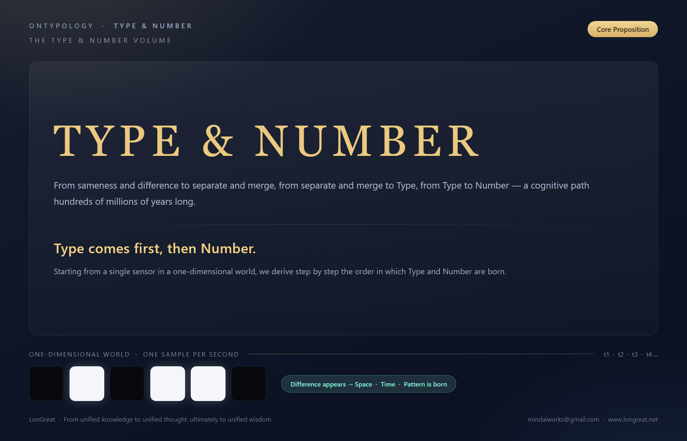

Why Does Type Come Before Number?

── From Sameness/Difference to Taiji, from Gestalt to the Cognitive Chain of Mathematical Symbols ──

❝  Type answers “what is it?”; Number answers “how many?”.  ❞

## TABLE OF CONTENTS

- CHAPTER 1 Introduction: The Light That Came in the Cambrian
- CHAPTER 2 Where Does Type Come From: Sameness/Difference → Separate/Merge → Type → Name
- CHAPTER 3 Thought Experiment: A Single Sensor in a One-Dimensional World
- CHAPTER 4 The Birth of Number: Merge First, Then Count
- CHAPTER 5 Superposition of Type: Type and Sub-Type
- CHAPTER 6 Case Study: The Unwritten Steps Behind 3 + 2 = 5
- CHAPTER 7 Conclusion: Type Comes First, Then Number
- APPENDIX Quick Reference Table of Concepts

> GUIDE  · WHAT THIS CHAPTER IS ABOUT
> This chapter answers a question that seems simple but is in fact extremely fundamental: which comes first, “Type” or “Number”? Starting from a single sensor in a one-dimensional world, we derive step by step two core propositions—“Where there is merge, there is Type” and “Number = comparing the counts of the small Types within a Type”—and finally arrive at the conclusion of the entire chapter: Type comes first, then Number. The brain has walked this path for hundreds of millions of years; to see it clearly is the path Ontypology must walk.

## CHAPTER 1 Introduction: The Light That Came in the Cambrian

### Where Does Type Come From?

Type—the “thing” we can recognize—does not exist by nature. Its birth follows a fixed sequence: the feeling of “sameness/difference” comes first, which gives rise to the acts of “separation” and “merging”; only then is “Type” born, and Type must have a Name.

In plain language, the brain must first sense that “this is different from that” or “this is the same as that”; only then does it circle the parts that are the same (merge) and cut apart the parts that are different (separate). The boundary drawn by this “circling/cutting” is what we call “Type.”

Imagine a world in which only two kinds of things exist: the brain does not actually need to name them; it only needs to know that “there is something” and “there is nothing (or another, different thing)” are not the same—this is the most primitive “difference.” Push this scenario to the extreme: an observer confronted with nothing but uniform blackness, unable to distinguish anything (for example, someone who cannot perceive color at all), would remain forever in a formless state because there is no “difference” with which the brain can draw a boundary.

From this we can distill the most fundamental cognitive chain:

Sameness/Difference → the brain draws a boundary (merge) → two Types are produced → they are named “Being” and “Non-being” (or think of them as X and Y, black and white)

This chain in fact echoes the Daoist saying “Wuji gives birth to Taiji”: before anything has differentiated, there is “Wuji”; once the most basic polarity of “being/non-being” or “black/white” emerges, “Taiji” (the primordial Type) is born.

From the perspective of cognitive science, this chain corresponds to the “Figure–Ground” principle in Gestalt psychology: the human visual system is innately disposed to divide perceived information into “foreground” (figure) and “background” (ground), and this act of “separating” is the most primitive starting point of the “sameness/difference → separate/merge → Type” chain. When the background is uniform and the foreground stands out, the brain can easily draw a boundary; conversely, when everything before the eyes is homogeneous (for example, all black), the brain has nothing with which to draw a boundary, and “Type” cannot be born.

Moreover, research in developmental psychology also indicates that infants can distinguish “familiar” from “unfamiliar” faces within weeks of birth, which shows that “sameness/difference detection” is innate and requires no learning; but to single out “Mom’s face” from all faces and give it a stable identity (a name) requires time and accumulated experience. This exactly echoes the thesis of this chapter: sameness/difference is innate, separate/merge happens naturally, but the birth of “Type” requires a boundary to be drawn, and drawing that boundary requires sufficient difference in stimulation.

### 1-1 The Cambrian Explosion of Numbers

Fei-Fei Li once told a story: in the distant Cambrian, the world was pitch-black and nothing could be seen. Then a trilobite, for the first time, perceived light. After perceiving light, it developed a nervous system; with a nervous system came “understanding and thought,” and finally execution. This is the law of biological development.

The key to this story is not light but “difference.” In a pitch-black world there is no difference at all, and nothing happens; light is the first difference to be detected—the difference between bright and dark. With difference, the nervous system has something to transmit; with transmission, understanding becomes possible; with understanding, action becomes possible.

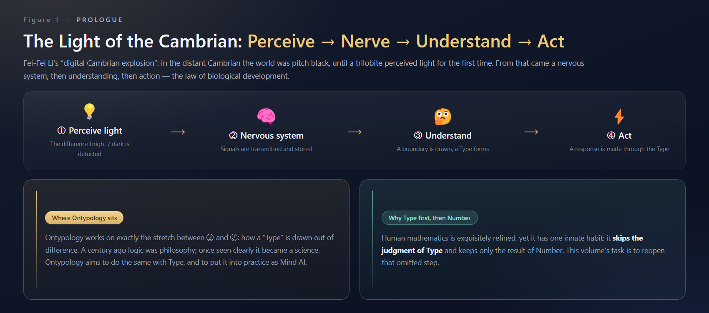

*Figure 1-1 The Cambrian cognitive chain: Perception → Nervous system → Understanding → Action*

### 1-2 A Path Omitted by Mathematics

A century ago, logic was philosophy; once people saw it clearly, it became a science. Today, our exploration of “Type”—concepts in the brain—still belongs to the realm of philosophy; what Ontypology aims to do is to see “Type” clearly, turn it into a science, and put it into practice as Mind AI.

Why start with “Type and Number”? Because human mathematics, however refined, has an innate habit: it skips the judgment of “Type” and keeps only the result of “Number.” The validity of every equation actually depends on a step that is never written out. The task of this chapter is to lay that omitted step bare in the sunlight.

> Core Propositions of This Chapter (two sentences that run through the whole chapter)
> 1. Where there is merge, there is Type: circling originally independent things into the same whole—this act itself produces a new, higher-level Type.
> 2. Number = the small Types within a Type · count comparison: under the same Type, count how many times its Sub-Types appear—Number always attaches to a Type that has already been recognized.

## CHAPTER 2 Where Does Type Come From: Sameness/Difference → Separate/Merge → Type → Name

### 2-1 Type Is Not Innate

Type—the “thing” we can recognize—does not exist by nature. Its birth follows a fixed sequence: the feeling of “sameness/difference” comes first, which gives rise to the acts of “separation” and “merging”; only then is “Type” born, and Type must have a Name.

In plain language: the brain must first sense that “this is different from that” or “this is the same as that”; only then does it circle the parts that are the same (merge) and cut apart the parts that are different (separate). The boundary drawn by this “circling/cutting” is what we call “Type.”

Imagine a world in which only two kinds of things exist: the brain does not actually need to name them; it only needs to know that “there is something” and “there is nothing (or another, different thing)” are not the same—this is the most primitive “difference.” Push this scenario to the extreme—an observer confronted with nothing but uniform blackness, unable to distinguish anything (for example, someone who cannot perceive color at all), would remain forever in a formless state because there is no “difference” with which the brain can draw a boundary.

From this we can distill the most fundamental cognitive chain:

> Cognitive Chain
> Sameness/Difference → the brain draws a boundary (merge) → two Types are produced → they are named “Being” and “Non-being” (or think of them as X and Y, black and white)

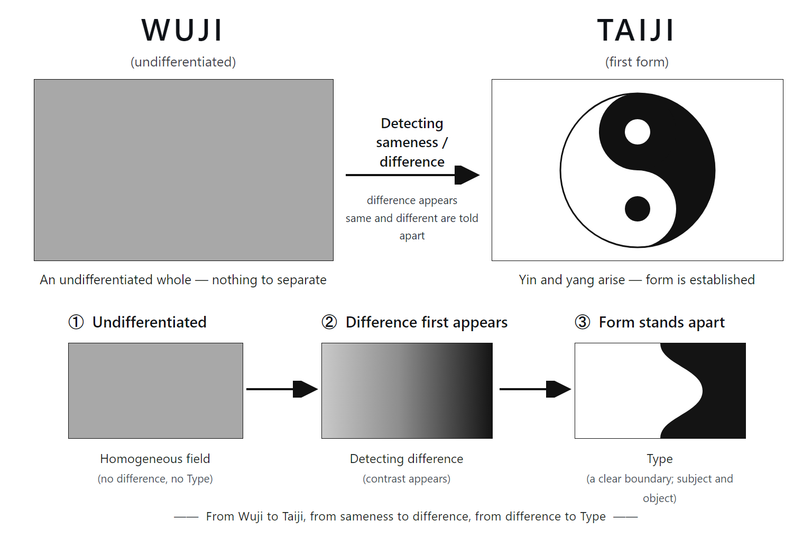

This chain in fact echoes the Daoist saying “Wuji gives birth to Taiji”: before anything has differentiated, there is “Wuji”; once the most basic polarity of “being/non-being” or “black/white” emerges, “Taiji” (the primordial Type) is born.

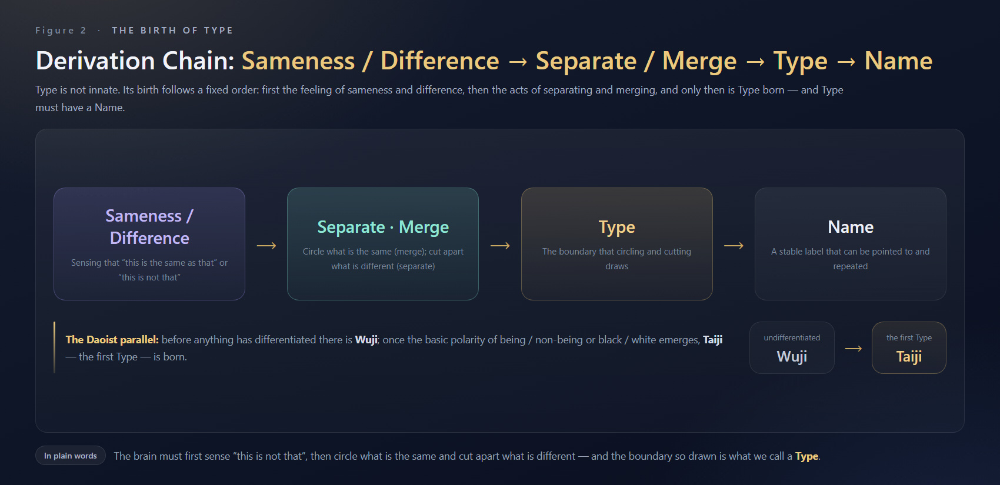

*Figure 2-1 The derivation chain Sameness/Difference → Separate/Merge → Type → Name, and its correspondence with “Wuji gives birth to Taiji”*

### 2-2 Evidence from Cognitive Science: the Gestalt “Figure–Ground” Principle

From the perspective of cognitive science, this chain corresponds to the “Figure–Ground” principle in Gestalt psychology: the human visual system is innately disposed to divide perceived information into “foreground” (figure) and “background” (ground), and this act of “separating” is the most primitive starting point of the “sameness/difference → separate/merge → Type” chain. When the background is uniform and the foreground stands out, the brain can easily draw a boundary; conversely, when everything before the eyes is homogeneous (for example, all black), the brain has nothing with which to draw a boundary, and “Type” cannot be born.

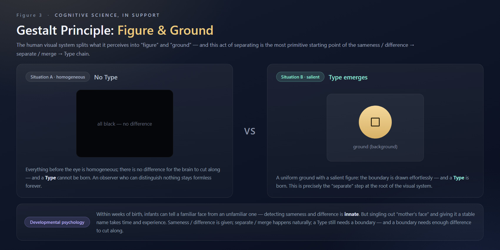

*Figure 2-2 The Gestalt “Figure–Ground” principle: homogeneous, no Type; salient, Type emerges—with evidence from developmental psychology*

Moreover, research in developmental psychology also indicates that infants can distinguish “familiar” from “unfamiliar” faces within weeks of birth, which shows that “sameness/difference detection” is innate and requires no learning; but to single out “Mom’s face” from all faces and give it a stable identity (a name) requires time and accumulated experience. This exactly echoes the thesis of this chapter: sameness/difference is innate, separate/merge happens naturally, but the birth of “Type” requires a boundary to be drawn, and drawing that boundary requires sufficient difference in stimulation.

## CHAPTER 3 Thought Experiment: A Single Sensor in a One-Dimensional World

### 3-1 Experimental Setup

Suppose a one-dimensional world containing only a single sensor—it senses color once per second and has no other function. The entire history of this universe is the sensor’s record, frame by frame. In this most minimal world, we will watch how “Type” and “Number” are born, one after the other.

### 3-2 Scenario A: Always the Same Color

If the sensor senses the same color every second (for example, always black), then every result it sees is identical and equally long. In this case there is neither space nor time—because no “difference” can be detected; everything is merely the repetition of the same event. The world is, as it were, frozen in a single frame.

### 3-3 Scenario B: Colors Begin to Alternate

When “difference” appears (here, difference means a difference the senses can detect), the situation is entirely different. Suppose the sensor sees black this second, white the next, then black again, and so on—space and time appear at the same moment.

One insight worth noting: time is in fact derived from change in space; the concept of “time” arises only because there are successive, differing states. At the same time, because the states begin to alternate regularly, Pattern (regularity/mode) is also produced.

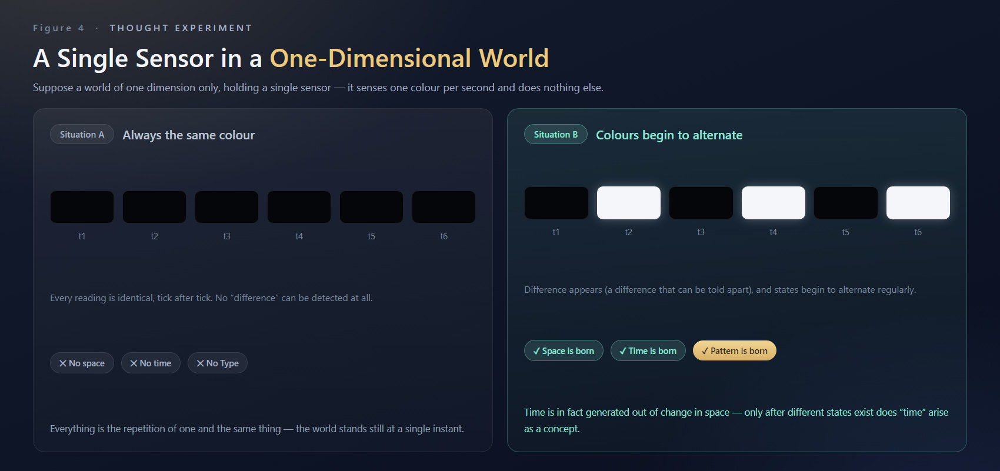

*Figure 3-1 The one-dimensional sensor thought experiment: without difference, no space-time; with difference, space-time and Pattern are born together*

### 3-4 The First “Type” Is a Boolean Value

Black and white are two different states. When the sensor can distinguish “this is black” from “this is not black (it is white),” this judgment of “same/different” is itself the production of the first “Type.”

The Type here is essentially a Boolean value (bool)—“present” or “absent,” “is” or “is not,” “different” or “same.” It is the most primordial act of recognition and does not yet involve “quantity” or “how many.”

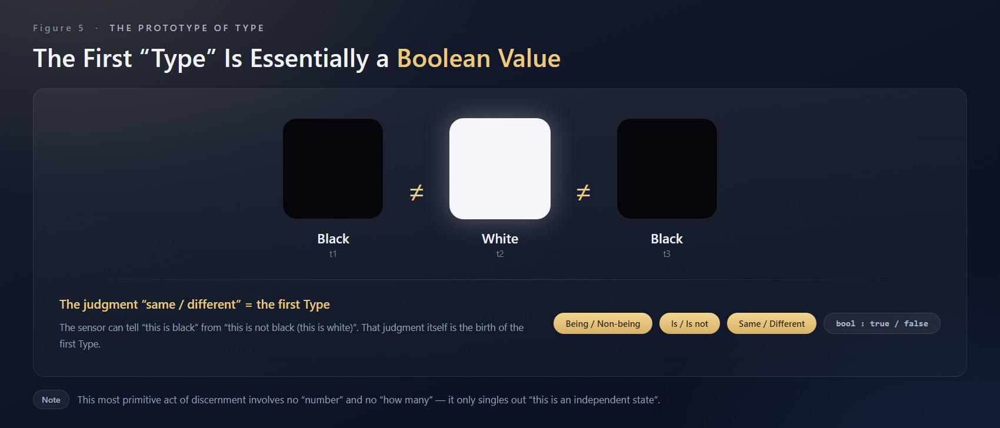

*Figure 3-2 Black ≠ white ≠ black: the first “Type” = a judgment of sameness/difference = a Boolean value*

## CHAPTER 4 The Birth of Number: Merge First, Then Count

### 4-1 Once and Twice

Number begins to appear when the alternation of black and white becomes more complex. For example: this second is black, the next is white, and the next is white again—white appears twice in succession. The sensor then notices that black appeared for a shorter time and white for a longer time. In other words, black appeared only once, while white appeared twice.

This distinction between “once” and “twice” is the birth of the first “Number,” and with it comes a new Pattern.

### 4-2 What “Merge” Quietly Does Behind the Scenes

To count “white appears twice,” the premise is that these two occurrences of white must first be judged to be “the same kind of thing”—that is, a “merge” must first take place, circling two independent moments into “two instances of the same Type,” so that they can be treated as one unit and counted together. If every white perceived were treated as a completely different, independent thing, there would be only “difference,” no “sameness,” and counting would be impossible.

In other words, Number is not merely the act of “counting occurrences”; it also presupposes the judgment of “which things may be regarded as the same unit.” And this judgment is precisely what “merge” quietly does behind the scenes.

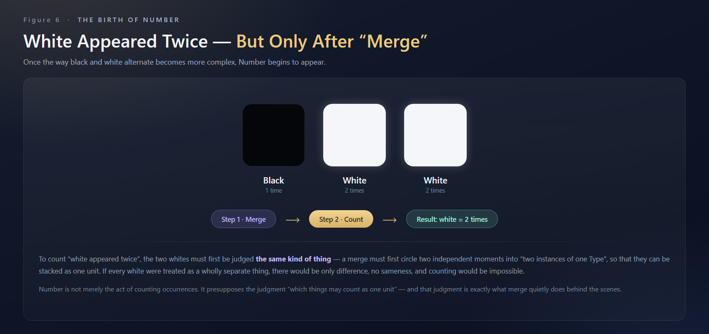

*Figure 4-1 The birth of Number: first “merge” into the same unit, then count “white = 2 times”*

### 4-3 The Key Difference Between Type and Number

The dividing line between Type and Number emerges here:

- Type answers “what it is / what it is not” (recognition of sameness/difference). Without Type, one cannot recognize “this is an independent state.” It is the more primordial, more fundamental cognitive act—Type can exist without Number.
- Number answers “how many / how many times” (a further measurement built upon Type). Only on the basis of already being able to recognize Type does Number go on to count “how many times such a Type has appeared”—Number cannot exist apart from Type.

|  | Type | Number |
| --- | --- | --- |
| Question Answered | What it is / what it is not | How many / how many times |
| Cognitive Act | Recognition of sameness/difference (drawing a boundary) | Measuring an already-recognized Type |
| Condition of Existence | Can exist without Number | Cannot exist apart from Type |

Suppose “black” is defined as A, “black-white” as B, and “white” as C. Among A, B, and C, one can judge through “sameness/difference” that they are different Types—this is the level of Type. But when we go further and ask “how many times did A appear?” or “which appeared more often, B or C?” we cross from “the recognition of Type” into “the measurement of Number.”

This shows one thing: Number cannot exist apart from Type, but Type can exist without Number. Type is the more primordial, more fundamental cognitive act; Number is the next layer of abstraction built upon Type—the result of “measuring a Type that has already been recognized.”

## CHAPTER 5 Superposition of Type: Type and Sub-Type

### 5-1 Separation and Merge of Inner and Outer: the Most Basic Type

Start with the most basic state: a circle. With its inside and outside separated, this circle is a basic Type—it exists, it has a boundary, and it can be recognized as “one thing (a unity).”

Next, place several such circles together and merge them into a group. This act of “merging” itself produces something new: these originally independent circles are now seen as one whole. That is, we no longer see only “three separate circles,” but “one larger Type containing three circles.”

Where there is merge, there is Type. This “larger Type” did not exist beforehand; it is produced by the act of “merging.” Before the merge, there were only three independent basic Types; after the merge, there is one more Type—new and higher—one that expresses the very fact that “these things belong to the same group.”

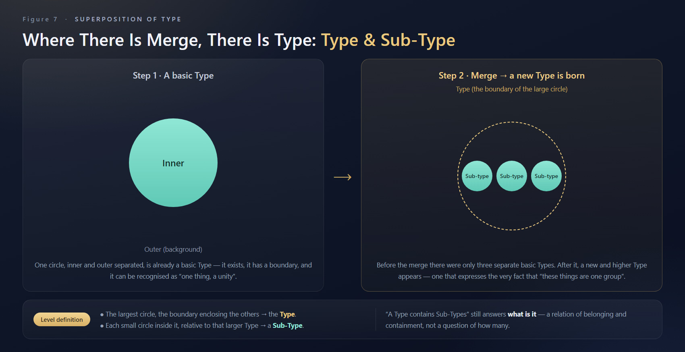

*Figure 5-1 From basic Type to Type and Sub-Type: the act of merging produces a new, higher-level Type*

Once this new, larger Type appears, two levels can be distinguished:

- The largest circle—the boundary that encloses the other circles—is called the “Type.”
- Each small circle contained within it is, relative to this larger Type, called a “Sub-Type.”

“A Type contains Sub-Types” still answers “what is it?”—it is a relation of belonging and containment (the Sub-Type belongs to this Type), not a question of “how many.”

### 5-2 Plain-Language Definitions of Separate, Merge, and Type

- Separate: seeing where these things “differ from one another.”
- Merge: finding, among these different things, the parts that “can actually be counted as the same kind.”
- Type: the boundary drawn by separate/merge; the “thing” we can ultimately recognize and name.

### 5-3 Infinite Superposition: Number Is Asked Again at Every Level

The brain’s way of classifying gradually refines from “the whole” to “features.” When there are only two things at first, no counting is needed; but when a second thing appears, the concept of “Number” is born, because now it becomes necessary to distinguish “this one,” “that one,” and “one more.”

This structure can in fact be nested infinitely: beneath one Sub-Type, even smaller sub-sub-Types can be contained. That is, the superposition of Type is a process in which Type itself continuously extends and grows new layers—and this entire process still belongs to the domain of Type.

But whenever we pause at any layer and ask “how many are beneath this layer,” Number is produced anew at that layer. In other words:

- The superposition of Type is a structural extension;
- The production of Number is the result of counting, at a given structural layer, the Sub-Types beneath it.

Number does not appear out of nowhere; it always attaches to a Type that has already been recognized at some layer. Unless each Sub-Type has first been distinguished one by one, the question “how many” cannot even be asked.

What the two scenarios have in common is this: recognition always precedes counting—

- Black-white alternation: first distinguish black from white (Type), then count “how many times black appeared, how many times white appeared” (Number).
- Type and Sub-Type: first distinguish “which small circles belong to this larger Type” (Type), then count “how many Sub-Types are beneath this larger Type” (Number).

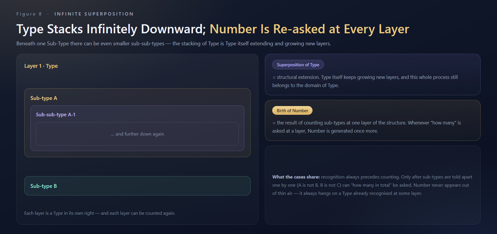

*Figure 5-2 The infinite superposition of Type: superposition is structural extension; Number is asked again at every layer*

## CHAPTER 6 Case Study: The Unwritten Steps Behind 3 + 2 = 5

### 6-1 A Primary-School Problem

There are three apples, two potatoes, and two peaches. How many fruits are there in total? Most people give only one equation: 3 + 2 = 5.

But for this equation to hold, a step that is never written out must already have taken place: the brain must first judge that both “apples” and “peaches” belong to the higher-level category “fruit,” so that the two can be regarded as the same unit and put into the same addition equation.

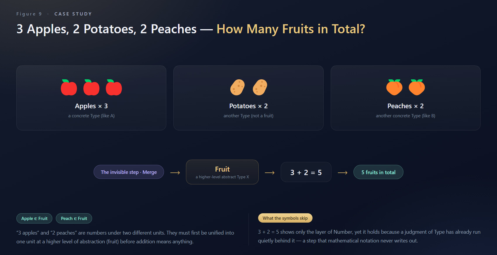

*Figure 6-1 The invisible premise of 3 + 2 = 5: apple ∈ fruit, peach ∈ fruit*

### 6-2 What Mathematical Language Skips

An apple is a concrete Type (like A), a peach is another concrete Type (like B), and “fruit” is the abstract Type (X) that circles A and B and gives them a common name. Without first completing the belonging judgment “apple ∈ fruit” and “peach ∈ fruit,” 3 and 2 simply cannot be added—because “3 apples” and “2 peaches” are originally numbers under two different units; they must first be unified into the same unit at a higher level of abstraction (fruit) for the addition to mean anything.

In other words, the equation 3 + 2 = 5 presents only the level of “Number” on its surface, yet it holds because a judgment of “Type” has already quietly run its course behind the scenes (apples and peaches → merged into fruit)—except that this process is never written in mathematical symbols. Mathematical language skips “Type” entirely and keeps only the result of “Number.”

> Key Sentence
> Whether two quantities can be added depends on whether a Type can first be found that merges them into the same unit—this step is precisely what mathematical symbols never write out.

## CHAPTER 7 Conclusion: Type Comes First, Then Number

Gathering the whole chapter’s derivation into a single sentence:

Type comes first, then Number.

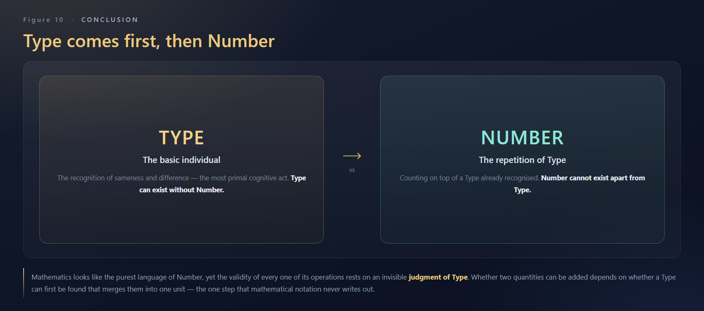

*Figure 7-1 Conclusion: Type is the basic individual; Number is the repetition of Type; Type comes first, then Number*

### 7-1 Implications for Mind AI

This chain of derivation has a direct implication for artificial intelligence: a system that only processes “Number”—whether a statistical model or a vector space—if it has not first recognized “Type” (entities, boundaries, relations of belonging), all its computations are rootless. True understanding must first complete the stretch “sameness/difference → separate/merge → Type”: cutting the world into identifiable, nameable, attributable units, and only then carrying out measurement and reasoning upon those units.

From the unification of knowledge, to the unification of thought, and ultimately toward the unification of wisdom. This is the eternal path of AGI pursued by LonGreat—making artificial intelligence not merely a tool, but a truly intelligent living system capable of understanding, reasoning, learning, and creating.

### 7-2 Recap of the Whole Chapter’s Derivation

- Sameness/difference is innate: without difference, there is nothing (an all-black world has no Type).
- Separate and merge happen naturally: circle the same, cut apart the different, and boundaries are drawn accordingly.
- Type = boundary; Type must have a Name: the first Type is a Boolean value (different/same).
- Where there is merge, there is Type: the act of merging itself grows a new, higher-level Type.
- Number = the small Types within a Type · count comparison: Number attaches to a Type already recognized, and is asked again at every layer.
- Mathematics skips “Type”: the validity of 3 + 2 = 5 rests on an invisible judgment of belonging.

> One-Sentence Summary
> Sameness/Difference → Separate/Merge → Type → Name; Type can be superposed infinitely and still be Type; Number is the result of asking “how many” at any layer. Recognition always precedes counting—therefore, Type comes first, then Number.

## APPENDIX Quick Reference Table of Concepts

| Concept | One-Sentence Definition |
| --- | --- |
| Sameness/Difference | Sensing that “this and that are different / the same.” The most primordial, innate spark of cognition. |
| Separate | Seeing where these things “differ from one another”—the act of cutting apart. |
| Merge | Finding, among different things, the parts that “can count as the same kind”—the act of circling. |
| Type | The boundary drawn by separate/merge; the “thing” we can recognize and name. The first Type is a Boolean value. |
| Name | The stable label by which a Type is identified and can be repeatedly referred to. |
| Sub-Type | Each small Type contained within a larger Type; the two are in a relation of belonging and answer “what is it.” |
| Number | Under the same Type, counting how many times its Sub-Types appear—comparing the counts of the small Types within a Type. |
| Pattern | The pattern formed by the regular alternation of states; born together with difference and time. |

www.longreat.net

Chang Changfeng gamma@livemail.tw

Chang Tingying mindaiworks@gmail.com
