# Ontypology

# Space Type

# Mathematical Proof

*A Supplement to Unit Type and Set Logic*

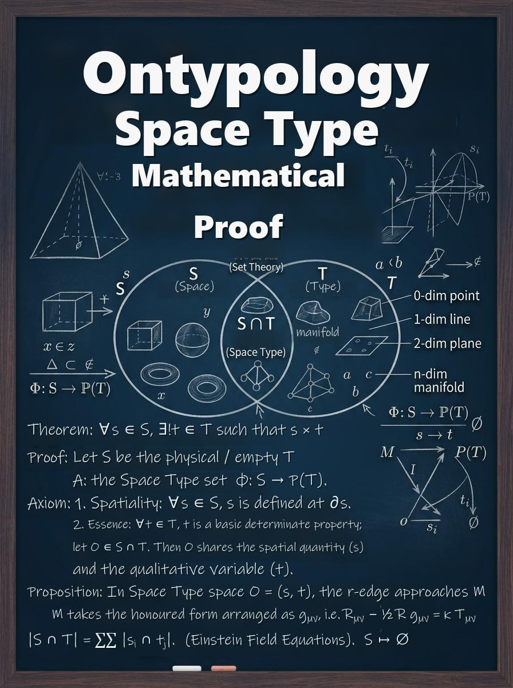

## TABLE OF CONTENTS

- Foreword — The Task of This Supplement
- Introduction — The Two Languages of Proof
- Chapter 1 What Mathematical Proof Does in Set Theory
- 1.1 The Three-Piece Set of Proof: Definition, Criterion, Reasoning
- 1.2 What Pure Set Language Can Do
- 1.3 Three Gaps: Rules, Identity, Structure
- Chapter 2 Supplementing Rules: [ ] Writes a Category as a Rule
- 2.1 Defining a Category: T = (F(T), ∩(T))
- 2.2 The Intersection-Criterion Funnel: From Features to Classification
- 2.3 Borderline Cases: Sharpening the Definition
- 2.4 Worked Proof: Category Membership
- Chapter 3 Supplementing Identity: ( ) Writes Invariance as an Axiom
- 3.1 The Container C = (id(C), S(C)) and the Invariance Axiom
- 3.2 “Invariants” in Proof
- 3.3 The Five Steps of an Invariant
- 3.4 Worked Proof: Replacement and Sameness
- Chapter 4 Supplementing Structure: { } Writes Dependence as a Criterion
- 4.1 The BOM Criterion: Does It Still Recognize Itself When Detached?
- 4.2 The remove Criterion: Three-Level Classification
- 4.3 Worked Proof: Grading the Parts
- Chapter 5 How to Use It Precisely: Putting the Three Supplements Back into a Proof
- 5.1 The Six Steps of Proof
- 5.2 A Complete Introductory Example: A Small Theorem
- 5.3 Misuse Contrast: Five Common Errors
- 5.4 Pre-Submission Checklist
- Review — Key Points and Self-Check
- R-1 Three Supplements, Three Gaps
- R-2 Three-Piece Proof, One Through-Line
- R-3 Precision Is Checkable Precision
- Appendix Glossary and Notation at a Glance

## Foreword — The Task of This Supplement

This little book is a supplement to Unit Type and Set Logic. The original book set up the three axes that describe a Type — property, bill of materials, and spatial container — and used three kinds of brackets to write a Type down completely. But there is still one step between “being able to read the notation” and “being able to write a proof”: when you want to write a proof in mathematical language, with set-theoretic notation, how should this toolkit be used so that it is precise? This book supplies exactly that step.

Concretely, the book does three things. First, it looks closely at the site of mathematical proof within set theory: what makes a proof stand? Where does pure set language fall short? Second, it offers three “supplements” — [ ] for rules, ( ) for identity, { } for structure — each with a usage that can be written directly into a proof. Third, it gathers them into a “precise method of use”: six steps, three layers of checking, a contrast of misuses, and a checklist, so that when you finish a proof you can verify it yourself.

> **Two Conventions for Reading This Book**
>
> - Convention One: each of the three brackets has its own duty. Braces { } are the composition set (bill of materials); square brackets [ ] are the abstract set (properties); parentheses ( ) are the container set (spatial container).
> - Convention Two: the book keeps the cup from the original. The cup is both an everyday object and the most faithful specimen for practicing proof.

| **Gap in proof** | **Supplement** | **Criterion used** | **Chapter** |
| --- | --- | --- | --- |
| Rules omitted — the category is written as a fixed list | [ ] Abstract Set | T = (F(T), ∩(T)) | Ch. 2 |
| Identity omitted — the whole falls apart when contents change | ( ) Container Set | C = (id(C), S(C)); Invariance Axiom | Ch. 3 |
| Structure omitted — parts are merely juxtaposed | { } Composition Set | BOM criterion; three levels of remove | Ch. 4 |
| All three converge — put back into one proof | Six steps + three-layer check | ∩(T) · id(C) · remove combined | Ch. 5 |

*Table 0-1 The supplement map: three gaps in proof and three supplements*

> *A proof is precise because every layer of information is written where it belongs.*

## Introduction — The Two Languages of Proof

Mathematical proofs are almost always written in the language of set theory. The strength of pure set language is its extreme economy: it answers only “belongs or not”, x ∈ S or x ∉ S, a clean yes or no. Precisely because it assumes the least, it also omits the most — the three layers of identity, structure, and rules are all flattened in a list such as “{ handle, base, lid, body, coffee, white }”.

Type Set language takes pure sets as its core and adds three value-adds: { } restores the composition structure of parts, ( ) restores an identity that does not change with contents, and [ ] restores a generation rule that can automatically judge new members. The two languages do not replace each other; they stack — the skeleton of a proof is written in pure sets, and the completeness of the proof depends on the three supplements.

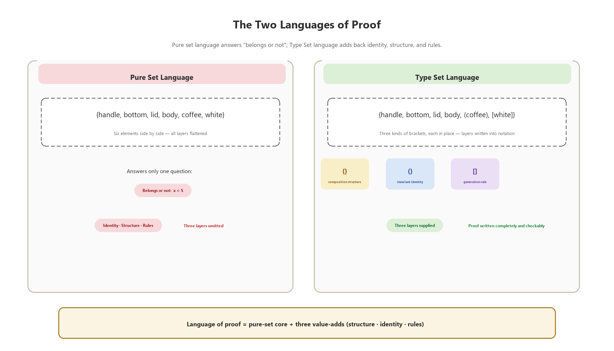

*Figure D-1 The two languages of proof: a pure-set core with three value-adds*

| **Set kind** | **Brackets** | **Example** | **Role in proof** | **Chapter** |
| --- | --- | --- | --- | --- |
| Abstract Set | [ ] | [ white, black, yellow ] | Write the category rule and verify it item by item | Ch. 2 |
| Composition Set | { } | { handle, base, lid, body } | Write the part structure and dependencies | Ch. 4 |
| Container Set | ( ) | ( water, coffee ) | Write the invariant identity | Ch. 3 |

*Table D-1 The three brackets at a glance*

> **One sentence, three layers**
>
> - “There is water in the cup” should be split into three layers in a proof: the set relation (water ∈ S(C)), identity constancy (id(C) unchanged), and replaceability of contents (e1 replaced by e2).
> - Pure sets record only the first layer; the three supplements restore the other two, and only then is the proof complete.

## Chapter 1 What Mathematical Proof Does in Set Theory

*Chapter image · The Gate of Proof — definition, criterion, reasoning*

Before writing a proof, get clear about what a proof itself stands on. This chapter takes apart the three-piece set of proof, sees what pure set language can do, and where it leaves three gaps — and wherever there is a gap, that is where a supplement goes.

### 1.1 The Three-Piece Set of Proof: Definition, Criterion, Reasoning

Any mathematical proof, opened up, is a combination of three things. Definition: first say clearly who the object under discussion is — what the category “cup” includes and what it excludes. Criterion: give a standard that can be verified item by item — what counts as “belonging”, what counts as “still the same one”. Reasoning: start from the known definitions and criteria and move step by step toward the conclusion, with every step open to inspection.

None of the three can be missing. Without definition, a proof has no object; without criterion, a proof can only rely on feeling; without reasoning, there is only a conclusion and no process. Set theory became the common language of mathematical proof precisely because it writes “definition” and “criterion” with exceptional precision.

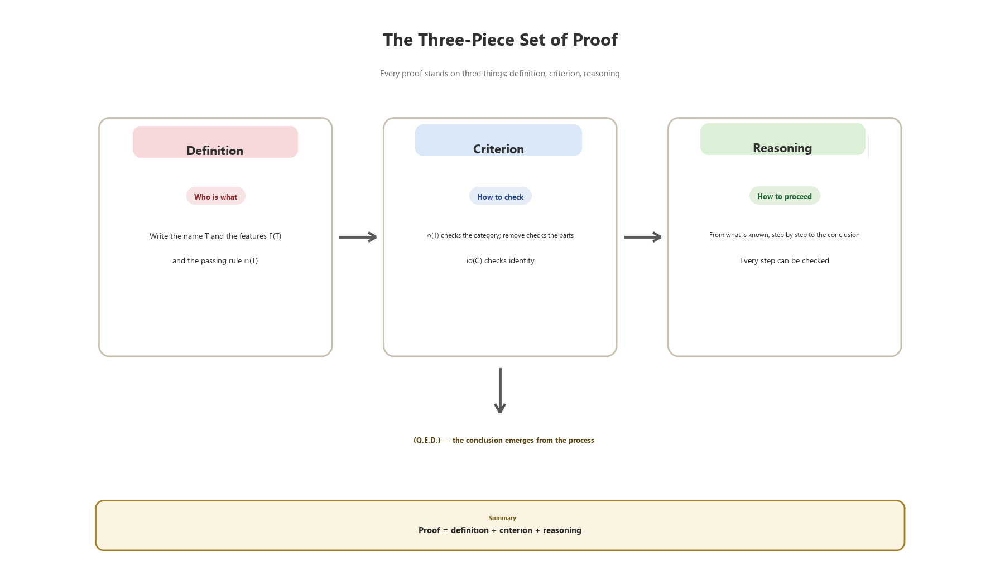

*Figure 1-1 The three-piece set of proof: definition, criterion, reasoning*

But precision has a price. Pure set language takes “belongs or not” to its limit, and the rest of the information can only be omitted. To see clearly what is omitted, first look at what it can do.

### 1.2 What Pure Set Language Can Do

The core notation of pure set language is the braces { } and the membership sign ∈. “Water ∈ S” says “water belongs to set S”; “A ⊆ B” says every element of A belongs to B. This language can state membership, subsethood, intersection, and union precisely — the skeleton of most mathematical proofs can be built from these few signs.

| **Notation** | **Reading** | **Use in proof** |
| --- | --- | --- |
| { a, b, c } | Set, members listed | State the scope of the object |
| x ∈ S / x ∉ S | belongs / does not belong | State membership |
| A ⊆ B | subset | State inclusion |
| A ∩ B / A ∪ B | intersection / union | Combine conditions |

*Table 1-1 Pure set notation and what it can do in a proof*

For mathematical proof this is already enough — provided you only need to answer “belongs or not”. Once a proof needs to ask “what is it made of”, “is it still the same after the contents change”, or “does the new object count as a member”, pure sets begin to omit.

### 1.3 Three Gaps: Rules, Identity, Structure

Reference document 4.1 points out that mathematical sets omit the information that three layers of everyday language naturally carry. In a proof, these become three concrete gaps.

Gap one, rules. { mug, glass, paper cup } is a hard-coded list — does a newly appearing thermos count as a “cup”? The list cannot answer. Wherever a proof needs to “judge a new member”, it needs an open generation rule.

Gap two, identity. { water } with the water removed and replaced by { coffee } is already another set. But when we say in daily life “the cup now holds coffee”, the cup is still the same cup. Wherever a proof needs “sameness through change”, it needs an identity that does not change with contents.

Gap three, structure. { handle, base, lid, body } puts four elements side by side, with no visible dependence. But removing the base and removing the handle have completely different consequences. Wherever a proof needs to “distinguish primary from secondary”, it needs the dependence structure of the parts.

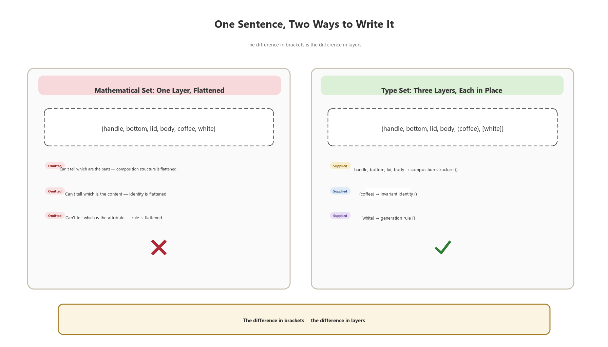

*Figure 1-2 One sentence, two ways of writing it: layers flattened vs. each in its place*

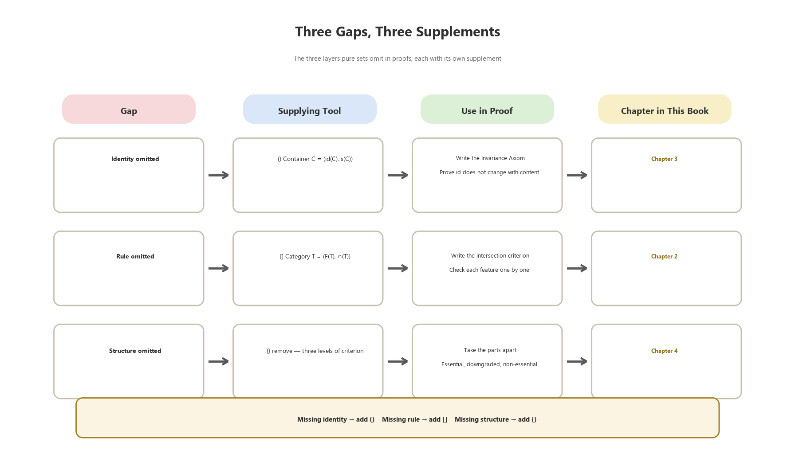

*Figure 1-3 The supplement map: each of the three gaps has its own remedy*

| **Gap** | **Pure-set writing** | **Writing after supplementation** | **Tool** |
| --- | --- | --- | --- |
| Rules | { mug, glass, paper cup } (closed list) | [ x \| x passes ∩(T) ] (open rule) | [ ] |
| Identity | { water } → { coffee } (a different set) | (water) → (coffee), id(C) unchanged | ( ) |
| Structure | { handle, base, lid, body } (juxtaposed) | remove(p,M): three-level classification | { } |

*Table 1-2 Three gaps and three supplements*

> **Chapter Summary**
>
> - The three-piece set of proof: definition (who the object is), criterion (how to verify), reasoning (how to proceed).
> - Pure set language answers “belongs or not” precisely, and omits all three other layers.
> - Three gaps — rules (a hard-coded list), identity (the whole scatters when contents change), and structure (parts merely juxtaposed) — are supplemented by [ ], ( ), and { } respectively.

## Chapter 2 Supplementing Rules: [ ] Writes a Category as a Rule

*Chapter image · The Light of Rules — the funnel of the intersection criterion*

The first gap is rules. This chapter upgrades the category from a “hard-coded list” to an “open rule”: how to write the definition, how to use the intersection criterion, how borderline cases sharpen the definition, and finally a worked proof of “category membership” in full.

### 2.1 Defining a Category: T = (F(T), ∩(T))

Ontypological logic defines an abstract category as an ordered pair: T = ( feature set F(T), intersection criterion ∩(T) ). F(T) lists the features that the category requires; ∩(T) specifies that every feature must pass for membership. For the cup, F(cup) = { can hold liquid, can be held and drunk from }.

The advantage of this writing is that it is “verifiable”. To judge whether a new object x is a [cup], you do not ask intuition; you put x through each item of F(T): if every feature f(x) is true, x ∈ [cup]; if any item is false, x ∉ [cup]. The “membership judgment” in a proof now has a track that can be written step by step.

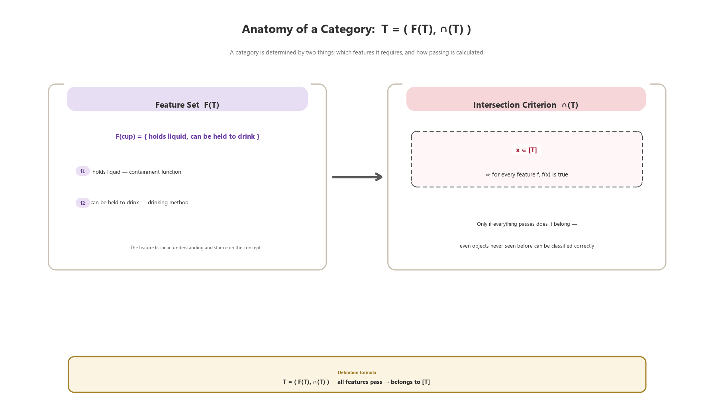

*Figure 2-1 The anatomy of a category: feature set and intersection criterion*

> **Definition (Abstract Category)**
>
> - Abstract category T = ( feature set F(T), intersection criterion ∩(T) ).
> - x ∈ [T] if and only if, for every feature f in F(T), f(x) is true.
> - Openness: membership in T is not determined by enumeration but generated dynamically by ∩(T) — even objects that have not yet appeared can be classified correctly.

### 2.2 The Intersection-Criterion Funnel: From Features to Classification

∩(T) can be imagined as a funnel: the object to be judged enters from above, each feature is a sieve, and only if all pass does it fall through into [T] below. One side of the funnel collects the passers, the other catches the failures — a judgment can always be broken into a series of checkable steps.

| **Step** | **Operation** | **Explanation** |
| --- | --- | --- |
| 1 | Determine the feature set F(T) of category T | e.g. F(cup) = { can hold liquid, can be held and drunk from } |
| 2 | Check each feature of the new object x one by one | f(x) = true / false |
| 3 | Take the intersection | ∩(T)(x) = are all f(x) true? |
| 4a | All pass → x ∈ [T] | Classified automatically; no manual addition |
| 4b | Any failure → x ∉ [T] | Not a member of this category |

*Table 2-1 The four steps of abstract judgment*

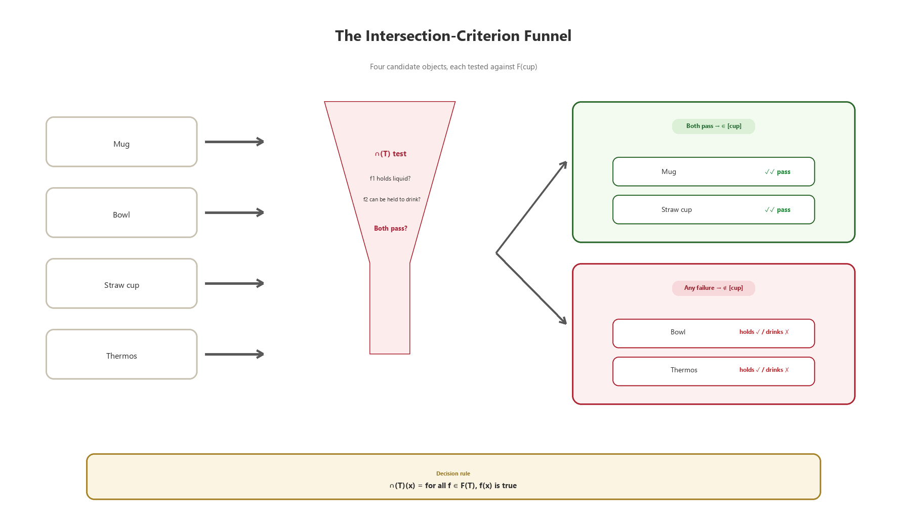

*Figure 2-2 The intersection-criterion funnel: judging four candidate objects*

There is one key to using the funnel in a proof: write “each feature passes” as a small sentence that can be verified independently, then join them with “and” (∧). In this way, a reviewer of your proof can reproduce your judgment simply by ticking each sentence.

### 2.3 Borderline Cases: Sharpening the Definition

Whether a rule is well written is revealed by borderline cases. A bowl can hold liquid but cannot be held and drunk from; a sippy cup passes both; a syringe can hold and can be held, but is not for drinking — whether it counts as a [cup] depends on whether F(T) includes “used for drinking” among its features.

| **Object** | **f1  can hold liquid** | **f2  can be held and drunk from** | **Verdict** |
| --- | --- | --- | --- |
| Bowl | ✓ | × | ∉ [cup] |
| Sippy cup | ✓ | ✓ | ∈ [cup] |
| Syringe | ✓ | ✓ | Depends on whether F(T) includes “used for drinking” |

*Table 2-2 Borderline-case verdict table*

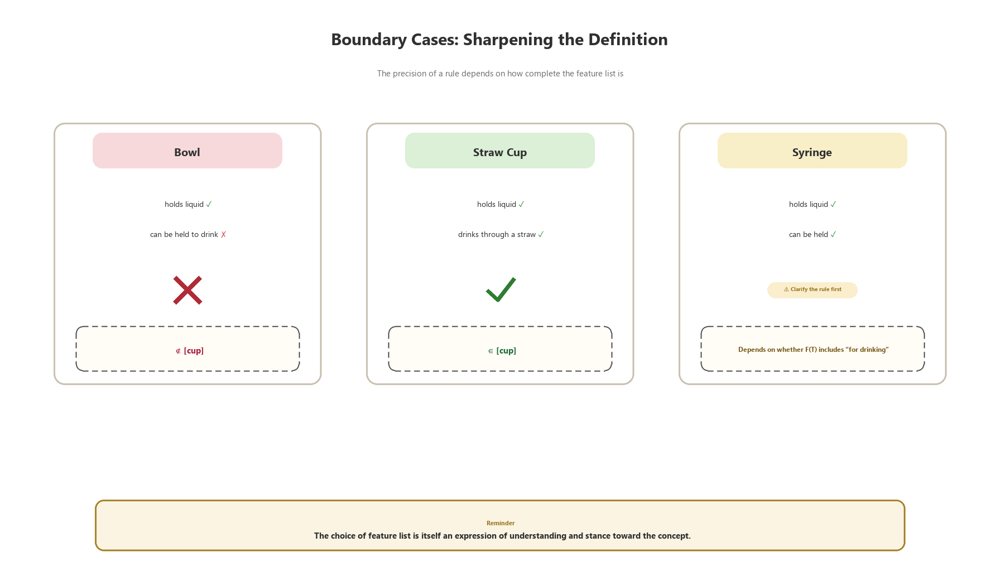

*Figure 2-3 Borderline cases: sharpening the definition*

One thing needs special attention here: the choice of the feature list is itself an expression of one’s understanding and position regarding the concept. When writing a proof, F(T) must be written clearly at the very beginning — not to save effort, but to let the reader know which cup your “cup” is.

### 2.4 Worked Proof: Category Membership

Now put the equipment of 2.1 to 2.3 into a minimal proof.

> **Worked Proof**
>
> **[Theorem]** A sippy cup ∈ [cup].
>
> **[Proof]**
>
> (1) Write the definition: T = cup, F(T) = { can hold liquid, can be held and drunk from }, and ∩(T) as “both features pass”.
>
> (2) Check the sippy cup item by item: f1 — the sippy cup can hold liquid, pass; f2 — it can be held and drunk from through a straw, pass.
>
> (3) By ∩(T), all features are true, hence the sippy cup ∈ [cup]. (Q.E.D.)
>
> **[Contrast]** Bowl: f2 does not pass, so bowl ∉ [cup] — the same rule, the same review.

This proof is small but complete: definition first, criterion in the middle, reasoning last. A larger proof simply does the same thing several times over.

> **Chapter Summary**
>
> - Define a category with an ordered pair: T = (F(T), ∩(T)) — only when all features pass does it enter the category.
> - ∩(T) is a funnel: each feature is a sieve that can be verified independently.
> - Borderline cases sharpen the definition; the choice of F(T) is a position — make it explicit at the start of the proof.

## Chapter 3 Supplementing Identity: ( ) Writes Invariance as an Axiom

*Chapter image · The Ring of Invariance — the container with constant identity*

The second gap is identity. Once the contents change, a pure set falls apart; yet a proof often needs an object that “stays the same through change”. This chapter uses the container ( ) to supply identity, writes “invariance” as an axiom and an invariant, and then gives a worked proof of “replacement”.

### 3.1 The Container C = (id(C), S(C)) and the Invariance Axiom

Ontypological logic writes the container as an ordered pair: C = ( identity marker id(C), inner space S(C) ). id(C) is a marker that does not change when elements in S(C) change; S(C) is a set that can hold elements, whose contents can be replaced or emptied. The Invariance Axiom says: for any e1, e2 in S(C), replacing e1 with e2 does not change id(C).

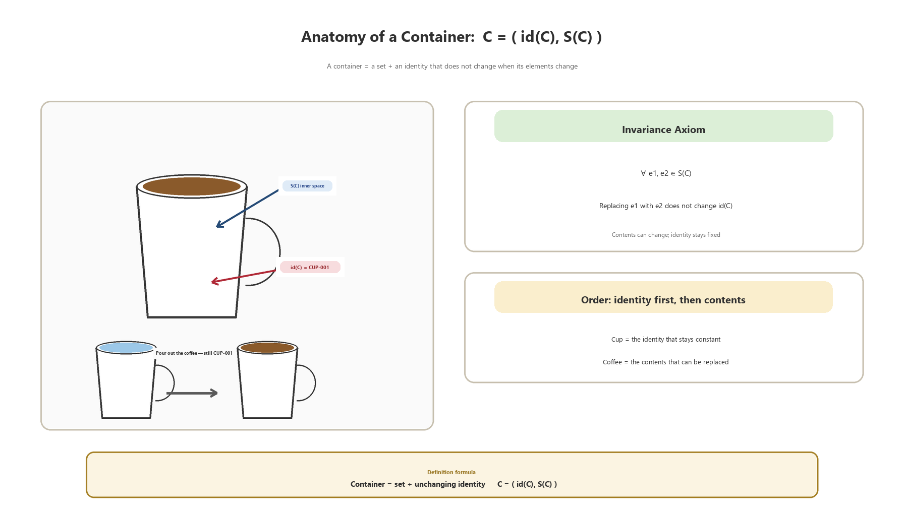

*Figure 3-1 The anatomy of a container: identity marker and inner space*

> **Definition (Container)**
>
> - Container C = ( identity marker id(C), inner space S(C) ).
> - id(C): a marker that does not change when elements of S(C) change.
> - Invariance Axiom: for any e1, e2 ∈ S(C), replacing e1 with e2 does not change id(C).
> - Layers: the container is identity, the contents are elements — establish identity first, then discuss contents.

### 3.2 “Invariants” in Proof

The incarnation of the Invariance Axiom in a proof is called an invariant: a property that remains true under a certain kind of change. The cup changes water for coffee, yet id(CUP-001) does not change — that is the cup’s invariant. Many techniques in mathematical proof are essentially this: first find the invariant, then prove that it still holds after every step of change.

The reverse also holds: when you want to prove that “two things are the same one”, the least effortful path is usually to find the invariant that holds the identity up, rather than comparing contents item by item.

### 3.3 The Five Steps of an Invariant

To write an invariant into a proof, follow five steps every time:

| **Step** | **Operation** | **Cup example** |
| --- | --- | --- |
| 1  Fix identity | Write id(C) | CUP-001 |
| 2  List the variable contents | State which elements in S(C) may change | water, coffee, … |
| 3  Write the invariant | State the property that remains true through the change | id(C) unchanged |
| 4  Check replacement step by step | Verify the invariant after each replacement | water → coffee, id is still CUP-001 |
| 5  Conclude | Close via the Invariance Axiom | The container judgment holds |

*Table 3-1 The five steps of an invariant*

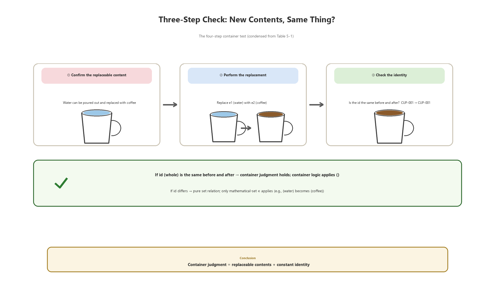

*Figure 3-2 Three-step check: after the contents change, is it still the same one?*

### 3.4 Worked Proof: Replacement and Sameness

> **Worked Proof**
>
> **[Theorem]** Let C be a container, e1, e2 ∈ S(C). After replacing e1 with e2, C is still the same container.
>
> **[Proof]**
>
> (1) Write the structure: C = (id(C), S(C)), where id(C) is the identity marker.
>
> (2) List the change: this change is the replacement e1 → e2 of an element in S(C), and does not touch id(C).
>
> (3) Invoke the Invariance Axiom: for any e1, e2 ∈ S(C), replacing e1 with e2 does not change id(C).
>
> (4) Therefore after the replacement id(C) is still the same — the container is the same container. (Q.E.D.)
>
> **[Contrast]** { water } replaced by { coffee } is another set; (water) replaced by (coffee) is still the same container. The difference is not in the elements but in the identity.

> **Chapter Summary**
>
> - Container C = (id(C), S(C)) — identity is the marker, contents are the elements.
> - Invariance Axiom: contents may be replaced while id(C) stays the same — this is where the “invariant” in proof comes from.
> - The five steps of an invariant: fix identity → list variables → write the invariant → check step by step → conclude.

## Chapter 4 Supplementing Structure: { } Writes Dependence as a Criterion

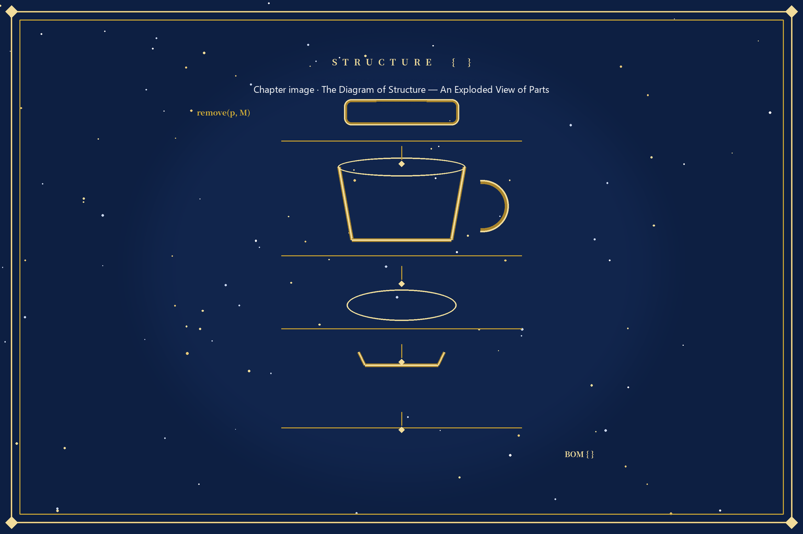

*Chapter image · The Structural Blueprint — an exploded view of the parts*

The third gap is structure. Anyone can list the parts, but a proof needs “dependence”: which part, when missing, makes the whole fail; which part, when missing, only downgrades it; which part, when missing, has no effect. This chapter uses the BOM criterion and the three levels of remove to turn dependence into a criterion that can be reasoned with.

### 4.1 The BOM Criterion: Does It Still Recognize Itself When Detached?

To decide whether a feature belongs in the BOM, there is only one standard: once detached, does it still recognize itself? A lid, detached, is still a lid — it enters the BOM; a color, detached, is nothing — it enters the properties. This boundary separates “composition” from “appearance”: when a proof talks about structure it talks only about the BOM, and when it talks about appearance it talks about properties.

### 4.2 The remove Criterion: Three-Level Classification

After confirming the parts list, grade it with the remove criterion: remove part p from the whole M and look at the result. remove(p,M) ≢ M — identity is lost, so p is an essential part; remove(p,M) ≡ M′ ⊂ M — function is missing but identity remains, so p is a functionally downgraded part; remove(p,M) ≡ M — no effect at all, so p is a non-essential part.

| **Level** | **Result of test** | **Cup example** | **Use in proof** |
| --- | --- | --- | --- |
| Essential part | remove(p,M) ≢ M | base, body | Prove “without it there is no whole” |
| Functionally downgraded part | remove(p,M) ≡ M′ ⊂ M | handle, lid | Prove “function missing, identity retained” |
| Non-essential part | remove(p,M) ≡ M | sticker, decoration | Prove “removal has no effect” |

*Table 4-1 The three-level remove criterion*

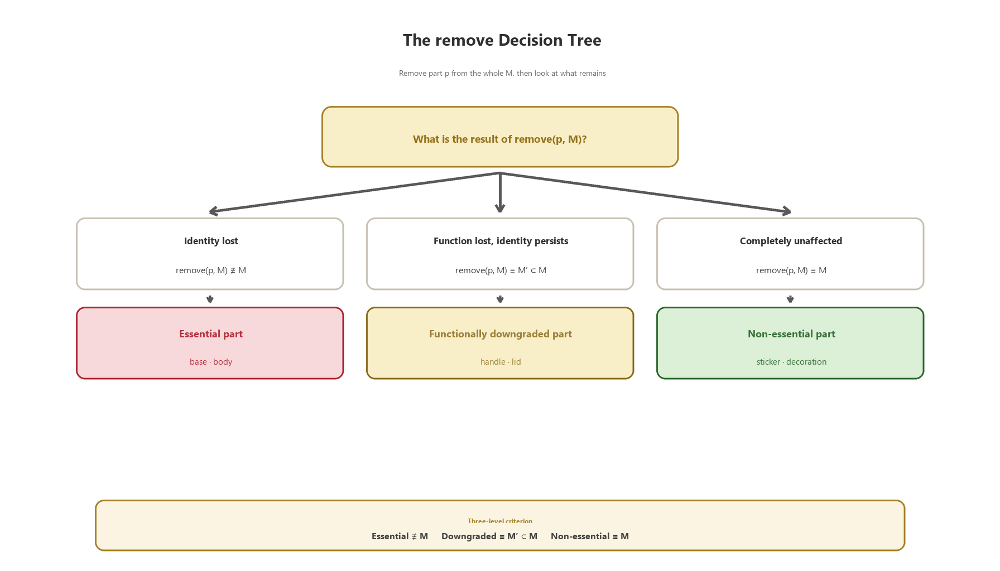

*Figure 4-1 The remove decision tree: the three-level classification process*

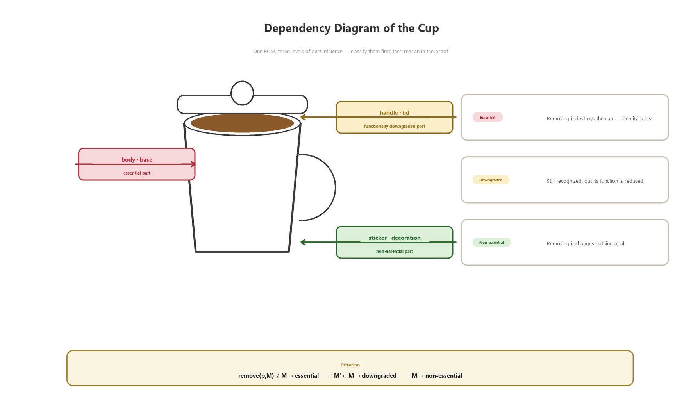

*Figure 4-2 The cup’s dependence graph: three kinds of part influence*

In a proof, the value of the remove criterion is that it translates the vague word “important” into three statements that can each be verified. Compare it with the Invariance Axiom of 3.1: the Invariance Axiom guards the replacement of a container’s contents, while the remove criterion guards the removal of parts from the whole — one inside, one outside, clearly layered.

### 4.3 Worked Proof: Grading the Parts

> **Worked Proof**
>
> **[Theorem]** The base is an essential part of the cup; the handle is a functionally downgraded part of the cup.
>
> **[Proof]**
>
> (1) Fix the whole: M = cup, BOM = { handle, base, lid, body } (all pass the check “does it still recognize itself when detached”).
>
> (2) Consider remove(base, M): after removing the base, the body cannot hold liquid, the identity of “cup” is lost, remove(base,M) ≢ M — the base is an essential part.
>
> (3) Consider remove(handle, M): after removing the handle, the cup can still hold water and is still recognized as a cup, but loses the handheld function, remove(handle,M) ≡ M′ ⊂ M — the handle is a functionally downgraded part. (Q.E.D.)
>
> **[Contrast]** Sticker: remove(sticker, M) ≡ M, so it is a non-essential part — only when each of the three levels is in its place is the structure fully written.

> **Chapter Summary**
>
> - BOM criterion: still recognizes itself when detached → enters the BOM; disappears when detached → enters the properties.
> - Three levels of remove: essential part (≢ M) / functionally downgraded part (≡ M′ ⊂ M) / non-essential part (≡ M).
> - The Invariance Axiom guards “replacement of contents”, the remove criterion guards “removal of parts” — inside and outside are distinct.

## Chapter 5 How to Use It Precisely: Putting the Three Supplements Back into a Proof

*Chapter image · The Six-Step Staircase — toward (Q.E.D.)*

All three supplements are in place. The final chapter puts them back into one workflow: the six steps of proof, a complete introductory example, a contrast of five misuses, and a checklist before handing in a proof.

### 5.1 The Six Steps of Proof

Facing a proposition that is to be written as a proof, follow six steps every time. Step one, identify the whole — first ask “which whole is the object of my proof”; the same physical scene may contain several objects of judgment. Step two, describe by axis — write X properties, Y composition, and Z container once each. Step three, write the Type Set — record the object with { parts, (contents), [category] }. Step four, choose the proposition — is it membership, invariance, or grading that is to be proved? Step five, criterion reasoning — walk through the corresponding criterion (∩(T), the Invariance Axiom, remove) step by step. Step six, three-layer check — after jointly verifying the container, composition, and abstraction layers, close the conclusion.

| **Step** | **Operation** | **Output** | **Usual tool** |
| --- | --- | --- | --- |
| 1  Identify the whole | Name the object of judgment for the proof | One sentence: what M is | — |
| 2  Describe by axis | Describe each of the three axes once | Property table, BOM, container | Three brackets |
| 3  Write the Type Set | Complete notation | { parts, (contents), [category] } | Type Set |
| 4  Choose the proposition | Choose membership / invariance / grading | One theorem sentence | — |
| 5  Criterion reasoning | Reason step by step with the right criterion | Body of the proof | ∩(T), id(C), remove |
| 6  Three-layer check | Joint three-layer check | Conclusion (Q.E.D.) | Three-layer judgment |

*Table 5-1 The six-step proof operation table*

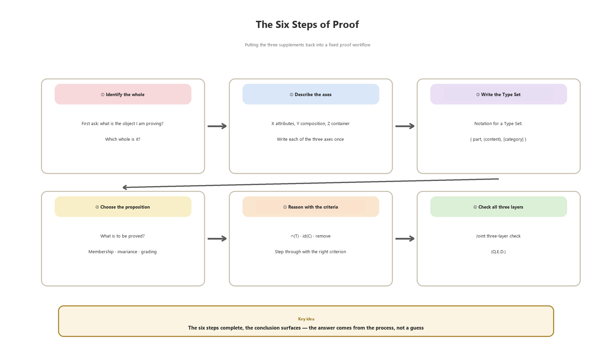

*Figure 5-1 The six steps of proof*

### 5.2 A Complete Introductory Example: A Small Theorem

Use one theorem to walk through all six steps.

> **Worked Proof**
>
> **[Theorem]** A thermos ∈ [cup].
>
> **[Proof]**
>
> (1) Identify the whole: the object of judgment is a thermos, M = thermos.
>
> (2)(3) Describe by axis and write the notation: BOM = { lid, body, base }; S(M) = (hot water); appearance features are checked per F(T).
>
> (4) Choose the proposition: this proof establishes “membership” — whether the thermos ∈ [cup].
>
> (5) Criterion reasoning: F(cup) = { can hold liquid, can be held and drunk from }. f1 passes — the thermos can hold liquid; f2 passes — the body can be held and drunk from at the mouth. By ∩(T), the thermos ∈ [cup].
>
> (6) Three-layer check: container layer ✓ (pour out the water and add tea, id unchanged); composition layer ✓ (lid is a downgraded part, base an essential part — remove grading is clear); abstraction layer ✓ (∩(T) all pass). All three layers pass — the thermos ∈ [cup]. (Q.E.D.)

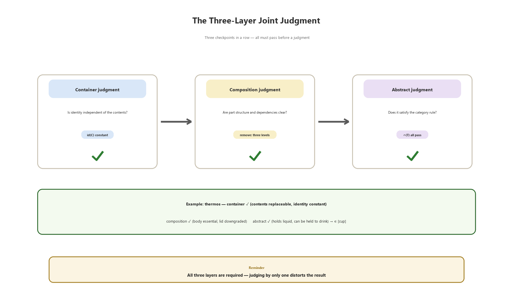

*Figure 5-2 Joint three-layer judgment: three gates in a row*

### 5.3 Misuse Contrast: Five Common Errors

| **#** | **Misuse** | **The problem** | **Correct writing** |
| --- | --- | --- | --- |
| 1 | Using ( ) as an ordinary set | (water) is written as { water }, identity disappears | Use ( ) for contents and label id(C) |
| 2 | Writing [ ] as a closed list | New members cannot be classified | Use the open rule T = (F(T), ∩(T)) |
| 3 | Replacing disassembly with comparison | Properties rely on comparison, the BOM on disassembly — methods are mixed | Ask only “does it still recognize itself when detached?” to decide BOM entry |
| 4 | Calling it something else as soon as the contents change | Confusing the layers of container and contents | Fix identity first, then discuss contents |
| 5 | Concluding after only one layer of judgment | Each of the three layers has blind spots | Conclude only after the joint three-layer judgment |

*Table 5-2 Five common misuses and their correct writing*

The common root of the five misuses is that the “layers” are not written clearly: the layer of brackets, the layer of container and contents, the layer of judgment. When writing a proof, always ask yourself one question — to which layer does this piece of information belong?

### 5.4 Pre-Submission Checklist

| **#** | **Checklist question** | **Pass standard** |
| --- | --- | --- |
| 1 | Is the object identified? | You can say in one sentence “which whole I am proving” |
| 2 | Is F(T) stated? | The category definition is at the start of the proof and its features can be verified item by item |
| 3 | Are the brackets used correctly? | { } parts, ( ) contents, [ ] category — each in its place |
| 4 | Is id(C) marked? | When a container is involved, the identity marker is explicit |
| 5 | Has the remove grading been done? | When discussing part influence, each of the three levels is assigned |
| 6 | Have borderline cases been considered? | At least one borderline case is correctly decided by the rule |
| 7 | Is every step checkable? | A reader can tick each sentence and reproduce the reasoning |
| 8 | Has the joint three-layer check been done? | Write (Q.E.D.) only after the container, composition, and abstraction layers all pass |

*Table 5-3 Checklist: eight questions before submitting a proof*

Only when all eight questions pass is the proof “written precisely”. This checklist is not merely a format — it is the acceptance standard of the three supplements.

> **Chapter Summary**
>
> - Six steps: identify the whole → describe by axis → write the Type Set → choose the proposition → criterion reasoning → three-layer check.
> - The common root of the five misuses: the layers are not written clearly.
> - The eight checklist questions are the acceptance standard of the three supplements.

## Review — Key Points and Self-Check

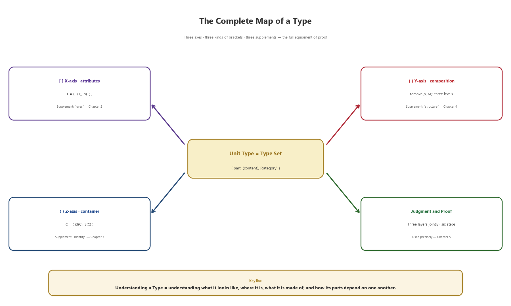

*Figure R-1 Review of key points: the complete map of a Type*

### R-1 Three Supplements, Three Gaps

[ ] replaces the hard-coded list with an open rule — T = (F(T), ∩(T)); ( ) gathers scattered contents under an unchanging identity — C = (id(C), S(C)) and the Invariance Axiom; { } arranges juxtaposed parts into a dependence structure — the three levels of remove. Wherever the gap is, that is where the bracket supplements.

### R-2 Three-Piece Proof, One Through-Line

Definition first, criterion in the middle, reasoning last; the six steps are simply doing the three-piece set on one object in order. Pure set language is the skeleton, the three supplements are the flesh — only used together is a proof complete.

### R-3 Precision Is Checkable Precision

Judgment relies not on intuition but on process: ∩(T) verified item by item, id(C) compared before and after, remove divided into three levels; conclude only after the joint three-layer check. A reader can tick each sentence and reproduce your reasoning — that is what the word “precise” means.

| **Self-check question** | **What you should be able to answer** |
| --- | --- |
| How is a category defined? | Write T = (F(T), ∩(T)) and test it with borderline cases |
| How is identity preserved? | Write id(C) and the Invariance Axiom, and identify the invariant |
| How is structure graded? | Use the remove criterion to divide parts into essential, downgraded, and non-essential |
| How does a proof start? | Walk the six steps once: from identifying the whole to (Q.E.D.) |
| How are misuses avoided? | Check yourself against the five misuses one by one, and write the layers clearly |
| How is precision accepted? | All eight checklist questions pass, and a reader can verify each sentence |

*Table R-1 Self-check list*

> *A proof is precise because every layer of information is written where it belongs.*

## Appendix Glossary and Notation at a Glance

| **Term** | **English / notation** | **One-line definition** |
| --- | --- | --- |
| Type | Type | A fully described object (not Form) |
| Unit Type | Unit Type | The union of three sets: { parts, (contents), [category] } |
| Type Set | Type Set | The complete notation of a Unit Type |
| Property / value | Property / Value | Dimension and scale |
| Abstract category | T = (F(T), ∩(T)) | An open category determined by features and a criterion |
| Feature set | F(T) | The list of features required by the category |
| Intersection criterion | ∩(T) | Membership only if all features pass |
| Container | C = (id(C), S(C)) | A set plus an unchanging identity |
| Identity marker | id(C) | A marker that does not change with contents |
| Inner space | S(C) | A set of elements that can be held and replaced |
| Invariance Axiom | ∀ e1, e2 ∈ S(C) | Replacing contents does not change id(C) |
| Bill of Materials | BOM | The composition list seen through disassembly |
| remove criterion | remove(p,M) | Remove a part and see whether identity survives |
| Three-layer judgment | Container / composition / abstraction | The judgment workflow of the joint three-layer check |

*Table A-1 Glossary at a glance*

| **Notation** | **Reading** | **Usage** |
| --- | --- | --- |
| { } | Braces | Composition Set (parts) |
| ( ) | Parentheses | Container Set (contents) |
| [ ] | Square brackets | Abstract Set (category) |
| ∈ / ∉ | belongs / does not belong | Membership statement |
| ∀ | for all | Universal quantifier |
| ∧ | and | Conditional connective |
| ⇔ | if and only if | Definitional equivalence |
| ≢ / ≡ | not identical / identical | remove-criterion terminology |
| T = (F(T), ∩(T)) | Abstract category | Category definition |
| C = (id(C), S(C)) | Container | Container definition |

*Table A-2 Notation at a glance*

> *Understanding a Type = understanding what it looks like, where it is, what it is made of, and how its parts depend.*

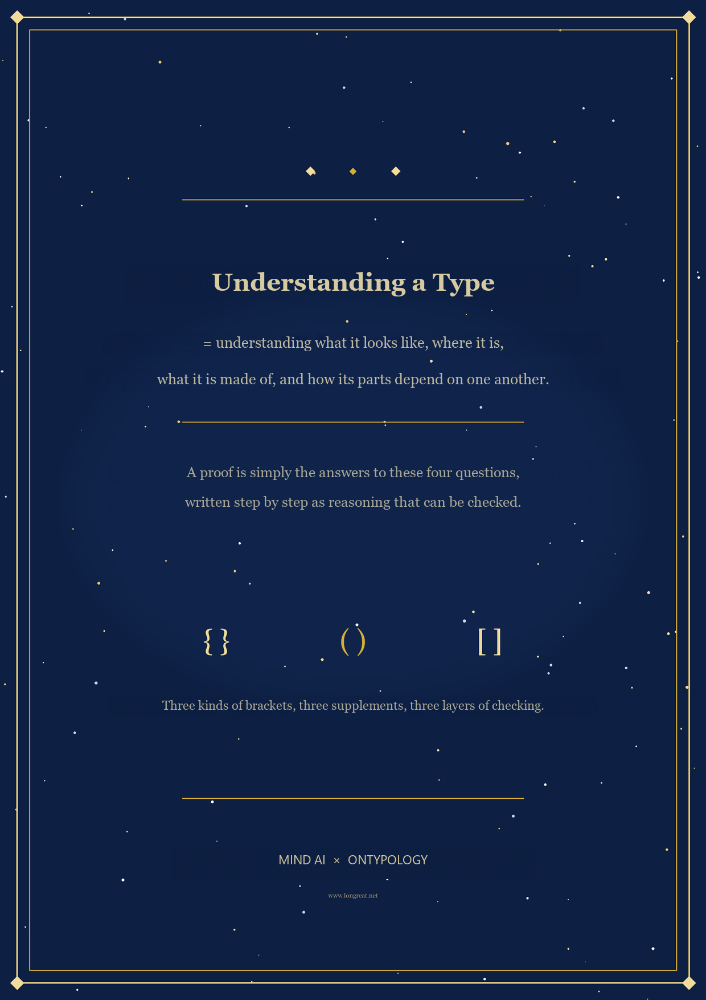
