# AIBioLabBrain

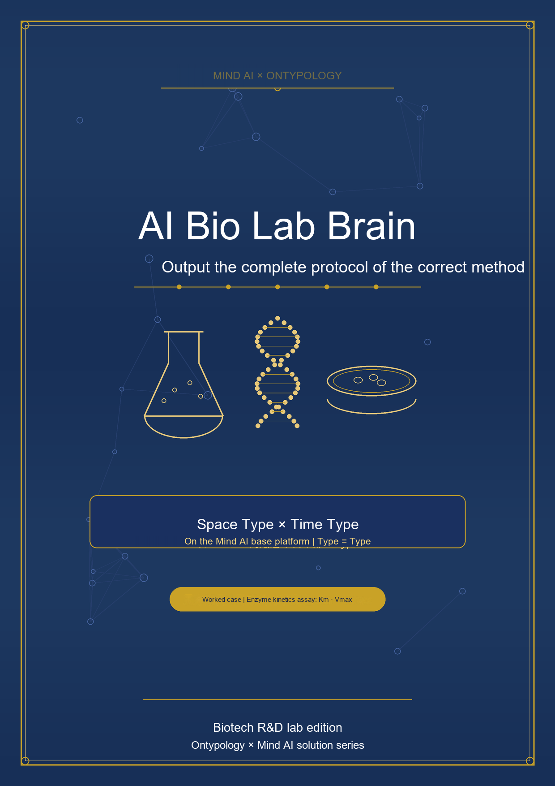

## Contents

- **Foreword: Three Conventions** **3**
- **Introduction: Two Languages, Three Ways to Read** **4**
- **1 Understanding the AI Bio-Lab Brain** **7**
  - 1.1 The Reasoning-Capable Experimental Twin: Type + Number 7
  - 1.2 The Two Types Land on the Bench 8
  - 1.3 Division of Labour in Mind AI: LLM Induces, Mind Model Deduces 10
  - 1.4 Preview: The Four Accuracy Gates 10
- **2 The Six Output Types: Hypothesis, Experiment, Protocol, Data, Verdict, Evolution** **12**
  - 2.1 Hypothesis Type (HypothesisType) 13
  - 2.2 Experiment Type (ExperimentType) 14
  - 2.3 Protocol Type (ProtocolType) 16
  - 2.4 Data Type (DataType) 17
  - 2.5 Verdict Type (VerdictType) 17
  - 2.6 Evolution Type (EvolutionType) 18
- **3 The Four Layers of Accuracy Assurance** **20**
  - 3.1 Layer One | The ∩(T) Criterion: Four Data-Quality Gates 20
  - 3.2 Layer Two | The Reasoning Skeleton: Michaelis–Menten 21
  - 3.3 Layer Three | Experimental Validation: Control, Replication, Statistics 23
  - 3.4 Layer Four | The Type Evidence Chain 23
  - 3.5 Space × Time Cross-Acceptance 24
- **4 From Requirement to Experiment: The Six Steps** **26**
  - 4.1 The Four-Step Framing: Recognising the Requirement 26
  - 4.2 The Six-Step Operation Card 27
  - 4.3 Three-Layer Judgement: Selecting, Combining and Switching Moves 28
- **5 S1–S7 Prompts and a Full-Run Output Example** **31**
  - 5.1 The Seven-Stage Relay 31
  - 5.2 Full Prompt Text for S1–S7 32
  - 5.3 Engineer Wu's ALP Kinetics Assay 35
  - 5.4 The Verdict Report and the Evolution Log 37
  - 5.5 Report Verification and Rules of Use 38
- **6 Misuse, Maturity, Adoption** **40**
  - 6.1 The Five Misuses 40
  - 6.2 The Ten-Question Checklist 41
  - 6.3 Maturity L1–L4 42
  - 6.4 Adoption Blueprint 43
- **Review: Three Takeaways** **44**
- **Appendix A The Toolbox** **46**
  - A.1 Terminology Quick Reference 46
  - A.2 The Fourteen Moves × Their Application in Biological Experiments 46
  - A.3 Notation Quick Reference 47

## Foreword: Three Conventions

Welcome to this methodology document. It has exactly one task: to make every output of the AI Bio-Lab Brain — hypothesis, experimental design, SOP, data, verdict, evolution — accurate, acceptable and traceable. The book is grounded in Ontypology (Space Type + Time Type) and runs on the Mind AI platform; the running case throughout is the most ordinary task in a biotech R&D lab: establishing a kinetic specification for an enzyme (alkaline phosphatase, ALP, with pNPP as substrate, solving for Km and Vmax).

> **Three Conventions (Ground Rules Before You Read)**  
> Convention One — Type, never Form: throughout the book every Output Type is named with Type, as in HypothesisType, ExperimentType and ProtocolType.  
> Convention Two — the theory is used, not taught: the two Types of Ontypology (Space Type and Time Type) enter only as tools. The three bracket types, ∩(T), id(C), the remove criterion, the four-step framing and the move board are used directly, without restating the original arguments and chapters.  
> Convention Three — the platform is cited, not described: Mind AI is the underlying platform, so the division of labour between the LLM and the Mind Model is cited only, not restated from existing Mind AI material.  

> **Statement on Illustrative Data (Said Up Front)**  
> All experimental data, SOP numbers, batch numbers and people in this book (Engineer Wu, the new rALP batch) are illustrative. They exist to demonstrate output formats and reasoning paths; they do not represent real experimental results and must not be used as a basis for clinical, regulatory or commercial decisions.  
> Biochemical work involves reagents, instruments and biological materials; carry it out in accordance with each laboratory's safety rules and applicable regulations. This book involves no system implementation; it delivers only the method for producing accurate output, together with the full content of the proposal.  

**Table 0-1 Task Map: Six Chapters, One Road**

| **Chapter** | **Theme** | **Emphasis** | **In One Line** |
| --- | --- | --- | --- |
| Foreword | Three conventions and the illustrative-data statement | Set the ground rules first | Agree how to read before starting |
| Introduction | Two languages, three ways to read | Comparison table; reading paths | See the map before setting off |
| Chapter 1 (System Positioning) | What this brain is | The experimental twin; where the two Types land; division of labour | What it is, and what makes it accurate |
| Chapter 2 (Output Skeleton) | Overview of the six Output Types | Hypothesis, experiment, protocol, data, verdict, evolution, taken one by one | What the outputs look like |
| Chapter 3 (Accuracy Gatekeeping) | The four accuracy gates | Criterion; skeleton; validation; evidence chain | Where accuracy comes from |
| Chapter 4 (Operating Procedure) | From requirement to experiment | Four-step framing; six steps; three-layer judgement | How to do it in practice |
| Chapter 5 (Prompt Examples) | S1–S7 and a full-run example | Full prompts; the ALP kinetics case | Copy it and use it |
| Chapter 6 (Governance and Adoption) | Misuse comparison and maturity | Five kinds of misuse; L1–L4; the blueprint | How to make it last |
| Review (Closing) | Three things to take away | The twin; the six-Type chain; the four layers | What to carry away |
| Appendix A (Quick Reference) | Terms, moves, notation | Three quick-reference tables | Kept for lookup |

## Introduction: Two Languages, Three Ways to Read

This book joins two languages: the language of Type in Ontypology, and the language of doing experiments in the lab. Before setting off, take one look at the whole picture — Space Type describes what something is, Time Type describes how it is done, and Mind AI loads both into a single experimental twin; what runs out of that twin is the six Output Types.

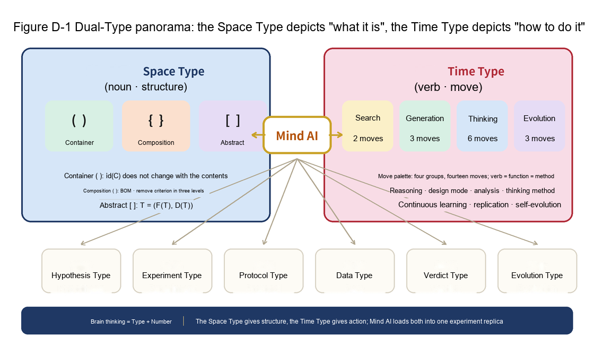

*Figure D-1 The Two Types in Panorama: Space Type describes what something is, Time Type describes how it is done*

**Table D-1 Two Languages Side by Side: Type terminology on the left, bench language on the right**

| **Ontypology tool (used, not taught)** | **Bio-lab counterpart** | **In One Line** |
| --- | --- | --- |
| Container ( ) \| C = (id(C), S(C)) | Well, tube, petri dish, sample tube | Identity does not change with the contents |
| Composition { } \| BOM; remove in three levels | Reaction recipe, medium, reagent composition | Take it apart — does it still know itself? |
| Abstract [ ] \| T = (F(T), ∩(T)) | Assay category, specification, acceptance criterion | Every feature must pass |
| Four-step framing | Fixing the requirement; positioning before the hypothesis opens | A failed control forces out a new dimension |
| Three-layer judgement | Assay eligibility check (is / has / right) | Ask Container, BOM and Abstract once each |
| Time Type; the fourteen moves of the move board | SOP actions, analytical techniques, learning and evolution | Verb = function = method = move |
| ∩(T) intersection criterion | The four data-quality gates | No gate passed, no next step |
| Type evidence chain | Tracing back through the lab record | Every conclusion traces to its source |

**Table D-2 Three Ways to Read: Different roles, different paths**

| **Role** | **Suggested path** | **What you can do afterwards** |
| --- | --- | --- |
| Lab manager | Introduction → Chapter 1 (System Positioning) → Chapter 6 (Governance and Adoption) → Review | Grasp the positioning, the risks and the pace of adoption |
| Principal investigator (PI) | Chapter 1 (System Positioning) → Chapters 2 and 3 (Skeleton and Gates) → 5.3–5.5 | Build habits of accuracy acceptance and review |
| R&D engineer | Chapter 4 (Operating Procedure) → Chapter 5 (Prompt Examples) → Appendix A | Go straight to S1–S7 and the move board |

> **Warm-Up: Three Sentences to Get Started**  
> First: to do an experiment accurately, build the Type correctly first — get the structure definition wrong, and the prettiest data is worth nothing.  
> Second: accurate output has to be acceptable — agree on ∩(T) up front, and a dispute has a referee.  
> Third: experimentation is an art of verbs — the move board of Time Type turns how to do something into moves you can pick, combine and swap.  

## 1 Understanding the AI Bio-Lab Brain

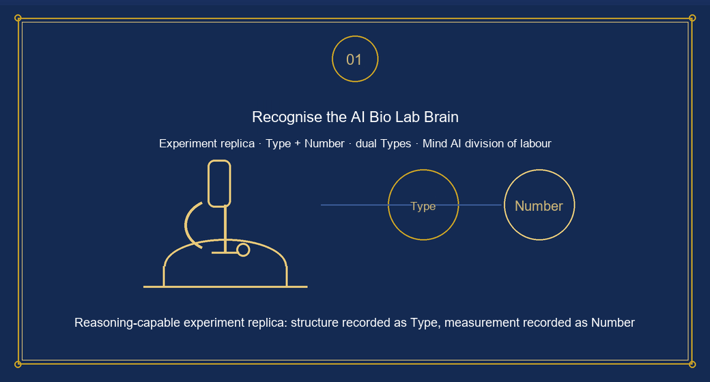

Before handing over any output, settle three things: what this brain contains (a reasoning-capable experimental twin), how the theory lands on the bench (the two Types), and who is responsible for guarding accuracy (the division of labour in Mind AI).

### 1.1 The Reasoning-Capable Experimental Twin: Type + Number

The most valuable thing in a laboratory is not the spectrophotometer; it is the collective memory of what was done, what was seen and why that conclusion followed. The AI Bio-Lab Brain builds that memory into a reasoning-capable experimental twin: structure is recorded as Type — what Container the sample sits in, what the recipe is Composed of, which class the assay belongs to; measurement is recorded as number — concentration, absorbance, initial rate, statistics. Type gives the skeleton, number gives the flesh, and only then can the twin reason.

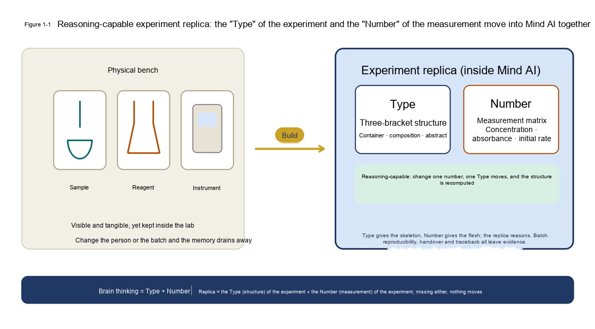

*Figure 1-1 The Reasoning-Capable Experimental Twin: the bench's Types and the measurement's numbers move into Mind AI together*

The value of the twin is practical: change the person, change the batch, come back six months later — the reasoning path is still there. Comparing batches no longer rests on a feeling that it is about the same as last time; you take out the same set of Types and the same set of criteria and recompute.

**Table 1-1 Four Scenes of Inaccurate Output: you have met them all**

| **Scene** | **Symptom** | **How the twin solves it** |
| --- | --- | --- |
| Inconsistent reporting conventions | One dataset, two people, two verdicts | Set ∩(T) in the Verdict Type first; agree on the referee |
| Protocols passed on by hand | The SOP lives with the senior technician; change hands and it drifts | Version the Protocol Type; every action is a move |
| Data with no traceability | Press a conclusion and you get 'I think it was something like...' | The Type evidence chain: all six Types checkable link by link |
| Specifications by feel | 'About the same as the last batch', with no number attached | The reasoning skeleton plus a CI-based equivalence criterion |

### 1.2 The Two Types Land on the Bench

Space Type and Time Type each hold a post in the lab. Space Type governs what a sample is: a tube is at once a Container (( ): the well keeps its identity), has a Composition ({ }: the reaction recipe) and belongs to a class ([ ]: the criterion for its assay category). Time Type governs how the experiment is done: verb = function = method = move. The fourteen moves fall into four groups — Search, Generation, Thinking, Evolution — and every action in an SOP and every technique used in analysis maps onto one of them.

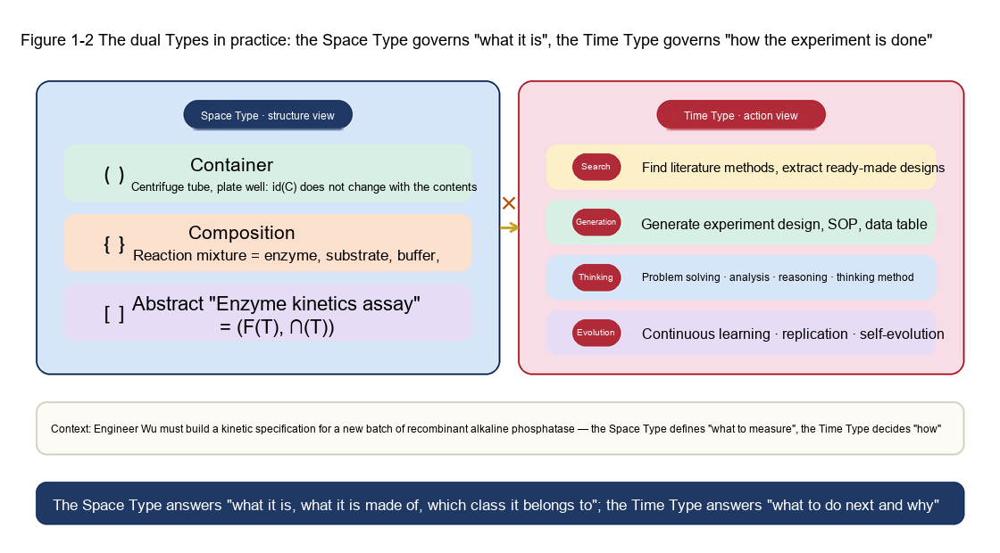

*Figure 1-2 The Two Types Land on the Bench: Space Type governs what a sample is, Time Type governs how the experiment is done*

**Table 1-2 The Three Space Brackets × Where They Land on the Bench**

| **Bracket** | **Type tool** | **Bench landing point** | **Question asked** |
| --- | --- | --- | --- |
| ( ) Container | C = (id(C), S(C)); the invariance axiom | Well, tube, petri dish, cryovial | Does identity hold? |
| { } Composition | BOM; the remove criterion in three levels | Reaction recipe, medium, reagent composition | Does it come apart? |
| [ ] Abstract | T = (F(T), ∩(T)) | Assay category, specification, acceptance criterion | Do all features pass? |

**Table 1-3 The Move Board: Four Groups, Fourteen Moves × Where They Land in the Lab (full table in Appendix A)**

| **Group** | **Moves (extract)** | **What it looks like in the lab** |
| --- | --- | --- |
| Search group (2 moves) | Type-time function search; design search and extraction | Looking up literature methods; extracting an assay design from a standard |
| Generation group (3 moves) | Design patterns; logic generation; function generation | Applying control or block designs; generating SOPs and data tables |
| Thinking group (6 moves) | Problem solving, analysis, design, reasoning, thinking methods, R&D and exploration | Diagnosing failure, analysing data, causal reasoning, reverse validation |
| Evolution group (3 moves) | Continuous learning; refactoring and recombination; self-evolution | Learning across batches; refactoring the SOP; self-revision of the specification |

### 1.3 Division of Labour in Mind AI: LLM Induces, Mind Model Deduces

The underlying platform is Mind AI. The LLM engine is good at language understanding, generation and the inductive statistics of the literature; the Mind Model engine is good at managing Type structure, deductive reasoning and long-term memory. Their division of labour in one line — the LLM speaks fast, the Mind Model speaks accurately; language goes to the LLM, intelligence goes to the Mind Model, and the ∩(T) criterion has the last word.

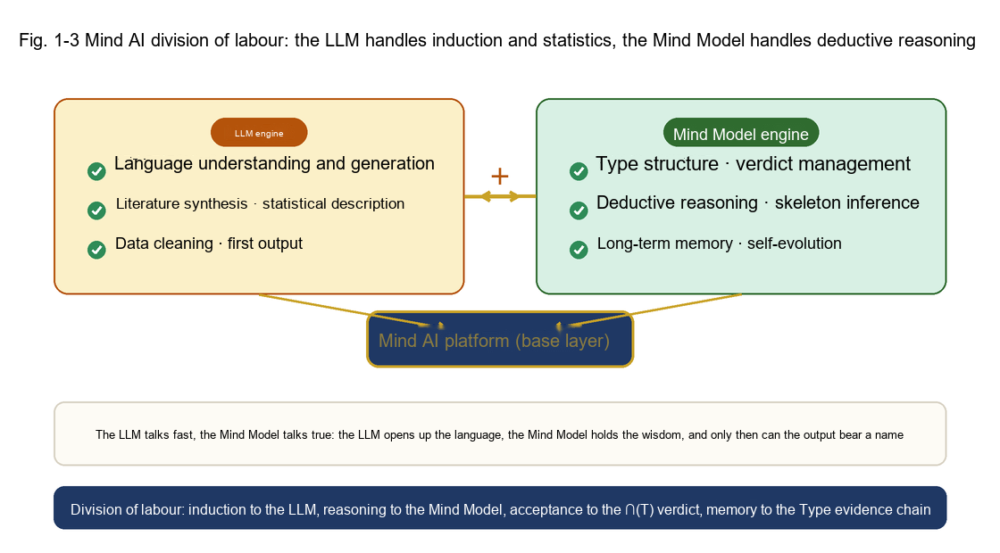

*Figure 1-3 Division of Labour in Mind AI: the LLM handles induction and statistics, the Mind Model handles deduction*

**Table 1-4 Division of Labour: who is good at what, and at which station of the workflow**

| **Engine** | **Strength** | **Workflow landing point** |
| --- | --- | --- |
| LLM engine | Language understanding and generation; induction and statistics | Literature review, first drafts, data cleaning, report polishing |
| Mind Model engine | Type structure, criteria, deductive reasoning, memory | Modelling the six Types, deriving the skeleton, ∩(T) acceptance, the evolution log |
| Mind AI platform | Integrates both engines plus reasoning, memory, learning and planning | Runtime environment and evidence-chain store for the S1–S7 pipeline |

### 1.4 Preview: The Four Accuracy Gates

The phrase 'accurate output' resolves into four gates, climbed one at a time, each leaving checkable Type evidence behind. The next chapter shows what the outputs look like; Chapter 3 takes the gates apart one by one.

**Table 1-5 Preview of the Four Accuracy Gates**

| **Layer** | **Gate** | **Question** | **In the ALP case** |
| --- | --- | --- | --- |
| Layer one | The ∩(T) criterion | Does the data pass? | Four gates: linearity R², CV, blank, dilution |
| Layer two | Reasoning skeleton | Is the theory pinned down? | v = Vmax[S]/(Km+[S]) |
| Layer three | Experimental validation | Does the benchwork support it? | Controls, replication, statistical tests |
| Layer four | Type evidence chain | Does the conclusion trace back? | Conclusion → … → hypothesis: all six stations checkable |

> **Chapter highlights**  
> Experimental twin = Type + number: structure recorded as Type, measurement as number, and only then does the twin reason.  
> The two Types keep to their posts: Space Type governs what something is, Time Type governs how it is done.  
> Accuracy has a gatekeeper: the LLM induces and runs the statistics, the Mind Model deduces, and ∩(T) is the referee.  

## 2 The Six Output Types: Hypothesis, Experiment, Protocol, Data, Verdict, Evolution

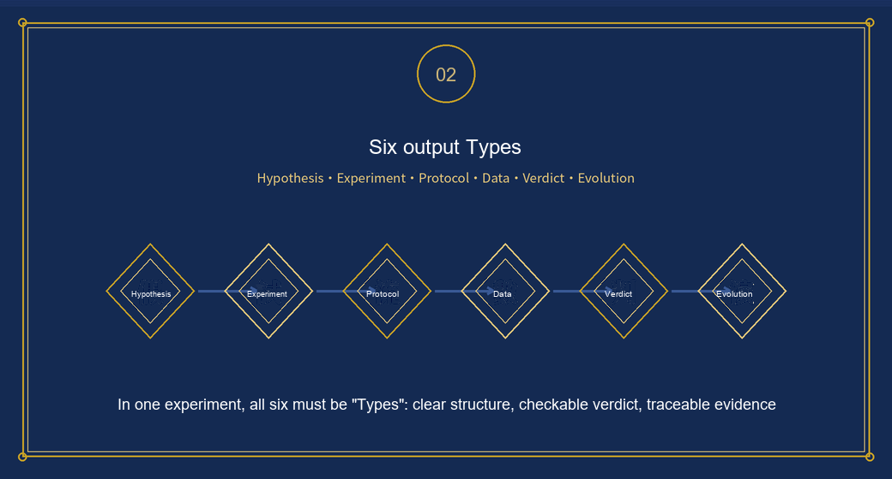

The output of the AI Bio-Lab Brain is not a pile of loose files but six interlocking Types. The six-word mnemonic runs hypothesis, experiment, protocol, data, verdict, evolution — Hypothesis Type, Experiment Type, Protocol Type, Data Type, Verdict Type, Evolution Type. Each Type has its fields, its criteria and its deliverables.

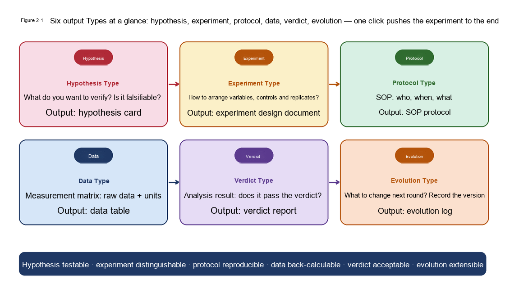

*Figure 2-1 The Six Output Types at a Glance: one chain carries the experiment through*

**Table 2-1 The Six Types in Summary: each Type in one line**

| **Output Type** | **English designation** | **Question answered** | **Deliverable** | **Acceptance criterion** |
| --- | --- | --- | --- | --- |
| Hypothesis Type (HypothesisType) | A falsifiable judgement statement | What do you want to verify? | Hypothesis card | Falsifiability conditions explicit |
| Experiment Type (ExperimentType) | Variables, controls, replication | How are variables and controls laid out? | Experiment design document | Independent / dependent / controlled clearly separated |
| Protocol Type (ProtocolType) | SOP action sequence | Who does what, and when? | SOP procedure | Reproducible by another operator |
| Data Type (DataType) | Measurement matrix and provenance | What was measured? | Data table plus raw values | All four ∩(T) gates passed |
| Verdict Type (VerdictType) | Parameters plus uncertainty | What is the conclusion? | Verdict report | Skeleton fits; residuals random |
| Evolution Type (EvolutionType) | Version narrative and lessons | What changes next round? | Evolution log | Every version has a story |

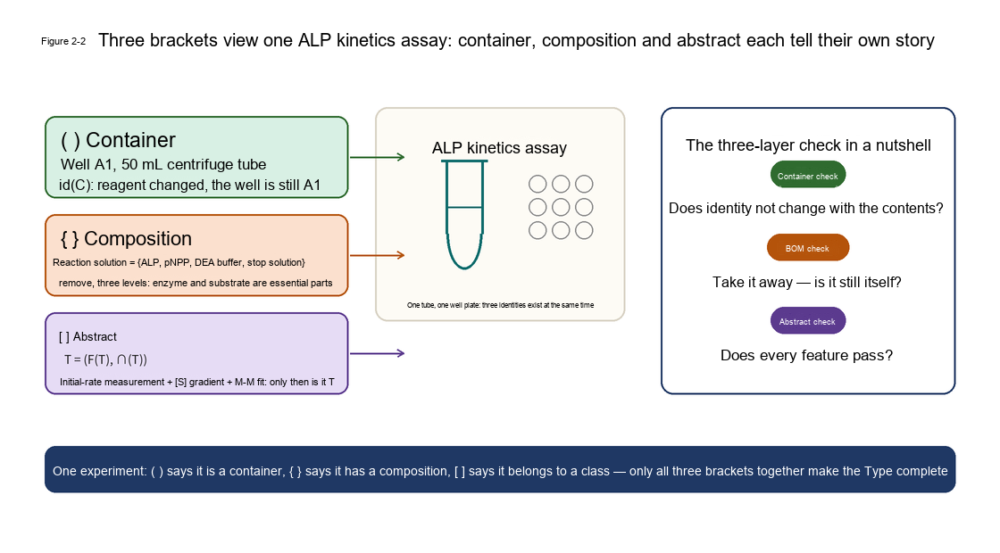

*Figure 2-2 The Three Brackets Applied to an ALP Kinetics Assay: Container, Composition and Abstract each speak for themselves*

### 2.1 Hypothesis Type (HypothesisType)

The Hypothesis Type is where the whole chain starts: what you want to verify, written as a falsifiable sentence. A vague aim ('get a feel for this batch of enzyme') is not a hypothesis; a statement that data can overturn ('the Km and Vmax of the new rALP batch fall within the 95% confidence interval of the previous batch') is. The Hypothesis Type also declares the variables and states the success criterion — every Type downstream draws on it.

**Table 2-2 Hypothesis Type Field Card**

| **Field** | **Required content** | **ALP case example** |
| --- | --- | --- |
| Hypothesis statement | One falsifiable judgement statement, with subject, variables and conditions all present | The new batch is kinetically equivalent to the previous batch |
| Alternative hypothesis | State what it looks like when it does not hold | Km or Vmax shifts materially |
| Falsifiability conditions | What kind of data would overturn it | Any parameter falling outside the previous batch's 95% CI |
| Variable declaration | Independent, dependent and controlled variables listed in one pass | See 2.2 Experiment Type |
| Success criterion | The numeric pass threshold, agreed before the work begins | Both parameters fall within the CI and all four gates pass |

### 2.2 Experiment Type (ExperimentType)

The Experiment Type turns a hypothesis into a design that can discriminate: which independent variable is moved, which dependent variable is read, which controlled variables are locked down, how many control groups, how many replications. A poorly designed experiment cannot be rescued by refined data later on — so acceptance of the Experiment Type asks one question only: can this design tell the two worlds apart?

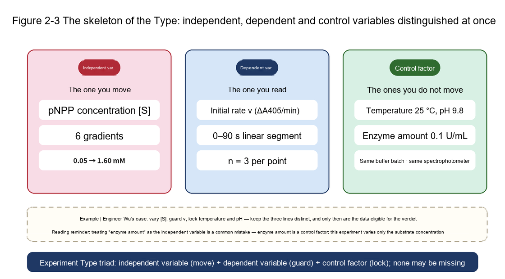

*Figure 2-3 The backbone of the Experiment Type: independent, dependent and controlled variables separated at a glance*

**Table 2-3 The three-way variable design card (ALP kinetics case)**

| **Variable** | **Role** | **Setting in this case** | **Common error** |
| --- | --- | --- | --- |
| pNPP concentration | Independent variable | 6 levels, 0.05 → 1.60 mM | The gradient does not bracket Km, so the fit is unstable |
| Initial rate v | Dependent variable | ΔA405/min, linear segment over 0–90 s | Reading the endpoint value and passing it off as the initial rate |
| Temperature / pH / enzyme amount | Controlled variable | Locked at 25 °C, pH 9.8, 0.1 U/mL | Mistaking the enzyme amount for an independent variable |
| Control group | Required provision | Blank + heat-denatured enzyme + previous-batch standard | Skipping controls; it cannot be made up afterwards |
| Replication | Required provision | n = 3 per point, randomised run order | Drawing a conclusion at n = 1 |

The Experiment Type also conceals the remove criterion of the Space Type: a reaction recipe is a bill of materials, and before removing any single item you must ask, "once it is removed, is the whole still the same reaction?" The answer decides whether the item is an essential component, a functionally degraded component, or a non-essential component.

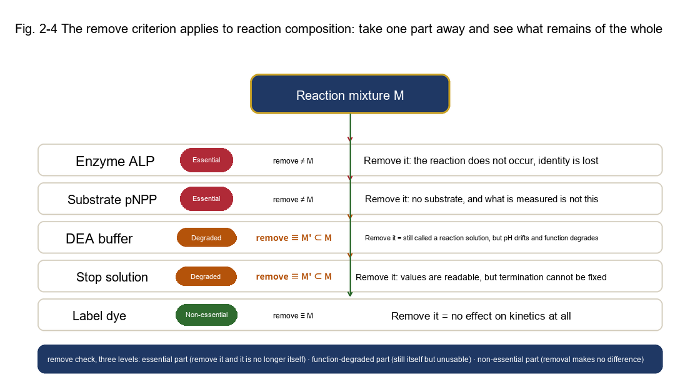

*Figure 2-4 The remove criterion applied to reaction composition: take one item away and see what is left of the whole*

**Table 2-4 The three remove grades × reaction composition**

| **Composition** | **Grade** | **remove criterion** | **Rationale** |
| --- | --- | --- | --- |
| Enzyme (ALP) | Essential component | remove(p,M) ≢ M | No enzyme, no reaction: identity is lost |
| Substrate (pNPP) | Essential component | remove(p,M) ≢ M | Without substrate, the assay measures something else |
| DEA buffer | Functionally degraded component | remove ≡ M' ⊂ M | pH drifts; still called the reaction mixture, but no longer usable |
| Stop solution | Functionally degraded component | remove ≡ M' ⊂ M | No fixed-point termination, so readings lose accuracy |
| Labelling dye | Non-essential component | remove(p,M) ≡ M | Unrelated to kinetics; removing it makes no difference |

### 2.3 Protocol Type (ProtocolType)

The Protocol Type is the Type of the SOP: it turns the experimental design into a sequence of actions — who, when, does what, to what degree. Every action maps onto a move of the Time Type (pipetting embodies function generation, checking instrument calibration is search, exception handling is problem solving). The Protocol Type has a single acceptance standard: hand it to someone else, and they obtain data of the same grade.

**Table 2-5 Protocol Type (SOP) field card**

| **Field** | **Required content** | **Illustrative example** |
| --- | --- | --- |
| Protocol number | Unique code + revision + effective date | SOP-ALP-042 v2.1 |
| Scope | Which Experiment Type and Hypothesis Type it corresponds to | Inter-batch kinetics comparison for rALP |
| Action sequence | Steps, parameters, tolerance, corresponding move | Pre-heat 5 min at 37 °C → start by adding pNPP |
| Key control points | Which steps drift most easily, and how to prevent it | Reaction start timing ±2 s, temperature control ±0.5 °C |
| Exception handling | Branches and recording method when something goes wrong | Blank drift over the limit → re-make the buffer |

### 2.4 Data Type (DataType)

The Data Type is the Type of measurement: raw value, unit, instrument, timestamp, operator — not one field may be omitted. It carries two disciplines. First, raw values are never overwritten; cleaning is saved as a separate version. Second, before reaching the verdict, data must pass the ∩(T) four gates (set out in Chapter 3) — data that fails the gates is not "poorer data", it is "data that may not be used".

**Table 2-6 Data Type field card**

| **Field** | **Required content** | **Illustrative example** |
| --- | --- | --- |
| Measurement matrix | Raw values by sample × condition × replication | 6 concentrations × 3 replicates = 18 initial-rate values |
| Units and range | SI units, instrument range and resolution | ΔA405/min, range 0–3 A |
| Traceability triad | Instrument ID, calibration record, operator | UV-2600#0412, CAL-2603, Engineer Wu |
| Timestamp | Measurement time and batch sequence | 2026-10-14 09:20–10:05 |
| Version discipline | Raw values read-only; cleaning saved as a new v with differences logged | raw v1 → clean v1 (blank subtracted) |

### 2.5 Verdict Type (VerdictType)

The Verdict Type turns data into a conclusion, but the conclusion must grow on the reasoning skeleton: recognise the equation first (Michaelis–Menten), then let the data support or overturn it. Its output is not a lone number but a set — parameter + uncertainty + applicable range + comparison verdict. Stating the range explicitly (for example, "valid only within 0.05–1.60 mM") is what makes a verdict responsible.

**Table 2-7 Verdict Type field card**

| **Field** | **Required content** | **Illustrative example** |
| --- | --- | --- |
| Skeleton and method | Which equation, which fit | Primarily M–M non-linear regression |
| Parameters and uncertainty | Point estimate ± SD/CI, not just the mean | Km = 0.25 ± 0.02 mM |
| Residual check | Residual randomness; treatment of outliers | Residuals random, no systematic offset |
| Scope | Boundary conditions within which the conclusion is valid | [S] 0.05–1.60 mM, 25 °C |
| Comparison verdict | Checked against the hypothesis: pass / fail | Falls within the previous batch's 95% CI → equivalence holds |

### 2.6 Evolution Type (EvolutionType)

The Evolution Type lets the lab's knowledge grow: this round's conclusions and lessons are written into the evolution log and become the nutrient for the next round's hypothesis and the reason for revising the SOP. Its acceptance standard is "every version has a story" — each version of the SOP can answer: what changed, why it changed, what will be tested next time. A lab without an Evolution Type can run a thousand experiments in ten years and in truth has run one experiment a thousand times.

**Table 2-8 Evolution Type field card**

| **Field** | **Required content** | **Illustrative example** |
| --- | --- | --- |
| Version narrative | What changed and why | v2.1→v2.2: added the temperature variable |
| Lesson log | Pitfalls encountered and how they were solved | Blank drift → buffer made fresh the same day |
| Next-round hypothesis | New questions grown from this round's conclusions | Temperature dependence of Km at 25/30/37 °C |
| Trigger criterion | What condition starts a new round | Triggered when two consecutive batches fall outside the CI |

> **Chapter highlights**  
> The six-Type mnemonic "hypothesis, experiment, protocol, data, verdict, evolution": the hypothesis is falsifiable, the experiment discriminable, the protocol reproducible, the data recomputable, the verdict acceptable, the evolution continuable.  
> The three bracket types and the remove criterion are hidden inside the experiment: container identity, recipe composition and category criterion should all be settled when the project opens.  
> Every Type has its field card and acceptance criteria — output does not rest on a feeling, it rests on the Type.  

## 3 The Four Layers of Accuracy Assurance

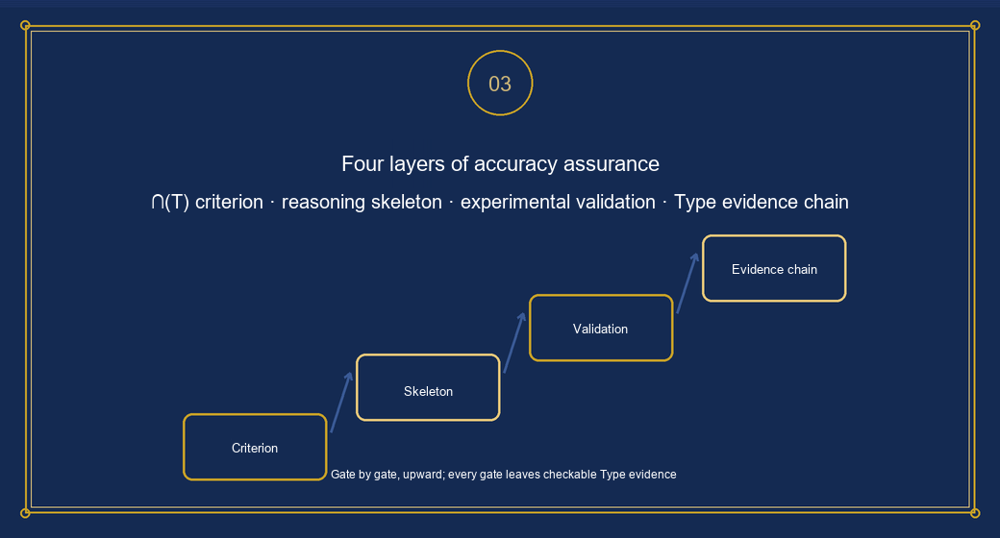

"Accurate output" cannot be guaranteed by intuition; it needs gates. The four layers run bottom-up: the ∩(T) criterion keeps data outside or lets it in, the reasoning skeleton pins the theory down, experimental validation lets the bench have its say, and the Type evidence chain lets a conclusion be traced back to its source; finally the Space × Time cross-acceptance keeps overall watch.

### 3.1 Layer One | The ∩(T) Criterion: Four Data-Quality Gates

An abstract category T is determined by its feature set F(T) and the intersection criterion ∩(T): an item belongs only if it passes every feature. Put that ruler on data and you get the four data-quality gates — linear region, repeatability, blank, dilution linearity. Only when all four pass is the Data Type qualified; if any one fails, the data goes back for re-measurement, and "fit first, argue later" is not permitted.

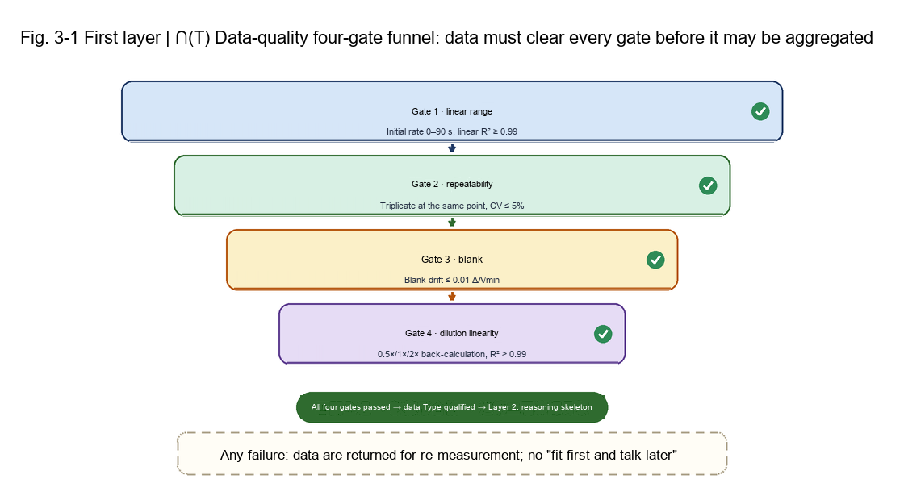

*Figure 3-1 The ∩(T) four-gate data-quality funnel: data must pass the gates before it may enter the fit*

**Table 3-1 The ∩(T) four-gate criterion card (ALP case)**

| **Gate** | **Criterion (agreed up front)** | **Measurement method** | **If the gate fails** |
| --- | --- | --- | --- |
| Gate 1 · Linear region | Initial rate linear over 0–90 s, R² ≥ 0.99 | Plot A405 against time and take the slope | Reduce the enzyme amount and re-measure |
| Gate 2 · Repeatability | Three replicates at the same point, CV ≤ 5% | Within-group CV of the 18 values | Check pipetting and timing error |
| Gate 3 · Blank | Blank drift ≤ 0.01 ΔA/min | Read the no-enzyme control throughout | Re-make the buffer and substrate |
| Gate 4 · Dilution linearity | Back-calculated R² ≥ 0.99 at 0.5×/1×/2× | Back-calculate activity from three enzyme concentrations | Check for enzyme inactivation or substrate inhibition |

> **Worked example \| How the four gates are recorded**  
> Gate 1: R² = 0.997 (0–90 s, six time points) Gate 2: CV = 1.8% (calculated in groups across the 18 values)  
> Gate 3: blank drift = 0.004 ΔA/min Gate 4: dilution back-calculation R² = 0.999 → all four gates pass; the Data Type is certified "qualified".  

### 3.2 Layer Two | The Reasoning Skeleton: Michaelis–Menten

The reasoning skeleton means: recognise the equation first, then let the data support or overturn it — not "draw a curve that looks agreeable". The skeleton of enzyme kinetics is the Michaelis–Menten equation v = Vmax·[S]/(Km+[S]); it also supplies the derivation chain: the double-reciprocal form 1/v = (Km/Vmax)·(1/[S]) + 1/Vmax gives slope and intercept their separate meanings, and the half-maximal point gives Km directly. With the skeleton standing first, the fit has a referee.

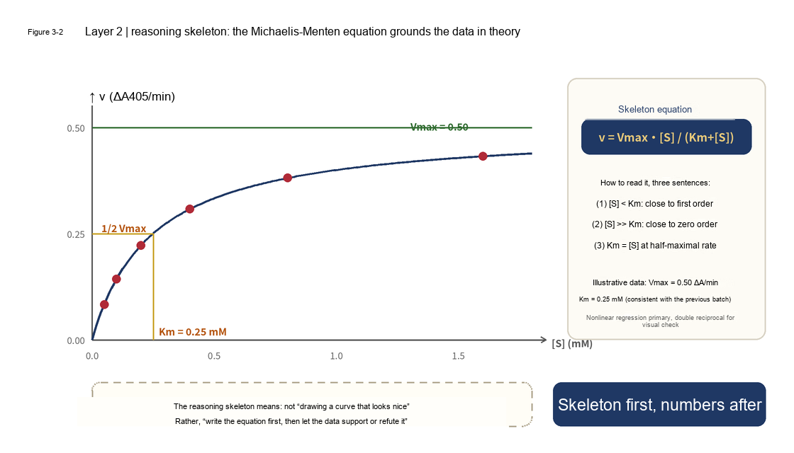

*Figure 3-2 The reasoning skeleton: the equation pins the data to the theory*

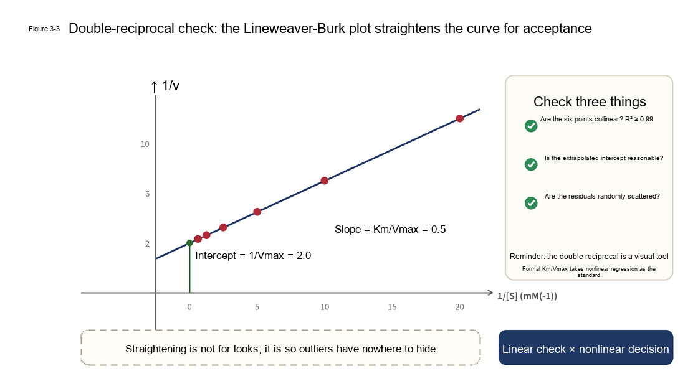

*Figure 3-3 The double-reciprocal check: straightening the curve for acceptance*

**Table 3-2 Reasoning-skeleton derivation steps (ALP case)**

| **Step** | **Action** | **Purpose and output** |
| --- | --- | --- |
| 1 | Write the skeleton: v = Vmax[S]/(Km+[S]) | Theory first; two parameters to estimate, Vmax and Km |
| 2 | Derive the double reciprocal: 1/v = (Km/Vmax)(1/[S]) + 1/Vmax | Slope = Km/Vmax, intercept = 1/Vmax, each with physical meaning |
| 3 | Non-linear regression for Vmax, Km and the 95% CI | The formal result rests on the non-linear fit; the double reciprocal is for inspection only |
| 4 | Residual check + treatment of outliers | Accept only random residuals; investigate outliers experimentally before discussing statistics |
| 5 | Compare with the previous batch's specification (CI overlap test) | Produces the comparison verdict of the Verdict Type |

### 3.3 Layer Three | Experimental Validation: Control, Replication, Statistics

However elegant the skeleton, the bench must nod in agreement. The third layer asks three plain things: are the controls complete, is the replication sufficient, does the statistics hold up. Control is an essential component of the Experiment Type (the remove criterion: take the control away and the experiment loses its identity); replication supplies the uncertainty; statistics translates "about the same" into a confidence interval.

**Table 3-3 The experimental-validation triad**

| **Item** | **Configuration in this case** | **Question it answers** |
| --- | --- | --- |
| Control | Blank + heat-denatured enzyme + previous-batch standard | Does the signal come from the reaction? Is the enzyme activity real? Is it comparable? |
| Replication | n = 3 per point, independently prepared solutions, randomised run order | How large is the error? Is the CV within 5%? |
| Statistics | Non-linear regression + 95% CI + residual inspection | Are the parameters estimated accurately? Is the difference from the previous batch significant? |

### 3.4 Layer Four | The Type Evidence Chain

The last layer is responsible for tracing back: any conclusion can be followed along Verdict Type, Data Type, Protocol Type, Experiment Type and Hypothesis Type all the way to its source. Break one link and the conclusion is demoted to an opinion for reference; only a complete chain may be written into a report, and only then is it fit to be signed.

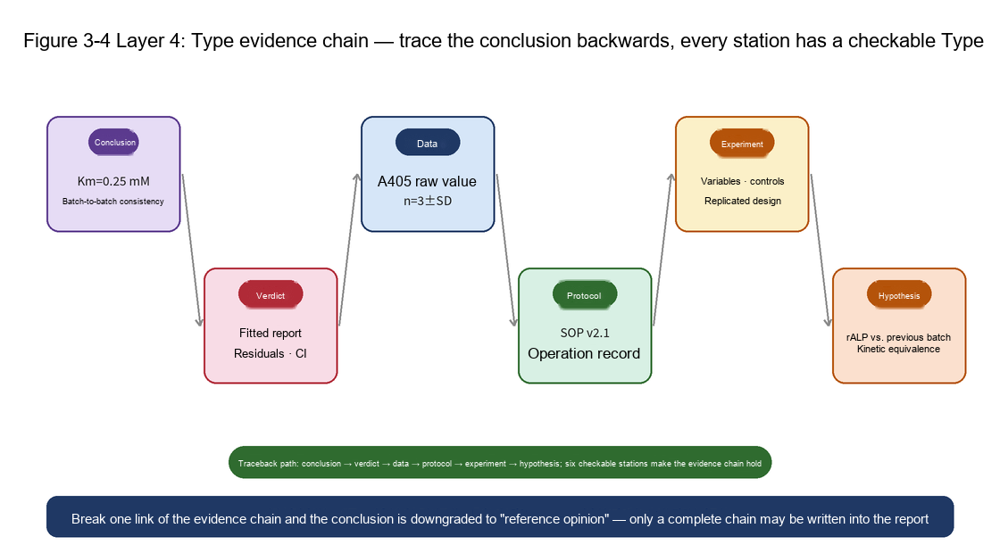

*Figure 3-4 The Type evidence chain: trace the conclusion backwards, and every station has a Type to check*

**Table 3-4 The six stations of the Type evidence chain (ALP case)**

| **Station** | **What is checked** | **Evidence in the ALP case** |
| --- | --- | --- |
| Conclusion | The conclusion sentence and its applicable range | Km = 0.25 mM, range 0.05–1.60 mM |
| Verdict Type | Fit method, residuals, CI | Non-linear regression report v1 |
| Data Type | Raw values and the four-gate record | 18 initial-rate values + sign-off that all four gates passed |
| Protocol Type | SOP version and run record | SOP-ALP-042 v2.1, item-by-item trace |
| Experiment Type | Variable, control and replication design | Experiment design document EX-2610-07 |
| Hypothesis Type | Falsifiability conditions and success criterion | Hypothesis card H-042: equivalence criterion established first |

### 3.5 Space × Time Cross-Acceptance

The four layers in fact have two faces: the Space Type checks whether the structure is right, the Time Type checks whether the protocol will run. The two faces cross into four cells — only the cell where Space is right and Time is also right is cleared for reporting; the other three each have a clear remedial path.

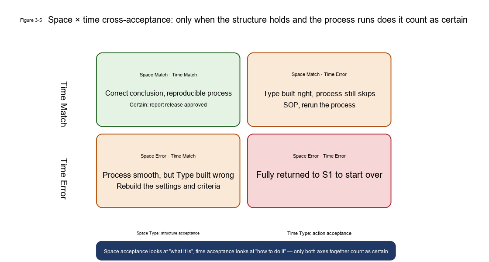

*Figure 3-5 The Space × Time cross-acceptance matrix*

**Table 3-5 Cross-acceptance table**

| **Cell** | **Symptom** | **Remedy** |
| --- | --- | --- |
| Space right · Time right | Structure correct, protocol reproducible | Cleared for reporting; entered into the Type evidence chain |
| Space right · Time wrong | The Type is built correctly but the protocol jumps around | Top up SOP training, then re-run the protocol segment |
| Space wrong · Time right | The protocol runs smoothly but the Type is built crooked | Go back to step 2, build the Type along the axes, and rebuild the definition and criterion |
| Space wrong · Time wrong | Total breakdown | Return to S1 and start again; seal the old outputs as lessons |

> **Chapter highlights**  
> Four layers, none to be skipped: the ∩(T) criterion → the reasoning skeleton → experimental validation → the Type evidence chain.  
> Skeleton first, data second: recognise the equation first, then let the data speak.  
> Cross-acceptance: Space checks the structure, Time checks the protocol; only when both axes pass is the result accurate.  

## 4 From Requirement to Experiment: The Six Steps

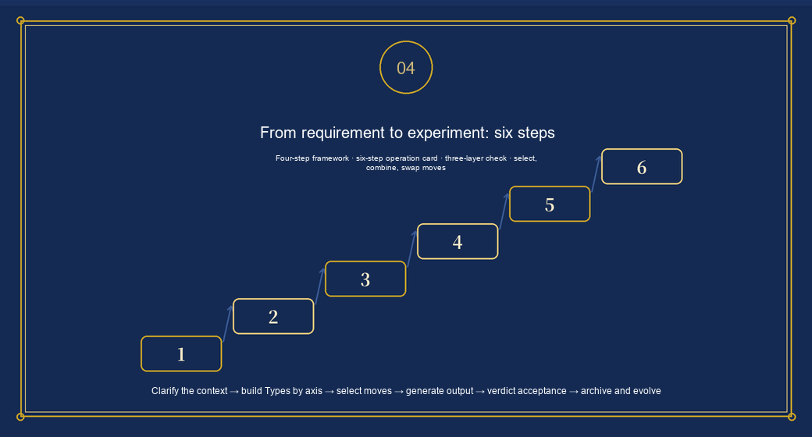

Having met the six Output Types and the four layers, this chapter arranges them into a single operating path: the four-step framing pins the requirement down first, the six steps run from context all the way to evolution, and along the way a three-layer judgement keeps watch while the picking, combining and swapping of moves dispatches the Time Type's moves.

### 4.1 The Four-Step Framing: Recognising the Requirement

Establishing a requirement is not a matter of deciding in a meeting off the top of one's head; it is a small exercise in abstraction engineering: distinguish similarities and differences → trigger abstraction → name the dimension → assign membership. When a new set of differences refuses to match the existing specification (a failed control), that is the moment a new dimension is forced out — once the dimension has a name, the requirement can be assigned back to one of the six Output Types, and the remaining five steps have a target.

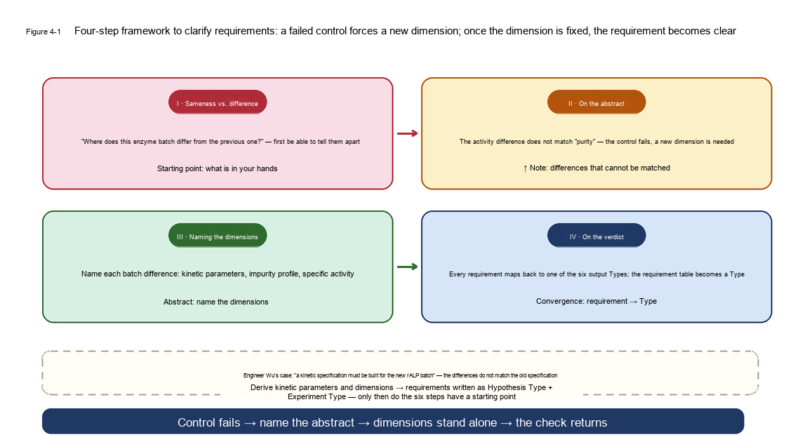

*Figure 4-1 The four-step framing recognises the requirement: a failed control forces a new dimension*

**Table 4-1 The four-step framing × opening an experiment**

| **Step** | **What you do** | **In the ALP case** |
| --- | --- | --- |
| I · Distinguish similarities and differences | First be able to say where this batch differs from the previous one | The new batch's activity readings do not match the old specification |
| II · Trigger abstraction | When the difference does not fit the old dimensions, a new dimension is needed | "Purity" cannot explain the difference → it is a kinetic parameter |
| III · Name the dimension | Name the difference and the dimension stands on its own | Three new dimensions: Km, Vmax and specific activity |
| IV · Assign membership | Assign the requirement back to one of the six Types and write it as a Type entry | → one Hypothesis Type entry and one Experiment Type entry |

### 4.2 The Six-Step Operation Card

The six steps form a loop: identify the context → build the Type along the axes → select and expand → generate the output → acceptance against the criterion → archive and evolve. The evolution log from step 6 is the context input to step 1 of the next round — the loop has no end, and the lab's knowledge grows inside it.

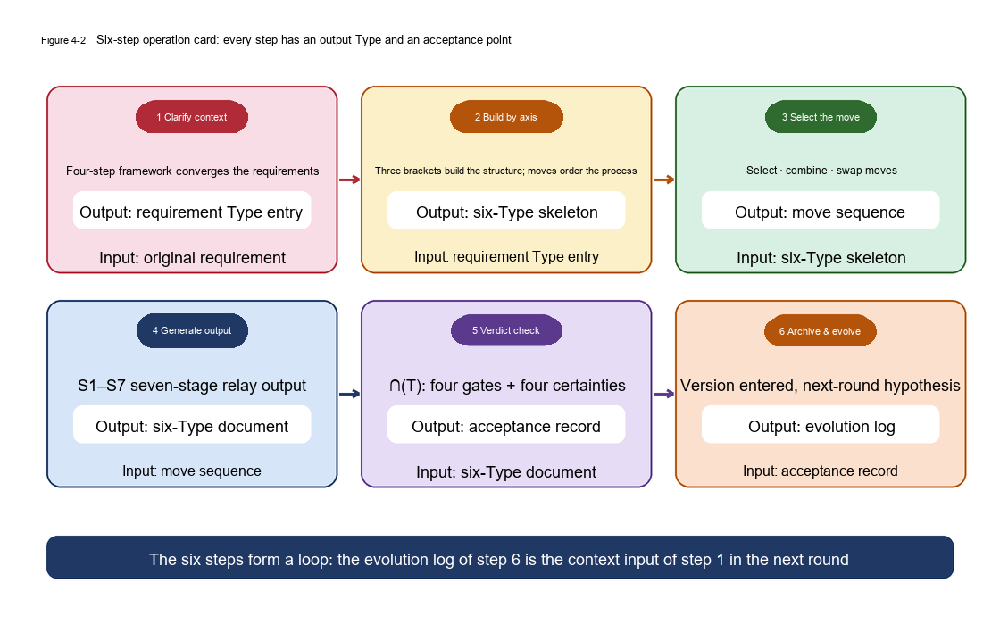

*Figure 4-2 The six-step operation card: every step has an Output Type and an acceptance point*

**Table 4-2 The six-step operation card: action, Output Type, moves, acceptance**

| **Step** | **Action** | **Output Type** | **Commonly used moves** | **Acceptance point** |
| --- | --- | --- | --- | --- |
| 1 Identify the situation | The four-step framing converges the requirement | Requirement Type entry | Problem solving, analysis | Requirement falsifiable |
| 2 Split the axes, build the Types | The three bracket types build the structure; the moves order the protocol | Six-Type skeleton | Design, design patterns | Skeleton complete with all six Types |
| 3 Select the expansion pattern | Selecting moves, combining moves, switching moves | Move sequence | (whole-board deployment) | Sequence executable |
| 4 Generate the outputs | S1–S7 seven-stage relay production | Six-Type documents | Function generation, logic generation | Each Type passes its field card |
| 5 Criterion-based acceptance | The ∩(T) four gates plus four-layer accuracy | Acceptance record | Reasoning, analysis | All four gates passed |
| 6 Archive and evolve | Version logged, next-round hypothesis | Evolution log | Continuous learning, self-evolution | Every version has a story |

### 4.3 Three-Layer Judgement: Selecting, Combining and Switching Moves

Two standing tools are kept on hand along the operating path. The first is the three-layer judgement (is / has / matches): the Container judgement asks 'is it the same one', the BOM judgement asks 'is anything missing', and the Abstract judgement asks 'is it the right class' — any qualification check is swept with these three questions. The second is move deployment: selecting a move (one move for a single situation), combining moves (several moves in relay), switching moves (change the route when stuck) — switching moves never switches the criteria; only the route changes, and not one ∩(T) gate may be dropped.

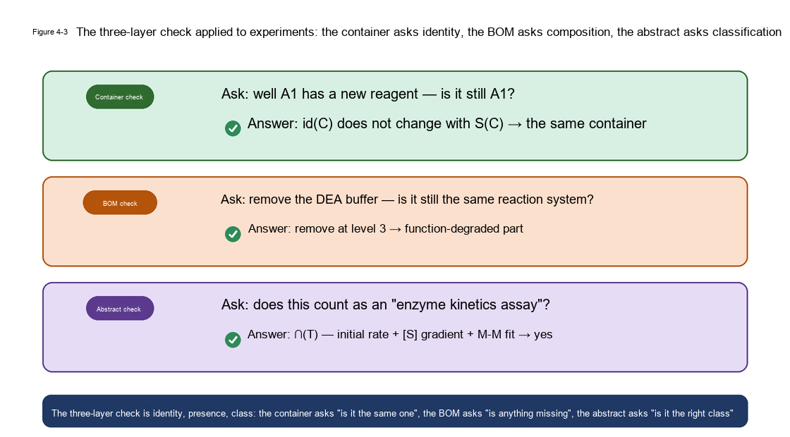

*Figure 4-3 Three-layer judgement: Container asks identity, BOM asks Composition, Abstract asks classification*

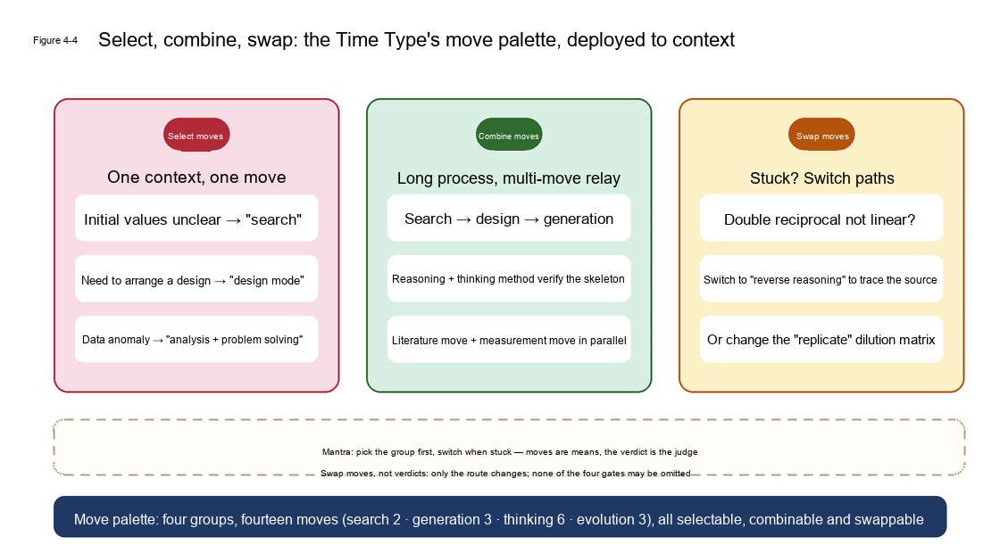

*Figure 4-4 Selecting, combining and switching moves: the move board is deployed to suit the situation*

**Table 4-3 Three-layer judgement scan table (ALP case)**

| **Layer** | **Question** | **Answer in the ALP case** |
| --- | --- | --- |
| Container judgement | Does identity survive a change of contents? | Well A1 remains A1 after a reagent change → the same Container |
| BOM judgement | Does it still recognise itself once taken apart? | Removing the buffer would make it a function-degraded part, so it is not stripped |
| Abstract judgement | Does it pass on every feature? | Initial rate + [S] gradient + M–M fit all pass → belongs to this class |

**Table 4-4 Selecting, combining and switching moves compared**

| **Move** | **When to use it** | **Illustrative example** |
| --- | --- | --- |
| Selecting a move | One move for a single situation | Unclear initial values → Search; a design to be laid out → design patterns |
| Combining moves | Several moves in relay over a long protocol | Search → Design → Function generation; Reasoning + Thinking to check the skeleton |
| Switching moves | Change the route when stuck | Double reciprocal not linear → reverse reasoning to trace the source, rebuild the dilution matrix |

> **Chapter highlights**  
> Identify the requirement before acting: the four-step framing turns 'the control failed' into a new dimension, and only then can the requirement be written into shape.  
> The six steps form a loop: the evolution log feeds back into the next round of situations.  
> The three-layer judgement (is / has / matches) is a standing scan; moves may be selected, combined or switched, but the criteria never change.  

## 5 S1–S7 Prompts and a Full-Run Output Example

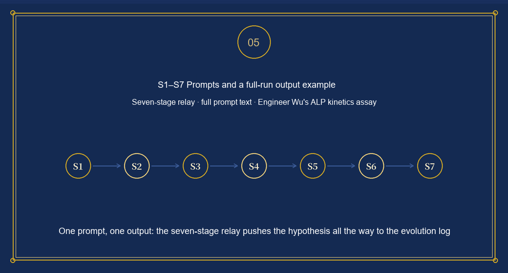

This chapter is the operational core of the book: the full prompt text of the S1–S7 seven-stage relay is handed to you first, and then Engineer Wu's ALP kinetics assay runs the outputs produced by all seven stages from beginning to end. The prompts can be copied straight out and used once modified; every example datum is marked illustrative.

### 5.1 The Seven-Stage Relay

The rhythm of the seven-stage relay is: define clearly → design to discriminate → protocol reproducible → data recomputable → verdict acceptable → report traceable → evolution continuable. Each stage consumes the output of the previous stage and emits the input of the next; the evolution log from S7 feeds back into S1, and the next round of hypotheses grows from there. There are six rules of use, and keeping them beside the prompts is the safest arrangement.

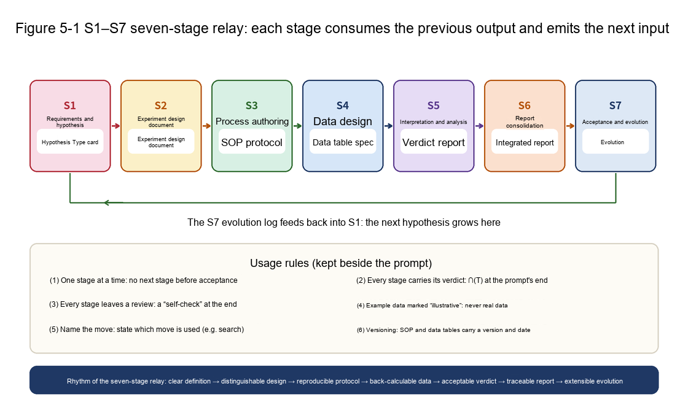

*Figure 5-1 The S1–S7 seven-stage relay: each stage consumes the previous stage's output and emits the next stage's input*

**Table 5-1 S1–S7 overview**

| **Stage** | **Task** | **Output Type** | **Commonly used moves** | **Stage-pass criterion** |
| --- | --- | --- | --- | --- |
| S1 | Requirement and hypothesis | Hypothesis Type card | Problem solving, Thinking | Falsifiability conditions explicit |
| S2 | Experiment design | Experiment design document | Design, design patterns | Three-way variable split clear; controls complete |
| S3 | Protocol drafting | SOP procedure | Function generation, logic generation | Reproducible by another operator |
| S4 | Data design | Data table specification | Logic generation | Four-gate criteria built in |
| S5 | Verdict analysis | Verdict report | Analysis, reasoning | Skeleton fits; residuals random |
| S6 | Report consolidation | Integrated report | Logic generation | Evidence chain complete |
| S7 | Acceptance and evolution | Evolution log | Continuous learning, self-evolution | Every version has a story |

### 5.2 Full Prompt Text for S1–S7

The seven prompts below are the substance of the 'method for using outputs accurately' that this book delivers. Every stage follows the same format: task, input, output, criteria, and the three self-check questions. Open only one stage at a time; if the previous stage's output has not been accepted, do not open the next.

> **S1 prompt \| Requirement and hypothesis**  
> You are an [experiment design analyst]. Task: converge a vague experimental requirement into a falsifiable Hypothesis Type card (HypothesisType).  
> Input: requirement description, background material, (optional) previous batch specification or literature.  
> Output: a hypothesis card with five fields — hypothesis statement (one falsifiable declarative sentence), opposing hypothesis, falsifiability conditions, variable declaration (independent / dependent / controlled), success criterion (numerical threshold).  
> Criteria: the statement must contain a subject, a variable and a condition; the success criterion must be a number or a decidable statement; points of uncertainty must be listed explicitly in a 'to be confirmed' list.  
> Three self-check questions: (1) Can this statement be overturned by data? (2) Was the success criterion stated in advance? (3) Is the three-way variable declaration complete?  

> **S2 prompt \| Experiment design**  
> You are an [experiment design engineer]. Task: translate the Hypothesis Type card into an Experiment Type design document (ExperimentType) that can tell the two worlds apart.  
> Input: Hypothesis Type card, list of available instruments and materials, time and sample budget.  
> Output: experiment design document — independent variable (gradient and range), dependent variable (measurement and unit), controlled variables (locked values), control groups (blank / positive / reference standard), replication and randomisation, three-level remove analysis (recipe BOM breakdown).  
> Criteria: the independent / dependent / controlled split is mutually exclusive and complete; the controls can tell 'where the signal comes from'; the number of replications matches the budget; the gradient spans the expected transition point (e.g. around Km).  
> Three self-check questions: (1) Can this design discriminate the two worlds? (2) Is any control missing? (3) Does the gradient cross the transition point?  

> **S3 prompt \| Protocol drafting (SOP)**  
> You are a [protocol engineer]. Task: translate the experiment design document into a Protocol Type SOP (ProtocolType) that another operator can reproduce, annotating the corresponding move at every step.  
> Input: experiment design document, instrument operating limits, safety and regulatory considerations.  
> Output: SOP — protocol number + revision + effective date, scope of application, action sequence (step / parameter / tolerance / move), key control points, exception-handling branches.  
> Criteria: every step has a tolerance and a timing origin; key control points state 'where it is most likely to drift'; exception handling has branches and requires a record.  
> Three self-check questions: (1) If someone else follows it, will they obtain data of the same grade? (2) Is a tolerance written for every step? (3) Is it clear what to do when something goes wrong?  

> **S4 prompt \| Data design and measurement**  
> You are a [data engineer]. Task: translate the SOP into Data Type (DataType) measurement specifications and a record table, building the ∩(T) four gates directly into the table.  
> Input: SOP, instrument range and resolution, (optional) previous batch data format.  
> Output: data table specification — measurement matrix (sample × condition × replication), units and range, the three traceability items (instrument / calibration / operator), timestamp fields, version discipline (raw values read-only), four-gate criterion columns (linearity / replication / blank / dilution).  
> Criteria: every measured value traces back to an instrument and a person; raw and cleaned values are stored separately; the four-gate criterion columns are built in and pre-filled with the 'planned threshold'.  
> Three self-check questions: (1) Can the raw value be overwritten (it must not be)? (2) Are units and range complete? (3) Are the four-gate columns in place?  

> **S5 prompt \| Verdict analysis**  
> You are a [statistical verdict engineer]. Task: produce a Verdict Type report (VerdictType) from data that has already passed the four gates, with the conclusions growing on the reasoning skeleton.  
> Input: qualified Data Type, Hypothesis Type card, skeleton equation (e.g. Michaelis–Menten).  
> Output: verdict report — skeleton and fitting method, parameters ± uncertainty (CI), residuals and outlier handling, range of applicability, comparison verdict against the hypothesis / previous batch (pass / fail).  
> Criteria: recognise the equation before fitting (skeleton first); a point estimate reported without a CI counts as incomplete; the range of applicability must state its boundaries; correlation must not masquerade as causation.  
> Three self-check questions: (1) Does the conclusion exceed the measured range? (2) Have the residuals been examined? (3) Has the uncertainty been reported?  

> **S6 prompt \| Report consolidation**  
> You are the [lead author of the experimental report]. Task: consolidate the outputs of the six Types into an integrated report and attach the complete Type evidence chain.  
> Input: Hypothesis Type card, experiment design document, SOP, Data Type, Verdict Type report.  
> Output: integrated report — abstract, one section for each of the six Types, evidence-chain index (conclusion → verdict → data → protocol → experiment → hypothesis, six linked stations), limitations and declarations.  
> Criteria: every concluding sentence carries an evidence-chain index; abstract figures agree with the body; illustrative and real data are marked in clearly separated zones.  
> Three self-check questions: (1) Can every conclusion be traced back? (2) Do the abstract and body figures agree? (3) Are the limitations stated honestly enough?  

> **S7 prompt \| Acceptance and evolution**  
> You are the [laboratory quality officer]. Task: perform four-layer accuracy acceptance on the integrated report and write the conclusions and lessons into the Evolution Type log (EvolutionType).  
> Input: integrated report, four-layer criteria checklist, (optional) previous evolution log.  
> Output: acceptance record (four gates + cell-by-cell sign-off of the cross-acceptance) + evolution log (version narrative / lesson register / next-round hypothesis / trigger criterion).  
> Criteria: each of the four layers is signed off individually — never 'probably passed'; the three evolution-log fields (what changed / why it changed / what to check next time) are complete; failed items list a remedy path explicitly.  
> Three self-check questions: (1) Were the four gates actually signed? (2) Does the version have a story? (3) Has the next-round hypothesis grown out?  

### 5.3 Engineer Wu's ALP Kinetics Assay

Situation: Engineer Wu at a biotech R&D laboratory receives a new batch of recombinant alkaline phosphatase (rALP, lot ALP-2610). Under the quality specification, the kinetic parameters of the new batch must be equivalent to those of the previous batch (ALP-2604). Engineer Wu decides to run a complete seven-stage relay in order to establish the kinetic specification for the new batch. All outputs below are illustrative.

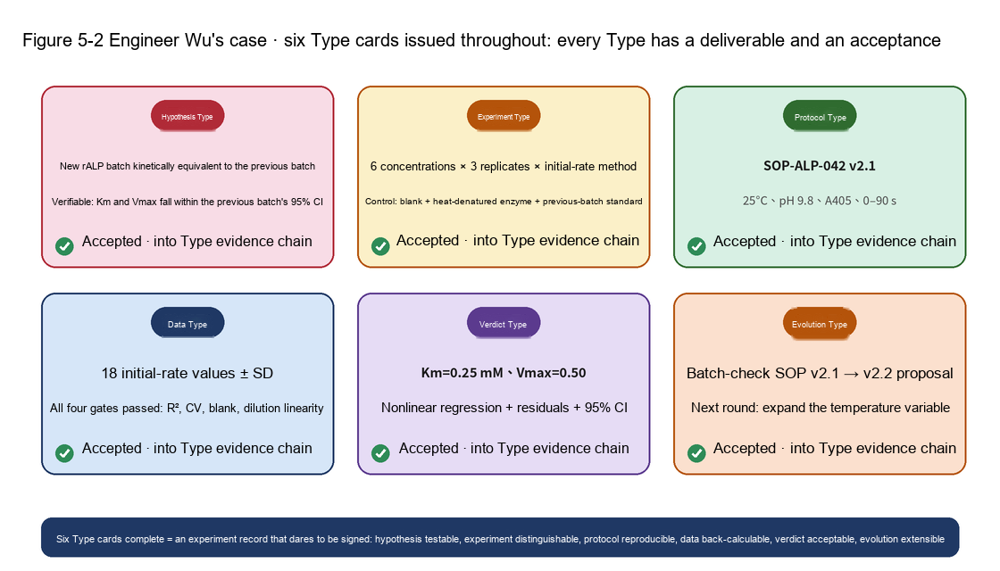

*Figure 5-2 The six Type cards produced across the run: every Type has a deliverable and an acceptance check*

**Table 5-2 S1 output · Hypothesis Type card H-042 (illustrative)**

| **Field** | **Content** |
| --- | --- |
| Hypothesis statement | The Km and Vmax of the new rALP batch ALP-2610 fall within the 95% confidence intervals of the previous batch ALP-2604 (kinetic equivalence) |
| Alternative hypothesis | Either parameter falls outside the previous batch's 95% CI, or a different mechanistic signature appears (a change in the double-reciprocal plot pattern) |
| Falsifiability conditions | After non-linear regression, the hypothesis is overturned if the CI of Km or of Vmax does not overlap the previous batch's CI |
| Variable declaration | Independent variable: pNPP concentration; dependent variable: initial rate v (ΔA405/min); controlled variables: 25 °C, pH 9.8, enzyme loading 0.1 U/mL |
| Success criterion | Both parameters fall within the previous batch's 95% CI, and all four ∩(T) gates pass (linearity R² ≥ 0.99, CV ≤ 5%, blank ≤ 0.01, dilution R² ≥ 0.99) |

**Table 5-3 S2 output · Experiment design document EX-2610-07 (illustrative)**

| **Field** | **Content** |
| --- | --- |
| Independent variable | Final pNPP concentration, 6 gradients: 0.05 / 0.10 / 0.20 / 0.40 / 0.80 / 1.60 mM (spanning the expected Km ≈ 0.25 mM) |
| Dependent variable | Initial rate v = ΔA405/min, taken as the slope of the 0–90 s linear segment; n = 3 |
| Controlled variable | 25 °C ± 0.5; pH 9.8 DEA buffer (prepared on the day); final enzyme concentration 0.1 U/mL; the same UV-2600 instrument |
| Control group | (1) blank (no enzyme); (2) heat-denatured enzyme (65 °C, 10 min); (3) previous batch standard ALP-2604 run alongside in the same batch |
| Replication and randomisation | Three replications per point, solutions prepared independently; instrument run order randomised; a single operator (Engineer Wu) |
| Three-level remove | Enzyme / substrate = essential part; DEA buffer / stop solution = function-degraded part; marker dye = non-essential part (not added) |

**Table 5-4 S3 output · SOP-ALP-042 v2.1 (illustrative abridged version)**

| **Step** | **Action (parameter · tolerance)** | **Move** | **Key control points** |
| --- | --- | --- | --- |
| 1 | Prepare DEA buffer at pH 9.8 (± 0.05), prepared on the day | Function generation | If pH is out of tolerance, remake the whole batch |
| 2 | Dilute the pNPP stock into six gradients (volume ± 1%) | Logic generation | Two-person check of the gradient labels |
| 3 | Pre-heat for 5 min at 25 °C, changed from 37 °C (± 0.5 °C) | Function generation | Do not start the run until the temperature is reached |
| 4 | Add enzyme to start the reaction; read A405 every 15 s for 6 points | Analysis | Start timing ± 2 s |
| 5 | Take the slope of the 0–90 s linear segment to obtain v | Analysis | Accept only if R² ≥ 0.99 |
| 6 | Run the blank, the heat-denatured control and the previous batch standard in the same way | Reasoning | Controls and samples on the same day and the same instrument |
| 7 | Enter raw values into the Data Type table; complete the four-gate columns on the same day | Continuous learning | Raw values read-only |

> **Example \| Table 5-5 S4 output · Data Type DS-2610-07 (illustrative data)**  
> Measurement matrix (initial rate v, ΔA405/min, n = 3, mean ± SD):  
> [S] = 0.05 mM: 0.083 ± 0.004 \| 0.10 mM: 0.143 ± 0.005 \| 0.20 mM: 0.222 ± 0.007  
> [S] = 0.40 mM: 0.308 ± 0.008 \| 0.80 mM: 0.381 ± 0.009 \| 1.60 mM: 0.432 ± 0.010  
> ∩(T) four gates: linearity R² = 0.997; within-point CV = 1.8%; blank drift = 0.004 ΔA/min; dilution back-calculation R² = 0.999 → all passed.  
> Traceability: UV-2600#0412, CAL-2603, operator Engineer Wu, 2026-10-14 09:20–10:05.  

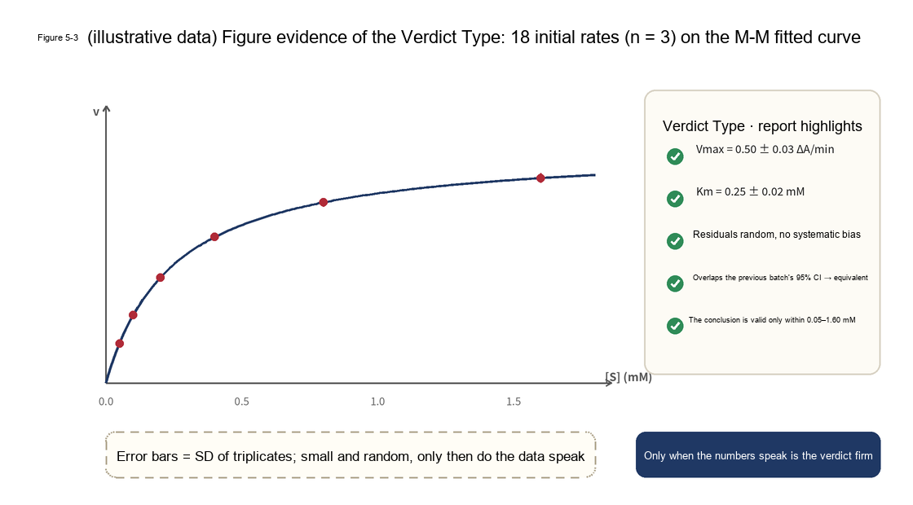

*Figure 5-3 Graphical evidence for the Verdict Type: 18 initial-rate values pinned onto the fitted curve (illustrative data)*

### 5.4 The Verdict Report and the Evolution Log

The S5 verdict pins the data onto the skeleton: Michaelis–Menten non-linear regression as the primary method, the double-reciprocal plot as a supporting check, yielding point estimates and 95% CIs for Km and Vmax, which are then compared with the previous batch specification. Once the comparison passes, S7 writes the conclusions and lessons of the whole round into the evolution log — and that is the starting point of the next round.

**Table 5-6 S5 output · Verdict Type report VR-2610-07 (illustrative)**

| **Field** | **Content** |
| --- | --- |
| Skeleton and method | v = Vmax[S]/(Km+[S]), settled by non-linear regression; Lineweaver–Burk used only for inspection (six points collinear, R² = 0.998) |
| Parameters and uncertainty | Vmax = 0.50 ± 0.03 ΔA405/min; Km = 0.25 ± 0.02 mM (95% CI, illustrative) |
| Residual check | Residuals scattered randomly with no systematic shift; no outliers requiring handling |
| Scope | Valid at [S] 0.05–1.60 mM, 25 °C, pH 9.8; not extrapolated beyond this range |
| Comparison verdict | Previous batch specification Km = 0.25 ± 0.02 mM, Vmax = 0.50 ± 0.03 → CIs overlap, equivalence holds → hypothesis passes |

**Table 5-7 S7 output · Evolution Type log EV-ALP-003 (illustrative)**

| **Field** | **Content** |
| --- | --- |
| Version narrative | SOP-ALP-042 v2.1 → v2.2 proposal: this round passed all four gates and equivalence holds; v2.2 will incorporate a temperature-gradient stage |
| Lesson log | (1) blank drift once exceeded the limit → buffer now prepared on the day; (2) operator timing spread of ± 4 s → dual-person timing plus a spoken start cue |
| Next-round hypothesis | Temperature dependence of Km at three temperatures, 25 / 30 / 37 °C (Arrhenius inspection), together with determination of the inhibitor Ki |
| Trigger criterion | A new round is triggered when the parameters of two consecutive batches fall outside the previous batch's CI, when a new instrument is introduced, or when the SOP has gone six months without review |

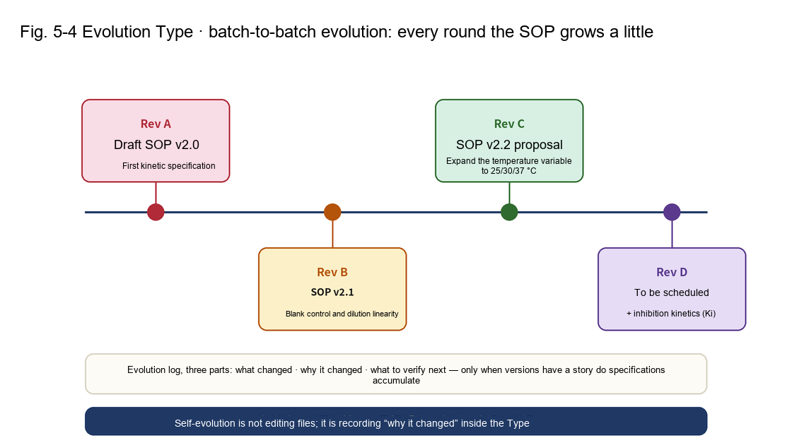

*Figure 5-4 Evolution Type · inter-batch evolution log: every round of experiments ages the SOP by a year*

### 5.5 Report Verification and Rules of Use

Before the S6 integrated report is handed over, three verification passes are made: numerical consistency (abstract = body = data table), evidence-chain completeness (station-by-station cross-check of the six stations), and completeness of declarations (the three items: illustrative data, range of applicability, disclaimer). Sign only once verification has passed. In daily use, keeping the six rules beside the prompts is the safest arrangement.

**Table 5-8 Rules for using the prompts (six rules)**

| **#** | **Rule** | **Why** |
| --- | --- | --- |
| 1 | Open one stage at a time; do not open the next stage before the previous one is accepted | The seven stages are a relay, not a buffet; skipping a stage means skipping a gate |
| 2 | Every stage carries its criteria (∩(T) written into the closing) | An output without a referee turns acceptance into an argument |
| 3 | Every stage leaves feedback (that stage's three self-check questions) | Self-checking is the cheapest quality insurance |
| 4 | Example data are marked 'illustrative' | Illustrative passed off as real means trust bankruptcy |
| 5 | Moves must be named (e.g. Search + Reasoning) | Only when you know which move you used can you switch to the next one |
| 6 | Revisions must be logged (version number + date) | An evolution log without versions has no story |

> **Chapter highlights**  
> The full prompt text runs to seven stages in one consistent format: task, input, output, criteria, three self-check questions — copy it directly and use it once modified.  
> Engineer Wu's case rehearses all six Types end to end: hypothesis card → experiment design document → SOP → data table → verdict report → evolution log.  
> Every number is illustrative; what is genuinely valuable is the path of 'set the criteria first, then collect the data'.  

## 6 Misuse, Maturity, Adoption

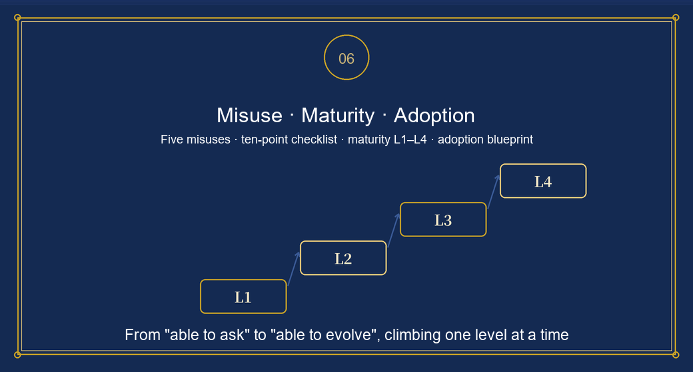

The final chapter is about lasting stability: it first lays out the five most common misuses, then gives you a ten-question checklist as a pre-flight check, and finally uses maturity levels L1–L4 and an adoption blueprint to settle the method into the laboratory's daily routine.

### 6.1 The Five Misuses

The misuses share three features: skipping the criteria, omitting the control, and inflating the conclusion. None of the three makes the data look better; they only make the conclusion more dangerous. On the left is the scene of the stumble, on the right the correct posture.

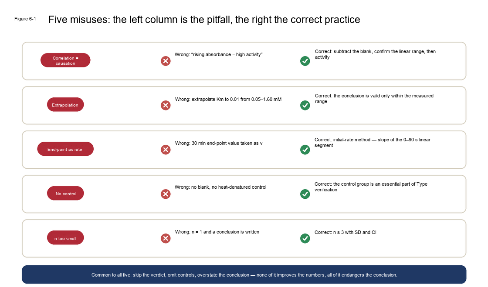

*Figure 6-1 The five misuses: the stumble on the left, the correct posture on the right*

**Table 6-1 The five misuses compared**

| **Misuse** | **Symptom** | **Correct response** |
| --- | --- | --- |
| Treating correlation as causation | 'Absorbance rises = activity is high', concluded directly | Subtract the blank first, confirm the linear range; causation must be supported by controls and mechanism |
| Extrapolation beyond the range | Extrapolating from 0.05–1.60 mM data down to 0.01 mM | Conclusions hold only within the measured range; the applicable range must be stated |
| Endpoint method masquerading as initial rate | Reading the 30 min endpoint as the reaction rate | Initial-rate method: only the slope of the 0–90 s linear segment is v |
| Missing control | No blank, no heat-denatured control | The control is a necessary component of the Experiment Type; remove it and identity is lost |
| Insufficient replication | Drawing conclusions from n = 1, reporting only the mean and no SD | n ≥ 3, report SD and CI; investigate outliers in the experiment first |

### 6.2 The Ten-Question Checklist

Before opening a case and before issuing a report, run through these ten questions. If three or more cannot be answered, hold off — this is not delay, it is time saved on rework.

**Table 6-2 The ten-question checklist (pre-flight check)**

| **#** | **Question** | **Maps to** |
| --- | --- | --- |
| 1 | Is the hypothesis falsifiable? What data would overturn it? | Hypothesis Type |
| 2 | Are the independent, dependent and controlled variables clearly separated? | Experiment Type |
| 3 | Are the controls complete? Blank / positive / reference material? | Experiment Type |
| 4 | Are the number of replications and the randomisation planned? | Experiment Type |
| 5 | Is the linear range for the initial rate confirmed? (Does R² clear the threshold?) | ∩(T) four gates |
| 6 | Have all four ∩(T) gates passed? Is there a sign-off? | ∩(T) four gates |
| 7 | Which equation is the reasoning skeleton? Has it been committed to first? | Reasoning skeleton |
| 8 | Does the conclusion trace back to the hypothesis? Are all six stations cleared? | Type evidence chain |
| 9 | Does the conclusion go beyond the measured range? | Verdict Type |
| 10 | Are the next round's hypotheses and lessons written into the evolution log? | Evolution Type |

### 6.3 Maturity L1–L4

Maturity is not a job title; it is the degree to which outputs can be acceptance-checked. A four-rung ladder: L1 Improvisation (ask whatever comes to mind), L2 Template (six-Type cards and S1–S7 become routine), L3 Criterion (∩(T) acceptance is automatic, the evidence chain takes shape), L4 Evolution (the evolution log closes the loop, the SOP revises itself). Each level rests on the one below it; skipping a level yields only the illusion of looking accurate.

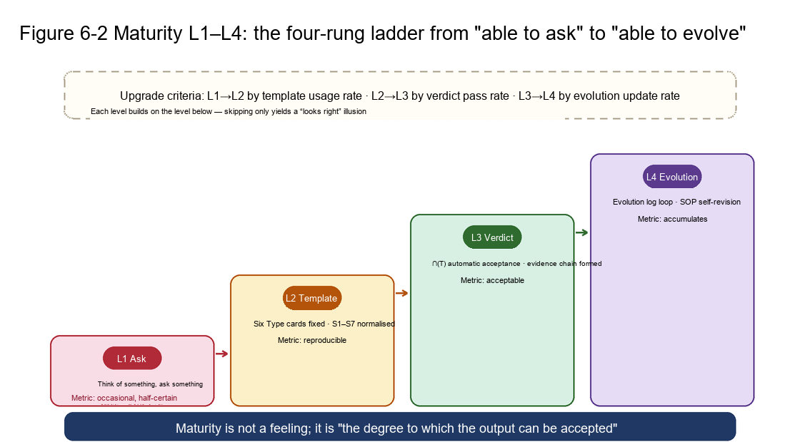

*Figure 6-2 Maturity L1–L4: the four-rung ladder from asking well to evolving*

**Table 6-3 Maturity L1–L4 compared**

| **Level** | **Characteristics** | **Upgrade criterion** | **Common sticking point** |
| --- | --- | --- | --- |
| L1 Improvisation | Prompts follow whatever comes to mind | Template usage > 60% | Outputs not reproducible, reporting conventions inconsistent |
| L2 Template | Six-Type cards and S1–S7 become routine | Criterion pass rate can be measured | Templates exist, but criteria still rely on feel |
| L3 Criterion | ∩(T) acceptance is automatic, the evidence chain takes shape | The evolution log is updated every month | Acceptance is strict, but nothing grows |
| L4 Evolution | The evolution log closes the loop, the SOP revises itself | (sustain continuously) | Complacency, review stops |

### 6.4 Adoption Blueprint

Adoption does not need a big bang. Three months, three milestones: in month one, pilot a single familiar protocol (a routinely run quantitative enzyme assay is the recommended choice); in month two, roll the six-Type cards and criteria out to the whole group; in month three, bring ∩(T) acceptance and the evolution log into routine review. Pilots succeed most often when the experiment is routinely run, quantifiable and backed by data from earlier batches.

**Table 6-4 Three-month adoption blueprint**

| **Milestone** | **Action** | **Output** | **Acceptance** |
| --- | --- | --- | --- |
| Month 1 · Pilot | Take one familiar protocol through all seven stages | One complete set of six-Type documents | All four gates passed + report signed |
| Month 2 · Roll-out | Turn the six-Type cards and criteria into templates; train the whole group | In-group template library | Template usage > 60% |
| Month 3 · Routine | Bring ∩(T) acceptance into the regular meeting; open the evolution log | Acceptance checklist + evolution log | At least one evolution record per month |

> **Chapter highlights**  
> The common antidote to all five misuses: skip no criterion, omit no control, inflate no conclusion — do none of these three things.  
> Use the ten-question checklist as a pre-flight check; if three questions cannot be answered, hold off.  
> Climb maturity L1–L4 one rung at a time; adopt through a three-month pilot roll-out, not a big bang.  

## Review: Three Takeaways

From start to finish this book does one thing: it turns "accurate" from an adjective into a method. Before you leave, take three things with you.

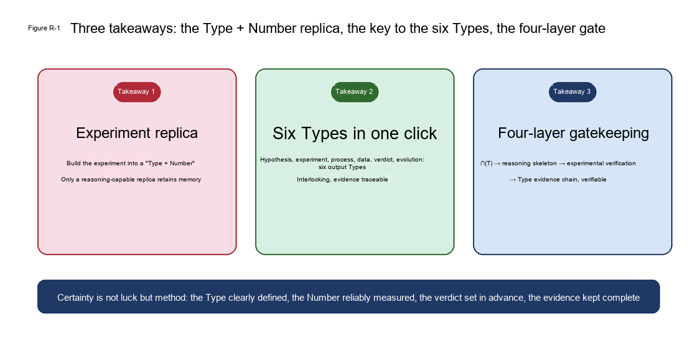

*Figure R-1 Three takeaways: the Type + number twin, the chain of six Types, the four-layer gate*

> **Takeaway 1 · The experimental twin: Type + number**  
> Build the experiment into a reasoning-capable twin of "Type + number": record structure as Type (Container, Composition, Abstract) and measurement as number (with the full three-part traceability set).  
> While the twin exists, the memory exists — a different person, a different batch, half a year later, the reasoning path can still be traced.  

> **Takeaway 2 · One chain of six Types: hypothesis, experiment, protocol, data, verdict, evolution**  
> The hypothesis is falsifiable, the experiment is discriminable, the protocol is reproducible, the data is recomputable, the verdict is acceptance-checked, the evolution is continuable — the six Types interlock and the evidence traces back.  
> The full S1–S7 prompt texts are in Chapter 5; copy them straight, adapt them and use them.  

> **Takeaway 3 · Four layers of gatekeeping: accuracy that can be checked**  
> ∩(T) criterion → reasoning skeleton → experimental validation → Type evidence chain: none of the four gates may be skipped; space × time cross-acceptance gates on both axes.  
> Accuracy is not luck, it is method: agree the criteria first, and only then dare to sign the conclusion.  

**Table R-1 Master list of tools in the book (exit checklist)**

| **Tool** | **Chapter** | **Use in one line** |
| --- | --- | --- |
| The three brackets ( ) { } [ ] | Chapter 2 (Output Skeleton) | Container identity, formulation composition, category criteria — build these first when opening a case |
| The three levels of the remove criterion | Chapter 2 (Output Skeleton) | Remove one part to see the whole: necessary component, function-degraded component, non-essential component |
| ∩(T) four gates | Chapter 3 (Accuracy Gatekeeping) | Linearity, replication, blank, dilution — only when all pass may you fit |
| Reasoning skeleton | Chapter 3 (Accuracy Gatekeeping) | Commit to the equation first, then let the data speak |
| Four-step framework + six steps | Chapter 4 (Operating Procedure) | Clarify the requirement first; walk the six-step loop |
| Three-layer judgement | Chapter 4 (Operating Procedure) | A three-question scan: Is it? Does it have? Is it right? |
| S1–S7 prompts | Chapter 5 (Prompt Examples) | A seven-stage relay, one stage at a time |
| Ten-question checklist | Chapter 6 (Governance and Adoption) | Pre-flight check; if three questions cannot be answered, hold off |

## Appendix A The Toolbox

### A.1 Terminology Quick Reference

**Table A-1 Terminology quick reference (thirteen rows)**

| **Term** | **Definition (used only, not taught)** | **Application point in this book** |
| --- | --- | --- |
| Type | The smallest identifiable unit of structure | Every output in the book is named with Type, never Form |
| Space Type | The Type that describes "what it is": Container, Composition, Abstract | Sample, formulation, experiment category |
| Time Type | The Type that describes "how it is done": verb = function = move | SOP actions, analytical methods, evolution |
| Container ( ) | C = (id(C), S(C)); identity does not change with the contents | Well, tube, petri dish |
| Composition { } | BOM and the three-level remove criterion | Reaction formulation, culture medium |
| Abstract [ ] | T = (F(T), ∩(T)); open rules define the category | Experiment category, specification |
| ∩(T) intersection criterion | Membership only when every feature passes | The four data-quality gates |
| remove criterion | Take it off: does it still recognise itself? | Necessary component / function-degraded component / non-essential component |
| id(C) identity | A marker that does not change with the internal space | Well number, sample barcode |
| Four-step framing | Distinguish similarity and difference → trigger abstraction → name the dimensions → assign membership | Requirement clarification |
| Three-layer judgement | The three questions on Container, BOM and Abstract (Is it? Does it have? Is it right?) | Experiment eligibility review |
| Reasoning skeleton | Commit to the equation first, then let the data speak | Michaelis–Menten |
| Type evidence chain | A six-station chain tracing the conclusion back to the hypothesis | Experimental records and sign-off |

### A.2 The Fourteen Moves × Their Application in Biological Experiments

**Table A-2 Complete table: the fourteen moves on the move board × their application in biological experiments**

| **Group** | **Move** | **Application in biological experiments** |
| --- | --- | --- |
| Search | Type–time function search | Look up literature methods, standard methods (e.g. pharmacopoeia), previous-batch SOPs |
| Search | Design search and extraction | Extract the experimental design from the literature: gradient, controls, number of replications |
| Generation | Design patterns | Apply patterns such as control design, factorial design, blocked design |
| Generation | Logic generation and application | Derive variable logic, criterion logic, conditional branches |
| Generation | Function generation and application | Generate SOP actions, data tables, analysis-script specifications |
| Thinking | Problem-solving | Diagnosing experimental failure: troubleshooting failed gates and abnormal controls |
| Thinking | Analysis | Data analysis: fitting, residuals, outlier determination |
| Thinking | Design | Experimental design: gradient layout, sample-size estimation |
| Thinking | Reasoning (cause→effect / effect→cause / simulation / statistical / reverse…) | Inferring mechanism, separating correlation from causation, verifying conclusions in reverse |
| Thinking | Thinking methods (forward / reverse / lateral / vertical / first principles…) | Rethink the hypothesis from another angle, take anomalies apart from first principles |
| Thinking | R&D and exploration | Exploring new indicators, new methods, new inhibitor conditions |
| Evolution | Continuous learning | Batch-to-batch learning: fold this round's data into the specification baseline |
| Evolution | Reconstruction and recombination | SOP reconstruction: merge steps, tighten tolerances |
| Evolution | Self-evolution | Self-revising specifications, next-round case opening driven by the evolution log |

### A.3 Notation Quick Reference

**Table A-3 Notation quick reference**

| **Notation** | **Read as** | **Used for** |
| --- | --- | --- |
| T = (F(T), ∩(T)) | Category = feature set + intersection criterion | Defining experiment categories, the four-gate criterion |
| C = (id(C), S(C)) | Container = identity + internal space | Wells, sample containers |
| remove(p,M) | Remove part p from the whole M | Three-level classification of a formulation BOM |
| remove(p,M) ≢ M | Identity is lost after removal (necessary component) | Enzyme, substrate |
| remove ≡ M' ⊂ M | Function is degraded after removal (degraded component) | Buffer, stop solution |
| remove(p,M) ≡ M | Unaffected after removal (non-essential component) | Labelling dye |
| v = Vmax[S]/(Km+[S]) | Michaelis–Menten skeleton | Reasoning skeleton, non-linear regression |
| 1/v = (Km/Vmax)(1/[S]) + 1/Vmax | Double-reciprocal inspection form | Lineweaver–Burk plot |
| S(t+1) = g(S(t), move, event) | The state evolves with the moves | Evolution log, SOP version drift |

> **Final reminder**  
> All data and document numbers in this book are illustrative; in real use, follow each laboratory's own regulations, safety rules and quality-control system.  
> The English term is Type, not Form — take that convention with you as well.  

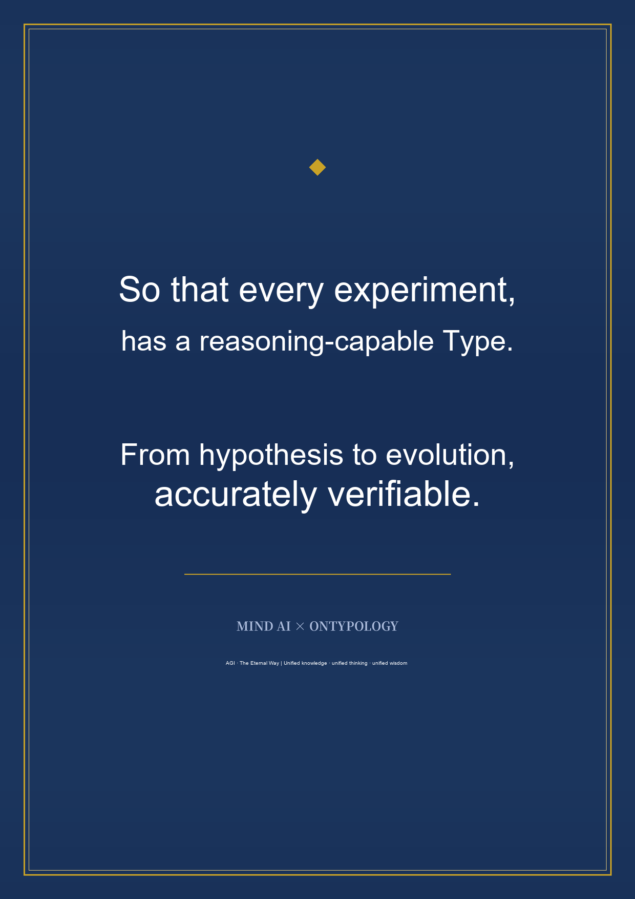
