# AICybersecurity

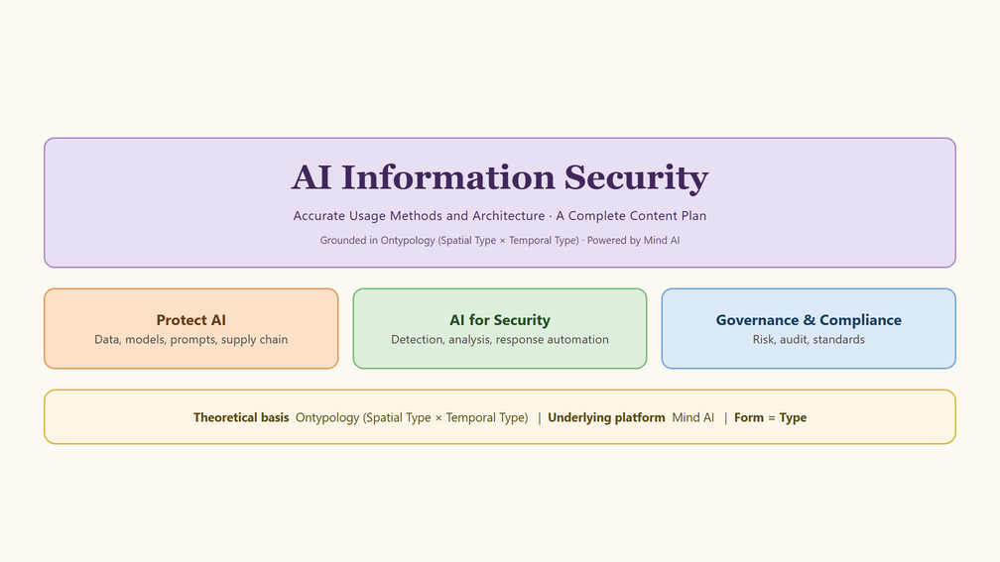

*Cover　AI Information Security: Accurate Usage Methods and Architecture · A Complete Content Plan*

This volume takes Ontypology (Spatial Type × Temporal Type) as its theoretical basis and Mind AI as its underlying platform, to establish accurate usage methods and a complete plan for AI information security. The book has eight parts: positioning, backbone at a glance, Spatial Types, Temporal Types, accurate usage methods, governance, compliance and overall architecture, a complete content plan, and conclusion, with quick-reference cards and exercise answers in the appendices.

> **Positioning of This Book**  
> Theoretical basis: Ontypology (Spatial Type and Temporal Type) — taking only the backbone, not reproducing the original work.  
> The underlying platform: Mind AI — taking only one line of platform architecture, not reproducing platform content.  
> Scope of topics: both sides fully covered — protecting AI, AI for security and governance and compliance advancing on three lines.  
> Purpose: readable for teaching, adoptable by enterprises; no system implementation chapters.  

** **

## Table of Contents

- **Part 1　Positioning — Why AI Information Security Needs Types**
- 1.1 The Two-Sided Proposition: Two Sides, One Body
- 1.2 The Shifting Threat Landscape: Three New Variables
- 1.3 Three-Layer Positioning: Root, Trunk, Fruit
- **Part 2　Backbone at a Glance — The Theoretical Skeleton This Book Needs**
- 2.1 The Cognition Chain and the Three Axes with Three Brackets
- 2.2 Three-Layer Judgment and the Function Four Questions
- 2.3 The Platform Backbone: Two Libraries, One Hub, One Loop
- 2.4 The Mapping Table: Ontypology Vocabulary Against Security Vocabulary
- **Part 3　Spatial Types — The Types of AI Security**
- 3.1 The AI Asset Type: Decomposing the Unit Type
- 3.2 Reading Security Through Three Axes: X Grading, Y BOM, Z Boundary
- 3.3 Threat Type: The Attack Surface Is the Seam Between Types
- 3.4 Control Type: Protective Measures Are Types Too
- 3.5 Remove Tiers = The Resilience Map
- 3.6 Container ( ) and Zero Trust: Identity Is Not Presumed
- 3.7 The Data Type: Six Life-Cycle Stations
- **Part 4　Temporal Types — Attack and Defence Are Both Functions**
- 4.1 The Attack Function Library: Malicious Temporal Types
- 4.2 Anatomy I: The Type of Prompt Injection
- 4.3 Anatomy II: The Type of Poisoning and Backdoors
- 4.4 Anatomy III: Model Theft and Inference Attacks
- 4.5 Anatomy IV: The Type of Jailbreaks and Guardrails
- 4.6 AI for Security: The Intelligent SOC Loop
- 4.7 Three Detection Function Families: Rules, Statistics, Models
- 4.8 Incident Response = A Closed Loop of Types In, Types Out
- **Part 5　Accurate Usage Methods — Making AI Security a Reviewable Judgment**
- 5.1 Three Supplements: Fill Whatever Is Missing
- 5.2 The Six-Step Proof
- 5.3 Full Demonstration: Judging the Adoption of an External LLM
- 5.4 The Eight-Question Checklist
- 5.5 The Misuse Comparison: Four Groups of Misconceptions
- 5.6 Scenario Routing: A Decision Tree
- **Part 6　Governance, Compliance and Overall Architecture — Writing Responsibility as a Type**
- 6.1 Governance and Compliance: Risk Grading and the Responsibility Type
- 6.2 Reading the Standards: The Four Frameworks
- 6.3 The Overall Architecture: Philosophy, Method, Practice
- 6.4 Three Maturity Levels: See → Judge → Act
- **Part 7　A Complete Content Plan — Learn, Practise, Use, Teach, Build**
- 7.1 Learn, Practise, Use, Teach, Build
- 7.2 The Eight-Week Route
- 7.3 Four Stages of Library Building and Their Acceptance Checks
- 7.4 Adoption Rhythm: Pilot → Expand → Scale
- 7.5 Three Stages of Vision: Unified Knowledge → Unified Thinking → Unified Intelligence
- **Part 8　Conclusion — See, Hold, Judge, Grow**
- **Appendix A　Glossary**
- **Appendix B　Quick-Reference Cards**
- **Appendix C　Model Answers to the Exercises**
- **Appendix D　Index of Figures and Tables**
- **Part 1　Positioning — Why AI Information Security Needs Types**
  - *Once AI enters the organisation, the security problem wears a different face: assets multiply, attacks grow smarter and responsibility blurs. This part first describes this shift, then answers a fundamental question — why list-based security management is no longer enough, and why we need the judgment that Types provide.*
  - 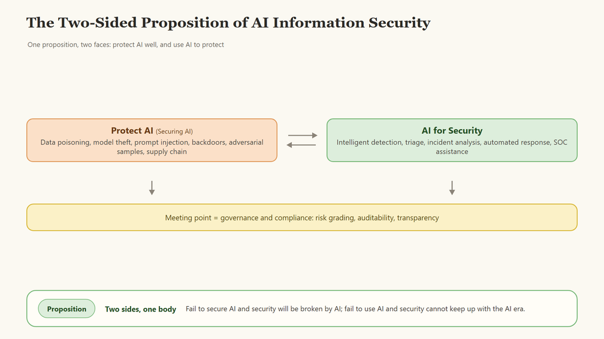
  - *Figure 1-1　The two-sided proposition of AI information security: protecting AI and AI for security, meeting in governance*
- **1.1 The Two-Sided Proposition: Two Sides, One Body**
  - AI information security is not a single topic but two sides of one proposition. The first side is protecting AI: models, data, prompts and supply chains are all new attack surfaces, and poisoning, theft, injection and jailbreaking are all new attack techniques. The second side is AI for security: applying AI to detection, triage and response so that defenders upgrade as well.
  - Where the two sides meet is governance and compliance: who provides, who deploys, who is accountable — if the chain of responsibility is unclear, both sides fail. Hence this book advances on three lines: one for protecting AI, one for AI for security and one for governance and compliance, meeting finally on the Type.

> **One Line**  
> Fail to secure AI and security will be broken by AI; fail to use AI and security cannot keep up with the speed of the AI era. Doing both at once is what complete AI information security means.  

#### 1.2 The Shifting Threat Landscape: Three New Variables

Traditional security deals with hosts, networks and accounts, and protects through boundaries and permissions. The AI era layers three new variables on top, so that the old map cannot find the new world:

◆　Uncertainty — model output is probabilistic, so the same input may produce different outputs, and traditional signature-matching defences fail en masse.

◆　Generativity — models can be induced to produce malicious content, disinformation and phishing messages, so the cost of attack drops sharply.

◆　Agents — once an AI that can act gains tool permissions, the attack surface expands from saying the wrong thing to doing the wrong thing.

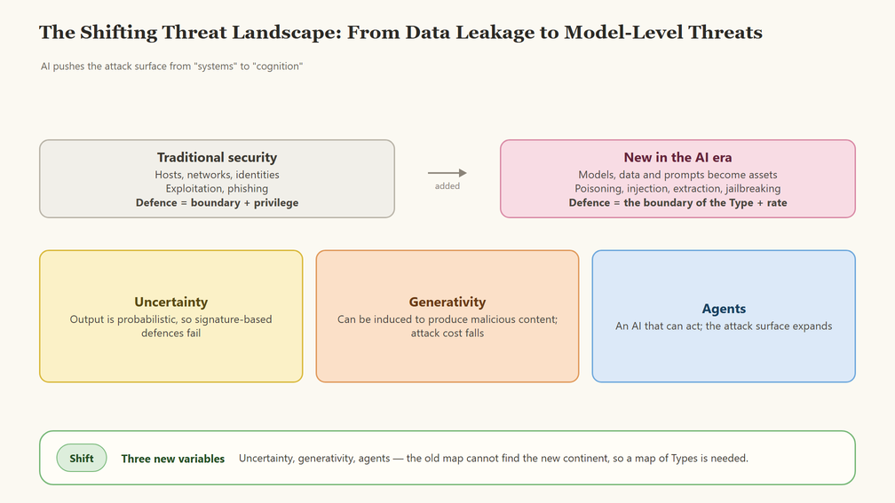

*Figure 1-2　The shifting threat landscape: from data leakage to model-level threats*

What these three variables have in common is that the asset itself becomes a Type that changes. Data leakage can be managed with an asset inventory, but an evolving model, a prompt that can be overwritten and a workflow that can be hijacked must be written as Types before they can be managed — this is where Ontypology comes into its own.

#### 1.3 Three-Layer Positioning: Root, Trunk, Fruit

The book's place on the knowledge map is made clear with three-layer positioning: the root is ontology, asking what exists — listing assets, threats and controls; the trunk is Ontypology, asking what a Type is, how to judge and how it works — giving the three axes, three-layer judgment and functions; the fruit is Mind AI, turning judgment into a platform.

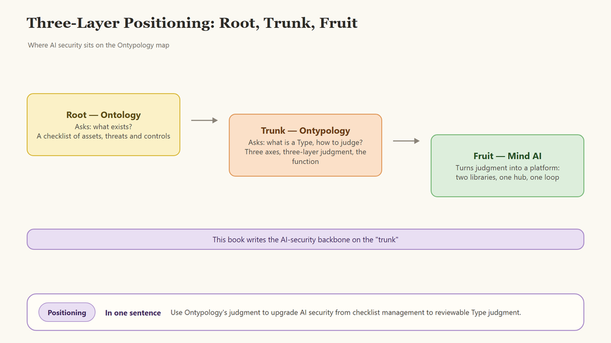

*Figure 1-3　Three-layer positioning: root, trunk, fruit*

The branches and leaves of AI information security grow from the trunk: an asset inventory is a product of the root, but only when assets are written as Types, attacks as functions and judgment is taken through all three layers do protections have grounds, audits have standards and automation have confidence.

| **Exercise E01** | Write the Unit Type of one AI asset around you: all three columns of {parts, (content), [category]} must have content, and the [ ] scale must be specific. |
| --- | --- |

| **Exercise E02** | Use the three new variables (uncertainty, generativity, agents) to analyse an AI application you are using: which Type does each variable affect, and which criterion does it break? |
| --- | --- |

> **Part Summary**  
> The shape of the AI security problem has changed: assets are Types that change, attacks are functions that combine, and responsibility is a boundary that moves. List-based management cannot answer these three questions; Type judgment can.  

> **Professional Column C1　A Chronology of Lessons from AI Security Incidents**  
> Looking back at public cases of recent years, a common thread emerges. The lesson at the data layer: the training data of an open-source model was found to have been mixed with a contaminated dataset, and a low ratio of poisoned data was enough to implant a backdoor — the shape of the supply chain was never checked, and everything downstream failed.  
> The lesson at the prompt layer: after an enterprise adopted a customer-service assistant, users used indirect injection to induce the model, through web-page content, to leak conversation records — content and instructions were not separated, the most widespread misconception at the time.  
> The lesson at the behaviour layer: in trials an agent was induced to bypass review and perform unauthorised operations — once AI gains tool permissions, saying the wrong thing escalates into doing the wrong thing.  
> Putting the three lessons of the layers side by side gives exactly the skeleton of Part 3 of this book: the asset Type, the prompt Type and the behaviour Type, each layer needing its criteria. An incident is not gossip; it is the cautionary tale of the Function Library.  

### Part 2　Backbone at a Glance — The Theoretical Skeleton This Book Needs

*This part is the only theoretical overview in the book: it establishes only the backbone this book needs and does not reproduce the existing content of Ontypology and Mind AI. Readers already familiar with the theory can skim it; readers meeting it for the first time can treat this part as the first page of the map — the details unfold as they are used in later parts.*

#### 2.1 The Cognition Chain and the Three Axes with Three Brackets

The cognition chain in one line: sameness and difference → split and merge → Type → name. First distinguish sameness and difference, then look at split and merge, then condense into a Type, and finally name it. The core proposition is where there is composition, there is a Type — any stable combination is worth writing as a Type.

A Type is written with three axes and three kinds of brackets: the X Property [ ] (dimension × scale) handles grading and labelling; the Y Composition { } (bill of materials and remove tiers) handles decomposition and resilience; the Z Container ( ) (identity and scope) handles boundary and trust. The Unit Type is written in one line: Type Set = {parts, (content), [category]}.

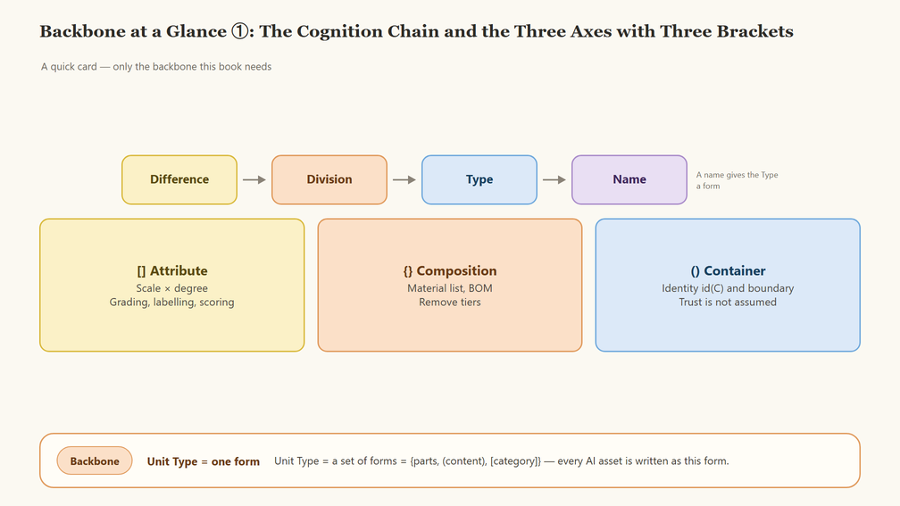

*Figure 2-1　Backbone at a glance ①: the cognition chain and the three axes with three brackets*

#### 2.2 Three-Layer Judgment and the Function Four Questions

Judgment has three layers: the container layer looks at identity and boundary, the composition layer looks at parts and structure, and the abstraction layer looks at category membership; the joint criterion is written J = J_C ∧ J_B ∧ J_T, and none may be missing. The most common failure in security judgment is walking only one layer — verifying the account (container) and letting it through, without looking at the content structure (composition) or the use category (abstraction).

Operation is written as functions (Temporal Types): each function gets one four-question card — name, input Type, output Type, criteria. A Temporal Type attaches to a Spatial Type: it takes in one Type and produces one Type. Attack is a function, defence is a function, response is a function too — only when attack and defence are both written as function cards is there a common language for the fight.

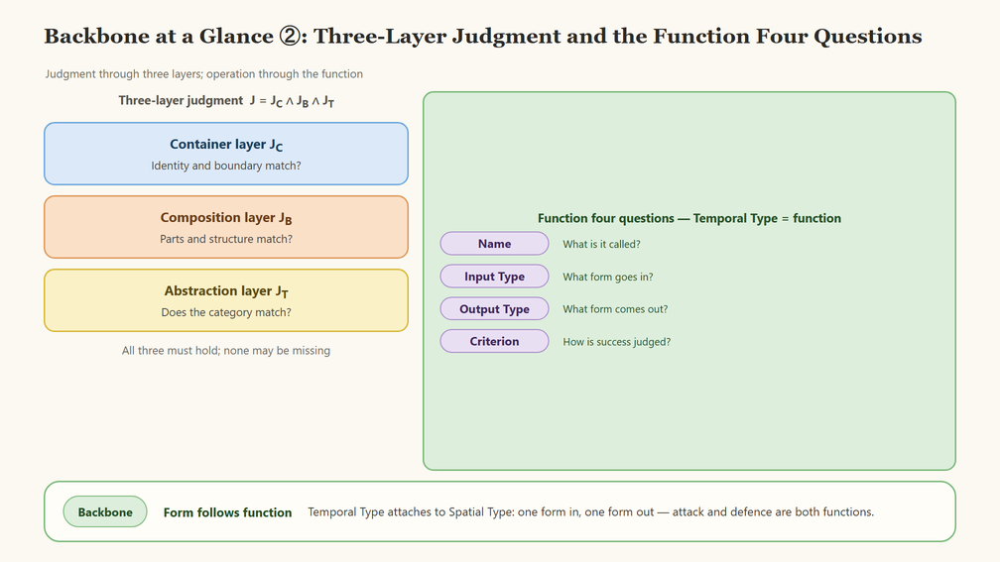

*Figure 2-2　Backbone at a glance ②: three-layer judgment and the function four questions*

#### 2.3 The Platform Backbone: Two Libraries, One Hub, One Loop

The architecture of the underlying Mind AI platform needs only one line in this book: the Type Library (the home of Spatial Types) + the Function Library (the home of Temporal Types) + the hub (three-layer judgment and four-question dispatch) + the loop (event feedback, continuous learning). Types and functions are stored in separate libraries, the hub judges, the loop grows — this book borrows that one line of architecture to ground AI security and does not reproduce the platform's own content.

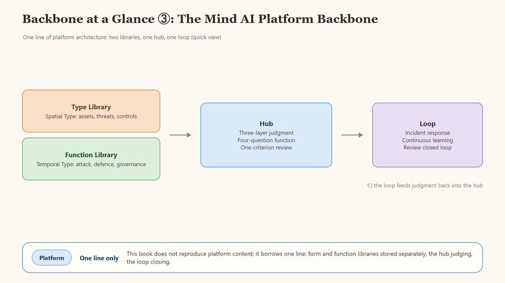

*Figure 2-3　Backbone at a glance ③: the Mind AI platform backbone*

#### 2.4 The Mapping Table: Ontypology Vocabulary Against Security Vocabulary

The whole-book mapping is shown in the table below: Ontypology vocabulary on the left, security vocabulary on the right. Remember one line first: assets are Types, attacks are functions, judgment has three layers — every later chapter unfolds this table.

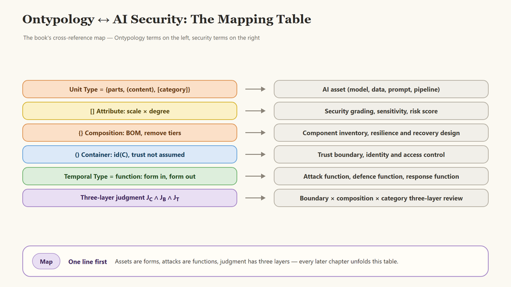

*Figure 2-4　Ontypology ↔ AI security mapping table*

| **Exercise E03** | Draw a third-party model API vendor as one container ( ): mark the identity id(C) and the scope S(C), and whichever column is missing indicates which supplement is needed. |
| --- | --- |

> **Backbone at a Glance: Summary**  
> Theory only needs to be remembered to this depth: the three axes record how to write a Type, three-layer judgment records how to judge, the function four questions record how it works, and two libraries, one hub, one loop record where it grows. The rest unfolds as you use it.  

### Part 3　Spatial Types — The Types of AI Security

*The first step of defence is to see: write the assets, threats and controls of the AI world as Types, and the attack surface goes from vague to countable. This part uses the three axes of the Spatial Type to organise the static world of AI security into three ledgers: the grading ledger, the parts ledger and the boundary ledger.*

#### 3.1 The AI Asset Type: Decomposing the Unit Type

An AI asset is written as a Unit Type = {parts, (content), [category]}. Take an image classification model: the parts ({ }) include the weights, the architecture, the tokenizer, the training pipeline and the dependent packages; the content (( )) includes the training data, the system prompt, the deployment boundary and the service scope; the category ([ ]) includes the use scale, the sensitivity level, the risk score and the compliance labels.

The point of decomposition is to recognise yourself: if you cannot recognise your own parts, you cannot secure them. In practice the first action is inventory — write all the models, datasets, prompt templates and plugin tools in the organisation as Type cards, and the attack surface turns from a slogan into a list at once.

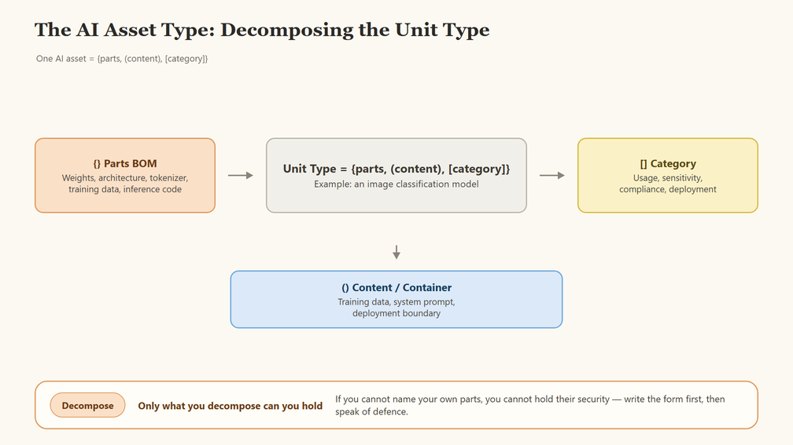

*Figure 3-1　The AI asset Type: decomposing the Unit Type*

#### 3.2 Reading Security Through Three Axes: X Grading, Y BOM, Z Boundary

The three axes of the Spatial Type are the three security ledgers. The X Property axis is the grading ledger: the dimensions are confidentiality, integrity and availability, and the scale runs from public to top secret — its role is to define the strength of protection. The Y Composition axis is the parts ledger: the BOM lists what the model is made of, and remove tiers separate essential, degradable and non-essential parts — its role is resilience and backup. The Z Container axis is the boundary ledger: id(C) identifies, S(C) scopes — its role is trust boundary and access control.

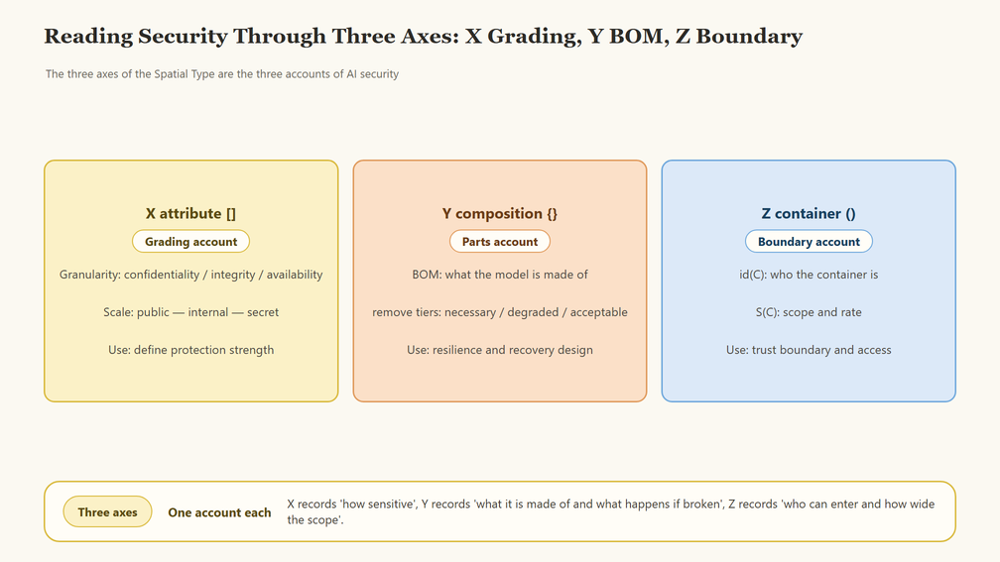

*Figure 3-2　Reading security through three axes: X grading, Y BOM, Z boundary*

> **Three Ledgers in a Nutshell**  
> X records how sensitive, Y records what it is made of and what happens if it breaks, and Z records who can get in and how large the scope is. Only when all three ledgers are complete is the asset Type a complete Type.  

#### 3.3 Threat Type: The Attack Surface Is the Seam Between Types

Vulnerabilities mostly grow in the seams — the hand-over between two Types: a vendor model handed to my application, with version updates, permission boundaries, format conversion and human hand-over in between. Write assets as Types and draw hand-overs as seams, and the attack surface goes from vague to countable.

The four most common seams: the supply-chain seam (third-party components), the data seam (labelling and import), the human–machine seam (prompt and review) and the organisational seam (permissions and process). In the AI era the human–machine seam is especially dangerous — the prompt is the hand-over surface between user and model, and also the battlefield of prompt injection.

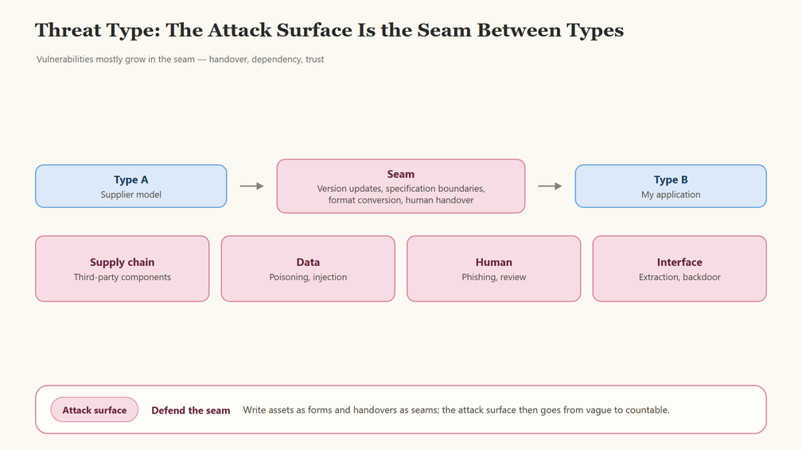

*Figure 3-3　Threat Type: the attack surface is the seam between Types*

#### 3.4 Control Type: Protective Measures Are Types Too

Every protection is also written as {parts, (content), [category]}: boundary control (WAF, API gateway, network segmentation), identity control (SSO, MFA, least privilege), content control (filtering, review, DLP) and behaviour control (rate, anomaly, sandbox). The ordered combination of these four kinds of control is defence in depth.

Only with a clear Control Type can you check what happens if this protection is removed — the detachability check of a protection is exactly where remove tiers come into their own.

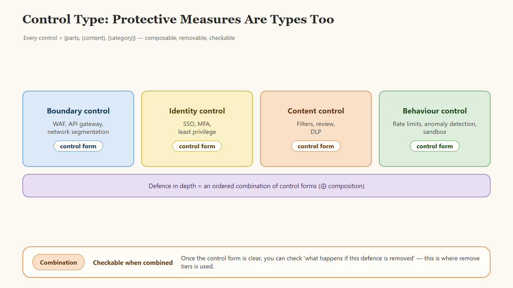

*Figure 3-4　Control Type: protective measures are Types too*

#### 3.5 Remove Tiers = The Resilience Map

Ask of every part in turn: if we remove it, does the system still recognise itself? The answers fall into three tiers — essential (remove it and it fails, such as model weights and core credentials: needs backup, off-site copies and drills), degradable (remove it and functionality degrades, such as the recommendation module and secondary APIs: needs a degradation plan and a switch), non-essential (remove it and everything runs as usual, such as experimental features and debugging interfaces: can be removed directly, shrinking the attack surface on the way).

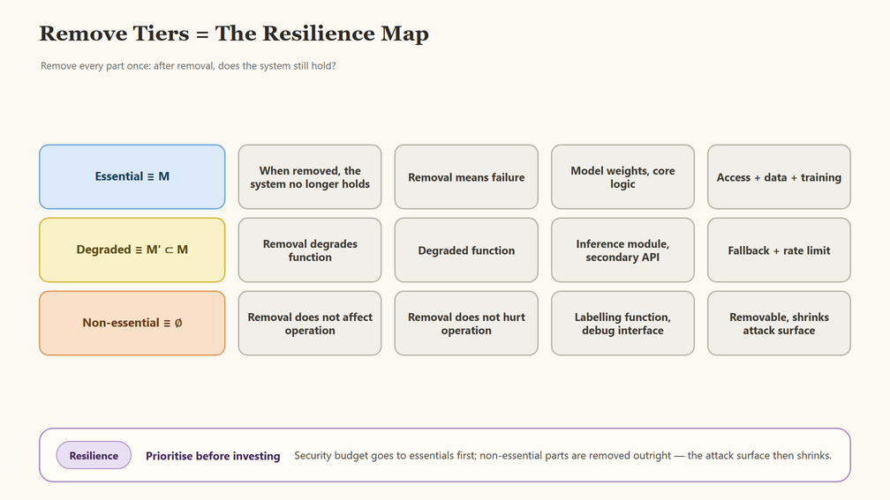

*Figure 3-5　Remove tiers = the resilience map*

Resilience is knowing what can be spared; security is protecting what cannot. The security budget goes to essential parts first, and non-essential parts are removed outright — graded investment is far more effective than spreading protection evenly.

#### 3.6 Container ( ) and Zero Trust: Identity Is Not Presumed

The old model is a moat: once inside the intranet you are free. The zero-trust model applies the container's invariance axiom to every request: verify id(C) every time, least privilege, short-lived credentials, assume already breached.

The AI version of zero trust adds one more rule: model output is not trusted by default either. Humans verify humans with credentials; AI output must be verified on three layers — boundary (which container it came from), structure (are the parts correct) and categorisation (is the use permissible) — and released only when all three pass. Output is a Type: judge first, then use.

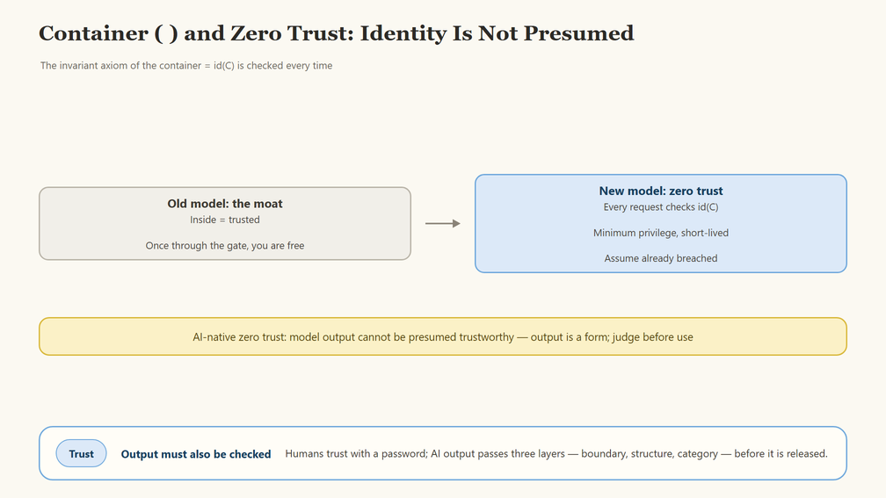

*Figure 3-6　Container ( ) and zero trust: identity is not presumed*

#### 3.7 The Data Type: Six Life-Cycle Stations

The data Type transforms along the way: collection (consent and scope) → cleaning (de-identification and filtering) → labelling (vendor and quality) → training (poisoning risk) → deployment (inference and memory) → retirement (destruction and retention). Every station has Types entering and leaving, and every station has a place to book risk against.

The high-risk stations are labelling and training: where poisoning most easily slips in. The watchword of protection is a ledger at every station — the input Type and output Type at each station must be verified, so that the journey of the data is traceable.

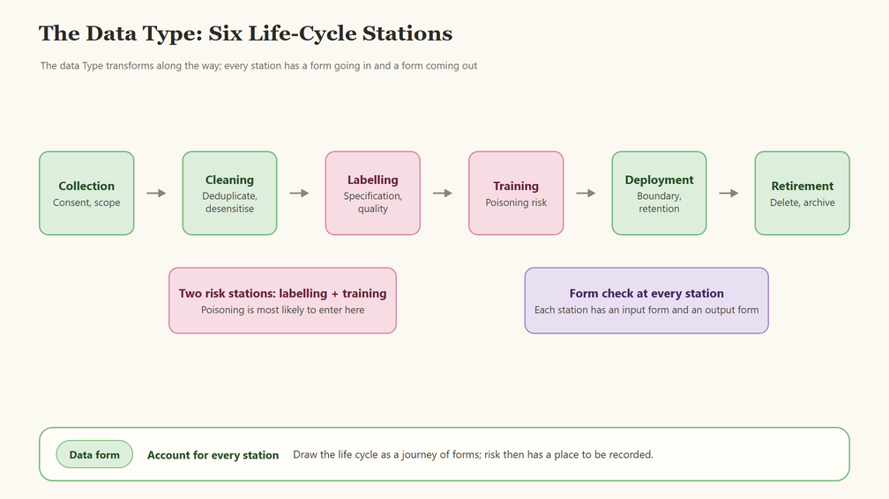

*Figure 3-7　The data Type: six life-cycle stations*

| **Exercise E04** | Find one seam in your organisation and write down which of the four kinds it is — supply-chain, data, human–machine or organisational — along with the input Type and output Type on either side of the seam. |
| --- | --- |

| **Exercise E05** | Sort one AI system into the three remove tiers (essential / degradable / dispensable), attaching one sentence to each tier on the consequences of removing it. |
| --- | --- |

> **Part 3 Summary**  
> The Spatial Type gives AI security three ledgers (X grading, Y parts, Z boundary), one way of looking (finding seams) and one resilience map (remove tiers). Only a Type you can see can be held.  

> **Professional Column C2　Reading MITRE ATLAS and OWASP LLM Top 10 as Types**  
> Two community frameworks are ready-made indexes of threat Types. MITRE ATLAS (Adversarial Threat Landscape for AI Systems) arranges the tactics and techniques aimed at AI into a matrix — reconnaissance, resource development, initial access, execution, privilege escalation, exfiltration, impact — and every cell can be read as a category index of an attack function.  
> OWASP's Top 10 risks for LLM applications, by contrast, is a quick-reference table at the application layer: prompt injection comes first, followed by insecure output handling, training-data poisoning, model denial of service, supply-chain vulnerabilities, sensitive information disclosure, insecure plugin design, excessive agency, over-reliance and model theft.  
> Reading: ATLAS is the catalogue of the Attack Function Library, OWASP is the league table of seams. When building protection, first complete function coverage against ATLAS, then start patching control Types against OWASP from the number-one seam. Both are indexes; the criteria still have to be written by you — an index tells you what exists, Type judgment tells you how to judge.  

### Part 4　Temporal Types — Attack and Defence Are Both Functions

*Once the static Type is seen clearly, the dynamic half takes the stage: attack is a malicious Temporal Type, defence is a guarding Temporal Type, and response is a retrospective Temporal Type. This part writes each of the main attack and defence techniques of AI security as a function four-question card, so that attack and defence fight with the same language.*

#### 4.1 The Attack Function Library: Malicious Temporal Types

Six representative attacks, each a function card: data poisoning (dirty data in → skewed model out), prompt injection (malicious prompt in → unauthorised behaviour out), model theft (query stream in → pirated model out), backdoor implant (trigger in → hidden malicious function out), adversarial sample (perturbed input in → wrong judgment out), membership inference (query comparison in → privacy leakage out).

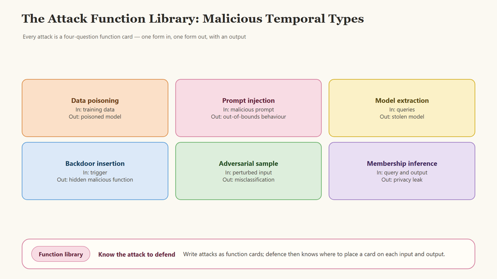

*Figure 4-1　The Attack Function Library: malicious Temporal Types*

The value of writing attacks as function cards lies on the defensive side: knowing what it takes in and what it spits out tells you where to place the checkpoint on input and output. Know the attack to defend well — that is the first lesson of the Function Library.

#### 4.2 Anatomy I: The Type of Prompt Injection

Direct injection is a user stuffing a malicious instruction into the dialogue box, and the model following it beyond its authority; indirect injection hides the instruction in a web page, document or email that the model will read, and the model is hijacked once it reads it. Their points of criteria failure differ: the former is the system prompt being overwritten, the latter is content and instructions not being separated.

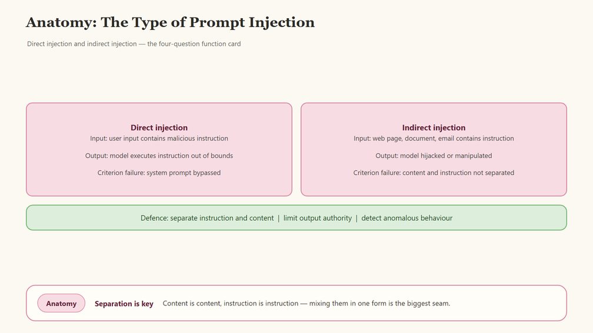

*Figure 4-2　Anatomy: the Type of prompt injection*

| **The Function Four Questions** | **Prompt injection (direct / indirect)** |
| --- | --- |
| **Input Type** | Malicious text (dialogue box, web page, document, email) + legitimate context |
| **Output Type** | Hijacked model behaviour: unauthorised reading, leakage, execution |
| **Criteria** | Whether instructions and content are separated, whether output permissions are converged, whether abnormal behaviour is detected — all three cards must pass before the defence holds |

#### 4.3 Anatomy II: The Type of Poisoning and Backdoors

Contamination happens at the training station and erupts at the inference station. Research shows a low ratio of poisoned data is enough to implant a backdoor; harder still to detect is the two-faced behaviour — normal input behaves normally, and the model only changes face when the trigger appears.

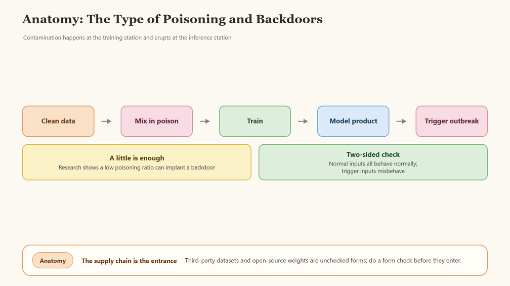

*Figure 4-3　Anatomy: the Type of poisoning and backdoors*

The entry point for protection is the supply chain: third-party datasets and open-source weights are untested Types, and the Type must be checked before they enter — whose container is id(C), is there anything abnormal in the { } structure, and do the [ ] labels match the content.

#### 4.4 Anatomy III: Model Theft and Inference Attacks

The attacker uses queries as a tool to dig the Type out of the black box: comparing a flood of queries against outputs to distil a shadow model; or asking membership inference whether this record was in the training set, attribute inference to recover group characteristics, and reconstruction attacks to recover training samples.

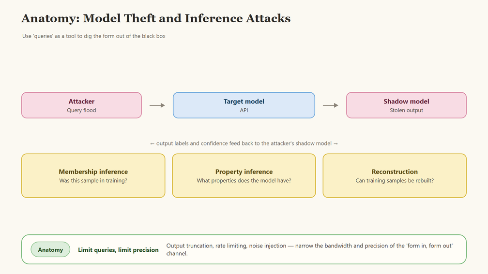

*Figure 4-4　Anatomy: model theft and inference attacks*

The protection approach is to narrow the bandwidth and precision of Types in, Types out: output truncation, rate limits, query quotas, noise injection. The blacker the box, the harder the Type is to dig out.

#### 4.5 Anatomy IV: The Type of Jailbreaks and Guardrails

Jailbreaking is a family of techniques for bypassing the criteria: role-play and scenario fabrication, encoding bypass and language mixing, multi-turn progression and long context. On the other side are three guardrail Types: the input guardrail (intent and classification screened up front), the process guardrail (tool permissions and sandbox) and the output guardrail (content review and format lock).

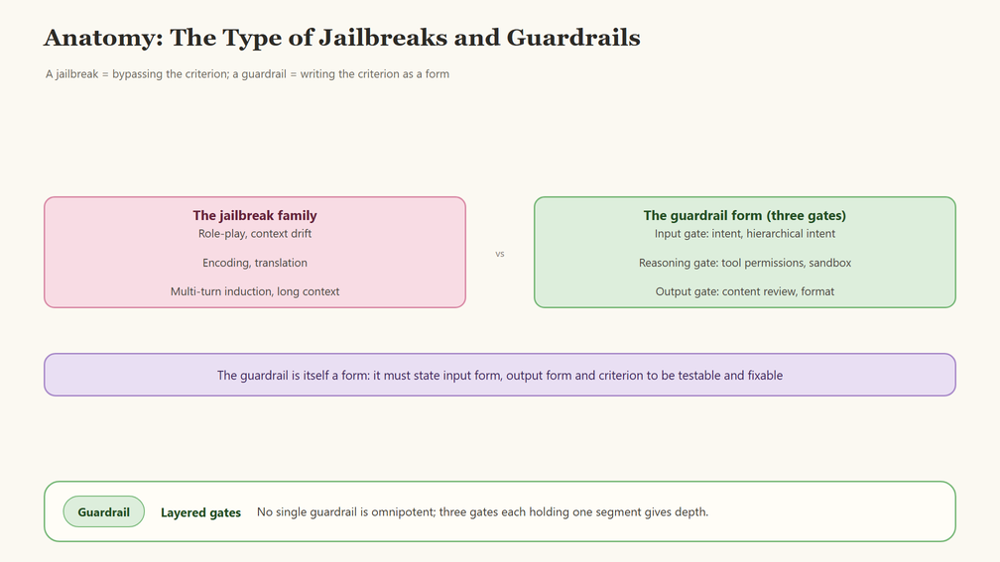

*Figure 4-5　Anatomy: the Type of jailbreaks and guardrails*

> **Guardrails Are Types Too**  
> A guardrail must state its input Type, output Type and criteria before it can be tested and repaired. No single guardrail is universal; three each guard a segment, and that is depth.  

#### 4.6 AI for Security: The Intelligent SOC Loop

Turn now to the defender's Temporal Type. AI turns from the protected object into a function that protects others: collect (logs, traffic, endpoints, cloud) → detect (anomaly, comparison, model scoring) → triage (context correlation, false-positive filtering) → respond (isolate, block, dispatch tickets) → learn (cases into the library, model updates), and back to collect — a loop of Types in, Types out.

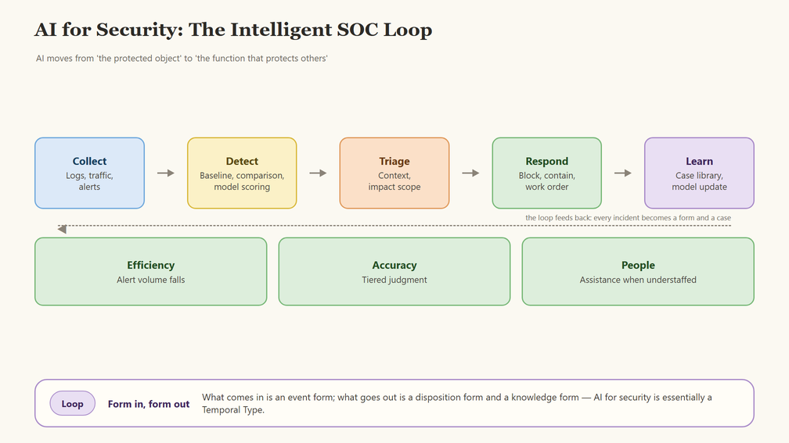

*Figure 4-6　AI for security: the intelligent SOC loop*

The value of the loop lies in three indicators: noise reduction (false-positive rate falls), speed (minute-level triage) and supplementing people (an assistant when staffing is short). Every incident makes the Type Library and the Function Library grow — this is exactly what two libraries, one hub, one loop looks like on the security floor.

#### 4.7 Three Detection Function Families: Rules, Statistics, Models

Detection functions fall into three families: the rules family is fast and precise but narrow, guarding the known; the statistics family catches drift but has false positives, catching the unknown; the models family is smart but needs feeding, judging complexity. Their input Types, output Types and criteria all differ, and in practice mixing them is strongest — their outputs are unified into an event Type that enters the triage station.

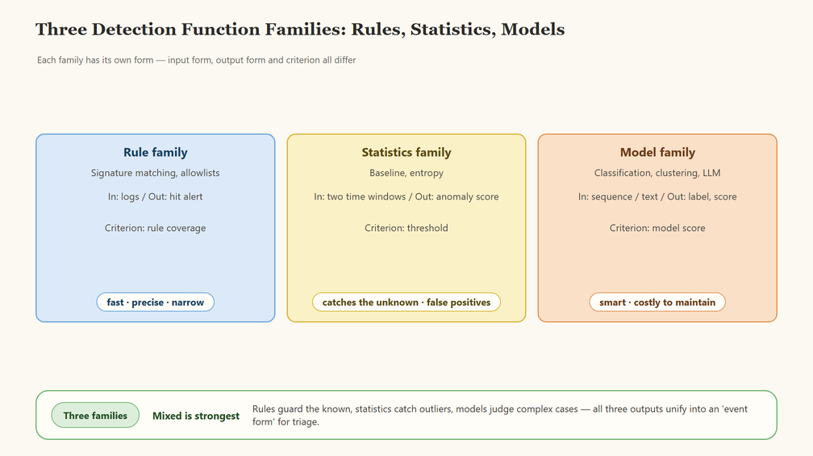

*Figure 4-7　Three detection function families: rules, statistics, models*

#### 4.8 Incident Response = A Closed Loop of Types In, Types Out

The Type Journey of One Incident: alert Type (time, source, features, score) → event Type (correlation and aggregation, scope of impact) → response Type (isolate, block, patch, notify) → knowledge Type (case extraction, rule update). On the timeline, detection must be at minute level, triage at hour level and feedback at day level.

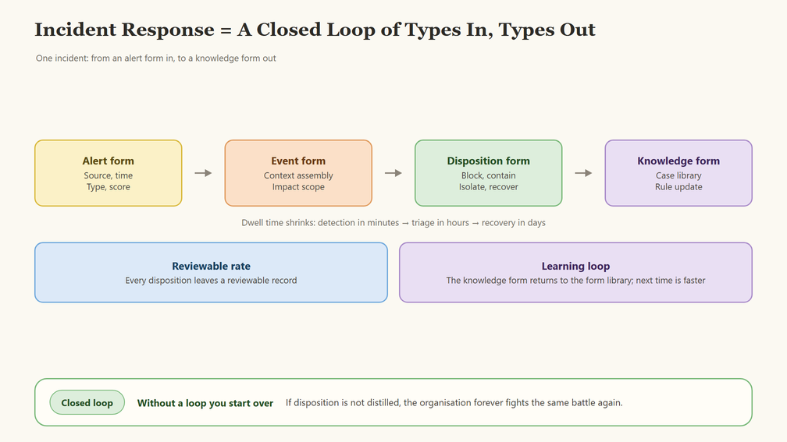

*Figure 4-8　Incident response = a closed loop of Types in, Types out*

Two checkpoints: reviewable accuracy — every response leaves a record of the criteria; continuous learning — knowledge Types return to the Type Library, so the next round is faster. If you do not extract after handling, the organisation will fight the same battle forever.

| **Exercise E06** | Write prompt injection as one function four-question card: one sentence each for the input Type, the output Type and the criteria. |
| --- | --- |

| **Exercise E07** | Why must model output also go through zero trust? Give a scenario where not verifying output leads to trouble, and write out the three verification points of judge first, then use. |
| --- | --- |

| **Exercise E08** | Design a function that detects model theft: input Type (what data it looks at), output Type (what it produces), criteria (how anomaly is calculated). |
| --- | --- |

> **Part 4 Summary**  
> Attack is a malicious Temporal Type, defence is a Temporal Type that guards the checkpoint, and response is a Temporal Type that closes the loop. Only when attack and defence are both written as function cards is there a common language; only when incidents are all extracted into knowledge Types is there progress.  

> **Professional Column C3　Adversarial Machine Learning: A One-Page History**  
> The history of adversarial samples is the archaeology of the function card perturbed input → wrong judgment. Early research found that image classifiers could be misled by tiny perturbations invisible to humans; the fast gradient sign method that followed cut the cost of producing a perturbation to a single backpropagation, bringing attack and defence into the practical era; after that came iterative projected attacks, universal perturbations (one perturbation image fooling a large number of inputs) and adversarial road signs printed in the physical world.  
> The history of the defensive side is an arms race: adversarial training (feeding attack samples back into training) is still the mainstay of defence, but randomisation, input sanitisation and certified defences (which guarantee that within a certain radius nothing goes wrong) each have their cost — certified defence comes closest to the reviewable accuracy of Ontypology.  
> What reading history gives Ontypology: every attack and defence technique can be written as a four-question card — input Type (perturbation, sample, query), output Type (wrong judgment, defended, guarantee), criteria (success rate, robust accuracy, certified radius). History is the evolution of the Function Library, not a storybook.  

> **Professional Column C7　Differential Privacy and Federated Learning: The Type of Privacy Protection**  
> On the other side of membership inference and reconstruction attacks sit two Types of privacy protection. Differential privacy adds a layer of provable noise to data: whether any single record is in the database or not, the output distribution barely changes — the criterion can be written as an ε budget, one of the few reviewable privacy promises.  
> Federated learning takes a different approach: data stays home and the model travels — each container ( ) keeps its local data and only exchanges parameter updates. Its Ontypology reading is plain: rewrite data movement as function movement, and the attack surface shifts from the data seam to the update seam (poisoned updates and model inversion still have to be defended against).  
> Both can be written as Control Type cards: input Type (raw data or an update), output Type (noised result or global model), criteria (the ε budget, the update validation rule). When choosing, ask first: what is my threat Type — if you fear query leakage, use differential privacy; if you fear centralised risk, use federation.  

### Part 5　Accurate Usage Methods — Making AI Security a Reviewable Judgment

*With Types written and functions recognised, the last step is accuracy: any AI security judgment must achieve reviewable accuracy. This part provides the method toolbox — three supplements, the six-step proof, the eight-question checklist, the misuse comparison and scenario routing — which is the methodological core of the book and the full unfolding of the four words accurate usage methods.*

#### 5.1 Three Supplements: Fill Whatever Is Missing

AI security documents most often have three gaps: unclear grading, unclear responsibility and an incomplete BOM. Three gaps call for three supplements — where rules are missing, add [ ] (make the implicit dimension and scale explicit, e.g. how sensitivity levels are graded); where identity is missing, add ( ) (make the container and its owner explicit, e.g. whose model this is and who is accountable); where structure is missing, add { } (make the parts list and dependencies explicit, e.g. which external data and plugins are used).

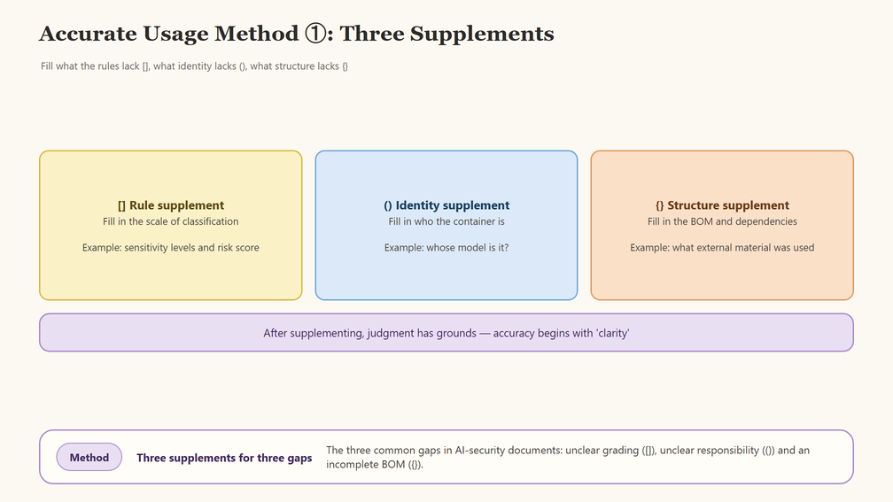

*Figure 5-1　Accurate usage method ①: three supplements*

Only after the supplements does judgment have grounds — accuracy begins with saying it clearly. In practice, for any AI document that needs approval, doing the three supplements before the six steps saves more than half of the back-and-forth clarification.

#### 5.2 The Six-Step Proof

The six steps are the standard process of judgment: ① identify the whole (where is the boundary of this matter) → ② describe by axis (write each of X/Y/Z) → ③ write the Type Set ({parts, (content), [category]}) → ④ fix the proposition (what is to be judged) → ⑤ reason from the criteria (derive according to the criteria) → ⑥ three-layer check (J_C ∧ J_B ∧ J_T).

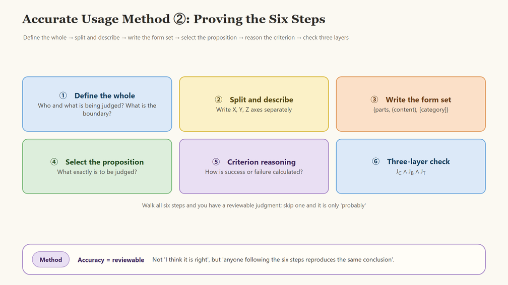

*Figure 5-2　Accurate usage method ②: proving the six steps*

When the six steps are complete, the output is a reviewable judgment: anyone following the same process can reproduce the same conclusion. A conclusion with a missing step can only be probably — and probably in security means we do not know.

#### 5.3 Full Demonstration: Judging the Adoption of an External LLM

Demonstrate one complete run. Scenario: a customer-service system wants to connect a third-party LLM — is it acceptable? ① Identify the whole: customer-service system × third-party LLM × personal-data process. ② By axis: X personal-data level, Y dependent components, Z API boundary. ③ Type Set: {model, (customer dialogue, FAQ), [high sensitivity]}. ④ Proposition: adoptable, but with compensating controls. ⑤ Reasoning: risk of data leaving the boundary → masking + contract + audit. ⑥ Three-layer check: J_C contract identity passes, J_B masking module passes, J_T use limited to customer service passes — conclusion: yes, with three conditions.

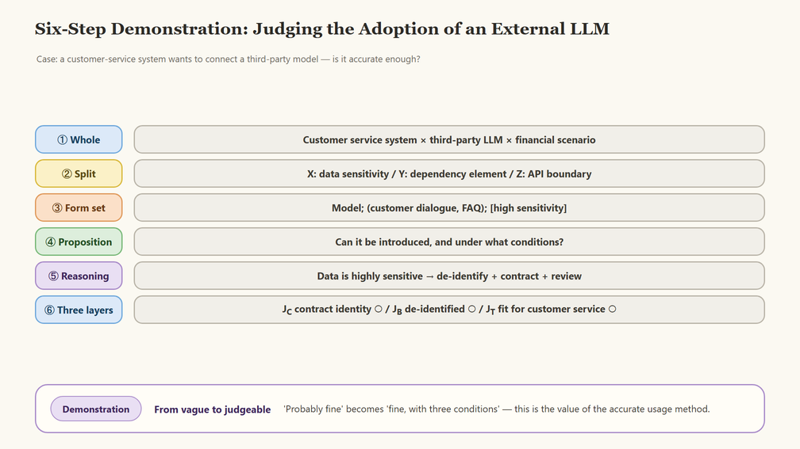

*Figure 5-3　Six-step demonstration: judging the adoption of an external LLM*

> **Lessons from the Demonstration**  
> "Probably fine" becomes "Yes, with three conditions" — this is the value of accurate usage methods: the conclusion is executable, the conditions are verifiable and the process is reviewable.  

#### 5.4 The Eight-Question Checklist

When time is short, use the pocket version of the eight questions: Q1 whole (is the boundary drawn correctly), Q2 three axes (are X/Y/Z all written), Q3 Type Set (are all parts listed), Q4 identity (are the container and responsibility clear), Q5 criteria (how are success and failure defined), Q6 three layers (do J_C ∧ J_B ∧ J_T pass), Q7 misuse (are there common misuses), Q8 review (can others reproduce it).

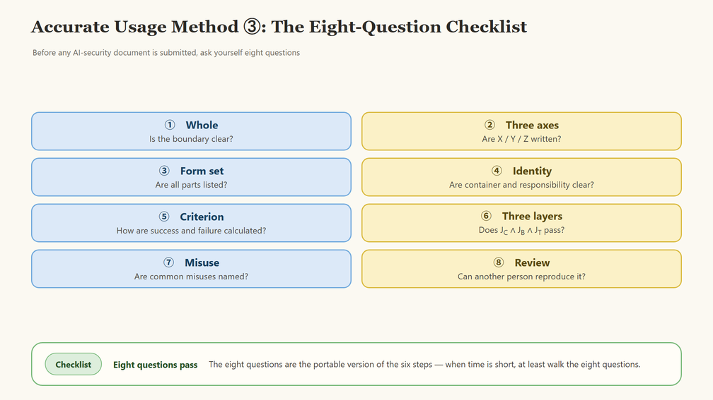

*Figure 5-4　Accurate usage method ③: the eight-question checklist*

#### 5.5 The Misuse Comparison: Four Groups of Misconceptions

The common root of misuse is confused layers and unclear identity. Avoid the four groups by comparison: layer misuse (treating the grading label as the protection itself, treating alert volume as the degree of security), identity misuse (treating the platform vendor's responsibility as your own, treating anonymisation as a get-out-of-jail card), structure misuse (claiming supply-chain security with an incomplete BOM, testing only the main model and not the plugins), criteria misuse (using test-set scores instead of red-team results, treating no incident as safe enough).

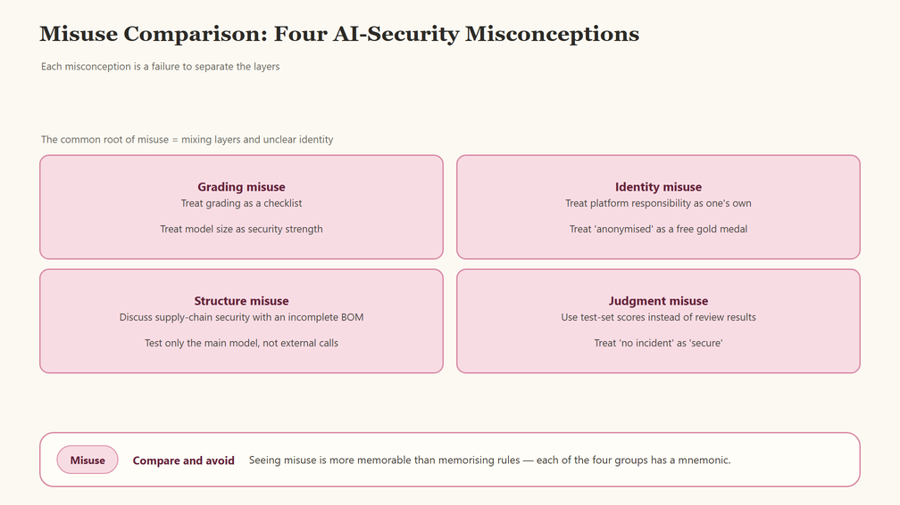

*Figure 5-5　Misuse comparison: four AI security misconceptions*

Seeing what misuse looks like defends better than memorising rules. Each misconception gets a memory line, for example a label is not protection (layers), anonymity is not exemption (identity), the list must be complete (structure), and no incident is not safe (criteria).

#### 5.6 Scenario Routing: A Decision Tree

The same set of Ontypology tools, with different purposes and different entry points. Three common routes: should we use this AI? → six steps plus eight questions; what if AI goes wrong? → the incident response loop; how does AI help me defend? → the SOC loop plus three detection families. Identify the whole first, then enter the right door.

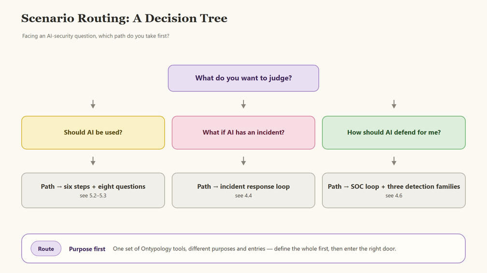

*Figure 5-6　Scenario routing: a decision tree*

| **Exercise E09** | Walk the six steps once on the question should we use an open-source LLM (one sentence per step is enough, but all six steps must be present — a missing step scores nothing). |
| --- | --- |

| **Exercise E10** | Find a real case from the misuse comparison (your own, or one in the news): name the misconception group, the memory line and the correct practice. |
| --- | --- |

> **Part 5 Summary**  
> The end point of method is habit: three supplements to complete the information, six steps to finish the judgment, eight questions as a pocket check, the misuse comparison to avoid pitfalls, the decision tree to choose the right entry — accurate = reviewably accurate.  

> **Professional Column C4　Red-Team Exercises and Automated Evaluation**  
> Method must land, and that is inseparable from red-team exercises. The red team's role is professional executor of attack functions: arrange scripts according to ATLAS tactics and techniques, try prompt injection, jailbreaking, poisoning and theft one by one, and produce a comparison table of which input Type can break through which control Type.  
> Automated evaluation, meanwhile, distils red-team scripts into a re-runnable test set: jailbreak success rate, injection detection rate, output violation rate, correct-refusal rate — four indicators that map exactly onto the criteria of the three guardrail cards. The evaluation report is itself a function card: input the test set, output the scores and cases, criteria the pass line.  
> From the Ontypology perspective, the essence of red teaming is to walk the six steps backwards on the organisation's behalf — to reason from the attacker's proposition, and then check whether the defender's three layers hold. A red-team report is a good one only if it can be reviewed.  

### Part 6　Governance, Compliance and Overall Architecture — Writing Responsibility as a Type

*Beyond technology and method, AI security must answer governance questions: how large is the risk, who is accountable, what must be complied with, and what does the architecture look like. This part writes governance as judgeable Types, then gives the book's overall architecture and maturity ladder.*

#### 6.1 Governance and Compliance: Risk Grading and the Responsibility Type

The core act of AI governance is to write responsibility as a judgeable Type. Risk grading is the scale thinking of the [ ] Property axis: define the dimension first, then the scale, then the obligations — unacceptable risk is prohibited, high risk carries mandatory compliance, limited risk carries transparency obligations, and minimal risk relies mainly on self-regulation (read alongside the four-level risk framework of the EU AI Act).

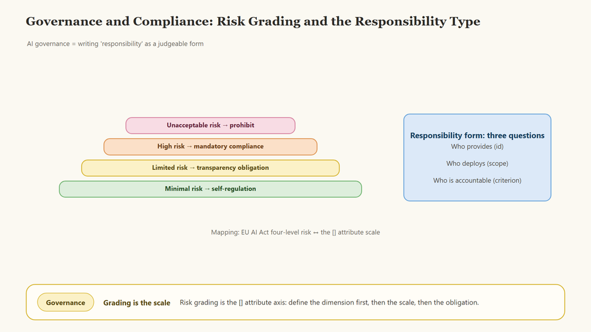

*Figure 6-1　Governance and compliance: risk grading and the responsibility Type*

Three questions of the Responsibility Type: who provides (id), who deploys (scope), who is accountable (criteria). The answers go into the container column of the Type card — with a clear chain of responsibility, you know whom to find when something goes wrong, and where the boundary of the response lies.

#### 6.2 Reading the Standards: The Four Frameworks

Ontypology does not replace standards; it gives them a judgeable skeleton. The six functions of NIST CSF 2.0 (govern, identify, protect, detect, respond, recover) can be read as six groups of Temporal Types; the ISMS of ISO 27001 is the container Type of a management system, PDCA is the standard way to write a loop, and the clauses are a list of control Types; OWASP LLM Top 10 is a quick-reference table of threat Types; MITRE ATLAS is the category index of the Attack Function Library.

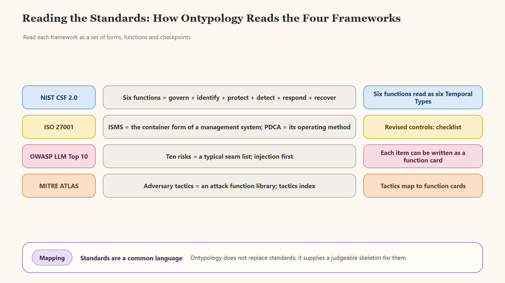

*Figure 6-2　Reading the standards: how Ontypology reads the four frameworks*

#### 6.3 The Overall Architecture: Philosophy, Method, Practice

The whole book in one picture: the philosophy layer (what a Type is, how to judge, how it works) gives the eyes; the method layer (three supplements, six steps, eight questions, misuse comparison) gives the hands; the practice layer (platform adoption through two libraries, one hub, one loop) gives the legs. Miss one layer and all you have left is slogans or tools.

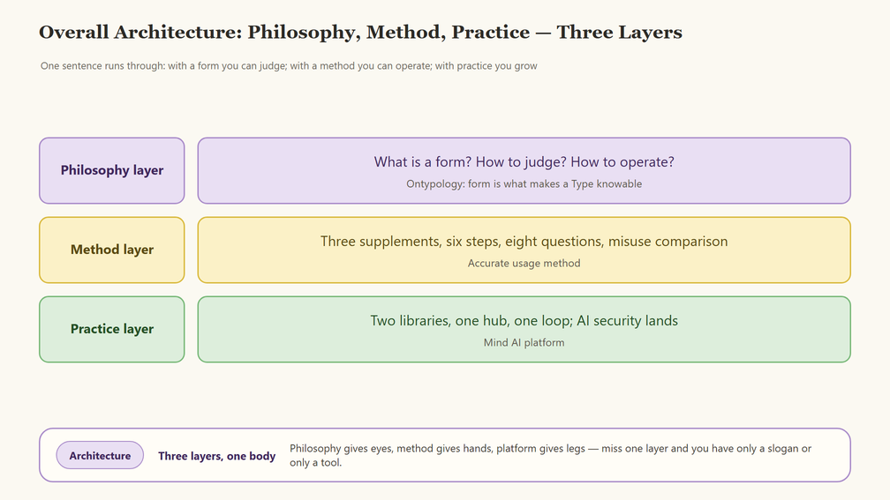

*Figure 6-3　Overall architecture: philosophy, method, practice — three layers*

In practice this unfolds into a one-to-one mapping between two libraries, one hub, one loop and security functions: the Type Library takes the event-Type aggregation from SIEM/SOC, the Function Library takes threat-intelligence updates, the hub takes the three-layer judgment output of risk assessment, and the loop takes the knowledge deposited by audit improvements. It is not adopting a platform but upgrading a function.

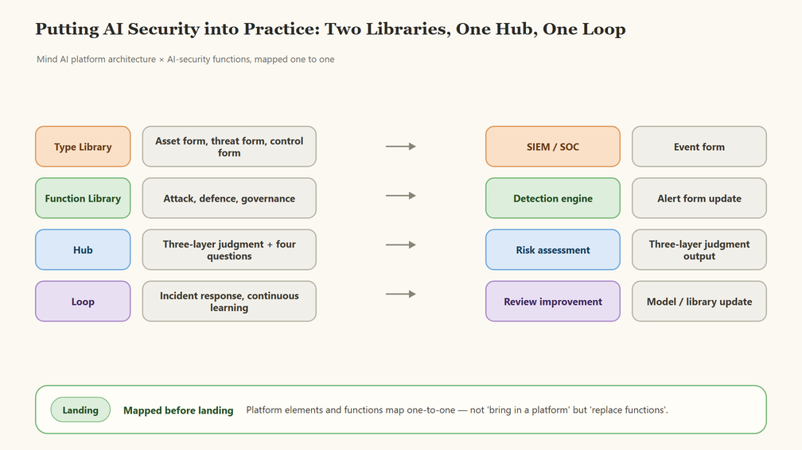

*Figure 6-4　Putting AI security into practice: two libraries, one hub, one loop*

#### 6.4 Three Maturity Levels: See → Judge → Act

Capability building climbs a ladder: level one, See (assets take shape, BOM clear, logs searchable, attack surface countable); level two, Judge (three-layer judgment routine, false positives controllable, criteria reviewable); level three, Act (automated response, self-running loop, minute-level handling, continuous evolution).

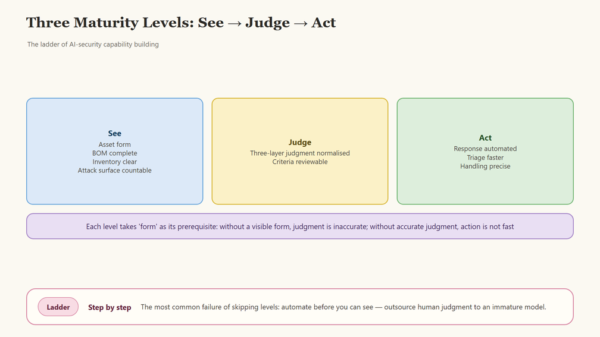

*Figure 6-5　Three maturity levels: See → Judge → Act*

> **The Lesson of Skipping Levels**  
> The most common failure is going to automation before you can see — outsourcing human judgment to an immature model is letting an unreviewable black box take responsibility for you. Every level presupposes a Type.  

> **Part 6 Summary**  
> Governance writes responsibility as a Type, standards are read as Types, the architecture holds three layers as one, and maturity advances step by step — this judgeable skeleton is what lifts AI security from a project to a function.  

> **Professional Column C5　The AI Compliance Map: From GDPR to the AI Act**  
> Compliance is not a book but a map. On the data side: the core of GDPR personal-data regulation can be read as content with identity — personal data is a content Type with ( ) identity and [ ] a sensitivity scale, and every processing action must fall within the container's scope.  
> The AI side: the EU AI Act legislates by risk level (unacceptable / high / limited / minimal), and high-risk systems are required to have risk management, data governance, record keeping, human oversight, robustness and security — five obligations that map exactly onto this book's Y parts ledger, data life cycle, incident loop, human–machine seam control and resilience map.  
> Suggested order in practice: first use the three axes to grade the system (X), then write the obligations as a list of control Types ({ }), and finally write responsibility into the container column (( )) — once the three axes are written, the skeleton of the compliance document stands up and all that remains is filling in the blanks.  

### Part 7　A Complete Content Plan — Learn, Practise, Use, Teach, Build

*For method and architecture to become organisational capability, there must be a walkable road. This part gives a complete plan: five stages of development, an eight-week learning map, four stages of library building and an adoption rhythm — teachers can use it to run courses, enterprises can use it to adopt.*

#### 7.1 Learn, Practise, Use, Teach, Build

Five stages of development: learn (read the backbone, understand the three axes and three brackets) → practise (do the exercises, write Type Set cards) → use (apply the six-step judgment at work) → teach (teach others, explain the eight questions clearly) → build (build the Type Library and Function Library, turn them into organisational assets). The five stages are not a waterfall: teaching and building come back round to force you to deepen what you learned.

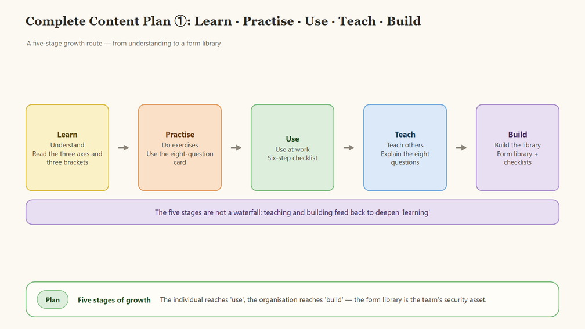

*Figure 7-1　Complete content plan ①: learn, practise, use, teach, build*

When individuals reach use they have productivity; when organisations reach build they have accumulation — the Type Library is the team's security asset, and judgment does not leave when people do.

#### 7.2 The Eight-Week Route

One theme per week, a deliverable every week: W1 backbone (the three axes and three brackets, primer) → W2 asset Type (shaping your own AI assets) → W3 threat Type (the Attack Function Library plus cases) → W4 protection Type (Control Type design plus remove tiers) → W5 method, part I (three supplements plus six steps) → W6 method, part II (eight questions plus misuse comparison) → W7 platform (hands-on with two libraries, one hub, one loop) → W8 integration (case presentation plus maturity self-assessment).

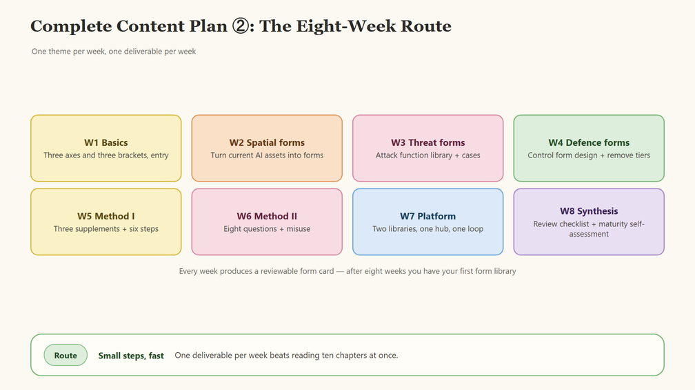

*Figure 7-2　Complete content plan ②: the eight-week route*

Produce one photocopiable Type card a week — after eight weeks you have your first Type Library. Small steps, one deliverable a week, is more effective than reading ten chapters in one go.

#### 7.3 Four Stages of Library Building and Their Acceptance Checks

Organisational library building goes through four stages: inventory (assets take shape, existing documents converted into Type cards) → modelling (define the three axes, write the criteria clearly) → go live (the hub judges, the loop starts turning) → evolution (case feedback, refactoring and recombination).

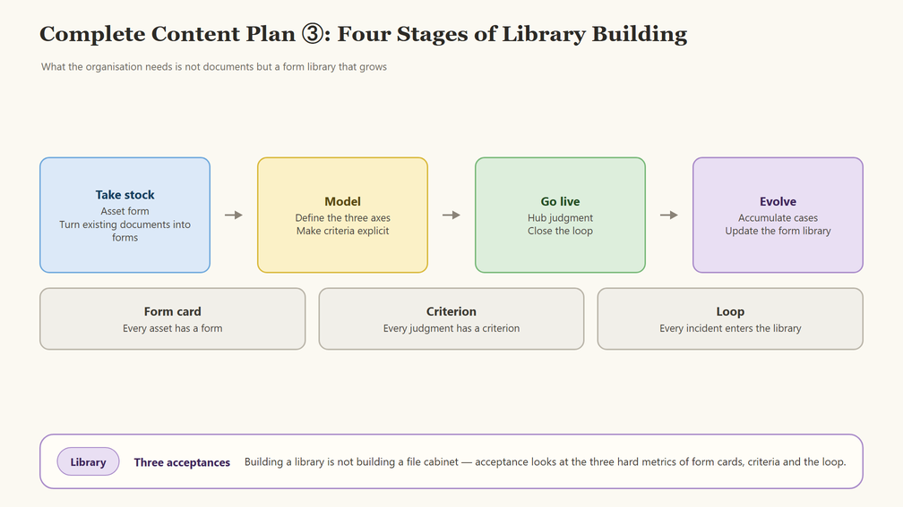

*Figure 7-3　Complete content plan ③: four stages of library building*

Three hard acceptance metrics: complete Type cards (every asset has a Type), clear criteria (every judgment has grounds), a loop that turns (every case is deposited in the library). Building a library is not building a filing cabinet — these are the three things acceptance looks at.

#### 7.4 Adoption Rhythm: Pilot → Expand → Scale

Each of the three stages has entry and exit conditions: the pilot picks one high-value scenario (e.g. customer-service LLM governance), with entry requiring that assets have taken shape and exit requiring that the six steps run through; expansion replicates to 2–3 scenarios, sharing the Type Library and criteria, and exits when criteria are stable across scenarios; scaling means organisation-wide routine operation, a self-running loop and periodic audits, with the goal of reaching maturity level three.

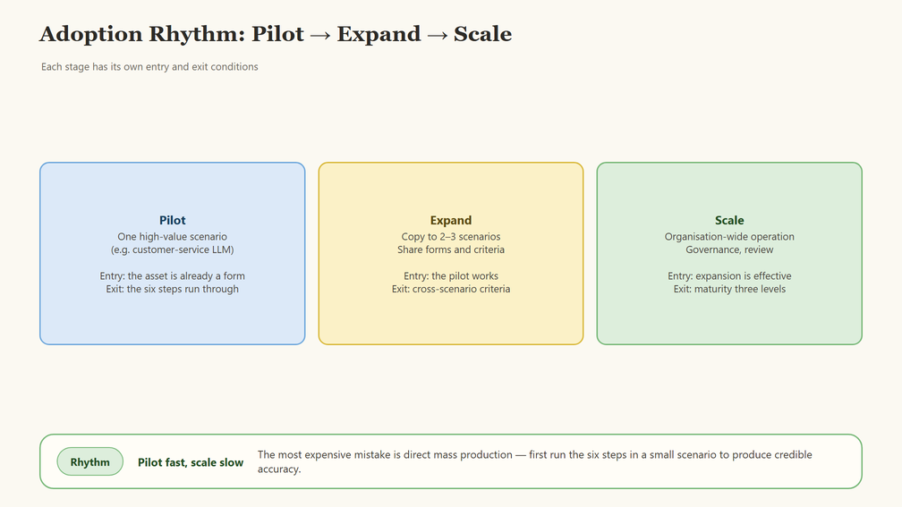

*Figure 7-4　Adoption rhythm: pilot → expand → scale*

The costliest mistake is scaling straight away — first let the six steps produce credible accuracy in a small scenario, then talk about scale. Fast pilot, slow scale.

#### 7.5 Three Stages of Vision: Unified Knowledge → Unified Thinking → Unified Intelligence

Finally, pull the view back: the endgame of AI security is not a race of tools but the building of judgment. Unified knowledge (assets, threats and controls all shaped and deposited in the library) → unified thinking (one judgment method, six steps and eight questions becoming habit) → unified intelligence (human–machine collaborative judgment, security becoming the system's instinct).

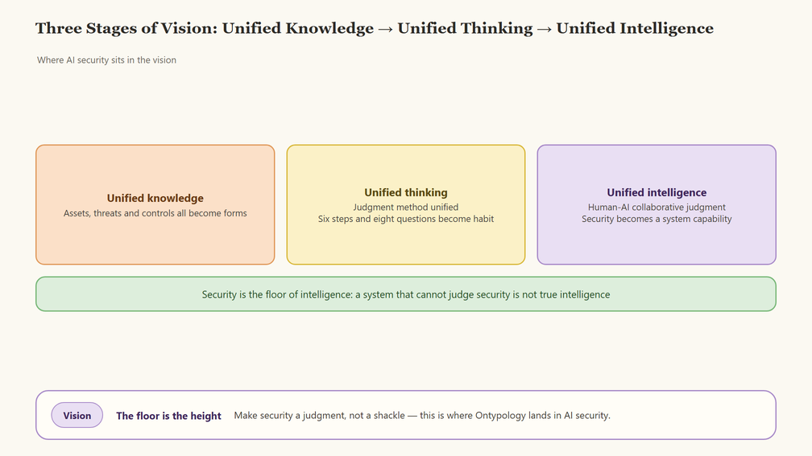

*Figure 7-5　Three stages of vision: unified knowledge → unified thinking → unified intelligence*

> **The Baseline Is the Height**  
> Security is the baseline of intelligence: a system that cannot judge safety is not truly intelligent. Make security a judgement rather than a shackle — this is where the Ontypology view of security lands.  

| **Exercise E11** | Lay out the eight-week route for your team and write down the first week's output and acceptance criteria. |
| --- | --- |

| **Exercise E12** | Assess which maturity level your organisation is at (See / Judge / Act) and list the two things needed to upgrade. |
| --- | --- |

> **Part 7 Summary**  
> Five stages of development, an eight-week route of small steps, four stages of library building with three acceptance checks, and an adoption rhythm of fast pilot and slow scale — every step of the plan has a deliverable and an acceptance line.  

> **Professional Column C6　Common Questions on Enterprise Adoption**  
> Q1: Can we start without AI experts? Yes. The first four weeks need only security and business staff — inventorying asset Types, drawing seams and sorting the three remove tiers are all work of asking the right questions, and require no model training.  
> Q2: Will the Type Library become just another Wiki nobody reads? Not if you hold to three acceptance checks: complete Type cards, clear criteria, and a loop that turns. The key is writing every case enters the library as the last step of the incident response process — if knowledge Types do not return, the loop breaks.  
> Q3: Can we use open-source models? Answer with the supply-chain seam check: whose container is id(C), is the { } structure of weights and data transparent, and do the [ ] labels match the actual capability. Once these three questions pass, the risk level follows — the question is not can we, but what risk do we accept in exchange for what control.  
> Q4: How do we calculate return on investment? Use the three maturity levels as a before-and-after test: attack surface countable (See), false-positive rate and triage turnaround (Judge), response turnaround and labour saved (Act) — every level has measurable indicators, and the return speaks for itself.  

> **Professional Column C8　People and Organisation: The CISO's AI Readiness Checklist**  
> AI security ultimately comes down to people and organisation. The CISO's readiness checklist can be very short. First, map the functions: use the two libraries, one hub and one loop to map the existing SOC functions and find the gaps — usually two missing roles, the Type Library administrator and the Function Library maintainer.  
> Second, the capability map — use the five stages of learn, practise, use, teach and build to position the team: who is learning, who can use, who can teach; the eight-week route can be turned directly into an internal training schedule.  
> Third, the indicator dashboard — each of the three maturity levels gets two indicators (asset Type card completion rate, attack-surface countable rate / false-positive rate, triage turnaround / response turnaround, loop feedback volume), and the quarterly review looks at trends, not snapshots.  
> The one-line version: let the organisation see first, then talk about buying tools. However many tools you buy, if assets do not take shape you are simply automating chaos.  

### Part 8　Conclusion — See, Hold, Judge, Grow

*The whole book walks one road: see AI security as a problem of Types and you will see it; write it as functions and you can hold it; walk the six steps and you will judge accurately; rely on the loop and it will grow. It closes into four cards.*

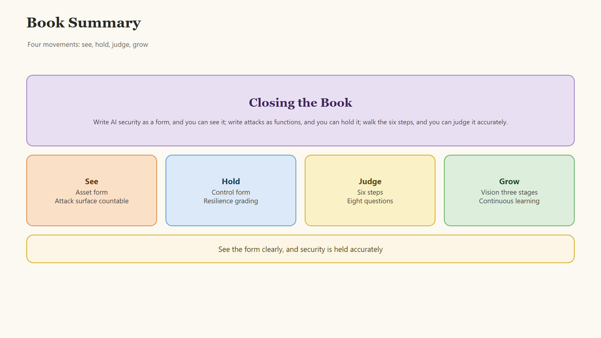

*Figure 8-1　Book summary*

See — assets take shape and the attack surface becomes countable: Unit Type decomposition, the three ledgers, finding seams, the remove-tier resilience map. Hold — controls take shape and checkpoints go deep: four kinds of control Type, three guardrail cards, the supply-chain Type check, zero trust including output. Judge — six steps, eight questions, three-layer check: accurate = reviewably accurate. Grow — two libraries, one hub, one loop: event feedback, continuous learning, learn–practise–use–teach–build, from pilot to scale.

Back to the two-sided proposition: protecting AI and AI for security meet on the Type — a defence that can judge is the defence of the AI era; an intelligence that can be safe is real intelligence.

> **End of Book**  
> See the Type clearly, and security can be held accurately. Hang this sentence on the first page of every AI security document — that is the whole of this book.  

### Appendix A　Glossary

| Term | Meaning | How to Use This Book |
| --- | --- | --- |
| Type | The Unit of Judgment Condensed by the Cognition Chain | Assets, threats and controls are all written as Types |
| Spatial Type | The Static Structure of a Type (Noun) | Three axes: [ ] Property, { } Composition, ( ) Container |
| Temporal Type | The Dynamic Working of a Type (Verb) | A Function Is a Move: Types In, Types Out |
| Unit Type / Type Set | {parts, (content), [category]} | The Standard Way to Write One AI Asset |
| Three-Layer Judgment | J＝J_C ∧ J_B ∧ J_T | Container, composition and abstraction — all three layers together |
| Remove tiers | Essential / degradable / non-essential | The Resilience Map and the Allocation of Security Investment |
| The Function Four Questions | Name, Input Type, Output Type, Criteria | The Standard Format of an Attack-and-Defence Function Card |
| Accurate Usage Methods | Three Supplements + Six Steps + Eight Questions | Reviewable Accuracy |
| Two Libraries, One Hub, One Loop | Type Library · Function Library · Hub · Loop | The Mind AI Platform in One Line of Architecture |

### Appendix B　Quick-Reference Cards

**B-1　Six Steps × Eight Questions Quick Reference**

| Step | Action | Corresponding Eight Questions |
| --- | --- | --- |
| ① Identify the whole | Draw the boundary: system × data × process | Q1 The Whole |
| ② Describe by axis | X Grading / Y Parts / Z Boundary | Q2 The Three Axes |
| ③ Write the Type Set | {parts, (content), [category]} | Q3 Type Set |
| ④ Fix the proposition | What is to be judged, and the form of the output conclusion | The Identity Four Questions |
| ⑤ Reason from the criteria | Reason from the criteria, attach compensating controls | Q5 Criteria |
| ⑥ Three-layer check | J_C ∧ J_B ∧ J_T | Q6 Three Layers / Q7 Misuse / Q8 Review |

**B-2　Attack Function Quick Reference (Four-Question Card Summary)**

| Attack | Input Type | Output Type | Protection card |
| --- | --- | --- | --- |
| Data poisoning | Dirty data | Skewed Model | Supply-Chain Type Check |
| Prompt injection | Malicious prompt | Unauthorised behaviour | Instruction–Content Separation |
| Model theft | Query stream | Pirated model | Query limits · precision limits |
| Backdoor implant | Trigger | Hidden malicious function | Source verification + detection |
| Adversarial sample | Perturbed input | Wrong judgment | Adversarial training + certification |
| Membership inference | Query comparison | Privacy leakage | Differential privacy · noise |

**B-3　Photocopiable: Blank Type Card (copy this page and fill it in directly)**

| **Asset / Event Type Card (blank template)** |  |
| --- | --- |
| [ ] Property | Dimension: ______　Scale: ______　Risk score: ______ |
| { } Composition | Parts list: ______________　Essential: ____　Degradable: ____　Dispensable: ____ |
| ( ) Container | Identity id(C): ______　Scope S(C): ______　Owner: ______ |
| Proposition | What is to be judged: ____________________________ |
| Criteria | Success condition: ____________　Failure condition: ____________ |
| Three-Layer Check | J_C: □　J_B: □　J_T: □　(all three must pass) |

### Appendix C　Model Answers to the Exercises

*Exercises E01–E12 correspond to Parts 1 to 7, and S01–S03 are integrative questions. What follows are model answers — the point is that the six steps were walked; the answers themselves may differ, but the process must be reviewable.*

| No. | Question | Key Points of the Model Answer |
| --- | --- | --- |
| E01 | Write the Unit Type of one AI asset around you. | Example: {model, (customer dialogue, FAQ), [high sensitivity]}. Scoring looks at whether all three columns have content, whether { } lists every part, and whether the [ ] scale is specific. |
| E02 | Use the three new variables (uncertainty, generativity, agents) to analyse the risk of one AI application. | Give, variable by variable, which Type is affected and which criterion is broken — example: an agent gains tool permissions → the container scope S(C) expands → least privilege must be re-reviewed. |
| E03 | Draw a third-party model API vendor as one container ( ), marking id(C) and S(C). | id(C) = the vendor's legal identity and model version; S(C) = the data range and action range reachable through the API. If either column is missing, supplement it with ( ). |
| E04 | Find one seam in your organisation and write down which of the four kinds it is. | Example: a customer-service system importing an external knowledge base = a data seam plus a supply-chain seam. Question two: what are the input Type and output Type of this seam? |
| E05 | Sort one AI system into the three remove tiers. | Essential = the model's core weights and credentials; degradable = the recommendation module; dispensable = the debugging interface. The answer must be accompanied by the consequences of removal. |
| E06 | Write prompt injection as one function four-question card. | Input Type = malicious text + legitimate context; output Type = unauthorised behaviour; criteria = all three cards (separation, convergence, detection) pass. |
| E07 | Why must model output also go through zero trust? Give a scenario where not verifying output leads to trouble. | Output is a Type, a product and not the truth. Example: code produced by an assistant executed directly → the supply-chain seam is magnified. Judge first, then use. |
| E08 | Design a function that detects model theft: input Type, output Type, criteria. | Input Type = query logs (frequency, distribution, hit rate); output Type = risk score; criteria = threshold + manual review trigger line. |
| E09 | Walk the six steps once on the question should we use an open-source LLM (condensed version). | One sentence per step is enough, but all six steps must be present — an answer with a missing step scores nothing. Follow the format of demonstration 5.3. |
| E10 | Find a real case from the misuse comparison (your own, or one in the news). | Name the misconception group + the memory line + the correct practice. Example: treating anonymisation as an exemption = identity misuse; the correct practice is to keep the responsibility container. |
| E11 | Lay out the first week's output of the eight-week route for your team. | W1 output = one Type card per person for one of your own AI assets. Acceptance: all three columns complete, scales specific. |
| E12 | Assess which maturity level your organisation is at and list the two things needed to upgrade. | Example: at level one, See; two things to upgrade = raise asset Type card completion to 100% and add a three-layer check column to the incident response template. |
| S01 | Integration: write a 500-word briefing script on the current state and route of AI security (for your manager). | The structure must contain: one sentence on the two-sided proposition, the current state (which maturity level), three actions (corresponding to the three lines) and an eight-week goal. |
| S02 | Integration: adapt one diagram from this book into a version for your own organisation. | Any card will do, but you must note what was changed and why — the act of adaptation is where use begins. |
| S03 | Integration: design a red-team exercise script (one page). | Contains: the target Type, the attack function (against ATLAS or OWASP), the decision criteria, and which Type card the response feeds back into. |

### Appendix D　Index of Figures and Tables

| No. | Figure name | Part |
| --- | --- | --- |
| Figure 1-1 | The Two-Sided Proposition of AI Information Security | Part 1 |
| Figure 1-2 | The shifting threat landscape: from data leakage to model-level threats | Part 1 |
| Figure 1-3 | Three-Layer Positioning: Root, Trunk, Fruit | Part 1 |
| Figure 2-1 | Backbone at a Glance ①: The Cognition Chain and the Three Axes with Three Brackets | Part 2 |
| Figure 2-2 | Backbone at a Glance ②: Three-Layer Judgment and the Function Four Questions | Part 2 |
| Figure 2-3 | Backbone at a Glance ③: The Mind AI Platform Backbone | Part 2 |
| Figure 2-4 | Ontypology ↔ AI Security Mapping Table | Part 2 |
| Figure 3-1 | The AI Asset Type: Decomposing the Unit Type | Part 3 |
| Figure 3-2 | Reading Security Through Three Axes: X Grading, Y BOM, Z Boundary | Part 3 |
| Figure 3-3 | Threat Type: the attack surface is the seam between Types | Part 3 |
| Figure 3-4 | Control Type: Protective Measures Are Types Too | Part 3 |
| Figure 3-5 | Remove tiers = the resilience map | Part 3 |
| Figure 3-6 | Container ( ) and Zero Trust: Identity Is Not Presumed | Part 3 |
| Figure 3-7 | The Data Type: Six Life-Cycle Stations | Part 3 |
| Figure 4-1 | The Attack Function Library: Malicious Temporal Types | Part 4 |
| Figure 4-2 | Anatomy: The Type of Prompt Injection | Part 4 |
| Figure 4-3 | Anatomy: The Type of Poisoning and Backdoors | Part 4 |
| Figure 4-4 | Anatomy: Model Theft and Inference Attacks | Part 4 |
| Figure 4-5 | Anatomy: The Type of Jailbreaks and Guardrails | Part 4 |
| Figure 4-6 | AI for Security: The Intelligent SOC Loop | Part 4 |
| Figure 4-7 | Three Detection Function Families: Rules, Statistics, Models | Part 4 |
| Figure 4-8 | Incident Response = A Closed Loop of Types In, Types Out | Part 4 |
| Figure 5-1 | Accurate Usage Method ①: Three Supplements | Part 5 |
| Figure 5-2 | Accurate Usage Method ②: The Six-Step Proof | Part 5 |
| Figure 5-3 | Six-Step Demonstration: Judging the Adoption of an External LLM | Part 5 |
| Figure 5-4 | Accurate Usage Method ③: The Eight-Question Checklist | Part 5 |
| Figure 5-5 | Misuse Comparison: Four Groups of AI Security Misconceptions | Part 5 |
| Figure 5-6 | Scenario Routing: A Decision Tree | Part 5 |
| Figure 6-1 | Governance and Compliance: Risk Grading and the Responsibility Type | Part 6 |
| Figure 6-2 | Reading the Standards: How Ontypology Reads the Four Frameworks | Part 6 |
| Figure 6-3 | Overall Architecture: Philosophy, Method, Practice — Three Layers | Part 6 |
| Figure 6-4 | Putting AI Security into Practice: Two Libraries, One Hub, One Loop | Part 6 |
| Figure 6-5 | Three Maturity Levels: See → Judge → Act | Part 6 |
| Figure 7-1 | Complete Content Plan ①: Learn, Practise, Use, Teach, Build | Part 7 |
| Figure 7-2 | Complete Content Plan ②: The Eight-Week Route | Part 7 |
| Figure 7-3 | Complete Content Plan ③: Four Stages of Library Building | Part 7 |
| Figure 7-4 | Adoption Rhythm: Pilot → Expand → Scale | Part 7 |
| Figure 7-5 | Three Stages of Vision: Unified Knowledge → Unified Thinking → Unified Intelligence | Part 7 |
| Figure 8-1 | Book Summary | Part 8 |
