# AI Drone Brain

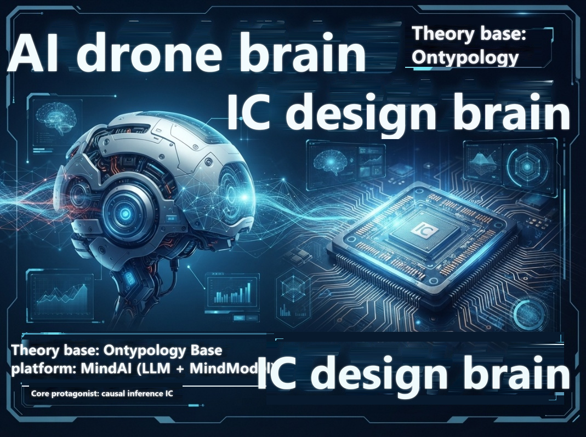

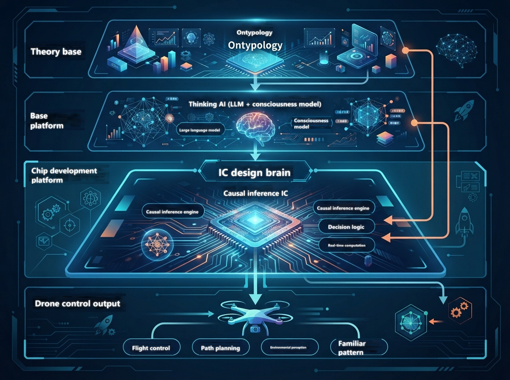

## Contents

- Foreword 4
- Reader's Guide 6
- Part I Positioning - One Effect, Many Causes; One Brain, Many Layers 8
- 1-1 Trustworthy Intelligence 8
- 1-2 One Effect Often Has Many Causes 8
- 1-3 Five Pain Points: All Because the Type Was Never Established 9
- 1-4 Three-Layer Positioning: Root, Trunk, Fruit 10
- 1-5 Four-in-One: Theory, Platform, Dev Platform, Core 11
- 1-6 Causal Reasoning IC: Enter the Protagonist 12
- Part II Backbone at a Glance - Typology Toolbox and Master Mapping Table 14
- 2-1 Cognition Chain x Causal Decision Chain x Chip Design Chain 14
- 2-2 Six Tools: Build the Backbone Once 15
- 2-3 Three-Platform Master Mapping Table: The Translation Bridge 15
- Part III Spatial Type - The Type of the AI Drone Brain 18
- 3-1 Anomalous Event Type and Hypothesis Type 18
- 3-2 Six Output Types: The Design Vocabulary of the Causal Reasoning IC 19
- 3-3 Three Axes: Type of Judgment x Type of Design 21
- 3-4 Three Levels of remove: Evidence Gaps x Module Grading 22
- 3-5 Three-Layer Judgment: Guard's Funnel x Design's Intake Defense 23
- 3-6 Layers and Identity: Semantics != Physics, Evidence Never Breaks 24
- Part IV Temporal Type - The Function Library of the Causal Reasoning IC 26
- 4-1 Hardening the Six-Station Chain: From Decision Chain to IC Pipeline 26
- 4-2 The Four-Question Function Card 27
- 4-3 Relay of the Five Inference Families 28
- 4-4 Type-in / Type-out: Closed Loop and Evolution Ledger 29
- 4-5 Technique Board x Chip Production Line 30
- 4-6 LLM, Mind Model, Causal Reasoning IC: Each in Its Place 31
- Part V Complete Architecture of the Accuracy Method 34
- 5-1 Substance - Use - Accuracy 34
- 5-2 Three Completions 35
- 5-3 Full Walkthrough of the Six-Step Proof 36
- 5-4 Four-Layer Accuracy Assurance 38
- 5-5 Structured Log x Type Evidence Chain: Auditable Accuracy 39
- 5-6 Eight-Question Checklist 41
- 5-7 16 Kinds of Misuse 42
- 5-8 Routing Decision Tree 43
- Part VI Overall Architecture - Three Platforms x Two Libraries, One Hub, One Loop 46
- 6-1 Three Platform Layers: Base, Development, Core IC 46
- 6-2 Two Libraries, One Hub, One Loop x AI Drone Brain 47
- 6-3 UAV Brain Chip Architecture: Companion / Mission Compute and FCU 48
- 6-4 Three Roles, Each in Its Place 50
- 6-5 Workload Chain: Replayable Workloads Make Verifiable Chips 50
- 6-6 The HAL Ecosystem: The Banyan Tree and Dual Sovereignty 51
- 6-7 DT Incubates the IC: From Workloads to Chip Specifications 53
- Part VII Complete Content Program 55
- 7-1 Learn, Practice, Apply, Teach, Build 55
- 7-2 Eight-Week Roadmap 56
- 7-3 Four Phases of Library Building 56
- 7-4 PoC Acceptance and Four Acceptance Lines 57
- 7-5 Maturity Levels L1-L4 58
- 7-6 Path by Reader Profile: Four Kinds of Readers 59
- Conclusion Three Consecutive Goals 61
- Appendix A Glossary 62
- Appendix B Quick Reference Cards 64
- Appendix C Exercise Answers 66
- Appendix D Figure and Table Index 67
- Appendix E Sources and Further Reading 70

# Preface

This booklet only does one thing: write the road of "AI Drone Brain" - from airborne Causal_DT, to Causal Reasoning IC, to verifiable UAV intelligence capabilities - into a complete plan of Accuracy Method and content that can be learned, practiced, and verified. The main content is drawn from the "Mind AI & Causal_DT" program and the "IC Design Brain" method manual: the former brings a smart twin and Six-Station Causal Decision Chain that can judge causes and predictions; the latter brings Six Output Types, Four-Layer Accuracy and Seven-Stage Prompt Pipeline of chip development platforms. This book puts the two into the same skeleton, allowing the "brain" to grow from method to silicon.

#### Map of This Book

| **Part** | **Topic** | **a word** |
| --- | --- | --- |
| Part I | Positioning | The same effect often has different causes - first understand why AI Drone Brain is needed |
| Part II | Backbone at a Glance | Typology Toolbox six pieces, Three-Platform Master Mapping Table |
| Part III | Spatial Type | Brain's Type: Event Type, Hypothesis Type, Six Output Types, Three Axes, Three-Layer Judgment |
| Part IV | Temporal Type | Causal Reasoning IC's Function Library: Six Stations, four-question card, Five Inference Families, closed loop |
| Part V | Accuracy Method | Substance - Use - Accuracy, Three Completions, six steps, eight questions, Misuse, routing |
| Part VI | Overall architecture | Three-platform layering, brain chip, Three Roles, Each in Its Place, HAL ecology, DT Incubates the IC |
| Part VII | Complete content plan | Learn - Practice - Apply - Teach - Build, Eight-Week Roadmap, Four Phases of Library Building, PoC Acceptance, Maturity Level |
| Conclusion | three consecutive goals | Build airborne Causal_DT → Develop HAL → Create brain chip |

#### Table 0-2 Task Map: Which Part Answers Your Question

| **your situation** | **what you really need** | **This book corresponds to** |
| --- | --- | --- |
| AI helps me design chips, but I don’t dare to use the output | Accuracy must be able to tell why | Part V (Four-Layer Accuracy / Six steps) |
| The drone’s AI gives a conclusion but cannot tell the source | Auditable Accuracy and Multi-Hypothesis Mechanism | Part I / Part III |
| Want to know what Causal Reasoning IC looks like? | Hardening the Six-Station Chain and Six Output Types | Part III / Part IV |
| The team wants to work together, but everyone talks in his own way | Shared Type Vocabulary and Master Mapping Table | Part II |
| Make proposals and plans to the supervisor PoC | Acceptance Line, Eight-Week Roadmap, Maturity Level | Part VI / Part VII |

# Reader's Guide

When reading this booklet, it is best to have three pairs of glasses on hand: one for flight engineering, one for chip engineering, and one for Typology. In the same process, when you put on the flight glasses, you see sensing, telemetry, flight control and safety; when you put on the chip glasses, you see Specification, Interface, Timing and Verification; when you put on Typology Lens, you see Type, Criterion, Layer and Re-verification. The method in this book is to wear three pairs of glasses on top of each other.

Engineering language answers "what the system does": Observation, Candidate Causes, Counterfactual, Risk Advisory, Guard, Evidence Feedback, RTL, testbench, coverage - these words have clear meanings in their respective engineering worlds. Typology Language answers "What is Type, where is Criterion, how Re-verification": Event Type, ∩(T) Classification, simulation reasoning, Three-Layer Judgment, Type-in / Type-out Closed Loop - these words allow the same thing to be checked. The advantage of superimposed use is: engineering language allows team collaboration to be undistorted, and Typology Language makes the judgment process smooth.

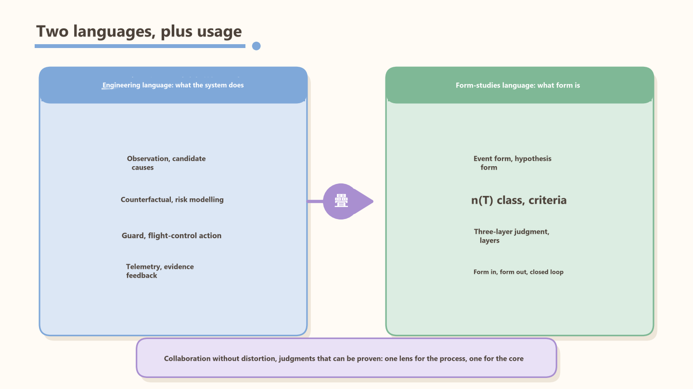

Figure 0-1: Two languages, superimposed

Six pieces of Typology Tools - Three Axes and Three Brackets, Three-Layer Judgment, Four-Step Framework, Five Operations, Six Groups of the Function Library, Accuracy Method - Part II are used in the whole book as the backbone. They will only be used hereafter and will not be repeated. The three platforms are in place: Ontypology is the theoretical basis, Mind AI is the underlying platform, IC Design Brain is the chip development platform, and Causal Reasoning IC is the protagonist of this book.

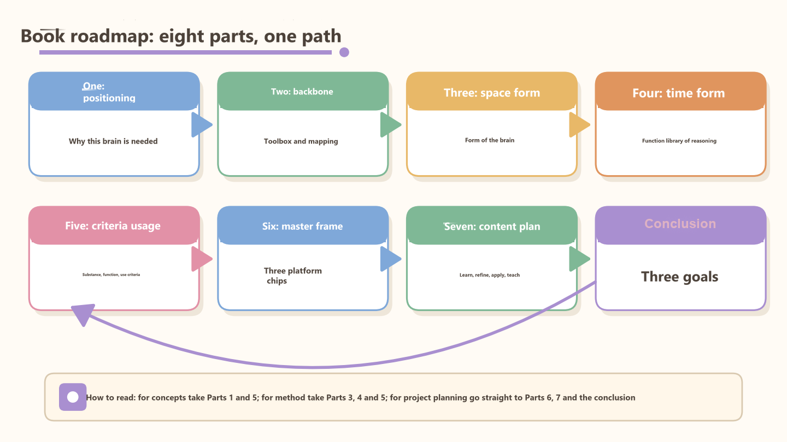

Figure 0-2 Roadmap of the book: Eight Part roads

> **Three reading methods, choose any one**  
> Just want to understand the concept: read 5-1 and 5-4 of Part I and Part V.  
> How to get started: Read Part III to Part V one by one Section, and complete E01–E09.  
> To plan a project: directly read Part VI, Part VII and Conclusion, and match S01–S03.  

> **Quick overview of symbols: All the symbols in the book are collected here**  
> [ ] Attributes and scale \| } Composition and BOM \| ( ) Container and identity \| ∩(T) Intersection Criterion \| op: Type → Type (function)  
> ≡ Same ≢ Different one ⊂ Downgraded Inclusion ⊕ Type Merge σ Substitution Preserving Identity  
> Turn to Appendix A Glossary when you cannot read the marks; turn to Appendix B-3 when you want to copy a blank card.  

# Part I Positioning - One Effect, Many Causes; One Brain, Many Layers

To position Part, first answer three questions: What does this brain want to deliver? Why is it necessary? On which floor does it stand and on which platform does it grow? The answer will be to break down the word "trustworthy" into engineering requirements step by step - and finally fall on a verifiable Causal Reasoning IC.

## 1-1 Trustworthy Intelligence

What AI Drone Brain wants to deliver is not “better-speaking AI”, but trustworthy intelligent capabilities. Causal_DT Let us move from seeing reality to exploring possibilities; from understanding cause and effect to changing the future. When experts, AI models and task agents put forward different reasons for the same Anomaly "result", the brain provides Candidate Causes and Risk Assessment, Pre-action Strategy Review, Evidence Feedback, providing traceable Risk Advisory before major actions. So, together we went from "purchasing a drone" to "providing evidence of flight safety and intelligence of the Verification."

To put it in Typology’s language: Trustworthiness does not mean “the AI ​​is very confident in what it says”, but “every judgment is auditable”. Auditable Accuracy is the root of this brain; everything Part does in the next six days is to keep this root. And when this brain is about to grow into the chip, the word "auditable" are upgraded from the requirements of the document to the requirements of the circuit - this is the reason for the existence of Causal Reasoning IC.

> **Positioning in one sentence**  
> AI Drone Brain = accompanying wisdom twins who can judge causes and consequences, grown on Mind AI, developed with IC Design Brain, and the core is a verifiable Causal Reasoning IC.  

## 1-2 One Effect Often Has Many Causes

When the UAV vibrates, climbs insufficiently, or has degraded navigation quality, pilots, maintenance engineers, the Anomaly inspection model, and the LLM may suggest different reasons. If AI only gives confident conclusions but cannot show the source and counter-evidence, mutual trust between humans and machines may decline; on the contrary, only by retaining multiple Hypothesiss and clearly marking uncertainties can differences become testable issues. Take the increase in vertical fluctuation of IMU as an example:

| **Same Anomaly** | **candidate explanation** | **How to recheck** |
| --- | --- | --- |
| IMU Increased fluctuation in vertical direction | airflow disturbance | Compare environment/body dynamics, attitude output and Timing changes |
| IMU Increased fluctuation in vertical direction | Voltage sag/insufficient thrust | View current, motor and ESC telemetry |
| IMU Increased fluctuation in vertical direction | Sensor bias or time synchronization issues | Cross-check different sensors, timestamps and calibration status |
| IMU Increased fluctuation in vertical direction | Simulation model mismatch | Check mass, inertia, wind fields, thrust curves and simulation assumptions |

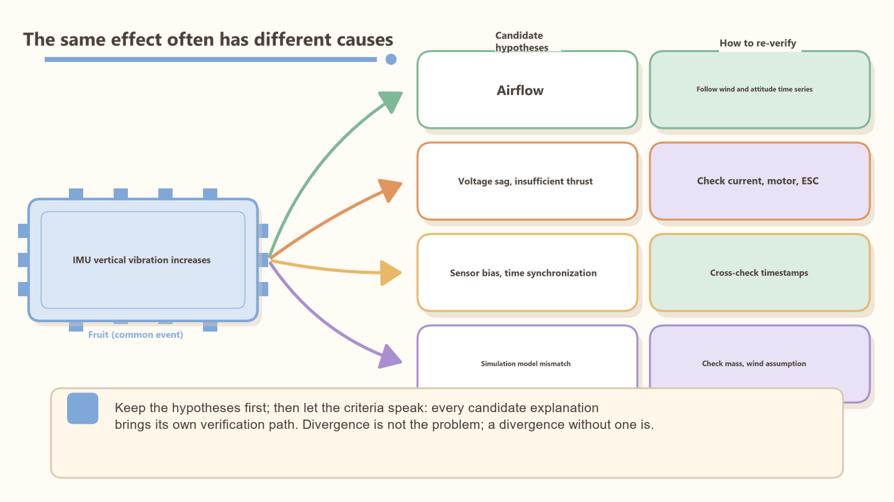

Figure 1-1 The same effect often has different causes

> **Keep Hypothesis first, then it’s Criterion’s turn to speak**  
> The third column of Table 1-1, "How to retest" is the key point: each candidate explanation carries its own Verification path. Differences are not terrible - differences without the Verification path are terrible.  

## 1-3 Five Pain Points: All Because the Type Was Never Established

Looking at the common trust crises, there are actually five pain points: no source of confident conclusions, a single Hypothesis finalization, no rebuttal test, misunderstanding the user's trust as eternal obedience to AI, and no independent security capabilities when the connection is lost. The five pain points point to the same common root cause - the Type Is Not Properly Established: HypothesisNot Established as a Type, there is no BOM for evidence, and Criterion does not write rules. The numbers and conclusions are that it runs ahead of the Types and Criteria, which looks faster but is actually not as fast as the auditable route.

These five pain points have changed to Name in the chip world, but the symptoms are the same: Specification cannot produce sentences (the Type Is Not Properly Established), write RTL when Interface is not locked (supplemented by Criterion), submit the document after running through the simulation (no evidence to the contrary), regard the Verification report as a gold medal to avoid death (trust misunderstanding), and crash when disconnected (lost connection and no autonomy). Cure the disease first in Type Level, and both worlds will benefit at the same time.

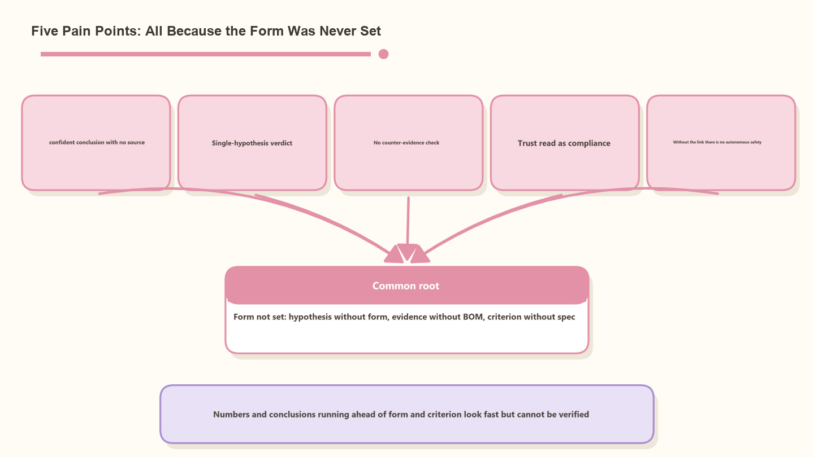

Figure 1-2 Five pain points: They are all "the Type Is Not Properly Established"

## 1-4 Three-Layer Positioning: Root, Trunk, Fruit

The position of AI Drone Brain in Three Layers must be explained clearly first. The root is Auditable Accuracy - understanding cause and effect, moving towards changing the future; the stem is Accuracy Method - the list of Three Completions, Six-Step Proof, Eight Questions and Misuse; the fruit is a trustworthy intelligent system - the AI ​​decision-making process is traceable, risks can be traced, and loss of contact still has independent security capabilities.

Causal Reasoning IC is the core carrier of the fruit layer. In terms of flight control protection, it covers configured device-side security behaviors such as low battery, positioning failure, and data link interruption; before high-level commands enter the flight control, it checks authorization, data period, work area, prohibition conditions, and mission status, and supplements Candidate Causes, Counterfactual risks, and Evidence Gap before major actions. The root grows on the "quasi", the stem grows on the "method", and the fruit grows on the "silicon" - Three Layers forms a line.

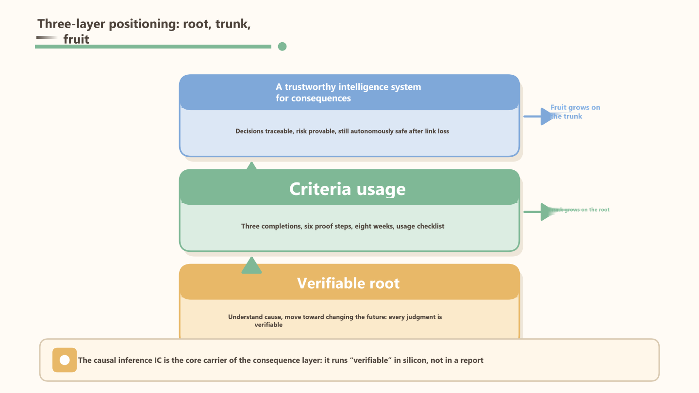

Figure 1-3 Three-Layer Positioning: Root - Trunk - Fruit

## 1-5 Four-in-One: Theory, Platform, Dev Platform, Core

This brain is a project of Four-in-One. The bottom layer is Ontypology: Spatial Type manages the static Type, Temporal Type manages the dynamic Types and Criteria, and the language of Types and Criteria runs throughout the book. Above it is the Mind AI underlying platform: LLM is responsible for language capabilities, Mind Model is responsible for intelligence capabilities, and Two Libraries, One Hub, One Loop carries long-term memory and reasoning. Next is IC Design Brain - chip development platform: Six Output Types, Four-Layer Accuracy, six-step SOP and Seven-Stage Prompt Pipeline, turning "AI helps me design chips" into a reliable production line. The top is the protagonist: Causal Reasoning IC - install Six-Station Causal Decision Chain into silicon, instantly, Verification can be lost, and the connection is independent.

Four-in-One has a common rule: the same as One Type Language. Type of Judgment (event, Hypothesis, strategy) and Type of Design (Specification, Interface, Module) use the same set of three brackets, the same set of Criterion, and the same chain of evidence. This allows the flight team and the chip team to quarrel with the same picture and converge with the same table for the first time.

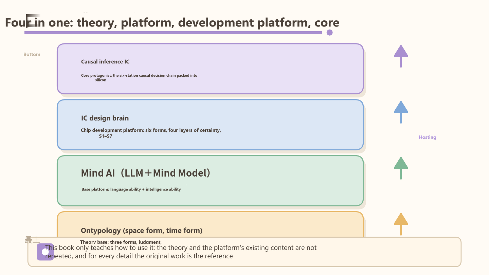

Figure 1-4 Four-in-One: theory, platform, development platform, core

## 1-6 Causal Reasoning IC: Enter the Protagonist

What is Causal Reasoning IC? In a word: harden the chain of "trial cause, pre-result, ruling, Feedback" into a set of Verification-capable hardware units. Its input is sensing flow and Event Type, and its output is judgment, Consequence Type and Structured Log; its internal operation is Hypothesis sorting, Counterfactual comparison and Three-Layer Judgment; its discipline is Six Stations does not jump, Criterion is generated before, Unbroken Evidence Chain.

Why harden? Three reasons. The first is determinism: reasoning on the safe path cannot have variables such as "whether the model is in a good mood today", and the hardware pipeline provides reproducible delays and Verification behavior. The second is immediacy: What-if Counterfactual comparison is a matter of seconds in the software, but it is a matter of milliseconds in the hardware accelerator - only the review window before major actions can be closed. The third is Auditability: the intermediate results of each stop are left in Evolution Ledger, and the origin can be asked after an accident.

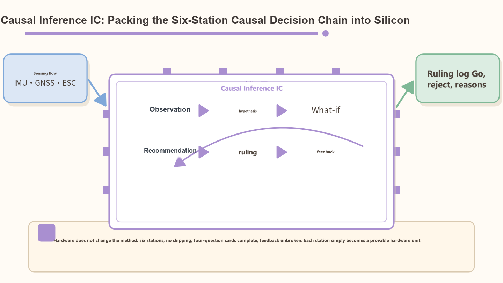

Figure 1-5 Causal Reasoning IC: Putting Six-Station Causal Decision Chain into silicon

> **Summary of this Part**  
> Trustworthiness = auditability in every judgment; the common root of the five pain points is the Type Is Not Properly Established; Three-Layer Positioning sticks to the root - stem - fruit; Four-in-One shares One Type Language; Causal Reasoning IC puts Six-Station Chain into silicon, which is the protagonist of this book.  

> **Exercise E01 (Part I)**  
> ① "Insufficient climb" in the landing mission is a result. Please follow Table 1-1, list three candidate explanations, and write a line "How to retest" for each explanation.  
> ② Among the five pain points, which two pain points will explode at the same time in the "lost connection" scenario? Explain their relationship with "the Type Is Not Properly Established".  

> **[Professional Column C1] A brief history of causal inference: Bayes, Fisher and Pearl’s Ladder**  
> There are three stages of causal inference. The first period is the statistical era: Bayes (1763) left behind the formula of "updating beliefs by effect", and Fisher (1920s) used randomized experiments to write "intervention" into statistics - but both stopped at correlation and design, without the language of cause and effect. The second section is the structural era: Wright's (1921) path diagram, Simon's (1950s) causal sequence, and Pearl's (1988) Bayesian network, establishing the "causal structure" as Computable Type. The third paragraph is about intervention and Counterfactual: Pearl’s do-calculus (1995) and the causal ladder (seeing → intervening → Counterfactual, 2000/2009). Rubin’s potential outcome framework makes “what would happen if we changed the action at that time” a deducible question.  
> The significance of AI Drone Brain: What-if in Six-Station Chain occupies the third step, and causal reasoning occupies the leap from the first to the second step. This book does not teach theory (Promise 2), but you need to know that every stop in IC is based on a hundred years of probability and causal research.  

# Part II Backbone at a Glance - Typology Toolbox and Master Mapping Table

The backbone Part is the translation layer of the whole book: three chains stack up a skeleton, Six Tools serves as the foundation, and Master Mapping Table serves as the dictionary. If you read this page lightly, the following pages will be light; if you skip this page, you will get lost back and forth between the two worlds.

## 2-1 Cognition Chain x Causal Decision Chain x Chip Design Chain

The Cognition Chain of Ontypology is: Similarity / Difference → Division / Combination → Type → Name. The Causal Decision Chain of Causal_DT is: Common Reality Observation (Fruit) → Competitive Cause and Effect Hypothesis (Cause) → Counterfactual Action Comparison (What-if) → Security Strategy Recommendation → Guard/Flight Control Execution → New Fruit Feedback (Evidence Update). The Chip Design Chain of IC Design Brain is: Specification → Interface → Module → Timing → Verification → Mode.

Three strands are three ways of reading the same thing. See the real Similarity / Difference, separate out Candidate Causes, form a comparable Hypothesis, give the word Name and the verdict - this is the common skeleton of Cognition Chain and the decision-making chain; establish the output of each step as having an identity, Criterion, Versioned Type - this is the discipline of the design chain. Let’s divide Similarity / Difference first, and then talk about cause and effect; Establish the Type First, Then Design—this sentence is the foundation of the whole book.

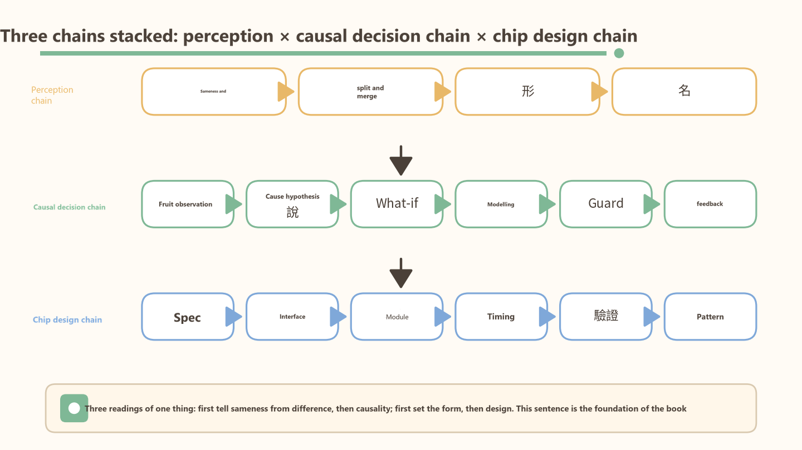

Figure 2-1 Three Chains Stacked: Cognition Chain x Causal Decision Chain x Chip Design Chain

## 2-2 Six Tools: Build the Backbone Once

The method of establishing the backbone of this volume is "architecture diagram + graphic abstract" and does not reprint the theory chapter by chapter. Six Tools has one sentence each: Three Axes and Three Brackets — [ ] attribute scale, { } composition BOM, ( ) container identity; Three-Layer Judgment — container, BOM, and abstract Three Layers are indispensable; Four-Step Framework — distinguish Similarity / Difference, trigger abstraction, specify Name dimension, and judge attribution; Five Operations — Type Merge ⊕, Type Split remove, replace σ, Classification ∩(T), Nesting ι; Six Groups of the Function Library — Temporal Type is the function, Input a Type, Produce a Type; Accuracy Method — Three Completions, Six-Step Proof, eight questions and Auditable Accuracy.

Five Operations appears a lot in this book: ⊕ is used to combine the sensing parts into Event Type, remove is used to disassemble the evidence to determine the importance, σ is used to modify Specification without changing the identity, ∩(T) is used to classify the event into Hypothesis, and ι is used to hang Verification Type under Module Type. Each station of Six-Station Chain is actually a combination of these five operations.

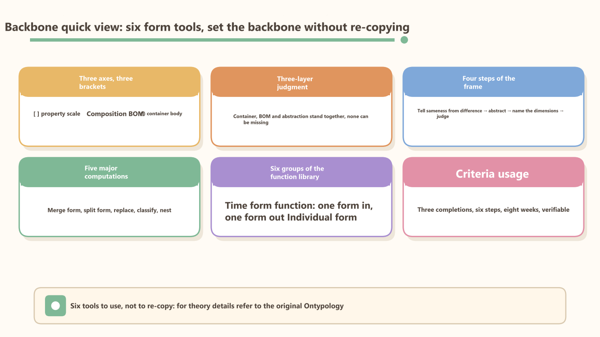

Figure 2-2 Backbone at a Glance: six pieces Typology Tools

## 2-3 Three-Platform Master Mapping Table: The Translation Bridge

Master Mapping Table is a translation dictionary for the whole book: when you can’t understand the left side, read it again in the language on the right; when the right side is about to fall off, switch back to the object on the left. The sixteen mappings cover the judgment side and the design side—the first eight are for flight judgment, and the last eight are for chip design.

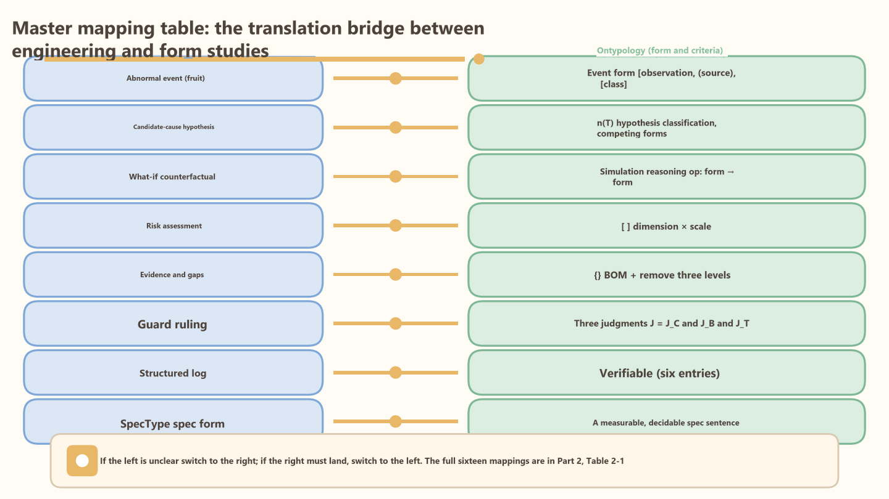

Figure 2-3 Master Mapping Table: Translation Bridge engineering with Typology

#### Table 2-1 AI Drone Brain ↔ Ontypology Master Mapping Table (sixteen items)

| **AI Drone Brain (Engineering)** | **Ontypology (Types and Criteria)** |
| --- | --- |
| Anomaly event (result) | Event Type {Observation,(source),[category]} |
| Candidate CausesHypothesis | ∩(T) HypothesisClassification / Competing Type |
| What-if Counterfactual compares | Simulation inference function op: Type → Type |
| Risk Assessment | [ ] Dimension × Scale (lead, error release, delay) |
| Evidence and Evidence Gap | { } BOM + remove level three |
| Airborne/Ground/Simulator | ( ) container C=(id(C),S(C)) |
| Guard Ruling | Three-Layer Judgment J=J_C ∧ J_B ∧ J_T |
| Structured Log | Auditable Accuracy (six columns) |
| SpecType Specification sentence | Measurable / Adjudicable Type: If it cannot be measured, it will be returned |
| InterfaceType port contract | ( ) Container entry rules: only if they match |
| ModuleType BOM | { } composition + remove three-level classification |
| TimingType wave Type with assertion | ( ) Dynamic projection of the container: oscilloscope is established |
| VerifyType self-checking | ∩(T) Executability of Criterion |
| PatternType Mode library | Design Search and Extraction: Reusable Type with Criterion |
| Version change / ECN | σ Substitution Preserving Identity: id(C) remains unchanged |
| Evolution Ledger / Review Lessons | Type-in / Type-out Closed Loop: Types and Functions Co-Evolve |

#### Table 2-2 Comparison of Name words in three worlds

| **flying world** | **chip world** | **Typology World** |
| --- | --- | --- |
| Sensing flow | Timing incentive | Type Input |
| Anomaly event | test failed | Event Type |
| Candidate Causes | Assume failure Mode | Hypothesis Type |
| security policy | Design trade-offs | Strategy Type |
| Guard Ruling | Sign-off | Three-Layer Judgment |
| flight log | Verification report | Auditable Accuracy |

> **Example Three translations of one word**  
> The matter of "data expiration": the flight world calls it "admission rule violation", the chip world calls it "timing contract is not satisfied", Typology World calls it "( ) container admission check failed" - three versions, the Same Type. If both parties quarrel during a meeting, first turn over Master Mapping Table once each, and you will usually find that the quarrel is about the same grid.  

> **Summary of this Part**  
> The three-chain stack is the foundation, Six Tools is the toolbox, and Master Mapping Table is the Translation Bridge. When the three worlds each speak their own words, use Table 2-1 to align them; when the terms conflict, Typology World is the final arbitration - because it only cares about "Types and Criteria" and does not support any engineering camp.  

> **Exercise E02 (Part II)**  
> ① Without looking at Table 2-1, write down the two mapping Typology Sides of "Evidence Feedback" and "Risk Assessment", and then check the answers.  
> ② Explain in one sentence to the chip colleague what "number = Sub-Types Inside Types" refers to in Causal Reasoning IC.  

# Part III Spatial Type - The Type of the AI Drone Brain

Spatial Type tube "Quiet Type". In this round, Event Type and Hypothesis Type on the judgment side are aligned with Six Output Types on the design side - Three Axes, remove level three, Three-Layer Judgment, and Layers and Identity, all fall into the same bracket.

## 3-1 Anomalous Event Type and Hypothesis Type

An event is a Type. Put once IMU AnomalyEstablish as a Unit Type: {Observation Fruit, (source container), [Anomaly category]}. The curly brackets contain the components - fluctuation sequence, GNSS quality, ESC current, etc.; the small brackets contain the identity and container - which machine, which mission, which data source, and what time stamp; the square brackets contain the attributes and scale - vibration type or climbing type, how high the risk is, and what level.

Here is a very important way to read in Typology: number = Sub-Type·time comparison in Type. The "Confidence 0.7" on the Hypothesis card is not a dangling number, it is a measurement on the Hypothesis Type. First there was Type, then there was the number - Type Not Established, the numbers are just decoration. Hypothesis Type is a four-square card: supporting evidence, opposing evidence, re-examination path, plus a blank space to write "what you don't know yet". Dare to leave the Hypothesis card blank so that it will not be misinterpreted as finalized.

The relationship between Event Type and Hypothesis Type is Nesting ι: the Hypothesis card is linked under Event Type. One incident has many Hypothesiss, and one Hypothesis has many evidences. After asking layer by layer, we can get the origin. At the IC end, this structure is the tree skeleton of the Verification Plan - the parent Section point is risk, and the child Section point is testing and evidence; the two sides look alike, which is not a coincidence, they are two projections of the Same Type Skeleton.

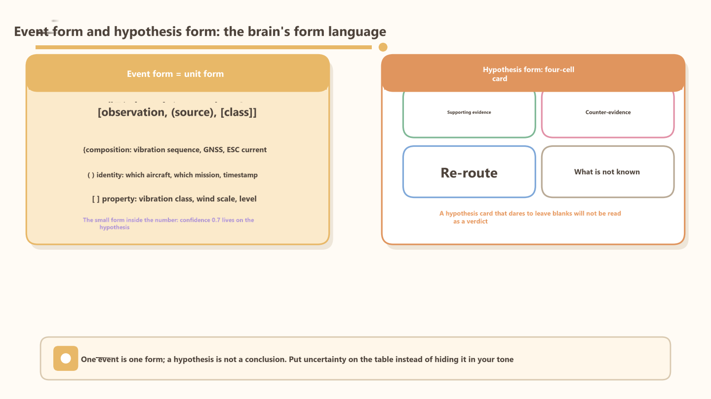

Figure 3-1 Event Type and Hypothesis Type: Type Vocabulary of the brain

> **Put uncertainty on the table**  
> Causal Reasoning IC is more trustworthy than "confident conclusion". The first gap is here: it puts uncertainty on the table instead of hiding it in the tone. The four slots of the Hypothesis card are the four temporary storage slots in the silicon - support, objection, retest, and don't know yet, not a single slot is missing.  

## 3-2 Six Output Types: The Design Vocabulary of the Causal Reasoning IC

The judgment side uses Event Type and Hypothesis Type, and the design side uses Six Output Types of IC Design Brain. Specification Type SpecType sets the requirement sentence into Specification that can be Criterion - transmission speed, frame error rate, clock domain. adjective that cannot be measured will be returned for rewriting; Interface Type InterfaceType is the contract between Module and the outside world - port list, bit width, direction, handshake agreement. Changing Interface means changing the contract; Module Type ModuleType is used { } BOM composition, use remove three levels to determine the severity; Timing Type TimingType collects all "movements" - clock, frame Timing, reset sequence, cross-domain synchronization, and can always be oscillographed and asserted; Verification Type VerifyType handles "how to calculate it right" Establish as a Type - self-checking, coverage, and item-by-item sign-off; Mode Type PatternType It is a reusable design Mode that was passed by Verification, with Criterion and known pitfalls.

Way of Establishing the Type of Type is completely suitable for Five Operations: Specification uses ∩(T) for sentence classification, Module uses ⊕ for synthesis, Specification uses σ for revision to protect identity, Verification TypeNesting uses ι under Module Type, and remove is used for cost reduction. Make Counterfactual. This six-port Type covers the entire production line of Causal Reasoning IC from demand to receipt.

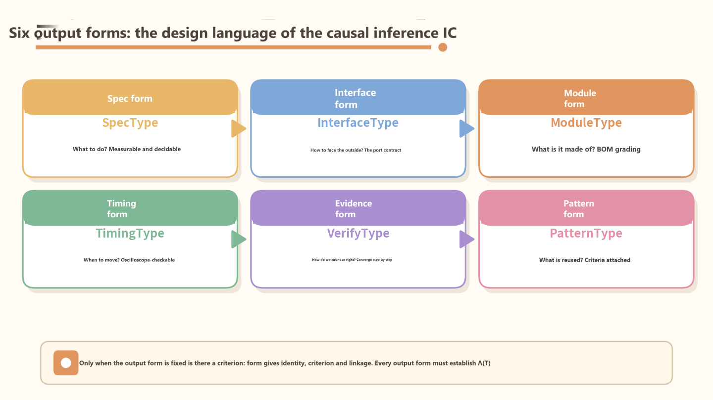

Figure 3-2 Six Output Types: Design vocabulary of Causal Reasoning IC

#### Table 3-1 Six Output Types general table (Causal Reasoning IC version)

| **Output Type** | **Answered questions** | **triple bracket center of gravity** | **Delivery Criterion** | **Causal Reasoning IC Example** |
| --- | --- | --- | --- | --- |
| Specification Type SpecType | What to do? | [ ] Attribute-based | Every sentence can be measured and judged | What-if delay ≤ 10 ms |
| Interface Type InterfaceType | How to speak to the outside world? | [ ]+( ) | Be honest and speak clearly | Sense bus contracts with FCU command port |
| Module Type ModuleType | What does it consist of? | { } BOM mainly | BOM Criterion+remove classification | Hypothesis sequencing unit / Counterfactual accelerator |
| Timing Type TimingType | When to move? | ( ) container-based | Can be used for oscilloscope and assertion | Decision pipeline latency and cross-domain synchronization |
| Verification Type VerifyType | How is it right? | Use all three brackets | Coverage meets standards + sign for item by item | Controlled perturbation + truth label verification |
| Mode Type PatternType | What to reuse? | { }+[ ] | Criterion comes with + pit record | Handshake protocol / Cross-domain FIFO / Frequency divider |

> **Example: The first SpecType of Causal Reasoning IC**  
> Specification sentence: "What-if the end-to-end delay of Counterfactual comparison is P99 ≤ 10 ms; the number of false releases of major actions = 0; the inference results can be reproduced under controlled disturbance."  
> Four Questions for Physical Examination - Measurable: Delays have P99 numbers, and wrong releases can be counted; Attributable: Delay hanging [ ] scale, Reproducible hanging ( ) container; Judgable: Two engineers read the same conclusion and got the same conclusion; Traceable: Every sentence returns the requirement of "review before major actions." adjective (fast and robust) that cannot be measured will be returned for rewriting - this is the first lesson of six Types to establish Type.  

## 3-3 Three Axes: Type of Judgment x Type of Design

Expand Type into three axes, and the judgment side and the design side are exactly aligned. X attribute axis [ ]: Determine "how dangerous" the side pipe is - detection advance, number of false releases, end-to-end delay; design "how much" the side pipe is - bit width, frequency, frame error rate, power consumption. Y composition axis { }: judge "what" the side pipe is made of - necessary evidence, downgradeable evidence, gap records; design "what the side pipe is made of" - subunit and remove classification. Z container axis ( ): Determine "where the side pipe is located" - airborne, ground, and simulator each have an identity; design "which domain the side pipe is in" - clock domain, protocol domain, Verification domain.

Three Axes is three sets of brackets - [ ] for description, { } for composition, and ( ) for identity. Type of Judgment and Type of Design share the same sub-brackets. The biggest advantage is that "cross-layer dialogue is not distorted": when the flight engineer talks about the risk scale, what the chip engineer reads is the Specification parameters; when the chip engineer talks about cross-domain, what the flight engineer reads is the container boundary. Three Axes lacks one, so Type is a mess.

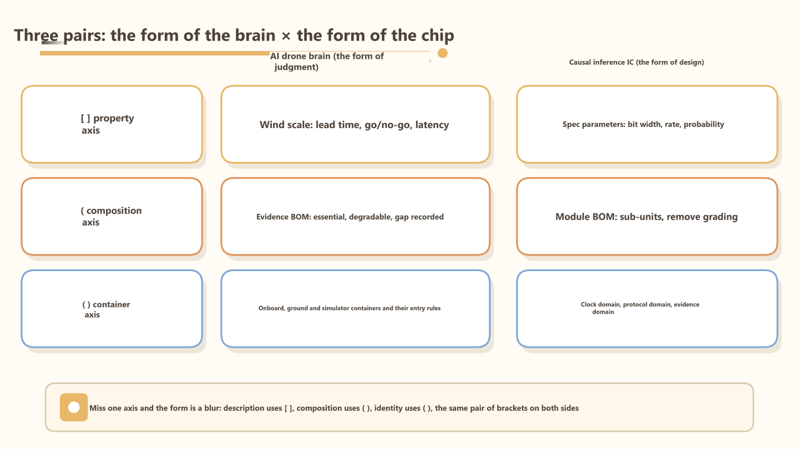

Figure 3-3 Three Axes reading: Type of the brain × Type of the chip

## 3-4 Three Levels of remove: Evidence Gaps x Module Grading

Treat evidence and Module as BOM, and you will ask that TypologyName saying: Can you recognize yourself if you take it apart? The necessary parts (≢ M) are removed, and the identity is lost - ESC The judgment cannot be established if the current is missing, and baud_gen is removed and it is no longer a UART; the function downgraded part (≡ M′ ⊂ M) is removed, the function is downgraded but the identity remains - the wind farm data is missing and the judgment must be reduced, the FIFO is still UART but easy to overflow; the non-essential parts (≡ M) operate as usual after being removed - debug Logo and decorative telemetry are directly removed from the production version.

The Evidence Gap is not something to be ashamed of - the undocumented notch is. The notch map turns "what you don't know yet" from a mantra to a list; the same Criterion falls on the chip, which is the common language when cutting costs and doing ECN: "What will happen if you remove this unit?" You shouldn't rely on arguing, the remove classification has already been written.

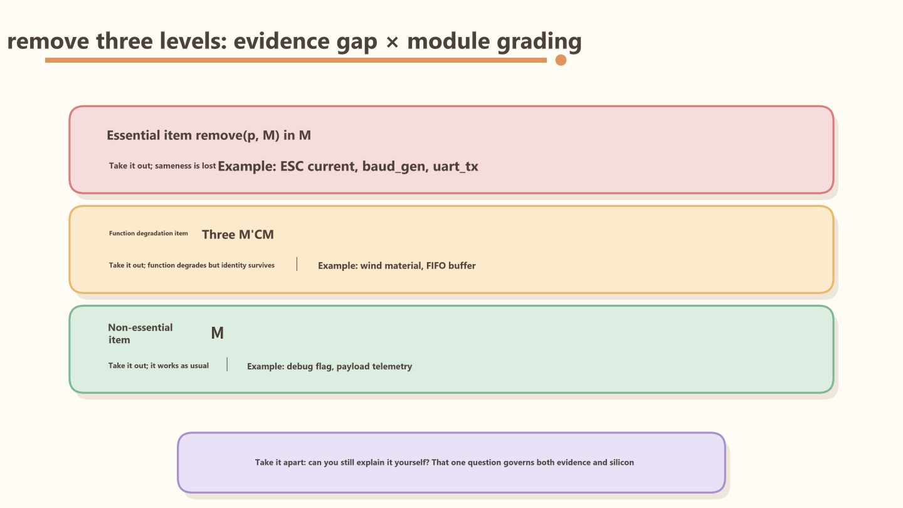

Figure 3-4 Remove level three: Evidence Gap × Module classification

#### Table 3-2 Example of BOM and remove classification of Causal Reasoning IC

| **parts** | **remove Criterion** | **Grading** | **consequences of taking it away** |
| --- | --- | --- | --- |
| Hypothesis sorting unit | remove(p, M) ≢ M | Necessary parts | The competition between multiple Hypothesis disappears, and the decision to return to single Hypothesis is finalized |
| Counterfactual accelerator | remove(p, M) ≢ M | Necessary parts | What-if can’t finish running, and the review window cannot be closed before major actions. |
| Three-Layer Judgment engine | remove(p, M) ≢ M | Necessary parts | Guard No basis for ruling, loss of identity |
| Wind field estimate Module | remove(p, M) ≡ M′ ⊂ M | Functional downgrade | It can still be judged, but the confidence is downgraded and a gap is marked. |
| telemetry compression unit | remove(p, M) ≡ M′ ⊂ M | Functional downgrade | Bandwidth becomes tighter and log granularity becomes coarser |
| Debug tracking Interface | remove(p, M) ≡ M | Optional parts | The mass production version can be removed directly |

> **Example: Gap Accounting Demonstration**  
> Three lines of accounting for missing wind farm data: Gap = Wind farm estimate is unavailable; Disposition = Confidence is reduced from 0.8 to 0.55 and marked; Back-up period = Retest after the next batch of telemetry updates. There is no shame in recording the gap, but there is shame in not recording it. With these three lines written, the Hypothesis card’s “I don’t know anything yet” has changed from a tone to an asset.  

## 3-5 Three-Layer Judgment: Guard's Funnel x Design's Intake Defense

The verdict for the Guard is the Three Layers funnel. The first level of container judgment J_C: Authorization, data period, work area, prohibition conditions, task status - review the five entry rules one by one; the second level of BOM judgment J_B: Are the necessary evidences complete? Are gaps recorded? No. Three Layers abstract judgment J_T: ∩(T) Intersection Criterion — Which Hypothesis does this event belong to. Three Layers Lianli J=J_C ∧ J_B ∧ J_T, only if all are passed will be released; if any level is not met, return to provide evidence or reject - the funnel will not be detoured.

The same funnel is placed at the receiving end of IC Design Brain, which is the last line of defense for output: Container judgment asks "Does it stay in the right ( )" (whether the clock domain and protocol domain are correct); BOM judgment asks "Is its relationship with the components in { } correct?" (Is the remove classification consistent with the dependency chain); Abstract judgment asks "Does it comply with the opening rules of ∩(T)" (Does the new requirement have the right dimensions). Judge the safety of side-guard flight and design the quality of side-guard output - one funnel, two kinds of laws.

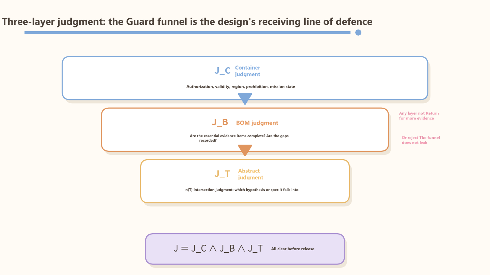

Figure 3-5 Three-Layer Judgment: Guard’s funnel = Designed receiving defense line

## 3-6 Layers and Identity: Semantics != Physics, Evidence Never Breaks

PoC-3 gave a classic Misuse lesson. When dual FSM is used to describe runway availability and the UAV landing mission, the runway occupancy first triggers the "mission status change" - this is a semantic layer event; to generate a real IMU Anomaly, additional crosswinds or airflow disturbances with physical effects need to be injected - this is the reason for the physical layer. The physical reason for mistaking the runway semantic event for IMU is Misuse of Layers and Identity: cause and effect are not on the same level, and the causal chain is broken.

Identity is another ruler. In the container C=(id(C),S(C)), id(C) is a constant identity anchor, and S(C) is a variable state - σ replaces the state, not the identity: the body changes the task, and the task id is rebuilt; the chip changes the version number, and the ECN record continues the same id of Module. Matched with identity recognition is Type Evidence Chain: Demand sentence → Type → Criterion → Inference moves → Verification → Evolution Ledger. The origin of each piece of output can be traced. If any link in the chain is broken, the output will not be collected.

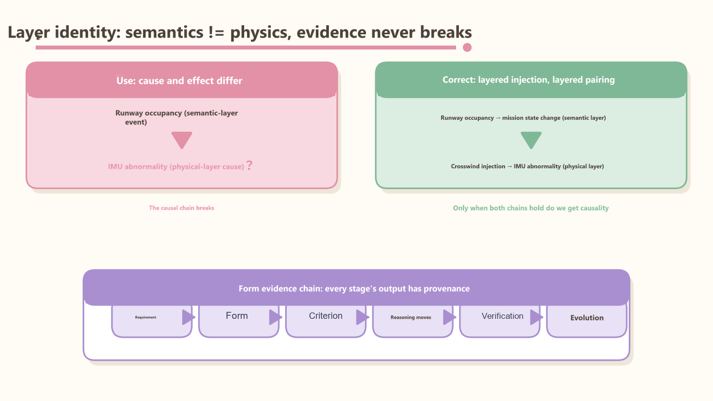

Figure 3-6 Layers and Identity: Semantics!= Physics, Unbroken Evidence Chain

> **Part III Summary**  
> Spatial Type teaches things: events must be established, Hypothesis must be reserved, six Type must be established, Three Axes must be filled, gaps must be accounted for, judgment must be passed, hierarchies must be aligned, and identities must be anchored. Only when these eight things are done can "results" and "outputs" begin to become auditable.  

> **Exercise E03–E04 (Part III)**  
> ③ E03 "GNSS quality degradation" Establish as an Event Type: Write the contents in three brackets {Observation, (source), [category]}, and specify one piece of necessary evidence and one piece of evidence that can be downgraded.  
> ④ E04 Judgment level: "Data link interruption leads to telemetry interruption" and "telemetry interruption leads to judgment degradation" - which one is the physical layer cause and effect, which is the system layer cause and effect? If you mix the two into a causal sentence, which family Misuse will be trampled on? (Tip: See 3-6 and Table 5-6)  

> **[Professional Column C2] EDA×AI: The real layout of AI writing Verilog**  
> "AI writes chips" is not news. Starting in 2023, ChipGPT-type research will bring large-scale language models into RTL generation; the three EDA giants (Synopsys.ai, Cadence JedAI, Siemens EDA Copilot) have successively put AI into Verification convergence and design space exploration. The consensus in the industry quickly settled into one sentence: AI's strength is "fast writing" and its weakness is "thinking right" - and IC is an industry where "if you think wrong once, the tape-out will be in vain".  
> The position of this book echoes the direction of convergence in the industry: do not pin your accuracy on changing to a model that is better at writing RTL (the model will be replaced), but put Type Established and Criterion in front and generate deductive skeleton constraints (the assets will remain). The S1-S7 pipeline of IC Design Brain is to split "write the entire chip at once" into "seven sections each with one Type" - this is not so much a Prompt technique as it is writing the design discipline into the human-machine division of labor.  

# Part IV Temporal Type - The Function Library of the Causal Reasoning IC

Temporal Type manages "moving moves". Six-Station Causal Decision Chain is the main axis: each station is a function, each card has Criterion, five races relay reasoning, Feedback will grow up - after hardening into an IC pipeline, there are many rules.

## 4-1 Hardening the Six-Station Chain: From Decision Chain to IC Pipeline

Temporal Type depends on Spatial Type: Input a Type, Produce a Type. The practical technology of Causal_DT is Six-Station Chain: Common Reality Observation (Fruit) → Competitive Cause and Effect Hypothesis (Cause) → Counterfactual Action Comparison (What-if) → Security Strategy Recommendation → Guard/Flight Control Execution → New Fruit Feedback (Evidence Update). Each station is a function: the Observation function expands the sensing stream Establish as an Event Type, the Hypothesis function expands Event Type into a Hypothesis set, What-if The function maps "Hypothesis+action" into Consequence Type, the suggestion function converges Consequence Type into Strategy Type with confidence conditions, the decision function translates Strategy Type into release or rejection, and the Feedback function writes the execution result back to the Hypothesis library.

When hardened into an IC pipeline, each station corresponds to a set of Verification units: sensing Interface, event detection and sequencing, Counterfactual accelerator, policy convergence, Three-Layer Judgment engine, and Evolution Ledger accounting. Hardware does not change the method - Six Stations does not skip stations, Criterion does not lack four-question cards, Feedback does not interrupt; what changes is only the carrier: from "process file" to "each station has a circuit Module guarded by Verification Type". This is where Six Output Types comes in handy: Each unit of Specification, Interface, Timing, Verification each has its own Type and signature.

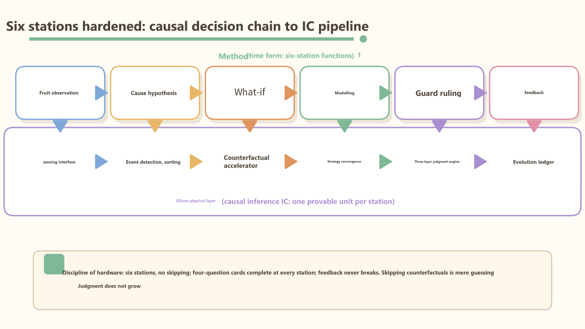

Figure 4-1 Hardening the Six-Station Chain: From Causal Decision Chain to IC pipeline

> **Six Stations does not skip stations**  
> The suggestion to skip Counterfactual is just a guess; the judgment to skip Feedback will not grow up. Complete the Six Stations process before taking any major action - first review the cause, then predict the result, then make the decision, and finally Feedback - this is the brain's specific commitment to the three words "trustworthy".  

> **Example: Hardware Section of Six Stations**  
> A reference Section summary: the sensing window is 1 ms to establish a Event Type; Hypothesis sorting gives the candidate order within 5 ms; What-if compares three candidate actions within the 10 ms window; Guard ruling ≤ 1 ms; Feedback writes to Evolution Ledger and takes the non-safe path, which does not occupy the review window. The numbers can be discussed, but each station must have its own Timing Type and Verification Type guard - the Section tune is designed, not prayed for.  

## 4-2 The Four-Question Function Card

Each function is equipped with a four-question card: Name, Input Type, Output Type, Criterion. The four-question card is actually one card written in two ways: "Problem-Proposal-Impact" for Engineering, and "Input Type-Output Type-Criterion" for Typology. Take the What-if Counterfactual comparison as an example - Input Type is Hypothesis Type H with candidate action Type A, Output Type is Consequence Type C with risk scale and confidence conditions, Criterion is truth label, controlled perturbation check and the number of false releases is zero. If you can't write the function of Criterion, you won't be able to work yet - this rule will appear again and again in the three sets of controlled experiments of PoC.

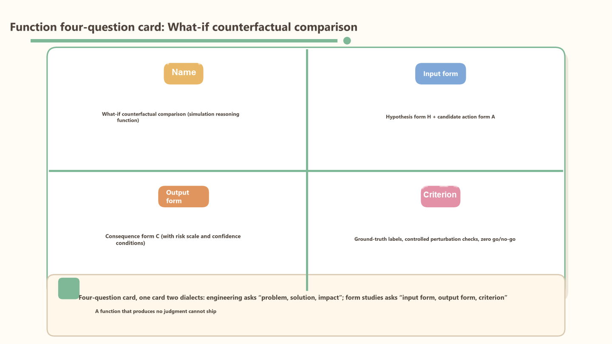

Figure 4-2 Four-Question Function Card: What-if Counterfactual comparison

#### Table 4-1 Two four-question cards: core functions of Causal Reasoning IC

| **field** | **Card 1: What-if Counterfactual comparison** | **Card Two: Guard Three Layers Verdict** |
| --- | --- | --- |
| Name scale | What-if Counterfactual comparison (analog reasoning) | Guard Three Layers Judgment (judgment function) |
| Input Type | Hypothesis Type H + candidate action Type A | Strategy TypeP + Event TypeE |
| Output Type | Consequence Type C (risk scale + confidence condition) | Ruling Type (release/rejection + reason) |
| Criterion | Truth label / Controlled perturbation check / Error release=0 | J=J_C∧J_B∧J_​​T Passed all, reasons can be traced back, six fields of the log are filled |

## 4-3 Relay of the Five Inference Families

What is running in Six-Station Chain is a relay race of five races of reasoning: statistical reasoning preliminary screening - telemetry to detect normal baselines and outliers; causal reasoning main judge - infer causes from effects, multiple Hypothesiss compete to sort; causal reasoning pre-effects - infer effects from causes, predict the consequences of intervention; simulation reasoning comparison and selection - comparison of what-if Counterfactual actions; reverse reasoning return visit - trace back the evidence chain from Anomaly. The five races are not mutually exclusive options, but are relay batons: statistics are used for initial screening, causation is used for main judgment, causation and simulation are used for predicting results, and reverse is used for closing.

After hardening, each of the five families has its own hardware placement: the statistical preliminary screening corresponds to the lightweight detection unit (it can even be an AE/XGBoost model), the causal judgment corresponds to the Hypothesis sorting unit, the causal prediction corresponds to the prediction unit, the simulation selection corresponds to the Counterfactual accelerator, and the reverse review corresponds to the accounting and backtracking unit. The light work is done by the soft, and the heavy work is done by the hard - there is only one Criterion division of labor: reasoning on the safe path must be reproducible.

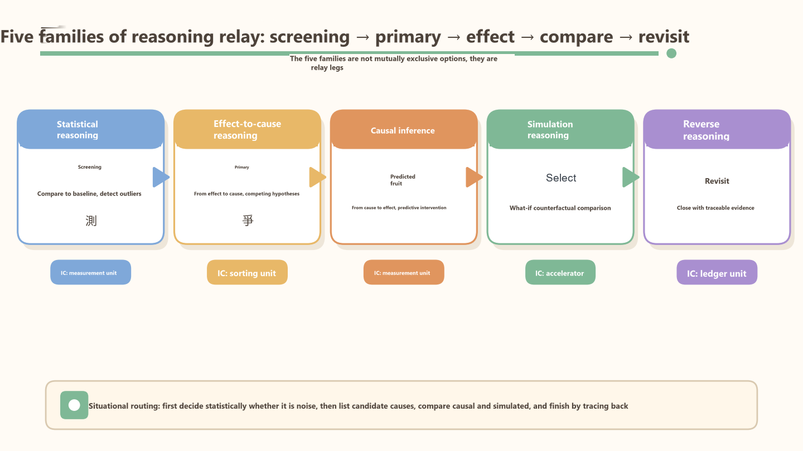

Figure 4-3 Relay of the Five Inference Families: Preliminary screening → Chief judge → Preliminary results → Comparison and selection → Return visit

#### Table 4-2 Five Inference Families × Causal Reasoning IC unit

| **reasoning family** | **Bang times** | **a word** | **IC unit landing point** | **Criterion** |
| --- | --- | --- | --- | --- |
| statistical inference | Preliminary screening | Telemetry to baseline, outlier detection | detection unit | False positive rate below threshold |
| causal reasoning | Referee | From effect to cause, multiple Hypothesis competition | Hypothesis sorting unit | Sorting can be explained, supported and opposed, and presented |
| causal reasoning | pre-result | Deducing effects from cause and predicting intervention | prediction unit | The consequences of intervention have a verifiable truth value |
| simulation reasoning | Competition | What-if Counterfactual compares | Counterfactual accelerator | Error release=0 |
| reverse reasoning | return visit | The end of the traceback evidence chain | Accounting and backtracking unit | No breakpoints in the chain |

## 4-4 Type-in / Type-out: Closed Loop and Evolution Ledger

Event Type and Hypothesis Type come in, Six Stations function operates, Strategy Type and log Type go out and return to the world - but the real focus is that Feedback line. Each cycle, the Hypothesis library adds an extra item Verification, the function Criterion is tightened once, and the confidence scale is calibrated once: Types and Functions Co-Evolve. The wisdom without Feedback is a consumable; the wisdom with Feedback is an asset. Evidence Update is the growth engine of the brain, and it is also the exact meaning of the word "grow" in "grow your own UAV wisdom ability".

The chip world has the same circuit, Name is called Evolution Ledger: this round of Criterion receipts, coverage gaps, lessons learned and reconstruction decisions are recorded in the account. When the next project starts, the previous account will be checked first, so there is no need to step on the trap a second time. Reconstruction and reorganization rely on id(C) to ensure security - Module is still the same Module after QXization and pipeline transformation. Feedback falls on the hardware, which is the Specification requirement of the accounting unit: the input, Criterion, output, and timestamp of each decision can be written out and retrieved.

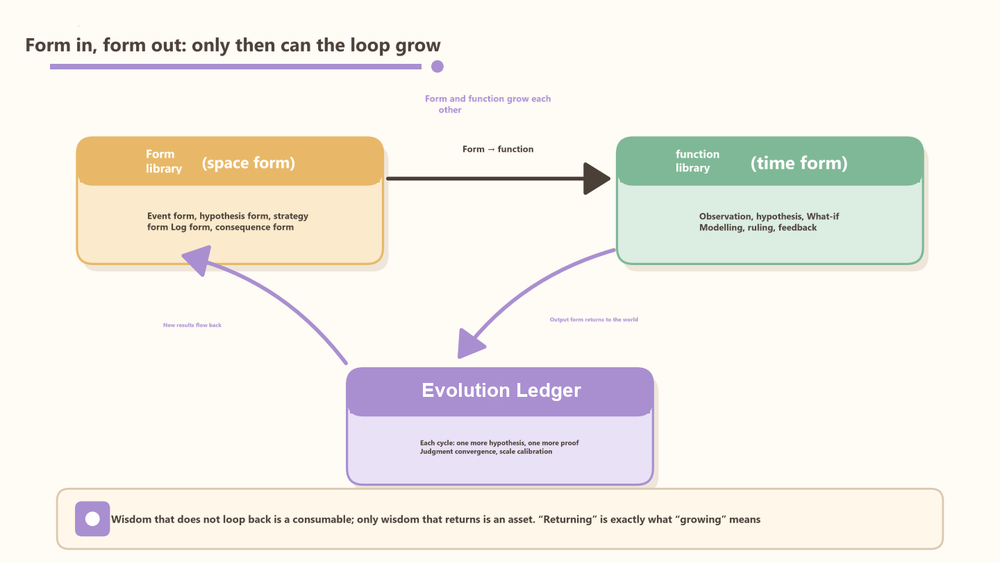

Figure 4-4 Type-in / Type-out: Only by closing the loop can you grow up

## 4-5 Technique Board x Chip Production Line

The position of the Temporal Type's move plate (Six Groups of the Function Library's fourteen moves) on the chip production line is worthy of a comparison table - it answers the old question of "which move should be used in this step?" Problem-solving and analysis are used in requirement dismantling and trade-off comparison; design Mode and search and extraction are used in obtaining Reusable Type from old cases; reasoning (cause and effect, cause and effect, simulation, statistics, reverse engineering) are used throughout QXZ16 1Q derivation and failure analysis; thinking methods (forward, reverse, horizontal, vertical, first principles) are used in architectural challenges; four methods of continuous learning, reconstruction and reorganization, R&D exploration, and self-evolution, all rely on Evolution Ledger.

#### Table 4-3 Fourteen moves in the move plate × Causal Reasoning IC production line placement

| **Moves (Temporal Type)** | **The placement point of IC production line** | **Book chapter Section** |
| --- | --- | --- |
| function search | Search the Type warehouse for existing Specification and RTL | 4-1, 5-3 |
| Design search and extraction | Reusable Mode extracted from old cases | 3-2 |
| Design Mode | Handshake, cross-domain FIFO, frequency divider, etc. Mode calls | 3-2, 4-2 |
| Logic generation and application | Deduction and verdict of Criterion | 5-4 |
| Function generation and application | Seal repetitive processes into Prompt functions (S1–S7) | 5-3 |
| Continuous learning | Daily accounting of Evolution Ledger | 4-4 |
| Refactoring and reorganization | Module-based and pipeline-based transformation (id(C) guarantee) | 4-4 |
| Solve problems | Requirements dismantling and problem analysis | 5-3 |
| analysis | Control comparison, remove Counterfactual analysis | 3-4, 5-7 |
| Design (creation and innovation) | Architecture design and trade-offs | 6-3 |
| Reasoning (Five Tribes) | Cause and effect, causality, simulation, statistics, reverse | 4-3 |
| Thinking method | Forward, reverse, horizontal, vertical, first principles | 5-8 |
| R&D and exploration | New architecture PoC and evaluation of alternatives | 7-4 |
| self-evolution | Maturity Level L4: Evolution Ledger drives the brain to grow | 7-5 |

## 4-6 LLM, Mind Model, Causal Reasoning IC: Each in Its Place

In the architecture of the brain, the Gemma class LLM has a clear and humble position: taking the non-safe immediate path, being triggered by events, and used to assist the generation of Hypothesis - its timeout does not hinder the independent safe disposal of FCU. In the words of Typology: LLM is the assistant function of "Hypothesis generation group" in Function Library, and is not the holder of Criterion. It can help propose Candidate Causes, but whether it is released or not will always be decided by Three-Layer Judgment.

The position of Mind Model is the wisdom layer: knowledge unification, deep reasoning, long-term memory and thought management - it is it that constrains the generated deductive skeleton, checks Criterion, and tracks the evidence chain. The position of Causal Reasoning IC is the execution layer: instant causal judgment, hardware-level certainty, and autonomous safety when out of contact. The three roles can be summarized in one sentence: LLM produces language, Mind Model produces wisdom, and Causal Reasoning IC produces certainty. Putting each model in the right position is exactly the "trustworthy" engineering detail Section.

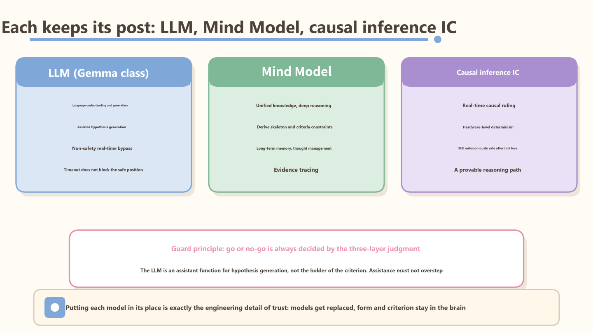

Figure 4-5 Each in Its Place: LLM / Mind Model / Causal Reasoning IC

> **Part IV Summary**  
> Temporal Type teaches things: Six Stations is a function chain, each station has four question cards, five races relay reasoning, closed loop will make you grow up, the moves are in the correct position, LLM's assistance does not exceed the authority. Temporal Type runs stably because Spatial Type stands firm - there is Type first, and then there is the function.  

> **Exercise E05–E06 (Part IV)**  
> ⑤ E05 Write a four-question card for "Observation Function (Fruit)": one line each for Name scale, Input Type, Output Type, and Criterion.  
> ⑥ E06 Path by Reader Profile: An "insufficient climb" alarm suddenly appeared during the mission. Please arrange the order in which the reasoning of the five tribes appears, and write a line of reasons for each.  

> **[Professional Column C3] Edge AI: How to put low-power inference on the chip**  
> When putting reasoning on drones, power consumption and weight are the ceiling. The three axes of edge AI: quantization (INT8/INT4 presses floating-point models into integer operations), pruning and distillation (packs the judgment of large models into small models), and architecture selection (CNN/RNN/Timing models each occupy their own place). Typical figures: The energy efficiency of INT8 inference on the same generation of NPUs is 2–4 times higher than that of floating point; pruned models can often save 30–70% more calculations with almost no loss of accuracy.  
> Inspiration for Causal Reasoning IC: The "light" parts of Six-Station Chain (statistical preliminary screening, event detection) are suitable for placement in the replaceable inference unit, allowing BYOM (bring your own model) replacement; the "heavy" parts (Hypothesis sorting, Counterfactual comparison, Three-Layer Judgment) are the territory of self-developed accelerators - what they have in common is that Criterion is stable and Verification has high demand. The choice principle of edge AI coincides with the principle of this book that "models will be replaced, Types and Criteria will stay".  

> **[Professional Column C4] Mathematics of Counterfactual: SCM and do-calculus in one sentence**  
> Structural causal model (SCM) writes the world as a set of three pieces: exogenous variables U, endogenous variables V, and structural equations F. "Intervention" in SCM is an action: replacing a certain equation (do(X=x)), rather than "observing X=x" - the difference between causation and correlation lies here. Counterfactual is the second replacement: re-running the equation under the premise of "the same U" and asking "what would have happened if it was not like this at the time".  
> Readers of this book only need to take away one sentence: The essence of the What-if Counterfactual comparison is "fix other equations, replace one equation, and recalculate Consequence Type" - the causal version of σ replacement. As for whether the three do-calculus rules can estimate the intervention effect from the Observation data, that is a matter of theory and subject to Pearl's original work (Convention 2).  

# Part V Complete Architecture of the Accuracy Method

Accuracy Method is the heart of the book: Substance - Use - Accuracy establishes the skeleton, Three Completions fills the gap, walks the whole process in six steps, Four-Layer Accuracy has a long structure, eight questions and a list, and Misuse serves as a road sign—finally closed in "Auditable Accuracy".

## 5-1 Substance - Use - Accuracy

The skeleton of Accuracy Method is composed of three characters: body, use and accuracy. The body is the family background - Type library and Function Library, Two Libraries, One Hub, One Loop; the use is the moves - Six-Station Chain operation, Relay of the Five Inference Families, four-question card driver; it is the referee - Three Completions, Six-Step Proof, eight-question check, Misuse list, and finally collected in "Auditable Accuracy". If the body is not upright, it will be chaotic when used; if it is not upright, it will be dangerous when used. Any Guard ruling must be rechecked in the log - this is the operational definition of "accurate = Auditable Accuracy".

This skeleton treats the judgment side and the design side equally. The "accuracy" on the judgment side falls on Structured Log and the ruling record, the "accuracy" on the design side falls on Four-Layer Accuracy and the receipt sheet; the "body" on the judgment side is the Event Type library and Hypothesis library, and the "body" on the design side is the six Type work orders and Mode library. The three words Substance - Use - Accuracy bring the two worlds into the same inspection framework.

The operation of "It must be the referee" is very specific: when a piece of output is put up, the referee first asks where Criterion is (the fourth question), then checks whether the evidence is sufficient (the sixth question), and finally checks Layers and Identity (the second and fifth questions) - the referee does not reinvent the answer, but only checks whether the answer is qualified for the job. The product of the referee is the receipt sheet and log, not the consensus of the meeting.

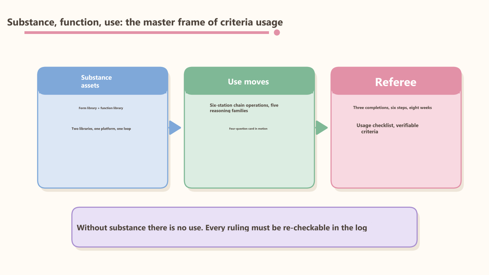

Figure 5-1 Substance - Use - Accuracy: Accuracy Method overall architecture

## 5-2 Three Completions

Missing rule complement [ ], missing identity complement ( ), missing structure complement { } - Three Completions corresponds to three sets of brackets. Falling to AI Drone Brain: Rule supplementation documents the five admission rules and risk scale definitions of authorization, data period, work area, prohibition conditions, and task status; identity supplementation clearly states the IDs of events, bodies, and tasks, data sources, and timestamps, and performs three identical checks (same as Name, same source, and simultaneous); structural supplementation establishes three-level classification of evidence BOM, gap records, and confidence downgrade markings. The three books are written in parallel: the rules book manages admission, the identity book manages traceability, and the structure book manages certificates - whichever book is missing, make up for it.

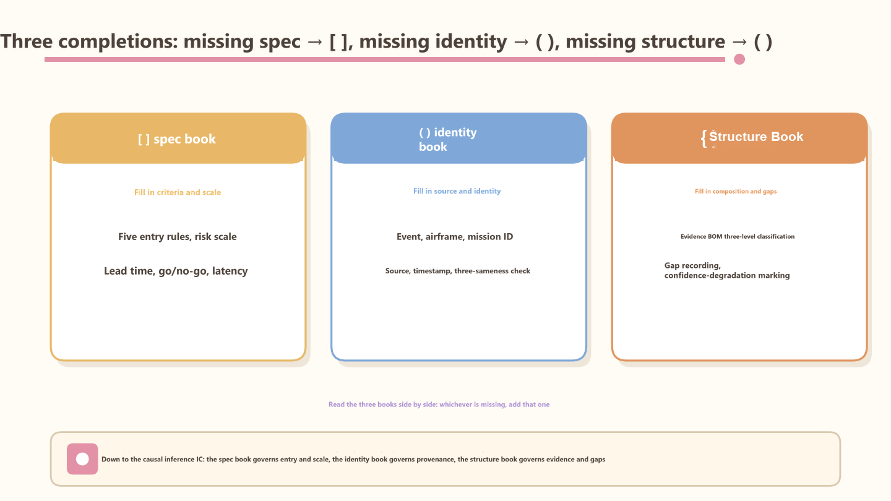

Figure 5-2 Three Completions: Missing rule complement [ ], missing identity complement ( ), missing structure complement { }

#### Table 5-1 Three Completions: AI Drone Brain version

| **complement** | **What to make up for?** | **AI Drone Brain specific projects** | **Wafer side correspondence** |
| --- | --- | --- | --- |
| [ ] Rule complement | Criterion and scale | Authorization, data period, work area, prohibition conditions, task status; risk scale (advance amount, wrong release, delay) | SpecType Acceptance Metric / SDC Constraint |
| ( ) Identity supplement | Origin and Identity | Event ID / Unit ID / Mission ID / Data source / Time stamp; triple check | Module id(C) / Version number / ECN record |
| { } structural complement | composition and gaps | Evidence BOM three-level classification; gap record; confidence downgrade mark | ModuleType BOM·remove classification table |

## 5-3 Full Walkthrough of the Six-Step Proof

Use the case of PoC-1 to go through the six steps. Case: During the landing mission, the vertical fluctuation of IMU increased. The six steps are: Identify the whole → Description of the sub-axis → Write the Type Set → Select the proposition → Criterion Reasoning → Three Layers Check. These six steps are also the judgment side mirror image of the IC Design Brain six-step SOP (identify the situation → build Type by axis → select expansion → generate output → Criterion acceptance → archive evolution) - two sets of six steps, one skeleton.

#### Table 5-2 Six-Step Proof × IMU case process

| **steps** | **action** | **How to write this example** |
| --- | --- | --- |
| ① Recognize the whole | First identify What Type Is This | Anomaly incident during landing mission - not a fault conclusion |
| ② Axis description | Write one line each for Three Axes | [ ] Fluctuation amplitude × time window / { } Evidence list / ( ) Airborne telemetry flow container |
| ③ Write the Type Set | Write Unit Type | {IMU AnomalyObservation,(airborne telemetry stream),[vibration type]} |
| ④ Select proposition | List candidates Hypothesis | H1 Airflow Disturbance/H2 Voltage Sagging and Insufficient Thrust/H3 Time Synchronization/H4 Model Mismatch |
| ⑤ Criterion reasoning | What-if + evidence comparison | The current is stable → H2 is arranged; the timestamp deviation → H3 is supported; the wind farm classmates change → H1 is supported |
| ⑥ Three Layers inspection | Lianli Three Layers re-adjusted | Container: The data has not expired ✓; BOM: All necessary evidence is complete ✓; ∩(T): Classified as H3 → Guard Ruling + Record |

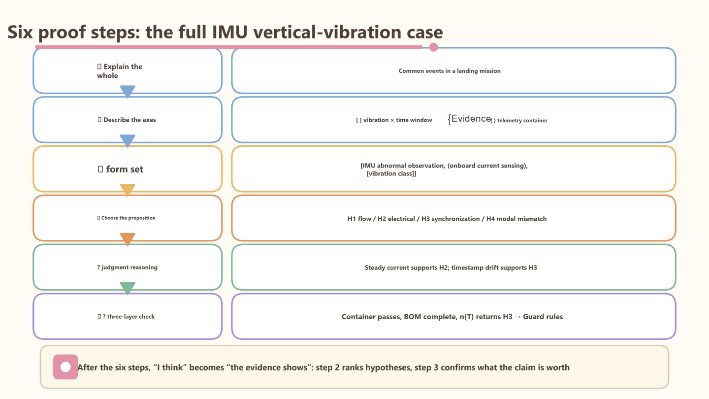

Figure 5-3 Six-Step Proof: The whole process of IMU vertical fluctuation case

> **Division of labor between steps ⑤ and ⑥**  
> Criterion reasoning is responsible for sorting Hypothesis, and Three Layers inspection is responsible for confirming the "qualification to say this" - whether the level is correct, whether the evidence is sufficient, and whether the identity is this one. After completing the six steps, "I think" is upgraded to "evidence shows."  

> **Example: Another round: Six-step sketch of voltage sag**  
> ① Identify: Anomaly event with insufficient climb and power alarm; ② Axis: [ ] voltage drop amplitude × time window, { } current and cell telemetry, ( ) airborne power telemetry container; ③ Type Set: {Voltage sag Observation, (airborne power telemetry), [power type]}; ④ Proposition: H1 battery aging/H2 Motor stalled/H3 power supply board Anomaly; ⑤ Reasoning: Large single pressure difference supports H1, current sudden increase supports H2; ⑥ Three Layers: The data has not expired ✓, the necessary evidence is complete ✓, ∩(T) belongs to H2 → Guard It is recommended to limit the torque and record it. The same skeleton can still work in another case - this is the method.  

## 5-4 Four-Layer Accuracy Assurance

The accuracy on the design side is structural, with four layers guaranteed to grow layer by layer. The first level ∩ (T) Criterion first: Before any output is generated, write down "what is right and what is wrong" - Criterion backfill is the most insidious inaccuracy, which is equivalent to allowing candidates to change the test questions themselves. The second layer of deduction skeleton: Mind Model deduces the skeleton structure according to Types and Criteria. LLM only fills the skeleton with meat - if the skeleton is wrong, it will be caught by the first layer, if the statement is wrong, it will be caught by Three Layers. No. Three LayersFormal Verification: lint, simulation, assertion, coverage - the object of Verification is Criterion, not the program code. Each self-checking of testbench must point back to a certain item of ∩(T). The fourth level Type Evidence Chain: Any section of RTL must be able to trace back to "which Type was hung, which moves were used, which Criterion passed, and which Evolution Ledger fell."

Each of the four levels blocked one type of inaccuracy: Criterion blocked "I don't know what it means to be right", skeleton blocked "the structure is crooked", Verification blocked "corner case", and evidence chain blocked "right but I can't explain why it is right". Missing one layer is a mistake. Acceptance depends on the dual axes: the space is complete (six QXZ108s are in place, the Criterion is established, and the records are complete), and the time is in place (calls are well-founded, reasoning is complete, records are archived) - both axes must be passed before going out.

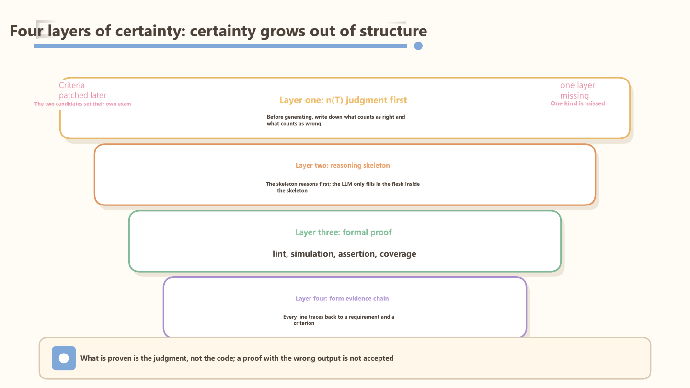

Figure 5-4 Four-Layer Accuracy: Accuracy is the result of structural growth

#### Table 5-3 Acceptance control of Four-Layer Accuracy

| **layer** | **Acceptance issues** | **through evidence** | **But deal with** |
| --- | --- | --- | --- |
| ∩(T) Criterion | Was Criterion established before generation? | Criterion receipt form (with date) | Return and reestablish |
| Deduction skeleton | Is the skeleton deduced? | Reasoning step record | Return to heavy long skeleton |
| Formal Verification | Is coverage up to standard? | Coverage report + gap treatment | Supplementary test |
| Type Evidence Chain | Is it possible to retrace every line? | Spot check of chain of evidence | Those who break will not accept |

## 5-5 Structured Log x Type Evidence Chain: Auditable Accuracy

The important decision-making output of the brain is a readable Structured Log, with six columns filled in: Observation what was found, possible reasons, supporting/contrary evidence, what is not yet known, suggested strategies, and Guard final verdict. Operators are reviewable and can intervene under well-defined conditions—user trust is not misunderstood as permanent compliance with the AI. The log is not a report for people to see, but evidence for readers: it changes the three sentences of "traceable, Verification, and intervention" from slogans into fields.

On the chip side, the same log is the output port of Type Evidence Chain: each decision is written to Evolution Ledger with the Input Type, Criterion version, reasoning path and timestamp. After the accident, the request sentence is asked all the way from the result. Two chains merge here - the flight log and the Verification report are originally two aspects of the same chain of evidence.

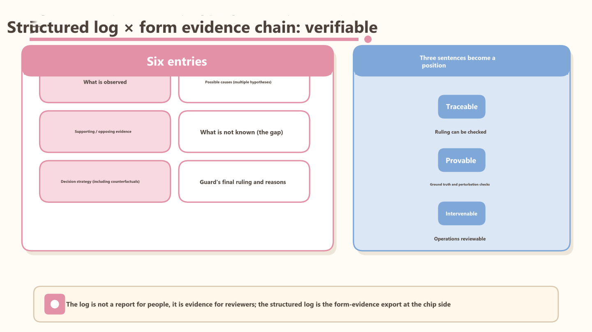

Figure 5-5 Structured Log × Type Evidence Chain: Auditable Accuracy

#### Table 5-4 Structured Log six columns

| **field** | **what to write** | **What to ask when Re-verification** |
| --- | --- | --- |
| What did Observation get? | Summary of Event Type and Three Axes | Is this the Same Type? |
| Possible reasons | Candidate Hypothesis set (multiple Hypothesis merged) | Hypothesis Has the evidence slot been left? |
| Evidence for/against | Evidence BOM and Gaps | Do you have all the necessary evidence? Has the shortfall been accounted for? |
| Don’t know what yet | Gap Recording and Confidence Downgrade | Is uncertainty on the table? |
| Suggested strategies | Contains What-if comparison results | Has Counterfactual been done? |
| Guard Final decision | Release/Rejection + Reason | Is Three-Layer Judgment connected? |

## 5-6 Eight-Question Checklist

Before each major action, eight questions are asked in order. The order is particular: Type first, then the number, first the aftermath, first the cause and the consequence. Passing eight questions = getting a job certificate; getting stuck on any question = returning it to provide evidence, no forced application. This list also applies to chip receipts: replace "major action" with "delivery", replace "Event Type" with "Output Type", and do not change a word of the eight questions.

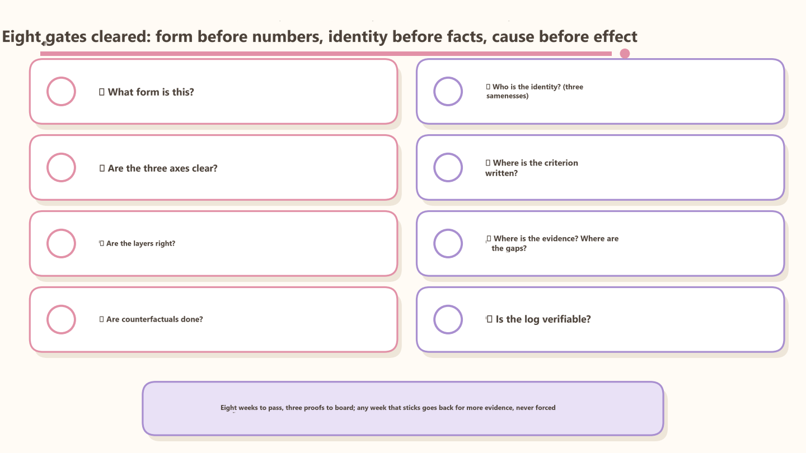

Figure 5-6 Eight-Question Checklist: Type first, then number

#### Table 5-5 Eight-Question Checklist

| **ask** | **Where to look** | **What to do if it’s not out of date?** |
| --- | --- | --- |
| ① What Type Is This? | Event Type/Hypothesis Type/Strategy Type/Output Type? | Back to 3-1 / 3-2 Li Type |
| ②Who is the identity? | id / task / source / timestamp (three identical) | Return ( ) identity supplement |
| ③ Three Axes Did you make it clear? | [ ] scale / { } BOM / ( ) container | Return to 3-3 Complementary axis |
| ④ Where is Criterion written? | Criterion column of four question card | No job without Criterion |
| ⑤ Is the level correct? | Semantic layer ≠ physical layer, Hypothesis level | Back to 3-6 Alignment levels |
| ⑥ Is the evidence enough? | Necessary evidence / Gap records | Return to remove Level 3 map |
| ⑦ Have you done Counterfactual? | What-if compare records | Back to 4-2 for comparison |
| ⑧ Log auditable? | Are the six columns filled? | Fill in the fields and then decide |

## 5-7 16 Kinds of Misuse

The Misuse list is grouped into four lesion families and is for comparison purposes only, not for memorization. Whenever you step on a box, write down your case next to that box - this is much more useful than writing down 16 items from memory. The lesions in the four groups are: Layers and Identity (cause and effect are not on the same level, identity is not anchored), evidence and Criterion (the gap is not accounted for, Criterion is supplemented later), container and trust (trust should be treated as obedience, and judgment is incorporated into control), and time and Feedback (the circuit should be treated as a one-way assembly line).

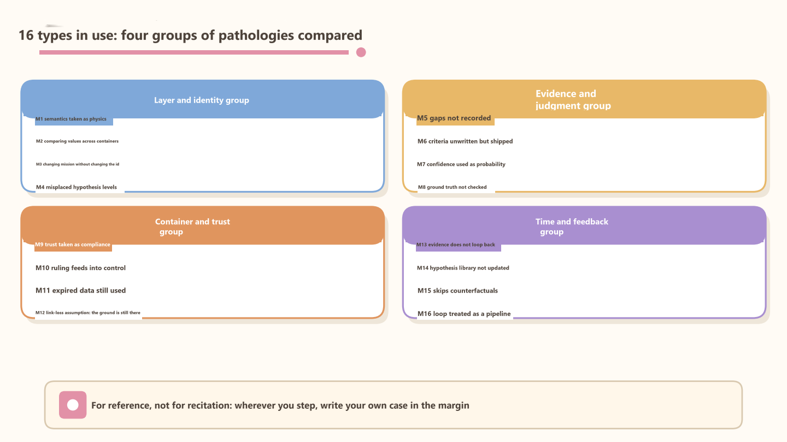

Figure 5-7 16 Kinds of Misuse: Four groups of lesion comparisons

#### Table 5-6 16 Kinds of Misuse: Four groups of controls

| **group** | **Misuse** | **Correct a sentence** |
| --- | --- | --- |
| Layers and Identity group | M1 semantic event as physical cause | First ask: Do cause and effect stand on the same level? |
| Layers and Identity group | M2 cross-container direct comparison value | Compare id(C) first, then compare the scale |
| Layers and Identity group | M3 forgot to change the ID when changing tasks | Once the mission is changed, the identity is re-established |
| Layers and Identity group | M4 Hypothesis levels are misaligned with each other | Write the Type Set indicates the level |
| Evidence and Criterion Group | M5 Evidence Gap does not record | The gap is recorded and the confidence is downgraded |
| Evidence and Criterion Group | M6 Criterion came to work without writing | Four question card Criterion column is required |
| Evidence and Criterion Group | M7 Confidence is used as probability | Confidence is the scale in QXZ​108Q, not probability |
| Evidence and Criterion Group | M8 Close the case without checking the truth value | Controlled perturbation + truth label verification |
| Containers and trust groups | M9 Trust = Always obey | Trust is reviewable, not exempt from inspection |
| Containers and trust groups | M10 Guard integrated into the control loop | Separation of Judgment and Control |
| Containers and trust groups | M11 Expired data can still be used | Data period is the entry rule |
| Containers and trust groups | M12 disconnection assumes that the ground is | Loss of connection and autonomy is a design requirement |
| Time and Feedback group | M13 The evidence is not Feedback | New fruit must be FeedbackHypothesis library |
| Time and Feedback group | M14 Hypothesis library not updated | Calibrate Criterion once per cycle |
| Time and Feedback group | M15 Skip Counterfactual and go straight | Six Stations does not skip stations |
| Time and Feedback group | M16 loop acts as a one-way pipeline | Loops are growth engines, not pipelines |

## 5-8 Routing Decision Tree

Convert Six-Station Chain to Routing Decision Tree: After reporting the sensing event, first take the quick rejection path - data expiration, authorization incompatibility, direct rejection, not worth running through the entire smart chain; other events are initially screened and sorted by AE/XGBoost or BYOM, entered into Causal KG search and lightweight What-if comparison, and finally decided by Guard Three-Layer Judgment: write down the reasons for release or rejection. After the verdict is Structured Log, and after the log is Evidence Feedback-Six Stations.

The other side of path selection is the path selection of thinking method: when the forward direction fails, switch to the reverse direction (backtracking from the result), when the single perspective is stagnant, change the level (remove the restrictions and see how to solve it in other domains), and when the mechanism is unclear, switch to the vertical direction (down to the first principles: down to the lowest level of physics and data and then rebuild). The decision tree governs how events proceed, and the thinking method governs how ideas are cut—the two pictures are posted on the wall together.

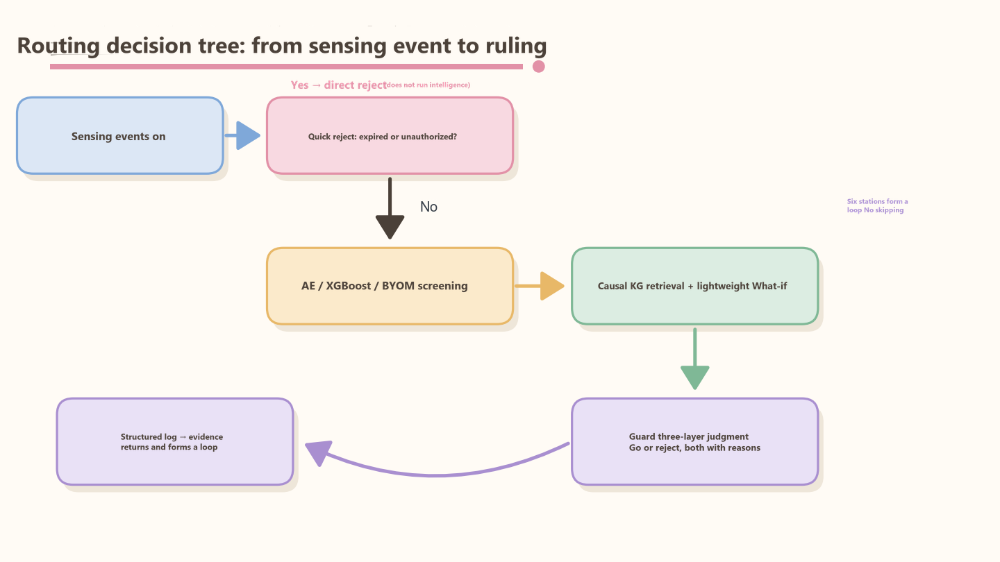

Figure 5-8 Routing Decision Tree: From sensing events to ruling

> **Part V Summary**  
> Accuracy Method in one sentence: Write Criterion as checkable Type. Three Completions completes the rules, identity and structure; the six steps turn judgment into a process; Four-Layer Accuracy grows the design into a structure; the eight questions turn the process into a list; the Misuse table turns the pitfalls of the predecessors into road signs; the routing tree collects everything into an operable road.  

> **Exercise E07–E09 (Part V)**  
> ⑦ E07 Your project is missing a "data expiration rule". Which kind of complement does it belong to? On which bracket does it go? Write a one-line example of the rule.  
> ⑧ E08 Use six steps to solve the "voltage sag" case: write down two reasonings for Type Set in step 3 and Criterion in step 5.  
> ⑨ E09 Nabal asks to check your latest "major action decision": Which question is the easiest to get stuck on? Why?  

> **[Professional Column C5] Formal Verification Research: From Turing to model checking**  
> The problem of Turing's judgment in 1936 left the question of "whether the properties of the program can be proven mechanically". In the 1960s-70s, Floyd and Hoare wrote "assertions" as logical contracts (Hoare triples); in the 1980s, Clarke, Emerson, and Sifakis' model checking made the Timing properties of finite state systems automatically Verification (2007 Turing Award); in the 1990s, Pnueli Introducing Timing logic into the hardware Verification (1996 Turing Award). Today's assertion-based Verification and formal signatures are the implementation of this line.  
> The book says "The object of Verification is Criterion". This sentence has the word Name in the history of Formal Verification: specification is Type, and proof is the evidence chain. Every unit of the Causal Reasoning IC should have a "formalize-enabled contract" - not because it's fashionable, but because the reasoning on the safe path deserves to be proven rather than just tested.  

> **[Professional Column C6] Functional Safety: DO-254 and the Reliable Vocabulary of Aerospace Grade**  
> There are two bibles in aerospace electronics: DO-178C for software and DO-254 for hardware. Their core ideas are surprisingly consistent with this book: requirements must be traceable (requirements-based testing), design and Verification must be separated, failures must be classified (DAL A–E), and every step must have "objective Verification evidence." DO-254's requirements for complex electronics Specification - clarity, verifiability, traceability - are exactly what Six Output Types delivers Criterion.  
> Translate functional safety into Typology Language: the DAL classification is [ ] scale, the requirements traceability matrix is ​​Type Evidence Chain, and the design assurance level is the image of remove level three (necessary parts are maintained at the highest level). If Causal Reasoning IC is moving towards airworthiness certification, there is no need to invent anything new in terms of method - aligning the existing Type Language to the vocabulary of DO-254 can be seamlessly integrated.  

# Part VI Overall Architecture - Three Platforms x Two Libraries, One Hub, One Loop

The overall architecture Part puts the achievements of the top five Part into the body: three-platform layering, Two Libraries, One Hub, One Loop, brain chip and FCU division of labor, Three Roles, Each in Its Place, HAL ecology and DT Incubates the IC - from method to industry.

## 6-1 Three Platform Layers: Base, Development, Core IC

Putting the top five Part into a frame, let’s first see how the platform is layered. The bottom is the Mind AI underlying platform: LLM language capability + Mind Model intelligence capability, carrying Two Libraries, One Hub, One Loop; the middle is the IC Design Brain chip development platform: Six Output Types, Four-Layer Accuracy, six-step SOP and S1–S7 Prompt assembly line, making the chip output credible; the top is Causal Reasoning IC Core: Six-Station Chain is hardware-based, capable of verification, auditability, and disconnection independence. Three Layers shares the same One Type Language - Type, Criterion, and the evidence chain runs through Three Layers, which is the engineering meaning of Four-in-One.

The hierarchical discipline is "the lower level does not care about the judgment of the upper level." Mind AI does not make decisions for Guard, IC Design Brain does not make decisions for flight missions, and Causal Reasoning IC does not modify Criterion itself - each layer only delivers its own "accuracy" and lets the upper layer use it to make judgments. This discipline is also asset protection: models will be replaced, tools will be replaced, and Types and Criteria will remain in the contract between layers.

The connection between layers relies on version management: Criterion is replaced by σ Substitution Preserving Identity - the version number changes, the task identity remains unchanged, and the ECN record continues the history of the Same Type; model replacement is carried out by BYOM Interface - the inference unit is replaced, Criterion and the evidence chain remain unchanged. Therefore, each layer can evolve independently without tearing the entire evidence chain.

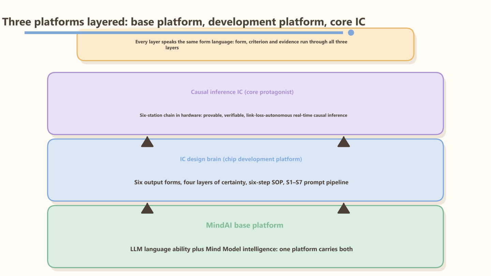

Figure 6-1 Three-platform layering: underlying platform, development platform, and core IC

## 6-2 Two Libraries, One Hub, One Loop x AI Drone Brain

Type library (Spatial Type) lives Event Type, Hypothesis Type, Strategy Type, logs Type, Consequence Type, Specification Type; Function Library (Temporal Type) runs Observation, Hypothesis, What-if, suggestions, rulings, FeedbackSix Stations, with Five Inference Families and Mode libraries; the hub is Guard Verdict - Three-Layer Judgment Continuous Setup, Eight Questions Check, Auditable Accuracy; the circuit is Evidence Feedback - Xinguo updates the Type library and Function Library at the same time. This skeleton uses Mind AI as the underlying platform: the two libraries are the family assets, the center is the referee, and the loop is the growth. According to the agreement, the content of Mind AI is not reproduced in this volume, and only the location where it is carried is marked.

Causal Reasoning IC's position in this skeleton is very special: it is the hardware embodiment of "hub + loop" - the Three-Layer Judgment engine is the circuitization of the hub, the accounting unit is the circuitization of the loop, and the two databases are still carried by Mind AI and can be updated remotely. This division of labor of "hardware abides by the verdict, software supports the family" takes into account both immediacy and growth: Criterion adopts version management (σ Substitution Preserving Identity) when it is replaced, and there is no need to repeat the tape-out.

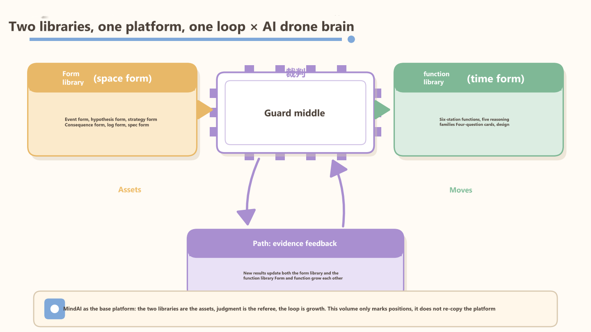

Figure 6-2 Two Libraries, One Hub, One Loop × AI Drone Brain

## 6-3 UAV Brain Chip Architecture: Companion / Mission Compute and FCU

The division of labor between the brain chip and the flight control can be summed up in one sentence: the brain is responsible for "thinking clearly before taking action", and FCU is responsible for "safety no matter what". UAV Brain IC (Companion / Mission Compute) carries the perception model, Causal_DT inference, mission strategy and security auditable interface; flight control FCU carries the low-level attitude control, motor output, core failsafe, control loop, loss of connection handling, battery and geofencing of Verification, and does not carry LLM. The two are strictly isolated by HAL, and the division of labor and collaboration-the separation of ruling and control is a positive example of M10.

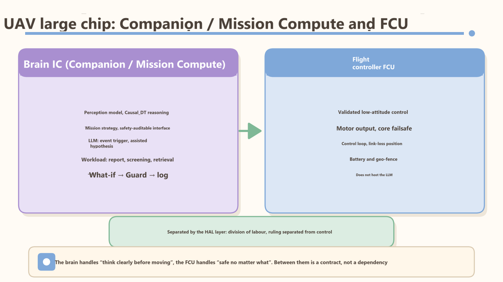

Figure 6-3 UAV Brain chip: Companion / Mission Compute and FCU

#### Table 6-1: Brain IC and FCU block comparison

| **block** | **Brain IC (Companion / Mission Compute)** | **Flight control FCU** |
| --- | --- | --- |
| Responsibilities | Perception model, Causal_DT reasoning, task strategy, secure auditable interface | Through Verification’s low-level attitude control, motor output, and core failsafe |
| workload | Sensing event reporting → AE/XGBoost or BYOM → KG retrieval → lightweight What-if → Guard → recording | Control loop, loss of connection handling, battery and geofencing |
| LLM location | Gemma class: non-safe instant path, event-triggered auxiliary Hypothesis; non-blocking when timeout | Not carrying LLM |
| quarantine | Strictly isolated by HAL, and collaborated with FCU | Strictly isolated by HAL to maintain independent safe disposal |

> **Example: The end-to-end journey of an adjudication**  
> IMU Anomaly reports → The detection unit marks vibration events → Hypothesis sorts and gives the first two Names of H1 airflow/H3 synchronization → Counterfactual accelerator completes the two candidate actions of "continue descent" and "go-around" → Guard Three-Layer Judgment releases "go-around" and writes the reasons → Six-column log into Evolution Ledger. The entire process is completed in the brain IC, and FCU only receives one action suggestion with approval; if any stop in the middle times out, FCU will use its own failsafe as the criterion - the contract is written in HAL, not in the tacit understanding.  

## 6-4 Three Roles, Each in Its Place

Interruption is the touchstone. After cutting off the connection to the ground station or simulator, the independence of the airborne sensing, Causal_DT Risk Advisory and FCU failsafe must be verifiable. The three Each in Its Place - Shenying DT provides causal risk intelligence, Counterfactual comparison and uncertainty, but must not become a necessary reliance on emergency stop or stable control; HAL Guard is responsible for the authorization, data deadline, status and strategy legality review of high-level tasks and action proposals; flight control FCU Execution expert Verification's low-level control, loss of connection, battery, geofencing and posture security handling.

Echo 3-4 in the words of Typology: Three Roles, Each in Its Place is a third-level image of remove - FCU is a necessary part and cannot be disassembled; DT is a functional enhancement part, which can be downgraded but must be marked; Guard is a gatekeeper part and does not exceed authority. List of rights and responsibilities, no loss of communication and no loss of order.

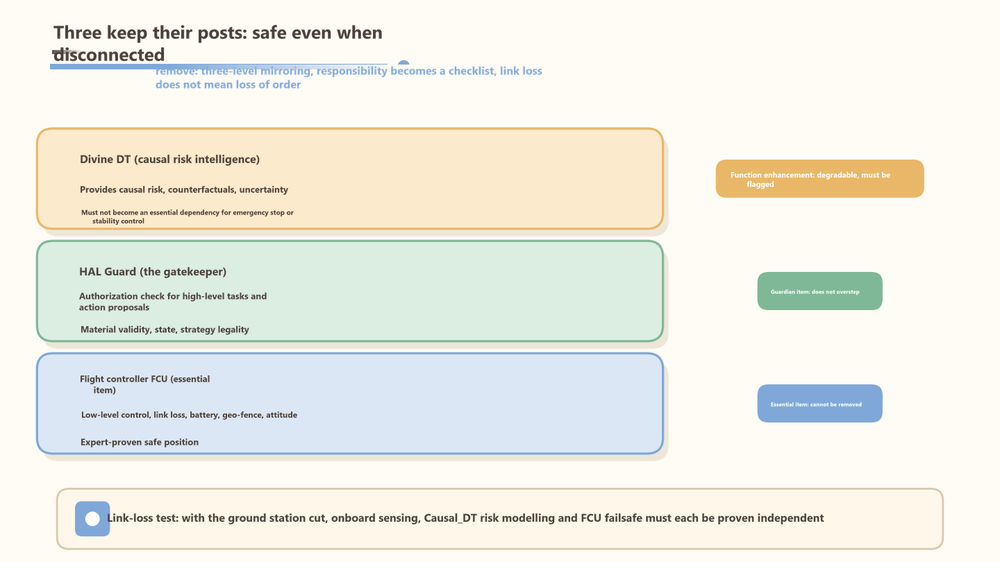

Figure 6-4 Three Roles, Each in Its Place: It’s safe to disconnect

## 6-5 Workload Chain: Replayable Workloads Make Verifiable Chips

Workload Chain is the demand engine of the chip Specification: Sensing event reporting → AE/XGBoost or BYOM preliminary screening → Causal KG search → Lightweight What-if → Guard ruling → Structured Log and Feedback. Evidence is left at every stop in this chain, so it can be replayed, tested, and compared. Only by getting real workloads can we be qualified to determine the chip architecture. The order cannot be reversed: load first, then Specification; replay first, then Verification.

Load distribution determines the division of hard and soft labor: parts with low computing power and high elasticity (BYOM Preliminary screening, language assistance) are placed in the replaceable inference unit; the parts with high certainty and high Verification requirements (Hypothesis sorting, Counterfactual acceleration, Three-Layer Judgment) are placed in the self-developed fixed function unit; and the write bandwidth and retention strategy required by the log and Evolution Ledger are the Specification sources of the memory subsystem.

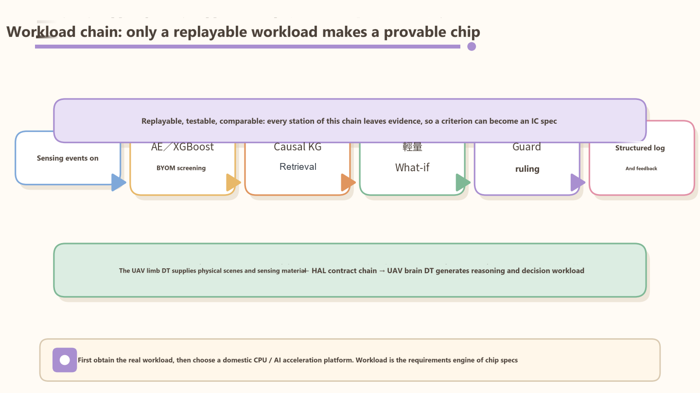

Figure 6-5 Workload Chain: Replayable Workloads Make Verifiable Chips

#### Table 6-2: Work load × hard and soft division of labor

| **workload** | **nature** | **landing point** | **Verification mode** |
| --- | --- | --- | --- |
| Sensing event reporting | High throughput and low latency | Fixed function Interface | Timing Type+assertion |
| BYOM preliminary screening | Model is replaceable | replaceable inference unit | Efficacy measurement + truth check |
| Causal KG Search | memory dense | Memory subsystem + acceleration | Retrieve quality report |
| Lightweight What-if | Parallel and approximable | Counterfactual accelerator | Controlled perturbation comparison |
| Guard Three Layers Verdict | Certainty and auditable | Fixed function judgment engine | Formal Verification+Sign for receipt |
| Log and Feedback | Intensive writing and cannot be lost | Accounting unit + Evolution LedgerInterface | Breakpoint sampling playback |

## 6-6 The HAL Ecosystem: The Banyan Tree and Dual Sovereignty

To grow into industrial capabilities, Causal_DT needs system-level HAL as the soil. The engineering metaphor of a big banyan tree: each manufacturer's brand UAV and chips are the roots of the industry; the system-level HAL is the backbone that allows the orderly grafting of multiple wisdoms; the runtime Causal_DT and various BYOM, Agent, and task services are the branches and leaves that continue to grow. PX4, MAVLink, ROS 2, ArduPilot AP_HAL and ros2_control already provide flight control, communication and hardware abstraction capabilities respectively; Taiwan's sovereign HAL is positioned as a "system-level semantics/governance layer across UAV, AI and mission systems" - embracing the hardware abstraction within the original flight control, allowing different manufacturers to use common events, risks, actions and audit contracts without having to rebuild the entire smart chain individually.

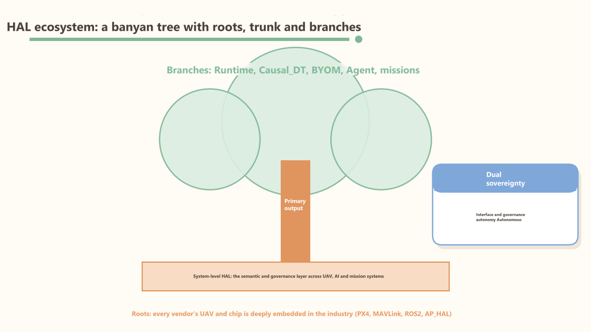

Figure 6-6 HAL Ecology: Big banyan tree—roots, trunks, branches and leaves

#### Table 6-3 Industry Role: Open Competition × Sharing HAL Collaboration Interface

| **industry role** | **Open to competition** | **Shared HAL Collaborated Interface** |
| --- | --- | --- |
| UAV complete machine factory | Airframe, load capacity, pneumatics, reliability, scene services | Capability declaration, task events, acceptance evidence interface |
| Flight control/electromechanical factory | Control law, motor, power supply, ESC, maintenance capability | Telemetry Adapter, independent security rules and command mapping |
| Taiwan IC factory | RISC-V CPU, AI acceleration, power consumption/security design | Airborne Causal_DT inference, BYOM, model effectiveness measurement |
| AI/software factory | Visual model, Timing model, Causal KG, Agent | Replaceable inference APIs, knowledge versions and risk events |
| Academic and research units | Cause and effect testing, fault injection, information security and evaluation | Consistent test suites, control experiments and reports across models |
| government agency | Scenarios, service standards, operations and compliance requirements | Acceptable safety, reliability, interoperability and auditable indicators |

> **dual sovereignty**  
> Interface and governance autonomy - industry, academia and industry jointly discuss the open, versioned, testable HAL contract and reference implementation; computing and decision-making autonomy - master the alternative design, model deployment, expert knowledge and disconnection security capabilities of key computing platforms. The goal of the ecology is to standardize "the base that can be used with Verification" and keep "the ability of enterprises to innovate" open to competition.  

## 6-7 DT Incubates the IC: From Workloads to Chip Specifications

The third goal is to make DT a demand engine for IC design Specification: using a common HAL contract to connect "UAV limb DT" and "UAV Brain DT" - the former generates physical scenes and IMU Sensing data, the latter generates interpretable reasoning and decision-making workloads - first obtain real workloads that are replayable, testable, and comparable, and then select a suitable domestic CPU/AI acceleration platform and gradually move towards productization of the UAV Brain chip.

This route is fully integrated with the IC Design Brain's six Type production lines: the workload library becomes SpecType's metric source, HAL contract becomes InterfaceType's alignment baseline, load playback becomes VerifyType's Verification material, and every architectural trade-off is recorded in Evolution Ledger - the brain DT Incubating the brain chip itself is also a "Types and Functions Co-Evolve big event".

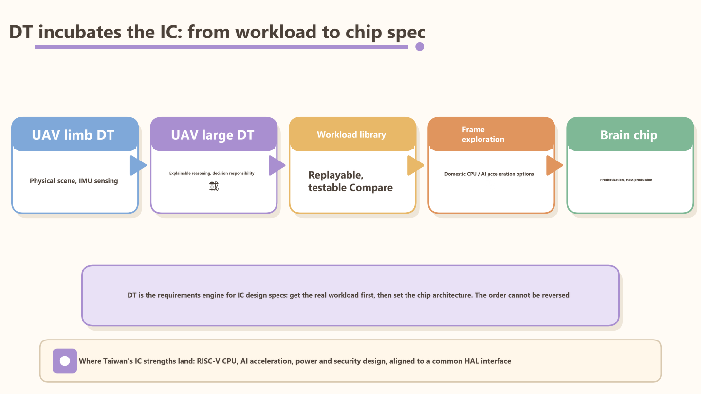

Figure 6-7 DT Incubates the IC: From Workloads to Chip Specifications

> **Part VI summary**  
> The three platforms are layered to abide by the contract, and Two Libraries, One Hub, One Loop abides by growth; the brain IC and FCU are separated in division of labor, and Three Roles, Each in Its Place is not out of order when disconnected; Workload Chain is the demand engine of the chip Specification; HAL ecology abides by dual sovereignty; DT Incubates the IC connects the entire road into a line.  

> **Exercise E10–E11 (Part VI)**  
> ⑩ E10 Misuse identification: A team wrote "runway occupation" directly into the causal model of IMU Anomaly, and let LLM directly issue an emergency stop command. Point out which boxes in Table 5-6 it has touched, and write a line of correction for each.  
> ⑪ E11 Use the three levels of remove to grade your brain chip ideas: write a necessary part, a functionally degraded part, and a non-essential part each, and explain the "consequences of removal."  

> **[Professional column C7] RISC-V and Taiwan chip advantages**  
> RISC-V's open instruction set (originated at UC Berkeley in 2010, transferred to the Foundation in 2015) gives latecomers a common starting point that can be customized and expanded without paying licensing fees. Taiwan's position in this wave is clear: a complete design-manufacturing-sealing and testing supply chain, coupled with accumulated power consumption and reliability capabilities in automotive and embedded applications, is the most needed combination of "customized AI acceleration + security design".  
> Meaning for Causal Reasoning IC: Hypothesis sorting, Counterfactual acceleration, and Three-Layer Judgment in Six-Station Chain can all be made into fixed-function accelerators next to RISC-V vectors/custom instructions—the core instruction set adopts common standards (ecological dividends), and causal reasoning expansion adopts independent design (differentiated dividends). Interface is aligned with HAL, and the computing is autonomous at hand - the specific geometric shape with dual sovereignty at the chip layer is like this.  

> **[Professional Column C8] PX4 / MAVLink / ROS 2: A one-page history of open flight control ecology**  
> Pixhawk open source hardware started in 2009, PX4 was released in 2012, and the Dronecode Foundation integrated the open source flight control community in 2013; the MAVLink communication protocol (from 2009) became the common language for ground stations and vehicles, and the Name mechanism of MAVLink 2 in 2021 complemented the security issues; ROS 2 (from 2017, DDS Backbone) brings the development of the robot world Mode into UAV, ArduPilot AP_HAL and ros2_control each set up standards for hardware abstraction.  
> This page of history has only one inspiration for this book: opening up the Interface layer has never been about "removing competition", but "removing duplication of construction." The positioning of the HAL ecosystem is to push this path one step further - from hardware abstraction to semantic abstraction of events, risks, actions and audits; allowing machine manufacturers, IC factories, and AI factories to work hard on a common contract.  

# Part VII Complete Content Program

Solution Part manages "how to promote": Learn - Practice - Apply - Teach - Build, Eight-Week Roadmap, Four Phases of Library Building, PoC Acceptance, Maturity Level and Path by Reader Profile - let the method leave this book and live in your team.

## 7-1 Learn, Practice, Apply, Teach, Build

Promoting the method relies on a replicable learning path. Learn - understand two languages ​​and Master Mapping Table; practice - pass E01-E11 question by question; use - bring the eight questions and six steps into your own tasks; teach - use Quick Reference Card and copyable templates to conduct workshops; build - press Four Phases of Library Building to build your own Type library with Function Library. Every step has an output: not heard of it, but done.

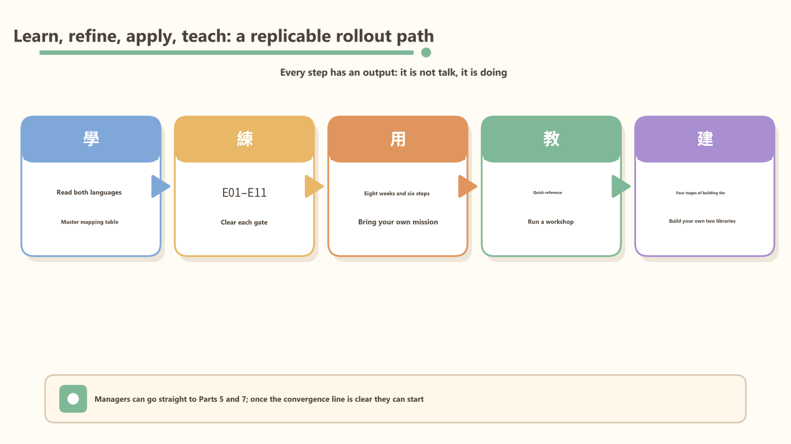

Figure 7-1 Learn - Practice - Apply - Teach - Build: replicable promotion path

> **Half-day workshop design (can be followed directly)**  
> The opening 30 minutes: three pairs of glasses + Master Mapping Table, allowing the flight team and the chip team to understand each other's words; 90 minutes of practice: each team brings a AnomalyEstablish as an Event Type + four-frame Hypothesis card; 60 minutes of reading: the two groups exchange cards and use eight questions to find faults with each other; the closing 30 minutes: each person writes a B-3 blank template and takes it away. Output list: Event Type card, Hypothesis card, eight questions to check, and a supplementary list of your own - the success or failure of the workshop depends on the output rather than the slides.  

## 7-2 Eight-Week Roadmap

#### Table 7-1 Eight-Week Roadmap: Topics and Outputs

| **week** | **Topic** | **Practice and produce** |
| --- | --- | --- |
| W1 | Understanding Type and the incident: three pairs of glasses superimposed | Put three of our own AnomalyEstablish as an Event Type |
| W2 | Three Axes and evidence BOM | Create a Evidence Gap map for your own events |
| W3 | Hypothesis Competition and Causal Reasoning | Four Hypothesis cards + re-inspection path |
| W4 | What-if Counterfactual and four question card | Write two Four-Question Function Card |
| W5 | Guard and Three-Layer Judgment | Walk through the six steps once |
| W6 | Six Output Types and Four-Layer Accuracy | Create six Type work orders for your own Module |
| W7 | PoC three-scenario drill | Planning a controlled perturbation experiment |
| W8 | Database construction and acceptance | Four Acceptance Lines self-test report |

Path by Reader Profile is very simple: Beginners start from W1; those with engineering background start from W4 and make up for W2-W3; managers directly read Part V and this Section and understand Acceptance Line; the chip team extended W6 by one week and aligned their own output with six Type.

## 7-3 Four Phases of Library Building

Four Phases of Library Building: The Event Type library is established first (formats the Anomaly event) → Hypothesis library is built again (expert experience is written into a card) → Function Library is extended (the Six Stations process is solidified into a four-question card) → Acceptance and governance are completed (the eight questions and Four Acceptance Lines are turned into a system). The order cannot be skipped: without the Event Type library, the Hypothesis library has no target; without the Hypothesis library, the Function Library has no accuracy. There are acceptance items at each stage: the Type library has formats, the Hypothesis library has cards, the Function Library has Criterion, and the management has systems.

There are three common hurdles in building a database: the Event Type library is intended to be perfectly classified in one step (solution: format first, then refine); the Hypothesis library is written as a conclusion library (solution: the four-question card is forced to leave "not yet known"); the Function Library is written as a process file and no one calls it (the solution: each four-question card must have an actual call record before it is closed). It's not scary to get stuck, but it's scary not to get stuck.

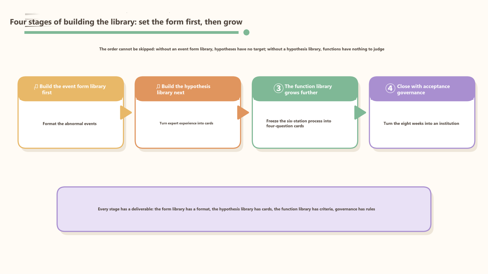

Figure 7-2 Four Phases of Library Building: Establish the Type First, grow up again

## 7-4 PoC Acceptance and Four Acceptance Lines

Three PoCs are the acceptance site for the entire approach. The common main acceptance indicators are: high-risk event detection lead time, candidate fault identification quality, safe recovery rate, number of false releases and end-to-end delay - all checked against true value labels and controlled disturbances. It is worth noting that the design of PoC-3 is detailed Section: runway occupation first triggers a change in mission status (semantic layer). To produce a real IMU Anomaly, crosswind or airflow disturbance (physical layer) with physical effects must be injected additionally - this is the actual combat of 3-6 and M1.

#### Table 7-2 PoC three scenarios

| **PoC** | **situation** | **main acceptance indicator** |
| --- | --- | --- |
| PoC-1 | Causal differences between landing crosswind and power Anomaly (crosswind injection, thrust decline, time offset and composite failure; comparison of three groups: Baseline AI, KG-guided Agent and airborne Causal DT) | Quality of cause and effect identification, number of wrong interventions, risk avoidance success rate, interpretation traceability, detection lead time, end-to-end delay |
| PoC-2 | Ground communication interruption and positioning quality degradation (sub-measurement remote control interruption, data link interruption, GNSS degradation and multiple failures; Verification airborne does not rely on the ground) | Safety recovery rate after disconnection, independent protection efficiency, number of incorrect releases = 0 |
| PoC-3 | Runway FSM and UAV mission coordination (dual FSM describes runway availability and landing mission; semantic events and physical injection layered processing) | Mission status trigger accuracy rate / Number of layer misjudgments=0 / Physical injection reproducibility |

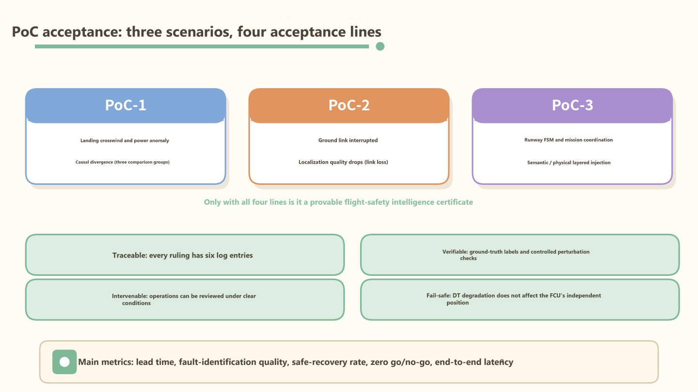

Figure 7-3 PoC Acceptance: Three Scenarios / Four Acceptance Lines

> **Four Acceptance Lines**  
> Traceable - each ruling has a six-column log; Verification - truth tags can be checked against controlled disturbances; intervenable - the operator can review under clear conditions; lost connection safety - DT downgrade does not affect the FCU independent disposal. Only when all four lines are passed can it be considered as "evidence of Verification's flight safety and intelligence."  

> **Example Acceptance Drill Day**  
> An afternoon of communication outage drill: 14:00 Cut off the ground station → 14:02 FCU enters failsafe, DT transfers to airborne autonomy → 14:05 Restores connection, log playback and comparison → 16:00 Four Acceptance Lines signs item by item. The output of the exercise is not "feeling safe" but a stack of boxes that can be shown to a supervisor.  

## 7-5 Maturity Levels L1-L4

Maturity Level is not an assessment, it is a navigation. L1 Type Vocabulary: The whole group said the same set of Type Language, six Types can write but not judge; L2 Type Criteria: Each Type can immediately draw ∩(T), Criterion can draw immediately but cannot trace; L3 Type Evidence Chain: The output can be traced and audited, but it relies on human recommendation; L4 Self-evolution: Evolution Ledger drives reconstruction and exploration, and the brain grows by itself. L1→L2 is a matter of method, L2→L3 is a matter of discipline, and L3→L4 is the real design brain.

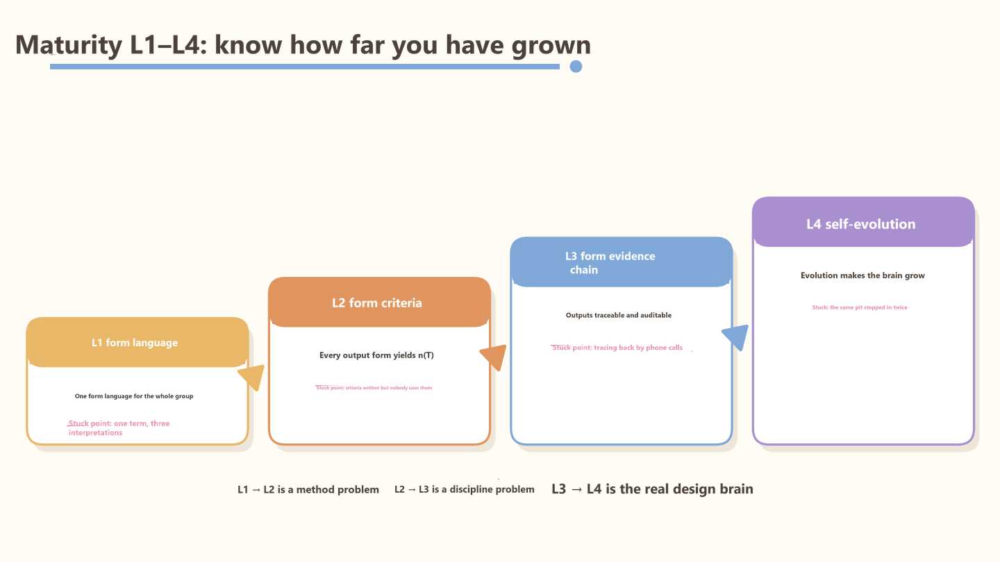

Figure 7-4 Maturity Level L1–L4: Know where you grow

#### Table 7-3 Maturity Level and upgrade actions

| **Level** | **Up to standard** | **stuck warning message** | **upgrade action** |
| --- | --- | --- | --- |
| L1 Type Vocabulary | The six TypeName in the document are called unified | Three interpretations of the same Name word | Hold a Type Vocabulary alignment workshop |
| L2 Type Criteria | Each Type has ∩(T) and someone signs for it. | Criterion is written and no one uses it | Criterion signature system: no generation without signature |
| L3 Type Evidence Chain | Random inspection of all three outputs can be traced back | Backtracking depends on calling people and asking people. | Evolution Ledger+ on-chain spot checks are routine |
| L4 self-evolution | New projects automatically bring out old lessons | Trampled for the second time | Move plate×Evolution Ledger closed loop |

## 7-6 Path by Reader Profile: Four Kinds of Readers

The four roads take the same mountain: only the entrances are different, and the end points are Auditable Accuracy. Beginners can master Type Vocabulary in eight weeks; those with engineering background can go straight to the method and acceptance; managers can get started once they understand Acceptance Line; the chip team mainly focuses on the third, fourth and sixth Part and aligns with the IC Design Brain production line. After choosing the entrance, we started walking - what we fear most is not that we walk slowly, but that we just collect and don't walk.

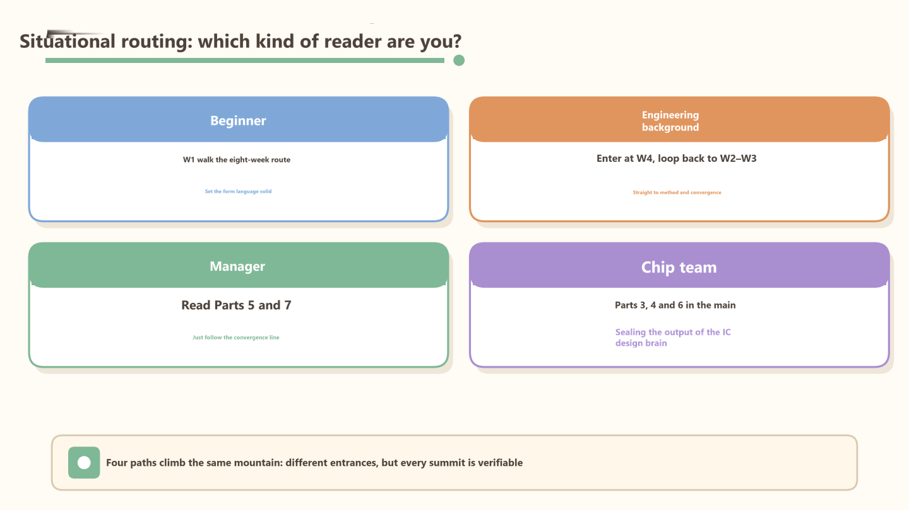

Figure 7-5 Path by Reader Profile: What kind of reader are you?

> **Part VII Summary**  
> Learn - Practice - Apply - Teach - Build is the path, eight weeks is Section, Four Phases of Library Building is the sequence, PoC and Four Acceptance Lines are the levels, Maturity Level is the navigation, and Path by Reader Profile is the entrance - the "completeness" of the complete content plan refers to the output of every step from the first lesson to the first chip.  

> **Exercises S01–S03 (Part VII and plan)**  
> ⑫ S01 Rewrite Eight-Week Roadmap for your team: Mark which two weeks can be combined and which weeks must be lengthened, and explain the reasons.  
> ⑬ S02: Design a small PoC Acceptance solution: write down the situation, injection method, main acceptance indicators and Four Acceptance Lines inspection method.  
> ⑭ S03 Use Maturity Level table to self-evaluate the current situation of the team: What is L now? What is the "upgrade action" for the next level? Write down one thing you can do in three months.  

# Conclusion Three Consecutive Goals

Let Taiwan's dominant chip manufacturers "align to common interfaces" and machine manufacturers to "align to common interfaces" so that both parties are loosely coupled - but interoperability must still be guaranteed by version management, implementation and compatibility testing. Let’s work together to achieve three consecutive goals: build airborne Causal_DT to practice autonomous decision-making flight; develop HAL to build the UAV ecosystem; build UAV Brain DT to incubate brain chips.

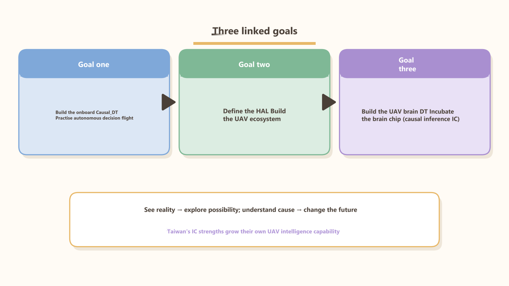

Figure C-1 Three consecutive goals (book closing card)

Going back to the words of Part I: Causal_DT Let us move from seeing reality to exploring possibilities; from understanding cause and effect to changing the future. This booklet breaks the word "accuracy" into practiceable steps. There is only one thing left - to complete the eight questions before pressing the verdict; after the verdict, fill up the log and send the evidence back to the loop. Leveraging Taiwan’s IC advantages to develop its own UAV smart capabilities – this is the path AI Drone Brain will take.

> **end of book**  
> See reality → explore possibilities; understand cause and effect → change the future. Establish the Type First, fill in the number later; establish Criterion first, then generate; Unbroken Evidence Chain, the brain grows by itself.  

# Appendix A Glossary

#### Table A-1 Terminology quick check (Type=Type)

| **Terminology** | **a word** | **Location: Part** |
| --- | --- | --- |
| Type(Type) | The smallest description unit: event, Hypothesis, strategy, chip Specification are all Type | whole book |
| Event Type | {Observation,(source),[category]}: Unit Type of Anomaly | 3-1 |
| Hypothesis Type | Candidate Causes card with support, objection and re-examination | 3-1 |
| [ ] attributes | Dimension × Scale: A measuring stick for risk | 3-3 |
| { } composition | Evidence BOM: essential parts, downgraded parts, non-essential parts | 3-3・3-4 |
| ( ) container | C=(id(C),S(C)): Identity and status, entry rules control | 3-3 |
| remove level three | Three-level classification of disassembled parts: essential parts, functionally degraded parts, and non-essential parts | 3-4 |
| Three-Layer Judgment | J=J_C ∧ J_B ∧ J_T: Container / BOM / Abstract connection | 3-5 |
| ∩(T) Classification | Intersection Criterion: Which Hypothesis does the event belong to, and which dimension does the demand depend on? | 3-5 |
| op: Type → Type | Function: Input a Type, Produce a Type | 4-1 |
| Four-Question Function Card | Name / Input Type / Output Type / Criterion | 4-2 |
| Five Inference Families | Statistics, Causation, Cause and Effect, Simulation, Reverse | 4-3 |
| Type-in / Type-out | Closed-loop operation: Types and Functions Co-Evolve | 4-4 |
| move plate | Temporal Type Fourteen moves: function = method = move | 4-5 |
| Evolution Ledger | Cumulative Account of Lessons, Reconstructions and Gaps | 4-4 |
| SpecType Specification Type | Measurable and adjudicable Specification structure | 3-2 |
| InterfaceType Interface Type | Module external port contract | 3-2 |
| ModuleType Module Type | The composition described by BOM structure Type | 3-2 |
| TimingType Timing Type | Clock, frame Timing and cross-domain dynamic Type | 3-2 |
| VerifyType Verification Type | Turn Criterion into Type that can perform inspections | 3-2 |
| PatternType Mode Type | Reusable design Mode with Criterion and pit position | 3-2 |
| Three Completions | [ ] Rule / ( ) Identity / { } Structure | 5-2 |
| Six-Step Proof | Identify→Axis→Type Set→Proposition→Inference→Three Layers Check | 5-3 |
| Auditable Accuracy | Six-column Structured Log+Guard decision record | 5-5 |
| Eight questions | Eight-question checklist before a big move | 5-6 |
| Two Libraries, One Hub, One Loop | Type library / Function Library / Guard hub / evidence loop | 6-2 |
| Three Roles, Each in Its Place | Condor DT/HAL Guard/Flight Control FCU Each in Its Place | 6-4 |
| Workload Chain | Report → Preliminary screening → Search → What-if → Guard → Record | 6-5 |

#### Table A-2: General list of marks (all book numbers collected on one page)

| **mark** | **read as** | **a word** |
| --- | --- | --- |
| [ ] | property brackets | Dimensions × Scale: Describes the scale of a Type |
| { } | form brackets | BOM and components: can you recognize yourself after taking it apart? |
| ( ) | Container brackets | Identity and status: C=(id(C),S(C)) |
| ∩(T) | Intersection Criterion | Open rules to determine whether new members belong |
| ≡ | same | Type unified: changed the shell, still the same |
| ≢ | Not the same | If removed, the identity will be lost (necessary item) |
| ⊂ | Downgraded Inclusion | Function downgrade but identity persists (M′⊂M) |
| ⊕ | Type Merge | Combine the parts into a Type |
| σ | replace | Change content to preserve identity: no amnesia after version change |
| ι | Nesting | Type hangs under Type: Asking questions to find out the origin |
| op: Type → Type | function | Temporal Type: Input a Type, Produce a Type |
| J=J_C∧J_B∧J_T | Three-Layer Judgment Lianli | The container, BOM, and abstraction must all pass before being released. |

# Appendix B Quick Reference Cards

#### B-1 Four-Question Function Card

| **field** | **fill in** |
| --- | --- |
| Name scale | (Function Name, such as What-if Counterfactual comparison) |
| Input Type | (Incoming Type: Event Type/Hypothesis Type+action Type...) |
| Output Type | (Type out: Consequence Type/Strategy Type...) |
| Criterion | (How to calculate it correctly: truth value label, verification method, number of incorrect releases) |

#### B-2: Check eight questions

| **○** | **Eight questions** |
| --- | --- |
| ○ | ① What Type Is This? |
| ○ | ②Who is the identity? (id / three-way identity) |
| ○ | ③ Three Axes Did you make it clear? |
| ○ | ④ Where is Criterion written? |
| ○ | ⑤ Is the level correct? |
| ○ | ⑥ Is the evidence enough? What about the gap? |
| ○ | ⑦ Have you done Counterfactual? |
| ○ | ⑧ Log auditable? |

**B-3: Blank template can be copied (it is recommended to print it separately)**

(This page can be copied in full: one card = a record of a major action)

| **field** | **Fill in area** |
| --- | --- |
| Event Type {Observation,(source),[category]} |  |
| Candidate Hypothesis (for/against/retest) |  |
| Three Axes: [ ] scale/{ } BOM/( ) container |  |
| What-if comparison results |  |
| Three-Layer Judgment J_C/J_B/J_T |  |
| Check eight questions (○ pass) | ○① ○② ○③ ○④ ○⑤ ○⑥ ○⑦ ○⑧ |
| Guard Final decision and reasons |  |
| Evidence Feedback: Hypothesis/Criterion to be updated |  |

**B-4 Ten Questions Receipt List (on the chip side, refer to 5-6 Eight Questions)**

| **#** | **Ask yourself before receiving** | **where is the evidence** |
| --- | --- | --- |
| 1 | Is ∩(T) set for each Output Type? | Six Type work orders |
| 2 | Was Criterion established before generation? | Date of receipt |
| 3 | Interface Is the contract table locked? | port contract table |
| 4 | Have the BOM Criterion and remove classifications been written? | BOM list |
| 5 | Are there synchronization bridges for cross-domain signals? | Cross-domain manifest |
| 6 | Does each functional unit only do one thing? | skeleton file |
| 7 | Is Verification Type self-checking? | Verification source code |
| 8 | Is the coverage up to standard and any gaps dealt with? | coverage report |
| 9 | Are the move calls and reasoning steps recorded? | work order |
| 10 | Can the demand sentence be obtained by tracing back the evidence chain? | On-chain spot checks |

# Appendix C Exercise Answers

#### Table C-1 Practice Demonstration Answers (Key Points)

| **question** | **Model answers (key points)** |
| --- | --- |
| E01 | ① Example: Candidate = insufficient thrust (check ESC current), counterweight change (check load record), wind shear (check wind field Timing); each column has one row for re-inspection. ② "Trust misunderstood as obedience" and "loss of connection and lack of autonomy": If DT is regarded as a necessary dependence and no review is set up when the call is disconnected, the two pain points will occur at the same time; the root cause is that Hypothesis and Criterion have not set up Type. |
| E02 | ① Evidence Feedback→Type-in / Type-out Closed Loop / Grow up with each other; Risk Assessment→[ ] Dimension×Scale. ② It is believed that 0.7 is measured on the Hypothesis Type (Sub-Type in Type). It is not necessary to find the number first and then find the Hypothesis; in the IC, it corresponds to a scale field on the register and must be checked by the Criterion along with the Hypothesis Type. |
| E03 | {GNSS quality degradation Observation, (Airborne GNSS receiver), [Navigation quality category]}; Necessary evidence: GNSS C/N0 and number of satellites; Degradable evidence: Ground station differential correction status. |
| E04 | The former is system layer causation (link → telemetry), and the latter is judgment layer causation (data → judgment downgrade); writing them together in one line will trample M1 (level misplacement) and M4 (Hypothesis level misplacement). |
| E05 | Name: Observation function (Fruit); Input Type: Sensing flow (IMU/GNSS/ESC telemetry); Output Type: Event Type (including timestamp); Criterion: Synchronization check passed, data has not expired, Observation repetition rate is below the threshold. |
| E06 | Statistics (first confirm that outliers are not noise) → Cause and effect (list candidates) → Cause and effect (infer the consequences of intervention) → Simulation (What-if comparison and selection) → Reverse (retrospect the end of the evidence chain). |
| E07 | [ ] Rule supplement (admission rules); supplement the admission rule book in the ( ) container; for example: "Telemetry data timestamps exceeding 2 seconds shall not be used as a basis for judgment." |
| E08 | ③ {Voltage sag Observation, (airborne power telemetry), [power type]}; ⑤ Example: sudden increase in current → insufficient support for thrust; large single cell voltage difference → support for battery factors; stable wind field → elimination of airflow. |
| E09 | Open to answers. Demonstration: Question 6 "Is the evidence sufficient?" is the easiest to get stuck - telemetry often lacks wind fields and model parameters (downgraded parts), so the gap should be noted and the confidence lowered. |
| E10 | Step on M1 (semantic events should be regarded as physical causes) and M9/M10 (LLM direct emergency stop = trust should be complied with, and the ruling is integrated into control); Correction: Semantic and physical layered injection, LLM only mentions Hypothesis, and emergency stop refers to FCU failsafe. |
| E11 | Demonstration: Necessary parts = Three-Layer Judgment engine (Guard has no basis for ruling after removal); Function downgrade parts = Wind farm estimate Module (Confidence is downgraded and gaps are marked after removal); Non-essential parts = Debug tracking Interface (can be removed for mass production version). |
| S01 | Open to answers. Demonstration: W3 and W4 are merged (both belong to Hypothesis and Counterfactual); W8 is extended to two weeks (acceptance and management take the most time). |
| S02 | Open to answers. Demonstration requirements: Scenario = landing crosswind; injection = simulator crosswind; indicator = lead time, identification quality, error release = 0; Acceptance Line provides each inspection method (log spot check, truth check, review drill, disconnection test). |
| S03 | Open to answers. Demonstration: Self-evaluation L2 (Criterion will immediately but not follow up); upgrade action = Criterion signature system; one thing that can be done within three months = attach the date of the signature to every weekly submission, and randomly check three evidence chains. |

# Appendix D Figure and Table Index

#### Table D-1 Figure Index

| **Figure** | **Name scale** | **location** |
| --- | --- | --- |
| cover | CAUSAL_DT UAV BRAIN (AI generated image) | cover |
| 0-1 | Two languages, used in combination | Reader's Guide |
| 0-2 | Book road map | Reader's Guide |
| 1-1 | The same effect often has different causes | 1-2 |
| 1-2 | Five pain points: They are all "the Type Is Not Properly Established" | 1-3 |
| 1-3 | Three-Layer Positioning: Root - Trunk - Fruit | 1-4 |
| 1-4 | Four-in-One | 1-5 |
| 1-5 | Causal Reasoning IC: Putting the Six-Station Chain into silicon | 1-6 |
| 2-1 | Three chain superposition | 2-1 |
| 2-2 | Backbone at a Glance: six pieces Typology Tools | 2-2 |
| 2-3 | Master Mapping Table: Translation Bridge | 2-3 |
| 3-1 | Event Type and Hypothesis Type | 3-1 |
| 3-2 | Six Output Types | 3-2 |
| 3-3 | Three Axes reading | 3-3 |
| 3-4 | remove level three | 3-4 |
| 3-5 | Three-Layer Judgment Funnel | 3-5 |
| 3-6 | Layers and Identity | 3-6 |
| 4-1 | Hardening the Six-Station Chain is the IC pipeline | 4-1 |
| 4-2 | Four-Question Function Card | 4-2 |
| 4-3 | Relay of the Five Inference Families | 4-3 |
| 4-4 | Type-in / Type-out: Only by closing the loop can you grow up | 4-4 |
| 4-5 | Each in Its Place | 4-6 |
| 5-1 | Substance - Use - Accuracy | 5-1 |
| 5-2 | Three Completions | 5-2 |
| 5-3 | Six-Step Proof full process | 5-3 |
| 5-4 | Four-Layer Accuracy | 5-4 |
| 5-5 | Structured Log × Type Evidence Chain | 5-5 |
| 5-6 | Eight-Question Checklist | 5-6 |
| 5-7 | 16 Kinds of Misuse | 5-7 |
| 5-8 | Routing Decision Tree | 5-8 |
| 6-1 | Three platform layering | 6-1 |
| 6-2 | Two Libraries, One Hub, One Loop | 6-2 |
| 6-3 | UAV Brain chip architecture | 6-3 |
| 6-4 | Three Roles, Each in Its Place | 6-4 |
| 6-5 | Workload Chain | 6-5 |
| 6-6 | HAL Ecology: Big banyan tree | 6-6 |
| 6-7 | DT Incubates the IC | 6-7 |
| 7-1 | Learn - Practice - Apply - Teach - Build | 7-1 |
| 7-2 | Four Phases of Library Building | 7-3 |
| 7-3 | PoC Acceptance | 7-4 |
| 7-4 | Maturity Level L1–L4 | 7-5 |
| 7-5 | Path by Reader Profile | 7-6 |
| C-1 | Three consecutive targets (closing card) | Conclusion |

#### Table D-2 Table index

| **table** | **Name scale** | **location** |
| --- | --- | --- |
| 0-1 | Map of This Book | Foreword |
| 0-2 | mission map | Foreword |
| 1-1 | One effect, multiple causes, four candidates | 1-2 |
| 2-1 | Master Mapping Table (sixteen items) | 2-3 |
| 2-2 | Comparison of Name words in three worlds | 2-3 |
| 3-1 | Six Output Types summary list | 3-2 |
| 3-2 | BOM and remove classification example | 3-4 |
| 4-1 | Two four-question cards | 4-2 |
| 4-2 | Five Inference Families × IC unit | 4-3 |
| 4-3 | Fourteen moves in the move plate | 4-5 |
| 5-1 | Three Completions | 5-2 |
| 5-2 | Six-Step Proof × IMU case | 5-3 |
| 5-3 | Four-Layer Accuracy acceptance control | 5-4 |
| 5-4 | Structured Log six columns | 5-5 |
| 5-5 | Eight-Question Checklist | 5-6 |
| 5-6 | 16 Kinds of Misuse | 5-7 |
| 6-1 | Brain IC and FCU block comparison | 6-3 |
| 6-2 | Workload × Hard and soft division of labor | 6-5 |
| 6-3 | industry role | 6-6 |
| 7-1 | Eight-Week Roadmap | 7-2 |
| 7-2 | PoC Three Situations | 7-4 |
| 7-3 | Maturity Level and upgrade actions | 7-5 |
| A-1 | Glossary | Appendix A |
| B-4 | Ten Questions Receipt List | Appendix B |
| C-1 | Practice model answers | Appendix C |
| D-1 | graph index | Appendix D |

# Appendix E Sources and Further Reading

This book is a special application book (Convention 2): the theoretical details Section shall be subject to the original work, and the method details Section shall be subject to the main material. The following sources are sorted by "first my own, then classics, then ecology" - the first three are the direct material of this book, and the rest are a path worth continuing.

| **Source** | **a word** | **Where to use** |
| --- | --- | --- |
| "Mind AI & Causal_DT" | Causal_DT solution: Six-Station Causal Decision Chain and PoC designs | Main material of this book |
| "IC Design Brain" | Chip Development Platform Method Manual: Six Type / Four-Layer Accuracy / S1–S7 | Main material of this book |
| "Ontypology" original work (Spatial Type / Temporal Type) | Theoretical basis: Type, Criterion, reasoning and move board | The skeleton of the book (only for use, not teaching) |
| "Mind AI Introduction" | Underlying platform: Division of labor of LLM + Mind Model | 6-1 / 6-2 (only quoted but not stated) |
| Pearl, Causality(2000/2009) | Ladder of Cause and Effect: See → Intervene → Counterfactual | Column C1 / C4 |
| Pearl & Mackenzie, The Book of Why(2018) | A popular map of causal inference | Column C1 |
| RTCA DO-254(2000) | Aerospace hardware design guarantee: traceable / Verification | Box C6 |
| Clarke, Grumberg & Peled, Model Checking(1999) | Textbook of Formal Verification | Box C5 |
| PX4 / MAVLink / ROS 2 official documentation | The contract layer of the open flight control ecosystem | 6-6 / Column C8 |
| RISC-V International Specification | Open instruction set and custom extensions | Box C7 |
