# AI 無人機大腦

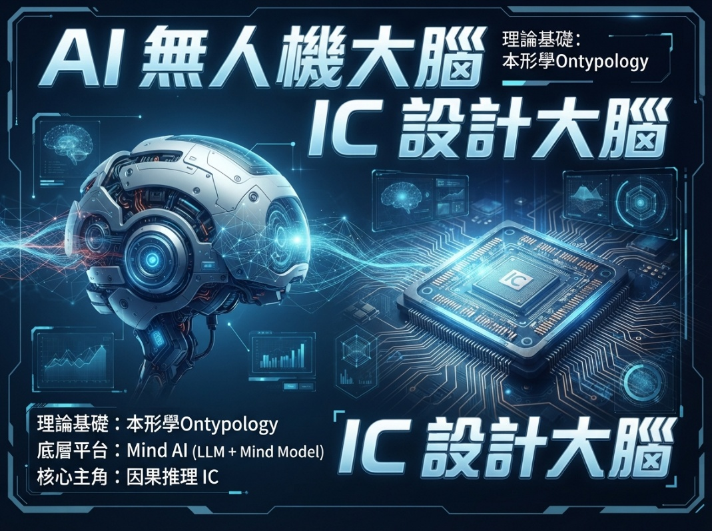

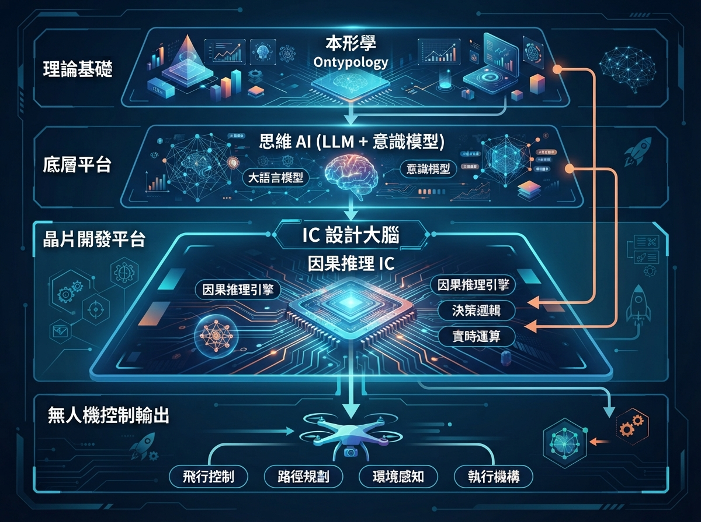

## 目　錄

- 寫在前面 4
- 導讀 6
- 第一篇　定位——同一個果，不同的因；同一顆腦，不同的層 8
- 1-1　可信任的智慧能力 8
- 1-2　同一個果，常有不同的因 8
- 1-3　五痛點：都是「形沒立好」 9
- 1-4　三層定位：根・幹・果 10
- 1-5　四位一體：理論・平台・開發平台・核心 11
- 1-6　因果推理 IC：主角登場 12
- 第二篇　骨幹速覽——形學工具箱與映射總表 14
- 2-1　認知鏈 × 因果決策鏈 × 晶片設計鏈 14
- 2-2　六件工具，立骨幹不重抄 15
- 2-3　三平台映射總表：工程與形學的翻譯橋 15
- 第三篇　空間本形——AI 無人機大腦的形 18
- 3-1　異常事件形與假說形 18
- 3-2　六種產出形：因果推理 IC 的設計語彙 19
- 3-3　三軸：判斷的形 × 設計的形 21
- 3-4　remove 三級：證據缺口 × 模組分級 22
- 3-5　三層判斷：Guard 的漏斗 × 設計的收件防線 23
- 3-6　層次與身份：語意 ≠ 物理，證據不斷鏈 24
- 第四篇　時間本形——因果推理 IC 的函式庫 26
- 4-1　六站鏈硬化：從因果決策鏈到 IC 管線 26
- 4-2　函式四問卡 27
- 4-3　推理五族接力 28
- 4-4　形進形出：閉環與演化帳 29
- 4-5　招式盤 × 晶片產線 30
- 4-6　LLM・Mind Model・因果推理 IC 各守其位 31
- 第五篇　準確使用方法完整架構 34
- 5-1　體—用—準 34
- 5-2　三種補足 35
- 5-3　證明六步驟全程示範 36
- 5-4　四層準確性保證 38
- 5-5　結構化日誌 × 形證據鏈：可複核的準 39
- 5-6　八問檢查清單 41
- 5-7　誤用 16 種 42
- 5-8　選路決策樹 43
- 第六篇　總架構——三平台 × 兩庫一中樞一迴路 46
- 6-1　三平台分層：底層平台・開發平台・核心 IC 46
- 6-2　兩庫一中樞一迴路 × AI 無人機大腦 47
- 6-3　UAV 大腦晶片架構：Companion／Mission Compute 與 FCU 48
- 6-4　三守其位 50
- 6-5　工作負載鏈：負載可重播，晶片才可驗證 50
- 6-6　HAL 生態：大榕樹與雙主權 51
- 6-7　DT 孵化 IC：從工作負載到晶片規格 53
- 第七篇　內容完整方案 55
- 7-1　學練用教建 55
- 7-2　八週路線 56
- 7-3　建庫四階段 56
- 7-4　PoC 驗收與四條驗收線 57
- 7-5　成熟度 L1–L4 58
- 7-6　情境選路：四種讀者 59
- 結語　三個連續目標 61
- 附錄 A　術語表 62
- 附錄 B　速查卡 64
- 附錄 C　練習參考答案 66
- 附錄 D　圖表索引 67
- 附錄 E　出處與延伸閱讀 70

# 前言

這本冊子只做一件事：把「AI 無人機大腦」這條路——從機載 Causal_DT，到因果推理 IC，到可複核的 UAV 智慧能力——寫成可學、可練、可複核的準確使用方法與內容完整方案。內容主軸取材自《Mind AI & Causal_DT》方案與《IC 設計大腦》方法手冊：前者帶來一顆會審因、預果的隨行智慧雙生與六站因果決策鏈；後者帶來晶片開發平台的六種產出形、四層準確性與七段提示詞流水線。本書把兩者收進同一副骨架，讓「大腦」從方法長成矽。

#### 本冊地圖

| **篇** | **主題** | **一句話** |
| --- | --- | --- |
| 第一篇 | 定位 | 同一個果，常有不同的因——先懂為何需要 AI 無人機大腦 |
| 第二篇 | 骨幹速覽 | 形學工具箱六件，三平台映射總表 |
| 第三篇 | 空間本形 | 大腦的形：事件形、假說形、六種產出形、三軸、三層判斷 |
| 第四篇 | 時間本形 | 因果推理 IC 的函式庫：六站、四問卡、推理五族、閉環 |
| 第五篇 | 準確使用方法 | 體—用—準、三種補足、六步驟、八問、誤用、選路 |
| 第六篇 | 總架構 | 三平台分層、大腦晶片、三守其位、HAL 生態、DT 孵化 IC |
| 第七篇 | 內容完整方案 | 學練用教建、八週路線、建庫四階段、PoC 驗收、成熟度 |
| 結語 | 三個連續目標 | 建置機載 Causal_DT → 制定 HAL → 打造大腦晶片 |

#### 表 0-2　任務地圖：你想解決的問題，翻到哪一篇

| **你的處境** | **你真正需要的** | **本書對應** |
| --- | --- | --- |
| AI 幫我設計晶片，但產出不敢用 | 準確性要能說出憑什麼 | 第五篇（四層準確性・六步驟） |
| 無人機的 AI 給結論卻講不出來源 | 可複核的準與多假說機制 | 第一篇・第三篇 |
| 想知道因果推理 IC 該長什麼樣 | 六站鏈硬化與六種產出形 | 第三篇・第四篇 |
| 團隊要一起做，卻各說各話 | 共用形語彙與映射總表 | 第二篇 |
| 要向主管提案、規劃 PoC | 驗收線、八週路線、成熟度 | 第六篇・第七篇 |

# 導讀

讀這本冊子，手上最好有三副眼鏡：一副是飛行工程的，一副是晶片工程的，一副是形學的。同一條流程，戴上飛行眼鏡看到的是感測、遙測、飛控與安全；戴上晶片眼鏡看到的是規格、介面、時序與驗證；戴上形學眼鏡看到的是形、判準、層次與複核。本書的做法是三副眼鏡疊著戴。

工程語言回答「系統做什麼」：觀測、候選原因、反事實、風險建議、Guard、證據回流、RTL、testbench、覆蓋率——這些詞在各自的工程世界裡都有明確含義。形學語言回答「形是什麼、判準在哪、怎麼複核」：事件形、∩(T) 歸類、模擬推理、三層判斷、形進形出閉環——這些詞讓同一件事可以被檢查。疊加使用的好處是：工程語言讓團隊協作不失真，形學語言讓判斷過程可驗證。

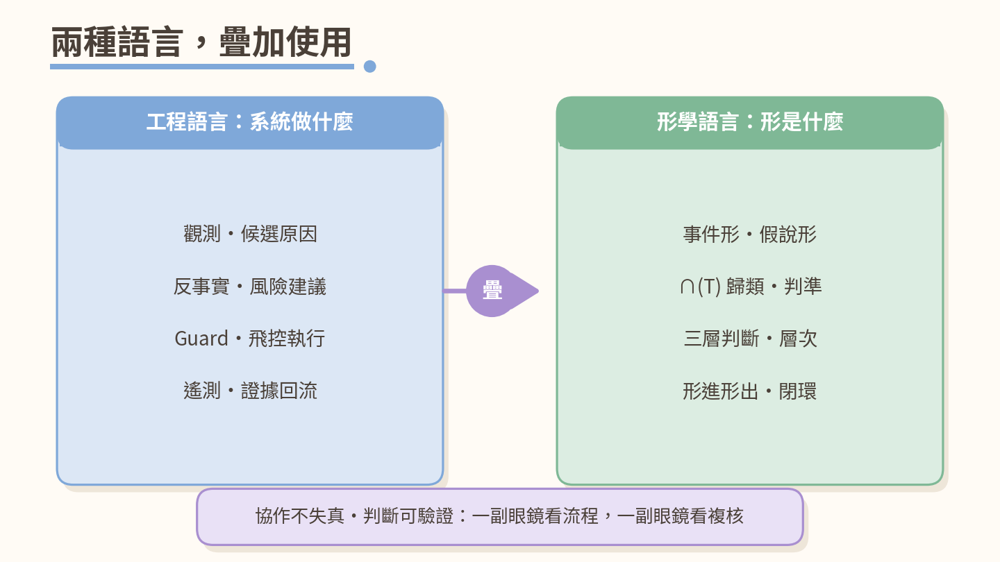

圖 0-1　兩種語言，疊加使用

全書用到六件形學工具——三軸三括號、三層判斷、框架四步驟、五大運算、函式庫六群、準確使用方法——第二篇立骨幹，其後只取用、不重講。三個平台各就各位：本形學是理論基礎、Mind AI 是底層平台、IC 設計大腦是晶片開發平台，而因果推理 IC 是本書的主角。

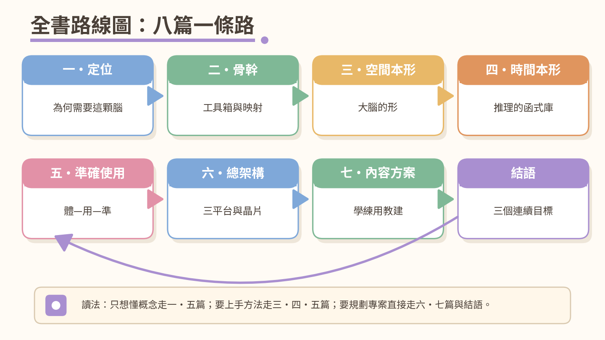

圖 0-2　全書路線圖：八篇一條路

> **三種讀法，任選一種**  
> 只想懂概念：讀第一篇、第五篇的 5-1 與 5-4。  
> 要上手方法：第三篇到第五篇逐節讀，做完 E01–E09。  
> 要規劃專案：直接讀第六篇、第七篇與結語，搭配 S01–S03。  

> **符號速覽：全書的記號都收在這裡**  
> [ ] 屬性與刻度　{ } 組成與 BOM　( ) 容器與身份　∩(T) 交集判準　op：形 → 形（函式）  
> ≡ 同一　≢ 不同一　⊂ 降級包含　⊕ 合形　σ 替換保身份　ι 嵌套　J＝J_C ∧ J_B ∧ J_T（三層判斷連立）  
> 看不懂記號時翻附錄 A 術語表；要複印空白卡時翻附錄 B-3。  

# 第一篇　定位——同一個果，不同的因；同一顆腦，不同的層

定位篇先回答三個問題：這顆大腦要交付什麼？為什麼非有不可？它站在哪一層、長在哪個平台？答案會把「可信任」三個字，一步步拆成工程要求——最後落在一顆可複核的因果推理 IC 上。

## 1-1　可信任的智慧能力

AI 無人機大腦要交付的不是「更會說話的 AI」，而是可信任的智慧能力。Causal_DT 讓我們由看見現實，走向探索可能；由理解因果，走向改變未來。當專家、AI 模型與任務 Agent 對同一個異常「果」提出不同原因時，大腦提供候選原因與風險評估、策略事前審查、證據回流，在重大動作前提供可追溯的風險建議。於是，我們一起從「採購一架無人機」，走向「可驗證的飛行安全與智慧證據」。

用形學的語言說：可信任不是「AI 說得很有把握」，而是「每一次判斷都可複核」。可複核的準，是這顆大腦的根；後面六篇做的所有事，都是在守這個根。而當這顆大腦要長進晶片裡，「可複核」三個字就從文件的要求，升級成電路的要求——這正是因果推理 IC 存在的理由。

> **一句話定位**  
> AI 無人機大腦＝會審因、預果的隨行智慧雙生，長在 Mind AI 上，用 IC 設計大腦開發，核心是一顆可複核的因果推理 IC。  

## 1-2　同一個果，常有不同的因

當 UAV 振動、爬升不足或導航品質下降時，飛行員、維修工程師、異常檢測模型與 LLM 可能提出互不相同的原因。若 AI 只給出自信的結論，卻無法展示來源與反證，人機互信可能下降；反之，保留多個假說、明確標示不確定性，才能讓分歧成為可檢驗的問題。以 IMU 垂直方向波動增大為例：

| **同一異常** | **候選解釋** | **如何再檢驗** |
| --- | --- | --- |
| IMU 垂直方向波動增大 | 氣流擾動 | 對照環境／機體動態、姿態輸出及時序變化 |
| IMU 垂直方向波動增大 | 電壓下陷／推力不足 | 查看電流、馬達與 ESC 遙測 |
| IMU 垂直方向波動增大 | 感測器偏置或時間同步問題 | 交叉檢查不同感測器、時間戳與校正狀態 |
| IMU 垂直方向波動增大 | 模擬模型失配 | 檢查質量、慣量、風場、推力曲線與模擬假設 |

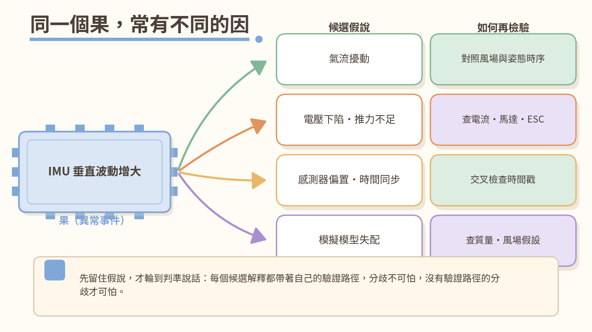

圖 1-1　同一個果，常有不同的因

> **先留住假說，才輪到判準說話**  
> 表 1-1 的第三欄「如何再檢驗」才是重點：每個候選解釋都帶著自己的驗證路徑。分歧不可怕——沒有驗證路徑的分歧才可怕。  

## 1-3　五痛點：都是「形沒立好」

把常見的信任危機攤開來看，其實是五個痛點：自信結論無來源、單一假說定案、無反證檢驗、把使用者的信任誤解為對 AI 永遠順從、失聯時沒有自主安全能力。五個痛點指向同一個共通根源——形沒立好：假說不立形，證據不設 BOM，判準不寫規則。數與結論跑在形與判準前面，看起來快，實際上不可複核。

這五個痛點到了晶片世界換了名字，病卻一樣：規格句量不出來（形沒立好）、介面沒鎖就寫 RTL（判準後補）、跑過模擬就交件（無反證）、把驗證報告當免死金牌（信任誤解）、斷線就當機（失聯無自主）。先在形的層次把病治好，兩個世界同時受益。

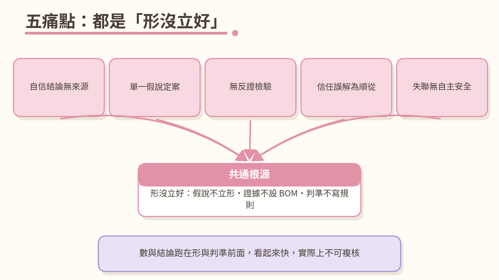

圖 1-2　五痛點：都是「形沒立好」

## 1-4　三層定位：根・幹・果

AI 無人機大腦在三層中的位置要先講清楚。根，是可複核的準——理解因果，走向改變未來；幹，是準確使用方法——三種補足、證明六步驟、八問與誤用清單；果，是可信任的智慧體系——AI 決策過程可追溯、風險可驗證、失聯仍具自主安全能力。

因果推理 IC 是果層的核心載體。在飛控保護方面，它涵蓋電池低電、定位失效、資料鏈中斷等已有配置的設備端安全行為；在高階命令進入飛控前，它檢查授權、資料期限、工作區域、禁制條件與任務狀態，並補充重大動作前的候選原因、反事實風險與證據缺口。根長在「準」上，幹長在「方法」上，果長在「矽」上——三層連成一條線。

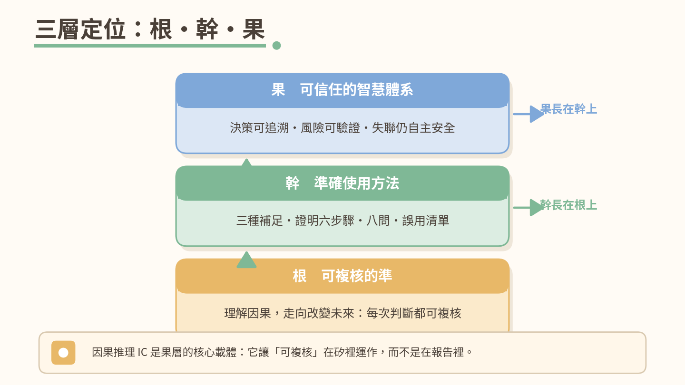

圖 1-3　三層定位：根・幹・果

## 1-5　四位一體：理論・平台・開發平台・核心

這顆大腦是四位一體的工程。最下層是本形學：空間本形管靜態的形，時間本形管動態的招，形與判準的語言貫穿全書。其上是 Mind AI 底層平台：LLM 負責語言能力，Mind Model 負責智慧能力，兩庫一中樞一迴路承載長期記憶與推理。再上是 IC 設計大腦——晶片開發平台：六種產出形、四層準確性、六步驟 SOP 與七段提示詞流水線，讓「AI 幫我設計晶片」變成可信的產線。最上面是主角：因果推理 IC——把六站因果決策鏈裝進矽，即時、可驗證、失聯自主。

四位一體有一個共同紀律：同一副形語言。判斷的形（事件、假說、策略）與設計的形（規格、介面、模組）用同一套三括號、同一套判準、同一條證據鏈。這讓飛行團隊與晶片團隊第一次可以用同一張圖吵架、用同一張表收斂。

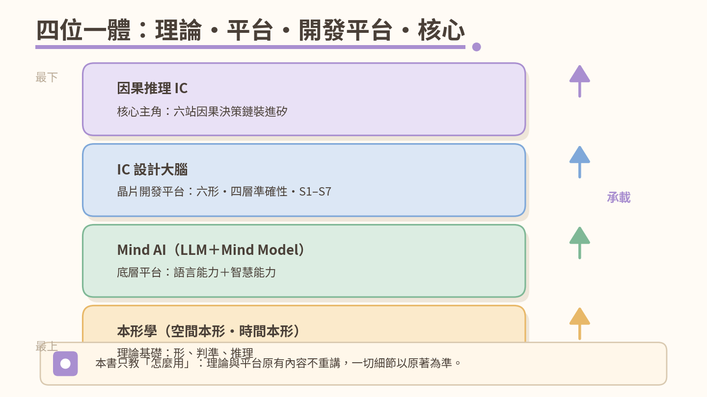

圖 1-4　四位一體：理論・平台・開發平台・核心

## 1-6　因果推理 IC：主角登場

因果推理 IC 是什麼？一句話：把「審因、預果、裁決、回流」這條鏈，硬化成一組可驗證的硬體單元。它的輸入是感測流與事件形，輸出是裁決、後果形與結構化日誌；它的內部跑的是假說排序、反事實比較與三層判斷；它的紀律是六站不跳站、判準先於生成、證據不斷鏈。

為什麼要硬化？三個理由。第一是確定性：安全路徑上的推理不能有「模型今天心情好不好」的變數，硬體管線給出可重現的時延與可驗證的行為。第二是即時性：What-if 反事實比較在軟體裡是秒級的事，在硬體加速器裡是毫秒級的事——重大動作前的審查窗口才關得上。第三是可複核：每一站的中間結果都留在演化帳裡，出事之後問得到來歷。

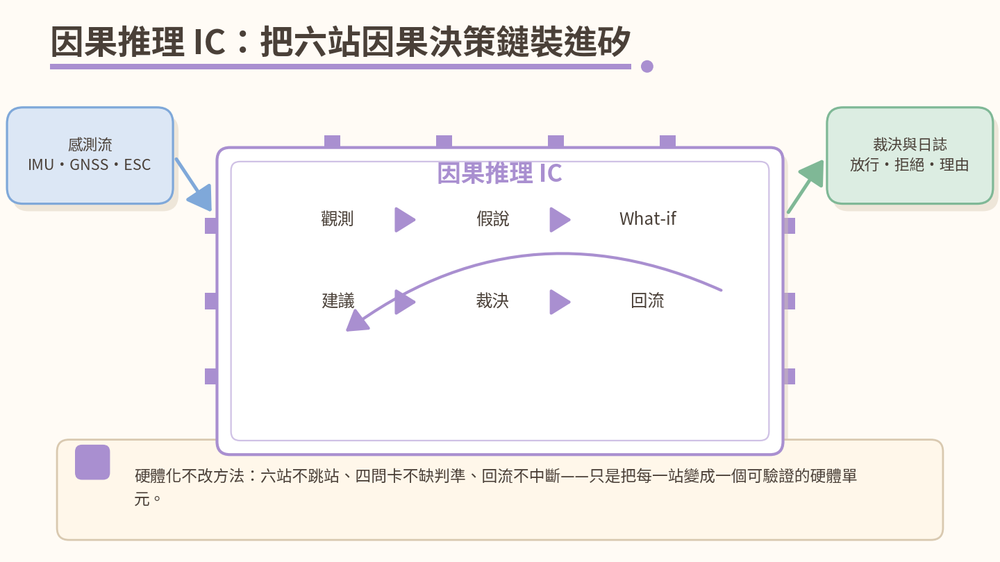

圖 1-5　因果推理 IC：把六站因果決策鏈裝進矽

> **本篇小結**  
> 可信任＝每一次判斷都可複核；五痛點的共通根源是形沒立好；三層定位守住根—幹—果；四位一體共用一副形語言；因果推理 IC 把六站鏈裝進矽，是本書的主角。  

> **練習　E01（第一篇）**  
> ① 降落任務中「爬升不足」是一個果。請仿照表 1-1，列出三個候選解釋，並為每個解釋寫一行「如何再檢驗」。  
> ② 五痛點中，哪兩個痛點在「失聯」場景下會同時爆發？說明它們與「形沒立好」的關係。  

> **【專業專欄 C1】因果推斷簡史：Bayes、Fisher 與 Pearl 之梯**  
> 因果推斷有三段路。第一段是統計時代：Bayes（1763）留下「由果更新信念」的公式，Fisher（1920s）用隨機化實驗把「干預」寫進統計學——但兩者都停在相關與設計，沒有因果的語言。第二段是結構時代：Wright（1921）的徑路圖、Simon（1950s）的因果順序、Pearl（1988）的貝氏網路，把「因果結構」立成可計算的形。第三段是干預與反事實：Pearl 的 do-calculus（1995）與因果階梯（看見→干預→反事實，2000/2009），Rubin 的潛在結果框架，讓「如果當時換一個動作會怎樣」成為可推導的問題。  
> 對 AI 無人機大腦的意義：六站鏈裡的 What-if 佔的是第三階梯，果因推理佔的是第一到第二階梯的跨越。本書不教理論（約定二），但要知道——IC 裡跑的每一站，都站在一百年的機率與因果研究上。  

# 第二篇　骨幹速覽——形學工具箱與映射總表

骨幹篇是全書的翻譯層：三條鏈疊一副骨架、六件工具立地基、映射總表做字典。這一頁讀薄，後面幾篇都輕；這一頁跳過，後面就會在兩個世界之間來回迷路。

## 2-1　認知鏈 × 因果決策鏈 × 晶片設計鏈

本形學的認知鏈是：異同 → 分合 → 形 → 名。Causal_DT 的因果決策鏈是：共通現實觀測（Fruit）→ 競爭性因果假說（Cause）→ 反事實行動比較（What-if）→ 安全策略建議 → Guard／飛控執行 → 新果回流（Evidence Update）。IC 設計大腦的晶片設計鏈是：規格 → 介面 → 模組 → 時序 → 驗證 → 模式。

三條鏈是同一件事的三個讀法。看見現實的異同，分出候選原因，組成可比較的假說，給出名字與裁決——這是認知鏈與決策鏈的共用骨架；把每一步的產出立成有身份、有判準、有版本的形——這是設計鏈的紀律。先分異同，才談因果；先把形立好，才談設計——這句話是全書的地基。

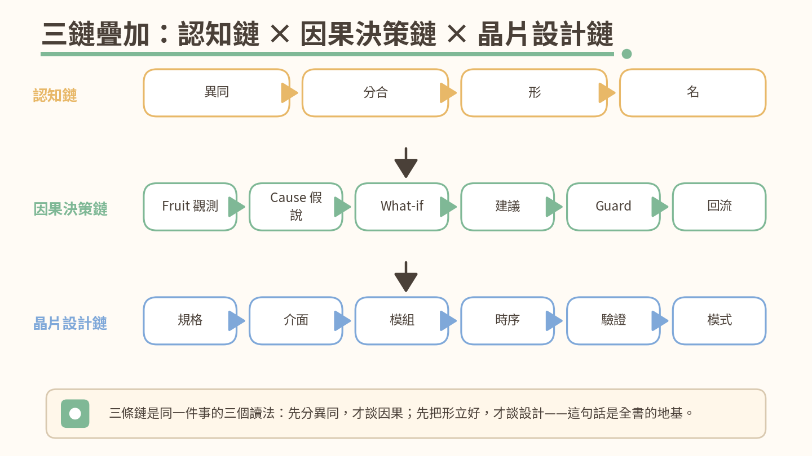

圖 2-1　三鏈疊加：認知鏈 × 因果決策鏈 × 晶片設計鏈

## 2-2　六件工具，立骨幹不重抄

本冊立骨幹的方式是「架構圖＋圖文摘要」，不逐章重抄理論。六件工具各自一句話：三軸三括號——[ ] 屬性刻度、{ } 組成 BOM、( ) 容器身份；三層判斷——容器、BOM、抽象三層連立缺一不可；框架四步驟——分辨異同、觸發抽象、命名維度、判斷歸屬；五大運算——合形 ⊕、拆形 remove、替換 σ、歸類 ∩(T)、嵌套 ι；函式庫六群——時間本形就是函式，輸入一個形，產出一個形；準確使用方法——三種補足、證明六步驟、八問與可複核的準。

五大運算在本書的出場特別多：把感測件合成事件形用 ⊕，把證據拆開定輕重用 remove，把規格改版而不換身份用 σ，把事件歸入假說用 ∩(T)，把驗證形掛在模組形之下用 ι。六站鏈的每一站，其實都是這五個運算的組合招。

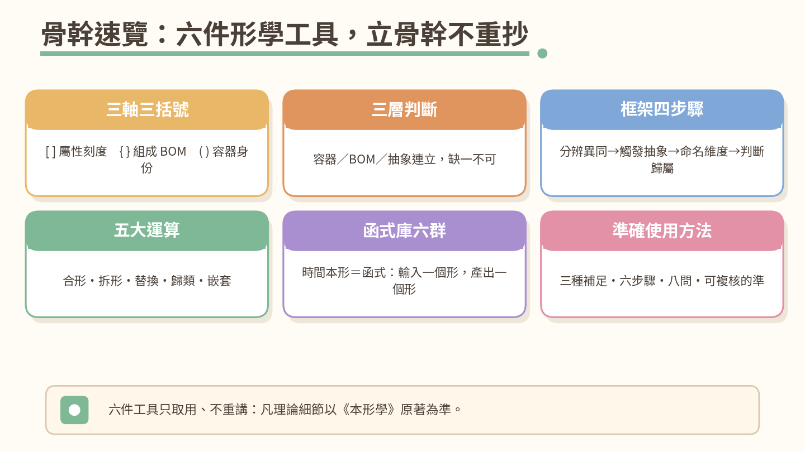

圖 2-2　骨幹速覽：六件形學工具

## 2-3　三平台映射總表：工程與形學的翻譯橋

映射總表是全書的翻譯字典：左邊看不懂時，換右邊的語言再讀一次；右邊要落地時，換回左邊的物件。十六條映射涵蓋判斷側與設計側——前八條管飛行判斷，後八條管晶片設計。

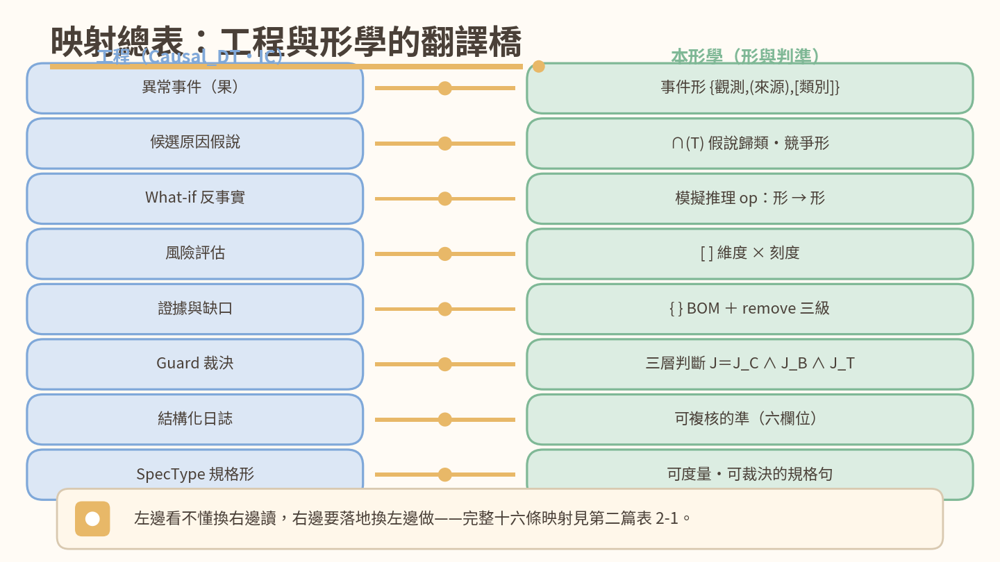

圖 2-3　映射總表：工程與形學的翻譯橋

#### 表 2-1　AI 無人機大腦 ↔ 本形學 映射總表（十六條）

| **AI 無人機大腦（工程）** | **本形學（形與判準）** |
| --- | --- |
| 異常事件（果） | 事件形 {觀測,(來源),[類別]} |
| 候選原因假說 | ∩(T) 假說歸類・競爭形 |
| What-if 反事實比較 | 模擬推理函式 op：形 → 形 |
| 風險評估 | [ ] 維度 × 刻度（提前量・錯誤放行・延遲） |
| 證據與證據缺口 | { } BOM ＋ remove 三級 |
| 機載／地面／模擬器 | ( ) 容器 C=(id(C),S(C)) |
| Guard 裁決 | 三層判斷 J＝J_C ∧ J_B ∧ J_T |
| 結構化日誌 | 可複核的準（六欄位） |
| SpecType 規格句 | 可度量・可裁決的形：量不出來就退回 |
| InterfaceType port 契約 | ( ) 容器入場規則：對得起來才算數 |
| ModuleType BOM | { } 組成 ＋ remove 三級分級 |
| TimingType 波形與 assertion | ( ) 容器的動態投影：可示波才成立 |
| VerifyType self-checking | ∩(T) 判準的可執行化 |
| PatternType 模式庫 | 設計搜尋與萃取：帶判準的可重用形 |
| 版本更迭・ECN | σ 替換保身份：id(C) 不變 |
| 演化帳・覆盤教訓 | 形進形出閉環：形與函式互相長大 |

#### 表 2-2　三個世界的名詞對照

| **飛行世界** | **晶片世界** | **形學世界** |
| --- | --- | --- |
| 感測流 | 時序激勵 | 形的輸入 |
| 異常事件 | 測試失敗 | 事件形 |
| 候選原因 | 假設失敗模式 | 假說形 |
| 安全策略 | 設計取捨 | 策略形 |
| Guard 裁決 | 簽收（sign-off） | 三層判斷 |
| 飛行日誌 | 驗證報告 | 可複核的準 |

> **例　一詞三譯**  
> 「資料過期」這件事：飛行世界叫「入場規則違規」，晶片世界叫「timing 契約不滿足」，形學世界叫「( ) 容器的入場檢查失敗」——三個說法，同一個形。開會時如果兩邊吵起來，先各自翻一次映射總表，通常會發現吵的根本是同一格。  

> **本篇小結**  
> 三鏈疊加是地基，六件工具是工具箱，映射總表是翻譯橋。三個世界各說各話時，用表 2-1 對齊；用語衝突時，以形學世界為最終仲裁——因為它只管「形與判準」，不站任何工程陣營。  

> **練習　E02（第二篇）**  
> ① 不看表 2-1，寫出「證據回流」與「風險評估」兩條映射的形學一側，再對答案。  
> ② 用一句話向晶片同事解釋「數＝形裡小形」在因果推理 IC 裡指的是什麼。  

# 第三篇　空間本形——AI 無人機大腦的形

空間本形管「靜的形」。這一輪把判斷側的事件形、假說形，與設計側的六種產出形一次立齊——三軸、remove 三級、三層判斷、層次與身份，全部落在同一副括號裡。

## 3-1　異常事件形與假說形

一個事件，就是一個形。把一次 IMU 異常立成單位形：{觀測 Fruit,(來源容器),[異常類別]}。大括號收的是組成——波動序列、GNSS 品質、ESC 電流這些觀測件；小括號收的是身份與容器——哪架機、哪次任務、哪個資料來源、什麼時間戳；中括號收的是屬性與刻度——振動類還是爬升類、風險多高、什麼等級。

這裡有一個形學上很要緊的讀法：數＝形裡面的小形・次比較。假說卡上的「置信度 0.7」不是懸空的數字，它是長在這個假說形上的量測。先有形，才有數——形不立好，數字只是裝飾。假說形則是四格卡：支持證據、反對證據、再檢驗路徑，外加一格留白，寫「還不知道什麼」。敢留白的假說卡，才不會被誤讀成定案。

事件形與假說形的關係是嵌套 ι：假說卡掛在事件形之下，一事件多假說、一假說多證據，層層問得到來歷。這個結構到了 IC 端就是 Verification Plan 的樹狀骨架——父節點是風險，子節點是測試與證據；兩邊長得像，不是巧合，是同一副形骨架的兩種投影。

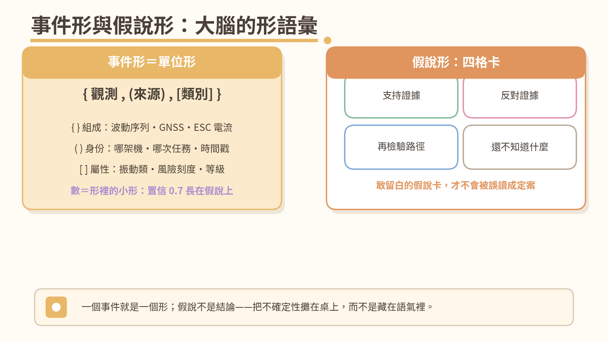

圖 3-1　事件形與假說形：大腦的形語彙

> **把不確定性攤在桌上**  
> 因果推理 IC 比「自信的結論」更可信任，第一個差距就在這裡：它把不確定性攤在桌上，而不是藏在語氣裡。假說卡的四格，就是矽裡的四個暫存位——支持、反對、再檢驗、還不知道，一格都不能少。  

## 3-2　六種產出形：因果推理 IC 的設計語彙

判斷側立了事件形與假說形，設計側則用 IC 設計大腦的六種產出形。規格形 SpecType 把需求句立成可判準的規格——傳輸速度、誤幀率、時鐘域，量不出來的形容詞一律退回重寫；介面形 InterfaceType 是模組與外界的契約——port 清單、位寬、方向、握手協定，改介面就是改契約；模組形 ModuleType 用 { } BOM 記組成，用 remove 三級定輕重；時序形 TimingType 收所有的「動」——時鐘、幀時序、復位序列、跨域同步，永遠可示波、可 assertion；驗證形 VerifyType 把「怎麼算對」立成形——self-checking、覆蓋率、逐條簽收；模式形 PatternType 是被驗證過的可重用設計模式，帶著判準與已知坑。

六形的立形方式完全用得上五大運算：規格句歸入維度用 ∩(T)，模組合成用 ⊕，規格改版用 σ 保身份，驗證形嵌套在模組形下用 ι，砍成本時用 remove 做反事實。這六口形覆蓋因果推理 IC 從需求到簽收的整條產線。

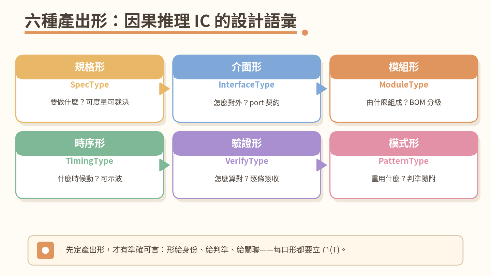

圖 3-2　六種產出形：因果推理 IC 的設計語彙

#### 表 3-1　六種產出形總表（因果推理 IC 版）

| **產出形** | **回答的問題** | **三括號重心** | **交件判準** | **因果推理 IC 範例** |
| --- | --- | --- | --- | --- |
| 規格形 SpecType | 要做什麼？ | [ ] 屬性為主 | 每句可度量、可裁決 | What-if 延遲 ≤ 10 ms |
| 介面形 InterfaceType | 怎麼對外？ | [ ]＋( ) | 對得起來、講得清楚 | 感測匯流排與 FCU 命令口契約 |
| 模組形 ModuleType | 由什麼組成？ | { } BOM 為主 | BOM 判準＋remove 分級 | 假說排序單元・反事實加速器 |
| 時序形 TimingType | 什麼時候動？ | ( ) 容器為主 | 可示波、可 assertion | 裁決管線時延與跨域同步 |
| 驗證形 VerifyType | 怎麼算對？ | 三括號全用 | 覆蓋達標＋逐條簽收 | 受控擾動＋真值標籤核對 |
| 模式形 PatternType | 重用什麼？ | { }＋[ ] | 判準隨附＋坑位記錄 | 握手協定・跨域 FIFO・除頻器 |

> **例　因果推理 IC 的第一條** **SpecType**  
> 規格句：「What-if 反事實比較的端到端延遲 P99 ≤ 10 ms；重大動作的錯誤放行次數＝0；受控擾動下推理結果可重現。」  
> 體檢四問——可度量：延遲有 P99 數字、錯誤放行可計數；可歸屬：延遲掛 [ ] 刻度、可重現掛 ( ) 容器；可裁決：兩個工程師讀完得到同一結論；可追溯：每一句都回得到「重大動作前審查」這條需求。量不出來的形容詞（快速、穩健）一律退回重寫——這是六形立形的第一課。  

## 3-3　三軸：判斷的形 × 設計的形

把形展開成三條軸，判斷側與設計側正好對讀。X 屬性軸 [ ]：判斷側管「多危險」——偵測提前量、錯誤放行次數、端到端延遲；設計側管「多少」——位寬、頻率、誤幀率、功耗。Y 組成軸 { }：判斷側管「憑什麼」——必要證據、可降級證據、缺口記錄；設計側管「由什麼組成」——子單元與 remove 分級。Z 容器軸 ( )：判斷側管「在哪說的」——機載、地面、模擬器各有身份；設計側管「在哪個域裡」——時鐘域、協定域、驗證域。

三軸就是三組括號——描述用 [ ]、組成用 { }、身份用 ( )。判斷的形與設計的形共用同一副括號，最大的好處是「跨層對話不失真」：飛行工程師說的風險刻度，晶片工程師讀到的就是規格參數；晶片工程師說的跨域，飛行工程師讀到的就是容器邊界。三軸缺一，形就是一筆糊塗帳。

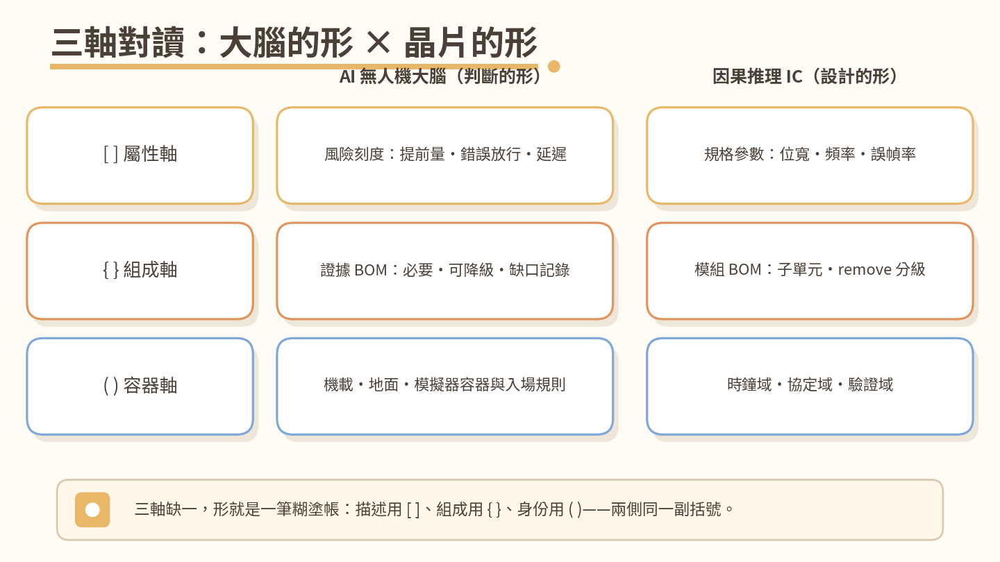

圖 3-3　三軸對讀：大腦的形 × 晶片的形

## 3-4　remove 三級：證據缺口 × 模組分級

把證據與模組都當 BOM 來管，就會問出那句形學名言：拆下來認得自己嗎？必要件（≢ M）拆掉，同一性喪失——ESC 電流缺了判斷不可成立，baud_gen 拿掉就不再是 UART；功能降級件（≡ M′ ⊂ M）拆掉，功能降級但身份存續——風場資料缺了可判斷但要降置信，FIFO 拿掉仍是 UART 但易溢位；非必要件（≡ M）拆掉照常運作——debug 標誌、裝飾遙測，量產版直接移除。

證據缺口不是丟臉的事——不記錄的缺口才是。缺口地圖讓「還不知道什麼」從口頭禪變成清單；同一条判準落在晶片上，就是砍成本、做 ECN 時的共同語言：「拿掉這個單元會怎樣」不該靠吵的，remove 分級早就寫好了。

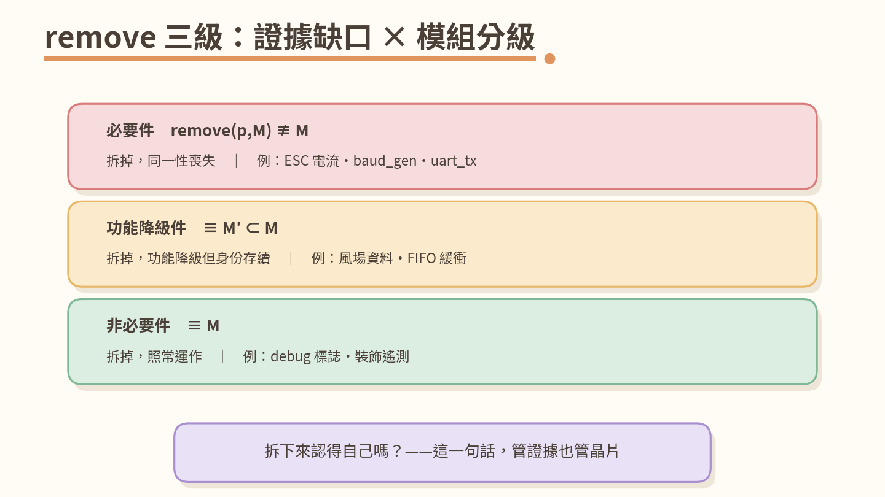

圖 3-4　remove 三級：證據缺口 × 模組分級

#### 表 3-2　因果推理 IC 的 BOM 與 remove 分級示例

| **部件** | **remove 判準** | **分級** | **拿掉的後果** |
| --- | --- | --- | --- |
| 假說排序單元 | remove(p, M) ≢ M | 必要件 | 多假說競爭消失，退回單一假說定案 |
| 反事實加速器 | remove(p, M) ≢ M | 必要件 | What-if 跑不完，重大動作前審查窗口關不上 |
| 三層判斷引擎 | remove(p, M) ≢ M | 必要件 | Guard 無裁決依據，同一性喪失 |
| 風場估計模組 | remove(p, M) ≡ M′ ⊂ M | 功能降級件 | 仍可判斷，但置信降級並標示缺口 |
| 遙測壓縮單元 | remove(p, M) ≡ M′ ⊂ M | 功能降級件 | 帶寬變緊，日誌粒度變粗 |
| 除錯追蹤介面 | remove(p, M) ≡ M | 非必要件 | 量產版可直接移除 |

> **例　缺口記帳示範**  
> 風場資料缺陣的三行帳：缺口＝風場估計不可用；處置＝置信從 0.8 降到 0.55 並標示；補期＝下一批遙測更新後複測。缺口入帳不丟臉，不入帳才丟臉——這三行寫滿，假說卡的「還不知道什麼」就從口氣變成了資產。  

## 3-5　三層判斷：Guard 的漏斗 × 設計的收件防線

Guard 的裁決是三層漏斗。第一層容器判斷 J_C：授權、資料期限、工作區域、禁制條件、任務狀態——五條入場規則逐一過目；第二層 BOM 判斷 J_B：必要證據齊備嗎？缺口有記錄嗎？第三層抽象判斷 J_T：∩(T) 交集判準——這個事件歸入哪個假說。三層連立 J＝J_C ∧ J_B ∧ J_T，全過才放行；任何一層不過，退回補證據或拒絕——漏斗不繞路。

同一副漏斗放在 IC 設計大腦的收件端，就是產出的最後防線：容器判斷問「它待在對的 ( ) 裡嗎」（時鐘域、協定域對不對）；BOM 判斷問「它與 { } 裡的部件關係對不對」（remove 分級與依存鏈一致嗎）；抽象判斷問「它符合 ∩(T) 的開放規則嗎」（新需求掛對了維度嗎）。判斷側守飛行安全，設計側守產出品質——同一個漏斗，兩種守法。

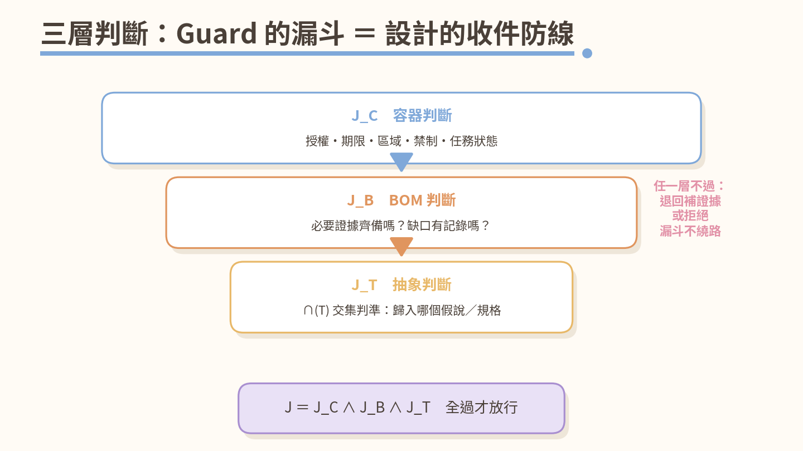

圖 3-5　三層判斷：Guard 的漏斗 ＝ 設計的收件防線

## 3-6　層次與身份：語意 ≠ 物理，證據不斷鏈

PoC-3 給了一堂經典的誤用課。以雙 FSM 描述跑道可用性與 UAV 降落任務時，跑道占用首先觸發的是「任務狀態改變」——這是語意層的事件；若要產生真實的 IMU 異常，需另外注入具有物理作用的側風或氣流擾動——這才是物理層的原因。把跑道語意事件誤當成 IMU 的物理原因，就是層次與身份的誤用：因與果不在同一層，因果鏈就斷了。

身份則是另一把尺。容器 C=(id(C),S(C)) 裡，id(C) 是不變的身份錨、S(C) 是可變的狀態——σ 替換換的是狀態，不換身份：機體換了任務，任務 id 重建；晶片改了版號，ECN 記錄延續同一模組的 id。與身分辨識配套的是形證據鏈：需求句 → 形 → 判準 → 推理招式 → 驗證 → 演化帳，每一段產出都問得到來歷，鏈上任何一環斷掉，產出不收。

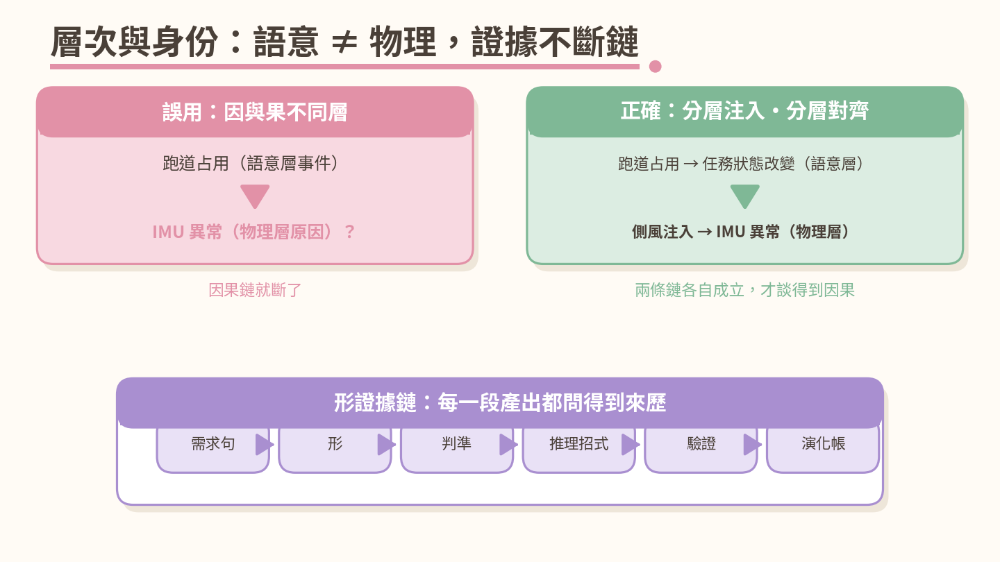

圖 3-6　層次與身份：語意 ≠ 物理，證據不斷鏈

> **第三篇小結**  
> 空間本形教的事：事件要立形、假說要留位、六形要立準、三軸要寫滿、缺口要記帳、判斷要過三層、層次要對齊、身份要錨定。這八件事做到，「果」與「產出」才開始變得可審。  

> **練習　E03–E04（第三篇）**  
> ③ E03　把「GNSS 品質下降」立成事件形：寫出 {觀測,(來源),[類別]} 三括號的內容，並指定一筆必要證據、一筆可降級證據。  
> ④ E04　判斷層次：「資料鏈中斷導致遙測停更」與「遙測停更導致判斷降級」——哪個是物理層因果、哪個是系統層因果？若把兩者混寫成一條因果句，會踩哪一族誤用？（提示：見 3-6 與表 5-6）  

> **【專業專欄 C2】EDA×AI：AI 編寫 Verilog 的真實版圖**  
> 「AI 寫晶片」不是新聞。2023 年起，ChipGPT 類研究把大型語言模型帶進 RTL 生成；EDA 三巨頭（Synopsys.ai、Cadence JedAI、Siemens EDA Copilot）先後把 AI 放進驗證收斂與設計空間探索。業界的共識很快沉澱成一句話：AI 的強項是「寫得快」，弱項是「想得對」——而 IC 是「想錯一次，流片一場空」的產業。  
> 本書的立場呼應業界收斂的方向：不要把準確寄託在換一個更會寫 RTL 的模型上（模型會換代），而要把形立好、判準前置、演繹骨架約束生成（資產留下來）。IC 設計大腦的 S1–S7 流水線，正是把「一次寫完整晶片」拆成「七段各立一形」——這與其說是提示詞技巧，不如說是把設計紀律寫進了人機分工。  

# 第四篇　時間本形——因果推理 IC 的函式庫

時間本形管「動的招」。六站因果決策鏈是主軸：每一站是函式、每張卡有判準、五族接力推理、回流才會長大——硬化成 IC 管線之後，紀律一條不少。

## 4-1　六站鏈硬化：從因果決策鏈到 IC 管線

時間本形依附空間本形：輸入一個形，產出一個形。Causal_DT 的實踐技術是一條六站鏈：共通現實觀測（Fruit）→ 競爭性因果假說（Cause）→ 反事實行動比較（What-if）→ 安全策略建議 → Guard／飛控執行 → 新果回流（Evidence Update）。每站都是函式：觀測函式把感測流立成事件形，假說函式把事件形展開成假說集，What-if 函式把「假說＋行動」映成後果形，建議函式把後果形收斂成帶置信條件的策略形，裁決函式把策略形翻成放行或拒絕，回流函式把執行結果寫回假說庫。

硬化為 IC 管線時，每一站對應一組可驗證單元：感測介面、事件偵測與排序、反事實加速器、策略收斂、三層判斷引擎、演化帳記帳。硬體化不改方法——六站不跳站、四問卡不缺判準、回流不中斷；變的只是載體：從「流程文件」變成「每站一個有驗證形看守的電路模組」。這正是六種產出形派上用場的地方：每個單元的規格、介面、時序、驗證各有各的形與簽收。

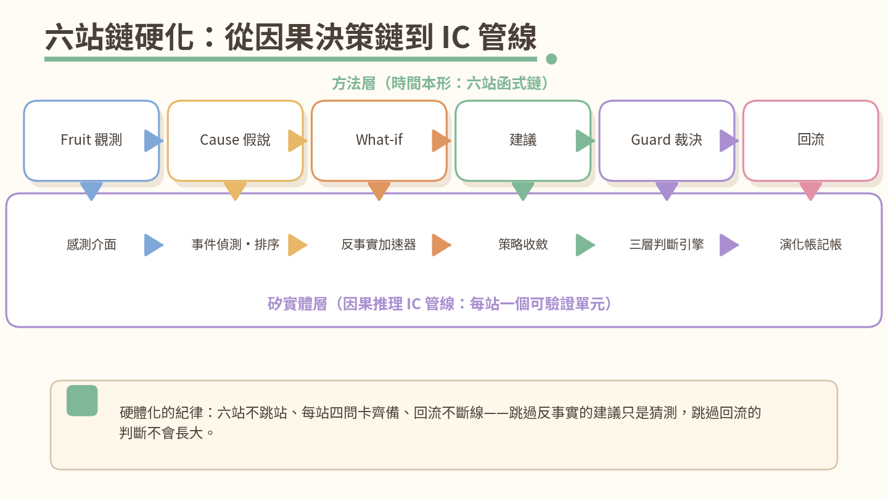

圖 4-1　六站鏈硬化：從因果決策鏈到 IC 管線

> **六站不跳站**  
> 跳過反事實的建議，只是猜測；跳過回流的判斷，不會長大。重大動作前走完六站——先審因、再預果、後裁決、終回流——這是大腦對「可信任」三個字的具體承諾。  

> **例　六站的硬體節奏**  
> 一個可參考的節奏：感測窗 1 ms 立一個事件形；假說排序在 5 ms 內給出候選序；What-if 在 10 ms 窗口內比完三個候選行動；Guard 裁決 ≤ 1 ms；回流寫入演化帳走非安全路徑，不佔審查窗口。數字可以再議，但每一站都必須有各自的時序形與驗證形看守——節奏是設計出來的，不是祈禱出來的。  

## 4-2　函式四問卡

每個函式配一張四問卡：名稱、輸入形、輸出形、判準。四問卡其實是一張卡兩種寫法：工程寫「問題—方案—影響」，形學寫「輸入形—輸出形—判準」。以 What-if 反事實比較為例——輸入形是假說形 H 與候選行動形 A，輸出形是帶風險刻度與置信條件的後果形 C，判準是真值標籤、受控擾動核對與錯誤放行次數為零。寫不出判準的函式，還不能上崗——這條規則在 PoC 的三組對照實驗裡會一再出現。

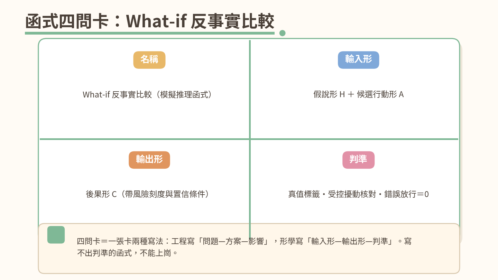

圖 4-2　函式四問卡：What-if 反事實比較

#### 表 4-1　兩張四問卡：因果推理 IC 的核心函式

| **欄位** | **卡一：What-if 反事實比較** | **卡二：Guard 三層裁決** |
| --- | --- | --- |
| 名稱 | What-if 反事實比較（模擬推理） | Guard 三層裁決（判斷函式） |
| 輸入形 | 假說形 H ＋ 候選行動形 A | 策略形 P ＋ 事件形 E |
| 輸出形 | 後果形 C（風險刻度＋置信條件） | 裁決形（放行／拒絕＋理由） |
| 判準 | 真值標籤・受控擾動核對・錯誤放行＝0 | J＝J_C∧J_B∧J_T 全過・理由可回溯・日誌六欄位寫滿 |

## 4-3　推理五族接力

六站鏈裡跑的是五族推理的接力賽：統計推理初篩——遙測對常態基線、離群偵測；果因推理主判——由果推因，多假說競爭排序；因果推理預果——由因推果，預測干預後果；模擬推理比選——What-if 反事實行動比較；逆向推理回訪——由異常回溯證據鏈。五族不是互斥的選項，是接力的棒次：初篩用統計、主判用果因、預果用因果與模擬、收尾用逆向。

硬化之後，五族各有各的硬體落點：統計初篩對應輕量偵測單元（甚至可以是 AE／XGBoost 類模型），果因主判對應假說排序單元，因果預果對應預測單元，模擬比選對應反事實加速器，逆向回訪對應記帳與回溯單元。輕的活給軟的做，重的活給硬的做——分工的判準只有一條：安全路徑上的推理，必須可重現。

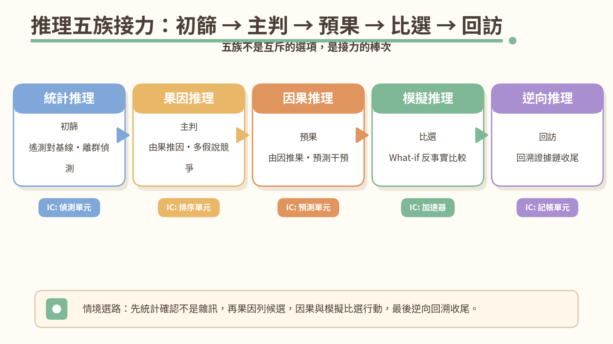

圖 4-3　推理五族接力：初篩 → 主判 → 預果 → 比選 → 回訪

#### 表 4-2　推理五族 × 因果推理 IC 單元

| **推理族** | **棒次** | **一句話** | **IC 單元落點** | **判準** |
| --- | --- | --- | --- | --- |
| 統計推理 | 初篩 | 遙測對基線、離群偵測 | 偵測單元 | 誤報率低於門檻 |
| 果因推理 | 主判 | 由果推因、多假說競爭 | 假說排序單元 | 排序可解釋、支持反對並陳 |
| 因果推理 | 預果 | 由因推果、預測干預 | 預測單元 | 干預後果有真值可核 |
| 模擬推理 | 比選 | What-if 反事實比較 | 反事實加速器 | 錯誤放行＝0 |
| 逆向推理 | 回訪 | 回溯證據鏈收尾 | 記帳與回溯單元 | 鏈上無斷點 |

## 4-4　形進形出：閉環與演化帳

事件形與假說形進來，六站函式運作，策略形與日誌形出去回到世界——但真正的重點是那條回流線。每循環一次，假說庫多一筆驗證、函式判準收緊一次、置信刻度校準一次：形與函式互相長大。不回流的智慧是消耗品；會回流的智慧才是資產。Evidence Update 是大腦的成長引擎，也是「長出自己的 UAV 智慧能力」裡「長出」兩個字的確切意思。

晶片世界有同一條迴路，名字叫演化帳：這輪的判準簽收單、覆蓋率缺口、教訓與重構決議記入帳裡，下一個專案開工時先翻上一次的帳，坑不用踩第二次。重構重組靠 id(C) 保障安全——模組化、管線化改造之後仍是同一個模組。回流落到硬體上，就是記帳單元的規格需求：每一筆裁決的輸入、判準、輸出、時間戳都寫得出來、查得回去。

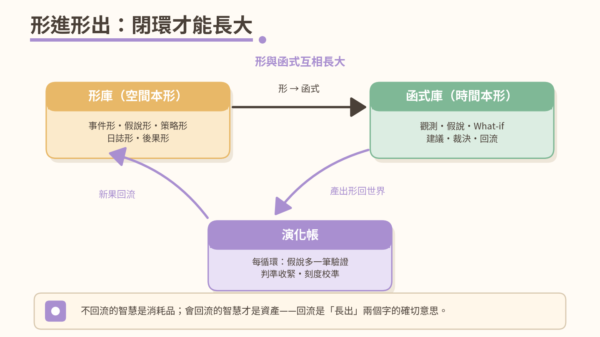

圖 4-4　形進形出：閉環才能長大

## 4-5　招式盤 × 晶片產線

時間本形的招式盤（函式庫六群十四招）在晶片產線上的落點，值得列成一張對照表——它回答「這一步該用哪一招」的老問題。解題與分析招用在需求拆解與取捨比較；設計模式與搜尋萃取招用在從舊案拿可重用的形；推理招（因果、果因、模擬、統計、逆向）貫穿判準推導與失效分析；思考法招（正向、逆向、水準、垂直、第一性原理）用在架構攻堅；持續學習、重構重組、研發探索、自我演化四招，全靠演化帳吃飯。

#### 表 4-3　招式盤十四招 × 因果推理 IC 產線落點

| **招式（時間本形）** | **IC 產線的落點** | **本書章節** |
| --- | --- | --- |
| 函式搜尋 | 在形倉庫搜尋既有規格與 RTL | 4-1、5-3 |
| 設計搜尋與萃取 | 從舊案萃取可重用模式 | 3-2 |
| 設計模式 | 握手、跨域 FIFO、除頻器等模式調用 | 3-2、4-2 |
| 邏輯生成與應用 | 判準的演繹與裁決 | 5-4 |
| 函式生成與應用 | 把重複流程封成提示詞函式（S1–S7） | 5-3 |
| 持續學習 | 演化帳的日常記帳 | 4-4 |
| 重構與重組 | 模組化、管線化改造（id(C) 保障） | 4-4 |
| 解題 | 需求拆解與問題分析 | 5-3 |
| 分析 | 對照比較、remove 反事實分析 | 3-4、5-7 |
| 設計（創造與創新） | 架構設計與取捨 | 6-3 |
| 推理（五族） | 因果・果因・模擬・統計・逆向 | 4-3 |
| 思考法 | 正向・逆向・水準・垂直・第一性原理 | 5-8 |
| 研發與探索 | 新架構 PoC 與替代方案評估 | 7-4 |
| 自我演化 | 成熟度 L4：演化帳驅動大腦長大 | 7-5 |

## 4-6　LLM・Mind Model・因果推理 IC 各守其位

在大腦的架構裡，Gemma 類 LLM 有明確而謙虛的位置：走非安全即時路徑、由事件觸發、用於輔助假說生成——它的超時不會阻礙 FCU 的獨立安全處置。用形學的話說：LLM 是函式庫裡「假說生成群」的助理函式，不是判準的持有者。它可以幫忙提出候選原因，但放行與否，永遠由三層判斷說了算。

Mind Model 的位置是智慧層：知識統一、深度推理、長期記憶與思維管理——約束生成的演繹骨架、檢查判準、追蹤證據鏈的是它。因果推理 IC 的位置是執行層：即時因果裁決、硬體級確定性、失聯自主安全。三個角色一句話總結：LLM 出語言，Mind Model 出智慧，因果推理 IC 出確定性——把每個模型放在對的位置，正是「可信任」的工程細節。

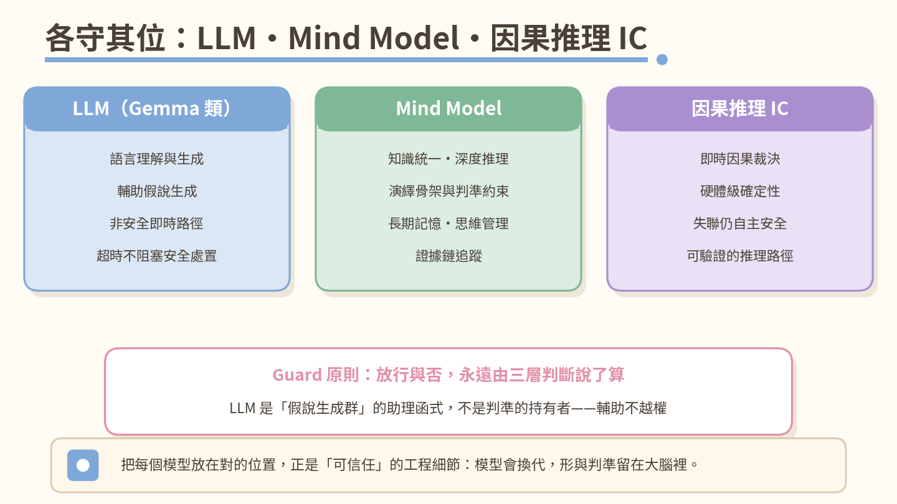

圖 4-5　各守其位：LLM・Mind Model・因果推理 IC

> **第四篇小結**  
> 時間本形教的事：六站是函式鏈、每站有四問卡、五族接力推理、閉環才會長大、招式盤對號入座、LLM 輔助不越權。時間本形跑得穩，是因為空間本形立得穩——先有形，才有函式。  

> **練習　E05–E06（第四篇）**  
> ⑤ E05　為「觀測函式（Fruit）」寫一張四問卡：名稱、輸入形、輸出形、判準各一行。  
> ⑥ E06　情境選路：任務中突然出現「爬升不足」告警。請排出五族推理的上場順序，各寫一行理由。  

> **【專業專欄 C3】邊緣 AI：低功耗推論如何上晶片**  
> 把推理放上無人機，功耗與重量就是天花板。邊緣 AI 的三把斧：量化（INT8／INT4 把浮點模型壓進整數運算）、剪枝與蒸餾（把大模型的判斷力裝進小模型）、架構選用（CNN／RNN／時序模型各佔其位）。典型數字：同一代 NPU 上 INT8 推論的能效比浮點高 2–4 倍；剪枝後的模型常能再省 30–70% 運算量而精度幾乎不掉。  
> 對因果推理 IC 的啟示：六站鏈裡「輕」的部分（統計初篩、事件偵測）適合放在可替換的推論單元，讓 BYOM（自帶模型）換代；「重」的部分（假說排序、反事實比較、三層判斷）則是自研加速器的地盤——它們的共同點是判準穩定、可驗證需求高。邊緣 AI 的取捨原則，正好與本書「模型會換代、形與判準留下」的原則互相印證。  

> **【專業專欄 C4】反事實的數學：SCM 與 do-calculus 一句話**  
> 結構因果模型（SCM）把世界寫成三件套：外生變數 U、內生變數 V、結構方程組 F。「干預」在 SCM 裡是一個動作：把某個方程換掉（do(X=x)），而不是「觀察到 X=x」——一字之差，因果與相關的分野就在這裡。反事實則是第二次替換：在「同一個 U」的前提下重跑方程，問「如果當時不這樣，會怎樣」。  
> 對本書讀者只需要帶走一句話：What-if 反事實比較的本質是「固定其他方程、替換一個方程、重算後果形」——σ 替換的因果版。至於 do-calculus 三條規則能否從觀測資料估出干預效果，那是理論細節，以 Pearl 原著為準（約定二）。  

# 第五篇　準確使用方法完整架構

準確使用方法是全書的心臟：體—用—準立骨架，三種補足補缺口，六步驟走全程，四層準確性長結構，八問收清單，誤用表當路標——最後收在「可複核的準」。

## 5-1　體—用—準

準確使用方法的骨架是三個字：體、用、準。體是家底——形庫與函式庫，兩庫一中樞一迴路；用是招式——六站鏈運作、推理五族接力、四問卡驅動；準是裁判——三種補足、證明六步驟、八問檢查、誤用清單，最後收在「可複核的準」。體不立、用必亂；準不立、用必險。任何一次 Guard 裁決，都要能在日誌裡被重新檢查一遍——這就是「準確＝可複核的準」的運作定義。

這副骨架對判斷側與設計側一視同仁。判斷側的「準」落在結構化日誌與裁決記錄，設計側的「準」落在四層準確性與簽收單；判斷側的「體」是事件形庫與假說庫，設計側的「體」是六形工作單與模式庫。體—用—準三個字，把兩個世界收進同一個檢查框架。

「準是裁判」的運作很具體：一份產出擺上來，裁判先問判準在哪（第四問），再看證據夠不夠（第六問），最後檢查層次與身份（第二、第五問）——裁判不重新發明答案，只檢查這份答案有沒有資格上崗。裁判的產物是簽收單與日誌，不是會議共識。

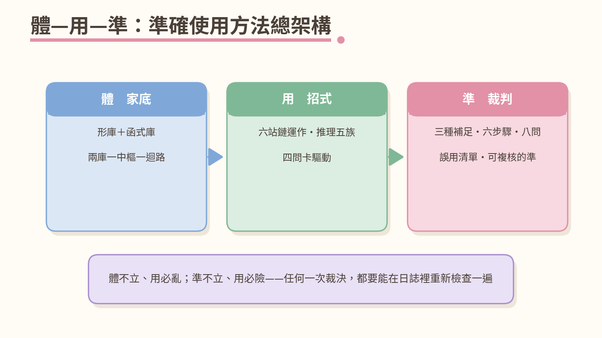

圖 5-1　體—用—準：準確使用方法總架構

## 5-2　三種補足

缺規則補 [ ]、缺身份補 ( )、缺結構補 { }——三種補足對應三組括號。落到 AI 無人機大腦：規則補足把授權、資料期限、工作區域、禁制條件、任務狀態五條入場規則與風險刻度定義寫成文；身份補足把事件、機體、任務的 ID 與資料來源、時間戳寫清楚，並做三同檢查（同名、同源、同時）；結構補足把證據 BOM 三級分類、缺口記錄與置信降級標示建起來。三本書對照著寫：規則書管入場、身份書管溯源、結構書管憑證——缺哪本就補哪本。

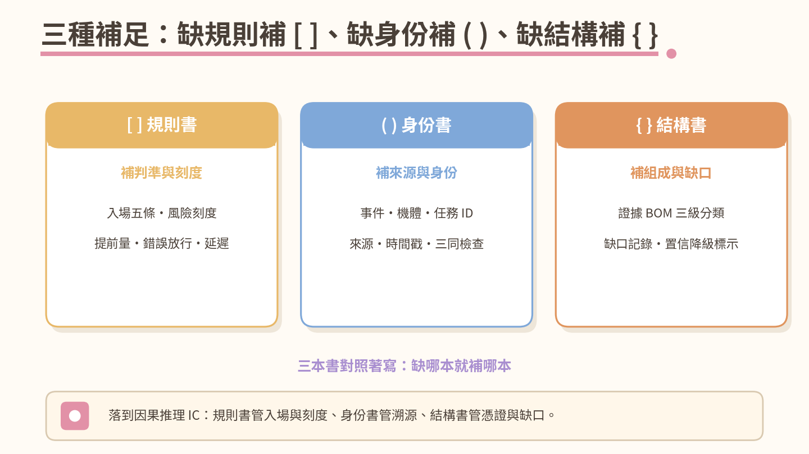

圖 5-2　三種補足：缺規則補 [ ]、缺身份補 ( )、缺結構補 { }

#### 表 5-1　三種補足：AI 無人機大腦版

| **補足** | **補什麼** | **AI 無人機大腦具體項目** | **晶片側對應** |
| --- | --- | --- | --- |
| [ ] 規則補足 | 判準與刻度 | 授權・資料期限・工作區域・禁制條件・任務狀態；風險刻度（提前量・錯誤放行・延遲） | SpecType 驗收度量・SDC 約束 |
| ( ) 身份補足 | 來源與身份 | 事件 ID・機體 ID・任務 ID・資料來源・時間戳；三同檢查 | 模組 id(C)・版本號・ECN 記錄 |
| { } 結構補足 | 組成與缺口 | 證據 BOM 三級分類；缺口記錄；置信降級標示 | ModuleType BOM・remove 分級表 |

## 5-3　證明六步驟全程示範

用 PoC-1 的案例走一遍六步驟。案例：降落任務中，IMU 垂直波動增大。六步驟是：認明整體 → 分軸描述 → 寫形集合 → 選定命題 → 判準推理 → 三層檢查。這六步同時是 IC 設計大腦六步驟 SOP（認明情境 → 分軸建形 → 挑選擴式 → 生成產出 → 判準驗收 → 歸檔演化）的判斷側鏡像——兩套六步驟，一副骨架。

#### 表 5-2　證明六步驟 × IMU 案例全程

| **步驟** | **動作** | **本例的寫法** |
| --- | --- | --- |
| ① 認明整體 | 先認明這是什麼形 | 降落任務中的異常事件——不是故障結論 |
| ② 分軸描述 | 三軸各寫一行 | [ ] 波動幅度×時間窗・{ } 證據清單・( ) 機載遙測流容器 |
| ③ 寫形集合 | 寫出單位形 | {IMU 異常觀測,(機載遙測流),[振動類]} |
| ④ 選定命題 | 列出候選假說 | H1 氣流擾動／H2 電壓下陷・推力不足／H3 時間同步／H4 模型失配 |
| ⑤ 判準推理 | What-if＋證據對照 | 電流平穩→排 H2；時間戳偏差→支持 H3；風場同窗變動→支持 H1 |
| ⑥ 三層檢查 | 連立三層再裁決 | 容器：資料未過期 ✓；BOM：必要證據齊 ✓；∩(T)：歸入 H3 → Guard 裁決＋記錄 |

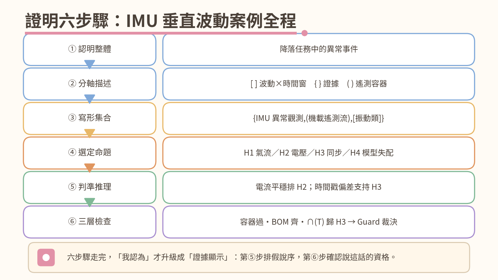

圖 5-3　證明六步驟：IMU 垂直波動案例全程

> **第⑤步與第⑥步的分工**  
> 判準推理負責把假說排好序，三層檢查負責確認「說這話的資格」——層次對不對、證據夠不夠、身份是不是這一個。六步驟走完，「我認為」才升級成「證據顯示」。  

> **例　再走一輪：電壓下陷的六步驟速寫**  
> ① 認明：爬升不足伴隨動力告警的異常事件；② 分軸：[ ] 壓降幅度×時間窗、{ } 電流與電芯遙測、( ) 機載電源遙測容器；③ 形集合：{電壓下陷觀測,(機載電源遙測),[動力類]}；④ 命題：H1 電池老化／H2 馬達堵轉／H3 電源板異常；⑤ 推理：單體壓差大支持 H1、電流突增支持 H2；⑥ 三層：資料未過期 ✓、必要證據齊 ✓、∩(T) 歸 H2 → Guard 建議限扭並記錄。同一副骨架，換一個案例照樣走得通——這就是方法。  

## 5-4　四層準確性保證

設計側的準確是結構性的，由四層保證一層層長出來。第一層 ∩(T) 判準先行：任何產出在生成之前，先寫出「何謂對、何謂錯」——判準後補是最陰險的不準確，等於讓考生自己出改考題。第二層演繹骨架：由 Mind Model 依形與判準演繹出產出的骨架結構，LLM 只在骨架內填肉——骨架錯了被第一層抓住，語句錯了被第三層抓住。第三層形式驗證：lint、模擬、assertion、覆蓋率——驗證的對象是判準不是程式碼，testbench 的每個 self-checking 都要指回 ∩(T) 的某一條。第四層形證據鏈：任何一段 RTL 要能回溯到「掛在哪一口形、用了哪幾招、通過哪條判準、落在演化帳哪一筆」。

四層各攔住一種不準確：判準攔「不知道什麼叫對」，骨架攔「結構長歪」，驗證攔「角落案例」，證據鏈攔「對了但講不出為什麼對」。缺一層就漏一種錯。驗收看雙軸：空間看形完備（六形齊、判準立、表記全），時間看招到位（調用有據、推理完整、記錄歸檔）——雙軸都過才出門。

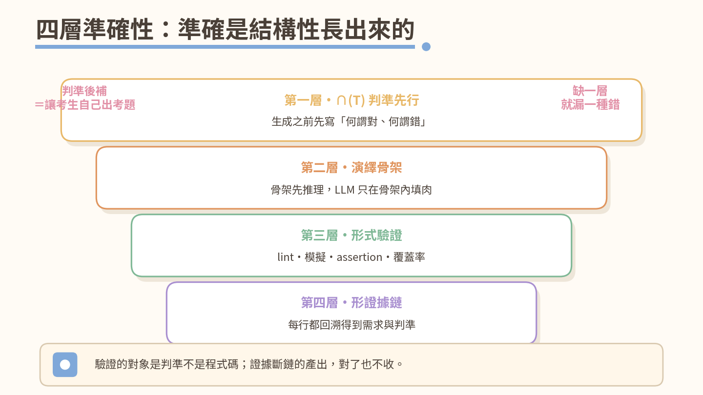

圖 5-4　四層準確性：準確是結構性長出來的

#### 表 5-3　四層準確性的驗收對照

| **層** | **驗收問題** | **通過證據** | **不過處置** |
| --- | --- | --- | --- |
| ∩(T) 判準 | 判準是在生成之前立的嗎？ | 判準簽收單（有日期） | 退回重立 |
| 演繹骨架 | 骨架是推理出來的嗎？ | 推理步驟記錄 | 退回重長骨架 |
| 形式驗證 | 覆蓋率達標了嗎？ | 覆蓋率報表＋缺口處置 | 補測試 |
| 形證據鏈 | 每行都回溯得回去嗎？ | 證據鏈抽查 | 斷者不收 |

## 5-5　結構化日誌 × 形證據鏈：可複核的準

大腦的重要決策輸出，是一份可讀的結構化日誌，六欄位寫滿：觀測到什麼、可能原因、支持／反對證據、還不知道什麼、建議策略、Guard 最終裁決。操作員可覆核，且能在定義明確的條件下介入——不把使用者信任誤解為對 AI 永遠順從。日誌不是給人看的報告，是給複核者看的證據：它讓「可追溯、可驗證、可介入」三句話從口號變成欄位。

在晶片端，同一份日誌就是形證據鏈的輸出口：每一筆裁決帶著輸入形、判準版本、推理路徑與時間戳寫入演化帳，出事之後從果一路問回需求句。兩條鏈在這裡合流——飛行日誌與驗證報告，本來就是同一條證據鏈的兩個切面。

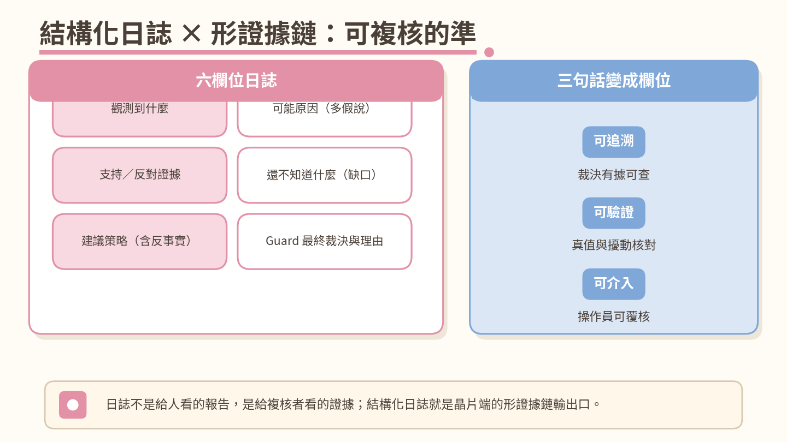

圖 5-5　結構化日誌 × 形證據鏈：可複核的準

#### 表 5-4　結構化日誌六欄位

| **欄位** | **寫什麼** | **複核時問什麼** |
| --- | --- | --- |
| 觀測到什麼 | 事件形與三軸摘要 | 這是同一個形嗎？ |
| 可能原因 | 候選假說集（多假說並陳） | 假說留證據位了嗎？ |
| 支持／反對證據 | 證據 BOM 與缺口 | 必要證據齊嗎？缺口入帳了嗎？ |
| 還不知道什麼 | 缺口記錄與置信降級 | 不確定性攤在桌上了嗎？ |
| 建議策略 | 含 What-if 比較結果 | 反事實做過嗎？ |
| Guard 最終裁決 | 放行／拒絕＋理由 | 三層判斷連立了嗎？ |

## 5-6　八問檢查清單

每次重大動作前，八個問題按順序問一遍。順序有講究：先形後數、先身後事、先因後果。八問過關＝上崗證；任一問卡住＝退回補證據，不硬上。這份清單同樣適用於晶片收件：把「重大動作」換成「交件」，把「事件形」換成「產出形」，八問一字不改。

圖 5-6　八問檢查清單：先形後數・先身後事・先因後果

#### 表 5-5　八問檢查清單

| **問** | **看哪裡** | **不過時怎麼辦** |
| --- | --- | --- |
| ① 這是什麼形？ | 事件形／假說形／策略形／產出形？ | 回 3-1・3-2 立形 |
| ② 身份是誰？ | id・任務・來源・時間戳（三同） | 回 ( ) 身份補足 |
| ③ 三軸說清楚了嗎？ | [ ] 刻度・{ } BOM・( ) 容器 | 回 3-3 補軸 |
| ④ 判準寫在哪？ | 四問卡的判準欄 | 沒判準不上崗 |
| ⑤ 層次對嗎？ | 語意層≠物理層、假說層級 | 回 3-6 對齊層次 |
| ⑥ 證據夠嗎？ | 必要證據・缺口記錄 | 回 remove 三級地圖 |
| ⑦ 反事實做過嗎？ | What-if 比較記錄 | 回 4-2 補比較 |
| ⑧ 日誌可複核嗎？ | 六欄位是否寫滿 | 補欄位再裁決 |

## 5-7　誤用 16 種

誤用清單按四個病灶家族分組，對照表用，不是背誦用。踩過哪一格，就在那一格旁邊寫下自己的案例——這比默寫 16 條有用得多。四組的病灶分別是：層次與身份（因與果不在同一層、身份沒錨定）、證據與判準（缺口不入帳、判準後補）、容器與信任（信任當順從、裁決併入控制）、時間與回流（迴路當單向流水線）。

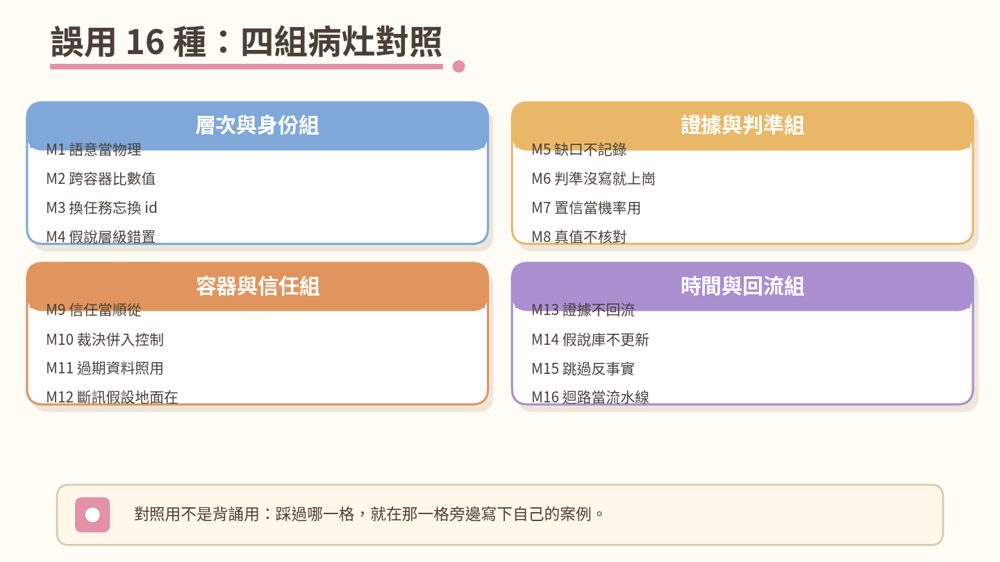

圖 5-7　誤用 16 種：四組病灶對照

#### 表 5-6　誤用 16 種：四組對照

| **組** | **誤用** | **改正一句話** |
| --- | --- | --- |
| 層次與身份組 | M1 語意事件當物理原因 | 先問：因與果站在同一層嗎？ |
| 層次與身份組 | M2 跨容器直接比數值 | 先比 id(C)，再比刻度 |
| 層次與身份組 | M3 換任務忘了換 id | 任務一換，身份重建 |
| 層次與身份組 | M4 假說層級互相錯置 | 寫形集合時標明層次 |
| 證據與判準組 | M5 證據缺口不記錄 | 缺口入帳，置信降級 |
| 證據與判準組 | M6 判準沒寫就上崗 | 四問卡判準欄必填 |
| 證據與判準組 | M7 置信度當機率用 | 置信是形裡的刻度，不是機率 |
| 證據與判準組 | M8 真值不核對就收案 | 受控擾動＋真值標籤核對 |
| 容器與信任組 | M9 信任＝永遠順從 | 信任是可覆核，不是免檢 |
| 容器與信任組 | M10 Guard 併入控制迴路 | 裁決與控制分離 |
| 容器與信任組 | M11 過期資料照樣用 | 資料期限是入場規則 |
| 容器與信任組 | M12 斷訊假設地面在 | 失聯自主是設計要求 |
| 時間與回流組 | M13 證據不回流 | 新果一定要回流假說庫 |
| 時間與回流組 | M14 假說庫不更新 | 每循環校準一次判準 |
| 時間與回流組 | M15 跳過反事實直上 | 六站不跳站 |
| 時間與回流組 | M16 迴路當單向流水線 | 迴路是成長引擎，不是管線 |

## 5-8　選路決策樹

把六站鏈翻成選路決策樹：感測事件上報後，先走快拒路徑——資料過期、授權不符，直接拒絕，不值得跑完整條智慧鏈；其餘事件經 AE／XGBoost 或 BYOM 初篩排序，進入 Causal KG 檢索與輕量 What-if 比較，最後由 Guard 三層判斷裁決：放行或拒絕都寫理由。裁決之後是結構化日誌，日誌之後是證據回流——六站成環。

選路的另一面是思考法的選路：正向推不通時換逆向（由果回溯），單一視角僵住時換水準（移去限制條件、看別的域怎麼解），機制不明時換垂直（往下拆到第一性原理：拆到物理與資料的最底層再重建）。決策樹管事件怎麼走，思考法管思路怎麼切——兩張圖一起貼在牆上。

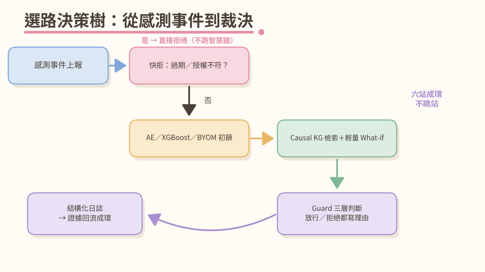

圖 5-8　選路決策樹：從感測事件到裁決

> **第五篇小結**  
> 準確使用方法一句話：把判準寫成可檢查的形。三種補足補齊規則、身份與結構；六步驟把判斷走成過程；四層準確性把設計長成結構；八問把過程收成清單；誤用表把前人的坑變成路標；選路樹把一切收進一條可運轉的路。  

> **練習　E07–E09（第五篇）**  
> ⑦ E07　你的專案缺一份「資料期限規則」。它屬於哪一種補足？補在哪個括號上？寫出規則的一行範例。  
> ⑧ E08　用六步驟走「電壓下陷」案例：寫出第③步的形集合與第⑤步的兩條判準推理。  
> ⑨ E09　拿八問檢查一次你最近的一次「重大動作決策」：哪一問最容易卡住？為什麼？  

> **【專業專欄 C5】形式驗證考據：從 Turing 到 model checking**  
> 1936 年 Turing 的判定問題，留下了「程式性質能不能機械證明」的懸念。1960s–70s，Floyd 與 Hoare 把「斷言」寫成邏輯契約（Hoare 三元組）；1980 年代 Clarke、Emerson、Sifakis 的 model checking 讓有限狀態系統的時序性質可自動驗證（2007 圖靈獎）；1990 年代 Pnueli 把時序邏輯引入硬體驗證（1996 圖靈獎）。今天的 assertion-based 驗證與形式簽收，都是這條線的落地。  
> 本書說「驗證的對象是判準」，這句話在形式驗證的歷史裡有名字：specification 就是形，proof 就是證據鏈。因果推理 IC 的每個單元都該有「可形式化的契約」——不是因為時髦，而是因為安全路徑上的推理，值得被證明而不只是被測試。  

> **【專業專欄 C6】功能安全：DO-254 與航太級的可靠語彙**  
> 航太電子有兩本聖經：軟體的 DO-178C 與硬體的 DO-254。它們的核心思想與本書驚人地一致：需求要可追溯（requirements-based testing）、設計與驗證要分離、失效要分級（DAL A–E）、每一步都要有「客觀驗證證據」。DO-254 對複雜電子規格的要求——明確性、可驗性、可追溯性——正是六種產出形的交件判準。  
> 把功能安全譯成形學語言：DAL 分級是 [ ] 刻度，需求追溯矩陣是形證據鏈，設計保證等級是 remove 三級的鏡像（必要件按最高等級守）。因果推理 IC 若走向適航認證，方法上不用發明新東西——把既有形語言對齊到 DO-254 的語彙，即可無縫接軌。  

# 第六篇　總架構——三平台 × 兩庫一中樞一迴路

總架構篇把前五篇的成果裝進機體：三平台分層、兩庫一中樞一迴路、大腦晶片與 FCU 分工、三守其位、HAL 生態與 DT 孵化 IC——從方法一路走到產業。

## 6-1　三平台分層：底層平台・開發平台・核心 IC

把前五篇收進一副骨架，先看平台怎麼分層。最底是 Mind AI 底層平台：LLM 語言能力＋Mind Model 智慧能力，承載兩庫一中樞一迴路；中間是 IC 設計大腦晶片開發平台：六種產出形、四層準確性、六步驟 SOP 與 S1–S7 提示詞流水線，讓晶片產出可信；最上是因果推理 IC 核心：六站鏈硬體化，可驗證、可複核、失聯自主。三層共用同一副形語言——形、判準、證據鏈貫穿三層，這是四位一體的工程含義。

分層的紀律是「下層不管上層的判斷」。Mind AI 不替 Guard 做裁決，IC 設計大腦不替飛行任務做決策，因果推理 IC 不自己改判準——每一層只交付自己的「準」，讓上一層拿去做判斷。這條紀律同時是資產保護：模型會換代、工具會替換，形與判準留在層與層之間的契約裡。

層與層之間靠版本管理接軌：判準換代走 σ 替換保身份——版本號變、任務身份不變，ECN 記錄延續同一個形的歷史；模型換代走 BYOM 介面——推論單元換、判準與證據鏈不動。於是每一層都可以各自演進，而不撕裂整條證據鏈。

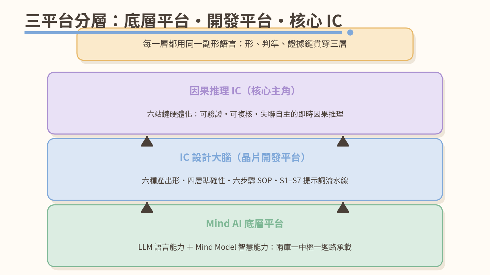

圖 6-1　三平台分層：底層平台・開發平台・核心 IC

## 6-2　兩庫一中樞一迴路 × AI 無人機大腦

形庫（空間本形）住事件形、假說形、策略形、日誌形、後果形、規格形；函式庫（時間本形）跑觀測、假說、What-if、建議、裁決、回流六站，附推理五族與模式庫；中樞是 Guard 裁決——三層判斷連立、八問把關、可複核的準；迴路是證據回流——新果同時更新形庫與函式庫。這副骨架以 Mind AI 為底層平台：兩庫是家底、中樞是裁判、迴路是成長。本冊依約定不重抄 Mind AI 的內容，只標出它承載的位置。

因果推理 IC 在這副骨架裡的位置很特別：它是「中樞＋迴路」的硬體化身——三層判斷引擎是中樞的電路化，記帳單元是迴路的電路化，而兩庫仍以 Mind AI 承載、可遠端更新。這種「硬體守判決、軟體養家底」的分工，兼顧了即時性與成長性：判準換代走版本管理（σ 替換保身份），不必重流片。

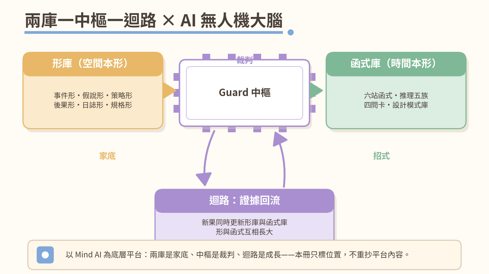

圖 6-2　兩庫一中樞一迴路 × AI 無人機大腦

## 6-3　UAV 大腦晶片架構：Companion／Mission Compute 與 FCU

大腦晶片與飛控的分工，一句話講死：大腦負責「想清楚再動」，FCU 負責「無論如何都安全」。UAV 大腦 IC（Companion／Mission Compute）承載感知模型、Causal_DT 推理、任務策略與安全可審核接口；飛控 FCU 承載經驗證的低階姿態控制、馬達輸出、核心 failsafe、控制迴路、失聯處置、電池與地理圍欄，且不承載 LLM。兩者由 HAL 嚴格隔離，分工協作——裁決與控制分離，是 M10 的正面示範。

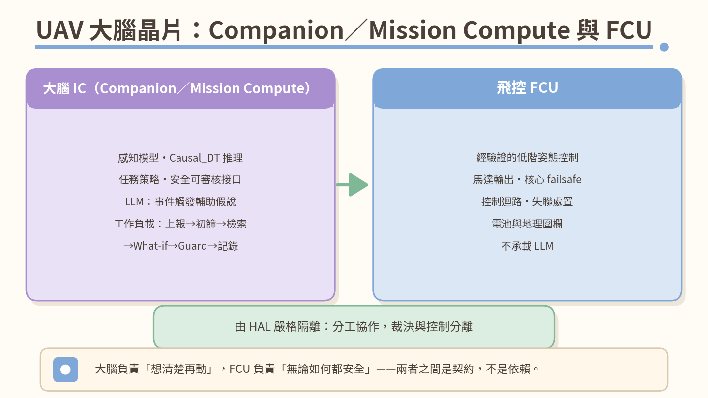

圖 6-3　UAV 大腦晶片：Companion／Mission Compute 與 FCU

#### 表 6-1　大腦 IC 與 FCU 區塊對照

| **區塊** | **大腦 IC（Companion／Mission Compute）** | **飛控 FCU** |
| --- | --- | --- |
| 職責 | 感知模型、Causal_DT 推理、任務策略、安全可審核接口 | 經驗證的低階姿態控制、馬達輸出、核心 failsafe |
| 工作負載 | 感測事件上報 → AE／XGBoost 或 BYOM → KG 檢索 → 輕量 What-if → Guard → 記錄 | 控制迴路、失聯處置、電池與地理圍欄 |
| LLM 位置 | Gemma 類：非安全即時路徑、事件觸發輔助假說；超時不阻塞 | 不承載 LLM |
| 隔離 | 由 HAL 嚴格隔離，與 FCU 分工協作 | 由 HAL 嚴格隔離，維持獨立安全處置 |

> **例　一次裁決的端到端旅程**  
> IMU 異常上報 → 偵測單元標記振動類事件 → 假說排序給出 H1 氣流／H3 同步的前兩名 → 反事實加速器比完「續降」與「復飛」兩個候選行動 → Guard 三層判斷放行「復飛」並寫理由 → 六欄位日誌入演化帳。全程在大腦 IC 內完成，FCU 只收到一條帶簽核的行動建議；若中間任何一站超時，FCU 以自身 failsafe 為準——契約寫在 HAL 裡，而不是寫在默契裡。  

## 6-4　三守其位

斷訊是試金石。切斷地面站或模擬器連線後，機載感測、Causal_DT 風險建議與 FCU failsafe 的獨立性必須被驗證。三者各守其位——神鷹 DT 提供因果風險情報、反事實比較與不確定性，但不得成為急停或穩定控制的必要依賴；HAL Guard 負責高階任務與行動提案的授權、資料期限、狀態及策略合法性審核；飛控 FCU 執行專家驗證的低階控制、失聯、電池、地理圍欄與姿態安全處置。

用形學的話呼應 3-4：三守其位是 remove 三級的鏡像——FCU 是必要件，不可拆；DT 是功能增強件，可降級但要標示；Guard 是守門件，不越權。權責清單化，失聯不失序。

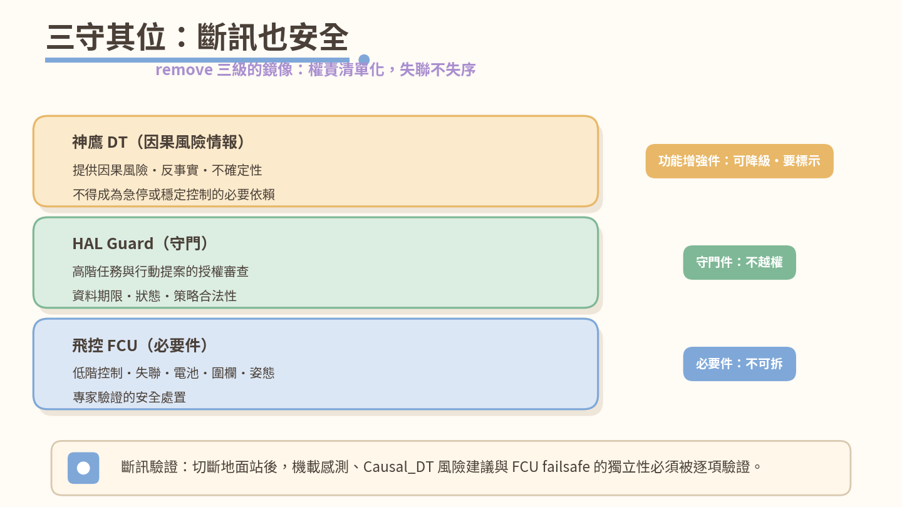

圖 6-4　三守其位：斷訊也安全

## 6-5　工作負載鏈：負載可重播，晶片才可驗證

工作負載鏈是晶片規格的需求引擎：感測事件上報 → AE／XGBoost 或 BYOM 初篩 → Causal KG 檢索 → 輕量 What-if → Guard 裁決 → 結構化日誌與回流。這條鏈的每一站都留證據，所以可重播、可測試、可比較——只有拿到真實工作負載，才有資格定晶片架構。順序不能倒：先有負載，後有規格；先有可重播，後有可驗證。

負載分佈決定硬軟分工：低算力、高彈性的部分（BYOM 初篩、語言輔助）放在可替換的推論單元；高確定性、高驗證要求的部分（假說排序、反事實加速、三層判斷）放在自研固定功能單元；而日誌與演化帳需要的寫入頻寬與留存策略，是記憶體子系統的規格來源。

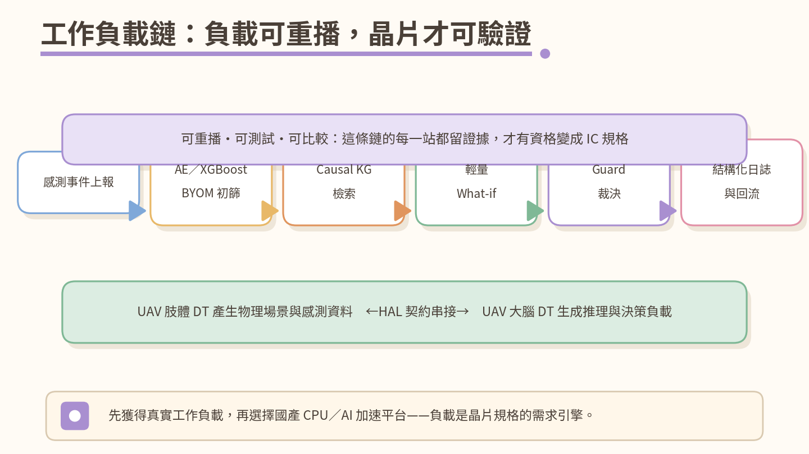

圖 6-5　工作負載鏈：負載可重播，晶片才可驗證

#### 表 6-2　工作負載 × 硬軟分工

| **工作負載** | **性質** | **落點** | **驗證方式** |
| --- | --- | --- | --- |
| 感測事件上報 | 高吞吐・低延遲 | 固定功能介面 | 時序形＋assertion |
| BYOM 初篩 | 模型可換代 | 可替換推論單元 | 效能量測＋真值核對 |
| Causal KG 檢索 | 記憶密集 | 記憶體子系統＋加速 | 檢索品質報告 |
| 輕量 What-if | 並行・可近似 | 反事實加速器 | 受控擾動對照 |
| Guard 三層裁決 | 確定性・可審計 | 固定功能判斷引擎 | 形式驗證＋簽收 |
| 日誌與回流 | 寫入密集・不可丟 | 記帳單元＋演化帳介面 | 斷點抽樣回放 |

## 6-6　HAL 生態：大榕樹與雙主權

Causal_DT 要長成產業能力，需要系統級 HAL 當土壤。大榕樹的工程比喻：各廠品牌 UAV 與晶片是深植產業的根；系統級 HAL 是讓多方智慧有秩序嫁接的主幹；Runtime Causal_DT 與各式 BYOM、Agent、任務服務則是持續生長的枝葉。PX4、MAVLink、ROS 2、ArduPilot AP_HAL 與 ros2_control 已分別提供飛控、通訊與硬體抽象能力；台灣主權 HAL 的定位是「跨 UAV、AI 與任務系統的系統級語意／治理層」——包容原有飛控內部的硬體抽象，讓不同廠商使用共同的事件、風險、行動與稽核契約，不必各自重建整條智慧鏈。

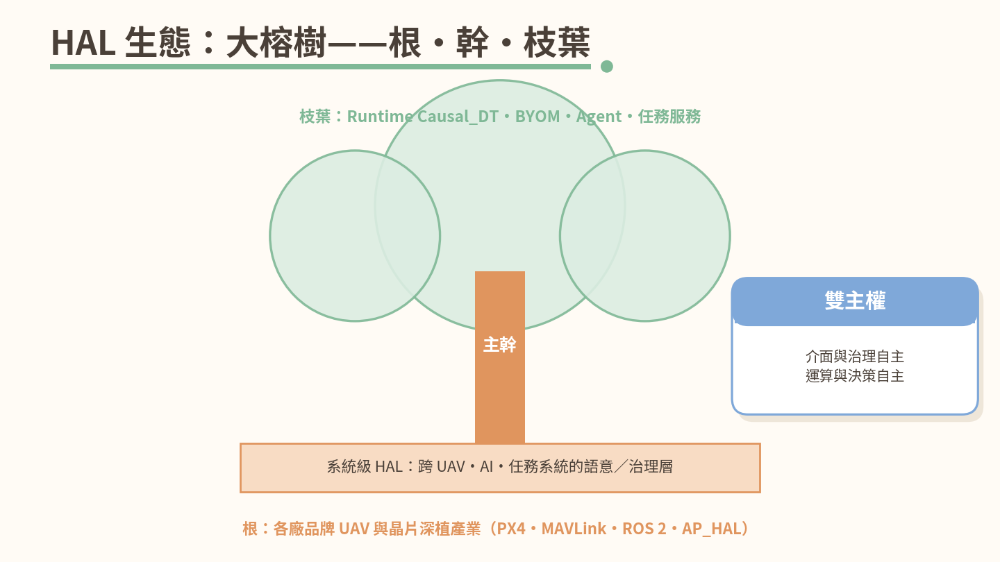

圖 6-6　HAL 生態：大榕樹——根・幹・枝葉

#### 表 6-3　產業角色：開放競爭 × 共用 HAL 協作介面

| **產業角色** | **開放競爭** | **共用 HAL 協作介面** |
| --- | --- | --- |
| UAV 整機廠 | 機體、載重、氣動、可靠度、場景服務 | 能力宣告、任務事件、驗收證據接口 |
| 飛控／機電廠 | 控制律、馬達、電源、ESC、維修能力 | 遙測 Adapter、獨立安全規則與命令映射 |
| 台灣 IC 廠 | RISC-V CPU、AI 加速、功耗／安全設計 | 機載 Causal_DT 推論、BYOM、模型效能量測 |
| AI／軟體廠 | 視覺模型、時序模型、Causal KG、Agent | 可替換推論 API、知識版本與風險事件 |
| 學研單位 | 因果測試、故障注入、資安與測評 | 跨機型一致測試套件、對照實驗及報告 |
| 政府機關 | 場景、服務標準、操作與法遵需求 | 可驗收的安全、可靠度、互通性與可稽核指標 |

> **雙主權**  
> 介面與治理自主——產學業界共同研議公開、版本化、可測試的 HAL 契約及參考實作；運算與決策自主——掌握關鍵運算平台的可替代設計、模型部署、專家知識及失聯安全能力。生態的目標是把「可以共同驗證的底座」標準化，把「應由企業創新的能力」保留開放競爭。  

## 6-7　DT 孵化 IC：從工作負載到晶片規格

第三個目標是讓 DT 成為 IC 設計規格的需求引擎：以共同 HAL 契約串接「UAV 肢體 DT」與「UAV 大腦 DT」——前者產生物理場景與 IMU 感測資料，後者生成可解釋的推理與決策負載——先獲得可重播、可測試、可比較的真實工作負載，再選擇適合的國產 CPU／AI 加速平台，逐步走向產品化 UAV 大腦晶片。

這條路線與 IC 設計大腦的六形產線完全接軌：工作負載庫變成 SpecType 的度量來源，HAL 契約變成 InterfaceType 的對齊基準，負載回放變成 VerifyType 的驗證素材，而每一次架構取捨都記入演化帳——大腦 DT 孵化大腦晶片，本身也是一次「形與函式互相長大」。

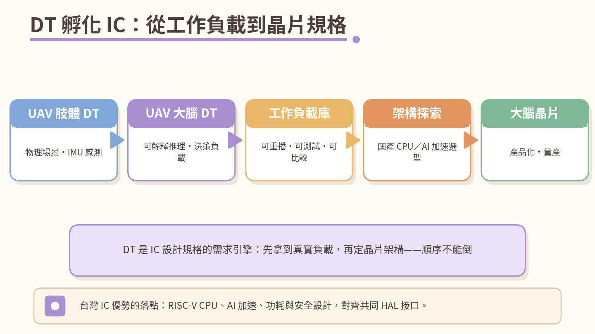

圖 6-7　DT 孵化 IC：從工作負載到晶片規格

> **第六篇小結**  
> 三平台分層守契約，兩庫一中樞一迴路守成長；大腦 IC 與 FCU 分工分離，三守其位斷訊不失序；工作負載鏈是晶片規格的需求引擎；HAL 生態守雙主權；DT 孵化 IC 把整條路連成一條線。  

> **練習　E10–E11（第六篇）**  
> ⑩ E10　誤用辨識：某團隊把「跑道占用」直接寫進 IMU 異常的因果模型，並讓 LLM 直接下達急停指令。指出它踩了表 5-6 的哪幾格，各寫一行改正。  
> ⑪ E11　用 remove 三級為你的大腦晶片構想分級：各寫一個必要件、功能降級件、非必要件，並說明「拿掉的後果」。  

> **【專業專欄 C7】RISC-V 與台灣晶片優勢**  
> RISC-V 的開放指令集（2010 UC Berkeley 起源，2015 轉入基金會）給了後發者一個不付授權費、可自訂擴充的共同起點。台灣在這波浪潮的位置很清楚：完整的设计—製造—封測供應鏈，加上車用與嵌入式累積的功耗、可靠度功力，正是「客製 AI 加速＋安全設計」最需要的組合。  
> 對因果推理 IC 的意義：六站鏈裡的假說排序、反事實加速、三層判斷，都可以做成 RISC-V 向量／自訂指令旁的固定功能加速器——核心指令集走共同標準（生態紅利），因果推理擴充走自主設計（差異化紅利）。介面對齊 HAL，運算自主在手——雙主權在晶片層的具體形狀就是這樣。  

> **【專業專欄 C8】PX4・MAVLink・ROS 2：開放飛控生態一頁史**  
> 2009 年 Pixhawk 開源硬體起步，2012 年 PX4 釋出，2013 年 Dronecode 基金會整合開源飛控社群；MAVLink 通訊協定（2009 起）成為地面站與載具的通用語言，2021 年 MAVLink 2 的簽名機制補上安全課題；ROS 2（2017 起，DDS 骨幹）把機器人世界的開發模式帶進 UAV，ArduPilot AP_HAL 與 ros2_control 則各自立起硬體抽象的標準。  
> 這頁史對本書的啟示只有一條：開放介面層從來不是「把競爭拿掉」，而是「把重複建設拿掉」。HAL 生態的定位是把這條路再往前推一站——從硬體抽象，推到事件、風險、行動與稽核的語意抽象；讓整機廠、IC 廠、AI 廠在共同契約上各自拚命。  

# 第七篇　內容完整方案

方案篇管「怎麼推廣」：學練用教建、八週路線、建庫四階段、PoC 驗收、成熟度與情境選路——讓方法離開這本書，活在你的團隊裡。

## 7-1　學練用教建

把方法推廣出去，靠的是可複製的學習路徑。學——讀懂兩種語言與映射總表；練——E01–E11 逐題過關；用——把八問與六步驟帶進自己的任務；教——用速查卡與可複印模板開工作坊；建——按建庫四階段把自己的形庫與函式庫建起來。每一步都有產出物：不是聽過，是做過。

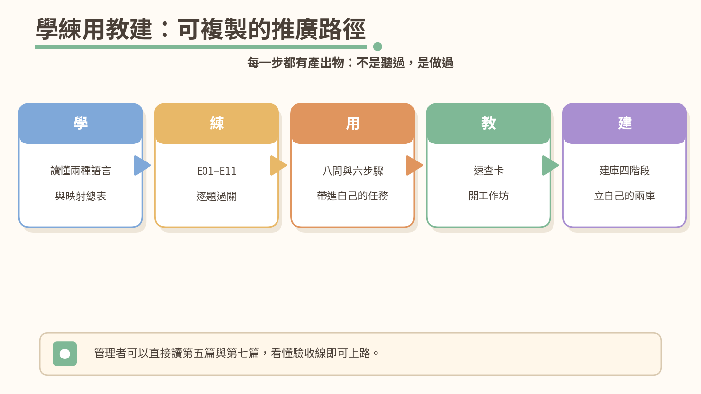

圖 7-1　學練用教建：可複製的推廣路徑

> **半日工作坊設計（可直接照辦）**  
> 開場 30 分鐘：三副眼鏡＋映射總表，讓飛行組與晶片組互相聽懂一個詞；實作 90 分鐘：各組把一個自家異常立成事件形＋四格假說卡；對讀 60 分鐘：兩組交換卡片，用八問互相找茬；收尾 30 分鐘：每人寫一張 B-3 空白模板帶走。產出物清單：事件形卡、假說卡、八問勾選、一張自己的補足清單——工作坊的成敗，看產出物不看投影片。  

## 7-2　八週路線

#### 表 7-1　八週路線：主題與產出

| **週** | **主題** | **練習與產出** |
| --- | --- | --- |
| W1 | 認識形與事件：三副眼鏡疊加 | 把三個自家異常立成事件形 |
| W2 | 三軸與證據 BOM | 為自家事件建證據缺口地圖 |
| W3 | 假說競爭與果因推理 | 四張假說卡＋再檢驗路徑 |
| W4 | What-if 反事實與四問卡 | 寫兩張函式四問卡 |
| W5 | Guard 與三層判斷 | 走一次六步驟全程 |
| W6 | 六種產出形與四層準確性 | 為自家模組立六形工作單 |
| W7 | PoC 三情境演練 | 規劃一個可控擾動實驗 |
| W8 | 建庫與驗收 | 四條驗收線自檢報告 |

情境選路很簡單：初學者從 W1 順走；有工程背景者從 W4 切入，回補 W2–W3；管理者直接讀第五篇與本節，看懂驗收線即可；晶片團隊把 W6 加長一週，把自家產出對齊六形。

## 7-3　建庫四階段

建庫四階段：事件形庫先立（把異常事件格式化）→ 假說庫次建（把專家經驗寫成卡）→ 函式庫再長（把六站流程固化成四問卡）→ 驗收與治理收尾（把八問與四條驗收線變成制度）。順序不可跳：沒有事件形庫，假說庫無的放矢；沒有假說庫，函式庫無準可判。每階段都有驗收物：形庫有格式、假說庫有卡、函式庫有判準、治理有制度。

建庫常見的卡關有三種：事件形庫想一步到位立成完美分類（解法：先格式化、後精化）；假說庫寫成結論庫（解法：四格卡強制留「還不知道」）；函式庫寫成流程文件沒有人調用（解法：每張四問卡必須有實際調用記錄才收檔）。卡關不可怕，卡關不入帳才可怕。

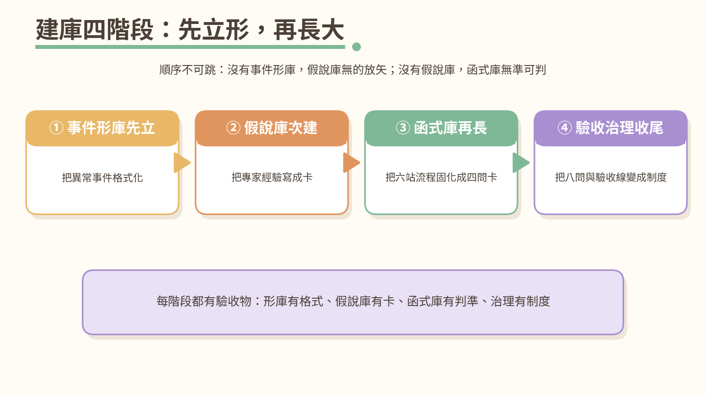

圖 7-2　建庫四階段：先立形，再長大

## 7-4　PoC 驗收與四條驗收線

三個 PoC 是整套方法的驗收場。共同的主驗收指標是：高風險事件偵測提前量、候選故障辨識品質、安全恢復率、錯誤放行次數與端到端延遲——一律以真值標籤和受控擾動核對。值得注意的是 PoC-3 的設計細節：跑道占用先觸發任務狀態改變（語意層），要產生真實 IMU 異常必須另外注入有物理作用的側風或氣流擾動（物理層）——這條正是 3-6 與 M1 的實戰化。

#### 表 7-2　PoC 三情境

| **PoC** | **情境** | **主驗收指標** |
| --- | --- | --- |
| PoC-1 | 降落側風與動力異常的因果分歧（注入橫風、推力衰退、時間偏移及複合故障；比較 Baseline AI、KG-guided Agent 與機載 Causal DT 三組） | 因果辨識品質・錯誤干預次數・避險成功率・解釋可追溯性・偵測提前量・端到端延遲 |
| PoC-2 | 地面通訊中斷與定位品質下降（分測遙控中斷、資料鏈中斷、GNSS 下降及多重故障；驗證機載不依賴地面） | 斷訊後安全恢復率・獨立保護生效率・錯誤放行次數＝0 |
| PoC-3 | 跑道 FSM 與 UAV 任務協同（雙 FSM 描述跑道可用性與降落任務；語意事件與物理注入分層處理） | 任務狀態觸發正確率・層次誤判次數＝0・物理注入可重現性 |

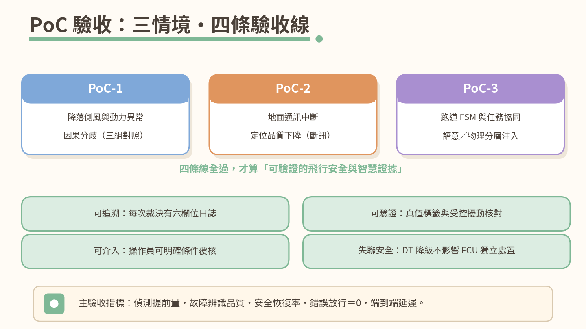

圖 7-3　PoC 驗收：三情境・四條驗收線

> **四條驗收線**  
> 可追溯——每次裁決有六欄位日誌；可驗證——真值標籤與受控擾動核對；可介入——操作員可在明確條件下覆核；失聯安全——DT 降級不影響 FCU 獨立處置。四條線全過，才算「可驗證的飛行安全與智慧證據」。  

> **例　驗收演練日**  
> 斷訊演練的一個下午：14:00 切斷地面站 → 14:02 FCU 進入 failsafe、DT 轉入機載自主 → 14:05 恢復連線、日誌回放比對 → 16:00 四條驗收線逐條簽字。演練的產出不是「感覺安全」，是一疊可以給主管看的欄位。  

## 7-5　成熟度 L1–L4

成熟度不是考評，是導航。L1 形語彙：全組說同一套形語言，六形會寫不會判；L2 形判準：每口形立得出 ∩(T)，判準會立不會追；L3 形證據鏈：產出可回溯、可審計，但靠人推；L4 自我演化：演化帳驅動重構與探索，大腦自己長大。L1→L2 是方法問題，L2→L3 是紀律問題，L3→L4 才是真正的設計大腦。

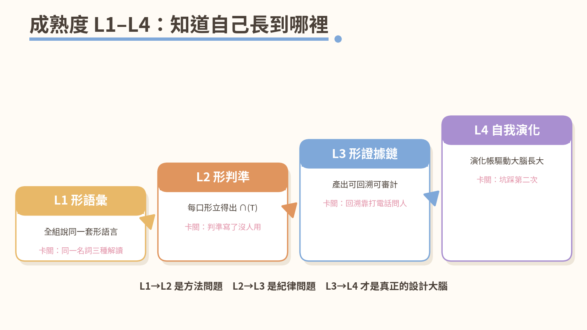

圖 7-4　成熟度 L1–L4：知道自己長到哪裡

#### 表 7-3　成熟度與升級動作

| **等級** | **達標樣子** | **卡關警訊** | **升級動作** |
| --- | --- | --- | --- |
| L1 形語彙 | 文件裡六形名稱統一 | 同一名詞三種解讀 | 辦一次形語彙對齊工作坊 |
| L2 形判準 | 每口形有 ∩(T) 且有人簽收 | 判準寫了沒人用 | 判準簽收制：無簽收不生成 |
| L3 形證據鏈 | 抽查三段產出全部可回溯 | 回溯靠打電話問人 | 演化帳＋鏈上抽查例行化 |
| L4 自我演化 | 新專案自動帶出舊教訓 | 坑踩第二次 | 招式盤×演化帳閉環 |

## 7-6　情境選路：四種讀者

四條路走的是同一座山：只是入口不同，終點都是可複核的準。初學者順走八週打穩形語彙；工程背景者直上方法與驗收；管理者看懂驗收線就可以上路；晶片團隊以第三、四、六篇為主，對齊 IC 設計大腦產線。選好入口，就開始走——最怕的不是走慢，是只收藏不走。

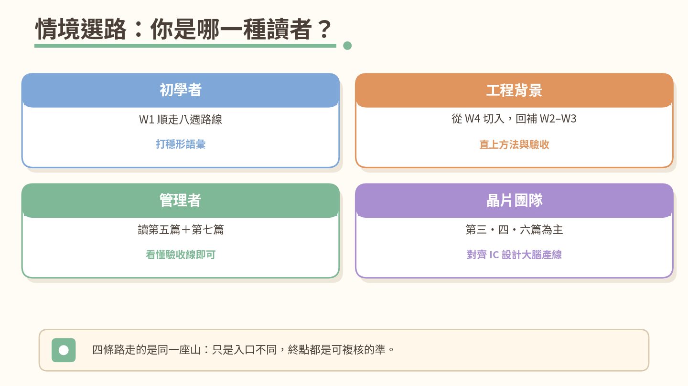

圖 7-5　情境選路：你是哪一種讀者？

> **第七篇小結**  
> 學練用教建是路徑，八週是節奏，建庫四階段是次序，PoC 與四條驗收線是關卡，成熟度是導航，情境選路是入口——內容完整方案的「完整」，指的是從第一課到第一顆晶片，每一步都有產出物。  

> **練習　S01–S03（第七篇與方案）**  
> ⑫ S01　為你的團隊改寫八週路線：標出哪兩週可以合併、哪一週必須加長，說明理由。  
> ⑬ S02　設計一個小型 PoC 驗收方案：寫出情境、注入方式、主驗收指標與四條驗收線的檢查方式。  
> ⑭ S03　用成熟度表自評團隊現況：現在是 L 幾？下一級的「升級動作」是什麼？寫出三個月內做得到的一件事。  

# 結語　三個連續目標

讓台灣優勢的晶片業者「對齊共同接口」，整機廠「對齊共同接口」，雙方鬆耦合——但互通性仍須由版本管理、實作與相容測試共同保證。一起協同實踐三個連續目標：建置機載 Causal_DT，實踐自主決策飛行；制定 HAL，建構 UAV 生態系；打造 UAV 大腦 DT，孵化大腦晶片。

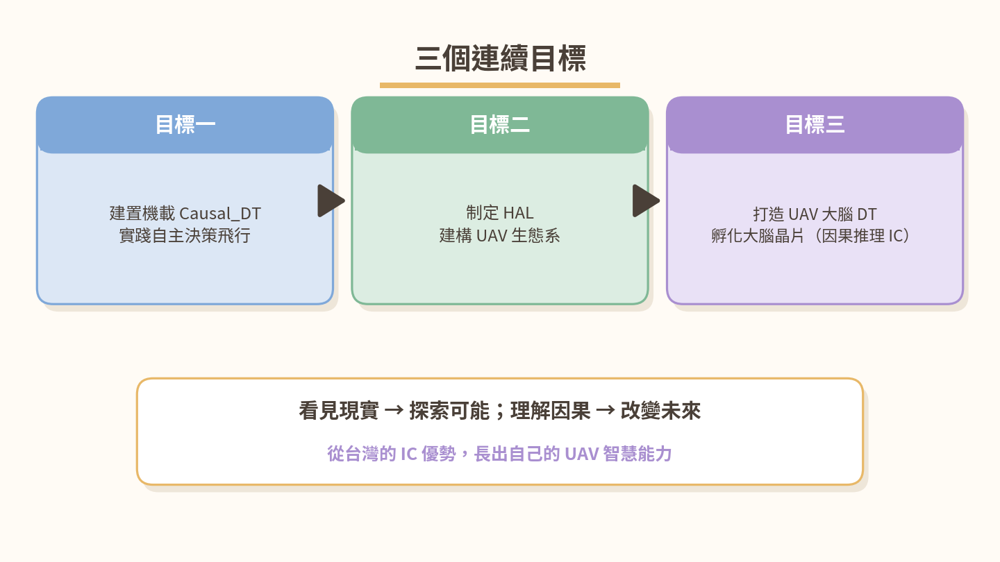

圖 C-1　三個連續目標（全書收束卡）

回到第一篇那句話：Causal_DT 讓我們由看見現實，走向探索可能；由理解因果，走向改變未來。這本冊子把「準確」兩個字拆成了可練的步驟，剩下的事只有一件——按下裁決之前，把八問問完；裁決之後，把日誌寫滿，把證據送回迴路。從台灣的 IC 優勢，長出自己的 UAV 智慧能力——這就是 AI 無人機大腦要走的路。

> **全書終**  
> 看見現實 → 探索可能；理解因果 → 改變未來。先立形、後填數；先立判準、後生成；證據不斷鏈，大腦自己長大。  

# 附錄 A　術語表

#### 表 A-1　術語速查（形＝Type）

| **術語** | **一句話** | **所在篇** |
| --- | --- | --- |
| 形（Type） | 最小描述單位：事件、假說、策略、晶片規格都是形 | 全書 |
| 事件形 | {觀測,(來源),[類別]}：一次異常的單位形 | 3-1 |
| 假說形 | 留有支持・反對・再檢驗三格的候選原因卡 | 3-1 |
| [ ] 屬性 | 維度 × 刻度：風險高低的量尺 | 3-3 |
| { } 組成 | 證據 BOM：必要件・降級件・非必要件 | 3-3・3-4 |
| ( ) 容器 | C=(id(C),S(C))：身份與狀態，入場規則把關 | 3-3 |
| remove 三級 | 拆件三級判等：必要件・功能降級件・非必要件 | 3-4 |
| 三層判斷 | J＝J_C ∧ J_B ∧ J_T：容器・BOM・抽象連立 | 3-5 |
| ∩(T) 歸類 | 交集判準：事件歸入哪個假說、需求掛哪個維度 | 3-5 |
| op：形 → 形 | 函式：輸入一個形，產出一個形 | 4-1 |
| 函式四問卡 | 名稱・輸入形・輸出形・判準 | 4-2 |
| 推理五族 | 統計・果因・因果・模擬・逆向 | 4-3 |
| 形進形出 | 閉環運作：形與函式互相長大 | 4-4 |
| 招式盤 | 時間本形十四招：函式＝方法＝招式 | 4-5 |
| 演化帳 | 教訓、重構與缺口的累積帳 | 4-4 |
| SpecType 規格形 | 可度量、可裁決的規格結構 | 3-2 |
| InterfaceType 介面形 | 模組對外的 port 契約 | 3-2 |
| ModuleType 模組形 | 以 BOM 結構描述的組成形 | 3-2 |
| TimingType 時序形 | 時鐘、幀時序與跨域的動態形 | 3-2 |
| VerifyType 驗證形 | 把判準變成可執行檢查的形 | 3-2 |
| PatternType 模式形 | 帶判準與坑位的可重用設計模式 | 3-2 |
| 三種補足 | [ ] 規則・( ) 身份・{ } 結構 | 5-2 |
| 證明六步驟 | 認明→分軸→形集合→命題→推理→三層檢查 | 5-3 |
| 可複核的準 | 六欄位結構化日誌＋Guard 裁決記錄 | 5-5 |
| 八問 | 重大動作前的八題檢查清單 | 5-6 |
| 兩庫一中樞一迴路 | 形庫・函式庫・Guard 中樞・證據迴路 | 6-2 |
| 三守其位 | 神鷹 DT／HAL Guard／飛控 FCU 各守其位 | 6-4 |
| 工作負載鏈 | 上報→初篩→檢索→What-if→Guard→記錄 | 6-5 |

#### 表 A-2　記號總表（全書記號一頁收齊）

| **記號** | **讀作** | **一句話** |
| --- | --- | --- |
| [ ] | 屬性括號 | 維度 × 刻度：描述一個形的量尺 |
| { } | 組成括號 | BOM 與部件：拆下來認得自己嗎 |
| ( ) | 容器括號 | 身份與狀態：C=(id(C),S(C)) |
| ∩(T) | 交集判準 | 判斷新成員屬不屬於的開放規則 |
| ≡ | 同一 | 形同一：換了外殼，仍是同一個 |
| ≢ | 不同一 | 拆掉即失去同一性（必要件） |
| ⊂ | 降級包含 | 功能降級但身份存續（M′⊂M） |
| ⊕ | 合形 | 把部件合成一個形 |
| σ | 替換 | 換內容保身份：版本更迭不失憶 |
| ι | 嵌套 | 形掛在形之下：層層問得到來歷 |
| op：形 → 形 | 函式 | 時間本形：輸入一個形，產出一個形 |
| J＝J_C∧J_B∧J_T | 三層判斷連立 | 容器・BOM・抽象全過才放行 |

# 附錄 B　速查卡

#### B-1　函式四問卡

| **欄位** | **填寫** |
| --- | --- |
| 名稱 | （函式名，如 What-if 反事實比較） |
| 輸入形 | （進來的形：事件形／假說形＋行動形...） |
| 輸出形 | （出去的形：後果形／策略形...） |
| 判準 | （怎麼算對：真值標籤・核對方式・錯誤放行次數） |

#### B-2　八問勾選

| **○** | **八問** |
| --- | --- |
| ○ | ① 這是什麼形？ |
| ○ | ② 身份是誰？（id・三同） |
| ○ | ③ 三軸說清楚了嗎？ |
| ○ | ④ 判準寫在哪？ |
| ○ | ⑤ 層次對嗎？ |
| ○ | ⑥ 證據夠嗎？缺口呢？ |
| ○ | ⑦ 反事實做過嗎？ |
| ○ | ⑧ 日誌可複核嗎？ |

**B-3　可複印空白模板（建議單獨列印使用）**

（本頁可整頁複印：一張卡＝一次重大動作的裁決記錄）

| **欄位** | **填寫區** |
| --- | --- |
| 事件形 {觀測,(來源),[類別]} |  |
| 候選假說（支持／反對／再檢驗） |  |
| 三軸：[ ] 刻度／{ } BOM／( ) 容器 |  |
| What-if 比較結果 |  |
| 三層判斷 J_C／J_B／J_T |  |
| 八問勾選（○ 通過） | ○①　○②　○③　○④　○⑤　○⑥　○⑦　○⑧ |
| Guard 最終裁決與理由 |  |
| 證據回流：要更新的假說／判準 |  |

**B-4　十問收件清單（晶片側，對照 5-6 八問使用）**

| **#** | **收件前問自己** | **證據在哪** |
| --- | --- | --- |
| 1 | 每口產出形都立了 ∩(T) 嗎？ | 六形工作單 |
| 2 | 判準是在生成之前立的嗎？ | 簽收單日期 |
| 3 | 介面契約表鎖定了嗎？ | port 契約表 |
| 4 | BOM 判準與 remove 分級寫了嗎？ | BOM 清單 |
| 5 | 跨域訊號都有同步橋嗎？ | 跨域清單 |
| 6 | 每個功能單元只做一件事嗎？ | 骨架文件 |
| 7 | 驗證形是 self-checking 嗎？ | 驗證原始碼 |
| 8 | 覆蓋率達標、缺口有處置嗎？ | 覆蓋率報表 |
| 9 | 招式調用與推理步驟有記錄嗎？ | 工作單 |
| 10 | 證據鏈回溯得到需求句嗎？ | 鏈上抽查 |

# 附錄 C　練習參考答案

#### 表 C-1　練習示範答案（要點）

| **題** | **示範答案（要點）** |
| --- | --- |
| E01 | ① 例：候選＝推力不足（查 ESC 電流）、配重改變（查載重紀錄）、風切（查風場時序）；每列各帶一行再檢驗。②「信任誤解為順從」與「失聯無自主」：斷訊時若把 DT 當必要依賴、又未設覆核，兩痛點同時爆發；根源都是假說與判準沒立形。 |
| E02 | ① 證據回流→形進形出閉環・互相長大；風險評估→[ ] 維度×刻度。② 置信 0.7 是長在假說形上的量測（形裡的小形），不是先有數字再找假說；IC 裡它對應的是暫存器上的一個刻度欄位，必須隨假說形一起被判準檢查。 |
| E03 | {GNSS 品質下降觀測,(機載 GNSS 接收機),[導航品質類]}；必要證據：GNSS C/N0 與衛星數；可降級證據：地面站差分改正狀態。 |
| E04 | 前者是系統層因果（鏈路→遙測），後者是判斷層因果（資料→判斷降級）；混寫成一條會踩 M1（層次錯置）與 M4（假說層級錯置）。 |
| E05 | 名稱：觀測函式（Fruit）；輸入形：感測流（IMU／GNSS／ESC 遙測）；輸出形：事件形（含時間戳）；判準：同步檢查通過、資料未過期、觀測重複率低於門檻。 |
| E06 | 統計（先確認離群不是雜訊）→ 果因（列出候選）→ 因果（推干預後果）→ 模擬（What-if 比選）→ 逆向（回溯證據鏈收尾）。 |
| E07 | [ ] 規則補足（入場規則）；補在 ( ) 容器的入場規則書；例：「遙測資料時間戳超過 2 秒者不得作為判斷依據」。 |
| E08 | ③ {電壓下陷觀測,(機載電源遙測),[動力類]}；⑤ 例：電流突增→支持推力不足；單體電芯壓差大→支持電池因素；風場平穩→排除氣流。 |
| E09 | 開放作答。示範：第⑥問「證據夠嗎」最易卡住——遙測常缺風場與模型參數（降級件），應記缺口並降置信。 |
| E10 | 踩 M1（語意事件當物理原因）與 M9/M10（LLM 直接急停＝信任當順從、裁決併入控制）；改正：語意與物理分層注入，LLM 只提假說，急停交 FCU failsafe。 |
| E11 | 示範：必要件＝三層判斷引擎（拿掉後 Guard 無裁決依據）；功能降級件＝風場估計模組（拿掉後置信降級並標示缺口）；非必要件＝除錯追蹤介面（量產版可移除）。 |
| S01 | 開放作答。示範：W3、W4 合併（同屬假說與反事實）；W8 加長為兩週（驗收與治理最需時間）。 |
| S02 | 開放作答。示範要件：情境＝降落側風；注入＝模擬器橫風檔；指標＝提前量・辨識品質・錯誤放行＝0；驗收線各給檢查方式（日誌抽查、真值核對、覆核演練、斷訊測試）。 |
| S03 | 開放作答。示範：自評 L2（判準會立不會追）；升級動作＝判準簽收制；三個月內做得到的一件事＝把每週交件都附上簽收單日期，並抽查三條證據鏈。 |

# 附錄 D　圖表索引

#### 表 D-1　圖索引

| **圖** | **名稱** | **所在** |
| --- | --- | --- |
| 封面 | CAUSAL_DT UAV BRAIN（AI 生成圖像） | 封面 |
| 0-1 | 兩種語言，疊加使用 | 導讀 |
| 0-2 | 全書路線圖 | 導讀 |
| 1-1 | 同一個果，常有不同的因 | 1-2 |
| 1-2 | 五痛點：都是「形沒立好」 | 1-3 |
| 1-3 | 三層定位：根・幹・果 | 1-4 |
| 1-4 | 四位一體 | 1-5 |
| 1-5 | 因果推理 IC：把六站鏈裝進矽 | 1-6 |
| 2-1 | 三鏈疊加 | 2-1 |
| 2-2 | 骨幹速覽：六件形學工具 | 2-2 |
| 2-3 | 映射總表：翻譯橋 | 2-3 |
| 3-1 | 事件形與假說形 | 3-1 |
| 3-2 | 六種產出形 | 3-2 |
| 3-3 | 三軸對讀 | 3-3 |
| 3-4 | remove 三級 | 3-4 |
| 3-5 | 三層判斷漏斗 | 3-5 |
| 3-6 | 層次與身份 | 3-6 |
| 4-1 | 六站鏈硬化為 IC 管線 | 4-1 |
| 4-2 | 函式四問卡 | 4-2 |
| 4-3 | 推理五族接力 | 4-3 |
| 4-4 | 形進形出：閉環才能長大 | 4-4 |
| 4-5 | 各守其位 | 4-6 |
| 5-1 | 體—用—準 | 5-1 |
| 5-2 | 三種補足 | 5-2 |
| 5-3 | 證明六步驟全程 | 5-3 |
| 5-4 | 四層準確性 | 5-4 |
| 5-5 | 結構化日誌 × 形證據鏈 | 5-5 |
| 5-6 | 八問檢查清單 | 5-6 |
| 5-7 | 誤用 16 種 | 5-7 |
| 5-8 | 選路決策樹 | 5-8 |
| 6-1 | 三平台分層 | 6-1 |
| 6-2 | 兩庫一中樞一迴路 | 6-2 |
| 6-3 | UAV 大腦晶片架構 | 6-3 |
| 6-4 | 三守其位 | 6-4 |
| 6-5 | 工作負載鏈 | 6-5 |
| 6-6 | HAL 生態：大榕樹 | 6-6 |
| 6-7 | DT 孵化 IC | 6-7 |
| 7-1 | 學練用教建 | 7-1 |
| 7-2 | 建庫四階段 | 7-3 |
| 7-3 | PoC 驗收 | 7-4 |
| 7-4 | 成熟度 L1–L4 | 7-5 |
| 7-5 | 情境選路 | 7-6 |
| C-1 | 三個連續目標（收束卡） | 結語 |

#### 表 D-2　表索引

| **表** | **名稱** | **所在** |
| --- | --- | --- |
| 0-1 | 本冊地圖 | 寫在前面 |
| 0-2 | 任務地圖 | 寫在前面 |
| 1-1 | 一果多因四候選 | 1-2 |
| 2-1 | 映射總表（十六條） | 2-3 |
| 2-2 | 三個世界的名詞對照 | 2-3 |
| 3-1 | 六種產出形總表 | 3-2 |
| 3-2 | BOM 與 remove 分級示例 | 3-4 |
| 4-1 | 兩張四問卡 | 4-2 |
| 4-2 | 推理五族 × IC 單元 | 4-3 |
| 4-3 | 招式盤十四招落點 | 4-5 |
| 5-1 | 三種補足 | 5-2 |
| 5-2 | 證明六步驟 × IMU 案例 | 5-3 |
| 5-3 | 四層準確性驗收對照 | 5-4 |
| 5-4 | 結構化日誌六欄位 | 5-5 |
| 5-5 | 八問檢查清單 | 5-6 |
| 5-6 | 誤用 16 種 | 5-7 |
| 6-1 | 大腦 IC 與 FCU 區塊對照 | 6-3 |
| 6-2 | 工作負載 × 硬軟分工 | 6-5 |
| 6-3 | 產業角色 | 6-6 |
| 7-1 | 八週路線 | 7-2 |
| 7-2 | PoC 三情境 | 7-4 |
| 7-3 | 成熟度與升級動作 | 7-5 |
| A-1 | 術語表 | 附錄 A |
| B-4 | 十問收件清單 | 附錄 B |
| C-1 | 練習示範答案 | 附錄 C |
| D-1 | 圖索引 | 附錄 D |

# 附錄 E　出處與延伸閱讀

本書是應用專書（約定二）：理論細節以原著為準，方法細節以主素材為準。下列出處按「先自家、後經典、再生態」排序——前三筆是本書的直接素材，其後是值得繼續走的路。

| **出處** | **一句話** | **用在哪** |
| --- | --- | --- |
| 《Mind AI & Causal_DT》 | Causal_DT 方案：六站因果決策鏈與 PoC 設計 | 本書主素材 |
| 《IC 設計大腦》 | 晶片開發平台方法手冊：六形・四層準確性・S1–S7 | 本書主素材 |
| 《本形學》原著（空間本形・時間本形） | 理論基礎：形、判準、推理與招式盤 | 全書骨架（只用不教） |
| 《Mind AI 簡介》 | 底層平台：LLM＋Mind Model 的分工 | 6-1・6-2（只引不述） |
| Pearl, Causality（2000/2009） | 因果階梯：看見→干預→反事實 | 專欄 C1・C4 |
| Pearl & Mackenzie, The Book of Why（2018） | 因果推斷的通俗地圖 | 專欄 C1 |
| RTCA DO-254（2000） | 航太硬體設計保證：可追溯・可驗證 | 專欄 C6 |
| Clarke, Grumberg & Peled, Model Checking（1999） | 形式驗證的教科書 | 專欄 C5 |
| PX4・MAVLink・ROS 2 官方文件 | 開放飛控生態的契約層 | 6-6・專欄 C8 |
| RISC-V International 規格 | 開放指令集與自訂擴充 | 專欄 C7 |
