# AIDrugRDBrain

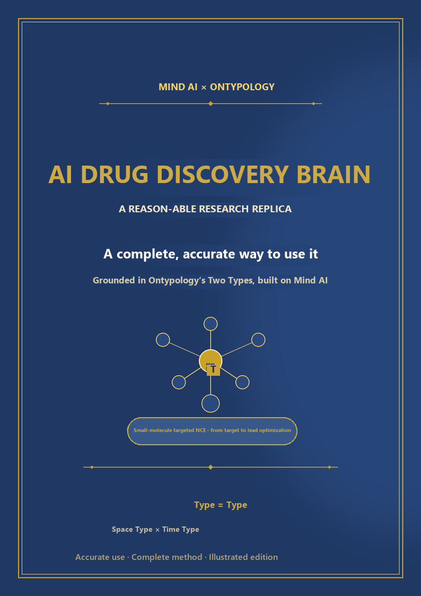

## Table of Contents

- **Before we begin: three conventions and the demonstration declaration3**
- **Guided reading: two languages and three ways of reading4**
- **Chapter 1　Understanding the AI Drug R&D Brain6**
  - 1.1 A Reasonable R&D Twin: Type + Number6
  - 1.2 The Two Types Land in Drug R&D7
  - 1.3 The Four Sets of the Move Tray and Where the Fourteen Moves Land7
  - 1.4 The Mind AI Division of Labour and the Four Gates8
  - 1.5 Four Scenes of Inaccurate Output9
- **Chapter 2　Six Output Types: Target, Hit, SAR, Optimise, Verdict, Evolution10**
  - 2.1 Six Types at a Glance: the Output Chain from Target to PCC10
  - 2.2 Target Type TargetType11
  - 2.3 Hit Type HitType12
  - 2.4 SAR Type SARType12
  - 2.5 Optimize Type OptimizeType13
  - 2.6 Verdict Type VerdictType14
  - 2.7 Evolution Type EvolutionType14
- **Chapter 3　Four-Layer Accuracy Assurance16**
  - 3.1 Layer One: the Intersection Criterion ∩(T)16
  - 3.2 Layer Two: Deriving the Deductive Skeleton17
  - 3.3 Layer Three: the Three-Piece Set of Experimental Validation17
  - 3.4 Layer Four: the Six Stations of the Type Evidence Chain18
  - 3.5 Space × Time Cross-Acceptance19
- **Chapter 4　Six Steps and Move Selection21**
  - 4.1 Four Framework Steps: Identifying the R&D Situation21
  - 4.2 Six-Step Operation Card22
  - 4.3 Three-Layer Judgement: Is, Has, Right22
  - 4.4 Selecting, Assembling, Swapping Moves and Misuse Warnings23
- **Chapter 5　S1–S7 and Full Output Examples25**
  - 5.1 Seven-Stage Relay: the S1–S7 Pipeline25
  - 5.2 Full Text of Prompts S1–S7 26
  - 5.3 Case, Part One: Target Type and Hit Type27
  - 5.4 Case, Part Two: SAR Type and Optimize Type28
  - 5.5 Case, Part Three: Verdict Type and Evolution Type28
- **Chapter 6　Misuse Comparison and Maturity31**
  - 6.1 Five Misuses31
  - 6.2 A Ten-Question Checklist32
  - 6.3 Maturity L1–L432
  - 6.4 The Ninety-Day Adoption Blueprint33
- **Review: three takeaways33**
- **Appendix A　Toolbox35**

## Before we begin: three conventions and the demonstration declaration

This is a "usable" book. It answers only one question: when a team hands drug R&D to the AI drug R&D brain, how can every output - target card, hit card, SAR table, optimisation plan, verdict document, evolution ledger - be accurate, checkable, and reproducible.

This book takes the Space Type and Time Type of Ontypology as its theoretical basis and Mind AI as its underlying platform, focusing on the R&D scenario of small-molecule targeted new drugs, from target discovery to lead optimisation. The theory itself is not restated here and the platform itself is not introduced here - they are only used. Before starting, establish three conventions.

> **Convention one: the English word for Type is Type**  
> The English for "Type" is always Type, never Form: TargetType, HitType and the rest are all Types. When you see Type in documents, prompts, or field cards, it refers to the "Type" of Ontypology.  

> **Convention two: the theory is used, not taught**  
> This book uses the three brackets [ ] { } ( ), the intersection criterion ∩(T), the identity anchor id(C), the three levels of remove, the four framework steps, the three-layer judgement, and the fourteen-move tray directly, without arguing again why they hold. For the principles, return to the original Ontypology texts; this book's responsibility is to "use them correctly".  

> **Convention three: the platform is cited, not restated**  
> This book takes Mind AI as its underlying platform: the LLM handles induction and generation in the language layer, the Mind Model handles reasoning in the criteria, deduction, and evolution layers. The platform's architecture and implementation are outside the scope of this book - this book only tells you how to make the output accurate while standing on the platform.  

> **Demonstration declaration**  
> The compound codes (DX series), activity and pharmacokinetic data, and criteria values in the cases of this book are demonstrative, used to illustrate the method, and do not point to any real drug or clinical decision; for any real R&D, follow the experimental data and regulatory requirements. This book involves no system implementation.  

**Table 0-1 Task map: eight stations, take what you need**

| **Station** | **Topic (deliberately worded differently from the chapter title)** | **What you will get** |
| --- | --- | --- |
| Chapter 1 (understanding the system) | Why a drug R&D brain is needed | The worldview and division of labour of a reasonable R&D twin |
| Chapter 2 (output Types) | The six-Type relay of target, hit, SAR, optimise, verdict, evolution | Six output-Type field cards and the three-bracket breakdown |
| Chapter 3 (the four accuracy gates) | How the four gates of accuracy operate | Criteria, derivation, validation, evidence chain |
| Chapter 4 (six steps) | Operating flow and move selection | Four framework steps, operation card, three-layer judgement |
| Chapter 5 (prompts and case) | The S1 to S7 seven-stage relay and a full demonstration | Full prompt text + DX series output examples |
| Chapter 6 (misuse and upgrade) | Control check and the maturity path | Misuse table, ten questions, L1 to L4 blueprint |
| Review (closing) | Three takeaways | A one-page review chart and a summary table of key points |
| Appendix A (quick reference) | Terminology, moves, notation | Three quick-reference tables |

## Guided reading: two languages and three ways of reading

Only two languages meet in the body of this book: the "Type" language of Ontypology and the "on-site" language of drug R&D. Once you understand their correspondence, the remaining five chapters are only elaboration.

**Table D-1 Two languages compared**

| **The language of Ontypology (tools)** | **The language of drug R&D (on site)** |
| --- | --- |
| Type | Target, molecule, series, verdict - anything can be established as a Type |
| Property [ ] (abstract set) | The scales of activity, selectivity, druggability, and ADMET |
| Composition { } (composition set) | Scaffold to functional group to atom: the dependency structure |
| Container ( ) (container set) | R&D programme to compound series to the space of a single molecule |
| Intersection criterion ∩(T) | Pass lines and veto lines of the four gates: the generation rule of qualified output |
| Identity anchor id(C) | The stable identity of molecule and series: renamed or re-versioned, it still recognises itself |
| Moves (Time Type) | Methods of search, reasoning, design, learning, and evolution |
| Evolution ledger | Each round's record, attribution, and plan for the next round |

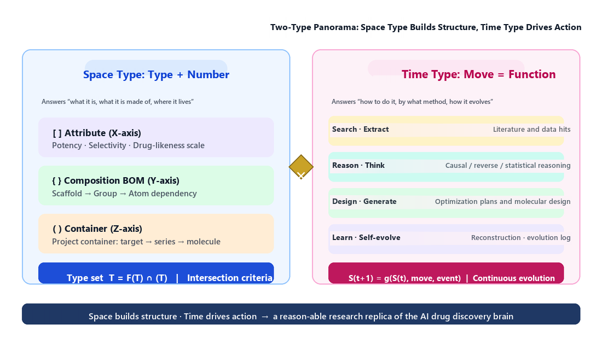

**Figure D-1 Panorama of the two Types: the Space Type establishes structure, the Time Type establishes action**

**Table D-2 Three ways of reading**

| **Reader** | **How to read it** | **Where to stop reading** |
| --- | --- | --- |
| Decision maker | Guided reading, the orientation chapter, and the misuse and maturity chapter | Know what this brain can give you |
| R&D director | Add a reading of the output-Type chapter and the four-gate accuracy chapter | Can establish Types, can accept, can run a review meeting |
| Executing colleague | Read the whole book straight through; copy the prompt chapter | Start directly at S1 to S7 |

## Chapter 1　Understanding the AI Drug R&D Brain

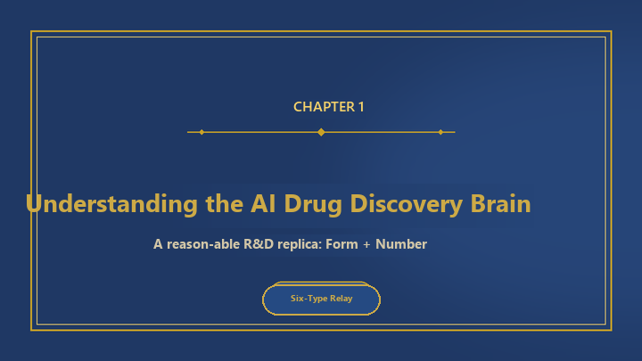

**The reasonable drug R&D twin: Type + Number**

The most expensive thing in drug R&D is not a compound but a decision made with no idea why: why is this hit worth pursuing? Why should this lead be changed this way? Why dare to send this candidate to the next gate? The reason the AI drug R&D brain exists is to establish the R&D site as a reasonable twin, so that every output can say "what it is, on what grounds, and how it came about".

### 1.1 A Reasonable R&D Twin: Type + Number

A twin is not a database. A database answers "how much"; a twin must also answer "what it is" - that is Type + Number: Type writes structure, composition, container, and criteria; Number writes the values of activity, property, and relationships. Only when an R&D programme is established as Type + Number can AI ask "what it is" before it opens its mouth and produce evidence before it draws a conclusion.

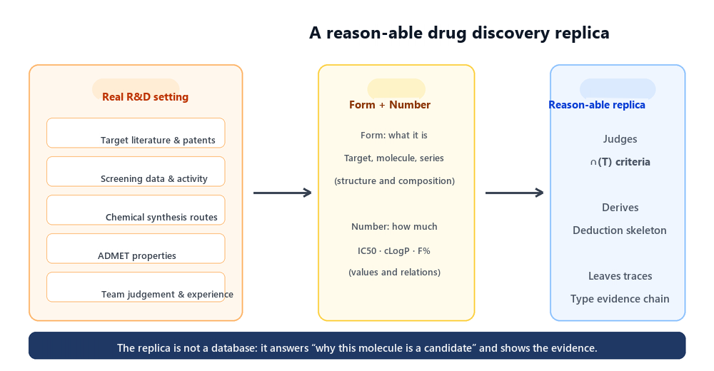

**Figure 1-1 A reasonable drug R&D twin**

> **Example: the Type and Number of DX-201**  
> Type: it is a member of the "phenylpyrimidine series" under the "fourth-generation EGFR inhibitor programme" container, and the scaffold is a pyrimidine-aniline bicyclic.  
> Number: EGFR T790M/C797S IC50 = 2.4 μM, LE = 0.31, cLogP = 2.8.  
> Only when both sides are put together is the Type "established" - report only numbers and nobody can catch the next round.  

### 1.2 The Two Types Land in Drug R&D

The Space Type answers "what it is, what it is made of, where it lives": the property [ ] is the scale axis of activity and druggability, the composition { } is the dependency axis from scaffold to atom, the container ( ) is the spatial axis from programme to molecule. The Time Type answers "how it is done, how it evolves": search, reasoning, design, and learning are all moves, written into the evolution ledger round after round. Where the two Types meet is where R&D decisions happen.

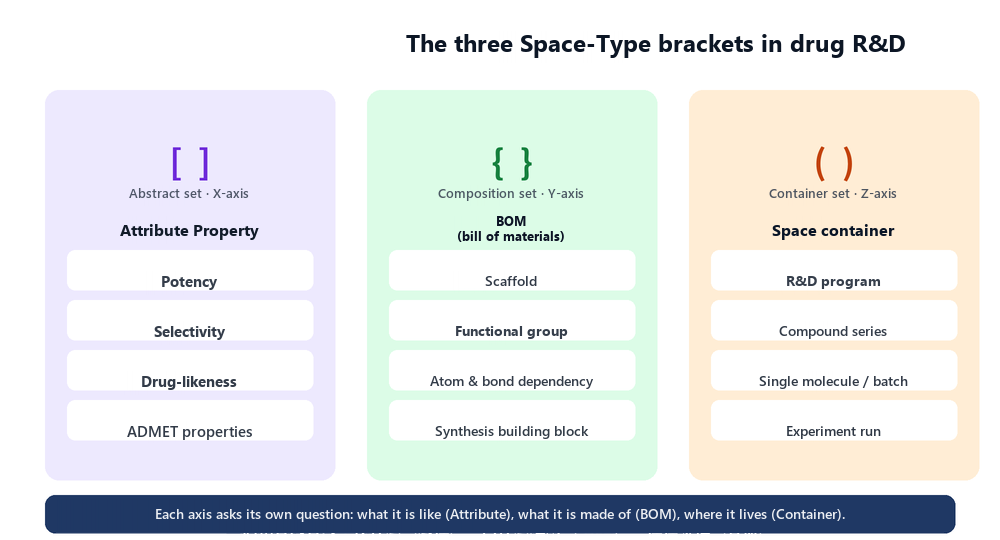

**Figure 1-2 The three brackets of the Space Type land in drug R&D**

**Table 1-2 Where the three Space brackets land**

| **Bracket** | **Ontypology tools** | **Where it lands in drug R&D** |
| --- | --- | --- |
| [ ] Property | Abstract set, X axis | The scale card of activity, selectivity, druggability, and ADMET |
| { } Composition | BOM composition set, Y axis | Scaffold, functional group, atoms, and synthesis building blocks |
| ( ) Container | Container set, Z axis | R&D programme to compound series to single-molecule batch |
| ∩(T) criterion | Intersection criterion | Four-gate pass lines: activity / selectivity / druggability / ADME |
| id(C) anchor | Identity anchoring | Renamed or series-upgraded, it still recognises itself |

### 1.3 The Four Sets of the Move Tray and Where the Fourteen Moves Land

The fourteen moves of the Time Type fall into four sets: search and extraction, reasoning and thinking, design and generation, learning and evolution. Every step of R&D selects a move - target exploration uses search and extraction, SAR explanation uses causal reasoning, molecular design uses design patterns, and each round's closing uses self-evolution. A move is a verb and the output is a noun; pick the right verb first and the noun will be accurate.

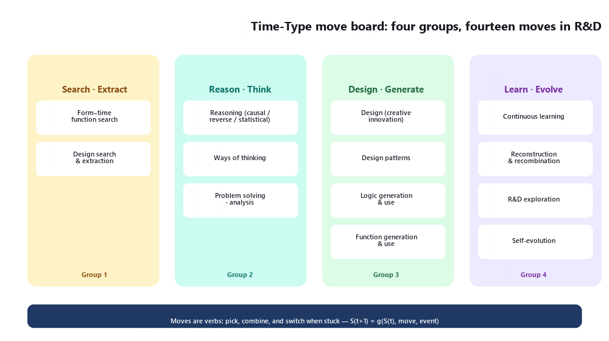

**Figure 1-3 The four sets and fourteen moves of the Time Type move tray**

**Table 1-3 Where the fourteen moves land in drug R&D**

| **Set** | **Move** | **Where it lands in R&D** | **Output verb** |
| --- | --- | --- | --- |
| One | Type-time function search | Hits from literature, patents, databases | Find: who has solved this problem |
| One | Design search and extraction | Virtual library screening, fragment screening | Screen: which molecules have a chance |
| Two | Reasoning (causal, reverse, statistical) | SAR attribution, metabolic site inference | Explain: why the activity changed |
| Two | Thinking methods | Look at the skeleton with first principles, look at failure in reverse | Think: look from another angle |
| Two | Problem solving | Untying conflicting parameters | Disassemble: which knot to untie first |
| Two | Analysis | Binding mode, ADMET alert analysis | Analyse: what the data is saying |
| Three | Design (creation and innovation) | An entirely new scaffold and design of modification sites | Create: what the next round's molecule looks like |
| Three | Design patterns | Bioisostere and prodrug strategies applied | Set: mature plays used directly |
| Three | Logic generation and application | Retrosynthetic reasoning, route feasibility | Derive: can this molecule be made |
| Three | Function generation and application | Generative molecular design, property optimisation | Generate: give me a batch of new candidates |
| Four | Continuous learning | Each round's data feed back into the criteria | Learn: criteria grow with the data |
| Four | Refactoring and recombination | Scaffold hopping, fragment recombination | Restart: escape the local optimum |
| Four | R&D and exploration | Exploration of new targets and new indications | Explore: where the next battlefield is |
| Four | Self-evolution | Evolution ledger to next round's plan | Optimise: mistakes never overnight, the next round more accurate |

### 1.4 The Mind AI Division of Labour and the Four Gates

The division of labour at the base is simple: the LLM excels at inductive statistics in the language layer - literature extraction, hypothesis generation, report writing; the Mind Model excels at deductive reasoning in the criteria layer - ∩(T) verdicts, skeleton derivation, remove counterfactuals, id(C) anchoring. Language to the LLM, criteria to the Mind Model; neither crosses the line, and only then is accuracy grounded.

**Table 1-4 The Mind AI division of labour**

| **Work** | **LLM (language layer)** | **Mind Model (criteria layer)** |
| --- | --- | --- |
| Knowledge | Literature extraction, abstract, translation | Field-based Type and three-bracket modelling |
| Reasoning | Inductive statistics, hypothesis generation | Deductive derivation, causal verdict |
| Output | Description, report, prompt | Criteria enforcement, evidence-chain verification |
| Memory | Conversation context | Evolution ledger, identity anchor, criteria version |

**Table 1-5 Preview of the four gates**

| **Gate** | **One sentence** | **Who guards it** |
| --- | --- | --- |
| First layer | Whether it qualifies is decided by the criteria | The four-gate funnel of the intersection criterion ∩(T) |
| Second layer | Whether it can be derived is decided by the skeleton | Deductive skeleton: premise, rule, prediction |
| Third layer | Whether it is real is decided by the experiment | The three-piece set: activity, ADMET, safety window |
| Fourth layer | Whether it can be found out is decided by the evidence | The six stations of the Type evidence chain |

### 1.5 Four Scenes of Inaccurate Output

An accurate method grows out of inaccurate scenes. R&D output is usually untrustworthy because it falls into four scenes - the four gates later in this book are the countermeasures to these four scenes, one by one.

**Table 1-1 Four scenes of inaccurate output**

| **Scene** | **Symptom** | **Countermeasure (chapter of this book)** |
| --- | --- | --- |
| The Type is not established | Molecules and series are recognised by nickname, and renaming loses the memory | Six-Type field cards + id(C) (Chapter 2) |
| Derivation break | Jumping from "chemical intuition" to a conclusion, with no way to reproduce it | The three-piece set of the deductive skeleton (Chapter 3) |
| Validation drifts | Reporting only the best run, with the raw data missing | The three-piece set of experimental validation (Chapter 3) |
| Review amnesia | Falling into the same pit once a quarter | Evolution ledger (Chapter 5) |

> **Chapter focus**  
> A reasonable twin = Type + Number: Type writes "what it is", Number writes "how much"; neither may be missing.  
> Where the two Types land: the three Space brackets establish structure, the fourteen moves establish action, and the evolution ledger turns mistakes into assets.  
> Iron rule of the division of labour: language to the LLM, criteria to the Mind Model; the four gates are the trailer for accuracy.  

## Chapter 2　Six Output Types: Target, Hit, SAR, Optimise, Verdict, Evolution

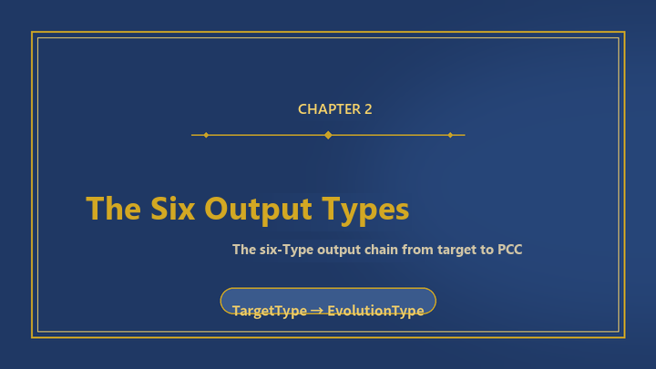

**The six-Type output chain from target to PCC**

An R&D team produces many documents every day, but only six outputs actually drive decisions: Target Type, Hit Type, SAR Type, Optimize Type, Verdict Type, Evolution Type - remembered as "target, hit, SAR, optimise, verdict, evolution". Six Types in relay, each with a field card, criteria, and evidence; miss one and the chain breaks.

### 2.1 Six Types at a Glance: the Output Chain from Target to PCC

The six Types relay along the R&D timeline: the Target Type answers "what to attack", the Hit Type "what was found", the SAR Type "what the relationship is", the Optimize Type "what to change", the Verdict Type "does it work", and the Evolution Type "what to change next round". The first three belong to discovery and the last three to optimisation - the boundary of this book is the PCC (drug candidate) verdict and no further.

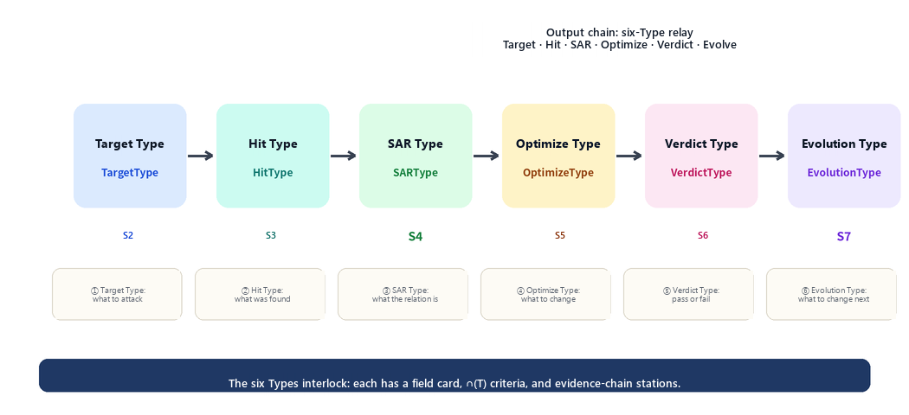

**Figure 2-1 The output chain: six Types in relay**

**Table 2-1 The six Types at a glance**

| **Output Type** | **English** | **One sentence** | **Criteria focus** |
| --- | --- | --- | --- |
| Target Type | （TargetType） | What to attack: building the target and indication card | Target evidence, druggability |
| Hit Type | （HitType） | What was found: building the hits-and-screening card | Activity threshold, reproducibility |
| SAR Type | （SARType） | What is the relationship: building the change-to-consequence card | The rule holds, derivability |
| Optimize Type | （OptimizeType） | What to change: building the multi-parameter plan card | Six axes never regress, synthetically feasible |
| Verdict Type | （VerdictType） | Does it work: building the PCC verdict card | All four gates passed, no break points in the chain |
| Evolution Type | （EvolutionType） | What to change next round: building the evolution ledger card | Attribution holds, plan executable |

**Table 2-8 Three levels of remove x compounds: recognise itself after disassembly**

| **Grade** | **What to disassemble** | **Judgement and consequence** |
| --- | --- | --- |
| Level one: key part | Pharmacophore (hydrogen-bond donor and acceptor) | Removing it zeroes the activity - remove(p1, DX-288) is not equal to DX-288 |
| Level two: scaffold dependency | Core scaffold | Take away the scaffold and the series identity (id(C)) changes - it is a new series, not a new molecule |
| Level three: decorative part | Solubility-modifying group | Removing it lowers the property but identity is unchanged - a new molecule in the same series |

### 2.2 Target Type TargetType

The Target Type is the anchor of the whole chain. It writes "what to attack" as a Type: target name, target variant, indication, mechanism, criteria, and evidence source. If the Target Type is not established, the remaining five Types build on sand.

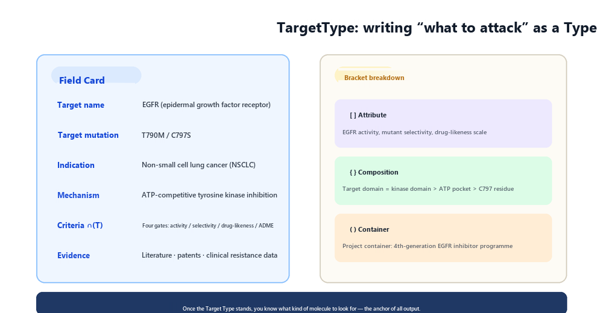

**Figure 2-2 Target Type field card**

**Table 2-2 Target Type (TargetType) field card**

| **Field** | **What to fill in** | **Criteria** |
| --- | --- | --- |
| Target name | EGFR (epidermal growth factor receptor) | Standard naming, alias comparison |
| Target variant | T790M / C797S cis double mutation | The variant distribution has clinical evidence |
| Indication | Non-small cell lung cancer (NSCLC) | Indication compatible with the mechanism |
| Mechanism | ATP-competitive tyrosine kinase inhibition | The binding mode can be verified structurally |
| Criteria ∩(T) | Four gates: activity / selectivity / druggability / ADME | Set first, use after; any change of line leaves a trace |
| Evidence source | Literature, patents, clinical resistance data | Traceable, with timestamps |

### 2.3 Hit Type HitType

The Hit Type writes "what was found" as a Type: the structure, activity, how it was found, and the reproduction record of the hit molecule. The greatest taboo of the Hit Type is "reporting only the IC50" - the screening path, the controls, and the replication count decide whether this hit is a lead or noise.

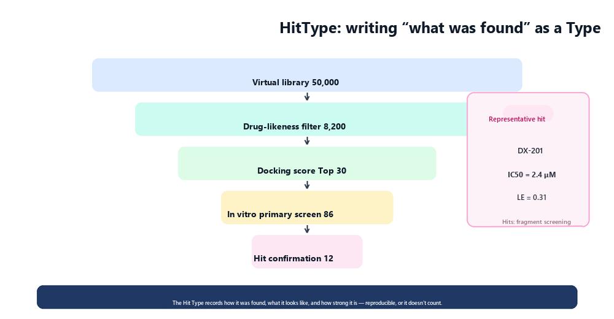

**Figure 2-3 Hit screening funnel**

**Table 2-3 Hit Type (HitType) field card**

| **Field** | **What to fill in** | **Criteria** |
| --- | --- | --- |
| Hit molecule | DX-201 (phenylpyrimidine bicyclic) | Structure confirmed, purity >= 95% |
| How it was found | Fragment screen | The screening path is reproducible |
| Initial activity | IC50 = 2.4 μM (mutant) | n = 3・R² ≥ 0.9 |
| Ligand efficiency | LE = 0.31 | Only LE >= 0.3 may be shortlisted |
| Initial selectivity value | WT/mutant = 18 | A trend is enough; fill it in during optimisation |
| Exclude noise | PAINS negative, no aggregation | Noise exclusion complete |

### 2.4 SAR Type SARType

The SAR Type writes "the relationship" as a Type: what was changed, by how much, and because of what. The SAR table is not a report card but a derivable causal record - every column must be able to answer "what happens if it is changed back" (remove counterfactual), and every row must connect to the derivation skeleton.

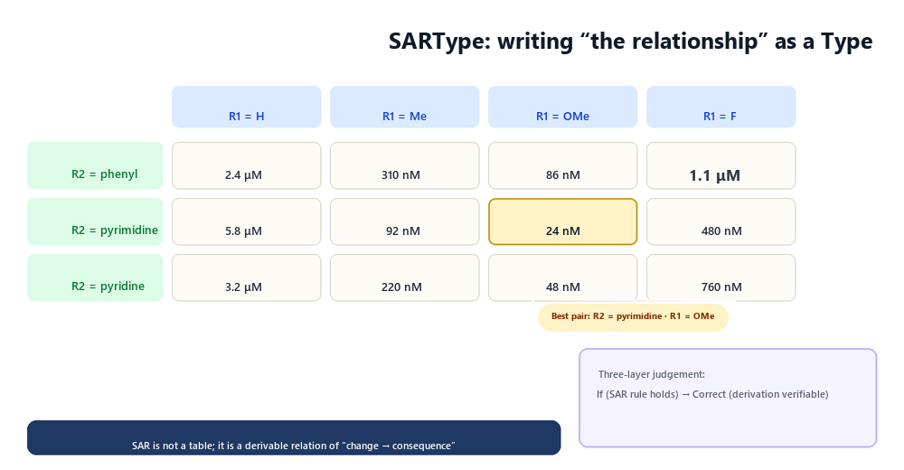

**Figure 2-4 SAR matrix: the activity comparison of R1 x R2**

**Table 2-4 SAR Type (SARType) field card**

| **Field** | **What to fill in** | **Criteria** |
| --- | --- | --- |
| Control axis | R1 = H/Me/OMe/F, R2 = phenyl/pyrimidine/pyridine | Move only one position at a time |
| Effect description | R1=OMe raises electron density and affinity; R2=pyrimidine forms a second hydrogen bond | The mechanism explanation is verifiable |
| Counterfactual | R1 back to H: activity falls back to the micromolar level (one of the three levels of remove) | Recognise itself after disassembly |
| Derivation prediction | R2=pyrimidine + R1=OMe estimated at 20-30 nM | Prediction first, measurement after |
| Measured correction | Measured 24 nM (DX-268) | Differences recorded in the evolution ledger |

### 2.5 Optimize Type OptimizeType

The Optimize Type writes "what to change" as a Type: around multi-parameter optimisation (MPO), it lists the knobs to move this round, the constraints, and the expectations. The bottom line of the Optimize Type is that the six axes never regress - activity gains must not be traded against metabolism, safety, or solubility.

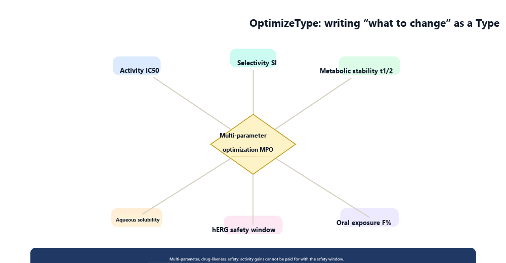

**Figure 2-5 Multi-parameter optimisation: all six axes together**

**Table 2-5 Optimize Type (OptimizeType) field card**

| **Field** | **What to fill in** | **Criteria** |
| --- | --- | --- |
| This round's goal | Metabolic stability: microsomal t1/2 from 18 to >= 20 min | Quantifiable target |
| Constraints not moved | Activity kept <= 30 nM, SI >= 50 | Six axes never regress |
| Design knobs | Metabolic site blocking + minor polar group adjustment | Synthetically feasible (<= 5 steps) |
| Expected interval | IC50 10–25 nM・t1/2 25–45 min | Prediction first, with a tolerance interval |
| Exit conditions | Two rounds without progress, so change the scaffold (refactoring move) | Move-swap conditions written in advance |

### 2.6 Verdict Type VerdictType

The Verdict Type writes "does it work" as a Type: the four gates judged item by item, the evidence chain checked, the conclusion and sign-off. The Verdict Type is an external document - it writes only "pass" and "fail" plus evidence, not mood.

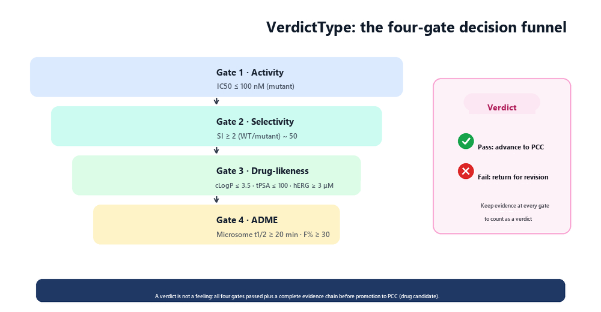

**Figure 2-6 The four-gate verdict funnel**

**Table 2-6 Verdict Type (VerdictType) field card**

| **Field** | **What to fill in** | **Criteria** |
| --- | --- | --- |
| Verdict subject | DX-288 (output of Optimize Type round 3) | Identity anchor id(C) matches |
| Four-gate results | Activity check / selectivity check / druggability check / ADME check | Item by item with data, no bundling |
| Evidence chain | All six stations connected (establish Types to archive) | A broken chain means rollback; no verdict may be given |
| Conclusion | Holds: upgrade to PCC | The conclusion can only be one of three: upgrade, return, shelve |
| Sign-off | R&D lead, date, criteria version | Person, time, and version: all three present |

### 2.7 Evolution Type EvolutionType

The Evolution Type writes "what to change next round" as a Type: what was changed this round, how much the result differed, what the attribution is, and what to do next round. The evolution ledger is a letter to the next round's self - without accounts, mistakes become habits; with accounts, mistakes become criteria.

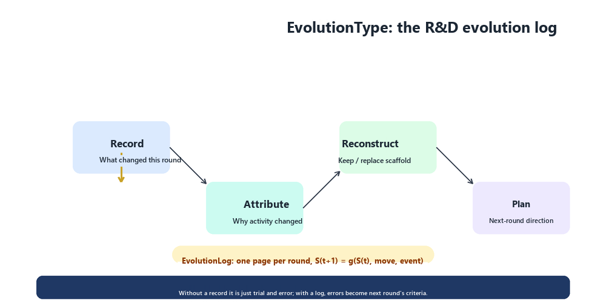

**Figure 2-7 The evolution ledger cycle: record, attribute, refactor, plan**

**Table 2-7 Evolution Type (EvolutionType) field card**

| **Field** | **What to fill in** | **Criteria** |
| --- | --- | --- |
| This round's changes | DX-268 to DX-288: block the 3-position metabolic site | Lines up with the Optimize Type goal |
| Result change | t1/2 18→42 min・IC50 24→12 nM | Speak with data, do not pick the pretty ones |
| Attribution hypothesis | The metabolic soft spot is blocked and clearance falls | The attribution can be tested in the next round |
| Criteria update | "Exposed 3-position = metabolic soft spot" enters the criteria library | Learning lands in the criteria, not in the head |
| Next round's plan | Advance IND development: toxicology and formulation planning | Plan executable, with a schedule |

> **Chapter focus**  
> The six Types "target, hit, SAR, optimise, verdict, evolution" are the minimal complete set of R&D output - one field card per Type, and the fields on the card are the entry points of the criteria.  
> The three levels of remove let a molecule "recognise itself after disassembly": the key part defines activity, the scaffold defines identity, the decoration defines property.  
> The Verdict Type writes only evidence and the evolution ledger writes only facts and attributions - these two closing documents determine the starting point of the next round.  

## Chapter 3　Four-Layer Accuracy Assurance

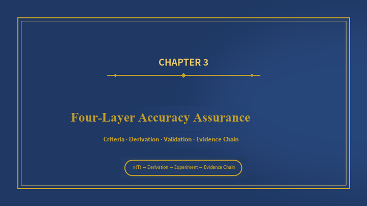

**Criteria, derivation, validation, evidence chain**

"Accurate" cannot rely on feeling; it must rely on gates. The four gates take turns: the intersection criterion governs qualification, the deductive skeleton governs reasoning, experimental validation governs reality, the Type evidence chain governs audit; finally Space × Time cross-acceptance performs the overall check. Only when all four layers pass is the output called accurate.

### 3.1 Layer One: the Intersection Criterion ∩(T)

∩(T) is the intersection of Type and Type: a molecule must both be "a Type of this series" and pass all criteria to count as qualified output. The criteria are divided into four gates - activity, selectivity, druggability, ADME - set first and used afterwards; to change a line, a trace must be left.

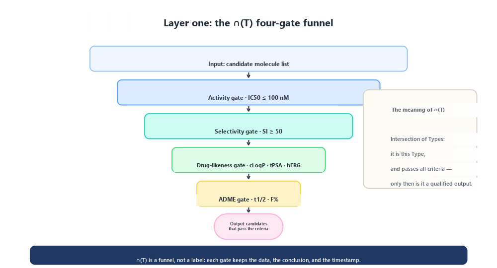

**Figure 3-1 The four-gate funnel of the intersection criterion**

**Table 3-1 The four-gate criteria (DX case version)**

| **Gate** | **Measurement** | **Pass line** | **Veto line** |
| --- | --- | --- | --- |
| Activity gate | IC50（EGFR T790M/C797S） | ≤ 100 nM | > 300 nM: reject outright |
| Selectivity gate | SI = IC50(WT) / IC50(mutant) | ≥ 50 | < 20: reject outright |
| Druggability gate | cLogP・tPSA・hERG | ≤ 3.5・≤ 100・≥ 3 μM | Any red line means reject |
| ADME gate | Microsomal t1/2, oral F% | ≥ 20 min・≥ 30% | t1/2 < 10 min: reject |

### 3.2 Layer Two: Deriving the Deductive Skeleton

The second layer governs reasoning: every prediction must complete the three-piece set "premise, rule, prediction" before it may land as a conclusion. The LLM induces a hypothesis, the Mind Model derives a prediction and a tolerance interval; once the measurement arrives, correction is made and the difference is written into the evolution ledger. Conclusions that skip steps are stopped right here.

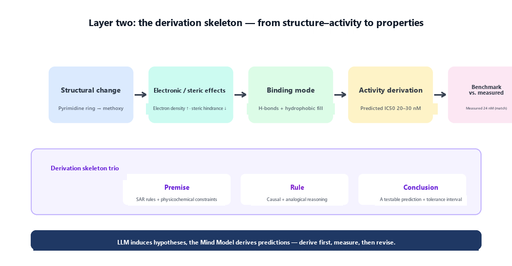

**Figure 3-2 The deductive skeleton: from structural change to measured comparison**

**Table 3-2 Example of deductive skeleton derivation (DX-268 to DX-288)**

| **Step** | **Content** |
| --- | --- |
| Premise | DX-268 has activity of 24 nM, but human liver microsomal t1/2 is only 18 min - the ADME gate is not passed |
| Rule | Causal reasoning: the exposed 3-position of the phenyl ring is a metabolic soft spot; reverse reasoning: blocking the soft spot usually extends t1/2 |
| Prediction | After blocking, t1/2 is estimated at 25-45 min and IC50 stays in the 10-30 nM range |
| Measured | DX-288: t1/2 = 42 min, IC50 = 12 nM (both within the predicted interval) |
| Correction | Activity better than the lower prediction bound - the "blocking or affinity-enhancing" hypothesis enters the evolution ledger pending verification |

### 3.3 Layer Three: the Three-Piece Set of Experimental Validation

The third layer governs reality: activity, ADMET, safety window - the three-piece set, each with controls, replication, and statistics. The derivation says "it should be 24 nM", the experiment answers "it really is 24 nM" - where the difference lies must also be recorded.

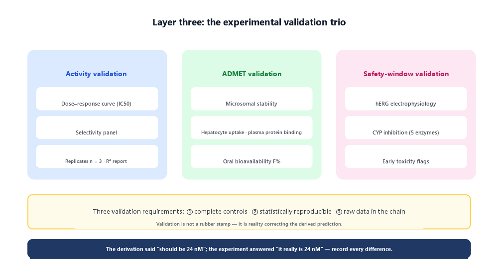

**Figure 3-3 The three-piece set of experimental validation**

**Table 3-3 The validation three-piece set and DX-288 measurements**

| **Kit** | **Item** | **Standard** | **DX-288 measured** |
| --- | --- | --- | --- |
| Activity | Dose-response IC50 (mutant) | ≤ 100 nM・n = 3・R² ≥ 0.9 | 12 nM（R² = 0.99） |
| Activity | Selectivity panel (WT control) | SI ≥ 50 | SI = 118（WT 1.42 μM） |
| ADMET | Human liver microsomal t1/2 | ≥ 20 min | 42 min |
| ADMET | Oral bioavailability (mouse) | F ≥ 30% | 48% |
| Safety window | hERG IC50 | ≥ 3 μM | 8.6 μM |
| Safety window | CYP inhibition (five enzymes) | IC50 ≥ 10 μM | All five enzymes >= 10 μM |

### 3.4 Layer Four: the Six Stations of the Type Evidence Chain

The fourth layer governs audit: establishing the Types, output, derivation, validation, verdict, archiving - each of the six stations keeps three things: a field snapshot, the numerical evidence, and a timestamp. If any station's chain breaks, the output may not enter the next round; a broken chain means rollback and evidence reinforcement, with no exceptions.

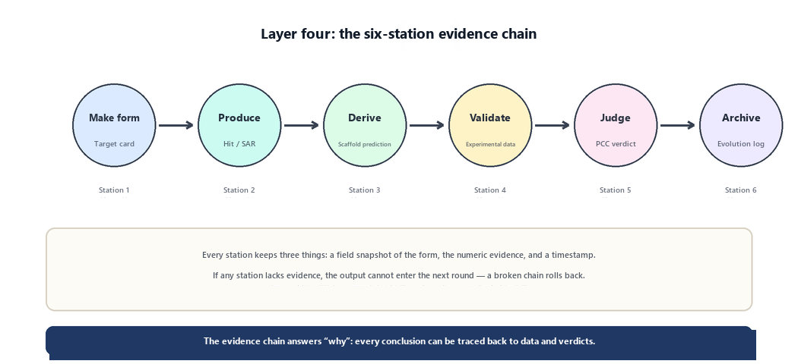

**Figure 3-4 The six stations of the Type evidence chain**

**Table 3-4 The six stations' duties and the consequences of a broken chain**

| **Station** | **What to keep** | **Consequence of a broken chain** |
| --- | --- | --- |
| 1 Establish the Types | Target card snapshot + criteria version | Output without an anchor, return to the situation and re-establish |
| 2 Output | Field card + raw data | Not reproducible: void and rerun |
| 3 Derivation | Premise, rule, prediction + tolerance interval | Skipped-step conclusion, return and fill in the derivation |
| 4 Validation | Raw curves, spectra, statistics | No raw file, no verdict |
| 5 Verdict | Four-gate results + the three sign-off elements | No sign-off means no verdict |
| 6 Archive | Evolution ledger page + criteria changes | Not archiving means this round was wasted |

### 3.5 Space × Time Cross-Acceptance

The final overall check: the three Space questions (Types complete, numbers trustworthy, chain traceable) x the three Time questions (moves aligned, derivation complete, evolution leaves a trace); only when all six pass is it released. Space says "what it is", Time says "how it comes about" - only when both sides match does accuracy hold.

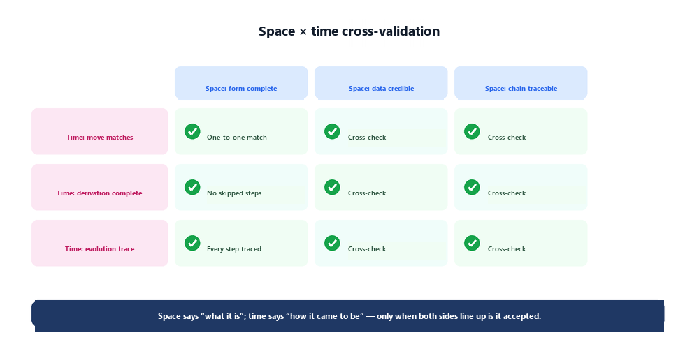

**Figure 3-5 Space x Time cross-acceptance**

**Table 3-5 The six cross-acceptance questions**

| **Aspect** | **Acceptance question** | **Pass standard** |
| --- | --- | --- |
| Space: Types complete | Are there any gaps in the six-Type fields? | Fields complete, no "to be completed" wording |
| Space: numbers trustworthy | Is there a raw file behind the number? | n >= 3, statistically qualified, raw file retrievable |
| Space: chain traceable | Can the conclusion be traced back to the evidence? | Each of the six stations can be opened |
| Time, moves aligned | Does the move used match the situation? | The move-selection record matches the situation |
| Time, derivation complete | Are there any skipped-step conclusions? | Premise, rule, and prediction: all three present |
| Time, evolution leaves a trace | Has this round entered the evolution ledger? | One page per round, attribution has a name |

> **Chapter focus**  
> Each of the four gates governs one thing: criteria govern qualification, the skeleton governs reasoning, experiment governs reality, the evidence chain governs audit - the order cannot be swapped.  
> The three-piece derivation "premise, rule, prediction" is the home ground of the Mind Model; a prediction must carry a tolerance interval, and a measurement must be corrected.  
> The six cross-acceptance questions are the last self-questioning before release - only when all six pass does the output leave this brain.  

## Chapter 4　Six Steps and Move Selection

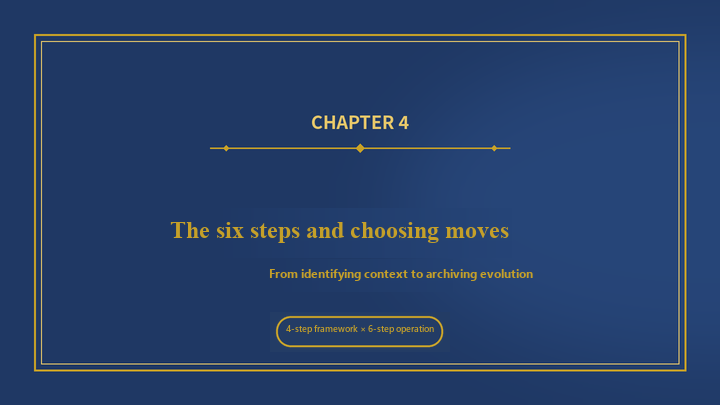

**From identifying the situation to archiving the evolution**

A methodology only counts if it can start work. This chapter provides a process that can be followed: first use the four framework steps to identify the R&D situation, then run the six steps from situation to evolution ledger; along the way use the three-layer judgement for control and selecting, assembling, and swapping moves to deploy the Time Type.

### 4.1 Four Framework Steps: Identifying the R&D Situation

The four framework steps are the four questions before starting work: establish the container, characterise the property, break down the composition, set the criteria. Start before these four are answered and every later step asks the wrong question.

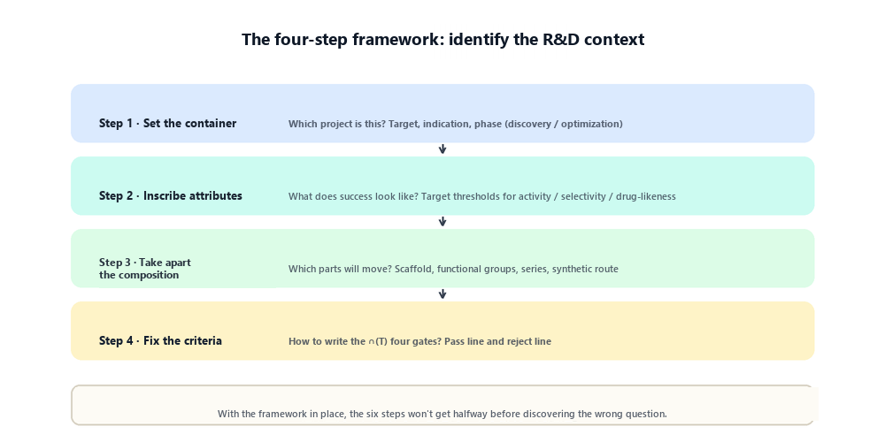

**Figure 4-1 The four framework steps**

**Table 4-1 The four framework steps x the DX case**

| **Step** | **Question** | **The answer of the DX case** |
| --- | --- | --- |
| Establish the container | Which programme and which stage is this? | Fourth-generation EGFR inhibitor (NSCLC), discovery to optimisation |
| Characterise the property | What does success look like? | Four-gate pass lines: activity / selectivity / druggability / ADME |
| Break down the composition | Which parts are to be moved? | R2 core, R1 substituent, 3-position metabolic soft spot |
| Set the criteria | How are pass and fail judged? | Four ∩(T) gates + veto lines + rules for tracing any change of line |

### 4.2 Six-Step Operation Card

With the framework standing, the six steps relay: identify the situation, build Types by axis, select the expansion pattern, generate the output, criteria acceptance, archive and evolve. Each step has an operation card - action, output, and commonly used moves written clearly, so a newcomer can go live by following the card.

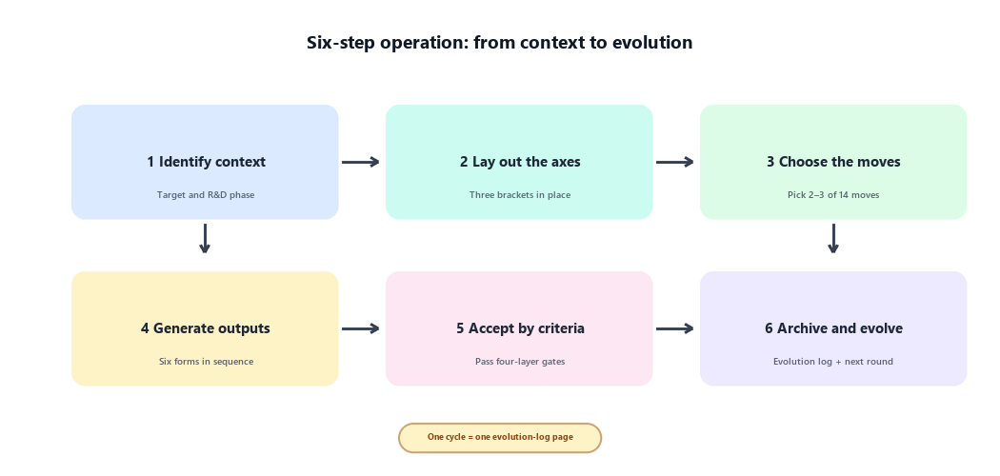

**Figure 4-2 Six steps: one cycle per round**

**Table 4-2 The six-step operation card**

| **Step** | **Action** | **Output** | **Commonly used moves** |
| --- | --- | --- | --- |
| 1 Identify the situation | Read the container and stage, align with the success picture | Situation card | Problem solving, analysis |
| 2 Build Types by Axis | The three brackets in their places; the six Types on the skeleton | Six-Type field card skeleton | Design patterns |
| 3 Select the Expansion Pattern | Pick two or three of the fourteen moves and write the exit conditions | Move selection sheet | Thinking methods |
| 4 Generate the Output | Fill the output according to the field card and add the data | Six-Type first draft | Search, reasoning, generation |
| 5 Criteria Acceptance | Four-gate verdict + the six cross-acceptance questions | Verdict document | Causal and reverse reasoning |
| 6 Archive and Evolve | One page per round, criteria changes enter the library | Evolution ledger page | Continuous learning, self-evolution |

### 4.3 Three-Layer Judgement: Is, Has, Right

Before picking up the pen for any output, pass the three-layer judgement: the first layer, container judgement, asks "is" - does it belong to this series and programme (id(C) anchoring); the second layer, structure judgement, asks "has" - is the part dependency complete (three levels of remove); the third layer, rule judgement, asks "right" - does it meet ∩(T) and the analogy rule. The order cannot be reversed: first "is", then "has", then "right".

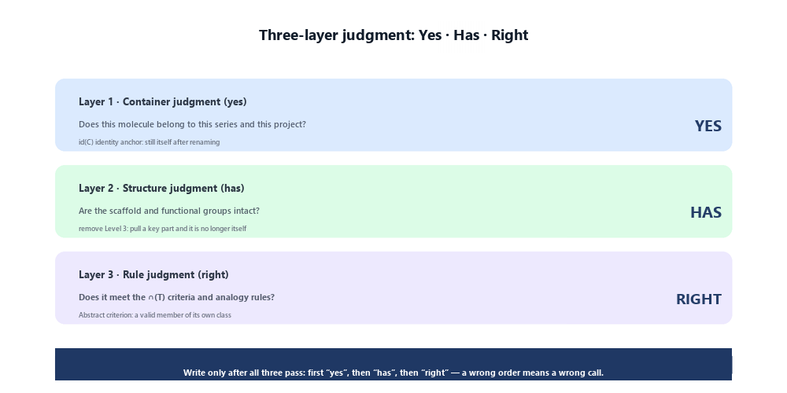

**Figure 4-3 Three-layer judgement: is, has, right**

> **Example: the three-layer judgement on DX-288**  
> Is: id(C) matches the DX-268 series (same container, same scaffold lineage) - identity holds.  
> Yes: the pharmacophore and the core are both present, and the blocking group is third-level decoration - the structure holds.  
> Right: all four gates pass + the analogy rule "pyrimidine with R1=OMe is superior" is supported by measurement - the rule holds.  

### 4.4 Selecting, Assembling, Swapping Moves and Misuse Warnings

You need not use all fourteen moves - choosing the right two or three is more effective than deploying twelve. Select moves by situation, assemble moves by relay, swap moves by signal: when data contradicts the derivation, change the reasoning; two rounds without progress, change the search domain; criteria failing repeatedly, return to the framework.

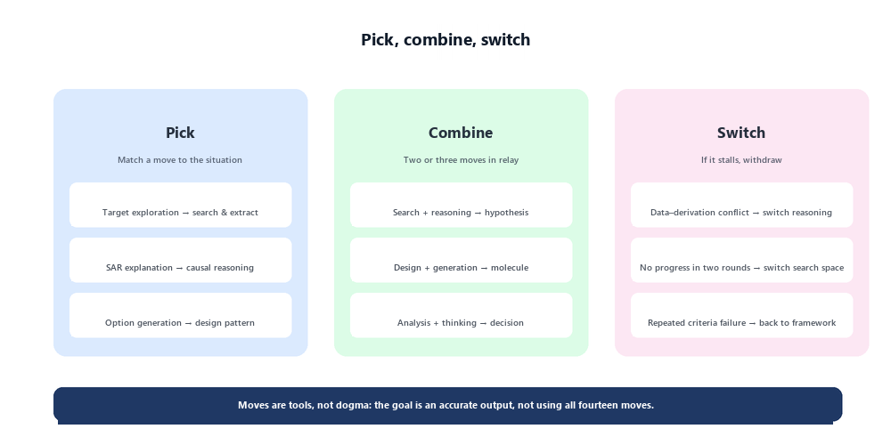

**Figure 4-4 Selecting, assembling, swapping moves**

**Table 4-3 Selecting, assembling, swapping moves**

| **Situation** | **Selecting moves** | **Assembling moves** | **Move-swap conditions** |
| --- | --- | --- | --- |
| Initial target exploration | Search and extraction | + analysis, target card | Too few hits, so expand the search domain |
| SAR ranking | Causal reasoning | + statistical reasoning, SAR Type | Correlation taken as causation, so add a counterfactual |
| Activity stuck | Design (creation and innovation) | + generation, a new batch of molecules | Two rounds without progress, so refactor the scaffold |
| ADME fails | Reverse reasoning | + design patterns, modification plan | Three revisions fail, so change the chemical space |
| Verdict dispute | First-principles thinking | + problem solving, re-evaluate the criteria | Changing a criteria line must leave a trace |

**Table 4-4 Six-step misuse warning points**

| **Step** | **Warning point** | **Alert** |
| --- | --- | --- |
| Identify the situation | Starting before the container is established | The six Types each go their own way and do not line up |
| Build Types by axis | Writing the three brackets into one column | Criteria with no entry point |
| Select the expansion pattern | Deploying twelve moves at once | Noise in the output exceeds the signal |
| Generate the output | Conclusion first, derivation patched later | The evidence chain grows backwards |
| Criteria acceptance | If it cannot pass, change the line | Criteria versions change frequently |
| Archive and evolve | Reviews rely on impressions | Stepping into the same pit repeatedly |

> **Chapter focus**  
> The four framework steps answer four questions first, then the six steps start - asking the right question matters more than running fast.  
> The three-layer judgement "is, has, right" is the last self-check before picking up the pen, and the order cannot be reversed.  
> Moves are tools, not dogma: pick two or three, write the exit conditions, and swap if it does not work - the goal is accurate output.  

## Chapter 5　S1–S7 and Full Output Examples

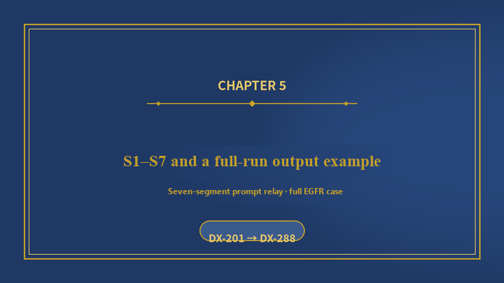

**Seven-stage relay, full DX series demonstration**

This chapter gives two things you can take away directly: how to write the seven prompts, and the full output of one small-molecule targeted new drug case. The case unfolds along the DX series - from the hit DX-201 to the PCC candidate DX-288 - and the output of every Type comes with example data that are self-consistent and can be checked cell by cell.

### 5.1 Seven-Stage Relay: the S1–S7 Pipeline

The seven-stage relay maps to the six steps and the six Types: S1 identifies the situation and produces the situation card, S2 to S7 produce the Target Type, Hit Type, SAR Type, Optimize Type, Verdict Type, and Evolution Type in order. Each stage's output is the next stage's input; if the previous stage has not passed, the next does not start.

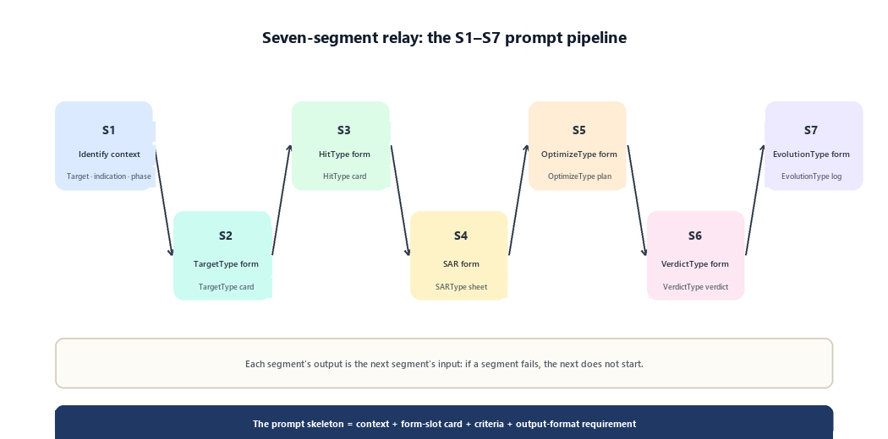

**Figure 5-1 The S1-S7 seven-stage pipeline**

**Table 5-1 The duties and pass conditions of S1–S7**

| **Stage** | **Input** | **Output** | **Pass conditions** |
| --- | --- | --- | --- |
| S1 | Programme background | Situation card | Container, success picture, uncertainty: all three present |
| S2 | Situation card | Target Type card | Six fields complete, four-gate criteria in shape |
| S3 | Target Type | Hit Type card | Screening path reproducible, noise excluded |
| S4 | Hit Type | SAR Type table | Causal chain + counterfactual + prediction interval |
| S5 | SAR Type | Optimisation plan | Quantifiable target, clear exit conditions |
| S6 | Optimisation output | Verdict document | Four gates item by item, six stations checked, sign-off complete |
| S7 | Verdict document | Evolution ledger page | Attribution has a name, plan executable |

### 5.2 Full Text of Prompts S1–S7

The following seven prompts can be copied and used directly. The common skeleton is the four-piece set: role, input, requirements, output format; the common discipline is "never write a number that is not supported by evidence".

> **S1: identify the situation (situation card)**  
> You are a drug R&D planner. Produce a "situation card" from the following information.  
> Input: target = EGFR; indication = non-small cell lung cancer; stage = discovery to optimisation (pre-PCC).  
> Requirements: (1) state the container position: programme, series, molecule;  
> (2) Write out the four dimensions of the success picture (activity / selectivity / druggability / ADME);  
> (3) List the three uncertainties of this stage.  
> Output as bullet points; do not write numbers unsupported by evidence; explicitly mark unknown items as "to be completed".  

> **S2: Target Type (TargetType)**  
> Continue the situation card and produce the Target Type field card.  
> Fields: target name, target variant, indication, mechanism, criteria ∩(T), evidence source.  
> Requirements: (1) write the criteria as four gates (activity / selectivity / druggability / ADME), each with a pass line and a veto line;  
> (2) Every column carries an evidence source and timestamp; (3) unknown fields are explicitly marked "to be completed" and may not be left blank.  

> **S3: Hit Type (HitType)**  
> Produce the Hit Type field card.  
> (1) Screening path: virtual library, drug-like filter, docking, in vitro primary screen, with counts at each stage;  
> (2) Representative hit: structure description, IC50, LE, how it was found, noise-exclusion record;  
> (3) Break down the hit with the three brackets (property / composition / container);  
> (4) Data are annotated with n and R2; numbers without a raw file may not be written.  

> **S4: SAR Type (SARType)**  
> Produce the SAR Type.  
> (1) List the control axes R1/R2 and the activity matrix (move only one position at a time);  
> (2) For the best combination, write the "change to effect" causal chain: premise, rule, prediction;  
> (3) Write one remove counterfactual: what happens if the key part is taken away;  
> (4) Predict the next round's numerical interval, explicitly stating "prediction first, measurement after".  

> **S5: Optimize Type (OptimizeType)**  
> Produce the Optimize Type plan for this round.  
> (1) This round's goal (quantifiable); (2) the axes locked and not moved (six axes never regress);  
> (3) Design two or three knobs, with synthesis feasibility (no more than five steps);  
> (4) Expected interval and exit conditions;  
> (5) Select moves: pick two or three of the fourteen and write the reasons and the move-swap conditions.  

> **S6: Verdict Type (VerdictType)**  
> Produce the verdict document.  
> (1) Verdict subject and id(C); (2) the four gates judged item by item: pass or fail plus data, no bundling;  
> (3) Check the six stations of the evidence chain one by one; (4) one of three conclusions: upgrade to PCC, return for revision, or shelve;  
> (5) Sign-off field: person, time, criteria version.  
> Throughout, write only evidence, not mood.  

> **S7: Evolution Type (EvolutionType)**  
> Produce the evolution ledger page.  
> (1) This round's change and the resulting change (with data); (2) attribution hypothesis + a testable approach;  
> (3) Changes to the criteria library; (4) the next round's plan and move-swap conditions;  
> (5) One sentence to the next round's self.  

### 5.3 Case, Part One: Target Type and Hit Type

Case background: a fourth-generation EGFR inhibitor programme, whose goal is to overcome the T790M/C797S cis double mutation that drives resistance to third-generation drugs, while sparing the wild type (WT) to reduce rash and diarrhoea toxicity. The data below are demonstrative, used to illustrate the output format and self-consistency.

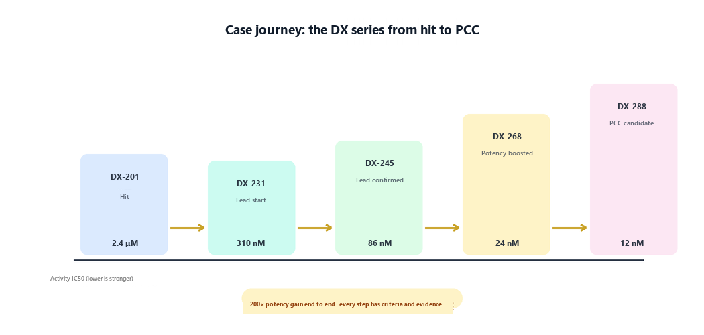

**Figure 5-2 Case journey: the DX series from hit to PCC**

**Table 5-2 Example target card output (S2)**

| **Field** | **Content** |
| --- | --- |
| Target name | EGFR (HER1/ErbB1, tyrosine kinase receptor) |
| Target variant | T790M / C797S cis double mutation (the main cause of resistance to third-generation drugs) |
| Indication | Non-small cell lung cancer (NSCLC) resistant population |
| Mechanism | ATP-competitive inhibition; mutant selectivity required, sparing WT |
| Criteria ∩(T) | Pass lines and veto lines of the four gates (per Table 3-1, version v1.2) |
| Evidence source | Literature, patents, clinical resistance data (demonstration, with timestamps) |

**Table 5-3 Example hit card output (S3)**

| **Field** | **Content** |
| --- | --- |
| Screening path | Virtual library 50,000, drug-like filter 8,200, docking 640, in vitro 86, confirmation 12 |
| Representative hit | DX-201: phenylpyrimidine bicyclic amide (found by fragment screening) |
| Initial activity | IC50 = 2.4 μM（n = 3，R² = 0.98）；pIC50 = 5.62 |
| Ligand efficiency | LE = 0.31 (>= 0.3 to be shortlisted) |
| Noise exclusion | PAINS negative, no aggregation, no fluorescence interference |
| The three brackets dismantled | [ ] micromolar activity, soluble; { } bicyclic + amide bond; ( ) fourth-generation programme container |

### 5.4 Case, Part Two: SAR Type and Optimize Type

The SAR stage advances with the R1 x R2 dual-axis comparison: electron-donating R1 groups raise affinity, and changing R2 to pyrimidine forms a second hydrogen bond. The activity matrix is shown in Table 5-4 - the best combination R2=pyrimidine + R1=OMe measures 24 nM (DX-268), matching the predicted interval of 20-30 nM.

**Table 5-4 SAR matrix (IC50, mean of n = 3)**

| **R1＼R2** | **Phenyl** | **Pyrimidine** | **Pyridine** |
| --- | --- | --- | --- |
| H | 2.4 μM（DX-201） | 5.8 μM | 3.2 μM |
| Me | 310 nM（DX-231） | 92 nM | 220 nM |
| OMe | 86 nM（DX-245） | 24 nM（DX-268） | 48 nM（DX-277） |
| F | 1.1 μM | 480 nM | 760 nM |

The optimisation stage follows: DX-268 has beautiful activity but a microsomal t1/2 of only 18 min, so the ADME gate is not passed. Following the deductive skeleton (Table 3-2), block the 3-position metabolic soft spot of the phenyl ring to obtain DX-288 - all six axes meet the target.

**Table 5-5 Optimisation milestones (summary of S5 output)**

| **Molecule** | **What was changed** | **IC50** | **SI** | **Microsomal t1/2** | **Determination** |
| --- | --- | --- | --- | --- | --- |
| DX-245 | R1=OMe affinity modification | 86 nM | 62 | 26 min | Lead established |
| DX-268 | R2=pyrimidine second hydrogen bond | 24 nM | 85 | 18 min | ADME fails |
| DX-288 | 3 Block the 3-position metabolic soft spot | 12 nM | 118 | 42 min | All four gates passed |

### 5.5 Case, Part Three: Verdict Type and Evolution Type

After three optimisation rounds, enter the verdict. The verdict document lists evidence gate by gate - no bundling, no mood; the evolution ledger records this round's changes, attributions, and criteria changes as the starting point for preclinical development.

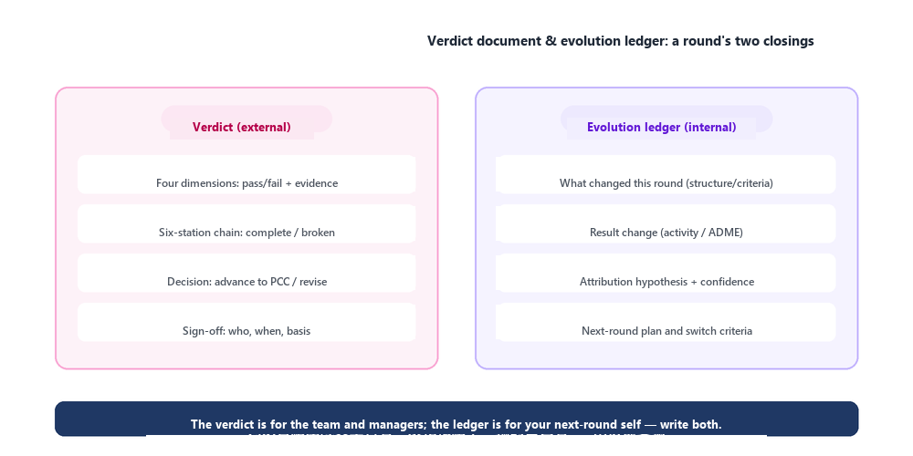

**Figure 5-3 Verdict document and evolution ledger: the two closings of a round**

**Table 5-6 Example PCC verdict document output (S6)**

| **Item** | **Content** |
| --- | --- |
| Verdict subject | DX-288 (id(C): an upgrade within the DX-268 series) |
| Activity gate | IC50 = 12 nM <= 100 nM, passed (R2 = 0.99) |
| Selectivity gate | SI = 118 >= 50, passed (WT IC50 = 1.42 μM) |
| Druggability gate | cLogP 3.1, tPSA 92, hERG 8.6 μM, passed |
| ADME gate | Microsomal t1/2 = 42 min, mouse F = 48%, passed |
| Pharmacophore check | Mouse tumour model TGI = 85% (30 mg/kg QD x 14 days, demonstration) |
| Evidence chain | All six stations connected: establish Types, output, derivation, validation, verdict, archive |
| Conclusion | Holds: upgrade to PCC (drug candidate) |
| Sign-off | R&D lead, criteria version v1.2, date (demonstration) |

**Table 5-7 Example evolution ledger output (S7)**

| **Field** | **Content** |
| --- | --- |
| This round's changes | DX-268 to DX-288: introduce a methyl block at the 3-position of the phenyl ring (move only one position at a time) |
| Result change | t1/2 18→42 min・IC50 24→12 nM・hERG 4.1→8.6 μM |
| Attribution hypothesis | Blocking the metabolic soft spot lowers clearance (verifiable by identifying microsomal metabolites) |
| Criteria update | New rule "exposed 3-position = metabolic soft spot" enters the criteria library (version v1.3) |
| Next round's plan | Moving to preclinical development: toxicology and formulation planning; backup move: prodrug strategy |
| To the next round's self | Activity can deceive; metabolism cannot - look at all six axes together. |

**Table 5-8 Rules for using the prompts**

| **#** | **Rules** |
| --- | --- |
| 1 | Run only one stage at a time: open the next only after the previous passes |
| 2 | Numbers must carry n and R2; numbers without a raw file do not enter the output |
| 3 | A prediction must carry an interval, explicitly stating "prediction first, measurement after" |
| 4 | Criteria lines are set first and used afterwards; any change of line must leave a trace (person, time, reason) |
| 5 | Outputting "to be completed" is a feature, not a fault - being incomplete is not shameful; fabricating is. |
| 6 | A page of the evolution ledger must be written at the end of every round; only the next day may a new round begin |

> **Chapter focus**  
> The skeleton of the seven-stage relay = role + input + requirements + output format; there is only one discipline - never write a number that is not supported by evidence.  
> The DX series data are self-consistent throughout: 2.4 μM to 12 nM, a total of 200-fold, with criteria, derivation, and evidence at every step.  
> The verdict document and the evolution ledger are the two closings of a round: one tells the outside world "does it work", the other tells the inside "what was learned".  

## Chapter 6　Misuse Comparison and Maturity

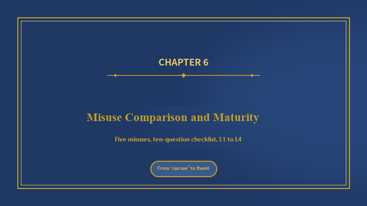

**Five misuses, ten-question checklist, L1 to L4**

The method is given; the last thing is to prevent misuse. This chapter provides a comparison of five common misuses, a ten-question self-check list, four maturity levels, and a ninety-day blueprint - upgrading all the way from "can use" to "uses it fluently".

### 6.1 Five Misuses

Each of the five misuses crashes in its own way, but the root cause is the same: wanting to skip a gate. Whatever you skip, the cost comes back doubled later.

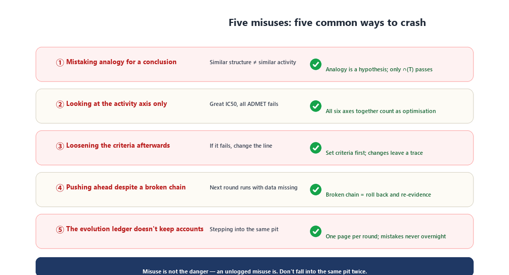

**Figure 6-1 Five common misuses**

**Table 6-1 Misuse comparison table**

| **Misuse** | **Symptom** | **Consequence** | **Solution** |
| --- | --- | --- | --- |
| Mistaking analogy for a conclusion | Applying "the structures look similar" directly | The whole series is wiped out | Analogy counts only as a hypothesis; only passing ∩(T) counts |
| Looking at the activity axis only | IC50 optimised to the end | ADMET and safety all fail | Look at all six axes; no axis may regress |
| Loosening the criteria afterwards | If it cannot pass, change the line | Criteria lose credibility | Change of line leaves a trace + version upgrade |
| Pushing ahead despite a broken chain | Continuing to run with missing data | Unjustified debt accumulates along the way | A broken chain means rollback and evidence reinforcement |
| The evolution ledger does not keep accounts | Reviews rely on impressions | Stepping into the same pit repeatedly | One page per round, mistakes never overnight |

### 6.2 A Ten-Question Checklist

Before any output leaves the brain, self-check it with ten questions. Deliver only when all ten pass; if one sticks, go back to the corresponding gate and make up the lesson.

**Table 6-2 The ten-question checklist**

| **#** | **Self-check question** |
| --- | --- |
| 1 | Which container does this output belong to? Does id(C) match? |
| 2 | Are there any blanks in the six-Type fields other than "to be completed"? |
| 3 | Were the criteria set first or patched afterwards? Which version number? |
| 4 | Does the prediction have an interval? Was the measurement corrected? |
| 5 | Can the key conclusions be traced station by station back to the raw data? |
| 6 | How many positions were moved this round? Was there any sneaky move of three positions at once? |
| 7 | Has any of the six axes regressed without being recorded? |
| 8 | Does the move used match the situation? Are the exit conditions written? |
| 9 | Has this round's mistake entered the evolution ledger? Does the attribution have a name? |
| 10 | Hand this output to the next round's self - can it catch it? |

### 6.3 Maturity L1–L4

Maturity is not an honour but a stability level. Each of the four levels has a target line and common sticking points - upgrades look at evidence, not slogans.

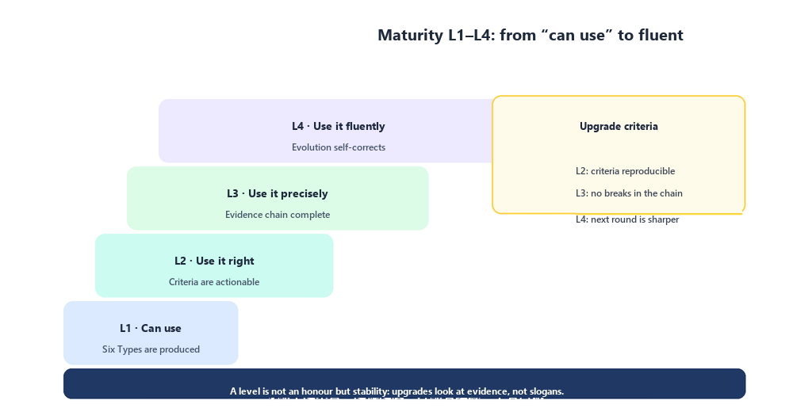

**Figure 6-2 The maturity ladder**

**Table 6-3 The four maturity levels**

| **Level** | **Feature** | **Target line** | **Common sticking points** |
| --- | --- | --- | --- |
| L1: can use it | The six Types can produce | Every Type has a field card | Fields copied, criteria idling |
| L2: uses it correctly | The criteria can be operationalised | The four gates have pass lines and veto lines | Criteria patched afterwards, changes of line leave no trace |
| L3: uses it well | Evidence chain complete | Zero break points across six stations | Raw files scattered, derivation skipping steps |
| L4: uses it fluently | Evolution self-correction | The criteria library changes every round | Attribution unclear, hesitant about swapping moves |

### 6.4 The Ninety-Day Adoption Blueprint

Adoption need not happen all at once: thirty days to establish the Types, thirty days to establish the chain, thirty days to establish the ledger. There is only one acceptance standard on Day 90 - when the review meeting starts, you can produce the evolution ledger instead of impressions.

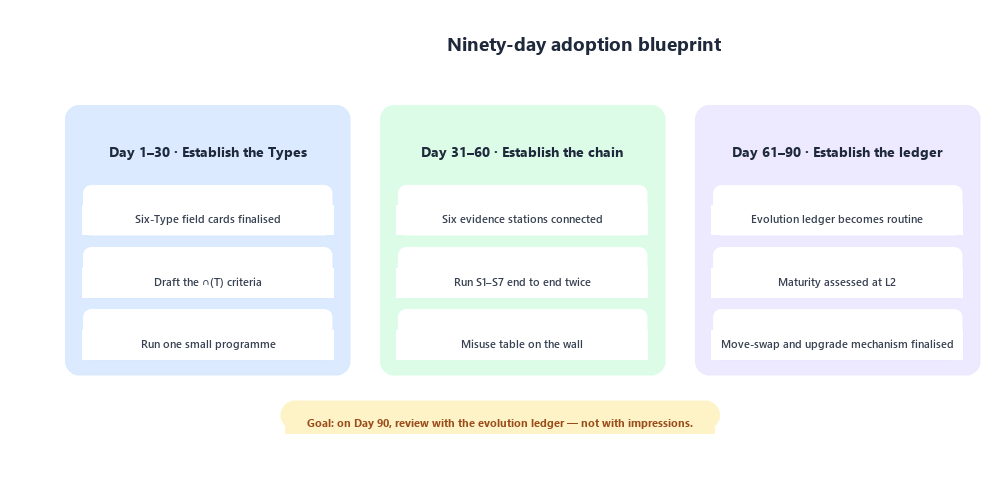

**Figure 6-3 The ninety-day adoption blueprint**

**Table 6-4 The ninety-day blueprint**

| **Schedule** | **Topic** | **Milestone** | **Acceptance** |
| --- | --- | --- | --- |
| Day 1–30 | Establish the Types | Six-Type field cards finalised, four-gate criteria drafted | Run one round on one small programme |
| Day 31–60 | Establish the chain | Six stations of the evidence chain connected, two relay rounds run | Misuse table on the wall, ten questions spot-checked |
| Day 61–90 | Establish the ledger | Evolution ledger becomes routine, criteria library activated | Maturity assessed at L2, move-swap mechanism finalised |

> **Chapter focus**  
> The root cause of all five misuses is "wanting to skip a gate" - and the cost comes back doubled.  
> The ten-question checklist is the last line of defence before delivery; maturity upgrades look at evidence: criteria versions, chain break-point counts, and evolution ledger page counts all speak.  
> Ninety days in three stages: establish the Types first, then the chain, then the ledger - on Day 90 hold the review with the evolution ledger.  

## Review: three takeaways

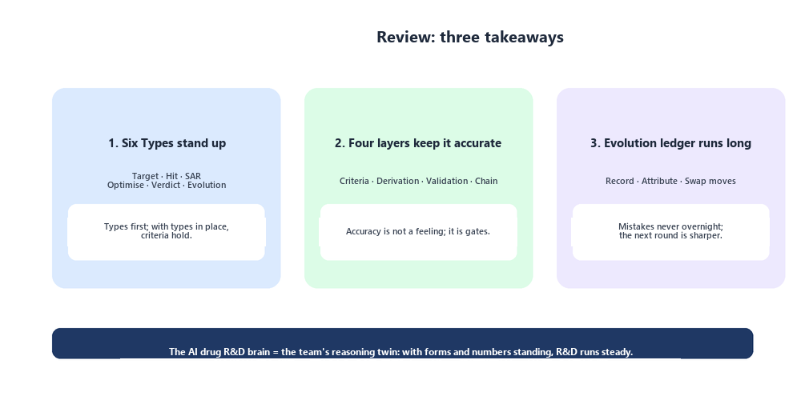

**Figure R-1 Three takeaways**

> **Takeaway one: six Types establish the output (target, hit, SAR, optimise, verdict, evolution)**  
> Establish the Type before the output; when the Type stands, accuracy follows: Target Type, Hit Type, SAR Type, Optimize Type, Verdict Type, Evolution Type - the six Types are the minimal complete set of R&D output.  

> **Takeaway two: four layers guarantee accuracy (criteria, derivation, validation, chain)**  
> Accuracy is not a feeling, it is a gate: ∩(T) governs qualification, the deductive skeleton governs reasoning, the three-piece set governs reality, the six stations govern audit - only when all four layers pass does it count.  

> **Takeaway three: the evolution ledger long run (keep accounts, attribute, swap moves)**  
> One page per round, mistakes never overnight: keep the accounts and mistakes become criteria; swap the move and stagnation becomes progress.  

**Table R-1 Master table of the book's key points**

| **Chapter** | **What to take away** | **Key tool** |
| --- | --- | --- |
| Chapter 1 | The worldview of a reasonable twin | Type + Number, the two Types, the four-gate trailer |
| Chapter 2 | Six-Type field cards and the three-bracket breakdown | Target, hit, SAR, optimise, verdict, evolution; three levels of remove; id(C) |
| Chapter 3 | The four gates of accuracy | ∩(T), deductive skeleton, three-piece set, six stations |
| Chapter 4 | A workable process | Four framework steps, six steps, three-layer judgement |
| Chapter 5 | Prompts and the full case | Seven-stage relay, DX series, usage rules |
| Chapter 6 | Control check and the upgrade path | Misuse comparison, ten questions, L1 to L4 |

> **A final reminder**  
> The cases and data in this book are demonstrative, used to illustrate the method; for real R&D, follow the experimental data, regulatory requirements, and professional judgement. The AI drug R&D brain is a reasonable twin of the R&D team - it amplifies expertise, it does not replace it.  

## Appendix A　Toolbox

Three quick-reference tables: terminology, moves, notation. Use them as an index while reading and as a desk card while working.

**Table A-1 Terminology quick reference**

| **Terminology** | **English** | **One sentence** |
| --- | --- | --- |
| Type | Type | The complete notation of "what it is" - Type in English, not Form |
| Type set | Type Set | T = ( F(T), ∩(T) ): generation rules + intersection criterion |
| Intersection criterion | ∩(T) | The generation rule of qualified output: it is both this Type and passes all criteria |
| Property | Property | [ ] Abstract set, scale axis |
| Composition | BOM | { } Composition set, part dependency axis |
| Container | Container | ( ) Spatial container: the spatial axis from programme to molecule |
| Identity anchor | id(C) | A stable identity that recognises itself after renaming or re-versioning |
| three levels of remove | remove | Recognise itself after disassembly: key, scaffold, and decoration at three levels |
| Move | Motion / Function | Time Type = verb = function = method |
| Evolution ledger | Evolution Log | One page per round: change, attribution, criteria change, plan |
| PCC | Preclinical Candidate | Drug candidate: the object that the Verdict Type upgrades |
| MPO | Multi-Parameter Optimization | Multi-parameter optimisation: six axes never regress |
| SAR | Structure-Activity Relationship | SAR relationship: a derivable relation of change to consequence |

**Table A-2 Quick reference for the fourteen moves (where they land in the Time Type)**

| **Set** | **Move** | **Drug R&D in one sentence** |
| --- | --- | --- |
| One: search and extraction | Type-time function search | Finding answers in literature, patents, databases |
| One: search and extraction | Design search and extraction | Finding molecules with a virtual library and fragment screening |
| Two: reasoning and thinking | Reasoning | Causal, reverse, and statistical: solving the mystery of SAR and metabolism |
| Two: reasoning and thinking | Thinking methods | Look at the skeleton with first principles, look at failure in reverse |
| Two: reasoning and thinking | Problem solving | Which knot to untie first when multiple parameters conflict |
| Two: reasoning and thinking | Analysis | What the binding mode and alert data are saying |
| Three: design and generation | Design (creation and innovation) | Creation of new scaffolds and modification sites |
| Three: design and generation | Design patterns | Bioisostere and prodrug strategies applied directly |
| Three: design and generation | Logic generation and application | Retrosynthetic reasoning: if it cannot be made, it cannot enter the next gate |
| Three: design and generation | Function generation and application | Generative design: give me a batch of new candidates |
| Four: learning and evolution | Continuous learning | Each round's data feed back, and the criteria grow |
| Four: learning and evolution | Refactoring and recombination | Scaffold hopping, escaping the local optimum |
| Four: learning and evolution | R&D and exploration | Exploration of new targets and new indications |
| Four: learning and evolution | Self-evolution | The closed loop from evolution ledger to next round's plan |

**Table A-3 Notation quick reference**

| **Notation** | **Read as** | **Meaning** |
| --- | --- | --- |
| [ ] | Square brackets | Abstract set, property (X axis) |
| { } | Braces | Composition set, BOM (Y axis) |
| ( ) | Parentheses | Container set, spatial container (Z axis) |
| T = ( F(T), ∩(T) ) | Type set | Type = generation rules + intersection criterion |
| C = ( id(C), S(C) ) | Container | Container = identity + structure |
| ∩(T) | Intersection criterion | The criteria of qualified output |
| remove(p, M) ≠ M | remove | Take away key part p and it is no longer M |
| S(t+1) = g(S(t), move, event) | Evolutionary form | The progressive form of the Time Type |
| Space x Time | Cross | Cross-acceptance: both sides must match for it to count |

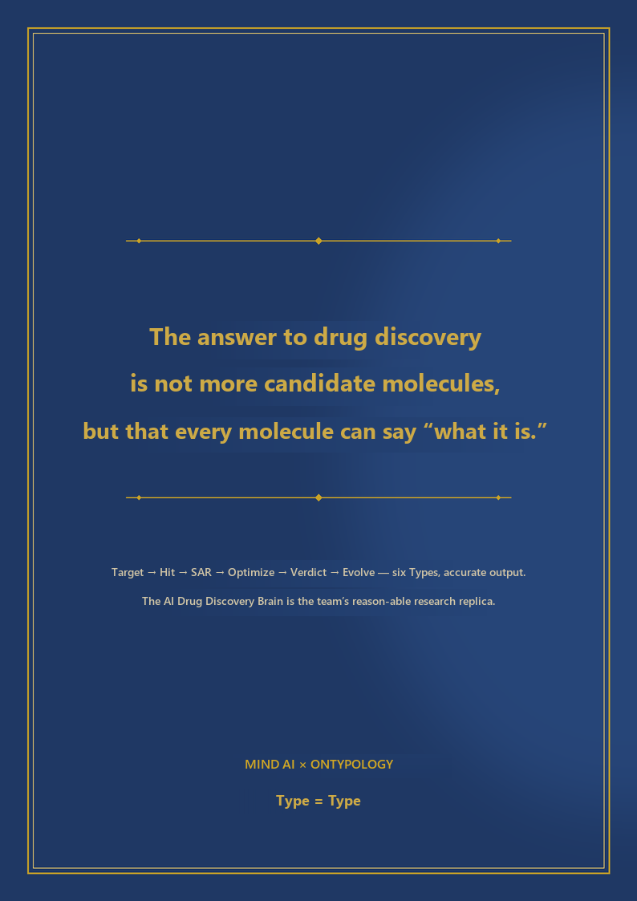
