# Mind AI Enterprise System Integration

## Precise Method and Architecture · Complete Content Plan

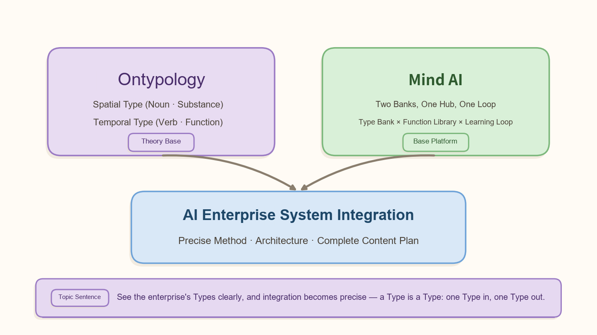

| **Theoretical foundation** | Ontypology: spatial Type (noun, substance) + temporal Type (verb, function) |
| --- | --- |
| **The base platform** | Mind AI: Two Banks, One Hub, One Loop (Type Bank × Function Library × Hub × Learning Loop) |
| **Book specification** | Precise method and architecture · complete content plan; method and architecture first, no system implementation |

** **

## Contents

  - **Guide: How to Use This Book 5**
- Guide-1 Two Tracks: The Main Text and the Professional Columns 5
- Guide-2 Navigating the Book 5
- Guide-3 Warm-Up Before You Start 6
  - **Part One: Why Enterprise Integration Needs "Types" 7**
- 1.1 The Pain of Integration Is the Pain of the Type 7
- 1.2 Ontology Is the Root, Ontypology the Trunk 8
- 1.3 Spatial Type and Temporal Type: Two Sides of One Type 9
- 1.4 The Task of This Book 10
  - **Part Two: The Backbone at a Glance — Two Sides, One Method, One Platform 11**
- 2.1 The Backbone of the Book 11
- 2.2 Spatial Type at a Glance: Three Axes, Three Brackets 11
- 2.3 Temporal Type at a Glance: Six Groups, Four Questions 13
- 2.4 The Precise Method at a Glance 13
- 2.5 The Base Platform: Mind AI on One Page 14
  - **Part Three: The Spatial Type — the Type of Enterprise Systems 16**
- 3.1 The Header Is the Type, the Row Is the Entity 16
- 3.2 Adding a Row vs Adding a Column: Two Asymmetric Changes 17
- 3.3 Fields Run Through: The Promise of Comparability 18
- 3.4 The Primary Key: Identity Beyond Attributes 18
- 3.5 Writing Enterprise Systems as Type Sets 20
- 3.6 The Composition Criterion: Three Levels of remove 20
- 3.7 Containers and id(C): The Invariance Axiom 21
- 3.8 The Abstract Criterion: F(T) and ∩(T) 22
- 3.9 Three-Layer Judgement of Type Logic 23
  - **Part Four: The Temporal Type — the Functions of Integration 26**
- 4.1 Verbs Have Types Too: Type In, Type Out 26
- 4.2 The Four Questions: Describing a Verb as a Type 26
- 4.3 Six Function Groups × Enterprise Integration Scenarios 27
- 4.4 API Contracts: Proof of Type In, Type Out 28
- 4.5 Event-Driven: Pinning Verbs to the Time Axis 29
- 4.6 Choosing a Thinking Path: Situation First, Then Route 30
- 4.7 The Flywheel: Types and Functions Grow Each Other 31
  - **Part Five: The Precise Method, Integration Edition 34**
- 5.1 Three Supplements: Putting Missing Information Back in Place 34
- 5.2 The Six Proof Steps: Writing Judgements to Be Auditable 35
- 5.3 Full Demonstration: Walking O2C from Order to Cash 35
- 5.4 The Eight-Question Checklist 37
- 5.5 The Misuse Table: 16 Kinds 38
  - **Part Six: The Overall Architecture — Philosophy, Method, Practice 40**
- 6.1 The Three-Layer Architecture: Philosophy—Method—Practice 40
- 6.2 Mind AI: Two Banks, One Hub, One Loop 40
- 6.3 Reading Palantir Ontology Side by Side 41
- 6.4 Digital Twins and Writeback 43
- 6.5 Three Stages of AGI: The Far Horizon of Ontypology 43
  - **Part Seven: The Complete Content Plan 46**
- 7.1 Learn, Drill, Use, Teach, Build: Five Stages of Formation 46
- 7.2 M1–M8: An Eight-Module Curriculum 46
- 7.3 The Eight-Week Route 47
- 7.4 Situation Routing: Which Situation, Which Move 48
- 7.5 Four Stages of Bank Building: Turning Integration into Enterprise Assets 49
  - **Part Eight: Conclusion 52**
- 8.1 The Summary Map 52
- 8.2 The Action List: Four Things You Can Do Tomorrow 53
- 8.3 Closing Lines 53
  - **Appendix A: Terminology and Notation Quick Reference 54**
- A-1 Notation Quick Reference 54
- A-2 Terminology Quick Reference 54
  - **Appendix B: Precise Method Quick Reference Card 55**
- B-1 One-Page Quick Reference Card 55
- B-2 Blank Templates (Photocopy Pages) 55
  - **Appendix C: Model Answers to the Exercises 57**
- C-1 Guide: Parts One and Two 57
- C-2 Parts Three and Four 57
- C-3 Part Five 58
- C-4 Parts Six and Seven 59

# Guide: How to Use This Book

Welcome to AI Enterprise System Integration — Precise Method and Architecture · Complete Content Plan. This is not a book about how to wire systems together; it is a book about how to see the objects of integration clearly. In countless failed integration projects the problem turns out to be the same: we thought we were integrating "data", when in fact we were integrating "Types" — and the Type was never written clearly.

This book takes Ontypology as its theoretical foundation: the spatial Type tells us "what a system's Type is", the temporal Type tells us "how integration actions work"; underneath, Mind AI is the practice platform that lands the theory as an engineering method that can be taught, trained, audited and accumulated. The book does not go into implementation detail — we discuss method and architecture, a "precise method" usable with any technology stack.

## Guide-1 Two Tracks: The Main Text and the Professional Columns

The book is arranged on two tracks. The main text is for everyone who faces integration problems: managers, project managers, business analysts, engineers — no prior database theory needed, just follow the rhythm of "one concept, one figure, one example, one exercise". The professional columns C1–C8 are for IT specialists: they read the book's Ontypology concepts against industry topics such as master data management, knowledge graphs, API contracts, event-driven design and ontology engineering, adding the meaning in a professional context. The tracks do not interfere; readers can read the main text first and come back to the columns.

## Guide-2 Navigating the Book

| **Part** | **Topic** | **Question answered** |
| --- | --- | --- |
| Part One | Why the Type is needed | Why is the root of integration pain in the Type? |
| Part Two | Backbone at a glance | Two sides, one method, one platform: the map in an hour |
| Part Three | Spatial Type · the Type of a system | What is a system's Type? How is it established and judged? |
| Part Four | Temporal Type · integration functions | How are integration actions written as acceptable functions? |
| Part Five | The precise method, integration edition | How to write integration to an auditable precision? |
| Part Six | Overall architecture | How do philosophy, method and practice interlock across three layers? |
| Part Seven | Complete content plan | How to learn it, drill it and turn it into enterprise assets? |
| Part Eight | Conclusion | Closing in one sentence, and the action list |

Reading advice: readers short on time can grasp the whole from the backbone overview in Part Two; readers who need to land it will find the method core in Parts Three to Five; readers planning training and a platform will find the full plan skeleton in Parts Six and Seven.

## Guide-3 Warm-Up Before You Start

> **[Exercise E00] Warm-Up: Say Your Integration Pain in One Sentence**  
> Write in one sentence the biggest integration trouble you (or your organisation) face, for example: "the order does not match across the two systems".  
> Then try to answer: in this trouble, how much is same name with different meanings, and how much is different names with the same meaning?  
> *Check when done: there is no standard answer here — after Part Five you will have the full toolkit to write this sentence "to be auditable".*  

# Part One: Why Enterprise Integration Needs "Types"

## 1.1 The Pain of Integration Is the Pain of the Type

Start from a cognitive chain so familiar it needs no explanation: first the sense of difference, then the acts of splitting and merging, and only then the birth of a Type — and a Type must have a name. This path the brain has walked for hundreds of millions of years is exactly the path integration must walk again. When the "customer" in ERP and the "customer" in CRM look different, the first thing is not to write a conversion program but to recognise each one's Type, then decide whether they are two notations of one Type or two Types entirely.

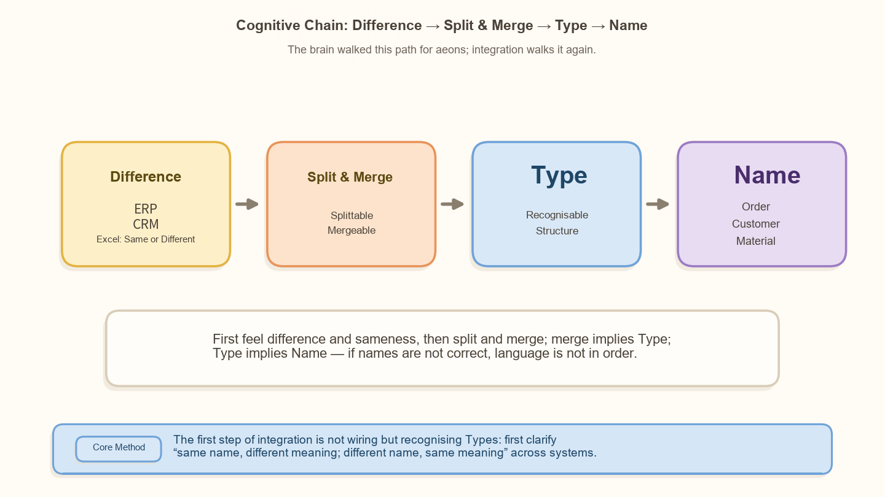

Figure 1-1 Cognitive chain: difference → split and merge → Type → name

Lay out the complaints from the integration floor and you find only six common pains: silos, same name with different meanings, different names with the same meaning, misalignment, unchangeable processes, untraceable data. On the surface they are data problems; the root of every one is the Type — its layers are not written clearly.

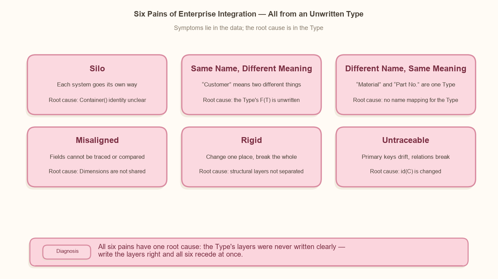

Figure 1-2 The six pains of enterprise integration all have their root in the Type

> **[Key Lines] Key Lines of This Part**  
> The first step of integration is not wiring but recognising Types.  
> The six pains have a single root: the layers of the Type are not written clearly — write the layers precisely and all six retreat together.  

## 1.2 Ontology Is the Root, Ontypology the Trunk

Ontology asks "what is there in the world?" — it lists the things in a system one by one: customers, orders, invoices. This is the root, the starting point of the question. But a list only tells you what exists, not what it looks like, what it is made of, how to judge it, how it works. Ontypology then asks: what is a Type? How is it recognised, named, notated, judged, operated? — this is the trunk, upgrading "what exists" into "how to use it precisely".

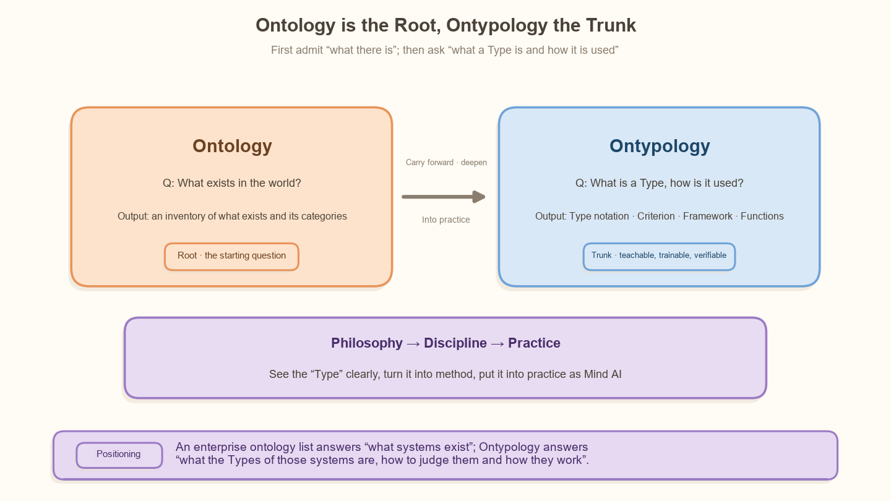

Figure 1-3 Ontology is the root, Ontypology the trunk

| **Key comparison** |  |
| --- | --- |
| **Ontology** | Asking "what exists" yields a list of what exists and its categories — understanding the world. |
| **Ontypology** | Asking "what is a Type, how is it used" yields Type notation, criteria, frameworks and functions — teachable, trainable, auditable, practicable. |
| **Relation** | Inherit: start from "what exists"; deepen: turn every "what exists" into a Type that can be identified and judged; practise: turn it into method and deliver it as Mind AI. |

## 1.3 Spatial Type and Temporal Type: Two Sides of One Type

A complete Type has two sides at once — "what it is" and "what it does" — like noun and verb in grammar. The spatial Type is the noun, the substance: Unit Type, three axes, Type Set, Type logic, answering "what it is". The temporal Type is the verb, the use: functions, methods, moves, services, answering "what it does and how". Substance and function are one; neither can be missing. And the Type comes before the action — the temporal Type rests on the spatial Type: one Type in, one Type out.

> **[Vignette] A Day in the Life of a Cup**  
> In the morning the cup (a spatial Type) stands quietly on the table; "fill with water → pour out → wash" (temporal Types) act on it one by one.  
> A cup does not become another cup because it holds water — what changes is the content, what stays is the Type. Every "fill, pour, wash" is some verb (function): one Type in, one Type out.  

For integration the division of labour between the two sides is immediately usable: data models, interface specifications and master data are the work of the spatial Type; ETL, approvals, reconciliation and alerts are the work of the temporal Type. Write both sides as "Types" and integration has a common language.

## 1.4 The Task of This Book

The book sets out to do three things: first, to see enterprise integration's objects — systems, data, processes — clearly in the language of Ontypology; second, to give a precise method so that every integration decision can be ticked, reproduced and audited; third, to give a complete content plan so that individuals and organisations can learn the method, use it, and store it as an asset. Throughout, Mind AI is the base platform, but no specific product is required — method before tool.

> **[Professional Column C1] Master Data Management: Where an Enterprise's "Types" Come From**  
> Master data management deals with the question of "who holds the authoritative definition" in an enterprise: core entities such as customers, materials and suppliers each have copies across dozens of systems — whose word counts? MDM's answer is to define a golden record and have the other systems align to it.  
> Restated in the language of Ontypology: what MDM does is establish a Type for each class of core entity — define its Type Set (which parts and fields it has), its abstract criterion (what kind of record counts as this class), its identity (which field is the id). A golden record is golden not because its data is the most complete but because its Type is the most precise: the id does not drift, attribute dimensions run through, and the membership criterion is clear.  
> So this part's conclusion holds directly for MDM: master data chaos is the chaos of unwritten Types; the first deliverable of an MDM project should not be a match-rule table but three Type specifications — the customer Type, the material Type and the supplier Type. That is exactly the theme Part Three unfolds.  

> **[Exercise E01] Diagnose the Integration Pain Around You**  
> Pick two systems you know (ERP and CRM, say) and write each one's definition of "customer".  
> Against the six pains, name at least two you have observed and write the root cause each corresponds to (which layer of the Type is unwritten).  
> *Check when done: put two definitions side by side and "same name, different meaning" usually shows at first glance.*  

# Part Two: The Backbone at a Glance — Two Sides, One Method, One Platform

This part is the book's map. Read it in an hour and you hold the backbone: the two sides of spatial and temporal Type, the one method of precise use, the one platform of Mind AI. Every later part simply enlarges one corner of this map.

## 2.1 The Backbone of the Book

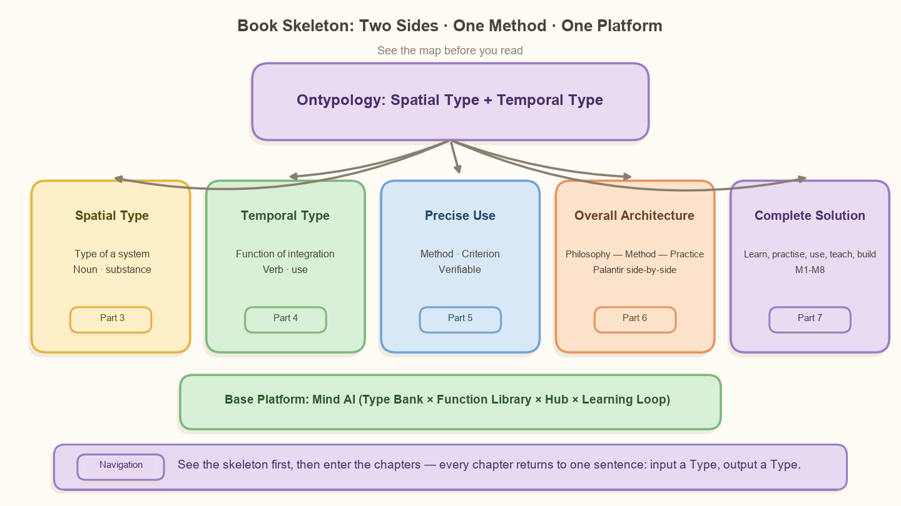

Figure 2-1 The backbone: two sides, one method, one platform

The backbone is only four sentences: establish the Type with the spatial Type, act on the Type with the temporal Type, verify the Type with the precise method, store the Type with Mind AI's Type Bank and loop. Behind the four sentences is one: one Type in, one Type out.

## 2.2 Spatial Type at a Glance: Three Axes, Three Brackets

The spatial Type describes a Type with three axes: the X axis is property, written in square brackets [ ], and is "dimension × scale" — colour, material and credit limit are all dimensions forced out by difference; the Y axis is composition, written in braces { }, and is the bill of materials (BOM) — which parts it is made of, judged by "taken apart, does it recognise itself"; the Z axis is container, written in parentheses ( ), and is "content space" — identity id(C) and content S(C) kept apart, so that content changes do not shake identity.

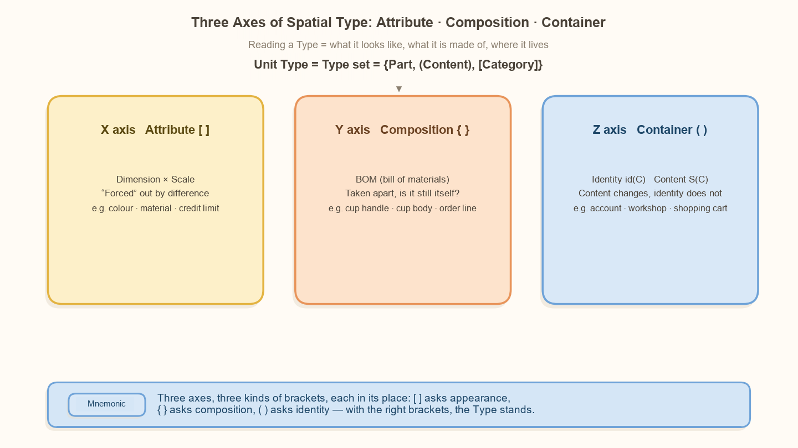

Figure 2-2 The three axes of the spatial Type: property, composition, container

The three axes fold into one formula: Unit Type = Type Set = {parts, (content), [category]}. A coffee cup written as a Type Set: {handle, base, lid, body, (coffee), [white]} — parts in { }, content in ( ), appearance in [ ], each in its place.

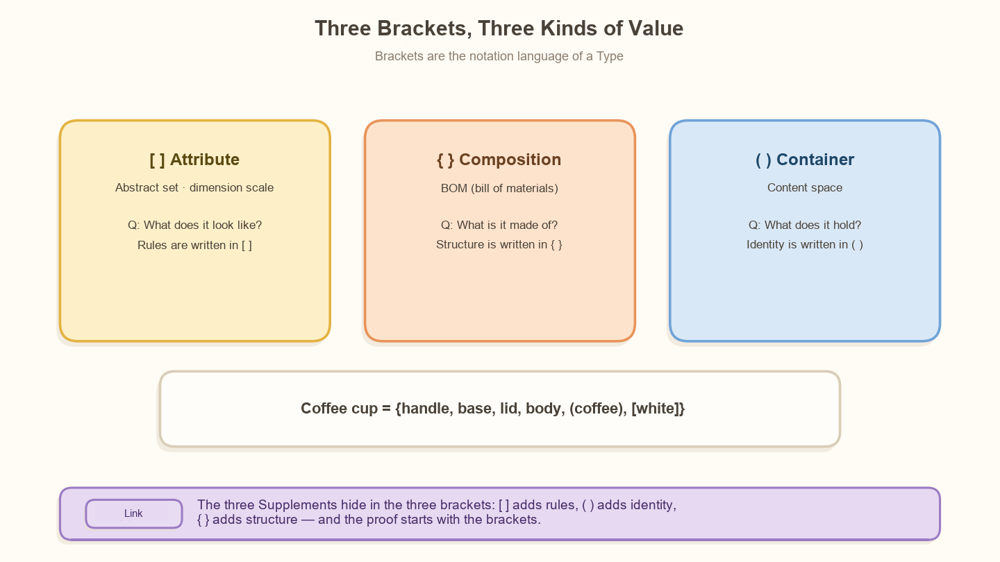

Figure 2-3 Three brackets, three kinds of value

> **[Mnemonic] The Bracket Mnemonic**  
> [ ] asks about appearance, { } asks about composition, ( ) asks about identity — with the right brackets, a Type holds.  
> The three supplements hide in the three brackets: [ ] adds rules, ( ) adds identity, { } adds structure.  

## 2.3 Temporal Type at a Glance: Six Groups, Four Questions

The temporal Type gathers verbs into one library in six groups: cognition and extraction, generation and application, problem solving and creation, reasoning and thinking, growth and maintenance, exploration. The arrangement is itself a learning path — find what already exists, then learn to generate the new, and only then move toward the unknown.

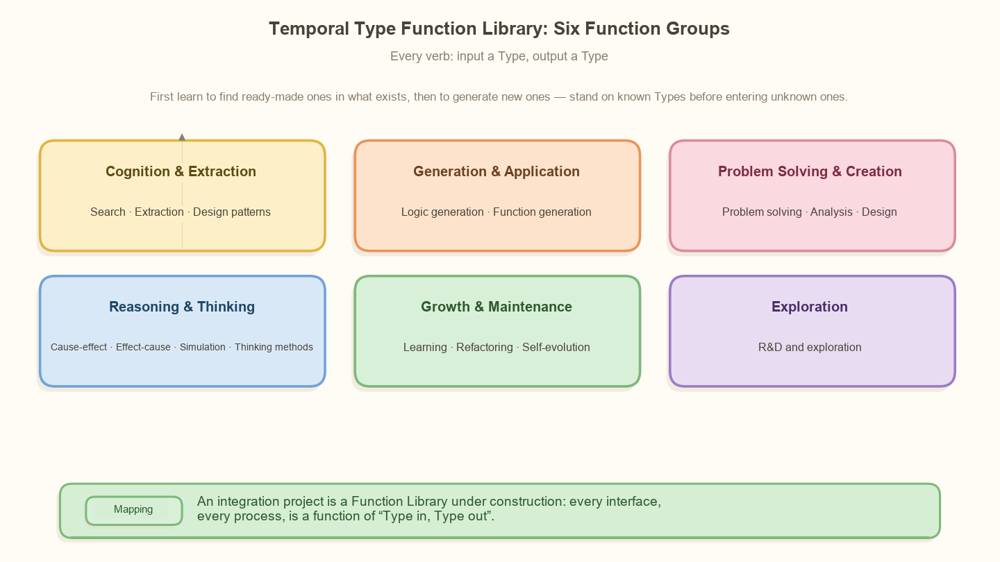

Figure 2-4 The temporal Type library: six function groups

Before going on duty, every verb fills a four-question card: name, input Type, output Type, criterion. With all four written, the verb has a Type; the criterion is the heart of the four questions — only when the criterion is written verifiably is the function written precisely. Part Four applies this toolkit directly to the actions of enterprise integration.

## 2.4 The Precise Method at a Glance

"Precise" is not a feeling but a process. The precise method comes as a three-piece kit: the three supplements ([ ] adds rules, ( ) adds identity, { } adds structure, upgrading verbal agreement into black and white), the six proof steps (identify the whole → describe by axis → write the Type Set → set the proposition → criterion reasoning → three-layer check, writing the judgement to be auditable), and the eight-question checklist (tick each item before delivery). Add the table of 16 misuses for avoiding traps, and the method layer of the book is fully equipped.

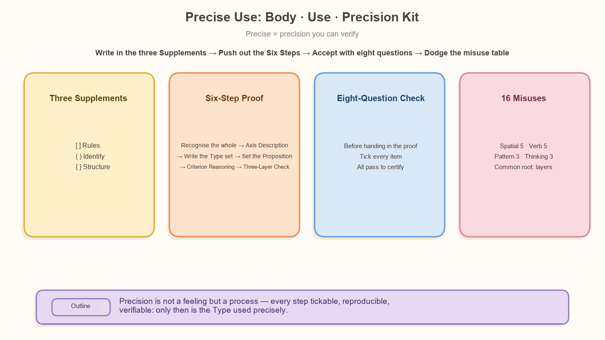

Figure 2-5 The precise method: substance, use, precision

## 2.5 The Base Platform: Mind AI on One Page

Mind AI is the practice platform for Ontypology and Mind Model, an intelligence architecture aimed at AGI. This book only needs its backbone: two banks, one hub, one loop — the Type Bank (spatial Types banked), the Function Library (temporal Types banked), the Mind Model Hub (unified knowledge and reasoning), and the Learning Loop (output Types pass the three-layer check and flow back into the bank, getting more precise with use). Part Six unfolds this in full and reads it against Palantir Ontology.

> **[Positioning] Where Platform Ends and Method Begins**  
> Method before tool: the precise method in this book is tied to no product; Mind AI provides the base of "Type Bank + loop" so that method settles into assets.  
> This book does not discuss system implementation — it discusses method and architecture, usable with any technology stack.  

> **[Professional Column C2] From GraphRAG to Mind Model: Why Knowledge Graphs Are Not Enough**  
> In the past two years GraphRAG has brought "graph + retrieval augmentation" into the mainstream: documents are cut into entities and relations, and the LLM answers questions along the graph. The industry has long managed entity relations with knowledge graphs (Neo4j, Amazon Neptune, Stardog and others). But judged by Ontypology's standard, knowledge graphs have several structural shortfalls: limited expressive power (only the "entity—relation—entity" triple, which cannot hold the Type Set's threefold structure of parts, content and category), limited relational expression (relations have no Type of their own and cannot carry a criterion), no deep reasoning (path queries are not judgement reasoning), difficulty representing abstract concepts (categories have no F(T) criterion), no structure of thinking (no Types for thinking methods and functions), and difficulty evolving and learning continuously (no loop).  
> Mind Model is not another graph but the practice architecture of Ontypology: the spatial Type handles the Type of knowledge (three axes, Type Set, three-layer judgement), the temporal Type handles the Type of thinking (six function groups, five modes of reasoning, thinking methods), and only the two together make "unified knowledge + unified thinking". In one line: graphs manage connections, the Type Bank manages judgement — integration needs more than connecting; it needs judging precisely.  

> **[Exercise E02] Backbone Self-Check: Retell the Book in Three Sentences**  
> Without the book, explain the backbone to a colleague in three sentences: one on the two sides, one on the method, one on the platform.  
> Then write down: in your current work, which task most urgently needs the precise method?  
> *Check when done: only when you can say it in three sentences have you really understood the map.*  

# Part Three: The Spatial Type — the Type of Enterprise Systems

This part puts the spatial Type onto the floor of enterprise information systems. The conclusion first: RDB is what the logic of the Type looks like once mechanised — the header is the Type, the row is the entity, the field is the dimension, the primary key is the identity, the foreign key is the relation. Understand these five correspondences and every rule of database design becomes the delivery of an Ontypology principle.

## 3.1 The Header Is the Type, the Row Is the Entity

A database table is born in two parts: the top row of column names (the header) is a shared list of questions to ask — it holds no answers itself yet dictates where answers must go, and that is exactly the Type. Each row of actual data below is that question list applied to one concrete thing and filled in — that is the entity. The correspondence is so exact that it is not a metaphor: it is the same structure appearing in two domains.

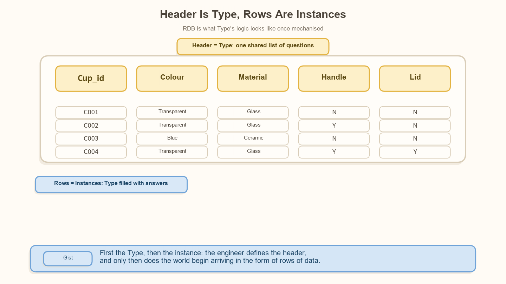

Figure 3-1 The header is the Type, the row is the entity

> **[The Type Is Not a Metaphor] The Key to Reading This Part**  
> Whenever you see a "table", read it as the compound "Type + entity": the header is the Type, the rows are entities.  
> Every other concept — field, primary key, foreign key, relation — grows out of this basic correspondence.  

Note the direction of the correspondence: the Type comes first, then the entity. An engineer's first step in building a table is to define the header — decide "what to ask" first, and only then does the world start coming in as rows. Once the header is settled it is the admission specification for this kind of thing: any individual must describe itself with this set of questions before it earns a row.

## 3.2 Adding a Row vs Adding a Column: Two Asymmetric Changes

"Adding data" is two entirely different things at two levels. Adding a row: the Type stays put and there is one more entity — light, and it can happen at any time. Adding a column: the Type itself grows and every entity must be backfilled — heavy, because it is the frame itself that moves. Only when the existing dimensions cannot explain a new difference (a cup with or without an insulating layer, say) are you forced to open a new dimension — that is the moment a new property is forced out.

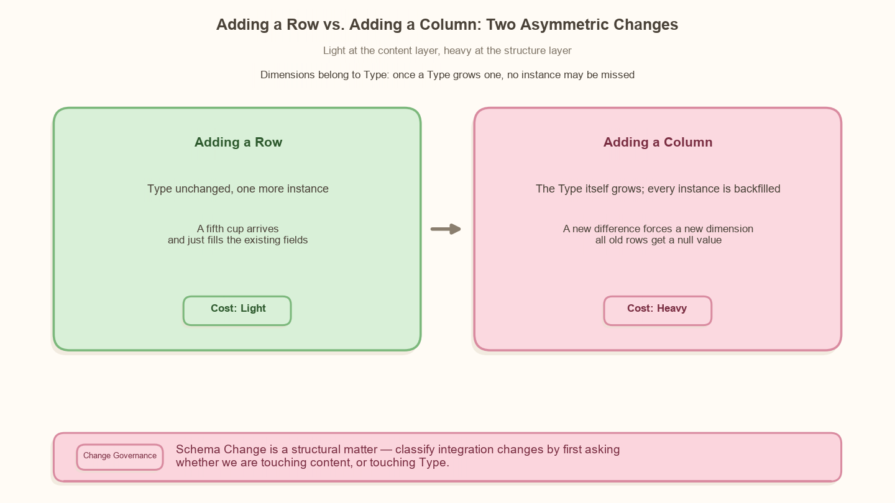

Figure 3-2 Adding a row and adding a column: two asymmetric changes

| **Action** | **Which layer is touched** | **The correspondence of Type theory** | **Cost** |
| --- | --- | --- | --- |
| Adding a data row | Content layer | The Type stays, one more entity | Light: the structure does not move at all |
| Adding a field | Structure layer | The Type grows a new dimension | Heavy: every entity must be backfilled |
| Changing the primary key | Identity layer | The entity's identity is destroyed | Extremely heavy: the whole relational web breaks |

This is the Ontypology basis for change grading in integration projects: touching content is an ordinary change, touching the Type is a structural change, touching identity is a catastrophic change. With the grading clear, the approval process has a standard.

## 3.3 Fields Run Through: The Promise of Comparability

In one table all rows share one set of fields — you cannot have some cups with an extra column and others with one fewer. Because the nature of a dimension is public: a ruler that is to measure everything cannot exist for only some things. "Find all transparent cups" can be executed as a precise operation because the dimension "colour" is open to every row without exception. Fields running through is the database's promise of comparability.

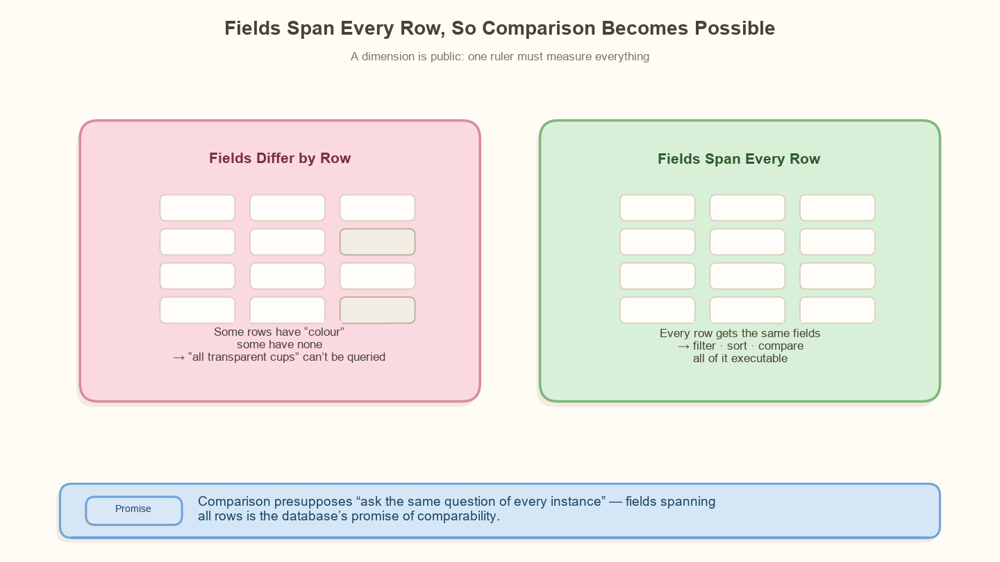

Figure 3-3 Fields run through, so comparison becomes possible

The pain of misalignment on the integration floor usually breaks down right here: of two same-named fields, one allows null and the other is mandatory, the dimension does not really run through, and comparison cannot proceed. The precise way is to write "the openness of the field" into the Type's notation — which individuals this dimension is open to, and on what scale it takes values.

## 3.4 The Primary Key: Identity Beyond Attributes

For a row of data to be identified on its own, it first needs a field that belongs only to that row and has nothing to do with any attribute content — a primary key. Even if two cups look exactly alike, as long as Cup_id differs they are two entities. Attributes can be swapped at will; the primary key cannot — what changes is the appearance, what cannot change is "who it is". This is the database version of the philosophical idea of identity: an entity's identity is the only anchor in the whole web of relations.

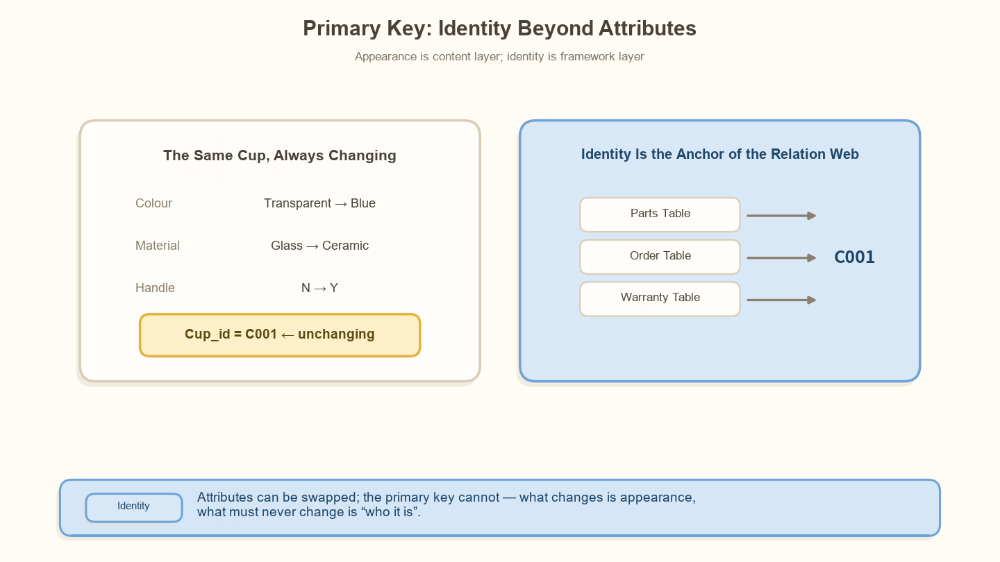

Figure 3-4 The primary key: identity beyond attributes

Once a primary key value is assigned it should not change: rename C001 to C009 and every detail table referencing C001 points at something that does not exist, and the whole relational web breaks. So in practice primary keys use "permanently meaningless" serial numbers or UUIDs — carrying an unchanging identity on a meaningless code is engineering's most careful guard of identity.

With a primary key, tables can identify each other: storing a field in the detail table that points at the master's primary key (a foreign key) is a relation — identify, do not copy; when details are needed, go back and look them up in the master. The whole database is a web woven from keys.

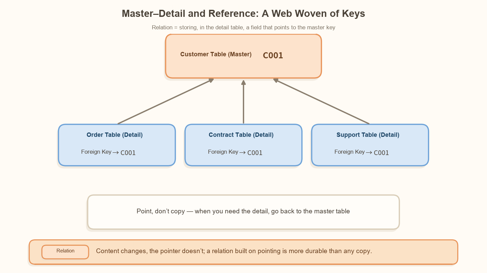

Figure 3-5 Master, detail and reference: a web woven from keys

## 3.5 Writing Enterprise Systems as Type Sets

Now pull the camera back: the order in ERP, the customer in CRM, the warehouse in SCM, the employee in HRM — the core entity of every system can be written as a Type Set with the same formula: Unit Type = {parts, (content), [category]}. If you can write it, it holds; if you cannot, you do not yet know it.

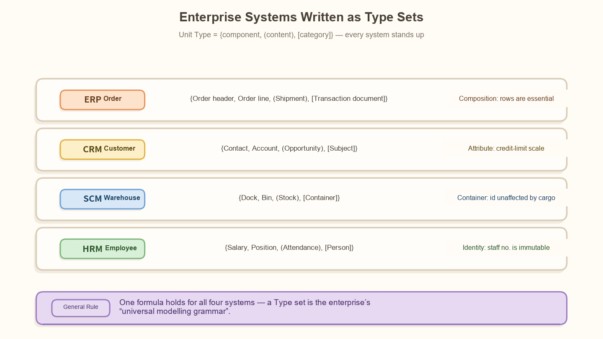

Figure 3-6 Enterprise systems written as Type Sets

Take an ERP order: order = {order header, order line, (shipment), [transaction document]}. The order line is essential — remove it and there is no order; the shipment is content — batches come and go and the order is still that order; the transaction document is category — whether it counts as a transaction document is settled by the abstract criterion. Three brackets, three questions, not one of them dispensable.

## 3.6 The Composition Criterion: Three Levels of remove

"What is it made of" cannot be answered by feeling. The BOM criterion asks one question: after it is taken apart, does it still recognise itself? The answer sorts it into three levels: essential parts (removed, no Type left, ≢ M), functionally degraded parts (removed, degraded but still itself, ≡ M′ ⊂ M), and optional parts (removed, the Type is completely unchanged, ≡ M).

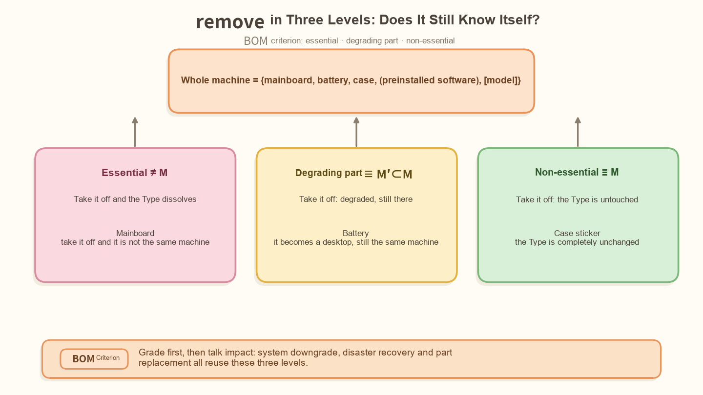

Figure 3-7 Three levels of remove: taken apart, does it still recognise itself

These three levels are hugely useful on the integration floor: which parts must be kept for disaster recovery? down to which level may degraded operation remove? how is part-replacement compatibility judged? All use the same ruler. Grade first, then talk impact — writing impact analysis to be auditable depends on the three levels of remove.

## 3.7 Containers and id(C): The Invariance Axiom

The container ( ) is the third axis of the Type. Container = a set + an identity that does not change when the elements change: C = (id(C), S(C)). Account A-1001's balance goes from 5,000 to 3,200 — the content moves, the account does not become another account. To judge whether something is a container, ask three questions: does it have a clear boundary? does it have inner space to hold content? is its identity independent of the content?

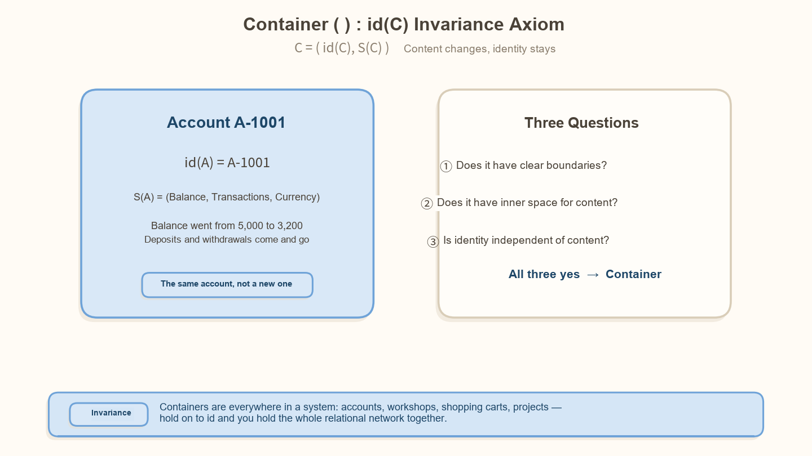

Figure 3-8 The container ( ): the invariance axiom of id(C)

Containers are everywhere in an enterprise: accounts, workshops, shopping carts, projects, tenants. Guard the id and you guard the whole relational web — this is also the Ontypology foundation of master data management; see Column C3.

## 3.8 The Abstract Criterion: F(T) and ∩(T)

"Which category does it belong to?" is the most frequent judgement in integration decisions: does this document count as anomalous? does this customer count as VIP? does this material belong to this category? The abstract layer's tool is to define category T as a feature set F(T) = {f1, f2, …} and test it item by item with the intersection criterion ∩(T) — all pass, then classify. A category is not a feeling; it is a checklist of features that can be ticked one by one.

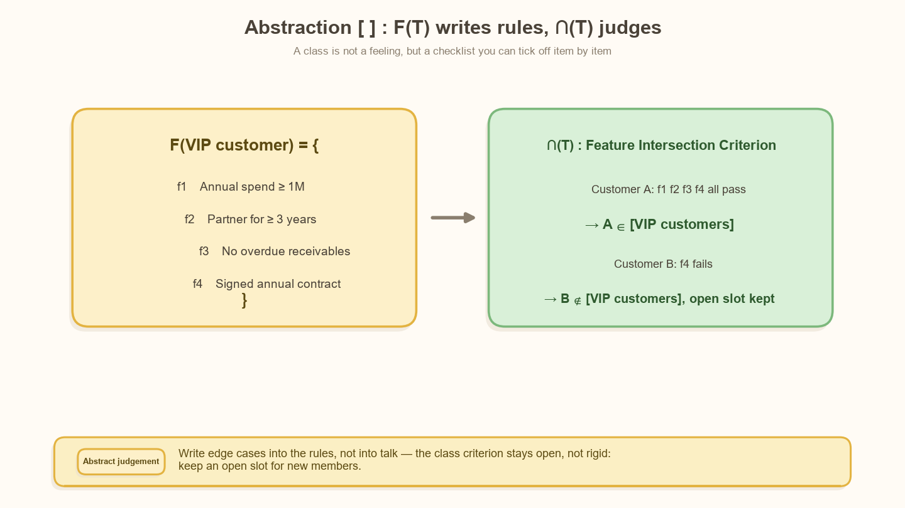

Figure 3-9 The abstract criterion: F(T) writes the rules, ∩(T) makes the judgement

> **[Open, Not Rigid] The Openness of Abstract Judgement**  
> F(T) is an open template: new features can be added as they come, but every extension must be applied back to all already-classified individuals — dimensions belong to the Type.  
> Write boundary cases into the rules, not leave them in talk: the value of a criterion lies entirely in the rulings on boundary cases.  

## 3.9 Three-Layer Judgement of Type Logic

A complete judgement passes three layers: the container layer (is id(C) stable? after the content changes, is it still the same?), the composition layer (are the three remove levels clear? does the essential part fall apart when removed?), the abstraction layer (verify F(T) item by item, classify only when ∩(T) passes). The three layers are joint, none can be missing — judging on one layer alone is the first of all misuses.

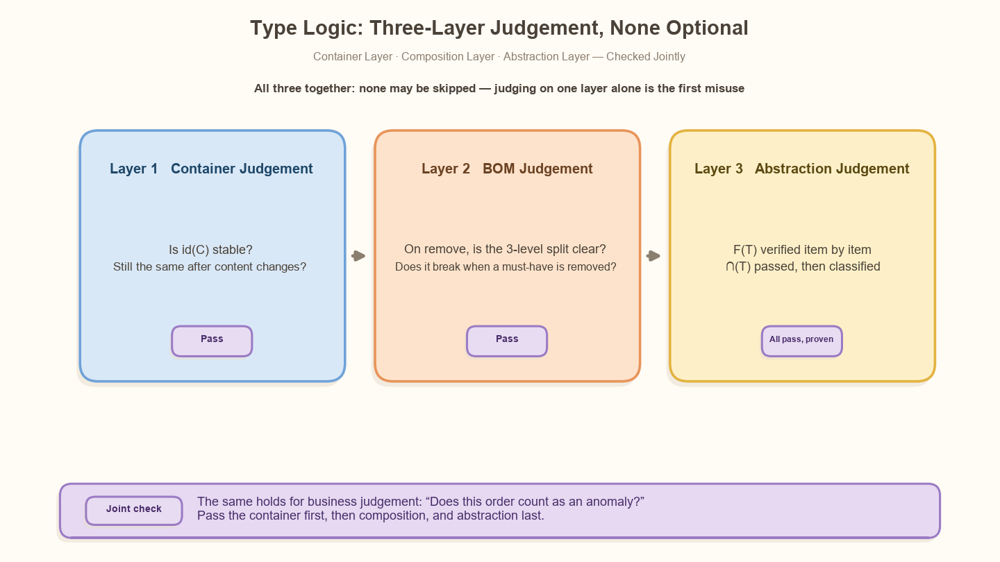

Figure 3-10 Three-layer judgement of Type logic: none can be missing

Business judgement works the same way. "Does this document count as anomalous?" First the container (is this document's id stable, is it a duplicate?), then the composition (are the essential fields complete, are the lines complete?), finally the abstraction (compare the anomaly document's F(T) item by item). Only when all three layers pass does the verdict hold.

> **[Professional Column C3] MDM × Ontypology: Golden Records and id(C)**  
> The hardest step in master data management is match and merge: are two records the same customer? The industry uses rules plus probabilistic scoring, and the probability threshold always needs a human to decide. Ontypology offers a way to write that decision as a criterion: first establish the Type (the customer Type's Type Set and F(T)), then judge layer by layer — the container layer compares id sources and the identity chain, the composition layer compares the dependence of essential fields, the abstraction layer compares the feature intersection of F(T). Each layer has an output, and the merge decision turns from "it feels like" into "auditable item by item".  
> More critical is the invariance axiom of id(C): when two records are merged, what is stored is "two identifications of the same identity", not two records kneaded into a new one. Survivorship rules decide who owns the appearance; the id chain decides who the identity is — separating appearance from identity is exactly the identity principle from the primary key section projected onto master data. Whenever someone wants to "change the primary key", answer with Part Three: that is not data repair but identity-layer surgery on the whole relational web.  

> **[Exercise E03] Write One System as a Type Set**  
> Pick a system you know (ERP, CRM or WMS), pick three core entities and write each as a Type Set: {parts, (content), [category]}.  
> For each entity mark: which field carries the id? which part is essential?  
> *Check when done: only when all three axes can be filled do you really know this entity.*  

> **[Exercise E04] Grading Practice for the Three Levels of remove**  
> Take a laptop, list six parts and sort them into the three levels of remove: essential, functionally degraded, optional.  
> Write your basis: after it is taken apart, does it still recognise itself?  
> *Check when done: the same part may be graded differently under different "definitions of the Type" — write the definition first and the grading has a basis.*  

> **[Exercise E05] Walk the Three-Layer Judgement Once**  
> Pick a judgement you make daily (for example "does this payment request need manual review?") and write the three-layer check: what the container layer asks, what the composition layer asks, which features the abstraction layer's F(T) has.  
> Verify your criterion with three real cases (two positive, one negative).  
> *Check when done: there must be at least one boundary case — the value of a criterion lies entirely at the boundary.*  

# Part Four: The Temporal Type — the Functions of Integration

Once the spatial Type is established, the temporal Type takes the stage: every integration action — transform, interface, approve, reconcile, alert — is a function: one Type in, one Type out. This part writes integration actions as acceptable functions and gives the six-group toolbox, how to write contracts and events, how to choose a thinking path, and the flywheel that compounds capability.

## 4.1 Verbs Have Types Too: Type In, Type Out

The temporal Type goes by many names — function, method, move, service, technique — all meaning the same thing. Every verb acts on some Type: ETL turns the "source table Type" into the "target table Type"; approval turns the "request Type" into the "approved Type"; reconciliation turns "the two parties' detail Types" into a "difference Type". Rewrite the integration's interface list as a function list and it becomes an acceptance list at once.

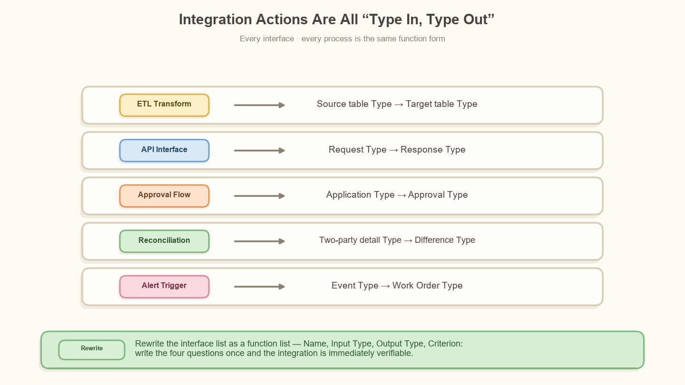

Figure 4-1 Every integration action is "Type in, Type out"

> **[Connection] In One Sentence**  
> The temporal Type rests on the spatial Type: the Type comes before the action — one Type in, one Type out.  

## 4.2 The Four Questions: Describing a Verb as a Type

For a verb to be "precise" it needs a description in Types. Every temporal Type answers four questions before it goes on duty: name (what is this function called, a name everyone recognises), input Type (which Type it acts on, identifiable and deliverable), output Type (what Type it produces, recognisable and acceptable), criterion (how success is counted, tickable sentence by sentence and auditable).

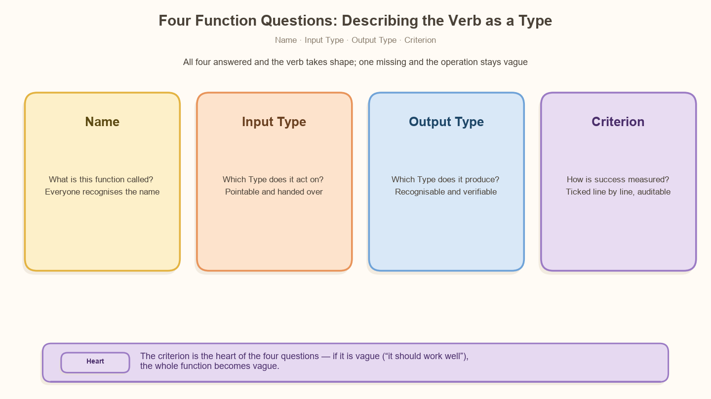

Figure 4-2 The four questions: name, input Type, output Type, criterion

The criterion is the heart of the four questions. Name, input and output are still description; the criterion is the only acceptance — write "must work well" as the criterion and the whole function turns vague with it; write "amount, tax type and currency all equal" and the function is written precisely.

| **Question** | **Description** | **Checkpoint** |
| --- | --- | --- |
| Name | What is this function called? | A name everyone knows, no context confusion |
| Input Type | Which Type does it act on? | The input Type is identifiable and deliverable |
| Output Type | What Type does it produce? | Produce something recognisable and acceptable |
| Criterion | How is success counted? | Tickable sentence by sentence, auditable |

## 4.3 Six Function Groups × Enterprise Integration Scenarios

The six groups of the Function Library map one to one onto integration scenarios: cognition and extraction (inventory existing interfaces, extract reusable patterns), generation and application (generate new mapping rules, apply to new systems), problem solving and creation (break the breakpoint, design a compensation plan), reasoning and thinking (root cause analysis, impact analysis), growth and maintenance (interface refactoring, contract version governance), exploration (new architecture selection, POC R&D).

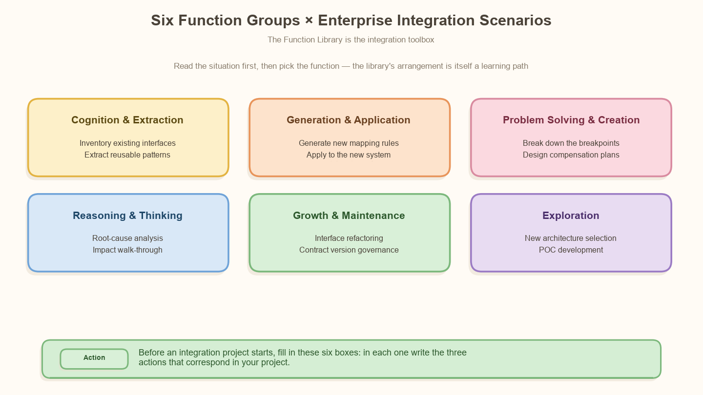

Figure 4-3 Six function groups × enterprise integration scenarios

Filling these six cells before you start is the best warm-up for an integration project: write the three actions in the project that correspond to each cell — the cell you cannot fill is usually where the risk hides.

## 4.4 API Contracts: Proof of Type In, Type Out

Microservices exchange only "Types", never guesses. The essence of an API contract is writing the four function questions in black and white: the request is the input Type, the response is the output Type, fields and types are the Type's notation, acceptance conditions are the criterion, and the version number is the Type's change governance. When the contract is revised, both sides upgrade together — version governance is the Type's change governance.

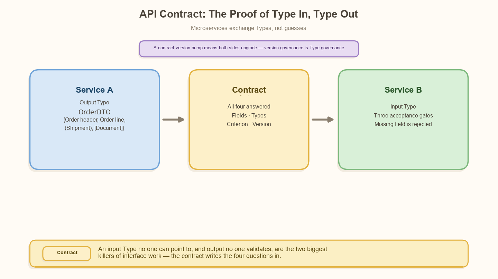

Figure 4-4 API contracts: proof of Type in, Type out

The two great causes of interface failure are exactly two of the four questions left unwritten: the input Type cannot be identified (missing request fields, vague types) and the output is not accepted (responses unchecked, bad data walks straight in). Writing the four questions into the contract blocks both causes at once.

## 4.5 Event-Driven: Pinning Verbs to the Time Axis

In an event-driven architecture every event is a broadcast of "a Type's state transition": placing an order, deducting stock, shipping, invoicing, collecting — each event is a milestone of a verb, pinning the verb's output Type to the time axis. Chained together they form the causal chain pattern: every hop is acceptable, replayable and compensable.

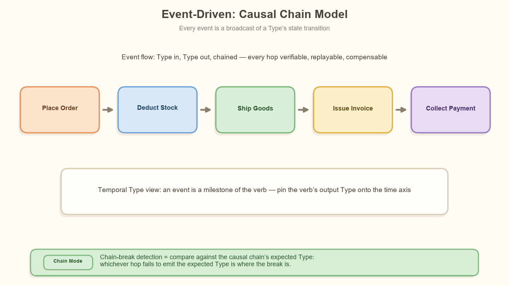

Figure 4-5 Event-driven: the causal chain pattern

Broken-link detection becomes a mechanical action: compare against the expected Types of the causal chain — whichever hop fails to emit the expected Type is where the break is. Compensation design works the same way: a compensating function is a function that "zeroes in reverse" the output Type of that hop, and it too is written out with the four questions.

## 4.6 Choosing a Thinking Path: Situation First, Then Route

When the integration design stalls, do not push harder — choose a path. Forward: if the route is clear, follow the causal chain. Reverse: work back from the target Type to the entry Type. Change direction: at a dead end, redraw in another dimension. Dig deeper: beneath the surface, down to first principles. And explain the choice — write the entry and exit Types: which Type you start from, which Type you must reach.

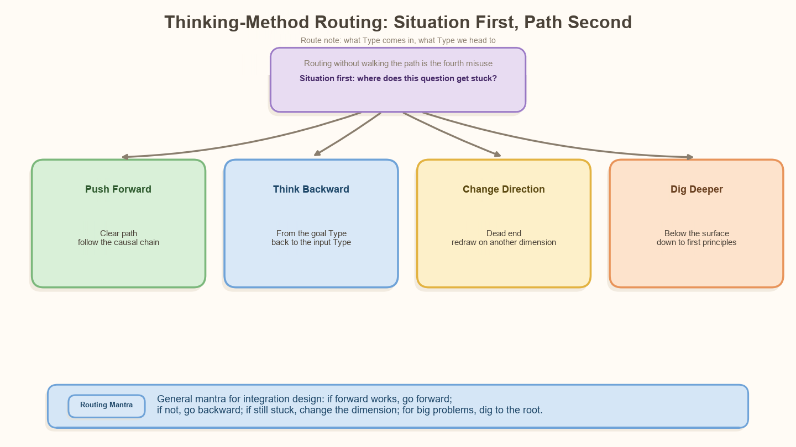

Figure 4-6 Choosing a thinking path: situation first, then route

> **[Mnemonic] The Routing Mnemonic**  
> If forward works, go forward; if not, go in reverse; if that fails, change the dimension; for big problems, dig to the root first.  
> Thinking picks the path and reasoning walks it — picking a path without walking it is the misuse of the thinking side.  

## 4.7 The Flywheel: Types and Functions Grow Each Other

Establishing, acting on and verifying a Type is a cycle: actions (design, generate, refactor) produce new Types, and Types support richer actions — the two grow each other. Together they are three ensemble rules: first, one Type in, one Type out; second, the output Type passes the three-layer check; third, the new Type returns to the Type Bank and grows a new function.

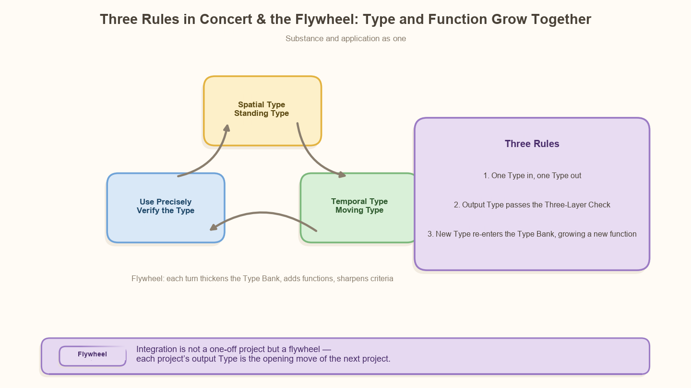

Figure 4-7 The three ensemble rules and the flywheel

Integration is not a one-off project but a flywheel — each project's output Type is the next project's opening move. Once the flywheel turns, it powers the four stages of bank building in Part Seven.

> **[Professional Column C4] API Contracts and Microservices: The Four Questions Are the Contract**  
> When the industry talks about API First and contract testing (Pact and the like), it is solving the same thing: the agreement between services must be verifiable. Align the contract template with the four function questions and you find two ways of writing the same card: the contract's operation name ↔ name; request schema ↔ input Type; response schema ↔ output Type; acceptance conditions and contract-test assertions ↔ criterion.  
> The difference is depth: an ordinary contract only writes the data shape, not the layers of the Type — which fields are essential (the three levels of remove), which request fields decide the response's category membership (the abstract criterion), and in which field the same business identity lives (id(C)). Add these three layers to the contract and contract testing upgrades from "format checking" to "business shape checking".  
> Practical advice: put a four-question card at the top of every microservice's contract file; grade the contract version's changelog by "which layer was touched" — content layer, structure layer, identity layer — exactly as in the change grading of 3.2.  

> **[Professional Column C5] Event-Driven Architecture: Pinning Verbs to the Time Axis**  
> Event sourcing and CQRS replace "state" with "the causal chain of events": the world now is the integral of the event stream. This is isomorphic to the causal chain pattern of the temporal Type — every event is the output Type of a verb, and the event stream is the time order of function outputs.  
> Three Ontypology checks on event design: first, is the event's Type written clearly (each event is a Type Set: {event header, payload, (context), [event category]}); second, is the causal antecedent written clearly (which state transition of which Type triggers it); third, is the compensating function written clearly (the four questions of reverse zeroing).  
> The common anti-pattern is the "universal event" — one event stuffed with half a business domain, an enormous output Type with no criterion. Ontypology's prescription is to return to the four questions: the output Type must be "recognisable and acceptable"; better many small events than one blurry event.  

> **[Exercise E06] Write Four-Question Cards for Two Interfaces**  
> Pick two system interfaces you own or know and fill a four-question card for each: name, input Type, output Type, criterion.  
> Check: can both cards' criteria be ticked sentence by sentence? If they say "must work well" or "normal is fine", rewrite them as verifiable conditions.  
> *Check when done: a function whose criterion cannot be ticked can only be accepted by feeling.*  

> **[Exercise E07] Draw Your Event Causal Chain**  
> Pick a business chain you know (for example "order to cash" or "hire to confirmation") and list four to six event nodes.  
> For each node write the input Type and the output Type; then pick one node and write the four questions of its compensating function.  
> *Check when done: the broken-link detection checklist is simply the list of expected Types along the chain.*  

# Part Five: The Precise Method, Integration Edition

This part is the method core of the book: it mounts the three supplements, the six proof steps, the eight questions and the 16 misuses onto one real integration flow — order to cash (O2C). After this part, every integration decision in your hands can be written to "auditable precision".

## 5.1 Three Supplements: Putting Missing Information Back in Place

The three gaps of a mathematical proof correspond to the three supplements: rules unwritten and you guess — use [ ] to write the category as a rule; identity unmarked and you imagine — use ( ) to write the invariant as an axiom; structure unclear and you argue — use { } to write dependence as a criterion. Supplements are not formatting; they upgrade verbal agreement into "a Type in black and white".

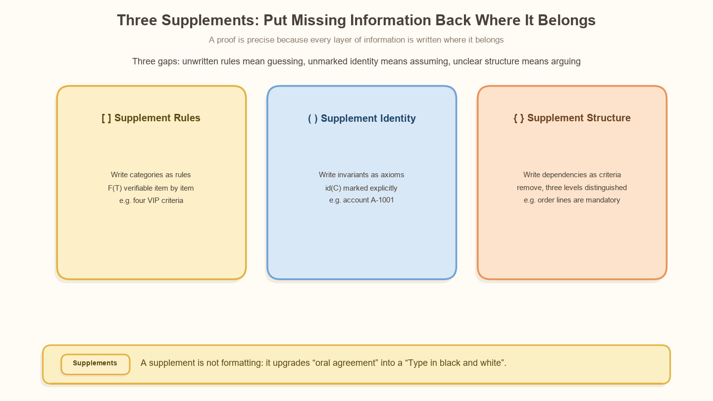

Figure 5-1 The three supplements: [ ] rules, ( ) identity, { } structure

| **Key comparison** |  |
| --- | --- |
| **[ ] Add rules** | Write the category as a rule: F(T) verifiable item by item. Example: a VIP customer's four features written into the criterion. |
| **( ) Add Identity** | Write the invariant as an axiom: mark id(C) explicitly. Example: account A-1001's identity does not change with its balance. |
| **{ } Add structure** | Write dependence as a criterion: separate the three remove levels. Example: the order line is essential, the free-gift sticker is optional. |

## 5.2 The Six Proof Steps: Writing Judgements to Be Auditable

The six steps are a fixed flow: identify the whole (which whole am I proving) → describe by axis (X property, Y composition, Z container written separately) → write the Type Set (the full notation {parts, (content), [category]}) → set the proposition (prove membership, prove success, or prove impact) → criterion reasoning (verify F(T) item by item, test remove part by part, check the id everywhere) → three-layer check (container, composition and abstraction all pass before it is written as proven).

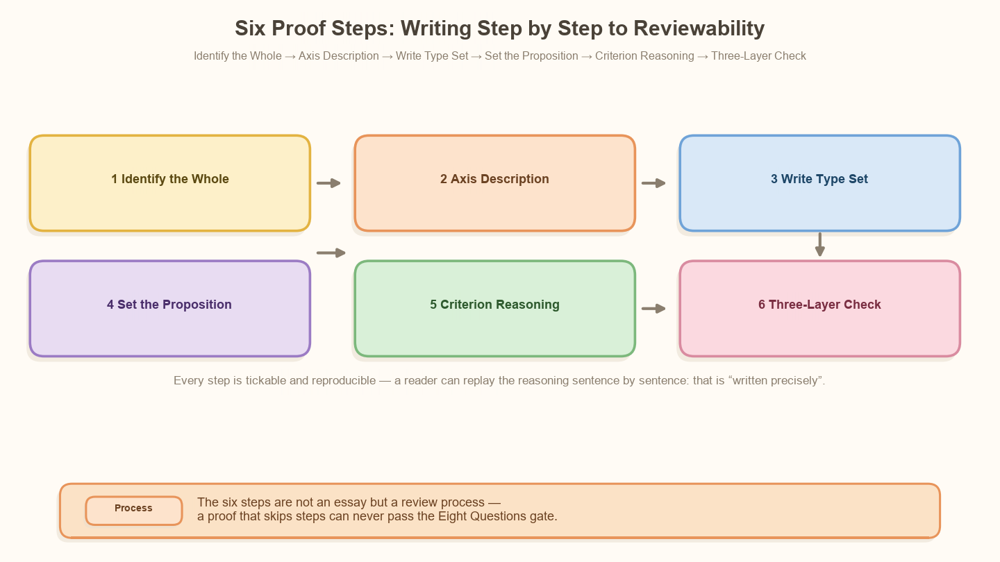

Figure 5-2 The six proof steps

The six steps are not an essay but a checking process — every step can be ticked and reproduced, and only when a reader can replay the reasoning sentence by sentence is it "written precisely". A proof that skips steps will never get past the eight questions.

## 5.3 Full Demonstration: Walking O2C from Order to Cash

As the demonstration, take the most representative integration flow: order to cash (O2C) — it spans order, warehouse, logistics and finance, four domains, and is where integration pain strikes most. Proposition: prove "shipment ∈ [transaction document]", and prove "collection writeback is acceptable".

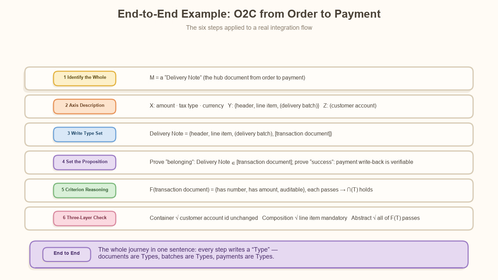

Figure 5-3 Full demonstration: the six steps end to end on O2C

> **[Proof Demo] The Six O2C Steps**  
> **(1) Identify the whole: the object is the "shipment note" — the central document from order to cash.**  
> **(2) Describe by axis: X: amount, tax type, currency; Y: {header, lines, (shipment batch)}; Z: (customer account).**  
> **(3) Write the Type Set: shipment note = {header, lines, (shipment batch), [transaction document]}.**  
> **(4) Set the proposition: prove membership — shipment note ∈ [transaction document]; prove success — the collection writeback is acceptable.**  
> **(5) Criterion reasoning: F(transaction document) = {has document number, has amount, auditable} — f1 passes (the number is generated from the ERP sequence), f2 passes (amount = sum of lines), f3 passes (every state transition leaves an audit trail). By ∩(T), shipment note ∈ [transaction document].**  
> **(6) Three-layer check: container ✓ (the customer account id does not change with collection); composition ✓ (lines are essential, shipment batch is content); abstraction ✓ (F(T) all pass). All three pass — (proved).**  

Now look at the before and after of "written to be auditable". Before is verbal agreement: "a shipment note probably counts as a transaction document", "the system reconciles automatically". After is Type notation: one Type Set, three criterion columns, one id. The same sentence, written as a Type, can be accepted.

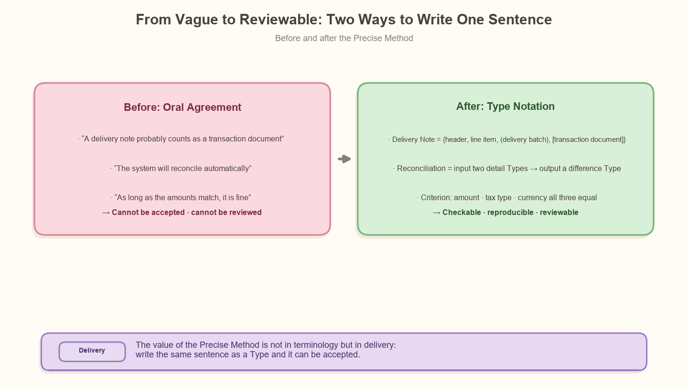

Figure 5-4 From vague to auditable: two ways to write the same sentence

## 5.4 The Eight-Question Checklist

Tick each item before delivery; all eight must pass: is the object identified? is F(T) written out? are the brackets right? is id(C) marked? has remove been graded? have boundary cases been considered? is every step checkable? has the joint three-layer check been done? The eight questions are the acceptance standard of the three supplements.

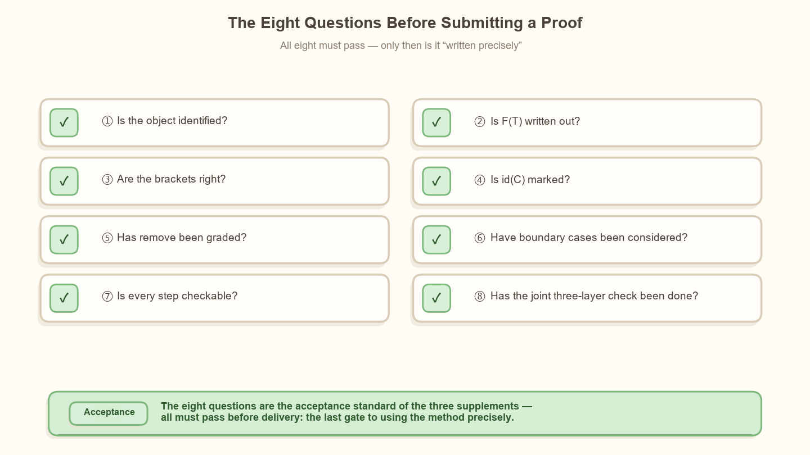

Figure 5-5 The eight questions before submitting a proof

## 5.5 The Misuse Table: 16 Kinds

The misuses gather into one big table: five on the spatial side, five on the verb side, three on the pattern side, three on the thinking side. The common root is one: the layers are not written clearly. How to read it: locate by side the traps you are likely to fall into, then copy the correct way straight across.

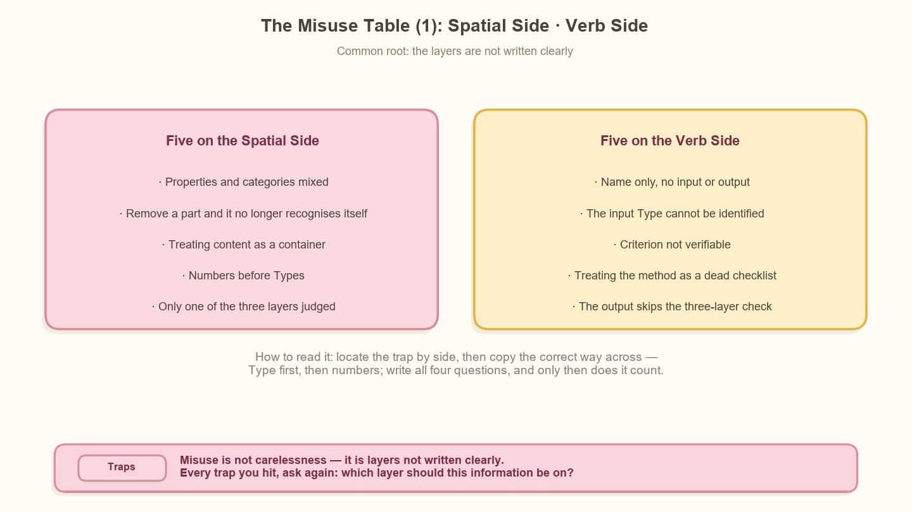

Figure 5-6 The misuse table (1): spatial side, verb side

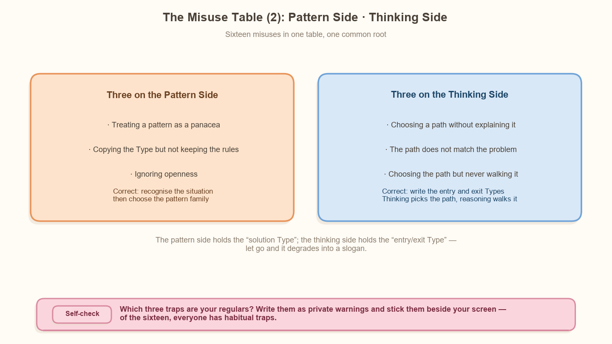

Figure 5-7 The misuse table (2): pattern side, thinking side

| **Side** | **Common misuses** | **Where the problem lies** | **The correct way** |
| --- | --- | --- | --- |
| Spatial side | Properties and categories mixed | [ ] Dimension scale ≠ [Category] | Dimensions belong to properties, categories to the Type Set |
| Spatial side | Remove a part and it no longer recognises itself | Remove an essential part and the Type falls apart | remove: test each part at the three levels |
| Spatial side | Treating content as a container | id(C) and S(C) confused | Identity separated from content |
| Spatial side | Numbers before Types | Counting before establishing the Type | Type first, numbers after |
| Spatial side | Only one of the three layers judged | None can be missing | Container, BOM and abstraction checked jointly |
| Verb side | Name only, no input or output | Everyone does something different | Write all four questions |
| Verb side | The input Type cannot be identified | Vague object of action | The input Type must be identifiable and deliverable |
| Verb side | Criterion not verifiable | "Must work well" cannot be ticked | [ ] Supplement the rules until they can be ticked |
| Verb side | Treating the method as a dead checklist | A new situation does not fit | The method is open rules (F(T), ∩(T)) |
| Verb side | The output skips the three-layer check | The result's provenance is unclear | All three layers must pass |
| Pattern side | Treating a pattern as a panacea | One formula for every situation | Situation first, then the pattern family |
| Pattern side | Copying the Type but not keeping the rules | Copying the shell, not keeping the solution Type | Every rule of the solution Type must be kept |
| Pattern side | Ignoring openness | The pattern as a dead checklist | Leave an open slot for new members |
| Thinking side | Choosing a path without explaining it | "I just want to think it that way" | Write the entry and exit Types |
| Thinking side | The path does not match the problem | Solve the dead end head-on | Re-choose on the decision tree |
| Thinking side | Choosing the path but never walking it | Beautiful thinking, no reasoning | Thinking picks the path, reasoning walks it |

> **[Exercise E08] Misuse Diagnosis + Six-Step Review**  
> Recall your most recent integration experience where the method did not go smoothly, locate at least two of the 16 misuses and write one line of correction for each.  
> Then pick a live integration judgement and write it as a one-page proof with the six steps (see the O2C demonstration in 5.3).  
> *Check when done: which three traps are your regulars? Write them as private warnings.*  

# Part Six: The Overall Architecture — Philosophy, Method, Practice

For the method to land it needs an architecture beneath it. This part gathers the book into a three-layer overall architecture, unfolds Mind AI's "two banks, one hub, one loop", and reads it against Palantir's Ontology — to see what "ontology engineering" does on the industry front line, and how it and Ontypology corroborate each other.

## 6.1 The Three-Layer Architecture: Philosophy—Method—Practice

One layer supports the next, and with one missing everything hangs: the philosophy layer (Ontypology) asks "why" — see the Type clearly; the method layer (the precise method) asks "how to be precise" — use the Type precisely; the practice layer (Mind AI and enterprise integration) asks "how to land" — deliver the Type.

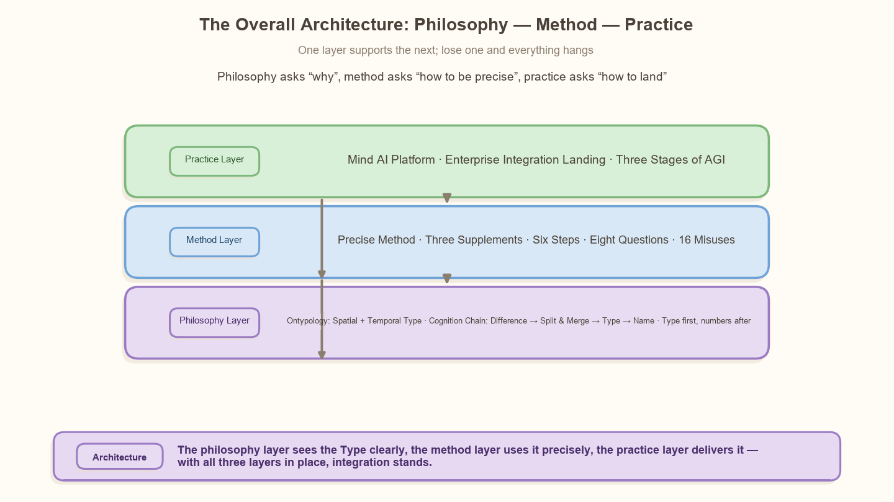

Figure 6-1 The overall architecture: philosophy—method—practice

An integration project can use these three layers as a health check: stuck at the philosophy layer means the Type is not recognised (same name, different meanings unresolved); stuck at the method layer means judgements are not auditable (each side argues its own case); stuck at the practice layer means delivery never lands (a beautiful plan that goes wrong at go-live).

## 6.2 Mind AI: Two Banks, One Hub, One Loop

Mind AI is the practice platform for Ontypology and Mind Model. The minimal architecture this book needs has only four parts: the Type Bank (spatial Types banked: Unit Type, three axes, Type Set), the Function Library (temporal Types banked: six groups, four questions, patterns), the Hub (Mind Model: unified knowledge, reasoning, thinking management), and the Learning Loop (output Types flow back into the bank once they pass the three-layer check).

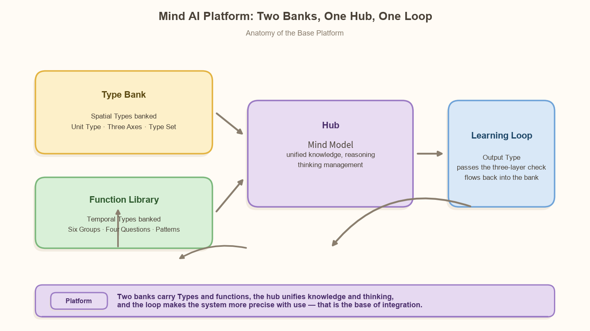

Figure 6-2 The Mind AI platform: two banks, one hub, one loop

Two banks carry Types and functions, the hub unifies knowledge and thinking, and the loop makes the system more precise with use — that is the base of integration. Note the book's boundary: what is given here is method and architecture, not system implementation; the base can be run today with "documents + spreadsheets + process", and platformisation comes later.

> **[Boundary] This Book Does Not Cover Implementation**  
> Two banks, one hub, one loop is architectural language, not a product specification — write the Type precisely with the method first, then talk about platformisation.  
> Mind AI's full research vision (unified knowledge → unified thinking → unified intelligence) is set out in 6.5; this book focuses on its projection onto enterprise integration.  

## 6.3 Reading Palantir Ontology Side by Side

On the industry front line Palantir's Ontology is positioned as "the organisation's operating layer": sitting on the data assets integrated into the platform, it connects objects back to their counterparts in the real world — from factory equipment to customer orders — and is often called the organisation's digital twin. It is built from two groups: semantic elements — objects, properties, links; and kinetic elements — actions, functions.

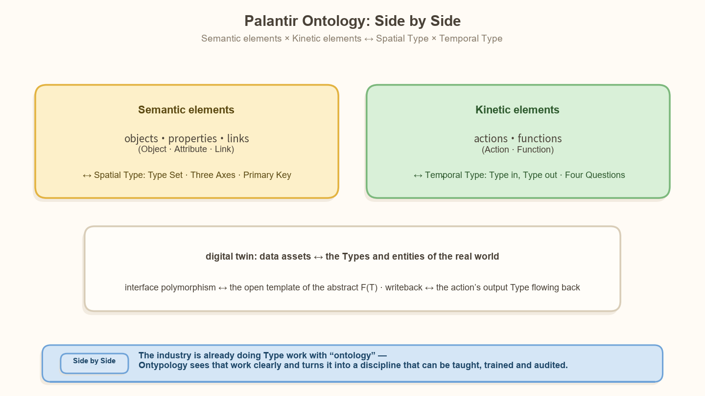

Figure 6-3 Reading Palantir Ontology

The reading is very direct: semantic elements ↔ spatial Type (objects and properties are Type Sets and three axes, links are a web woven from keys); kinetic elements ↔ temporal Type (actions and functions are all functions of Type in and Type out, and writeback is the return of the output Type). Palantir's interface provides polymorphism of object types — "describing the shape and capability of an object type" — which is the engineering embodiment of the abstract layer's open F(T) template.

| **Key comparison** |  |
| --- | --- |
| **objects・properties・links** | ↔ Spatial Type: the Type Set {parts, (content), [category]}, three axes, keys and links |
| **actions・functions** | ↔ Temporal Type: the four questions, Type in and Type out, acceptance by criterion |
| **digital twin** | ↔ Type and entity: the header is the Type, the row is the entity; a two-way mapping between system ↔ real world |
| **interface polymorphism** | ↔ The open template of abstract judgement F(T): categories that share a shape, with an open slot for new members |
| **writeback** | ↔ The output Type of an action flows back: after the three-layer check it becomes a new fact |

The conclusion of the reading is not "we are rather alike" but something heavier: the industry is already doing Type work with "ontology" — Ontypology sees that work clearly and turns it into a discipline that can be taught, trained and audited. The ontology road proves that "writing the world's Types into software" is the right direction; what Ontypology adds is criterion, layer and method of proof — exactly the three things the integration floor lacks most.

## 6.4 Digital Twins and Writeback

The digital twin institutionalises the mapping between the real world ↔ the world of Types: the field is moving (the contents of factories, orders and accounts change), and in the world of Types it is a state transition of a Type; for a decision to land, writeback returns the action's output Type to the real world. Both ends speak in Types, and only then is the mapping stable.

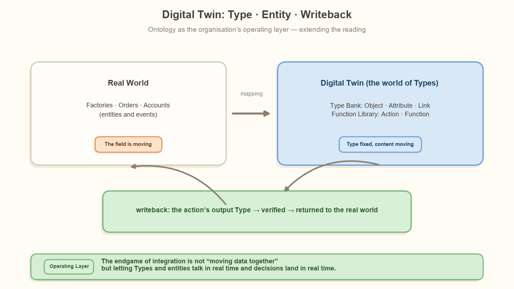

Figure 6-4 Digital twins: Type, entity, writeback

The endgame of integration is not "moving data together" but letting Types and entities talk in real time and decisions land in real time. This is also the maturity yardstick for enterprise system integration: from moving data, to establishing Types, to two-way writeback — at every step up, the precision of the Type is the precondition.

> **[Professional Column C6] Two Banks, One Hub, One Loop: Anatomy of the Platform**  
> Translate the four-piece kit into data-platform vocabulary: the Type Bank maps to the master data and ontology layer (type definitions, attribute dictionaries, identity rules), the Function Library to the service and rule layer (API contracts, business rules, process definitions), the hub to the knowledge and reasoning layer (inference engines, decision services, thinking management), and the loop to the governance and learning layer (audit, feedback, versions, refactoring).  
> Against a typical "data platform" blueprint the difference lies in two places: first, the Type Bank mandates three-axis notation (an ordinary platform has only a field dictionary, without the composition and container axes); second, the loop mandates the three-layer check before banking (ordinary platforms validate only format, not Type). These two differences are exactly where "integration pain" most often hides.  
> Suggested order of landing: first run the two banks on documents and spreadsheets (Type Set cards for the bank, four-question cards for the library), and turn the loop by hand in a weekly review; once the number of cards and the reuse rate prove the value, then platformise — validate the method before investing in a platform.  

> **[Professional Column C7] Ontology Engineering × Ontypology: What the Reading Means in Practice**  
> Ontology engineering is a long-established discipline that formalises domain knowledge, running from philosophical ontology all the way into information science: the semantic web (RDF/OWL), enterprise architecture (the data architecture domain of Zachman and TOGAF), and operational ontologies such as Palantir's. Together they verify three things: the world can be formalised, formalisation can support decisions, and decisions can be written back to the world.  
> Reading Ontypology against it yields three additions: first, the centrality of the criterion — F(T) and ∩(T) turn "category membership" from a privilege of inference engines into a table anyone can tick; second, the discipline of layers — the joint three-layer check of container, composition and abstraction gives ontology modelling's arguments ("is this a class or an individual?") a ruling procedure; third, the Type of the verb — the four function questions write actions and functions to the point of acceptance, filling a piece that ontology engineering has long left static.  
> The practical meaning in one sentence: if you do ontology engineering, treat Part Five of this book as your acceptance guide — your OWL class definitions, object properties and SWRL rules can all be translated into F(T), Type Sets and criteria, and then checked with the eight questions.  

> **[Exercise E09] Architecture Reading Exercise**  
> Take your organisation's data architecture diagram (or any data-platform blueprint) and mark where the Type Bank candidates are, where the Function Library candidates are, and where the loop has gaps.  
> Examine it with Palantir's split between semantic and kinetic elements: which group does your organisation currently invest more in? Is it balanced?  
> *Check when done: write the gap as one sentence: "what we lack is the Type of ____."*  

# Part Seven: The Complete Content Plan

With the method and the architecture in place, what remains is how to turn them into organisational capability. This part gives the complete plan: five stages of formation (learn, drill, use, teach, build), an eight-module curriculum (M1–M8), an eight-week route, a situation routing table, and four stages of bank building. The plan has one design principle: every step leaves a visible deliverable.

## 7.1 Learn, Drill, Use, Teach, Build: Five Stages of Formation

Learn it once, drill it once, use it once, teach it once, build it once — after five rounds the Type is yours. Every stage has a deliverable: learn (understand the Type, hand in notes), drill (do the exercises, hand in a six-step drill), use (apply it to work, hand in a real integration case), teach (explain it to someone, hand in one figure and one example), build (build the Type Bank, hand in enterprise assets).

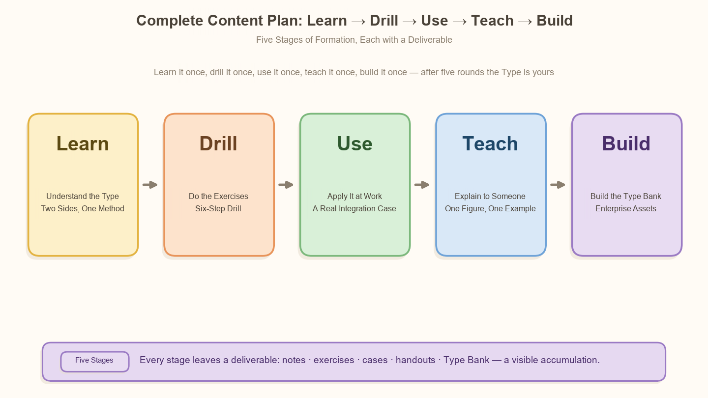

Figure 7-1 The complete plan: learn → drill → use → teach → build

The "teach" stage is often skipped, yet it is the most effective: only when you can explain the three axes to a colleague with one diagram do you prove you really understand. "Build" is both the end and the start — once the deliverable enters the Type Bank, the flywheel begins to turn.

## 7.2 M1–M8: An Eight-Module Curriculum

The content skeleton of the complete plan is eight modules, trimmable and combinable: M1–M6 lay the base (theory and method), M7–M8 land it (engineering and assets). Corporate training takes M1–M6; integration projects add M7; platform building adds M8.

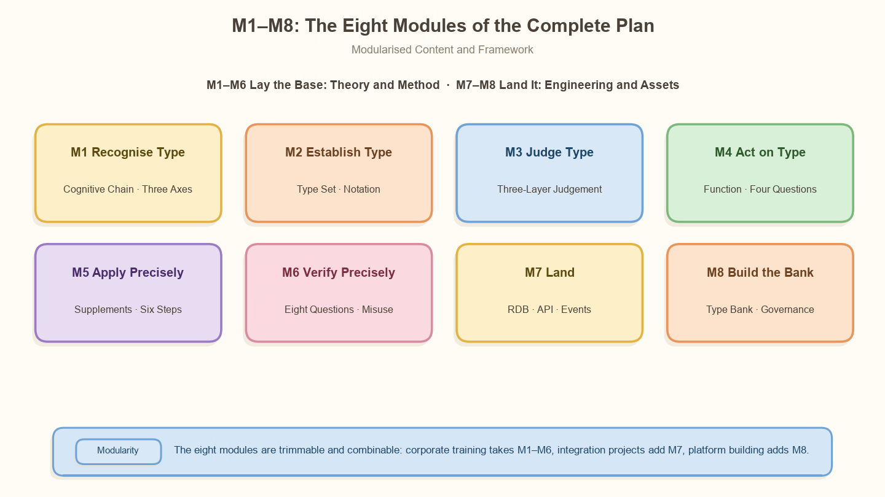

Figure 7-2 M1–M8: the eight modules of the complete plan

| **Module** | **Topic** | **Core content** | **Deliverables** |
| --- | --- | --- | --- |
| M1 Recognize | Cognitive chain · three axes | Difference, split, merge, Type, name; the X/Y/Z axes and the three brackets | One page of three-axis notes |
| M2 Establish | Type Set · notation | The Unit Type formula; how to write enterprise systems as Type Sets | Three Type Set cards |
| M3 Judge | Three-layer judgement | Container / BOM / abstraction joint check | A three-layer verdict |
| M4 Act | Function · Four questions | Six function groups; the four-question card | Two four-question cards |
| M5 Apply Precisely | Supplements · six steps | Three supplements; the six proof steps | A complete proof on one page |
| M6 Verify Precisely | Eight questions · Misuse | Eight-question check; the table of 16 misuses | Private warnings about misuses |
| M7 Land | RDB · API · Events | Key links; the contract's four questions; the event causal chain | A Type specification for an integration case |
| M8 Build the Bank | Type Bank · Governance | Four stages of bank building; version governance; the flywheel | A first-cut Type Bank |

## 7.3 The Eight-Week Route

For self-study or team study the eight-week route is recommended: W1 recognize, W2 establish, W3 judge, W4 act, W5 method, W6 demonstration, W7 landing, W8 building the bank. One theme, one figure, one exercise and one deliverable a week — eight weeks is only the starting line; the real route is the flywheel.

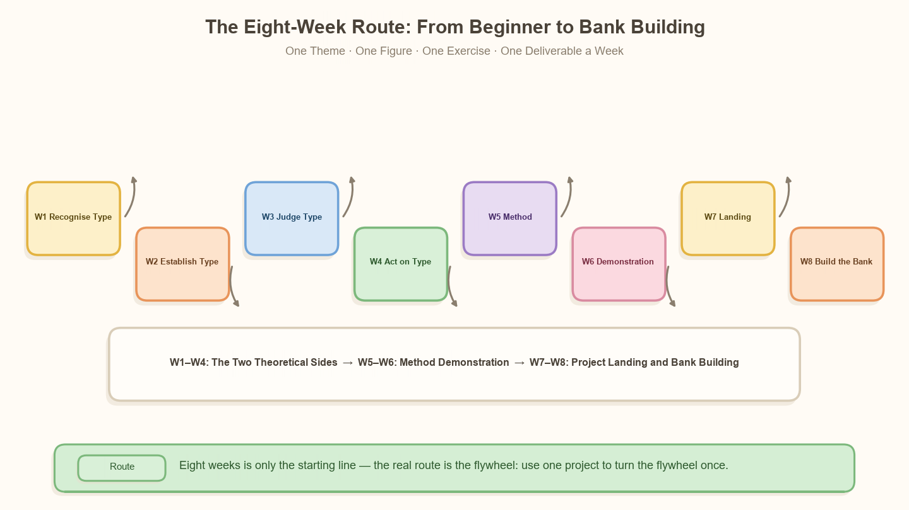

Figure 7-3 The eight-week route: from beginner to bank building

> **[Rhythm] The Three Beats of Eight Weeks**  
> W1–W4, the two theoretical sides: recognise, establish, judge and act on Types.  
> W5–W6, method demonstration: the six steps and the eight questions, walked end to end on a real flow such as O2C.  
> W7–W8, project landing and bank building: start on a real project and let the output settle into the bank.  

## 7.4 Situation Routing: Which Situation, Which Move

Five common integration situations, each with its matching method set. How to use this table: recognise the situation first — then pick the method — then walk the four steps (recognise the situation, pick the function, write the four questions, pass the eight questions).

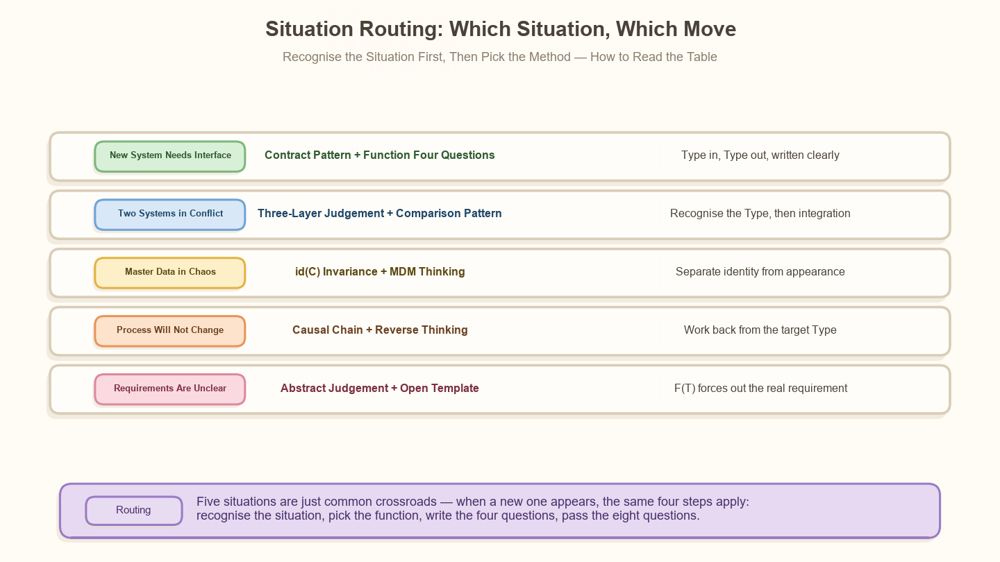

Figure 7-4 Situation routing table

Choosing a path is essentially the application of thinking method 6.4: if forward works, go forward; if not, go in reverse; if that fails, change the dimension. Five situations are just common crossroads — when a new one appears, the four steps still apply.

## 7.5 Four Stages of Bank Building: Turning Integration into Enterprise Assets

The Type Bank is integration's compound asset: collect (write down the Types met in projects first) → shape (three-axis notation, four-question cards filed) → bank (group, name, version, permission) → evolve (refactor and recombine, keep optimising the loop). Each project deposits a little, and it gets more precise with use.

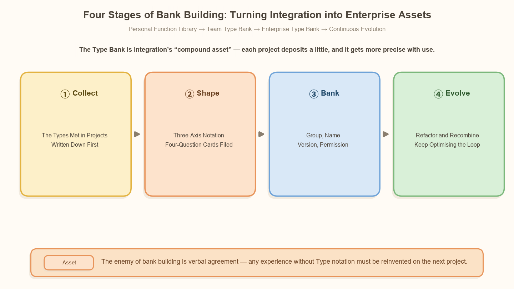

Figure 7-5 The four stages of bank building

The enemy of bank building is verbal agreement — any experience without Type notation must be reinvented on the next project. Conversely, every card in the Type Bank is the ruling basis for some future argument.

> **[Professional Column C8] Type Bank Governance: Change Management and Versions**  
> For the Type Bank to stay alive, governance must come first. Four governance themes: naming (one Type, one name; for synonyms use "reference", not "copy"), version (Type changes are graded in three levels — content, structure, identity — exactly as in 3.2), permission (who may change a Type, who may only propose), audit (every Type change leaves an audit trail, guarding the invariance of id(C)).  
> Read against the industry: this governance is isomorphic to data governance and ontology change management. The difference is that the Type Bank takes "the three brackets" as its smallest governance unit — changing [ ] is a rule change, changing ( ) an identity change, changing { } a structure change, and the approval level is obvious at a glance.  
> Starting in practice is light: one spreadsheet with three tabs (Type Set cards, four-question cards, change log) plus one rule — "a Type that is not on a card may not be cited in a formal plan". The rule matters more than the tool.  

> **[Exercise E10] Your Eight-Week Action Plan**  
> Following the eight-week route in 7.3, write your own eight-week plan: each week's theme, the hours you can spare, the planned deliverable.  
> Then, following the four stages in 7.5, choose where your Type Bank will live (a notebook, a spreadsheet, any tool) and write the title of the first card.  
> *Check when done: a plan counts only if it can be written down and delivered — better one small step a week for eight weeks than one giant step in week one.*  

# Part Eight: Conclusion

Having come this far, you have walked the whole map once. Gathered into one sentence: see the Type clearly, use the Type precisely, turn the Type into an asset — and there is only one measure of it all: auditable precision.

## 8.1 The Summary Map

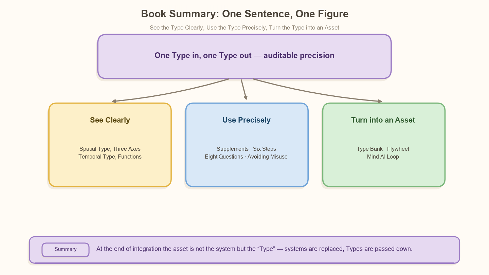

Figure 8-1 The book in summary: one sentence, one figure

Seeing clearly relies on the spatial Type (three axes, Type Set, three-layer judgement) and the temporal Type (functions, four questions, six groups); using precisely relies on the three supplements, the six steps, the eight questions and the 16 misuses; turning it into an asset relies on the Type Bank, the flywheel and Mind AI's learning loop. The three are joined head to tail: that is the complete methodology of integration.

## 8.2 The Action List: Four Things You Can Do Tomorrow

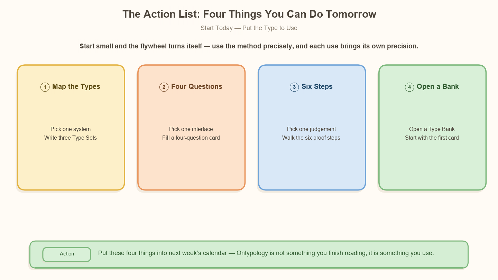

Figure 8-2 The action list: four things you can do tomorrow

- **Map the Types — pick one system and write three Type Sets: {parts, (content), [category]}.**
- **Write the four questions — pick one interface and fill a four-question function card: name, input Type, output Type, criterion.**
- **Run the six steps — pick one integration judgement, walk the six proof steps, and hand it to a colleague to challenge with the eight questions.**
- **Open a bank — open a Type Bank, starting with the first card.**

## 8.3 Closing Lines

**See the Type clearly, turn it into method, deliver it as Mind AI. Type first, numbers after; establish the Type first, then integrate. One Type in, one Type out — an auditable precision. Systems will be replaced; Types are inherited.**   

Ontology answers "what exists"; Ontypology answers "what a Type is and how it is used"; this book answers the one question they share on the enterprise floor: enterprise system integration in the AI era — establish the Type first, then integrate; precise Type, precise integration.

# Appendix A: Terminology and Notation Quick Reference

## A-1 Notation Quick Reference

| **Notation** | **How to read** | **Meaning** |
| --- | --- | --- |
| [ ] | Square brackets | Property / abstract set: dimension × scale; the category is recorded in the third position of the Type Set |
| { } | Braces | Composition / bill of materials (BOM): the structure of parts |
| ( ) | Parentheses | Container / content space: (coffee), (shipment batch) |
| C = ( id(C), S(C) ) | Container notation | Identity constant, content variable; the invariance axiom |
| F(T) | Feature set | The feature list of category T, verifiable item by item |
| ∩(T) | Intersection criterion | Classify only when the feature intersection all passes |
| ≢ M | Removed, no Type left | Criterion for essential parts (remove level one) |
| ≡ M′ ⊂ M | Still there, degraded | Criterion for functionally degraded parts (remove level two) |
| ≡ M | Removed, the Type is unchanged | Criterion for optional parts (remove level three) |

## A-2 Terminology Quick Reference

| **Term** | **In one sentence** |
| --- | --- |
| Type | The boundary drawn by splitting and merging; something recognisable, nameable and judgeable |
| Unit Type | The basic unit of the Type: Type Set = {parts, (content), [category]} |
| Spatial Type | The noun side of the Type, its substance: what it looks like, what it is made of, where it is |
| Temporal Type | The verb side of the Type, its use: one Type in, one Type out |
| Cognitive chain | Difference → split and merge → Type → name; every merge produces a Type; Type first, numbers after |
| Three-layer judgement of Type logic | Container, BOM and abstraction layers checked jointly, none can be missing |
| The four function questions | Name · Input Type · Output Type · Criterion |
| Three supplements | [ ] adds rules, ( ) adds identity, { } adds structure |
| The six proof steps | Identify the whole → describe by axis → write the Type Set → set the proposition → criterion reasoning → three-layer check |
| Eight questions | The eight check questions before delivery, and the acceptance standard of the three supplements |
| Type Set | The full notation of the Unit Type; also the enterprise's general modelling grammar |
| Mind Model | The practice architecture of Ontypology: a hub of unified knowledge and unified thinking |
| Mind AI | The practice platform of Ontypology and Mind Model: two banks, one hub, one loop |
| digital twin | A two-way mapping between the world of Types and the real world, where decisions can be written back |

# Appendix B: Precise Method Quick Reference Card

## B-1 One-Page Quick Reference Card

> **[Quick Card] One-Page Card for Integration Tasks (Photocopy and Post at Your Desk)**  
> **Three questions before you start: for this integration's object, is the Type written out? is the id marked? can the criterion be ticked?**  
> **Establish: Unit Type = {parts, (content), [category]} — write the three axes separately, each bracket in its place.**  
> **Act: the four questions — name, input Type, output Type, criterion; the criterion must be tickable sentence by sentence.**  
> **Verify: walk the six steps (identify the whole → describe by axis → write the Type Set → set the proposition → criterion reasoning → three-layer check).**  
> **Delivery: all eight pass — object, F(T), brackets, id, remove, boundary, checkable, three layers.**  
> **Avoiding traps: the common root of the 16 misuses is "the layers are not written clearly" — ask first: which layer should this piece of information be on?**  
> **Change grading: touching content = light, touching structure = heavy, touching identity = catastrophic.**  
> **Settle: the output Type enters the Type Bank after the three-layer check — one turn of the flywheel and the next opening move is ready.**  

## B-2 Blank Templates (Photocopy Pages)

The three templates below can be printed separately and posted at your desk or filed in the project folder.

### Template 1: The Four-Question Function Card

| **Field** | **What to fill in** | **Checkpoint** |
| --- | --- | --- |
| Name | ＿＿＿＿＿＿＿＿ | A name everyone knows, no context confusion |
| Input Type | ＿＿＿＿＿＿＿＿ | Identifiable and deliverable |
| Output Type | ＿＿＿＿＿＿＿＿ | Recognisable and acceptable |
| Criterion | ＿＿＿＿＿＿＿＿ | Tickable sentence by sentence, auditable |

### Template 2: The Type Set Card

| **Field** | **What to fill in** |
| --- | --- |
| The Type's name | ＿＿＿＿＿＿＿＿＿＿＿＿＿＿ |
| Composition { } | Parts: ______ (essential / degraded / optional) |
| Content ( ) | Holds: ______ id(C): ______ |
| Property [ ] | Dimension × scale: ______ |
| Category [ ] | F(T) feature list: ______ |

### Template 3: The Eight-Question Tick List

| **#** | **Check question** | **Tick** |
| --- | --- | --- |
| 1 | Is the object identified? | □ |
| 2 | Is F(T) Written Out? | □ |
| 3 | Are the brackets right? | □ |
| 4 | Is id(C) marked? | □ |
| 5 | Has remove been graded? | □ |
| 6 | Have boundary cases been considered? | □ |
| 7 | Is every step checkable? | □ |
| 8 | Has the joint three-layer check been done? | □ |

# Appendix C: Model Answers to the Exercises

Below are model answers for E00–E10. The answers are not unique — what matters is that every step is auditable: your answer should also be written so that others can tick it item by item.

## C-1 Guide: Parts One and Two

> **Exercise E00: Model Answer**  
> Model: "after an order ships, finance's receivable and the ERP order amount never reconcile." Same name, different meanings: both sides call it "amount", one is tax-inclusive and the other tax-exclusive. Different names, same meaning: "shipment note" and "dispatch note" are two names for the same Type.  
> Self-check: if your trouble is of both kinds, handle same name with different meanings first — that is the Type's F(T) left unwritten.  

> **Exercise E01: Model Answer**  
> Model: ERP's "customer" = {code, name, tax number} (the settlement subject); CRM's "customer" = {contact, opportunity, interaction log} (the opportunity subject). Same name, different meaning is confirmed: one is the transaction-subject Type, the other the relationship-subject Type.  
> Locating the pain: same name with different meanings plus misalignment. Root cause: F(T) unwritten plus dimensions that do not run through (the tax number exists only in ERP). Fix: write a Type Set for each of the two Types and connect them with a reference instead of forcing a merge.  

> **Exercise E02: Model Answer**  
> Model: first, the spatial Type governs "what the Type is", the temporal Type governs "how it moves"; second, the precise method writes judgements to be auditable; third, Mind AI stores the Type as an asset with two banks, one hub and one loop.  
> Self-check: if one of the three sentences sticks, go back and reread the corresponding section of Part Two.  

## C-2 Parts Three and Four

> **Exercise E03: Model Answer**  
> Model (WMS order): outbound note = {header, lines, (wave), [work document]}; id = outbound note number; essential = header and lines. Slot = {slot code, (pallet), [container]}; id = slot code; essential = code. Forklift = {body, battery, (driver), [equipment]}; degraded part = battery.  
> Self-check: the three Types' ids must not share field rules; removing an essential part must really leave no Type.  

> **Exercise E04: Model Answer**  
> Model: laptop = {motherboard, screen, keyboard, battery, disk, (data), [model]}. Essential: motherboard, screen (remove them and it is not a laptop); functionally degraded: battery (remove it and it becomes a desktop, still the same machine), keyboard (external keyboard, degraded function); optional: stickers, external mouse.  
> Self-check: "does it recognise itself" requires first writing down the definition of the Type — if the definition is "portable computing device", the battery may be essential.  

> **Exercise E05: Model Answer**  
> Model (manual review of a payment request): container layer — the request's id is stable and it is not a duplicate; composition layer — header and lines are essential, attachments optional; abstraction layer — F(needs review) = {amount > 100k, supplier is new, unusual payment terms, high-risk category}; any one feature hit triggers review.  
> Self-check: the two positive and one negative cases must include a boundary case (an amount of exactly 100k) — write the boundary ruling into the rule.  

> **Exercise E06: Model Answer**  
> Model: name "order sync ERP→WMS"; input Type "order Type {header, lines} (status = approved)"; output Type "receipt Type {order no., received time, status}"; criterion "receipt status = success and line counts equal and amount fields all equal".  
> Self-check: if the criterion says "normal" or "probably", send it back; only conditions like "all three fields equal" can be ticked.  

> **Exercise E07: Model Answer**  
> Model: order → deduct stock → ship → invoice → collect. Node "deduct stock": input Type "approved order Type", output Type "stock movement Type {SKU, quantity, bin}"; compensating function "restock": input Type "stock movement Type", output Type "restock Type (movement zeroed)", criterion "sellable after restock = original sellable + movement quantity".  
> Self-check: the compensating function needs all four questions too — a chain with unclear compensation cannot go to production.  

## C-3 Part Five

> **Exercise E08: Model Answer**  
> A model misuse diagnosis: "treating the pattern as a panacea" plus "criterion not verifiable". One line of correction each: recognise the situation first (the break is at the identity layer, so use the container pattern, not the general reconciliation pattern); rewrite the criterion ("it matches" → "all three fields equal and the difference table empty").  
> A model six steps: identify the whole (a "refund note") → axes (X: amount, reason code; Y: {header, (original order), (payment channel)}; Z: (customer account)) → Type Set (refund note = {header, (original order), (payment channel), [transaction document]}) → proposition (prove success: the refund writeback is acceptable) → criterion (F(acceptable) = {original order exists, amount ≤ original order, channel receipt complete}) → three layers (container ✓ account id unchanged; composition ✓ header essential; abstraction ✓ all pass).  

## C-4 Parts Six and Seven

> **Exercise E09: Model Answer**  
> Model: on a data-platform blueprint, mark the master data zone as "Type Bank candidate", the API gateway and rules engine as "Function Library candidate", and the data quality audit as "loop gap" (it checks format, not Type). Test with the dichotomy: most organisations put 8 of 10 into semantic elements and 2 into kinetic — the imbalance is exactly where "actions without a Type" festers.  
> Self-check: write the gap as "what we lack is the Type of ____" — if you cannot, you have not yet seen what is missing.  

> **Exercise E10: Model Answer**  
> A model eight weeks: W1 two hours each evening reading Part Two plus notes; W2 hand in three Type Set cards; W3 hand in one three-layer verdict; W4 hand in two four-question cards; W5 hand in a one-page O2C proof; W6 peer-review a colleague's proof with the eight questions; W7 start on a real project; W8 bank 20 cards.  
> Self-check: fill weekly hours as real numbers from your calendar; a suggested title for the bank's first card: "<the entity that hurts most> Type Set".
