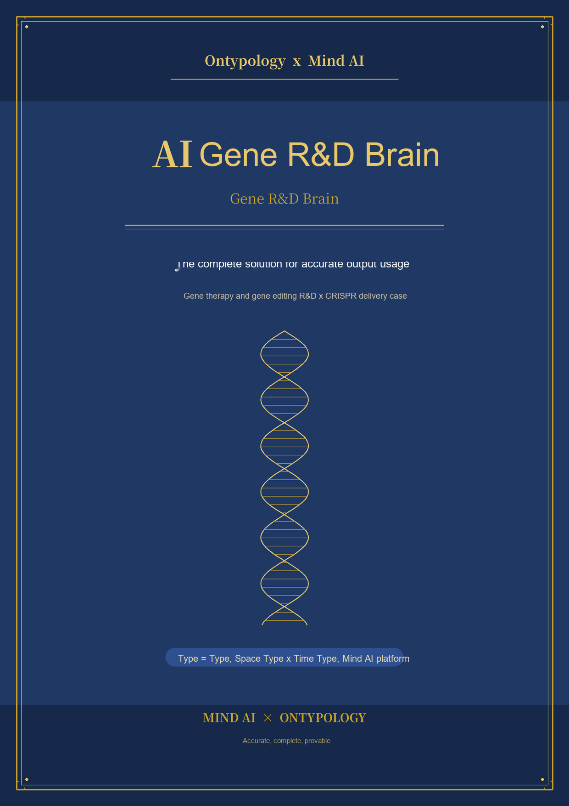

## Table of Contents

- **Before we begin: three conventions** **3**
- **Guided reading: two languages and three ways of reading** **4**
- **Chapter One Understanding the AI Gene R&D Brain** **5**
  - 1.1 The Reasonable R&D Twin: How Type + Number Holds Gene R&D 5
  - 1.2 Where the Two Types Land: the Three Space Brackets and the Fourteen Time Moves 6
  - 1.3 The Mind AI Division of Labour: LLM Induces, Mind Model Deduces 7
  - 1.4 Where Accuracy Comes From: Preview of the Four Gates 8
  - 1.5 Four Scenes of Inaccurate Output 8
- **Chapter Two Six Output Types: "Target, Guide, Vector, Assess, Verdict, Evolution"** **10**
  - 2.1 Overview of the Six Types and the Output Chain 10
  - 2.2 Target Type and Guide Type 11
  - 2.3 Vector Type and Assessment Type 12
  - 2.4 Verdict Type and Evolution Type 12
  - 2.5 The Three Brackets and the Three Levels of remove in R&D Use 13
- **Chapter Three Four-Layer Accuracy Assurance** **15**
  - 3.1 Layer One: the ∩(T) Criterion Funnel 15
  - 3.2 Layer Two: the Deductive Skeleton 16
  - 3.3 Layer Three: the Validation Three-Piece Set 17
  - 3.4 Layer Four: the Type Evidence Chain 18
  - 3.5 Cross-Acceptance: the Space × Time Nine-Cell Grid 19
- **Chapter Four Six Steps: from R&D Requirement to Output** **21**
  - 4.1 Four Framework Steps: Identifying the R&D Requirement 21
  - 4.2 Six-Step Operation Card 22
  - 4.3 Three-Layer Judgement: Is, Has, Right 23
  - 4.4 Selecting, Assembling, Swapping Moves 24
  - 4.5 Misuse Warning Points 24
- **Chapter Five The Full S1–S7 Case: GX-2610** **26**
  - 5.1 Seven-Stage Relay: the S1–S7 Pipeline 26
  - 5.2 Full Text of Prompts S1–S7 27
  - 5.3 Case Opening: Target Card and Guide Design 28
  - 5.4 Full Output: Vector, Assessment, and Verdict 29
  - 5.5 Evolution Ledger and Usage Rules 30
- **Chapter Six Misuse Comparison and Maturity** **33**
  - 6.1 Five Misuses 33
  - 6.2 A Ten-Question Checklist 34
  - 6.3 Maturity L1–L4 34
  - 6.4 The Ninety-Day Adoption Blueprint 35
  - 6.5 Compliance and Ethics Red Lines 36
- **Review: three takeaways** **37**
- **Appendix A Toolbox (quick reference)** **38**

# Before we begin: three conventions

This is a "how to use it" book. The AI gene R&D brain writes every output of gene therapy and gene editing R&D - target card, guide design, vector plan, assessment report, R&D verdict, evolution record - as a "Type" with fields, criteria, and identity, so that every step of R&D is reasonable, acceptable, and recheckable. Before picking up the pen, establish three conventions.

> **Convention one Type = Type, not Form**  
> The English for the character for Type throughout this book is always Type - SpecType, GuideType, Type-Driven R&D. Not Form.  

> **Convention two the theory is used, not taught**  
> The Space Type and the Time Type are the foundation of this book. The book uses only the tools of the theory - the three brackets [ ] { } ( ), the intersection criterion ∩(T), the identity id(C), the three levels of remove, the four framework steps, the three-layer judgement, and the fourteen Time moves - without restating the principles and arguments. To read the theory itself, return to the originals "The Space Type of Ontypology" and "Ontypology: The Time Type".  

> **Convention three the platform is cited, not restated**  
> Mind AI is the underlying platform of this book: the LLM handles inductive statistics, the Mind Model handles deductive reasoning, and the two converge in the platform. The book cites this division of labour without restating the platform; to understand the platform itself, return to "Introduction to Mind AI".  

> *Demonstration declaration: the programme code, sequence parameters, efficiency, and off-target values of the running case GX-2610 (HBB gene correction for sickle-cell anaemia) are all demonstration data,*  
> *Used to demonstrate the output format and the operation of the criteria; it does not constitute medical advice, nor is it a basis for real clinical trial design. Real gene-editing R&D must follow regulations and ethics review (see 6.5).*  

**Table 0-1 Task map: how this book takes you through**

| **Chapter** | **Topic** | **Corresponding tool** | **What you will get** |
| --- | --- | --- | --- |
| Before we begin | Three conventions and the demonstration declaration | Type = Type, used not taught | How to read the book |
| Guided reading | Two languages, three ways of reading | The coordinates of the two Types | The panorama in one figure |
| Chapter 1 (understanding the system) | Understanding the R&D brain, the four scenes of inaccurate output | Type + Number, the move tray | Why a Type is needed |
| Chapter 2 (overview of the six Types) | Target, guide, vector, assess, verdict, evolution: six-Type field cards | The three brackets, the three levels of remove | The template of the output |
| Chapter 3 (the four gates of accuracy) | Criteria, skeleton, acceptance, trace | ∩(T), Type evidence chain | The definition of accuracy |
| Chapter 4 (the six operating steps) | The operation from R&D requirement to output | Four framework steps, three-layer judgement | Operation card |
| Chapter 5 (the GX-2610 case) | Full output example of the seven-stage relay | Full text of prompts S1–S7 | A template that can be copied |
| Chapter 6 (misuse and maturity) | Misuse comparison, L1–L4, compliance red lines | The ten-question checklist, adoption blueprint | Adoption route |
| Review | Three takeaways | Toolbox | Carry-along card |
| Appendix A (quick reference) | Terminology, moves, notation | Quick-reference table | Look it up as you go |

# Guided reading: two languages and three ways of reading

Gene R&D has one language: target, sgRNA, vector, off-target, IND. Ontypology has another: Type, three brackets, criteria, moves. The two languages speak of the same thing - this book is their translation manual.

**Table D-1 Two languages compared**

| **The language of Ontypology** | **The language of the R&D site** | **State it clearly in one sentence** |
| --- | --- | --- |
| Type | Specification, design document, report | Output with fields and criteria |
| [ ] property, abstraction | Target features, design conditions | Dimensions and scales that can be questioned |
| { } BOM, composition | System composition, formulation, module list | Open it up and see what it is made of |
| ( ) Container, identity | Programme, batch, cell line | A frame whose content changes but whose identity does not |
| ∩(T) intersection criterion | Acceptance thresholds, release standards | Only when all pass does it count |
| three levels of remove | Part impact grading | Whether identity survives after removal |
| Move (function) | R&D operating method | Time Type = verb = function |
| Type evidence chain | R&D records and audit trail | Every step recheckable |

> 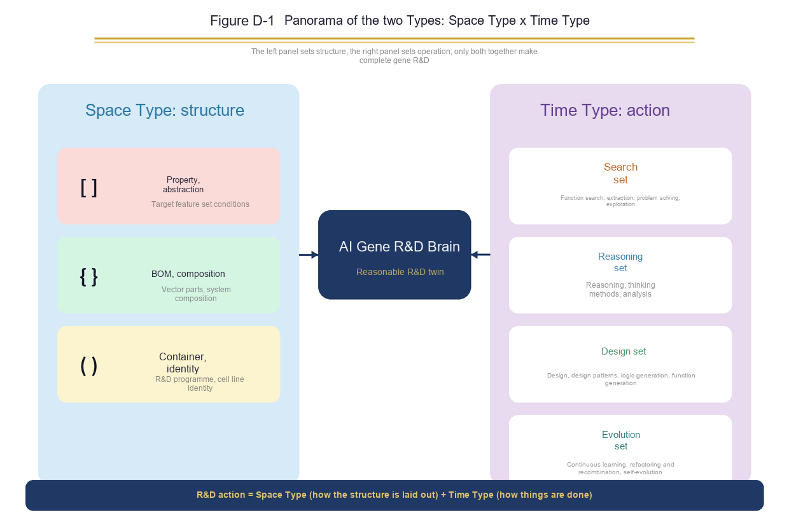  
> **Figure D-1 Panorama of the two Types: the Space Type sets structure, the Time Type sets operation**  

**Table D-2 Three ways of reading**

| **Who you are** | **Suggested path** | **Estimated time** |
| --- | --- | --- |
| Executive, decision maker | Before we begin, then 1.4, then 3.5, then 5.4, then 6.3 | 30 minutes |
| R&D engineer | Guided reading, then 2, then 4, then all of chapter 5 | 2 hours |
| Adoption driver | 1 → 2 → 4 → 6 | 90 minutes |

Path reading: the numbers point to chapters - the management line looks at decisions, the engineer line looks at output, the adoption line looks at process.

# Chapter One Understanding the AI Gene R&D Brain

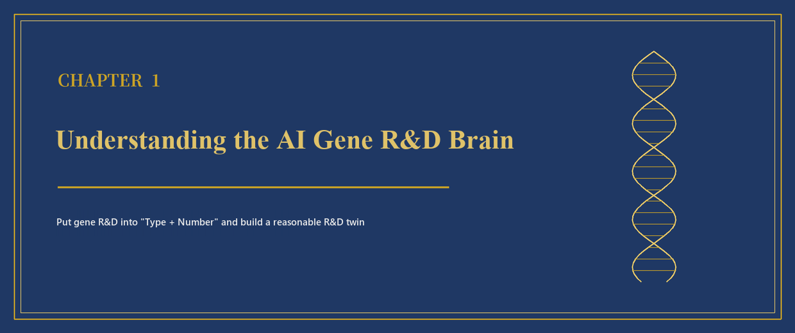

**The AI gene R&D brain is not a chatbot but a "reasonable R&D twin" - it packs the knowledge, criteria, and decisions of gene therapy and gene editing R&D into a frame built of Type and Number.**

The difficulty of gene R&D is not that data cannot be produced, but that there is always a gap between data and decision: literature sits in folders, parameters sit in engineers' heads, decisions sit in meeting minutes. By the time you need to recheck, hand over, or explain to a regulator, nobody can piece the reasoning back together. The AI gene R&D brain's solution is to write R&D itself as a Type - every output has fields, every gate has criteria, every decision has a documented basis.

## 1.1 The Reasonable R&D Twin: How Type + Number Holds Gene R&D

Brain thinking = Type + Number. Number answers "how much, how fast, how accurate" - editing efficiency 68%, off-target rate 0.3%, cell survival 86%; Type answers "what it is, what it is made of, how it changes" - does this pegRNA belong to the Guide Type, what does this delivery system consist of, and is this programme still the same one after changing a batch of cells. R&D with numbers alone yields a pile of numbers but no reasoning; only Type and Number together yield an R&D twin that can be questioned, rechecked, and handed on.

The core carrier of this twin is the "Type" (Type, not Form). Every output of R&D - target card, guide design, vector plan, assessment report, verdict document, evolution ledger - is a Type: with fields (properties), criteria (∩(T)), identity (id(C)), and composition (BOM). Only when the output is written as a Type does AI have a skeleton for reasoning and people have a target for acceptance.

> 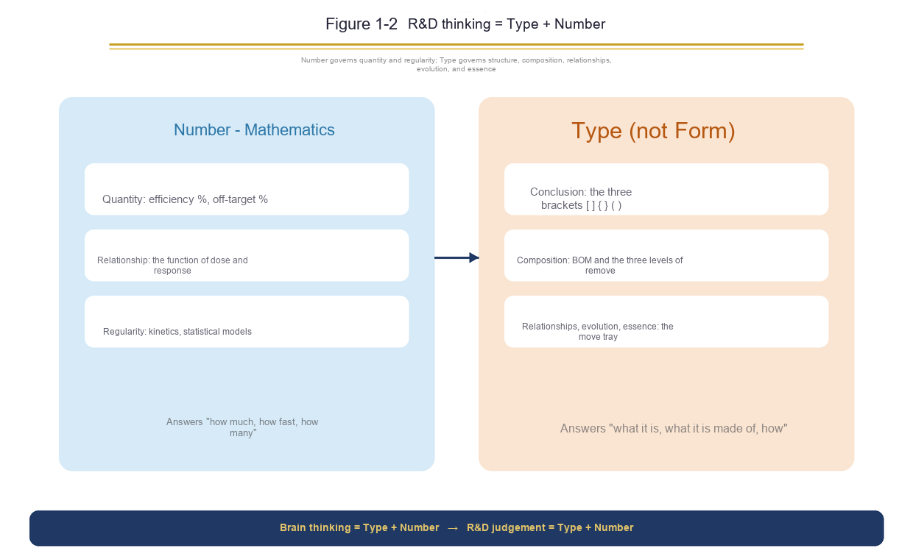  
> **Figure 1-2 R&D thinking = Type + Number**  

**R&D twin = Type (structure, composition, evolution) + Number (quantity, relationship, regularity)**

## 1.2 Where the Two Types Land: the Three Space Brackets and the Fourteen Time Moves

The Space Type governs "how the structure is arranged": the three brackets each write one layer - [ ] writes class rules, { } writes composition structure, ( ) writes the identity container. The Time Type governs "how things are done": the Time Type is verb, function, move; every act of R&D is selecting, assembling, and swapping moves on the fourteen-move tray.

**Table 1-1 The three Space brackets landing in gene R&D**

| **Bracket** | **Ontypology meaning** | **Where it lands in R&D** | **Instance** |
| --- | --- | --- | --- |
| [ ] | Property, abstract set | Target features, design conditions, acceptance thresholds | F(Guide Type) = { complementary target sequence, qualified PAM, editing window covering the variant } |
| { } | BOM, composition set | System composition, formulation, module list | BOM(LNP vector) = { lipid, mRNA, PEG lipid, targeting ligand } |
| ( ) | Container, spatial container | The identity of programme, batch, and cell line | C = (id(C), S(C)): when GX-2610 changes cell batch, id(C) does not change |

The fourteen moves of the Time Type fall into four sets: the search set finds it, the reasoning set thinks it clearly, the design set makes it, the evolution set grows it. The R&D situation decides which move to pick - designing pegRNA picks "design + generation", when efficiency will not come up pick "refactoring", when the assumption is unstable pick "first-principles thinking". The fourteen moves are not a checklist but a move tray that moves with the situation.

**Table 1-2 The fourteen Time moves x where they land in gene R&D**

| **Set** | **Move** | **Where it lands in R&D** |
| --- | --- | --- |
| Search set | Type-time function search | Find reusable designs in the Type library: past pegRNA parameters, vector formulations |
| Search set | Design search and extraction | Extract editing strategies and sequence design space from literature and patents |
| Search set | Problem solving | Troubleshooting path for efficiency bottlenecks and off-target anomalies |
| Search set | R&D and exploration | Feasibility exploration of new editors and new delivery routes |
| Reasoning set | Reasoning | Causal, reverse-causal, simulation, statistical, reverse: infer mechanism from data, infer variant from phenotype |
| Reasoning set | Thinking methods | Forward, reverse, horizontal, vertical, first principles: strategy divergence and convergence |
| Reasoning set | Analysis | Sequence analysis, off-target profile analysis, SAR-style structure-activity analysis |
| Design set | Design (creation and innovation) | Design of pegRNA, vector, and validation plan |
| Design set | Design patterns | Reusable R&D patterns: screening funnel, control design, dose escalation |
| Design set | Logic generation and application | Generate the criteria as executable acceptance rules |
| Design set | Function generation and application | Seal the process into a repeatably callable standard operation |
| Evolution set | Continuous learning | Each round's experimental data feed back into the Type library |
| Evolution set | Refactoring and recombination | PBS/RTT combination rearrangement, strategy refactoring and re-measurement |
| Evolution set | Self-evolution | Criteria thresholds update with the evidence, and the Type library grows by itself |

> 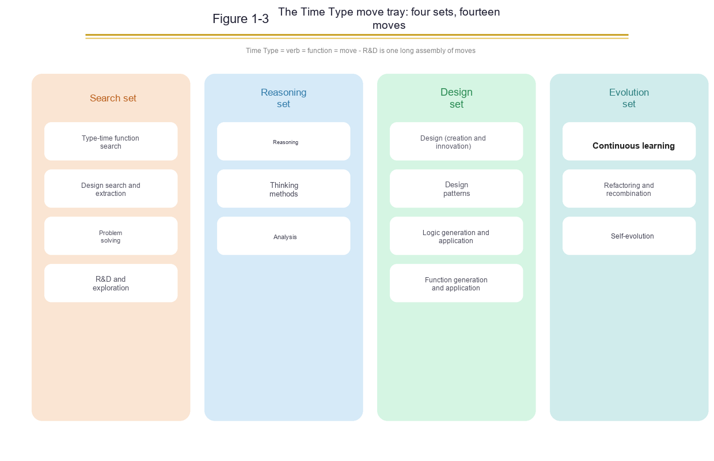  
> **Figure 1-3 The Time Type move tray: four sets, fourteen moves**  

## 1.3 The Mind AI Division of Labour: LLM Induces, Mind Model Deduces

The underlying platform is Mind AI. The division of labour in one sentence: the LLM handles language ability, the Mind Model handles intelligence. In gene R&D - the LLM reads literature, writes reports, recalls answers (inductive statistics); the Mind Model reasons, accepts, remembers, evolves (deductive reasoning). Accurate output does not come from a bigger model but from each doing its own job with the criteria refereeing in between.

**Table 1-3 The Mind AI division of labour in gene R&D**

| **Role** | **Good at** | **What is done at the R&D workflow** |
| --- | --- | --- |
| LLM (inductive statistics) | Language understanding, language generation, knowledge recall | Read literature and extract, write the first draft of each Type's output, organise experimental records |
| Mind Model (deductive reasoning) | Unified knowledge, deep reasoning, long-term memory, autonomous learning | Bring the first draft into the Type skeleton, run the ∩(T) criteria, and maintain the Type evidence chain and evolution ledger |
| R&D staff | Situation judgement, value trade-off, final sign-off | Give the situation, review the output, give the verdict - people handle direction, the Type handles clarity |

## 1.4 Where Accuracy Comes From: Preview of the Four Gates

"Accurate output" is not a slogan; it is gated out by four gates: first set the criteria (the ∩(T) funnel), then deduce the skeleton so the output grows on the skeleton, then reconcile with the experimental data three-piece set, and finally string every step into a Type evidence chain. Only when all four pass is it accurate; if any one fails, return - and the return also leaves a trace.

**Table 1-4 Preview of the four gates**

| **Gate** | **One sentence** | **What to output** | **Detail** |
| --- | --- | --- | --- |
| Gate one the criterion funnel | Set the criteria first, then let the candidates pass | ∩(T) acceptance sheet | 3.1 |
| Gate two deductive skeleton | The output grows on the skeleton, not on feeling | Deductive skeleton | 3.2 |
| Gate three validation reconciliation | When the experimental data come back, reconcile item by item | The validation three-piece set | 3.3 |
| Gate four trace into a chain | Every step recheckable and replayable | Type evidence chain | 3.4 |

> 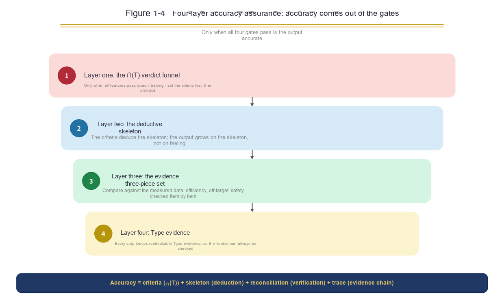  
> **Figure 1-4 Four-layer accuracy assurance**  

## 1.5 Four Scenes of Inaccurate Output

It is clearest read backwards. Inaccurate gene R&D output almost always happens in four scenes: target drift, guide misalignment, missed off-target, verdict without basis. The four scenes share one root cause - the output was not written as a Type, and the layers were not written clearly.

**Table 1-5 Four scenes of inaccurate output**

| **Scene** | **Symptom** | **Root cause** | **Solution** |
| --- | --- | --- | --- |
| Target drift | Target gene, variant site, and design goal each stated separately; the target is swapped midway and nobody notices | The target has no Type and no id(C) | The Target Type establishes identity |
| Guide misalignment | The sequence is right, the PAM is wrong, the editing window does not cover the variant site | Design conditions not written as ∩(T) | The Guide Type establishes the criteria |
| Missed off-target | Reporting efficiency but not off-target, leaving the safety assessment missing a whole block | Assessment fields incomplete | The Assessment Type has all five columns |
| Verdict without basis | The decision to enter lead optimisation is written in the meeting, and next quarter nothing can be checked | No Type evidence chain, no evolution ledger | Verdict Type + evolution ledger trace |

> 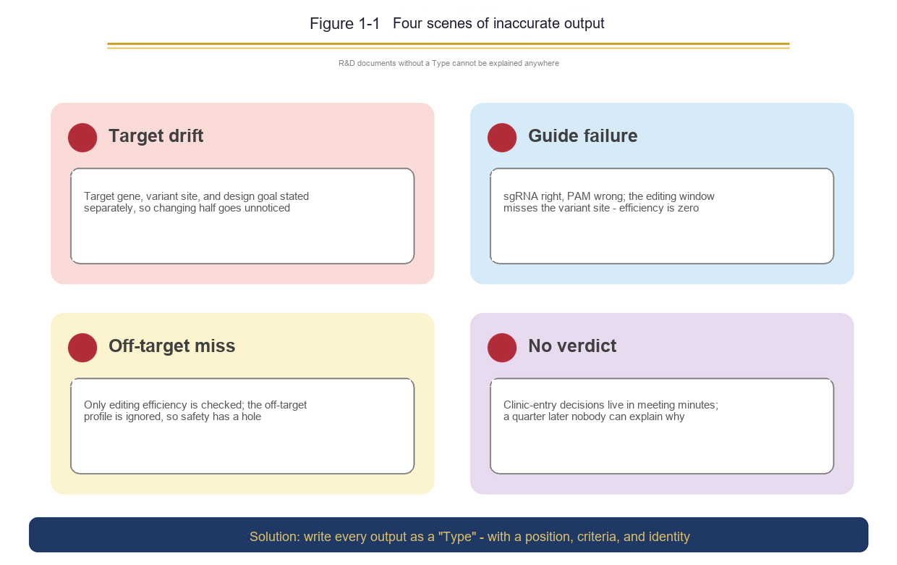  
> **Figure 1-1 Four scenes of inaccurate output**  

> **Chapter focus**  
> The AI gene R&D brain = a reasonable R&D twin: pack R&D into Type + Number, so every output has fields, criteria, and identity.  
> Where the two Types land: the three Space brackets write structure, the fourteen Time moves write operation; the Mind AI division of labour = LLM induces, Mind Model deduces.  
> Accuracy is gated out by four gates: criterion funnel, deductive skeleton, validation reconciliation, trace into a chain.  

# Chapter Two Six Output Types: "Target, Guide, Vector, Assess, Verdict, Evolution"

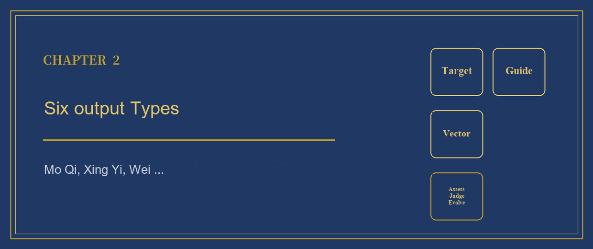

**Explaining R&D relies on the output; explaining the output relies on the Type. The output chain of gene R&D has six Types: Target Type, Guide Type, Vector Type, Assessment Type, Verdict Type, Evolution Type - remembered as "target, guide, vector, assess, verdict, evolution".**

## 2.1 Overview of the Six Types and the Output Chain

The six Types are not aliases for six documents but six sets of "field + criteria" specifications. The Target Type establishes the target, the Guide Type designs, the Vector Type delivers, the Assessment Type reconciles, the Verdict Type rules, and the Evolution Type closes - only when one chain is walked is one R&D run explained. Every Type is described with the same set of tools: [ ] writes field rules, { } writes composition, ( ) writes identity, ∩(T) writes criteria.

**Table 2-1 Overview of the six output Types**

| **Type** | **English** | **The question answered** | **Core criteria** |
| --- | --- | --- | --- |
| Target Type | TargetType | Which gene to change? What disease to treat? | Variant clear + indication corresponding |
| Guide Type | GuideType | Which sequence and which editor are used to change it? | PAM qualified + window covering the variant |
| Vector Type | VectorType | How is it delivered into the target cell? | Delivery efficiency + safety meet the target |
| Assessment Type | AssessType | Is it changed accurately, and is it safe? | The three-piece set: efficiency, off-target, safety |
| Verdict Type | VerdictType | Lead optimisation or eliminate? | All four gates passed + nine cells filled |
| Evolution Type | EvolutionType | How to do better next round? | Iteration trace + criteria update |

> 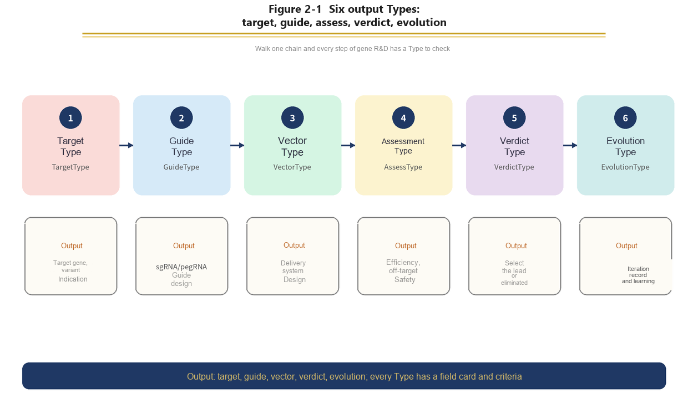  
> **Figure 2-1 The output chain of the six output Types "target, guide, vector, assess, verdict, evolution"**  

## 2.2 Target Type and Guide Type

The Target Type is the anchor of the whole chain. Once the target gene, variant site, indication, and design goal are written, id(C) is established, and all later output hangs under this identity; need to change the target midway? Then open a new Target Type, not secretly edit a field. The Guide Type writes "how to change it" as a verifiable specification: complementary target sequence, PAM, editing window, editor choice - these four features form F(GuideType), and only when the intersection criterion ∩(T) fully passes is the guide qualified.

**Table 2-2 Target Type field card**

| **Field** | **Type** | **Criteria (∩(T))** | **Example (GX-2610)** |
| --- | --- | --- | --- |
| Programme identity id(C) | Code | Unique, does not change with batch | GX-2610 |
| Target gene | Gene symbol | Documented in OMIM/NCBI | HBB |
| Variant site | HGVS notation | c. notation + protein notation complete | HBB c.17A>T(p.Glu6Val) |
| Indication | Disease classification | Causal relationship with the variant supported by literature | Sickle-cell disease (SCD) |
| Design goal | Strategy | Correct, silence, or reactivate: one of three, with justification | Directly correct the point mutation |
| Variable content S(C) | Checklist | Explicitly list which fields can be swapped and which may not be touched | Batch cells and reagent lot numbers may be moved |

**Table 2-3 Guide Type field card**

| **Field** | **Criteria** | **Inspection method** | **Example (PE-HBB-01)** |
| --- | --- | --- | --- |
| Complementary target sequence | Fully complementary to the target site, 0 mismatches | Compare against the GRCh38 reference sequence | 20 nt target sequence |
| PAM | The PAM required by the editor exists and is in the right position | Sequence scan | NGG(Cas9 nickase) |
| Editing window | Covers the variant site c.17 | Window position comparison | Window +4 to +8 covers c.17 |
| Editor choice | Matches the variant type (transition or transversion) | Strategy comparison table | Prime editing PE3max (can correct transversions) |
| PBS/RTT parameters | The length falls within the empirical range | Literature + measured scan | PBS 13 nt/RTT 44 nt |

## 2.3 Vector Type and Assessment Type

The Vector Type is the home ground of the BOM: { vector parts } writes the composition, and the three levels of remove write the impact. The Assessment Type is the ledger of accuracy: efficiency, off-target, safety, cell quality, phenotype recovery - five columns, each with a method, a threshold, and evidence; miss one and the verdict is missing a leg.

**Table 2-4 Vector Type field card**

| **Field** | **Criteria** | **Example (adopted in GX-2610)** |
| --- | --- | --- |
| Delivery platform | Matches the cell type, with clinical precedent | Electroporation (naked RNP + mRNA + pegRNA) |
| BOM composition | Only what recognises itself after removal enters the BOM | { electroporation module, Cas9 nickase mRNA, pegRNA, buffer, targeting ligand (optional) } |
| remove grading | Every item graded at three levels | Targeting ligand = function-degraded part (still deliverable after removal, targeting degraded) |
| Delivery efficiency | Threshold: target cells >= 70% | 82% (CD34+ cells, demonstration value) |
| Safety boundary | No insertional mutation risk, residues controllable | Non-viral route, no exogenous DNA integration |

**Table 2-5 Assessment Type field card**

| **Field** | **Method** | **Threshold** | **Evidence** |
| --- | --- | --- | --- |
| Editing efficiency | NGS sequencing quantification | Precise correction >= 40% | Sequencing raw files + analysis report |
| Off-target profile | GUIDE-seq + candidate site amplicon | Each off-target site < 1% | Off-target site list and quantification |
| Safety assessment | Survival rate, karyotype, large-fragment screening | Survival >= 80%, karyotype normal | Inspection report signature |
| Cell quality | Differentiation capacity, colony formation | CFU meets the target | Colony count record |
| Phenotype recovery | Erythroid differentiation culture, Hb phenotype | HbS falls significantly | HPLC electrophoresis profile |

## 2.4 Verdict Type and Evolution Type

The Verdict Type writes "enter lead optimisation or eliminate" as a recheckable ruling: ruling, basis, conditions, and sign-off - all four columns present; the basis must point back to the four gates and nine cells, and the conditions must be acceptable. The Evolution Type is R&D's memory: what was learned, what was refactored, what was explored, and how the criteria were updated in each round are all recorded in the evolution ledger, and the next round grows on from the ledger.

**Table 2-6 Verdict Type field card**

| **Field** | **Content requirements** | **Common misuses** |
| --- | --- | --- |
| Ruling | Lead optimisation, eliminate, or supplement: one of three | Writing unverifiable phrases such as "agreed in principle" |
| Basis | Point back to the four-gate ∩(T) results and the nine filled cells | Citing only meeting conclusions, not data |
| Condition | Conditional pass acceptable, with a deadline and an owner | Conditions written as wishes (such as "complete as soon as possible") |
| Sign-off | Three-party sign-off by R&D, QA, and biotech safety | Single-person sign-off with no second-person review |

**Table 2-7 Evolution Type field card**

| **Field** | **Content requirements** | **Corresponds to moves** |
| --- | --- | --- |
| Learning | This round's data and literature enter the Type library | Continuous learning |
| Restructure | Which combinations to rearrange and re-measure | Refactoring and recombination |
| Explore | Alternative routes for parallel validation | R&D and exploration |
| Evolve | Update of criteria thresholds and Type definitions | Self-evolution |
| Version | Type library version number + change summary | Trace: who changed it, and why |

## 2.5 The Three Brackets and the Three Levels of remove in R&D Use

Use the brackets in the wrong place and the layers collapse: [ ] is "what it should satisfy" - write the rules; { } is "what it is made of" - write the structure; ( ) is "where the identity is" - write the container. When discussing part impact, first pass the three levels of remove: identity lost after removal is an essential part, function missing but identity retained is a function-degraded part, no perceptible effect after removal is a non-essential part. Only when the three levels each sit in their place is the BOM complete.

> 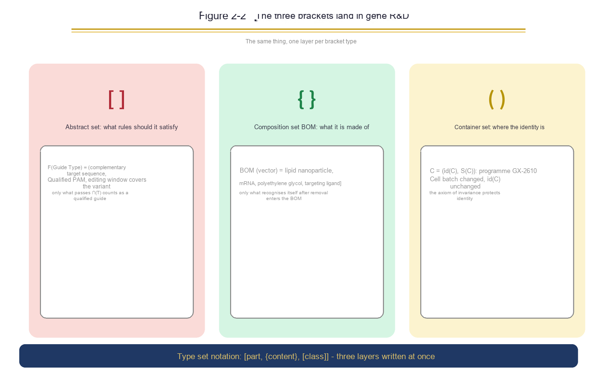  
> **Figure 2-2 The three brackets land in gene R&D**  

> 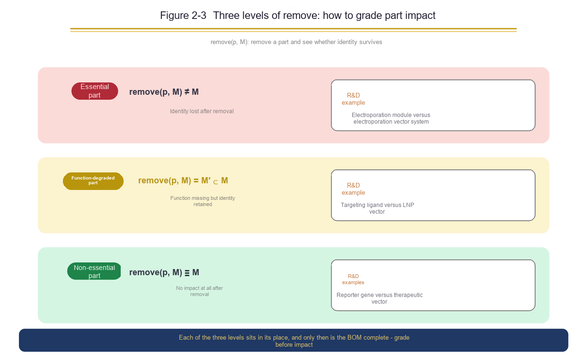  
> **Figure 2-3 Three levels of remove: how to grade part impact**  

**Table 2-8 Quick reference for BOM criteria and the three levels of remove**

| **Criteria** | **How to write** | **R&D example** |
| --- | --- | --- |
| BOM criterion | What recognises itself after removal enters the BOM; what vanishes after removal enters the property | The electroporation module enters the BOM; "sterile" is a condition, not a part |
| Essential part | remove(p, M) ≢ M | Cas9 nickase mRNA versus the editing complex |
| Function-degraded part | remove(p, M) ≡ M′ ⊂ M | Targeting ligand versus LNP vector |
| Non-essential part | remove(p, M) ≡ M | Reporter gene versus therapeutic construct |

> **Chapter focus**  
> The six Types "target, guide, vector, assess, verdict, evolution" each have a field card and criteria; only when one output chain is walked is one R&D run explained.  
> The Target Type establishes identity, the Guide Type establishes specification, the Vector Type establishes composition, the Assessment Type establishes the ledger, the Verdict Type establishes the ruling, the Evolution Type establishes memory.  
> The three brackets each in their place ([ ] rules, { } composition, ( ) identity), and the three levels of remove clarify part impact.  

# Chapter Three Four-Layer Accuracy Assurance

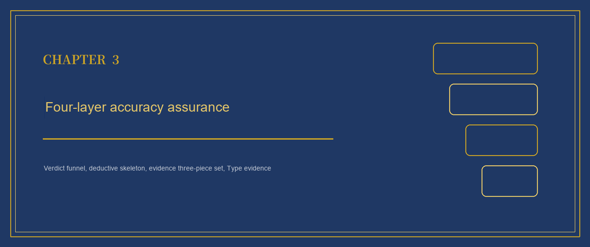

**Accuracy is not an attitude but a structure. The four-layer accuracy assurance - criterion funnel, deductive skeleton, validation three-piece set, Type evidence chain - translates "the output must be accurate" into four operable, acceptable gates.**

## 3.1 Layer One: the ∩(T) Criterion Funnel

Set the criteria first, then talk about output. Every Type first writes out its essential feature set F(T), and only when the intersection criterion ∩(T) fully passes does it count. In operation this becomes a funnel: a batch of candidates comes in and is filtered gate by gate, each gate with criteria, data, and handling - those that pass move on, those that fail are returned and leave a trace. The value of the funnel is repeatability: the same criteria, run by another person, give the same result.

**Table 3-1 The four-gate ∩(T) funnel**

| **Gate** | **Criteria** | **Evidence** | **Handling when it does not pass** |
| --- | --- | --- | --- |
| Gate one features complete | Every field of F(T) complete and testable | Field card cross-checked field by field | Return and fill in the fields |
| Gate two criteria testable | Every criterion has a measurement method and threshold | Method literature + threshold basis | Return and re-establish the criteria |
| Gate three data reconciliation | Measured data pass the threshold item by item | Raw data + analysis report | Return for redesign or eliminate |
| Gate four trace on the chain | The first three gates' evidence is already in the chain | Type evidence chain nodes | Only after the chain is repaired may it be submitted for a verdict |

> 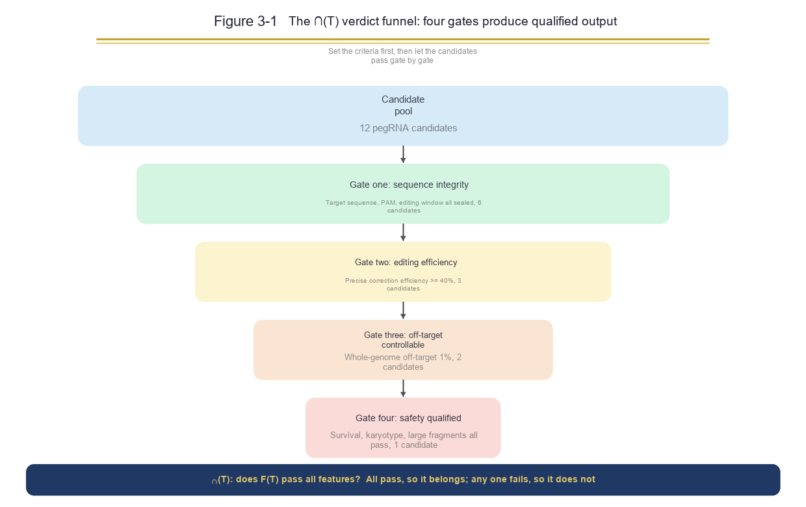  
> **Figure 3-1 The ∩(T) criterion funnel: four gates filter out qualified output**  

## 3.2 Layer Two: the Deductive Skeleton

Output that passes the criteria must still grow on the skeleton. The deductive skeleton is the reasoning chain "cause, mechanism, evidence, method, validation": start from the cause and the variant, derive the pathogenic mechanism, set the evidence requirements, choose the editing strategy, and finally design the validation - one link clasping the next, with no link skipped. The time state is written as S(t+1) = g( S(t), move, event ): every advance is driven by a move, and every state change leaves a trace.

**Table 3-2 The deductive skeleton (cause, mechanism, evidence, method, validation)**

| **Node** | **Deductive content** | **GX-2610 demonstration** |
| --- | --- | --- |
| Cause | What the cause and the variant are | HBB c.17A>T changes codon 6 of beta-globin from GAG to GTG, polymerising into sickle-shaped red blood cells |
| Mechanism | How the pathogenic mechanism proceeds | Deoxygenated HbS polymerises, red cells deform, vessels occlude and haemolysis follows |
| Evidence | What evidence counts | The three-piece set: precise correction rate, HbS phenotype reduction, off-target and safety |
| Method | Which strategy to choose to achieve it | Prime editing directly corrects the transversion (base editing only converts, so it does not apply) |
| Validation | How to verify that the strategy holds | In vitro erythroid differentiation culture + HPLC Hb phenotype + GUIDE-seq off-target |

> 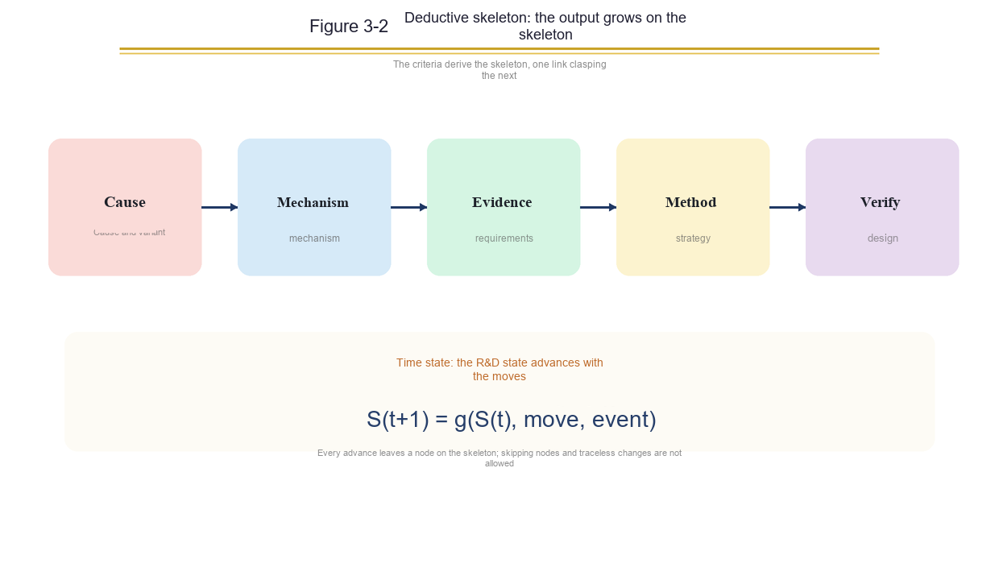  
> **Figure 3-2 The deductive skeleton: the output grows on the skeleton**  

## 3.3 Layer Three: the Validation Three-Piece Set

The experiment is not the end of the process but the reconciliation point of the criteria. The validation three-piece set - in vitro efficiency, off-target analysis, safety assessment - each has a method, a threshold, evidence, and handling. Only when all three pass does the Type evidence chain connect; one missing and the chain breaks, and the verdict has no right to be signed.

**Table 3-3 The validation three-piece set**

| **Item** | **Method** | **Threshold** | **Reconciliation results and handling** |
| --- | --- | --- | --- |
| In vitro efficiency | NGS sequencing quantification of precise correction rate and indel | Correction >= 40%, indel < 5% | Pass: enter the next gate; fail: return for redesign |
| Off-target analysis | GUIDE-seq whole genome + candidate site amplicon | Each off-target site < 1% | Pass: enter the next gate; fail: swap the guide or eliminate |
| Safety assessment | Survival rate, karyotype analysis, large-fragment deletion screening | Survival >= 80%, karyotype normal | Pass: submit for verdict; fail: supplement or eliminate |

> 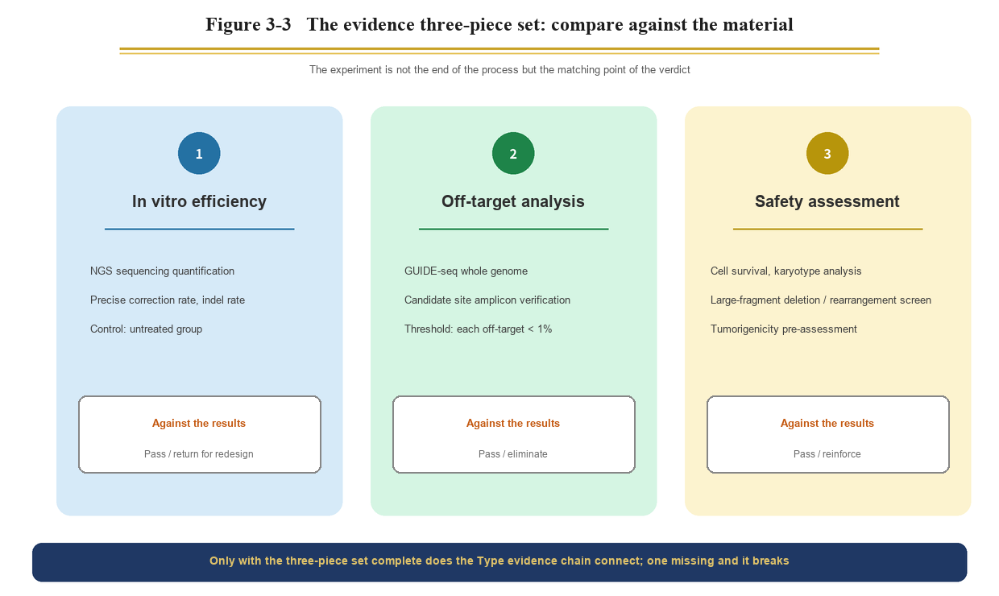  
> **Figure 3-3 The validation three-piece set: the data come back to reconcile**  

## 3.4 Layer Four: the Type Evidence Chain

A verdict does not fear questions, it fears having no chain. The Type evidence chain strings one R&D run into six stations: requirement card, Type first draft, output documents, acceptance sheet, verdict document, evolution ledger - each station answers the same three questions: what were the criteria? Did it pass? Where is the evidence? If any station's chain breaks, all downstream output is returned; returning is not redoing the conclusion but reconnecting the evidence.

**Table 3-4 The six stations of the Type evidence chain**

| **Station** | **Output** | **Criteria** | **Evidence** |
| --- | --- | --- | --- |
| 1 | Requirement card (S1) | Four framework steps completed, dimensions named | Situation description + dimension list |
| 2 | Type first draft (S2) | Six-Type fields opened, id(C) established | Field card draft |
| 3 | Output document (S4) | Fields of each Type filled and self-check passed | Six-Type output documents |
| 4 | Acceptance sheet (S5) | The four ∩(T) gates cross-checked one by one | Four-gate data reconciliation table |
| 5 | Verdict document (S6) | Nine cells filled + three-party sign-off | Sign-off record |
| 6 | Evolution ledger (S7) | All four columns - learning, refactoring, exploration, evolution - recorded | Version change summary |

> 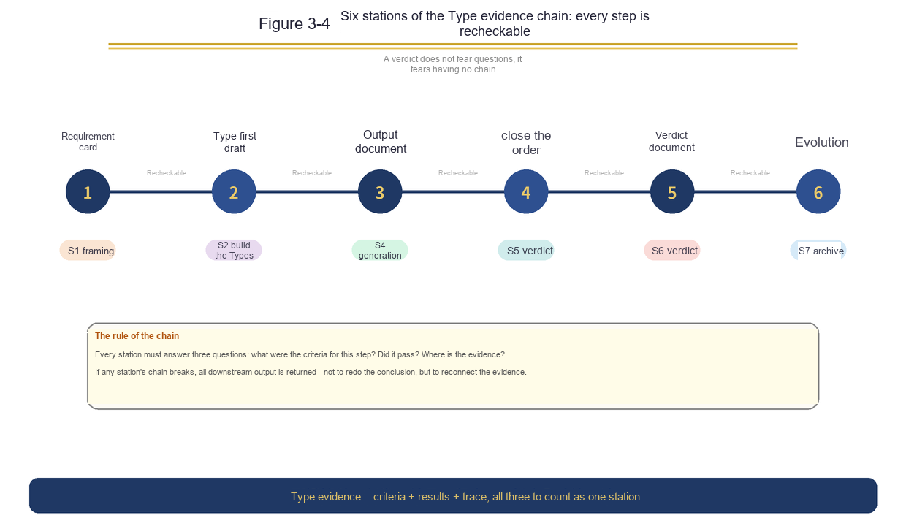  
> **Figure 3-4 The six stations of the Type evidence chain: every step is recheckable**  

## 3.5 Cross-Acceptance: the Space × Time Nine-Cell Grid

The last gate is cross-acceptance: lay the three Space brackets (property, composition, container) and the three Time phases (design, validation, decision) into nine cells, one question per cell, one filled sheet per question. Only when all nine cells are filled and passed does the verdict document have the right to be signed - read horizontally it asks whether the structure is complete, read vertically whether the operation is solid.

**Table 3-5 The nine cross-acceptance cells**

|  | **[ ] property layer** | **{ } composition layer** | **( ) container layer** |
| --- | --- | --- | --- |
| Design phase | Are the features complete? | Is the part list complete? | Is the identity established? |
| Validation phase | Has it been measured item by item? | Has it been taken apart piece by piece? | Does id stay the same after the content is changed? |
| Decision phase | Have all criteria passed? | Has the impact been graded? | Is the verdict traceable? |

> 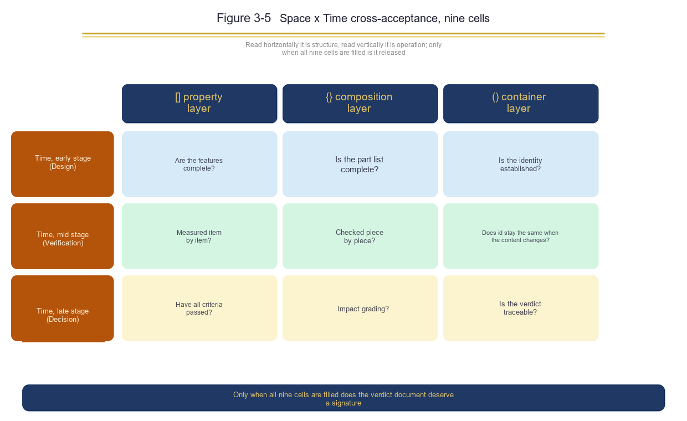  
> **Figure 3-5 The Space × Time nine-cell cross-acceptance grid**  

> **Chapter focus**  
> Four-layer accuracy: the ∩(T) criterion funnel, the deductive skeleton (cause, mechanism, evidence, method, validation), the validation three-piece set, the six stations of the Type evidence chain.  
> The experiment is the reconciliation point of the criteria: only when the three-piece set fully passes does the chain connect; one missing and the chain breaks.  
> Nine cross-acceptance cells: the three Space brackets x the three Time phases; only when all are filled may the verdict be signed.  

# Chapter Four Six Steps: from R&D Requirement to Output

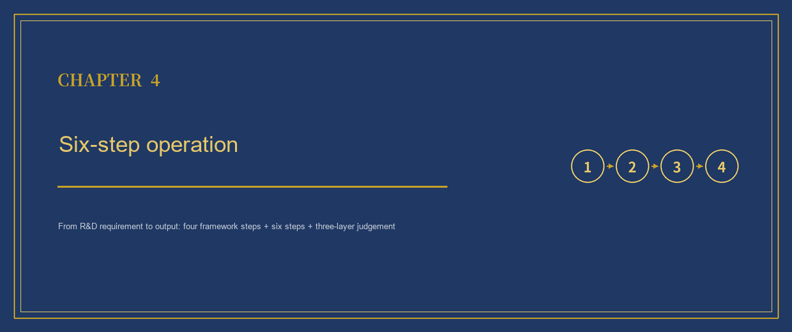

**Now that you know "what a Type looks like" and "how accuracy is guaranteed", this chapter strings the two into an operable process: the four framework steps identify the requirement, the six steps run the whole course, the three-layer judgement provides on-site control, and the move tray swaps moves with the situation.**

## 4.1 Four Framework Steps: Identifying the R&D Requirement

An R&D requirement is not understood on receipt; it is forced out by "the control failed". The four framework steps - distinguish similarity and difference, trigger abstraction, name the dimension, judge membership - solidify this derivation into a repeatable mechanism: first distinguish "this is not that"; when the new difference does not line up with the old dimension, trigger abstraction; name the dimension and set the axis; finally judge the membership of each requirement. If it fits, add a scale; if it does not, open a new axis - the requirement card grows into a Type inside this loop.

**Table 4-1 The four framework steps x organising the R&D requirement**

| **Step** | **Operation** | **R&D example** |
| --- | --- | --- |
| One: distinguish similarity and difference | List the targets, diseases, and constraints in the requirement, and first distinguish "this is not that" | "Correcting the HBB point mutation" is not "reactivating HbF" - separate the two routes first |
| Two: trigger abstraction | When the new difference does not line up with the old dimension, admit a new dimension is needed | "Heritability" does not line up with any design dimension, so a new axis must be opened |
| Parameter, naming the dimension | Name the dimension and set the axis: target, delivery, efficiency, safety, regulation | Set the regulatory axis: germline editing forbidden, somatic cells through IND |
| Four: judging membership | Every requirement is mapped into a dimension; if it does not fit, open another axis | "Long-term follow-up" belongs to the regulatory axis and is not mixed into the safety axis |

> 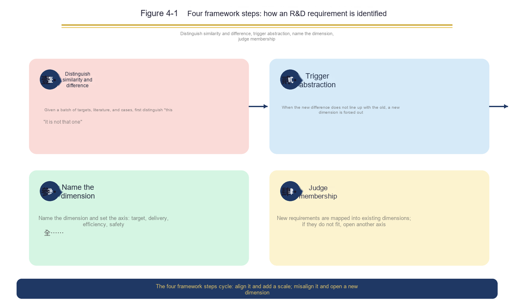  
> **Figure 4-1 The four framework steps: how an R&D requirement is identified**  

## 4.2 Six-Step Operation Card

Once the requirement is identified, the six steps relay: identify the situation, build Types by axis, select the expansion pattern, generate the output, criteria acceptance, archive and evolve. Every step has an input and an output - the previous step's output is the next step's input; any step can be returned, but the return must be recorded in the evolution ledger, and traceless re-editing is not allowed.

**Table 4-2 The six-step operation card**

| **Step** | **Operation** | **Output** | **Commonly used moves** |
| --- | --- | --- | --- |
| 1 Identify the situation | The four framework steps organise the requirement | Requirement card | Problem solving, analysis |
| 2 Build Types by Axis | The three brackets open the six-Type first draft | Type first draft | Design patterns |
| 3 Select the Expansion Pattern | Select from the move tray + write the reason | Move selection sheet | Thinking methods |
| 4 Generate the Output | Fill the fields Type by Type and generate the output documents | Six-Type output documents | Design, function generation |
| 5 Criteria Acceptance | Four ∩(T) gates + nine cells filled | Acceptance sheet | Reasoning, analysis |
| 6 Archive and Evolve | Enter the chain, keep the ledger, update the Type library | Evolution ledger | Continuous learning, self-evolution |

> 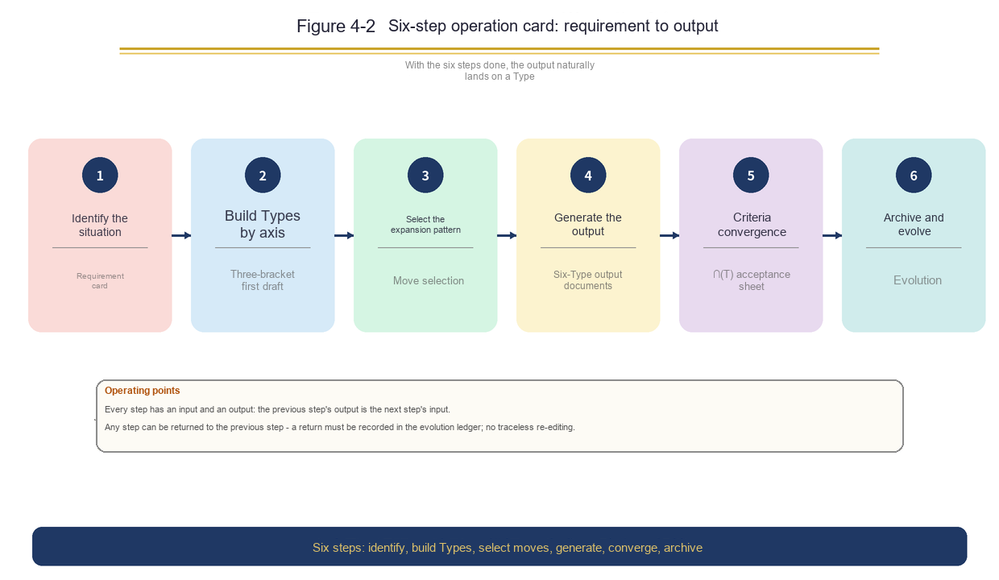  
> **Figure 4-2 The six-step operation card**  

## 4.3 Three-Layer Judgement: Is, Has, Right

Stop at any point in the process for the three-layer judgement: is - is the identity right? The container judgement asks "is identity independent of the contents"; has - is the structure complete? The composition judgement uses the three levels of remove to clarify impact; right - do the rules pass? The abstraction judgement runs ∩(T) and verifies on the spot. Only when all three pass is a conclusion drawn; if one layer fails, the conclusion is not a conclusion but a guess.

**Table 4-3 Quick reference for the three-layer judgement**

| **Layer** | **Question** | **Criteria** | **Example sentence from the site** |
| --- | --- | --- | --- |
| Is | Is identity independent of the contents? | C = (id(C), S(C)), the axiom of invariance | Change to a batch of CD34+ cells - is GX-2610 still GX-2610? |
| Has | Are the parts complete and clearly graded? | BOM criterion + the three levels of remove | Is the targeting ligand marked as a degraded part? |
| Right | Has it passed ∩(T)? | Test F(T) item by item | Does this pegRNA pass all the features of the Guide Type? |

> 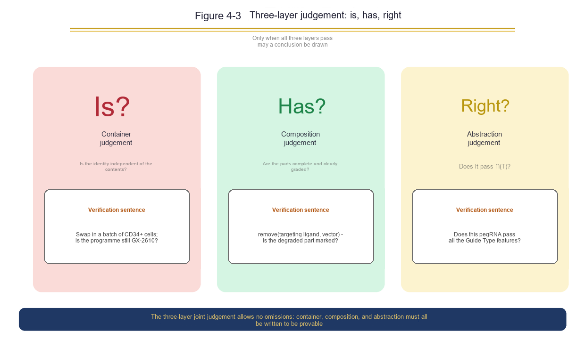  
> **Figure 4-3 Three-layer judgement: is, has, right**  

## 4.4 Selecting, Assembling, Swapping Moves

The fourteen moves are a move tray, not a checklist. Select moves by situation: for pegRNA design pick "design + generation", for literature search pick "search + extraction", for risk assessment pick "analysis + reasoning". Several moves form a pipeline: the previous move's output is the next move's input, and the combination is written into the S1–S7 stages. If stuck, swap: when efficiency will not come up swap in "refactoring", when the assumption is unstable swap in "first-principles thinking" - both the reason for the swap and the result must be recorded in the evolution ledger.

**Table 4-4 Situation table for selecting, assembling, and swapping moves**

| **Action** | **Situation** | **Move combination** | **Trace** |
| --- | --- | --- | --- |
| Selecting moves | Design pegRNA and editor selection | Design + logic generation | The move selection sheet states the reasons for selection |
| Selecting moves | Literature and patent research | Search + extraction + analysis | Source list entered in the Type library |
| Assembling moves | One complete R&D round | Search, analysis, design, validation, learning | S1–S7 embedded in the section |
| Swapping moves | The efficiency bottleneck cannot be broken | Problem solving, then refactoring and recombination | The evolution ledger records the reason for a move swap |
| Swapping moves | The strategy assumption wavers | Thinking methods (first principles) | The evolution ledger records the new hypothesis |

> 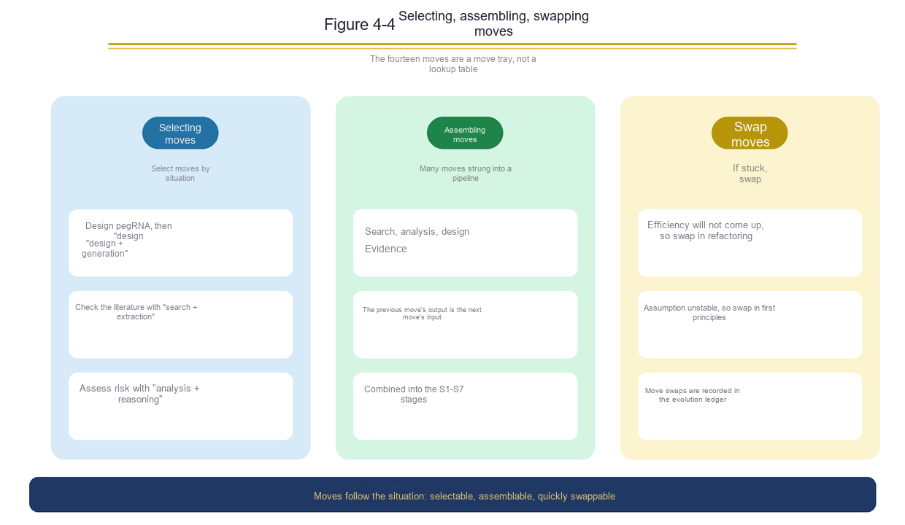  
> **Figure 4-4 Selecting, assembling, swapping moves**  

## 4.5 Misuse Warning Points

The process must run, and it must also avoid the reefs. Every station of the six steps has common misuse signals - handle the signal on the spot; it saves ten times the effort of remedying it later.

**Table 4-5 Operating misuse warning points**

| **Step** | **Warning signal** | **Immediate handling** |
| --- | --- | --- |
| Identify the situation | The requirement document cannot state three sentences of "this is not that" | Return to the four framework steps and first distinguish similarity and difference |
| Build Types by axis | The field card starts to become prose and the fields grow fewer | Stop writing and return to the field card, cross-checking field by field |
| Select the expansion pattern | The move selection sheet is blank or copied from last time | Re-select the move and write the reason; if no reason can be written, the wrong move was chosen |
| Generate the output | Outputs citing each other's conclusions | Pull it back to the skeleton: check link by link with cause, mechanism, evidence, method, validation |
| Criteria acceptance | The threshold is set after the data comes out | Void the criteria and re-establish them; lock the data before verifying |
| Archive and evolve | Two consecutive blank rounds in the evolution ledger | Only after the record is supplemented may the next round open |

> **Chapter focus**  
> The four framework steps (distinguish similarity and difference, trigger abstraction, name the dimension, judge membership) identify the requirement, and the six steps run the whole course.  
> The three-layer judgement is, has, right as a standing stop-check: only when identity, structure, and rule all pass is a conclusion drawn.  
> Moves follow the situation: select accurately, assemble smoothly, swap quickly; misuse warning points are handled on the spot, all leaving a trace.  

# Chapter Five The Full S1–S7 Case: GX-2610

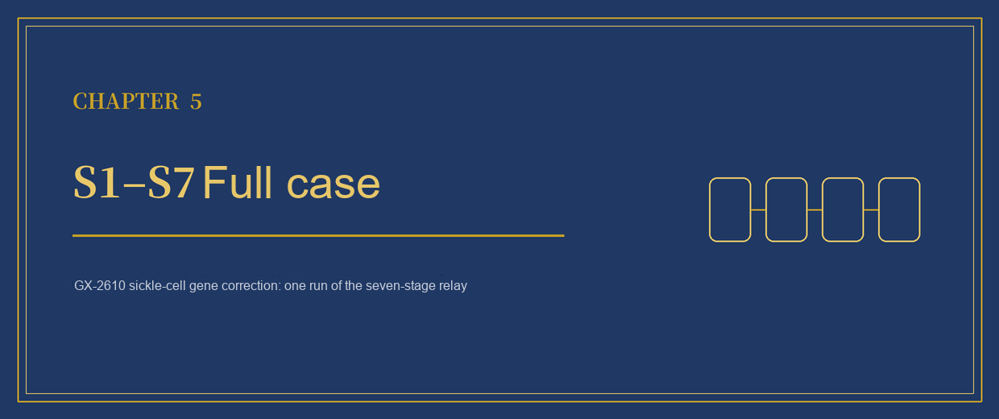

**This chapter connects all four previous chapters: it walks the S1–S7 seven-stage relay with the running case GX-2610 (HBB gene correction for sickle-cell anaemia), from the requirement card all the way to the evolution ledger - all values are demonstration data, demonstrating the output format and the operation of the criteria.**

## 5.1 Seven-Stage Relay: the S1–S7 Pipeline

The seven-stage prompt relay is the standard usage of this book: S1 situation framing, S2 build Types by axis, S3 select the expansion pattern, S4 generate the output, S5 criteria acceptance, S6 cross verdict, S7 archive and evolve. Each stage's output is the next stage's input, and the handover between stages must carry the Type evidence; if any stage fails, return to the previous stage on the spot, and cross-stage jumping is not allowed.

**Table 5-1 Overview of the seven-stage relay**

| **Stage** | **Task** | **Input** | **Output** |
| --- | --- | --- | --- |
| S1 | Situation framing | R&D requirement, literature, constraints | Requirement card |
| S2 | Build Types by axis | Requirement card | Six-Type first draft (field cards) |
| S3 | Select the expansion pattern | Six-Type first draft | Move selection sheet |
| S4 | Generate the output | Move selection sheet | Six-Type output documents |
| S5 | Criteria acceptance | Output document + measured data | Four-gate acceptance sheet |
| S6 | Cross verdict | Acceptance sheet + nine cells filled | Verdict document |
| S7 | Archive and evolve | Verdict document + the whole chain | Evolution ledger + Type library version |

> 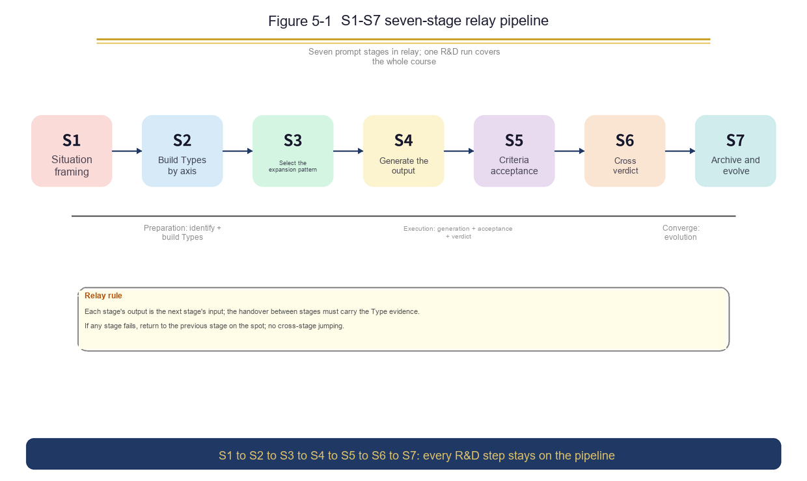  
> **Figure 5-1 The seven-stage relay pipeline**  

## 5.2 Full Text of Prompts S1–S7

The following seven prompts can be pasted directly into the Mind AI platform; the text in brackets is the stage name, and the output format column is the basis for accepting that stage - if the output does not match the format, return and rerun; do not settle.

> **[S1 situation framing] Output: requirement card**  
> You are the R&D planner of the AI gene R&D brain. Use the four framework steps to organise this R&D situation and output a requirement card:  
> (1) Distinguish similarity and difference: list the targets, diseases, and constraints, and write at least three sentences of "this is not that";  
> (2) Trigger abstraction: identify the new difference that cannot be explained by the existing dimensions;  
> (3) Name the dimension: name the new dimension (target / delivery / efficiency / safety / regulation ...);  
> (4) Judge membership: map each requirement into a dimension; if it does not fit, open a new axis.  
> Output format: requirement card = id(C) programme code + S(C) variable content list + dimension master table + open questions list.  

> **[S2 build Types by axis] Output: six-Type first draft**  
> Continue from the requirement card. Build the six-Type first draft with the three Space brackets:  
> [ ] Write the essential feature set F(T) and the intersection criterion ∩(T) for every Type;  
> { } Write the BOM of each system, and check each item with "recognise itself after removal";  
> ( ) Write the container C = (id(C), S(C)) and declare the axiom of invariance.  
> Output format: first draft of the six-Type field cards (Target Type, Guide Type, Vector Type, Assessment Type, Verdict Type, Evolution Type), one card per Type, with unfilled values marked "to be verified".  

> **[S3 select the expansion pattern] Output: move selection sheet**  
> Continue from the six-Type first draft. Select the moves this R&D run needs from the fourteen-move tray of the Time Type:  
> List the selected moves, the assembly order (the previous move's output = the next move's input), and the reason for selecting each move;  
> If the situation changes and a move must be swapped, write the swap conditions and the replacement move.  
> Output format: move selection sheet (move / purpose / input / output / swap conditions).  

> **[S4 generate the output] Output: six-Type output documents**  
> Continue from the move selection sheet. Generate the six-Type output documents in order: target card, guide card, vector card, assessment sheet, verdict document draft, evolution ledger opening.  
> Requirements: every item fills all fields of the field card; all values state their source (measured / literature / predicted);  
> Undetermined values are marked "to be verified" and may not be left blank; each item ends with a self-check line: are all F(T) items testable?  

> **[S5 criteria acceptance] Output: four-gate acceptance sheet**  
> Continue from the output documents. Run the four-gate ∩(T) funnel acceptance:  
> Gate one features complete \| gate two criteria testable \| gate three data reconciled \| gate four trace on the chain.  
> Each gate outputs "pass / return" plus the evidence metric; for a return, write the reason and the handling (supplement, redesign, eliminate).  
> Output format: four-gate acceptance sheet (gate / criteria / data / result / evidence location).  

> **[S6 cross verdict] Output: verdict document**  
> Continue from the acceptance sheet. Run the Space × Time nine-cell cross-acceptance ([ ] { } ( ) x the three phases of design, validation, and decision), filling each cell.  
> Only when all pass is the verdict document output: the ruling (one of three: enter lead optimisation, eliminate, supplement), the basis (citing the four gates and the nine cells),  
> Conditions (acceptable, with a deadline and an owner), sign-off columns (R&D, QA, biotech safety, three parties).  
> If any cell fails: return to the corresponding step; no verdict may be given directly.  

> **[S7 archive and evolve] Output: evolution ledger**  
> Continue from the verdict document. Output the opening of the evolution ledger:  
> Learning (this round's data and literature enter the Type library) \| Refactoring (which combinations to rearrange) \| Exploration (alternative routes) \| Evolution (proposed threshold updates).  
> Write a version number and change summary for the Type library (who changed it, and why).  
> Output format: four evolution ledger columns + version note. The next round restarts from S1, and the requirement card must cite the evolution ledger.  

## 5.3 Case Opening: Target Card and Guide Design

The GX-2610 situation: autologous CD34+ haematopoietic stem cells from a patient with sickle-cell anaemia, with the goal of directly correcting the pathogenic point mutation in the HBB gene. S1's requirement card sets the regulatory axis (germline editing forbidden, somatic cells follow the IND route), S2 opens the six-Type field cards, and S3 selects the combination "search + analysis + design + validation + learning". The following demonstrates the actual field entries of the S4 output document.

**Table 5-2 Target Type card (GX-2610 demonstration)**

| **Field** | **Value** | **Criteria check** |
| --- | --- | --- |
| id(C) | GX-2610 | Unique, does not change with batch - check |
| Target gene | HBB (beta-globin gene) | OMIM 603903 is documented - check |
| Variant site | HBB c.17A>T(p.Glu6Val, rs334) | HGVS notation complete - check |
| Indication | Sickle-cell disease (SCD) | Causal literature on the variant sufficient - check |
| Design goal | Directly correct the point mutation (GTG to GAG) | Correction strategy: one of three, justified - check |
| S(C) variable content | Batch cells, reagent lot numbers, culture conditions | Movable fields listed explicitly - check |

Strategy selection first passes one round of "selecting moves": base editing only converts (C to T, A to G) and cannot correct this transversion (A to T); HDR requires a double-strand break and has low efficiency in stem cells; prime editing can install any point mutation - choose PE3max as the main line, with "disrupting the BCL11A enhancer to reactivate fetal haemoglobin" as a parallel control route. This reasoning, written on the move selection sheet, is the "method" node of the deductive skeleton.

**Table 5-3 Guide Type card (pegRNA candidates, demonstration)**

| **Code** | **PBS/RTT** | **nick site** | **Precise correction** | **indel** | **Keep or drop** |
| --- | --- | --- | --- | --- | --- |
| PE-HBB-01 | 13 nt / 44 nt | +3 | 68% | 2.1% | Enter assessment |
| PE-HBB-02 | 15 nt / 40 nt | +6 | 52% | 1.6% | Enter assessment |
| PE-HBB-03 | 10 nt / 47 nt | −2 | 41% | 2.8% | Enter assessment |
| PE-HBB-04 | 13 nt / 50 nt | +9 | 23% | 3.4% | Efficiency gate returned |

> 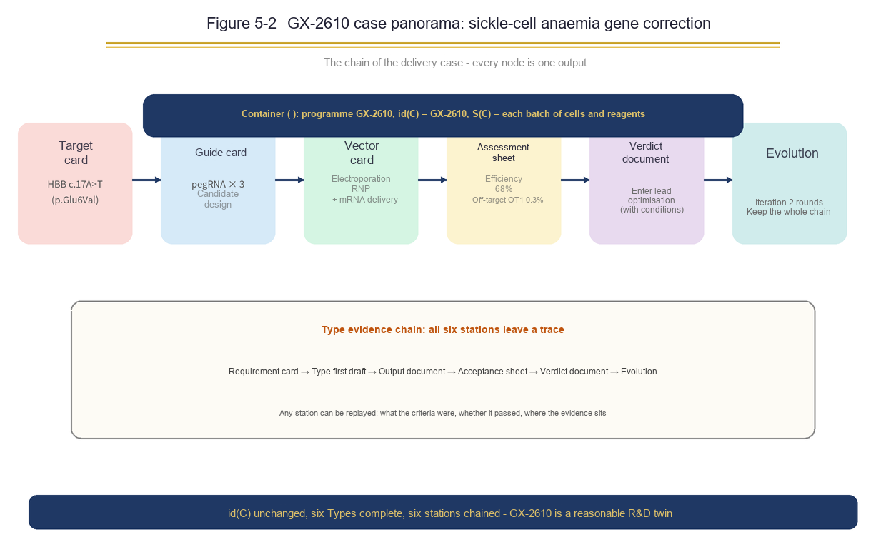  
> **Figure 5-2 Panorama of the GX-2610 case**  

## 5.4 Full Output: Vector, Assessment, and Verdict

The vector card compares two delivery routes: electroporation (non-viral) and the AAV6 donor template. The basis for the decision is written on the field card - electroporation delivery efficiency 82%, no exogenous DNA integration risk, ample HSC clinical precedent, chosen as the main route; the targeting ligand is marked as a function-degraded part (still deliverable after removal, targeting degraded). The assessment sheet then enters the three-piece set data item by item.

**Table 5-4 Vector Type card: route comparison (demonstration)**

| **Field** | **Electroporation (adopted)** | **AAV6 donor template (control)** |
| --- | --- | --- |
| Delivery format | Naked RNP + Cas9 nickase mRNA + pegRNA | AAV6 viral vector carrying the donor template |
| Delivery efficiency | 82% (CD34+, demonstration value) | 65–75% (literature value) |
| Safety boundary | No exogenous DNA integration, residues controllable | Residual DNA must be tested; production cost is high |
| BOM | { electroporation module, nickase mRNA, pegRNA, buffer, targeting ligand (optional) } | { AAV6 particles, donor template, helper plasmid } |
| remove grading | Targeting ligand = function-degraded part | Donor template = essential part |

**Table 5-5 Assessment sheet: four-gate reconciliation (demonstration)**

| **Gate** | **Criteria** | **Measured data** | **Result** |
| --- | --- | --- | --- |
| Gate one sequence integrity | All pegRNA in vitro activities match | 01/02/03 pass | Pass |
| Gate two editing efficiency | Precise correction >= 40% | 01: 68% \| 02: 52% \| 03: 41% | 3 candidates pass |
| Gate three off-target controllable | Each off-target site < 1% | 01: OT1 0.3%, OT2 0.1% \| 02: OT2 1.8% | 01/03 pass |
| Gate four safety qualified | Survival >= 80%, karyotype normal | 01: survival 86%, karyotype normal, no large fragments detected | 01 comes through |
| Phenotype recovery (erythroid differentiation) | HbS falls significantly | HbS 41%→6%, HbA 0→76%, HbF 18% | Pass |

> 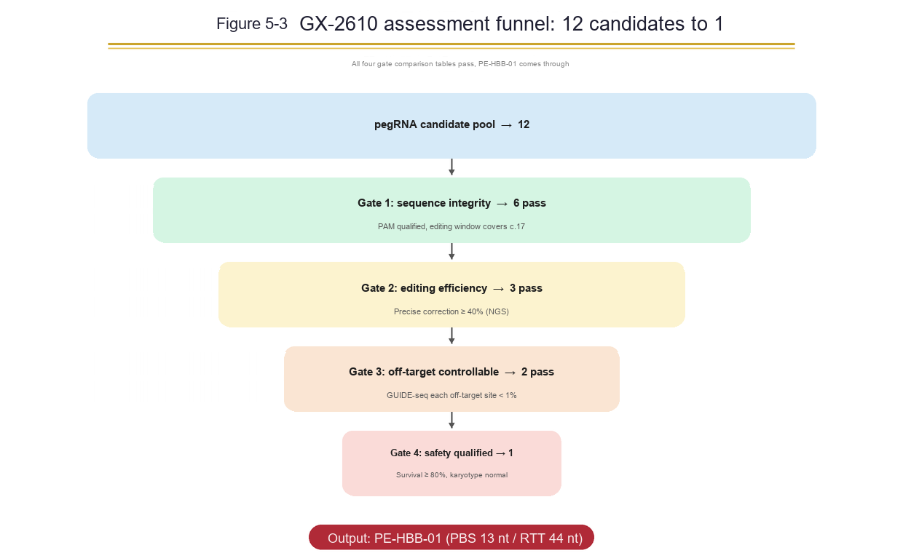  
> **Figure 5-3 The assessment funnel: 12 candidates filtered to 1**  

Six cells and nine windows filled, four gates passed, the verdict document enters. Note the "conditions" column of the verdict document: a conditional pass is not a discount; it is writing the next round's acceptance criteria in advance.

**Table 5-6 Verdict document (demonstration)**

| **Field** | **Content** |
| --- | --- |
| Ruling | Enter lead optimisation (conditional pass) |
| Basis | All four ∩(T) gates passed (PE-HBB-01); all nine cross-acceptance cells filled; the six stations of the Type evidence chain unbroken |
| Condition | (1) Complete in vivo assessment of in vitro off-target (deadline 60 days, owner: R&D team) (2) Schedule large-animal model validation (3) Bring long-term follow-up design into the clinical protocol |
| Sign-off | R&D lead \| QA lead \| biotech safety (three-party sign-off) |

> *Disclaimer: the sequence parameters, efficiency, and off-target values in Tables 5-2 to 5-6 are demonstration data and do not constitute medical advice,*  
> *Nor is it a basis for real clinical trial design; real gene-editing therapy R&D must follow local regulations and ethics review.*  

## 5.5 Evolution Ledger and Usage Rules

After the verdict, the evolution ledger takes over. GX-2610 ran two iteration rounds in this demonstration: the first round converged parameters with a PBS/RTT length scan, and the second optimised electroporation conditions to push efficiency from 52% to 68%; each round's four columns - learning, refactoring, exploration, evolution - are recorded in the ledger, and the criteria thresholds also update with the evidence - that is what "self-evolution" looks like concretely at the R&D site.

**Table 5-7 Evolution ledger (two iteration rounds, demonstration)**

| **Round** | **Learning** | **Refactor** | **Exploration** | **Evolution (criteria update)** |
| --- | --- | --- | --- | --- |
| Round 1 | PBS 10-15 nt x RTT 40-50 nt scan: the 13/44 combination is optimal | pegRNA parameter space rearrangement | PE3max versus PE2 | Efficiency threshold raised from 30% to 40% |
| Round 2 | Electroporation voltage and pulse number affect survival and efficiency | Refactor the electroporation conditions and re-measure | Parallel observation of the HbF route | A new mandatory field "large-fragment deletion screening" added to the safety gate |

**Table 5-8 Rules for using the prompts**

| **#** | **Rules** | **Reason** |
| --- | --- | --- |
| 1 | Establish the Type before acting: open the field card before generating content | Output without a Type cannot be accepted |
| 2 | Criteria first: the threshold is fixed before the data comes out | A threshold set afterwards is self-deception |
| 3 | Every output keeps the chain: the evidence location written into the acceptance sheet | A conclusion from a broken chain cannot be rechecked |
| 4 | Swap trace: the reason for the swap written into the evolution ledger | Traceless move swapping = decision without basis |
| 5 | The red line is the criterion: compliance clauses enter ∩(T) | Fail the red line and you fail the gate |
| 6 | Mark demonstration data: measured, literature, and predicted clearly separated | Mixed sources = numbers lose their meaning |

> 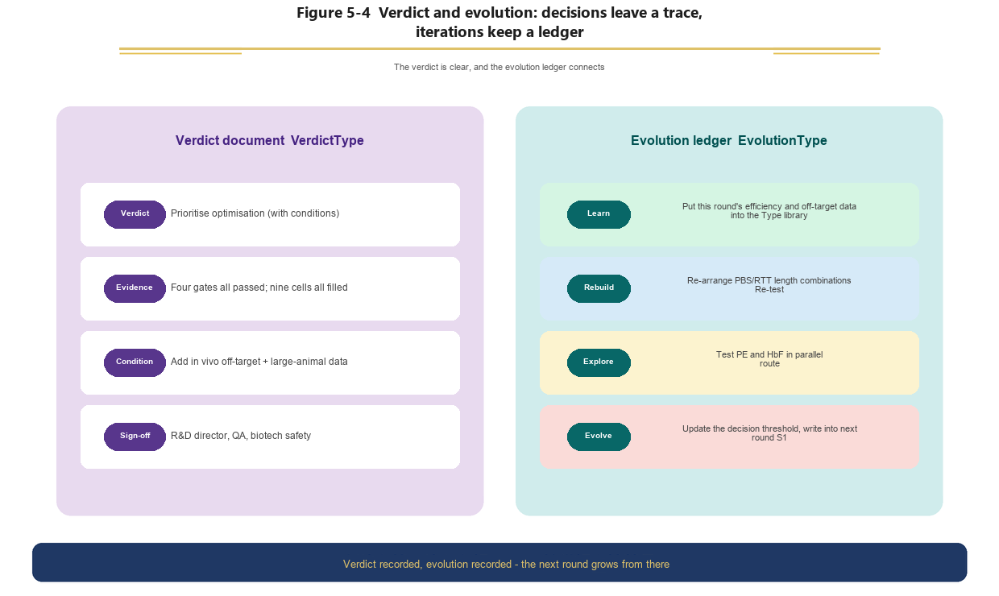  
> **Figure 5-4 Verdict and evolution: decisions leave a trace, iterations have a ledger**  

> **Chapter focus**  
> Seven-stage relay S1–S7: situation framing, build Types by axis, select the expansion pattern, generate the output, criteria acceptance, cross verdict, archive and evolve.  
> Full GX-2610 demonstration: target card, guide card, vector card, assessment sheet, verdict document, evolution ledger - all six Types present, all four gates passed.  
> Six usage rules: establish the Type first, criteria first, keep the chain, leave a trace, the red line is a criterion, mark demonstration data.  

# Chapter Six Misuse Comparison and Maturity

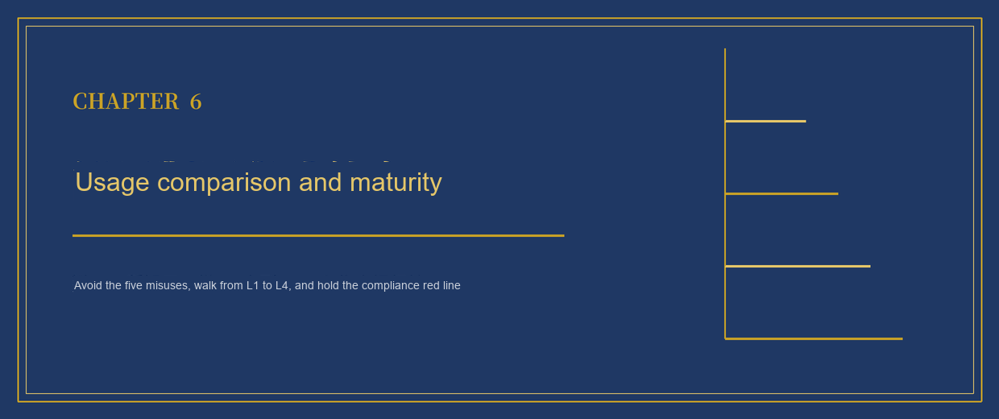

**The last chapter closes: avoid the five misuses first, carry the ten-question checklist, locate yourself on maturity L1–L4, schedule the ninety-day blueprint, and then draw the compliance red lines of gene editing clearly.**

## 6.1 Five Misuses

The common root of misuse is only one: the layers were not written clearly. Substituting numbers for Types, using brackets at random, skipping grading, breaking stations on the chain, changing the verdict without a trace - the five pits each have their own scene, but all can be self-checked with the same sentence: is every output written as a Type? Is the right bracket used at every layer?

**Table 6-1 Five misuses**

| **Misuse** | **On-site symptom** | **Root cause** | **Correction** |
| --- | --- | --- | --- |
| Substituting numbers for Types | The slides are full of percentages, and when asked "percentages of what" nobody can answer | Numbers are not hung on a Type | Back to the field card: label every number with its Type and field |
| Brackets used at random | [ ] { } ( ) written mixed, and the reader cannot grasp the layers | The semantics of the three brackets are not divided | Rules use [ ], composition uses { }, identity uses ( ) |
| Skipping grading | Discussing part impact without the three levels of remove | Impact by feel | remove(p, M) graded item by item at three levels |
| Breaking a station on the chain | The acceptance sheet cannot find the corresponding criteria and evidence | The trace does not enter the chain | Any break is returned; connect the chain before discussing the conclusion |
| Traceless change of the verdict | The verdict was changed and the evolution ledger was not recorded, so nothing can be checked afterwards | Decision bypasses the trace | A criteria change must open a new version and record the reason |

> 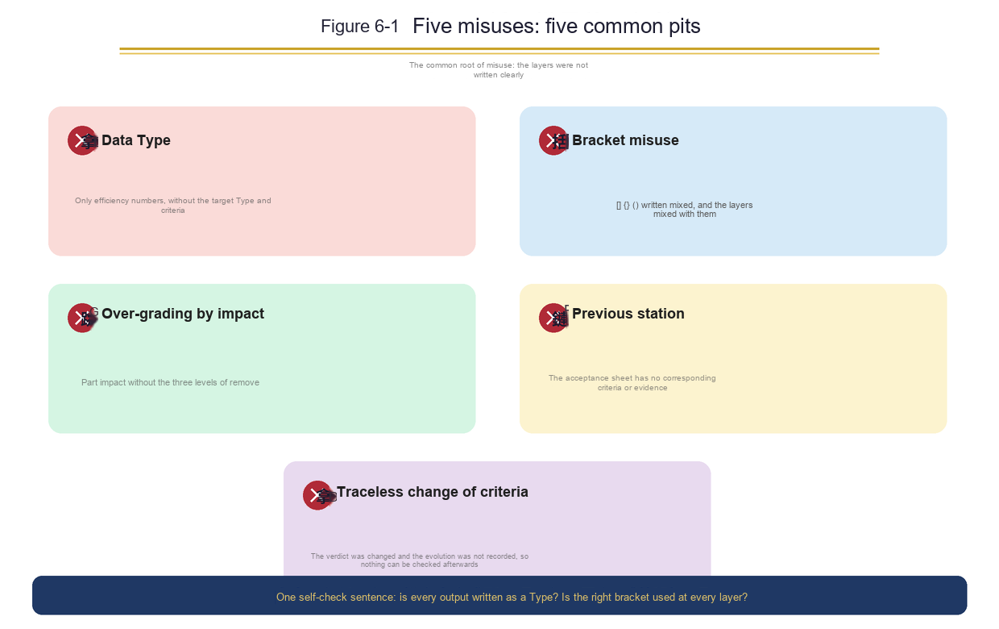  
> **Figure 6-1 Five misuses**  

## 6.2 A Ten-Question Checklist

The ten-question checklist is a carry-along acceptance card: answer each question before submitting for a verdict, and whatever cannot be answered is a missing item. The checklist does not replace the four gates; it is a self-examination beyond the four gates.

**Table 6-2 The ten-question checklist**

| **#** | **Check question** | **Pass standard** |
| --- | --- | --- |
| 1 | Is the identity id(C) of the Target Type established? | Changing the target midway opens a new Type; it is not editing a field |
| 2 | Are the F(T) and ∩(T) of every Type written clearly? | Features testable item by item, no "roughly complies" |
| 3 | Are the three brackets in the right places? | [ ] rules, { } composition, ( ) identity each in its place |
| 4 | Does every BOM item pass "recognise itself after removal"? | Properties and parts are not confused |
| 5 | Have the three levels of remove been assigned? | Essential, degraded, and non-essential parts each have their place |
| 6 | Was the threshold set before the data came out? | The acceptance sheet timestamp is earlier than the data |
| 7 | Does the three-piece set (efficiency, off-target, safety) all have data? | No "to be completed" field enters the verdict |
| 8 | Are all nine cross-acceptance cells filled? | A blank cell means no verdict may be signed |
| 9 | Is the six-station Type evidence chain unbroken? | Three replay questions per station |
| 10 | Have the compliance red lines been checked one by one? | Red-line clauses entered ∩(T) |

> **The last sentence before sign-off**  
> Only when all ten questions pass is the verdict document pushed out. If any one cannot be answered - the cost of returning is a few days; the cost of signing wrongly is a programme.  

## 6.3 Maturity L1–L4

Maturity is not a job title but the degree to which output can be rechecked. L1 can write a Type - the six-Type field cards can be opened; L2 can accept - the four gates run and the acceptance sheet matches; L3 can keep the chain - all six stations present and the verdict replayable; L4 can evolve - the evolution ledger drives iteration and the criteria thresholds update with the data. A reasonable goal for most teams is: from L1 to L2 within a quarter, and to L3 within half a year.

**Table 6-3 Maturity L1–L4**

| **Grade** | **Feature** | **Target metric** |
| --- | --- | --- |
| L1 Can write a Type | The output has fields and criteria | The whole team can open the six-Type field cards; three sentences can state "this is not that" |
| L2 Can accept | The four ∩(T) gates run | The acceptance sheet is one-to-one with the output documents; all thresholds precede the data |
| L3 Can keep the chain | All six stations of the Type evidence chain present | Any verdict can be replayed with the full reasoning within 24 hours |
| L4 Can evolve | The evolution ledger drives iteration | For three consecutive rounds the criteria thresholds update with the evidence; the Type library is versioned |

> 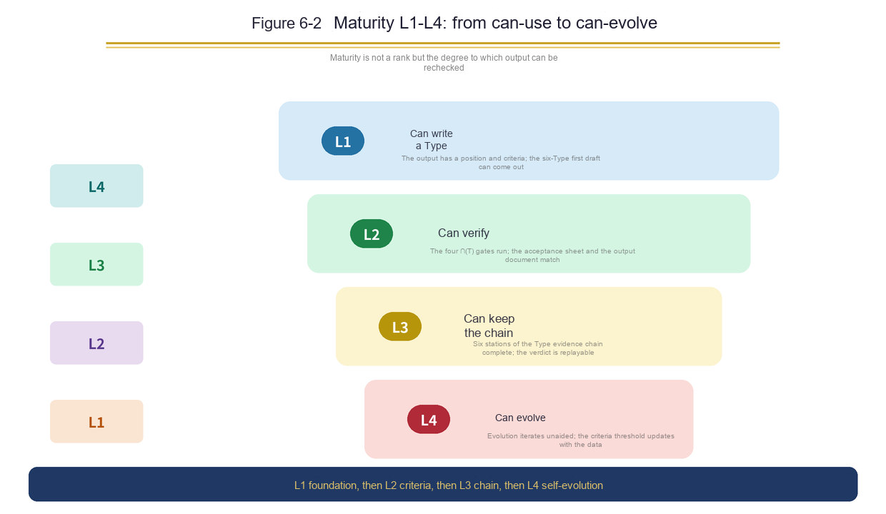  
> **Figure 6-2 Maturity L1–L4**  

## 6.4 The Ninety-Day Adoption Blueprint

Adoption need not happen all at once. Three thirty-day blocks: in the first month establish the Types - six-Type field cards land, pick one programme for a trial run; in the second month establish the criteria - four-gate acceptance sheets and six-station Type evidence chain filing; in the third month establish the chain - the evolution ledger runs routinely and maturity is self-assessed. Each stage has acceptable milestones; if you miss one, step back and make up the lesson rather than pushing on.

**Table 6-4 The ninety-day adoption blueprint**

| **Stage** | **Milestone** | **Output** | **Acceptance** |
| --- | --- | --- | --- |
| Days 1-30 establish the Types | Six-Type field cards land + one programme trial run | Field card template, S1–S7 trial run record | Everyone can open a six-Type first draft |
| Days 31-60 establish the criteria | Four-gate acceptance sheet + six-station filing | Acceptance sheet template, chain coding rules | One R&D round fully replayable end to end |
| Days 61-90 establish the chain | Evolution ledger routine + maturity self-assessment | Monthly evolution ledger report, L1 to L2 self-assessment form | The ten-question checklist brought into the sign-off process |

> 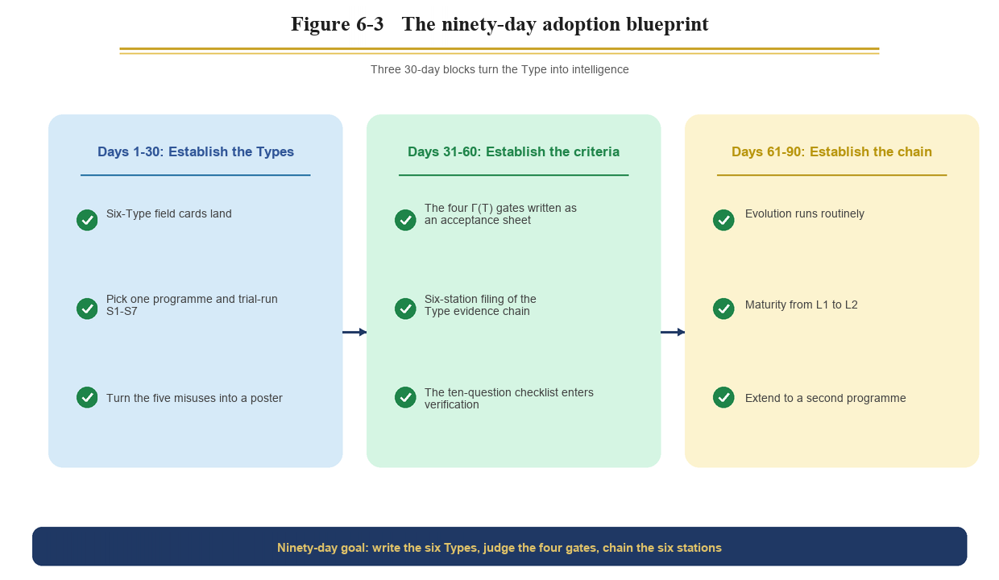  
> **Figure 6-3 The ninety-day adoption blueprint**  

## 6.5 Compliance and Ethics Red Lines

The "accuracy" of gene editing also includes accuracy towards the red lines. The red line is not an appendix but part of the criteria - written into ∩(T); fail the red line and you fail the gate. Everyone must memorise four red lines: germline editing is forbidden to enter the clinical R&D process; somatic cell therapy follows the rules through IND and ethics review; long-term follow-up enters the Type evidence chain as a condition of the verdict; informed consent is an essential field of the Target Type.

> 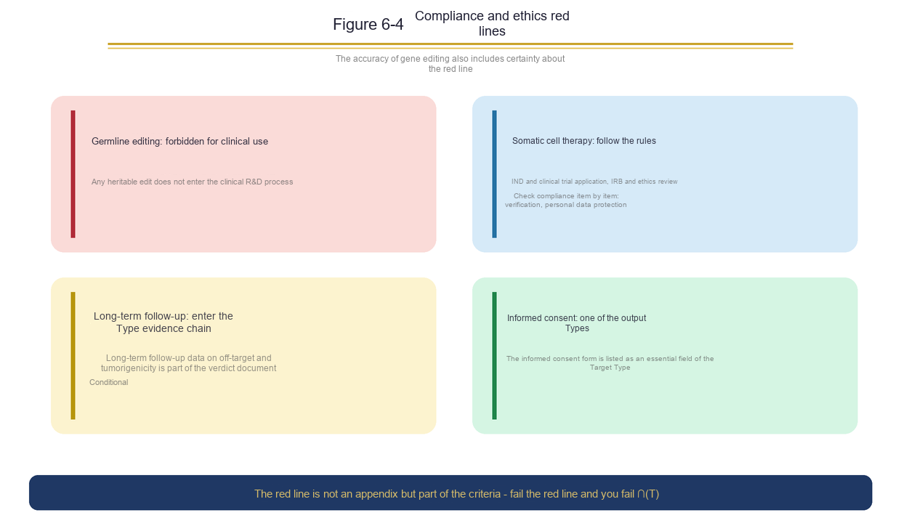  
> **Figure 6-4 Compliance and ethics red lines**  

> *Declaration: this section is a general compliance architecture demonstration and does not constitute legal advice; for actual R&D follow local regulations (such as human trials,*  
> *Gene therapy product management regulations) and the institutional ethics committee's review conclusions.*  

> **Chapter focus**  
> The common root of the five misuses = the layers were not written clearly; one self-check sentence: is every output written as a Type?  
> Carry the ten-question checklist, locate yourself on maturity L1–L4, and schedule the ninety-day blueprint.  
> Compliance red lines are part of the criteria: germline editing forbidden, somatic cells compliant, long-term follow-up, informed consent.  

# Review: three takeaways

This book does only one thing: make the output of gene R&D accurate, testable, and recheckable. Before closing the book, you should hold three things.

> 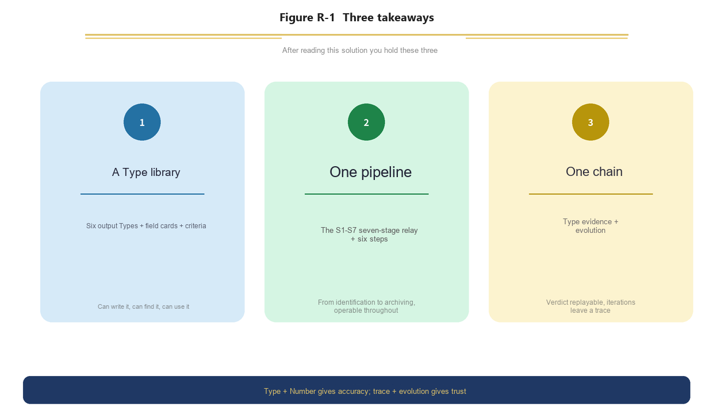  
> **Figure R-1 Three takeaways**  

**Table R-1 The book's toolbox**

| **Tool** | **Where it is used** | **Section** |
| --- | --- | --- |
| Type + Number | Pack R&D into a reasonable twin | 1.1 |
| The three brackets [ ] { } ( ) | Write the rules, write the composition, write the identity | 1.2·2.5 |
| The fourteen-move tray | Selecting, assembling, swapping moves | 1.2·4.4 |
| The six Types "target, guide, vector, assess, verdict, evolution" | The standard template of the output chain | Chapter 2 |
| The four-gate ∩(T) funnel | The first gate of accuracy | 3.1 |
| Deductive skeleton (cause, mechanism, evidence, method, validation) | Let the output grow on the skeleton | 3.2 |
| The validation three-piece set | Reconciliation of efficiency, off-target, and safety | 3.3 |
| The six stations of the Type evidence chain | Every step recheckable | 3.4 |
| The nine cross-acceptance cells | The final check before signing the verdict | 3.5 |
| Four framework steps + six steps | The process from requirement to output | Chapter 4 |
| Three-layer judgement (is, has, right) | On-site stop-check | 4.3 |
| S1–S7 prompts | Start directly at the seven-stage relay | 5.2 |
| The ten-question checklist, maturity, blueprint | Adoption and self-assessment | 6.2–6.4 |

# Appendix A Toolbox (quick reference)

**Table A-1 Terminology quick reference**

| **Terminology** | **English / notation** | **One-sentence definition** |
| --- | --- | --- |
| Type | Type | A fully described output (not a Form) |
| Type set | Type Set | Complete notation of a Unit Type: { part, (content), [class] } |
| Property, property value | Property·Value | Dimensions and scales |
| Abstract class | T = (F(T), ∩(T)) | An open class determined by features and criteria |
| Intersection criterion | ∩(T) | Only when all features pass does it count |
| Container | C = (id(C), S(C)) | Set + invariant identity |
| Identity recognition | id(C) | A marker that does not change with the content |
| Axiom of invariance | Content replaced, id unchanged | Change the cell batch and the programme is still the same |
| Bill of Materials | BOM | The composition list when opened up |
| remove criterion | remove(p, M) | Remove the part and see whether identity survives |
| Three-layer judgement | Is, has, right | Joint check of container, composition, and abstraction |
| Move | function | Time Type = verb = function |
| Type evidence chain | Type Evidence Chain | The six-station chain of criteria + results + trace |

**Table A-2 The six Types x their main moves**

| **Type** | **Main moves used** | **Supporting moves** |
| --- | --- | --- |
| Target Type | Analysis, problem solving | Search and extraction |
| Guide Type | Design (creation and innovation), design patterns | Logic generation |
| Vector Type | Design, function generation and application | R&D and exploration |
| Assessment Type | Analysis, reasoning | Statistical reasoning |
| Verdict Type | Reasoning (causal, simulation), thinking methods | Decision analysis |
| Evolution Type | Continuous learning, refactoring and recombination, self-evolution | First-principles thinking |

**Table A-3 Notation quick reference**

| **Notation** | **Read as** | **Meaning** |
| --- | --- | --- |
| T = (F(T), ∩(T)) | The definition of a Type | Feature set + intersection criterion |
| C = (id(C), S(C)) | The definition of a container | Identity + internal space |
| { part, (content), [class] } | Type set notation | Three layers of information written at once |
| remove(p, M) ≢ M | Essential part | Identity lost after removal |
| remove(p, M) ≡ M′ ⊂ M | Function-degraded part | Function missing, identity retained |
| remove(p, M) ≡ M | Non-essential part | No impact after removal |
| S(t+1) = g(S(t), move, event) | Time state advances | The R&D state is driven by moves |
| ⇒ | Implication | Pushed from criteria to conclusion |

> *This solution document is a Mind AI x Ontypology application demonstration; the cases, values, and sequence parameters in the book are for demonstration.*  
> *Gene editing R&D involves regulatory and ethics review; follow local laws and institutional rules.*  

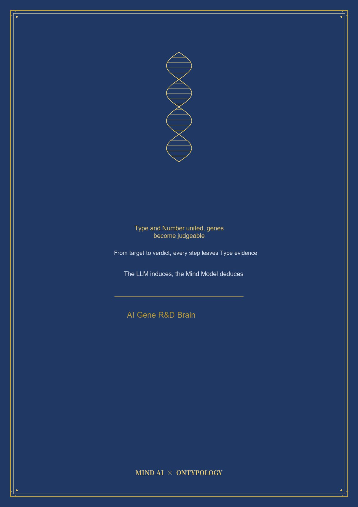
