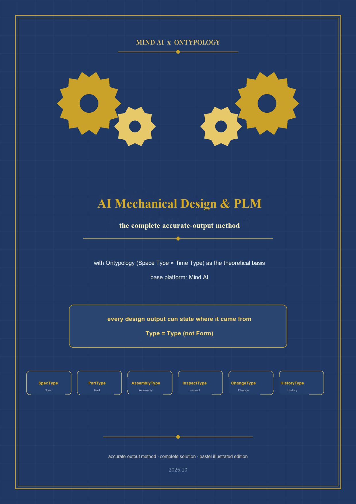

## Table of Contents

- **Before we begin: three conventions3**
- **Task Map: How to Use This Book4**
- **Introduction5**
- D-1 Two Languages, One Machine5
- D-2 The Panorama and Three Ways to Read6
- **Chapter 1 Getting to Know the AI Mechanical Design and PLM Brain7**
- 1.1 A Reasonable Product Replica: Type + Number7
- 1.2 The Two Types Land in Mechanical R&D8
- 1.3 The Division of Labour between Mind AI and the LLM9
- 1.4 Where "Accurate Output" Comes From10
- **Chapter 2 The Six Output Types: Spec, Part, Assembly, Inspection, Change, History12**
- 2.1 Design Specification Type (SpecType)13
- 2.2 Part Type (PartType)14
- 2.3 Assembly Type (AssemblyType)14
- 2.4 Inspection Type (InspectType)15
- 2.5 Change Type (ChangeType)16
- 2.6 History Type (HistoryType)16
- **Chapter 3 The Four-Layer Accuracy Guarantee 18**
- 3.1 Gate One: the ∩(T) Intersection Criterion18
- 3.2 Gate Two: the Deductive Skeleton19
- 3.3 Gate Three: Engineering Validation20
- 3.4 Gate Four: the Type Evidence Chain21
- **Chapter 4 The Six Steps: From Requirement to History23**
- 4.1 The Four-Step Framework: Turning Requirements into Dimensions23
- 4.2 The Six Steps End to End24
- 4.3 Three-Layer Judgement25
- 4.4 Choosing, Combining and Switching Moves25
- **Chapter 5 The S1-S7 Prompt Pipeline and a Full Worked Example27**
- 5.1 The S1-S7 Seven-Stage Prompt Pipeline27
- 5.2 Full Worked Example: Planetary Gearbox30
- **Chapter 6 Misuse Comparison, Maturity, Overall Check33**
- 6.1 Five Misuses33
- 6.2 The Ten-Question Checklist34
- 6.3 Maturity L1-L434
- **three closing questions for the review36**
- **Appendix A Quick Reference: Terms, Moves, Notation38**

# Before we begin: three conventions

This is a book about how AI can make mechanical design and PLM document output accurate. It does not retell theory or exhibit system code; it applies a set of cognitive tools directly on the mechanical R&D floor, so that in all six outputs - specification, part, assembly, inspection, change, history - every number can state where it came from.

So that every later chapter runs on the same track, three conventions are set first.

> **Convention one: the English word for Type is Type**  
> The word "Type" in this book is always rendered Type in English, never Form.  
> Hence SpecType, PartType, AssemblyType and so on; Type-Driven Design is "design driven by Types".  

> **Convention two: the theory is used, not taught**  
> Ontypology (the Space Type and the Time Type) is the theoretical basis of this book, but this book does not restate its text.  
> This book only uses its tools: the three brackets [ ] { } ( ), the intersection criterion ∩(T), the identity anchor id(C), the three levels of remove, the four-step framework, the three-layer judgement and the move tray.  
> For the derivation behind each tool, go back to the original theoretical work; this book is about using the tools in the right place.  

> **Convention three: the platform is cited, not restated**  
> The underlying platform is Mind AI: it provides a unified knowledge model, a reasoning engine, memory and self-evolution.  
> This book does not restate the platform, only cites its place in the division of labour where needed - the engineer talks to Mind AI, while criteria and evidence stay in the Type Library.  

The three conventions in one sentence: Type is Type, use the theory as a tool, use the platform as the base.

# Task Map: How to Use This Book

The book's six chapters fall into four stretches: first meet the brain (Chapter 1), then meet its output (Chapter 2), then see how accuracy is guaranteed (Chapter 3) and how it is produced (Chapters 4 and 5), and finally turn the mirror on yourself (Chapter 6 and the review). The table below is the task map - chapters on the left, what you take away from each on the right.

**Table 0-1 Task map: what each chapter gives you**

| **Chapter** | **Topic** | **What you get** |
| --- | --- | --- |
| Chapter 1 | what this brain is | the concept of the reasonable product replica, the mapping of the two Types onto the R&D process, the platform division of labour, and the four sources of accuracy |
| Chapter 2 | the six output Types | the definitions, fields and examples of the six Types (spec, part, assembly, inspection, change, history); the BOM criterion and the three levels of remove |
| Chapter 3 | the four gates of accuracy | ∩(T) criterion funnel, deductive derivation chain, engineering validation, Type evidence chain |
| Chapter 4 | the six-step method of working | the four-step framework, the six-step flow, the three questions of Type logic, and the selection and combination of moves |
| Chapter 5 | prompts and examples | The full text of the S1-S7 prompts, plus the complete planetary gearbox output from requirement to history |
| Chapter 6 and the review | self-check | misuse comparison, the ten questions, maturity L1-L4, the three closing questions |

*In Table 0-1 the left column deliberately uses half-width "Chapter N" numbers, kept separate from the chapter titles in the contents, so that machines and people can each look things up.*

Three ways to read. The engineer in a hurry: go straight to the six-Type field tables in Chapter 2 and the prompts in Chapter 5, and put them to work. The manager leading a team: read Chapters 1, 3 and 6 for the acceptance standards and the team maturity ladder. The reader who wants a full rollout: read in order and walk Chapter 5's example through your own case.

# Introduction

## D-1 Two Languages, One Machine

Mechanical engineering has its own language: specification, tolerance, fit, BOM, ECN, revision. Ontypology has its own too: Type, property, composition, container, criterion, move. The two languages describe the same machine - the difference is that engineering language tells you which fields to fill, while Type language tells you how those fields relate.

**Table D-1 The Two Languages Compared**

| **engineering language** | **The language of Ontypology** | **the corresponding output Type** |
| --- | --- | --- |
| specification, requirement clauses | Property [ ] and property values, the intersection criterion ∩(T) | Spec Type |
| part drawing, material list | Unit Type, BOM set { } | Part Type (PartType) |
| assembly drawing, BOM | composition structure, Spatial Container ( ) | Assembly Type (AssemblyType) |
| inspection report, measurement data | criterion acceptance, three-layer judgement | Inspection Type (InspectType) |
| engineering change notice ECN | three levels of remove, dependency-chain impact analysis | Change Type (ChangeType) |
| revision history, configuration management | identity anchor id(C), Time Type evolution | History Type (HistoryType) |

*Table D-1 The same planetary gearbox: on the left what the engineer writes every day, on the right the structure AI can reason about.*

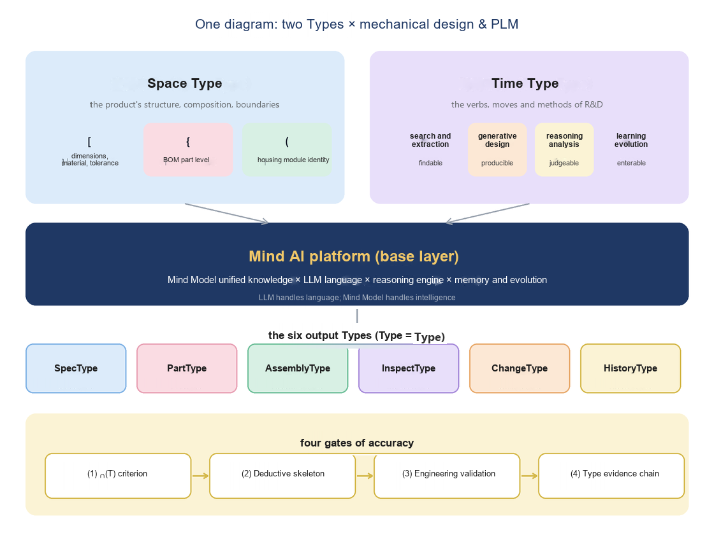

*Figure D-1 Two Types × mechanical design and PLM panorama: space raises the skeleton, time supplies the moves, the platform provides the base, six Types form the output*

## D-2 The Panorama and Three Ways to Read

Figure D-1 is the whole book compressed. The upper half is the two Types: the Space Type raises the product structure with three axes and three brackets, the Time Type turns R&D actions into repeatable methods with the move tray. In the middle is the Mind AI platform - the LLM supplies language ability, the Mind Model supplies reasoning and memory, and the two merge. The lower half is the output chain strung from the six output Types, and the four accuracy gates that guard them.

Along this diagram you can enter the book three ways. Read along the output chain: from SpecType through to HistoryType, for those racing to finish documents. Read along accuracy: check the four gates against the case in hand, for those doing acceptance. Read along the growth path: climb from L1 dialogue output to L4 self-evolution, for those planning team capability.

> **Chapter focus**  
> Two languages describe the same machine: engineering language gives the fields, Type language gives the relations.  
> How to remember the panorama: the two Types on top, the platform in the middle, the six Types and the four accuracy gates below.  
> Pick one way in first; when you have finished the book, come back and read it another way.  

# Chapter 1 Getting to Know the AI Mechanical Design and PLM Brain

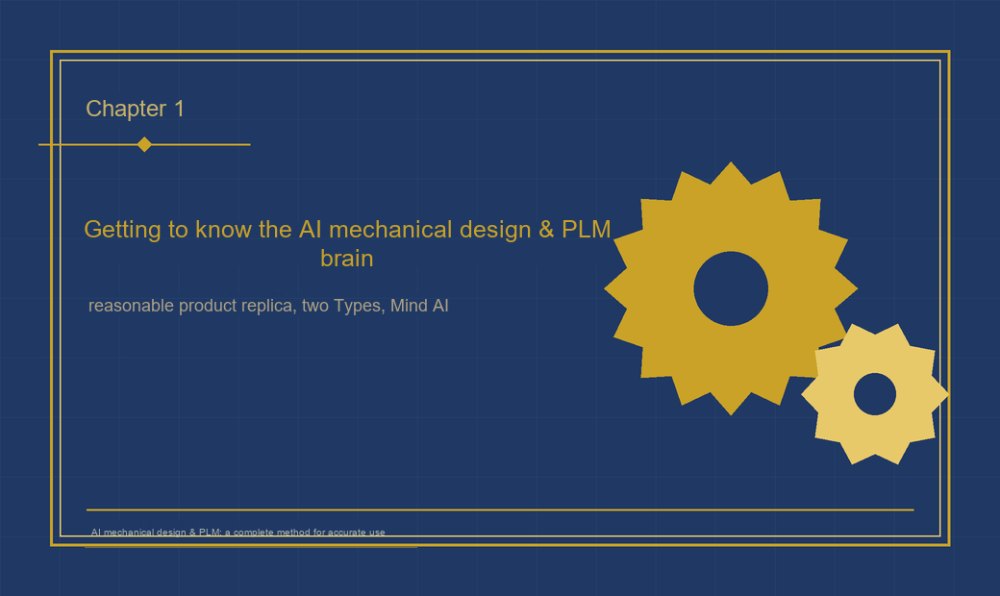

Let the protagonist take the stage: an AI mechanical design and PLM brain. It is not a CAD assistant that chats, nor a document generator - it is a brain that remembers what the product is, reasons out why the design is so, and calculates who is affected after a change. This chapter uses four sections to set out its position: the product replica, where the two Types land, the platform division of labour, and where the four words "accurate output" actually come from.

## 1.1 A Reasonable Product Replica: Type + Number

Every mechanical case has a "replica" in the computer: BOM, drawings, specification, change records. But the traditional replica is a pile of files - people can read them, AI cannot read the relations. A reasonable product replica requires everything in it to be a Type: parts are Types, assemblies are Types, specifications are Types, changes are Types. A Type has a name, boundaries, composition and criteria, so AI can question it and get meaningful answers.

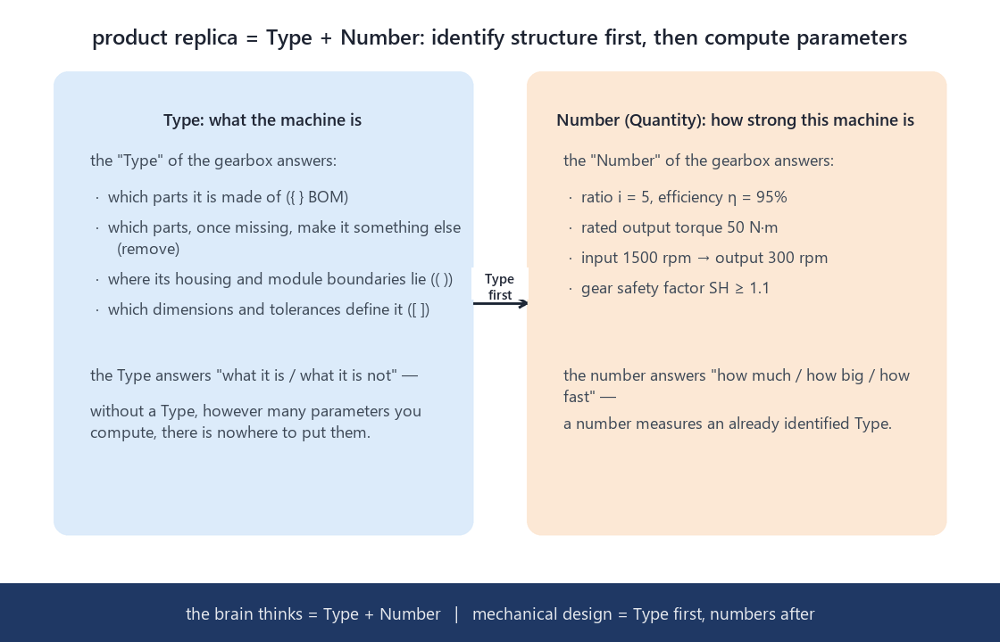

*Figure 1-1 Product replica = Type + Number: identify the structure first, then compute the parameters*

Take the running case of this book, the single-stage planetary gearbox. The Type "planetary gearbox" answers what it is: it consists of a sun gear, planet gears, a ring gear, a planet carrier and a housing, and without the sun gear it cannot transmit motion. The numbers i = 5, η = 95% and rated output torque 50 N·m answer how strong it is. Numbers cannot exist apart from the Type: without the Type "planetary gear train", the number "27 teeth" means nothing. First the Type, then the number - that is the first habit of accurate output.

**Table 1-1 The four scenes of "inaccurate output" and the Type prescription**

| **On-site symptom** | **the real cause** | **the Type prescription** |
| --- | --- | --- |
| the same part does not match across documents | no Types established, names drift | establish the PartType and anchor its identity with id(C) |
| the specification is written but cannot be accepted | no quantified criteria | the SpecType has built-in ∩(T) acceptance clauses |
| documents left unrevised after a change | no dependency chain | AssemblyType BOM + three-level remove impact analysis |
| AI output looks reasonable but nobody dares use it | the number has no origin | Type evidence chain: every number is tagged with its source |

*Table 1-1 The four symptoms share one cause: Type decoupled from number. The next five chapters fit these four prescriptions back one by one.*

## 1.2 The Two Types Land in Mechanical R&D

The Space Type handles "what the product looks like": the X axis property [ ] circles out specifications and tolerances, the Y axis composition { } opens up the BOM levels, and the Z axis container ( ) draws the boundaries of housing, modules and installation space. The Time Type handles "how R&D moves": analysis, design, reasoning, refactoring, self-evolution - each verb is a move that can be applied again and again.

**Table 1-2 The two Types × where they land in mechanical R&D**

| **the Ontypology tools** | **where it lands in mechanical R&D** | **practical example** |
| --- | --- | --- |
| [ ] Property (X axis) | specification clauses, parameters, tolerances | module 1.5, pressure angle 20°, accuracy ISO 1328 grade 6 |
| { } Composition (Y axis) | BOM levels, part composition | L0 machine → L1 gear train → L2 sun gear |
| ( ) Container (Z axis) | housing, module, storage-location boundaries | the planetary train is enclosed in the housing; lubricant must not cross the boundary |
| Time Type - moves | the verbs of the R&D process | requirement analysis, selection design, strength reasoning, ECN refactoring |
| id(C) identity anchor | configuration management | revisions never break: A → B is still the same machine |
| Three levels of remove | change impact analysis | removing the sun gear = fatal; changing the nameplate = imperceptible |

*Table 1-2 The three space axes raise the skeleton, the time moves fix the actions, and id(C) and remove manage change.*

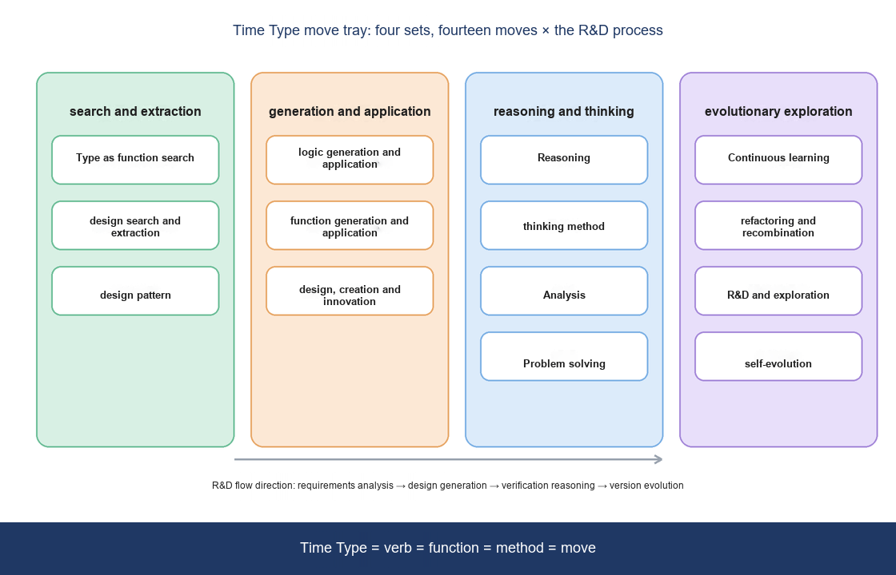

*Figure 1-2 The Time Type move tray: four sets and fourteen moves mapped to the verbs of the R&D process*

The full list of the fourteen moves and their mechanical R&D mapping is in Table A-2 of Appendix A. For now remember one thing: a move is a Time Type - it equals a method, equals a function - with an input (situation), an action (method) and an output (deliverable), so the same move can be used again on the next case.

## 1.3 The Division of Labour between Mind AI and the LLM

Beneath the brain is the Mind AI platform. It is not a single model but an architecture: the LLM provides language understanding and generation, the Mind Model provides unified knowledge, deep reasoning, long-term memory and self-evolution, and a reasoning engine and planning system schedule the two. In one sentence: the LLM handles language, the Mind Model handles intelligence.

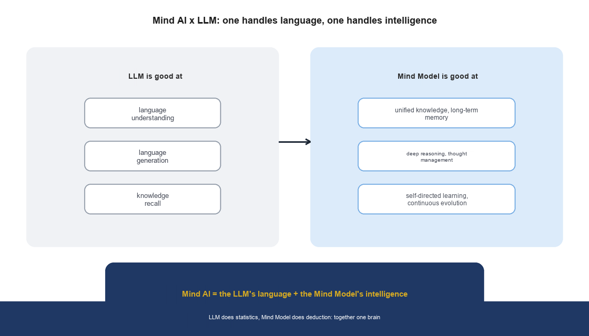

*Figure 1-3 Mind AI × LLM division of labour: language to the LLM, intelligence to the Mind Model*

**Table 1-3 Platform division of labour: who is responsible for what**

| **component** | **the intelligence of responsibility** | **what it looks like in mechanical design and PLM** |
| --- | --- | --- |
| LLM | language understanding and generation | turn the engineer's conversation into a SpecType and report documents |
| Mind Model | unified knowledge and memory | Type Library: PartTypes, the move library and the criteria library accumulate over time |
| reasoning engine | deduction and causal reasoning | from i = 5, Zr/Zs = 4 follows, step by step checkable |
| planning system | task decomposition and scheduling | break a case into the seven-stage S1-S7 pipeline |
| learning system | continuous learning and evolution | misuse cases feed back to the Type Library and are screened automatically next time |

*Table 1-3 The engineer talks to Mind AI; what really remembers the product is the Type Library.*

This division of labour matters directly for accuracy: the text an LLM generates carries a statistical blur by nature, while the criteria in the Type Library are definite. Let language stay language and criteria stay criteria, and only then does AI output deserve a stamp.

## 1.4 Where "Accurate Output" Comes From

"Accurate output" is not a slogan but the composite of four gates. The first is criteria: every Type carries an ∩(T) intersection criterion, and only output that passes counts. The second is derivation: conclusions are not copied, they are derived step by step along the deductive skeleton. The third is validation: the numbers must pass engineering validation - tolerance chain, strength, performance. The fourth is traceability: the Type evidence chain lets every number be traced back to its source.

**Table 1-4 The four gates of accuracy (preview)**

| **Layer** | **what it guards** | **One sentence** |
| --- | --- | --- |
| First layer | ∩(T) | if the intersection is not satisfied, it does not enter the Type |
| Second layer | Deductive skeleton | conclusions are derived, not copied |
| Third layer | engineering validation | computing the number is not enough; it counts only when validation passes |
| Fourth layer | Type evidence chain | every output traces back to a Type and a criterion |

*Table 1-4 Chapter 3 takes these four gates apart one by one; this chapter only plants the landmarks.*

> **Chapter focus**  
> A reasonable product replica = everything is a Type; Type first, number second.  
> The two Types: the three space axes raise the structure, the time moves fix the method.  
> The LLM handles language, the Mind Model handles intelligence - accuracy comes from criteria, not from fluency.  
> Accurate output = criteria + derivation + validation + traceability; none of the four gates may be missing.  

# Chapter 2 The Six Output Types: Spec, Part, Assembly, Inspection, Change, History

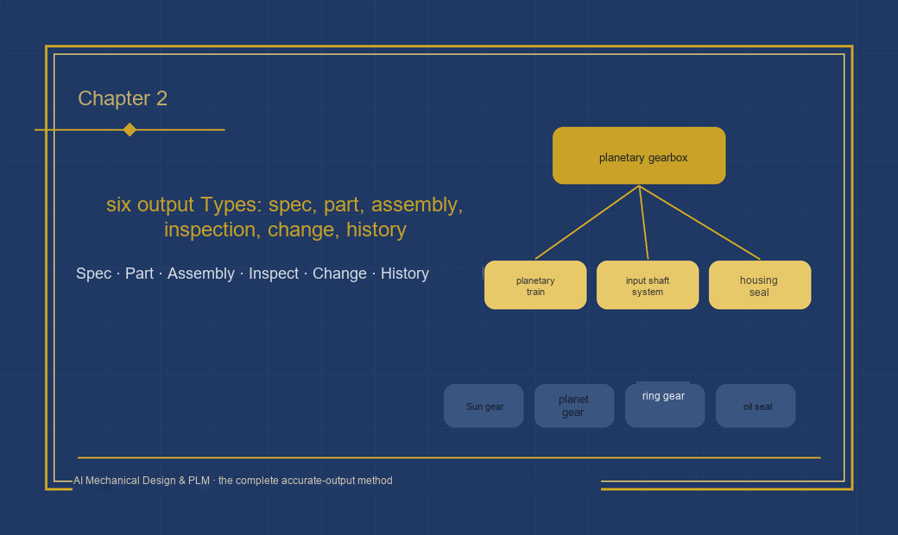

Mechanical design and PLM produce many documents but only six kinds of output: specification, part, assembly, inspection, change, history. Set each of the six up as a Type and you have six output Types - remembered in this book as "spec, part, assembly, inspection, change, history". The first three design the product; the last three govern it. Every Type has definition fields (what it records), criteria (what counts as passing), and upstream and downstream neighbours (whom it connects to).

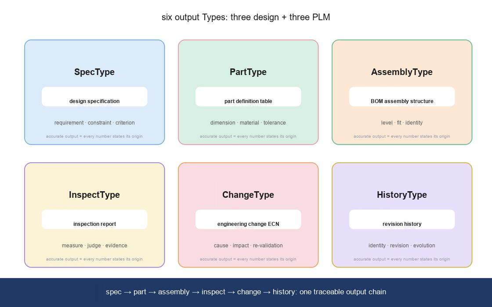

*Figure 2-1 The six output Types: three design Types + three PLM Types*

**Table 2-1 Master table of the six output Types**

| **Output Type** | **English** | **core question** | **key criterion** |
| --- | --- | --- | --- |
| Spec type | SpecType | what is to be made | requirements quantified and acceptable |
| PartType | PartType | what this thing is | fields complete, values sourced |
| AssemblyType | AssemblyType | who goes inside whom | BOM criterion, correct fits |
| InspectType | InspectType | whether the measurement passes | criteria come from the SpecType |
| ChangeType | ChangeType | who is affected by the change | impact analysis complete, re-validation complete |
| HistoryType | HistoryType | past and present lives | id(C) never breaks, always traceable |

*Table 2-1 The six Types join into one output chain: one Type's output is the next Type's criterion.*

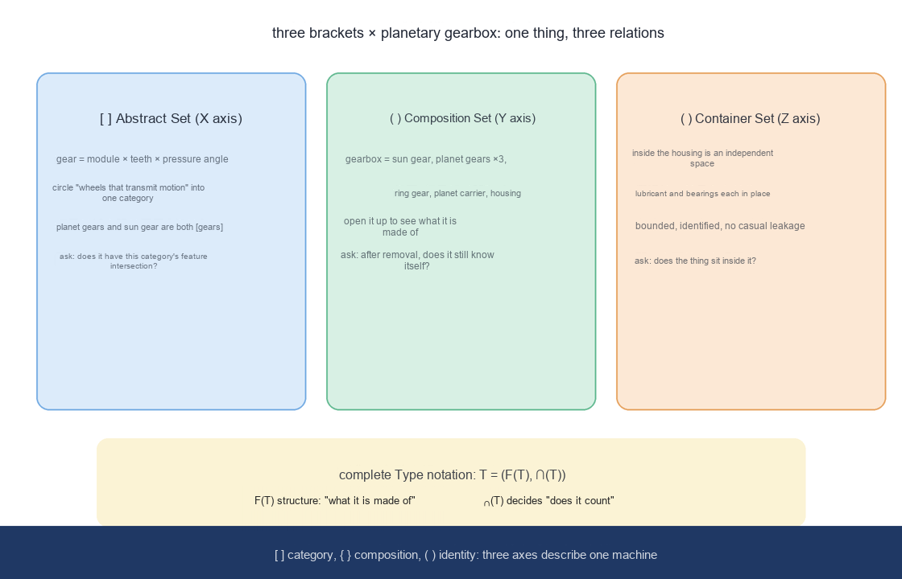

*Figure 2-2 The three brackets × planetary gearbox: three relations of the same machine*

## 2.1 Design Specification Type (SpecType)

The SpecType is the source of the output chain: the customer says "I want a small, high-torque gearbox", and the SpecType turns it into acceptable clauses. Its point is that every requirement is quantified into a criterion - a clause without a criterion is not a specification but a wish.

**Table 2-2 Key fields of the design SpecType**

| **Field** | **Description** | **planetary gearbox example** |
| --- | --- | --- |
| specification number | unique identity | SPEC-PG-001 |
| requirement clause | the original requirement text | the customer requires a gear ratio of 5:1 |
| quantified criterion ∩(T) | acceptable value ranges | i = 5 ± 2%; T2 ≥ 50 N·m |
| constraints | boundaries and limits | OD ≤ 120 mm; weight ≤ 3.5 kg |
| Acceptance method | how to judge fit | no-load run-in + rated torque test |
| traceability | which meeting / which quotation it came from | RFQ-2026-0815 clause 3 |

*Table 2-2 The quantified criterion column is where ∩(T) lands: the SpecType carries its own acceptance standard.*

## 2.2 Part Type (PartType)

The PartType is the leaf of the BOM: every part that can no longer be decomposed (for this case) becomes a Type. It records not only dimensions but material, heat treatment, tolerance and drawing number - miss one field and procurement, machining and inspection downstream each start guessing.

**Table 2-3 Key fields of the PartType**

| **Field** | **Description** | **sun gear example** |
| --- | --- | --- |
| part number | unique identity, the anchor point of id(C) | PT-SG-018 |
| Name | conventional names | sun gear |
| material and heat treatment | determines strength and life | SCM415, carburised and quenched, HRC58-62 |
| key dimensions | functional dimensions carry units | module 1.5; 18 teeth; pitch circle φ27 mm |
| tolerance | measurable accuracy requirements | tooth profile ISO 1328 grade 6; shaft diameter φ12 k6 |
| surface treatment | corrosion resistance and appearance | black oxide treatment |
| figure number | two-way link with the drawing files | DWG-PG-018 |

*Table 2-3 Every value must be tagged with its source when generated in S4 (see Chapter 5).*

## 2.3 Assembly Type (AssemblyType)

The AssemblyType answers "who goes inside whom": BOM levels, quantities, fit relations, assembly sequence and tightening torque. This is exactly where the BOM criterion (after removal, does it still know itself?) and the three levels of remove earn their keep.

**Table 2-4 Key fields of the AssemblyType**

| **Field** | **Description** | **planetary train assembly example** |
| --- | --- | --- |
| assembly number | assembly identity | AS-PGS-01 |
| BOM level | L0 machine / L1 assembly / L2 part | L1 (belongs to L0 planetary gearbox) |
| details and quantities | composition list | sun gear ×1, planet gears ×3, ring gear ×1, pins ×3 |
| fit relation | shaft-bore fits and tolerance zones | planet gear bore φ14 H7 / pin φ14 k6 |
| assembly sequence | reproducible steps | press the pin first, then fit the planet gears, then close the ring gear |
| tightening specification | torque and anti-loosening | M8 × 24 N·m + threadlocker |

*Table 2-4 The fit-relation column is the input to tolerance-chain analysis (see 3.3).*

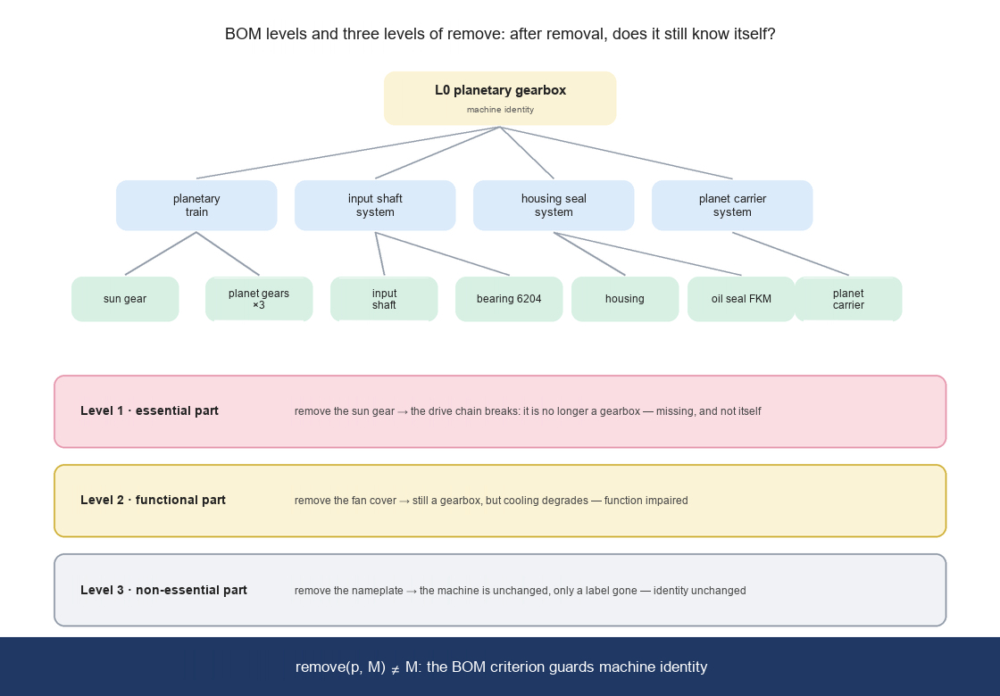

*Figure 2-3 BOM levels and the three levels of remove: after removal, does it still know itself*

**Table 2-5 The three levels of remove × planetary gearbox**

| **Grade** | **Criteria** | **example** | **how it is handled at change time** |
| --- | --- | --- | --- |
| Level 1 - essential part | remove and it is no longer itself | sun gear, ring gear | must re-validate, must issue an ECN |
| Level 2 - functional part | remove and the function degrades | fan cover, oil cooler pipe | assess the degree of degradation before deciding the re-validation scope |
| Level 3 - non-essential part | remove and identity is unchanged | nameplate, appearance label | light change, does not trigger re-validation |

*Table 2-5 The three levels of remove are the computational basis of ChangeType impact analysis (see 2.5 and 5.2).*

## 2.4 Inspection Type (InspectType)

The InspectType translates the SpecType's criteria into the language of measurement: inspection item, method, instrument, measured value, judgement. Every one of its criteria must trace back to the SpecType - the shop floor may not invent its own standard, and "roughly passing" is not allowed.

**Table 2-6 Key fields of the InspectType**

| **Field** | **Description** | **example** |
| --- | --- | --- |
| inspection item | what to measure | backlash |
| measurement method and instrument | how to measure | dial-indicator reversal method; resolution 0.01 mm |
| Criteria | which SpecType clause it comes from | SPEC-PG-001 §4: ≤ 7 arcmin |
| measured value | with units and measurement conditions | 0.09 mm (about 6.2 arcmin) @ 20°C |
| Determination | pass / fail / concession | Pass |
| record | report number and sign-off | INSP-PG-001-A / QA signature |

*Table 2-6 The judgement column allows only three values, shutting out the infinite space of "should be fine".*

## 2.5 Change Type (ChangeType)

The ChangeType is the ECN (engineering change notice). It is not a notification but a small design exercise: state the cause of the change, before and after, the scope of impact and the re-validation items. The scope is computed from the AssemblyType dependency chain and the three levels of remove, not from the engineer's memory.

**Table 2-7 Key fields of the ChangeType**

| **Field** | **Description** | **ECN-042 example** |
| --- | --- | --- |
| change number | unique identity | ECN-042 |
| cause | why the change | customer raises the upper limit of the operating temperature |
| change content | before-and-after comparison | oil seal material NBR → FKM |
| impact analysis | which Types are affected | PartType / AssemblyType / InspectType / SpecType |
| re-validation items | mandatory measurements and tests | 150°C seal hold test, lip wear re-measurement |
| effective revision | when the new baseline starts | revision B (revision A archived) |

*Table 2-7 How the impact-analysis column is generated is shown in Figure 5-2; a full ECN example is in Table 5-7.*

## 2.6 History Type (HistoryType)

The HistoryType is where the Time Type lands in PLM: every release, every ECN and every sign-off is collected onto one timeline. Its guardian is the identity anchor id(C) - revisions never break, and revisions A, B and C are the past and present lives of the same machine.

**Table 2-8 Key fields of the HistoryType**

| **Field** | **Description** | **example** |
| --- | --- | --- |
| revision | baseline code | Rev A → Rev B |
| release date | when it takes effect | 2026-03-12 |
| bound change | which ECNs this revision contains | Rev B = Rev A + ECN-042 |
| release basis | under what conditions it is released | type tests all passed |
| Sign-off | who is responsible | joint sign-off by design, QA and manufacturing |
| archive | how the old revision is disposed of | Rev A drawing stamped void, filed for ten years |

*Table 2-8 The HistoryType keeps "why was it designed this way back then" permanently answerable.*

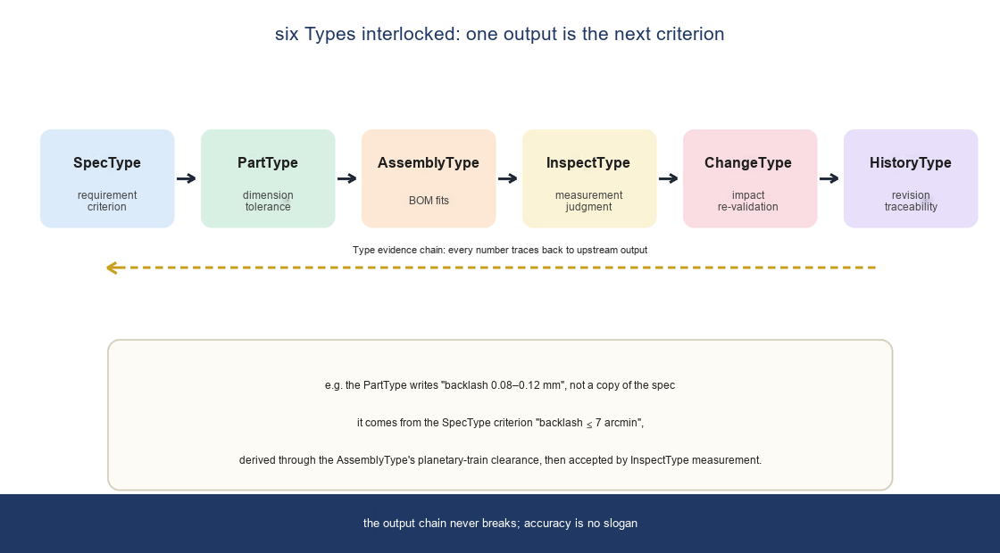

*Figure 2-4 The six Types interlocked: one Type's output is the next Type's criterion, and the evidence chain traces backwards*

> **Chapter focus**  
> Six output Types = spec, part, assembly, inspection, change, history: the three design Types (specification, part, assembly) plus the three PLM Types (inspection, change, history).  
> The quantified criterion of the SpecType is ∩(T): a clause without a criterion is not a specification.  
> The three levels of remove turn "how big is the impact" into a computable question.  
> The HistoryType keeps identity continuous through id(C): revisions never break.  

# Chapter 3 The Four-Layer Accuracy Guarantee

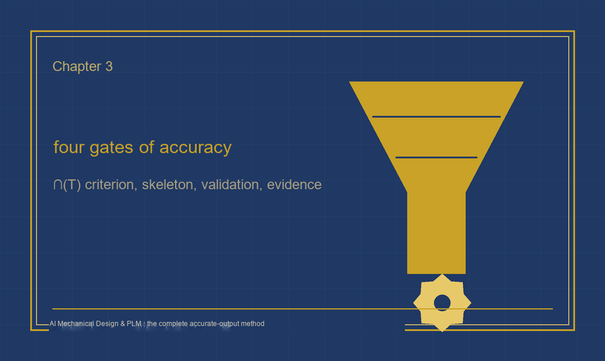

The previous chapter set up the six output Types; this chapter answers "on what grounds do we call it accurate". The answer is four gates: the ∩(T) intersection criterion guards "does it count", the deductive skeleton guards "was it derived", engineering validation guards "was it tested", and the Type evidence chain guards "can it be found". The four run from entrance to exit; if any gate fails, the output is downgraded to "for reference only".

**Table 3-1 Master table of the four gates of accuracy**

| **Layer** | **what it protects** | **Tool** | **symptoms of failure** |
| --- | --- | --- | --- |
| First layer | eligibility: does it count as this Type | ∩(T) | accept everything and the Type Library becomes a dump |
| Second layer | reasoning: how the conclusion was reached | Deductive skeleton | the number is right but its provenance is unknown |
| Third layer | reality: can the numbers hold up | engineering validation | passes on paper, fails in the field |
| Fourth layer | memory: can it be found afterwards | Type evidence chain | the same error repeats and nobody owns it |

*Table 3-1 The four gates stack: all must pass for accuracy; missing one leaves it incomplete.*

## 3.1 Gate One: the ∩(T) Intersection Criterion

Every Type carries an intersection criterion ∩(T): the intersection of a set of necessary conditions, and only output satisfying all of them enters the Type. In mechanical design ∩(T) becomes the four-gate funnel - requirement fit, catalogue availability, standard compliance, criterion acceptance - every gate filtering, every gate keeping evidence.

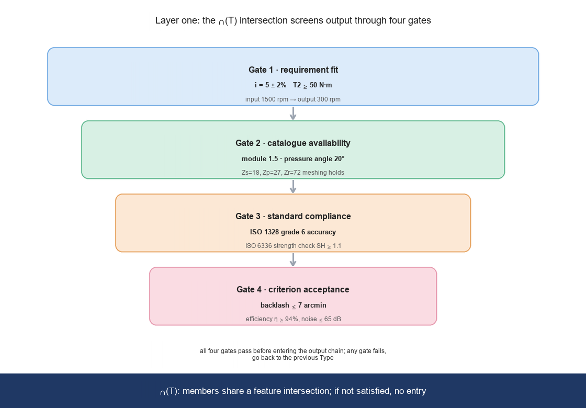

*Figure 3-1 The four-gate ∩(T) funnel: every gate filters, every gate keeps evidence*

**Table 3-2 Example of the four-gate ∩(T) criteria (planetary gearbox)**

| **Gate** | **criterion content** | **Action when not satisfied** |
| --- | --- | --- |
| requirement fit | i = 5 ± 2%; T2 ≥ 50 N·m; n1 ≤ 3000 rpm | return to S1 and rewrite the SpecType |
| catalogue availability | module and tooth counts satisfy the meshing conditions; (Zs+Zr)/number of planet gears is an integer | return to S2 and reselect the tooth parameters |
| standard compliance | ISO 1328 grade 6; ISO 6336 check SH ≥ 1.1 | return to S3 and increase the module or change the material |
| Criteria acceptance | backlash ≤ 7 arcmin; η ≥ 94%; noise ≤ 65 dB | return to S5 and open a non-conformance disposition |

*Table 3-2 The order of the four gates cannot be swapped: requirements first, then selection, then standards, acceptance last.*

The value of ∩(T) is that it holds the line. An output chain without criteria is just an elegant guess, however fluently the AI writes it; with criteria the guess is stopped at the first gate - and that is the first door to "accurate output".

## 3.2 Gate Two: the Deductive Skeleton

The second gate governs the reasoning process: every conclusion must be derived along the skeleton, every step being "known → formula → substitution → result". The opposite of the deductive skeleton is copying the answer: the answer happens to be right but nobody can check the process - change the operating condition next time and it is all wrong.

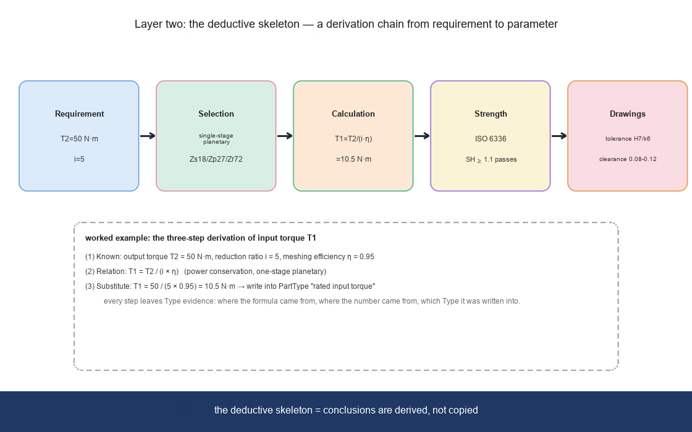

*Figure 3-2 The deductive skeleton: the derivation chain from requirement to parameter*

The input torque of the planetary gearbox is a typical derivation: given output torque T2 = 50 N·m, ratio i = 5, meshing efficiency η = 0.95; conservation of power gives T1 = T2 / (i × η); substituting gives T1 = 50 / (5 × 0.95) = 10.5 N·m. This result is then written into the "rated torque of input shaft" field of the PartType and its formula source is hung on the Type evidence chain. The meshing condition of the gears works the same way: for a single-stage planetary drive i = 1 + Zr/Zs, so Zr/Zs = 4, take Zs = 18 and Zr = 72; the concentricity condition Zr = Zs + 2Zp then gives Zp = 27; the assembly condition (Zs + Zr) / 3 = 30 is an integer, so three planet gears equally spaced holds.

**Table 3-3 Deductive skeleton derivation table (excerpt)**

| **Steps** | **Known** | **Relation** | **Result** |
| --- | --- | --- | --- |
| (1) | T2 = 50 N·m; i = 5; η = 0.95 | T1 = T2 / (i x η) | T1 = 10.5 N·m |
| (2) | i = 1 + Zr / Zs | Zr = 4 Zs | Zs = 18, Zr = 72 |
| (3) | concentricity condition Zr = Zs + 2 Zp | Zp = (Zr - Zs) / 2 | Zp = 27 |
| (4) | assembly condition (Zs + Zr) / n is an integer | n = 3 equally spaced | 90 / 3 = 30 holds |
| (5) | P = T2 x n2 / 9550 | n2 = n1 / i = 300 rpm | P = 1.57 kW |

*Table 3-3 Every result carries units and every formula has a source - that is the point of the skeleton.*

## 3.3 Gate Three: Engineering Validation

Correct derivation is not enough: the numbers must survive reality. The third gate is engineering validation - tolerance stack-up, strength checks and performance tests, nailing the paper numbers down with measurements from the physical world. For AI output this gate is the watershed of "dare we stamp it".

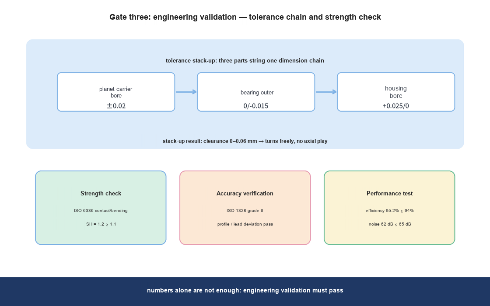

*Figure 3-3 Engineering validation: tolerance stack-up plus the three-way checks of strength and performance*

**Table 3-4 Tolerance-chain analysis table (radial location of the planetary train)**

| **composition ring** | **tolerance** | **worst-case stack-up** | **Result** |
| --- | --- | --- | --- |
| housing bore | +0.025 / 0 | max 120.025 | — |
| bearing outer diameter | 0 / -0.015 | min 59.985 | — |
| planet carrier bore | ±0.02 | max 120.02 | — |
| **◆Gap stack-up** | — | 0 ~ 0.06 mm | **◆Pass** |

*Table 3-4 The worst-case method looks at the worst situation first; tighten later in mass production with statistical methods (Cp/Cpk).*

Each of the three checks owns one question: strength checking (ISO 6336 contact and bending, safety factors SH ≥ 1.1 and SF ≥ 1.25) asks "will it break"; accuracy verification (ISO 1328 profile and lead deviations) asks "will it run smoothly"; performance testing (efficiency, noise, temperature rise) asks "is it good to use". If any one fails, the output goes back to the corresponding Type to be redone - not patched in the report.

## 3.4 Gate Four: the Type Evidence Chain

The last gate handles memory and traceability: the Type evidence chain writes "one source per number, one ledger per Type" into the output. Behind every value on a PartType hangs its birth certificate - which specification clause it came from, which formula it travelled, which measurement it passed. A number without evidence may not be booked.

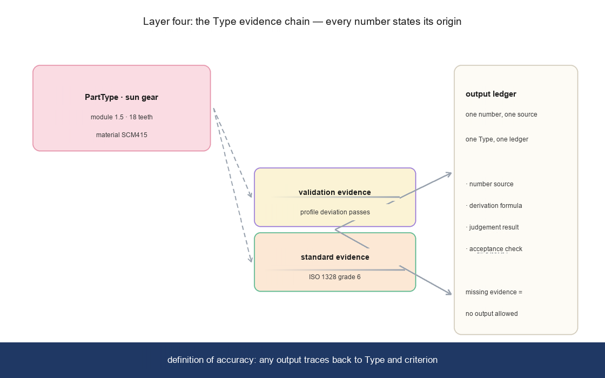

*Figure 3-4 The Type evidence chain: every number can state its origin*

**Table 3-5 Type evidence chain format (PartType excerpt)**

| **value** | **source Type** | **derivation / basis** | **validation record** |
| --- | --- | --- | --- |
| 18 teeth | SpecType SPEC-PG-001 §2 | back-calculate with i = 1 + Zr/Zs | — |
| material SCM415 | SpecType SPEC-PG-001 §6 | contact-stress material selection table | material certificate CM-0415 |
| shaft diameter φ12 k6 | AssemblyType AS-PGS-01 | shaft-bore fit H7/k6 | INSP-PG-001-A §2 |
| backlash 0.08-0.12 mm | SpecType §4 backlash criterion | backlash conversion | INSP-PG-001-A §5 |

*Table 3-5 Space × time cross acceptance: in space it traces back to the Type, in time to the revision and the measurement records.*

> **Chapter focus**  
> The four gates run from entrance to exit: criteria → derivation → validation → traceability.  
> The four-gate ∩(T) funnel: requirement fit, catalogue availability, standard compliance, criterion acceptance.  
> The deductive skeleton refuses copied answers: known → formula → substitution → result, units at every step.  
> The Type evidence chain, one source per number: a number without evidence may not be booked.  

# Chapter 4 The Six Steps: From Requirement to History

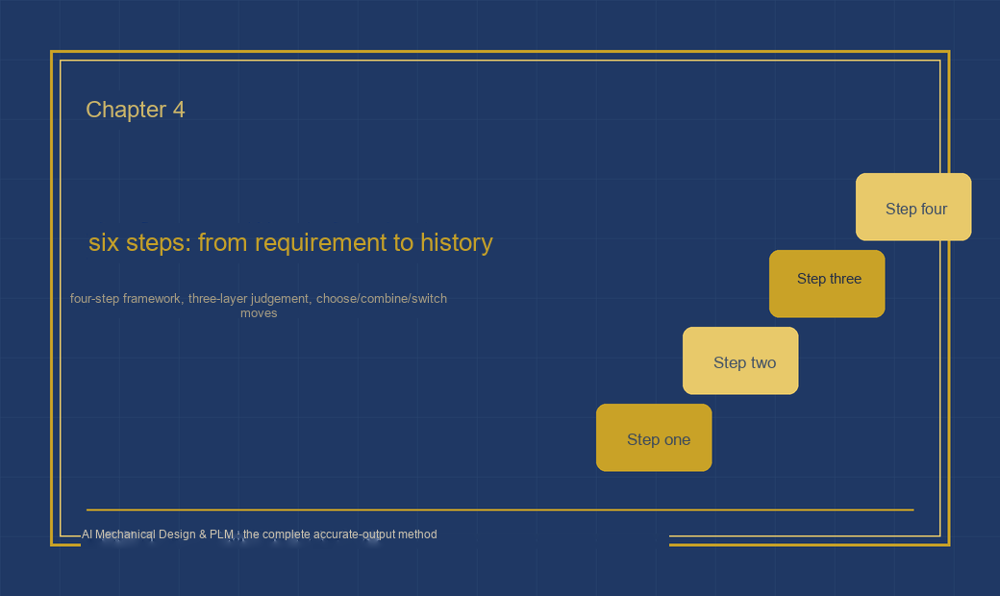

The first two chapters gave the output Types and the insurance on accuracy; this chapter gives the method of working - how to take a case from requirement to history. The method has three layers: the four-step framework turns requirements into dimensions, the six steps walk the case one full round, and the three-layer judgement plus move combinations find a way when you are stuck.

## 4.1 The Four-Step Framework: Turning Requirements into Dimensions

When a pile of requirements lands, do not start drawing. The four-step framework - one, tell sameness from difference; two, trigger abstraction; three, name the dimension; four, decide membership - sorts the mess into dimensions, so that every requirement has somewhere to hang.

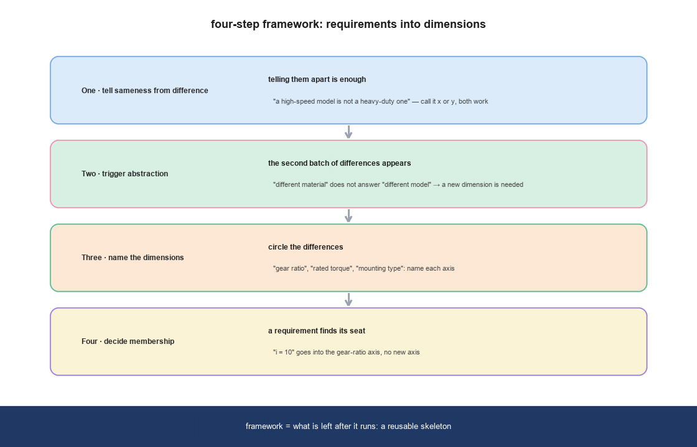

*Figure 4-1 The four-step framework: from messy requirements to ordered dimensions*

**Table 4-1 The four-step framework × requirement analysis**

| **Steps** | **trigger timing** | **planetary gearbox example** |
| --- | --- | --- |
| One: distinguish similarity and difference | a cluster of requirements arrives | "A high-speed model is not a heavy-duty model" - first tell them apart |
| Two: trigger abstraction | the second batch of differences does not match | "Different mounting flange" does not answer "different gear ratio" |
| Parameter, naming the dimension | differences must be understood separately | set up the axes of ratio, rated torque, mounting type and so on |
| Four: judging membership | a new requirement arrives | "Want i = 10" hangs on the transmission-ratio axis; no new axis is opened |

*Table 4-1 The framework is what is left after the framework has run: a skeleton that can be applied again and again.*

## 4.2 The Six Steps End to End

With the dimensions set, the case goes one round of the six steps: identify the situation, build Types by axis, select and expand the pattern, generate the output, criterion acceptance, archiving and evolution. Each step has clear entry conditions, actions and outputs - after six steps the six Types are complete and the case can be closed.

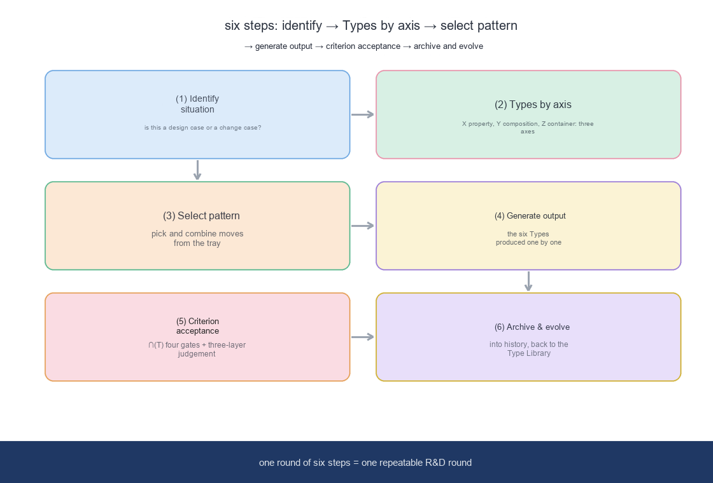

*Figure 4-2 The six steps: one repeatable R&D round*

**Table 4-2 The six steps × actions and outputs**

| **Steps** | **key actions** | **Output Type** | **completion criterion** |
| --- | --- | --- | --- |
| (1) Identify the situation | routing design cases / change cases / quotation cases | — | situation identified, scope bounded |
| (2) Build Types by axis | X property, Y composition, Z container: the three axes | SpecType draft | dimensions named |
| (3) Select and expand the pattern | choose and combine moves from the move tray | — | moves match the situation |
| (4) Generate the output | S1-S7 pipeline operation | PartType - AssemblyType | fields complete, values sourced |
| (5) Criterion acceptance | the four ∩(T) gates + engineering validation | InspectType | all judged pass |
| (6) Archiving and evolution | enter the history, feed back to the Type Library | ChangeType - HistoryType | release the revision, accumulate experience |

*Table 4-2 The mapping between the six steps and S1-S7 is detailed in Chapter 5; the move tray for (3) is in Table A-2.*

## 4.3 Three-Layer Judgement

Day-to-day work constantly needs the judgement "does this count": is this equipment a container? which level is this part? is this new product a gearbox? The three-layer judgement of Type logic answers in order: first the container identity ( ( ) ), then the composition structure ( { } ), and finally the abstract category ( [ ] ). Get the order right and half the disputes disappear.

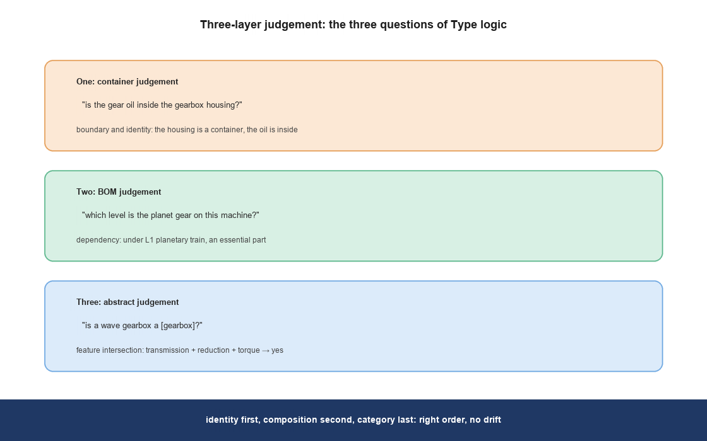

*Figure 4-3 The three questions of Type logic: identity first, composition second, category last*

## 4.4 Choosing, Combining and Switching Moves

The move tray of the Time Type must be used flexibly: picking a single move by situation is choosing; stringing several into a routine is combining; switching to another path when stuck is switching. A heavy-duty design case can start by choosing "design search and extraction", then combine "analysis → design → reasoning" to push forward; if forward design will not move, switch to "reverse thinking" or "first-principles thinking" and re-decompose.

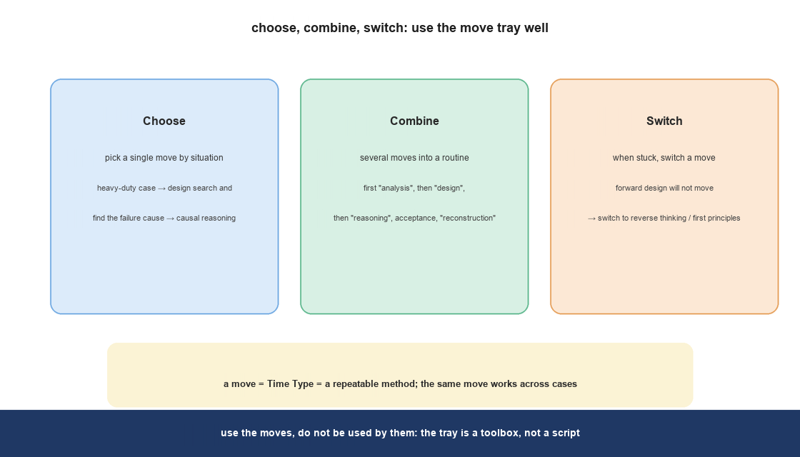

*Figure 4-4 Choosing, combining and switching moves: using the move tray flexibly*

**Table 4-3 Examples of move operations**

| **Operation** | **Situation** | **combine** |
| --- | --- | --- |
| Selecting moves | the customer wants "more torque in the same volume" | design search and extraction (find the existing limit) |
| Assembling moves | development of an entirely new transmission architecture | analysis → design (creation and innovation) → reasoning (strength causality) → refactoring |
| Swapping moves | parameter optimisation stuck at a local optimum | forward thinking → switch to the level-thinking method / first principles to re-establish the dimensions |

*Table 4-3 A move is a method, not a script: the input is a situation, the output is a document, and reuse is its duty.*

> **Chapter focus**  
> The four-step framework turns requirements into dimensions: tell sameness from difference → trigger abstraction → name the dimension → decide membership.  
> One round of the six steps: identify the situation → build Types by axis → select and expand the pattern → generate the output → criterion acceptance → archiving and evolution.  
> The three-layer judgement has a fixed order: container → composition → abstract.  
> Moves must be used flexibly: choose, combine, switch.  

# Chapter 5 The S1-S7 Prompt Pipeline and a Full Worked Example

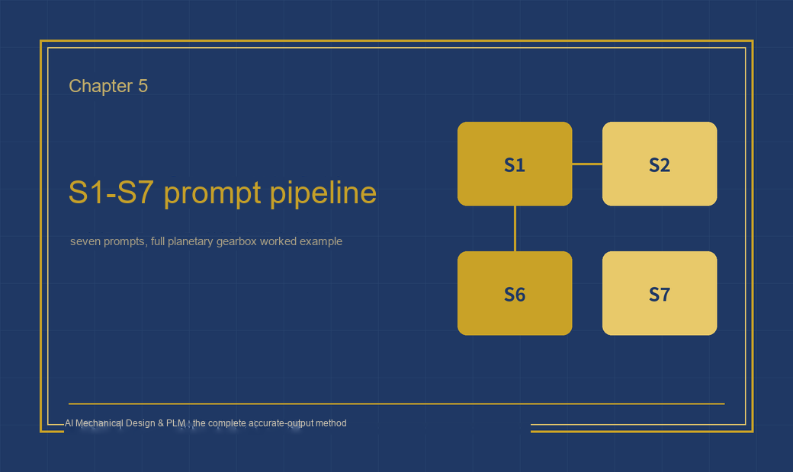

This chapter is the operating core of the book. The first half is the full text of the seven-stage S1-S7 prompt pipeline - each stage states role, input, action, output Type and acceptance criterion; the second half walks the pipeline from the beginning with the planetary gearbox, showing what the complete output of the SpecType, PartType, AssemblyType, InspectType, ChangeType and HistoryType actually looks like.

## 5.1 The S1-S7 Seven-Stage Prompt Pipeline

The pipeline's design principle: each stage does one thing only, produces one Type only, and answers to one set of criteria only. Stages hand over through the output Type, so any stage can be re-run without contaminating the others.

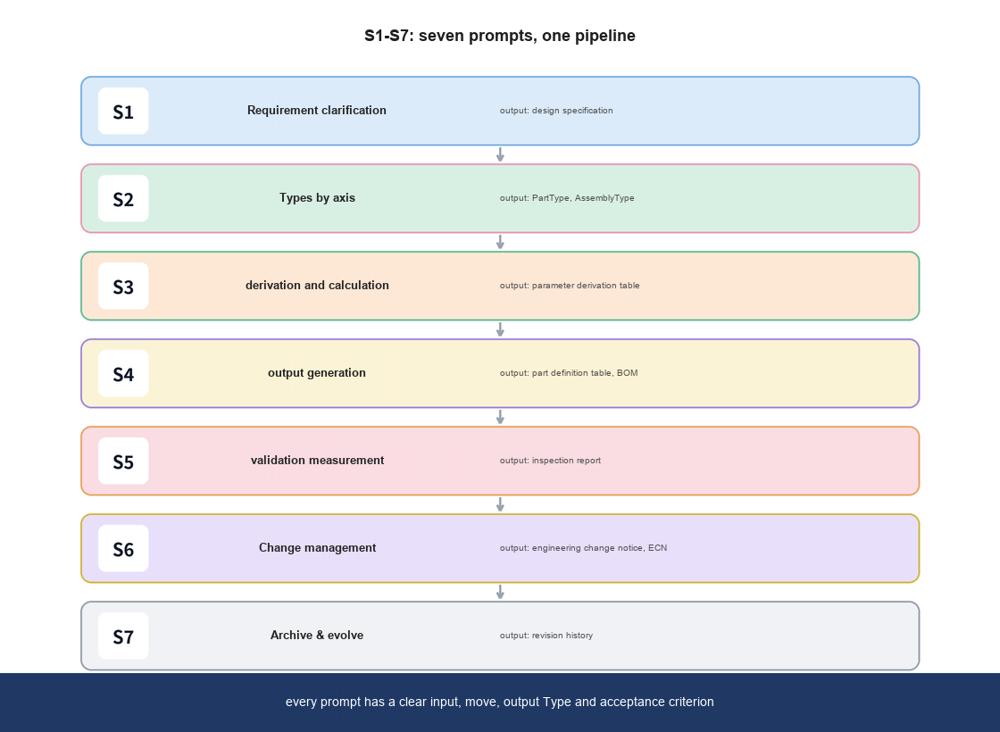

*Figure 5-1 The S1-S7 pipeline: every stage has an input, a move, an output Type and an acceptance criterion*

**Table 5-1 Master table of S1-S7**

| **Stage** | **Task** | **main moves** | **Output Type** | **Acceptance criteria** |
| --- | --- | --- | --- | --- |
| S1 | Clarifying the requirement | Analysis, problem solving | Spec type | every requirement is quantified |
| S2 | Build Types by axis | Four framework steps | PartType - AssemblyType | all three axes complete, remove grading done |
| S3 | derivation and calculation | reasoning (causal) | parameter derivation table | every step has units and a formula |
| S4 | output generation | Function generation and application | part definition table, BOM | every value is tagged with its source |
| S5 | validation and measurement | reasoning (simulation) | InspectType | all criteria come from the SpecType |
| S6 | change management | Refactoring and recombination | ChangeType | impact analysis covers the whole dependency chain |
| S7 | Archive and evolve | Continuous learning, self-evolution | HistoryType | release the revision, feed back to the Type Library |

*Table 5-1 The move column maps to where the fourteen moves land in Table A-2 of Appendix A.*

### S1 - Requirement Clarification

> **S1 prompt (requirement clarification → SpecType)**  
> You are a mechanical design engineer. Organise the following customer requirements into a [SpecType] design specification.  
> Requirements: (1) list the original text of each requirement clause one by one; (2) quantify each into an acceptable criterion ∩(T) (value + range);  
> (3) Annotate the constraints (dimensions, weight, environment, regulations); (4) state the acceptance method.  
> Never fabricate values the customer did not mention; mark gaps [To Be Confirmed] and list the clarification questions.  
> Output fields: specification number \| requirement clause \| quantified criterion \| constraints \| acceptance method \| traceability.  
> Customer requirement: {customer description}  

### S2 - Building Types by Axis

> **S2 prompt (build Types by axis → PartType and AssemblyType)**  
> Using SpecType SPEC-xxx, build the product Type along the three axes.  
> X axis [ ]: list the key properties and their values (name \| value \| unit \| source clause).  
> Y axis { }: expand the BOM down to part level (level L0-L2 \| number \| name \| quantity).  
> Z axis ( ): mark the container boundaries (housing / module / installation space, with id(C) and boundary description for each container).  
> And grade every component with the three levels of remove: essential / functional / non-essential part.  
> Output: AssemblyType skeleton + PartType list (fields may be left empty for S4 to fill in values).  

### S3 - Derivation and Calculation

> **S3 prompt (derivation and calculation → parameter derivation table)**  
> Derive the main parameters step by step along the deductive skeleton. Each step outputs four columns: known \| formula \| substitution \| result (with units).  
> where a standard is cited, give its number and clause (e.g. ISO 6336-1 contact strength).  
> Never give a conclusion without the derivation; if a parameter has several paths, take one as the main line and list the rest as alternatives.  
> Finally output the parameter derivation table, marking which PartType field each result will be written into.  

### S4 - Output Generation

> **S4 prompt (output generation → part definition table and BOM)**  
> Generate the part definition table and the BOM from the Types and the derivation results.  
> Part fields: part number \| name \| material \| heat treatment \| key dimensions and tolerances \| surface treatment \| drawing number.  
> Tag the source after every value with [Source: ...] (specification clause number or derivation step number).  
> BOM fields: level \| number \| name \| quantity \| fit relation \| remove level.  
> A value with no source may not be booked; anything of unclear origin is marked [Evidence Pending].  

### S5 - Validation and Measurement

> **S5 prompt (validation and measurement → InspectType)**  
> Write the inspection specification and report. Output item by item: inspection item \| measurement method \| instrument \| criterion (citing the SpecType clause number) \|  
> measured value (simulated values may be marked [Simulated] first) \| judgement (pass / fail / concession).  
> Every non-conforming item must come with a disposition recommendation and an automatically drafted change request (handed to S6).  
> Never invent criteria on the spot; vague judgements such as "should be fine" are banned.  

### S6 - Change Management

> **S6 prompt (change management → ChangeType ECN)**  
> Write the engineering change notice ECN as a ChangeType.  
> Content: change number \| cause \| before-and-after comparison \| scope of impact \| mandatory re-validation items \| effective revision.  
> The scope of impact must be computed from the three levels of remove and the AssemblyType dependency chain, and listed Type by Type (PartType / AssemblyType / InspectType / SpecType).  
> Changes to level-1 essential parts are automatically queued for mandatory re-validation; level-3 non-essential parts take the light-change route.  

### S7 - Archiving and Evolution

> **S7 prompt (archiving and evolution → HistoryType)**  
> Archive this case as a HistoryType: revision \| date \| release basis \| bound ECN list \| sign-off status \| archiving disposition.  
> and feed three things back to the Type Library: (1) the list of reusable PartTypes and AssemblyTypes; (2) the moves worth fixing and the prompt revisions;  
> (3) Misuses in this case and how they were corrected (see the five misuses in Chapter 6).  
> Finally output the suggested starting point for the next case (which Type in the Type Library to start from).  

## 5.2 Full Worked Example: Planetary Gearbox

Case background: customer RFQ-2026-0815 asks for a single-stage planetary gearbox - input 1500 rpm, ratio 5:1, rated output torque 50 N·m, continuous duty, outer diameter ≤ 120 mm, operating environment -20 ~ 120°C. The output is demonstrated stage by stage below along S1-S7 (key fields excerpted; the full documents come out of the pipeline, and what is shown here is what really matters for acceptance).

**Table 5-2 S1 output - design specification (SpecType excerpt)**

| **specification number** | **requirement clause** | **quantified criterion ∩(T)** | **Acceptance method** |
| --- | --- | --- | --- |
| SPEC-PG-001 §1 | gear ratio 5:1 | i = 5 ± 2% | no-load speed ratio measurement |
| SPEC-PG-001 §2 | rated output torque | T2 ≥ 50 N·m (continuous) | magnetic-particle brake load test |
| SPEC-PG-001 §3 | outer diameter and weight | OD ≤ 120 mm; ≤ 3.5 kg | instruments and scales |
| SPEC-PG-001 §4 | transmission accuracy | backlash ≤ 7 arcmin | dial-indicator reversal method |
| SPEC-PG-001 §5 | efficiency and noise | η ≥ 94%; ≤ 65 dB(A) | back-to-back efficiency test |
| SPEC-PG-001 §6 | operating environment | -20 ~ 120°C continuous operation | run-in in a thermal chamber |

*Table 5-2 Every clause is quantified and acceptable - wishes that do not qualify are marked [To Be Confirmed] right in S1.*

**Table 5-3 S3 output - main parameter derivation (excerpt)**

| **Known** | **formula** | **Substitute** | **Result** |
| --- | --- | --- | --- |
| T2 = 50 N·m; i = 5; η = 0.95 | T1 = T2 / (i x η) | 50 / 4.75 | 10.5 N·m |
| n1 = 1500 rpm; i = 5 | n2 = n1 / i | 1500 / 5 | 300 rpm |
| i = 1 + Zr / Zs | Zr = 4 Zs | Zs = 18 | Zr = 72 |
| Zr = Zs + 2 Zp | Zp = (72 - 18) / 2 | 54 / 2 | Zp = 27 |
| P = T2 x n2 / 9550 | 50 x 300 / 9550 | — | P = 1.57 kW |

*Table 5-3 Verification of meshing and assembly conditions is in Table 3-3; every result is written into the corresponding PartType.*

**Table 5-4 S2/S4 output - BOM (AssemblyType excerpt)**

| **level** | **No.** | **Name** | **quantity** | **remove level** |
| --- | --- | --- | --- | --- |
| L0 | AS-PG-000 | planetary gearbox | 1 | — |
| L1 | AS-PGS-01 | planetary train assembly | 1 | essential |
| L1 | AS-IN-01 | input shaft assembly | 1 | essential |
| L1 | AS-HS-01 | housing seal assembly | 1 | essential |
| L2 | PT-SG-018 | sun gear | 1 | essential |
| L2 | PT-PL-027 | planet gear | 3 | essential |
| L2 | PT-RG-072 | ring gear | 1 | essential |
| L2 | PT-SF-006 | oil seal FKM | 2 | essential |
| L2 | PT-NP-001 | nameplate | 1 | non-essential |

*Table 5-4 The fan cover (functional part) and others are omitted; the remove level is exactly the weight used in S6 impact analysis.*

**Table 5-5 S4 output - part definition table (PartType PT-SG-018 sun gear)**

| **Field** | **Value** | **[Source]** |
| --- | --- | --- |
| material | SCM415, carburised and quenched, HRC58-62 | SPEC §6 + material selection table S3-(5) |
| module / tooth count | 1.5 / 18 | SPEC §1; S3-(2) |
| pitch circle | φ27 mm (d = mZ) | S3 derivation step (2) |
| shaft diameter tolerance | φ12 k6 | AssemblyType AS-PGS-01 fit table |
| gear accuracy | ISO 1328 grade 6 | SPEC §4 |
| surface treatment | black oxide treatment | SPEC §6 environmental clause |
| figure number | DWG-PG-018 | S4 drawing list |

*Table 5-5 The third column is the Type evidence chain: a number missing [Source] is stopped at S4.*

**Table 5-6 S5 output - inspection report (InspectType INSP-PG-001-A excerpt)**

| **inspection item** | **instrument / method** | **criterion (source)** | **Measured** | **Determination** |
| --- | --- | --- | --- | --- |
| gear ratio | tachometer back-to-back test | i = 5 ± 2% (SPEC §1) | 5.01 | Pass |
| backlash | dial-indicator reversal method | ≤ 7 arcmin (SPEC §4) | 6.2 arcmin | Pass |
| transmission efficiency | the back-to-back loading method | ≥ 94% (SPEC §5) | 95.2% | Pass |
| noise | sound level meter at 1 m | ≤ 65 dB(A) (SPEC §5) | 62 dB(A) | Pass |
| high-temperature sealing | 150°C hold for 4 h | no leakage (ECN-042) | no leakage | Pass |

*Table 5-6 The criterion column cites SpecType clauses throughout - the measurement floor does not invent standards.*

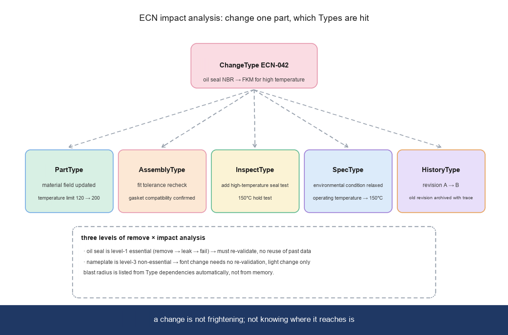

*Figure 5-2 ECN impact analysis: three levels of remove × dependency chain, the blast radius listed automatically*

**Table 5-7 S6 output - engineering change notice ECN-042 (ChangeType)**

| **Field** | **Content** |
| --- | --- |
| cause | the customer's environment has become harsher and the upper temperature limit must rise from 120°C to 150°C |
| change content | output shaft oil seal material NBR → FKM (PartType PT-SF-006 revision) |
| impact analysis | PartType: PT-SF-006 material field; AssemblyType: AS-HS-01 gasket compatibility recheck; InspectType: add a 150°C hold test; SpecType: revise the SPEC §6 environmental clause |
| remove judgement | The oil seal is a level-1 essential part (remove it and it leaks, then fails) → mandatory re-validation, previous case data may not be reused |
| re-validation items | high-temperature seal hold test, lip wear re-measurement, 8 h continuous run-in with temperature-rise re-measurement |
| effective revision | Rev B (Rev A drawing stamped void and filed) |

*Table 5-7 The impact-analysis column is derived automatically from the AssemblyType dependency chain; the engineer confirms rather than remembers.*

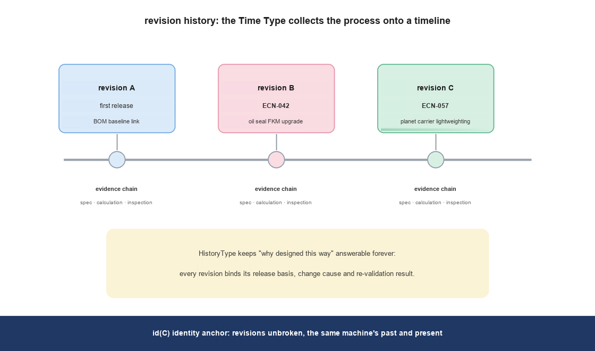

*Figure 5-3 Revision history: id(C) keeps revisions unbroken, each with its full evidence attached*

**Table 5-8 S7 output - revision history (HistoryType excerpt)**

| **revision** | **date** | **bound change** | **release basis** | **Sign-off** |
| --- | --- | --- | --- | --- |
| Rev A | 2026-03-12 | — | type tests all passed | design / QA / manufacturing |
| Rev B | 2026-06-01 | ECN-042 Oil Seal FKM | 150°C test passed | design / QA |
| Rev C | 2026-09-20 | ECN-057 Planet Carrier Lightweighting | fatigue test 200 h passed | design / QA / manufacturing |

*Table 5-8 Feedback to the Type Library: this case deposited 9 PartTypes and fixed 3 moves (design search, causal reasoning, refactoring).*

> **Chapter focus**  
> Each S1-S7 stage does one thing only, produces one Type, and answers to one set of criteria.  
> The soul of a prompt is its acceptance clauses: no fabrication, nothing written without a source, vague judgements are out.  
> The full planetary gearbox example shows the six Types as real entities: one line from SPEC-PG-001 to Rev C.  
> Impact analysis is computed from the dependency chain and the three levels of remove, not from memory.  

# Chapter 6 Misuse Comparison, Maturity, Overall Check

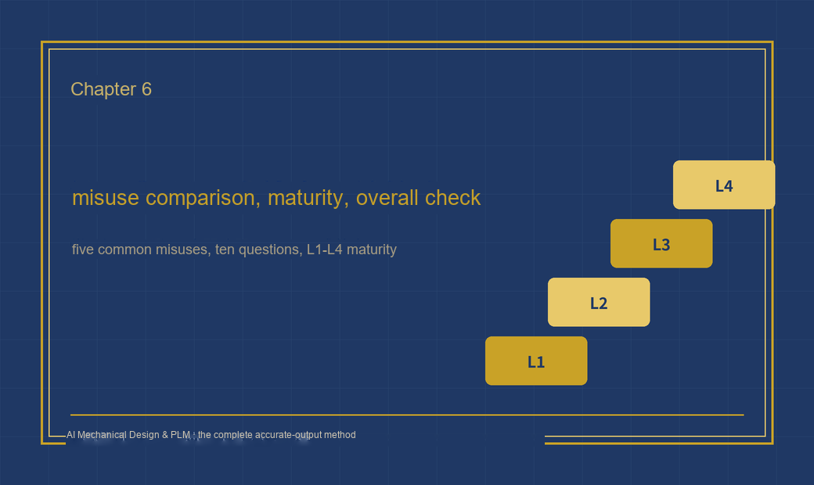

With the method taught, the last chapter handles the close: first the five most common misuses - between them they cover about eighty percent of real-world failure; then the ten-question checklist to score your own case; finally the maturity model to plan the team's next step.

## 6.1 Five Misuses

The five misuses share one root: Type decoupled from number, output decoupled from criteria. None of them blows up immediately, but all of them quietly leak "accurate output".

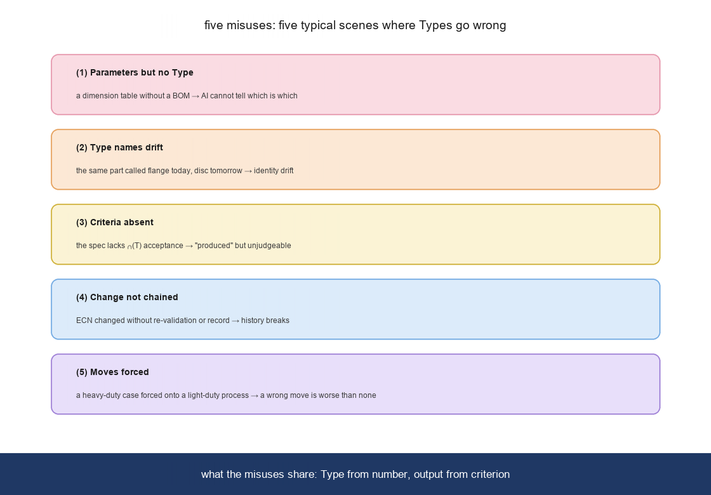

*Figure 6-1 Five misuses: five typical scenes where Type and number come apart*

**Table 6-1 Misuse comparison table**

| **Misuse** | **Symptom** | **Consequence** | **Correction** |
| --- | --- | --- | --- |
| (1) Parameters without a Type | throwing over only a dimension table | AI cannot tell one from another | establish the PartType and AssemblyType before filling in numbers |
| (2) Type names drift | one part, many names; renamed but not renumbered | identity drifts, BOM does not match | id(C) anchors the number; renames leave a trace |
| (3) Criteria absent | the specification has no acceptance condition | produced but impossible to judge | ∩(T) quantified, three-valued judgement |
| (4) Changes not linked to the chain | ECN changed without re-validation | the history breaks and the field fails | dependency chain + three levels of remove must be listed for re-validation |
| (5) Moves forced onto the wrong situation | a heavy-load case run through a light-load process | a misapplied move is worse than none | choose a move by situation; when stuck, switch |

*Table 6-1 Pin this table on the project-room wall: five sentences, five alarm bells.*

## 6.2 The Ten-Question Checklist

Ask yourself ten questions before closing a case. Each must be answered with a Type, never with "probably", "should be" or "as I recall".

**Table 6-2 The ten closing questions**

| **#** | **Problem** | **what a passing answer looks like** |
| --- | --- | --- |
| 1 | Does every part have a PartType? | list every item by number, none missed |
| 2 | Has the BOM criterion been applied? | every item is tagged with its remove level |
| 3 | Are the container boundaries drawn clearly? | each housing / module has its id(C) and boundary description |
| 4 | Is every specification quantified? | ∩(T) clauses are measurable and decidable |
| 5 | Can every number state its source? | No blank [Source] fields |
| 6 | Is the derivation complete? | known → formula → substitution → result, every step checkable |
| 7 | Has engineering validation been done? | tolerance chain, strength and performance each have a report |
| 8 | Is every change tagged with an impact analysis? | Every ECN carries a dependency-chain list |
| 9 | Can the history answer "why"? | any revision's release basis is traceable |
| 10 | Has the Type Library accumulated? | the experience of this case has been fed back to the Type Library |

*Table 6-2 Only when all ten questions pass is the output accurate; if one is stuck, go back to the corresponding step and redo it.*

## 6.3 Maturity L1-L4

Accuracy is not a switch but a staircase. A team can assess which level it stands on, then decide where to climb.

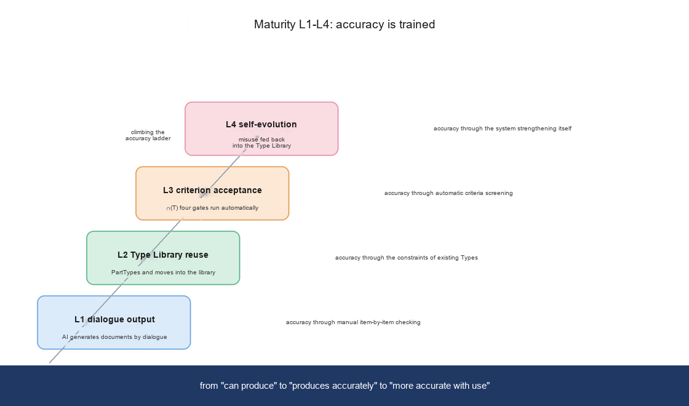

*Figure 6-2 Maturity L1-L4: from being able to produce, to producing accurately, to getting more accurate with use*

**Table 6-3 Maturity model**

| **Grade** | **Feature** | **what accuracy rests on** | **Upgrade action** |
| --- | --- | --- | --- |
| L1 dialogue output | AI generates documents through dialogue | manual item-by-item check | build the field templates of the Type |
| L2 Type Library reuse | PartTypes and moves enter the library | constraints of existing Types | write an ∩(T) criterion for every Type |
| L3 criterion acceptance | the four-gate funnel runs automatically | criteria screen automatically | link the Type evidence chain and the history |
| L4 Self-evolution | misuses fed back to the Type Library | the system strengthens itself | periodically refactor moves and criteria |

*Table 6-3 Most teams start at L1; reaching L2 within three months and touching L3 within a year is a realistic pace.*

# three closing questions for the review

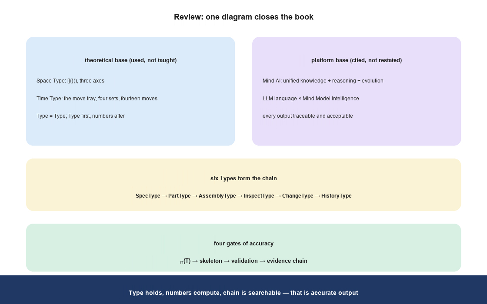

*Figure R-1 One diagram to close: theory as tool, platform as base, six Types as a chain, four gates guarding accuracy*

After six chapters, everything closes into three questions for each reader to take back to their own floor.

### Question one - have the Types been established?

In your own case, is every part, every assembly and every specification a Type - or just a pile of files? First the Type, then the number: that is this book's first habit and the precondition of all accuracy.

### Question two - has accuracy been held?

∩(T) criteria, deductive skeleton, engineering validation, Type evidence chain - how many of the four gates does your process have? Add whichever is missing; you need not do it all at once, but you must know where the gap is.

### Question three - will it be more accurate tomorrow?

Have this misuse, this ECN and this measurement surprise all been fed back to the Type Library? L4 self-evolution is not platform magic; it is the accumulation of that one step, "archiving and evolution", at the close of every case.

**Table R-1 Overall checklist for the book**

| **Aspect** | **Checkpoint** | **Pass standard** |
| --- | --- | --- |
| Output Type | all six Types (spec, part, assembly, inspection, change, history) complete | every Type has fields, criteria and neighbours |
| Criteria | hang the four ∩(T) gates into the process | Non-conforming output is stopped automatically |
| Derivation | the deductive skeleton is checkable | every step has units, a formula and a source |
| Verification | all three engineering validation routes complete | tolerance chain, strength and performance each have a report |
| traceability | the Type evidence chain is complete | any number's origin found within three minutes |
| Evolution | the Type Library keeps accumulating | every closed case has a feedback record |

*Table R-1 This table can serve as a quarterly audit sheet.*

# Appendix A Quick Reference: Terms, Moves, Notation

**Table A-1 Terminology quick reference**

| **Terminology** | **English** | **In one sentence** |
| --- | --- | --- |
| Type | Type | something with boundaries, composition, criteria and a name |
| property / property value | Property / Value | [ ] Axis: circle differences into dimensions and values |
| BOM | Bill of Materials | { } Axis: composition structure and levels |
| Spatial Container | Space Container | ( ) Axis: space with boundaries and identity |
| Intersection criterion | Intersection Criterion ∩(T) | the intersection of necessary conditions that must all hold before entering the Type |
| Identity anchor | Identity Anchor id(C) | an identity marker that keeps revisions unbroken |
| Three levels of remove | Remove Levels | change grading for essential / functional / non-essential parts |
| Type set | Type Set T = (F(T), ∩(T)) | a complete notation of structure description plus criteria |
| Four framework steps | Framework Four Steps | Distinguish similarity and difference, trigger abstraction, name the dimension, judge membership |
| Three-layer judgement | Three-Layer Judgment | the judgement order container → composition → abstract |
| Move | Motion / Function | Time Type: a repeatable R&D method |
| Type evidence chain | Type Evidence Chain | a traceability chain of one source per number, one ledger per Type |

*Table A-1 The word "Type" is always rendered Type in English, never Form.*

**Table A-2 The fourteen moves of the Time Type × where they land in mechanical design and PLM**

| **Set** | **Move** | **where it lands in mechanical R&D** |
| --- | --- | --- |
| Search and extraction | Type-time function search | find existing PartTypes and past cases in the Type Library |
| Search and extraction | Design search and extraction | catalogue selection, patent and benchmark comparison |
| Search and extraction | Design patterns | reuse mature configurations such as the planetary train and planet carrier |
| generative application | Logic generation and application | configuration combination generation under constraints |
| generative application | Function generation and application | calculation templates: strength, life, efficiency |
| generative application | design - creation and innovation | new transmission architecture, lightweight configuration |
| reasoning and thinking | Reasoning | causal (failure analysis), statistical (tolerance), reverse (back-solving) |
| reasoning and thinking | Thinking methods | first principles to decompose the requirement, level thinking to change the solution |
| reasoning and thinking | Analysis | requirement analysis, tolerance-chain analysis, market analysis |
| reasoning and thinking | Problem solving | locating field problems such as interference, abnormal noise and temperature rise |
| evolutionary exploration | Continuous learning | measurements and customer complaints feed back to the criteria library |
| evolutionary exploration | Refactoring and recombination | Rebuild the BOM and drawing baseline after the ECN |
| evolutionary exploration | R&D and exploration | exploring the feasibility of new materials and processes |
| evolutionary exploration | Self-evolution | misuse cases settle automatically into screening rules |

*Table A-2 Four sets, fourteen moves: search and extraction, generative application, reasoning and thinking, evolutionary exploration.*

**Table A-3 Notation quick reference**

| **Notation** | **Reading path** | **Meaning** |
| --- | --- | --- |
| [ ] | Abstract Set | Property X axis: the intersection of features generates the category |
| { } | Composition Set | BOM Y axis: composition structure |
| ( ) | Container Set | Space Z axis: boundaries and identity |
| T = (F(T), ∩(T)) | Type set notation | F(T) structure description + ∩(T) criterion |
| ∩(T) | Intersection criterion | the intersection of necessary conditions for entering the Type |
| id(C) | container identity | identity anchor: revisions never break |
| remove(p, M) | removal judgement | after removing p, is M still M |
| S1–S7 | the seven-stage pipeline | the prompt sequence from requirement clarification to archiving and evolution |

*Table A-3 The notation follows the original theoretical work; this book only uses it, it does not teach it.*

> **end of the book**  
> The Type holds up, the numbers compute correctly, the chain can be searched - that is accurate output.  
> Take the six Types back to your own floor, fit the four gates into your process, and write the misuses into the Type Library.  
> The next machine will be more accurate than this one.  

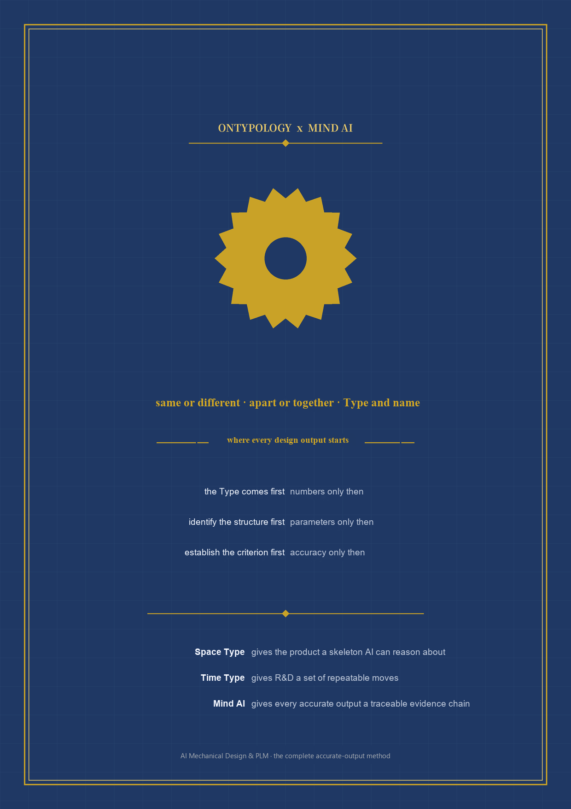
