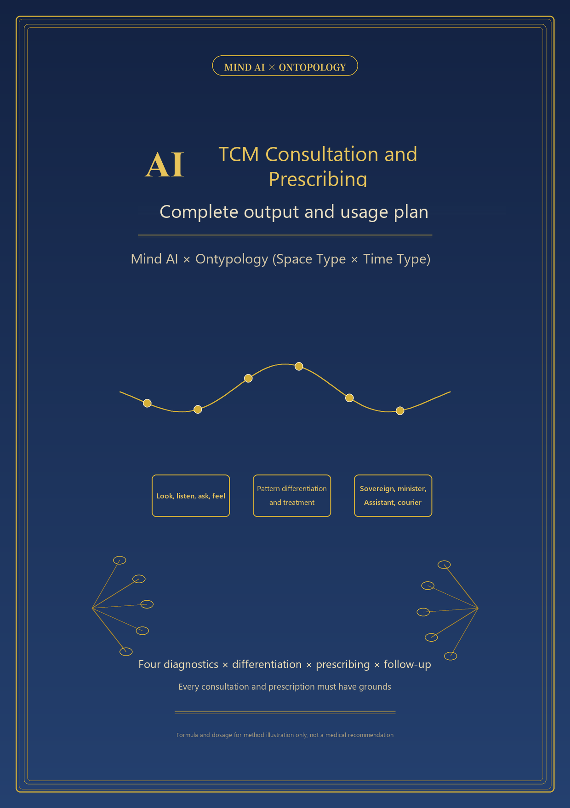

## Table of Contents

  - **Before we begin: three conventions3**
  - **How to read this book: three routes5**
  - **Chapter One Understanding AI TCM Consultation and Prescribing7**
- 1.1 A Reason-able Consultation-and-Prescription Replica7
- 1.2 Type and Number Land in Chinese Medicine8
- 1.3 How the Two Types Are Used in Consultation and Prescribing9
- 1.4 Division of Labour with Mind AI as the Underlying Platform10
- 1.5 Where Accuracy Comes From11
  - **Chapter Two Six Output Types: What Consultation and Prescribing Must Produce12**
- 2.1 Exam Type: Structuring Inspection, Auscultation-Olfaction, Inquiry and Palpation13
- 2.2 Syndrome Type: The Conclusion of Pattern Differentiation13
- 2.3 Mechanism Type: The Middle Segment of the Causal Chain14
- 2.4 Treatment Type: The Bridge from Pattern to Formula15
- 2.5 Formula Type: The Composition of Sovereign, Minister, Assistant and Courier15
- 2.6 Follow-up Type: The Time Type of a Course of Treatment17
  - **Chapter 3 The Four-Layer Accuracy Guarantee 18**
- 3.1 Layer One: the ∩(T) Pattern-Differentiation Criterion19
- 3.2 Layer Two: the Deduction Skeleton, a Chain of Pathomechanism Inference20
- 3.3 Layer Three: Medical Validation of the Formula20
- 3.4 Gate Four: the Type Evidence Chain21
- 3.5 Cross-Acceptance of Space and Time22
  - **Chapter Four The Six Steps: An Operating Procedure for Using the Method Accurately23**
- 4.1 Start with the Four-Step Framework to Clarify the Need23
- 4.2 Walk the Six Steps Once24
- 4.3 Three-Layer Judgment: Body, Formula, Pattern24
- 4.4 Pick, Combine and Swap Moves25
  - **Chapter Five The S1-S7 Prompt Pipeline and the Insomnia Case27**
- 5.1 S1-S7 at a Glance27
- 5.2 S1 Prompt: Four-Diagnostic Collection28
- 5.3 S2 Pattern Differentiation and S3 Pathomechanism Inference29
- 5.4 S4 Establishing the Treatment and S5 Composing the Formula30
- 5.5 S6 Formula Validation and S7 Follow-up Adjustment32
  - **Chapter Six Misuse, Checklists and Maturity34**
- 6.1 Five Kinds of Misuse34
- 6.2 The Ten-Question Checklist35
- 6.3 Maturity from L1 to L436
  - **Review and closure37**
  - **Appendix A Quick reference to terms, moves and notations38**

# Before we begin: three conventions

This is a "how to use it" book. Its subject is AI TCM consultation and prescribing: starting from the four diagnostics of inspection, auscultation-olfaction, inquiry and palpation, moving through differentiation, pathomechanism, treatment method and prescribing, and on to follow-up adjustment - the whole road must be walked accurately. What this book gives you is neither a TCM textbook nor a system manual, but a complete plan for using the method accurately: every consultation and prescription produces an explicit "Type", and every Type passes its criteria and can be verified by evidence.

The theoretical foundation is Ontypology - the Space Type and the Time Type; the underlying platform is Mind AI. Before putting pen to paper, establish three conventions that apply throughout the book.

> **Convention one: "xíng" is Type**  
> The English for "xíng" is always Type, never Form. Exam Type is ExamType, Syndrome Type is SyndromeType, Formula Type is FormulaType - terminology is consistent throughout the book.  

> **Convention two: theory is used, not taught**  
> This book does not restate the principles of Ontypology but takes the tools and uses them directly: the three brackets [ ] ( ) { }, the intersection criterion ∩(T), the identity anchor id(C), the three remove levels, the four-step framework, the three-layer judgment, and the Time Type's move board. For where these tools come from, return to the original texts on the Space Type and the Time Type; this book is only responsible for applying them to consultation and prescribing.  

> **Convention three: the platform is cited, not described**  
> Mind AI is the underlying platform; this book only cites its division-of-labour principle - LLM handles language, Mind Model handles intelligence - and does not restate the platform itself. What you need to know is this: every output of consultation and prescribing runs on this platform's reasoning, memory and learning capacity.  

> **Important statement: all formula and herb content appearing in this book (including herbs, doses and modifications) serves only to demonstrate the method and does not constitute medical advice; for clinical care please have a qualified TCM physician diagnose and prescribe.**  

Finally, gather the whole book with one task map: each of the six chapters handles one stretch of the road, with output Types and tools accompanying it all the way.

**Table 0-1 Task map: six stretches of road and their outputs**

| **Chapter** | **Topic** | **What you must learn** | **Core tools** |
| --- | --- | --- | --- |
| Chapter 1 (orientation) | What AI TCM Consultation and Prescribing Is | Understand the reason-able replica and where the two Types land | Type plus Number, the move board |
| Chapter 2 (output) | the six output Types | Structure every output of consultation and prescribing | Three brackets and the three remove levels |
| Chapter 3 (accuracy) | four gates of accuracy | Can state "why it is accurate" | ∩(T), id(C), evidence chain |
| Chapter 4 (operation) | The six-step flow | Follow the steps along the whole road | The four-step framework, the three-layer judgment |
| Chapter 5 (drill) | Prompts and the case | S1 to S7, follow and use | seven prompts |
| Chapter 6 (advanced) | Misuse, checklists, maturity | Avoid the traps, assess which level you are at | The ten-question checklist, L1-L4 |

# How to read this book: three routes

The language of Chinese medicine and the language of Type plus Number are two ways of saying the same thing. "Heart-spleen dual deficiency" is the conclusion of medical reasoning; the Syndrome Type is the structured spelling of that same conclusion. Translating between the two languages is the core skill this book teaches you.

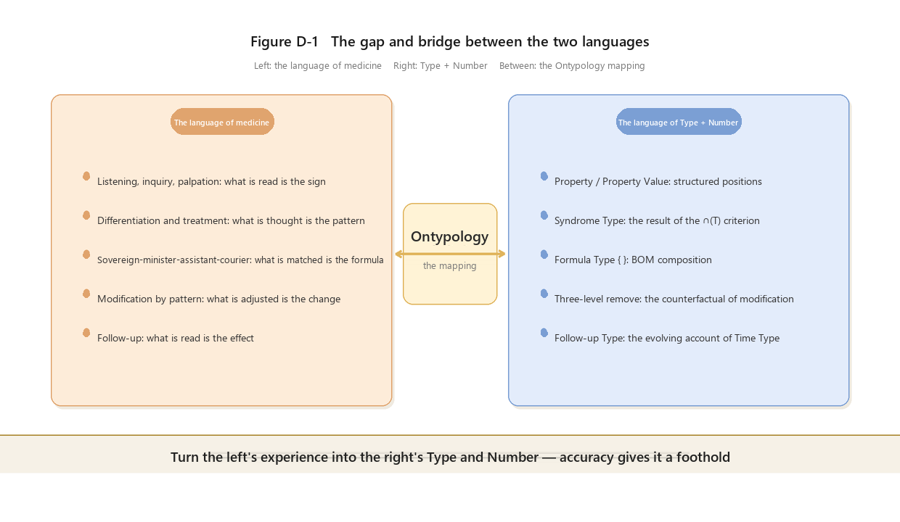

Figure D-1 The gap and the bridge between the two languages

**Table D-1 Comparison of the two languages**

| **The language of medical reasoning** | **The language of Type plus Number** | **Key points of translation** |
| --- | --- | --- |
| Inspection, auscultation-olfaction, inquiry and palpation | Exam Type | Findings into fields: only with fields can they be looked up |
| Differentiation (heart-spleen dual deficiency) | Syndrome Type | The feature set F(T) passes the ∩(T) criterion |
| Aetiology and pathomechanism | Mechanism Type | The causal chain of cause → mechanism → pattern |
| Therapeutic principle and treatment method | Treatment Type | One pathomechanism, one method, corresponding link by link |
| Prescription (sovereign-minister-assistant-courier) | Formula Type | BOM composition: {sovereign, minister, assistant, courier} |
| Follow-up adjustment | Follow-up Type | Therapeutic-effect comparison + version record + evolution |

This book has three routes; pick one to suit your needs, there is no need to chew through it from cover to cover.

**Table D-2 Three ways of reading**

| **Reading path** | **who it suits** | **Route** |
| --- | --- | --- |
| Use directly | For those who want to prescribe right away | Copy the S1-S7 prompts of Chapter 5 and compare the outputs against the case examples |
| For understanding | For those who want to explain the method clearly | Output Types in Chapter 2 → the four layers of accuracy in Chapter 3 → the drill in Chapter 5 |
| For orientation | For those who want the team to keep getting stronger | Chapter 1 → the six steps of Chapter 4 → maturity L1-L4 in Chapter 6 |

The whole book demonstrates with one running case: Ms. Lin, thirty-two, insomnia for about two months. From four-diagnostic collection all the way to follow-up adjustment, every chapter returns to her. You may first turn to Chapter 5 for the complete walkthrough and then come back for the theory, or read straight through and watch the same case dissected layer by layer.

# Chapter One Understanding AI TCM Consultation and Prescribing

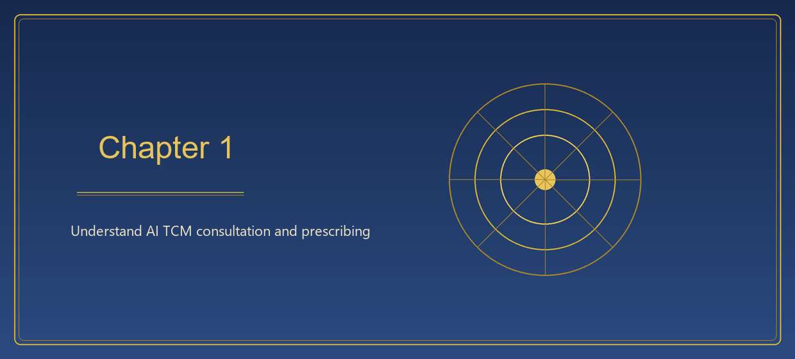

Get the object clear first. This chapter answers four things: what the AI TCM brain actually is, where Type and Number land in Chinese medicine, how the two Types are used in consultation and prescribing, and where the word "accuracy" comes from. After this chapter you should be able to explain this method to a colleague in one sentence.

## 1.1 A Reason-able Consultation-and-Prescription Replica

What runs through an experienced physician's mind during a consultation? One look at the complexion, one touch on the pulse, a few sentences of the chief complaint, and the pattern type surfaces, with the formula taking shape alongside it. This line of thinking lives inside his head - implicit and hard to pass on. AI TCM consultation and prescribing has exactly one job: to turn that line of thinking into a reason-able replica - not only giving the answer but preserving the path to it.

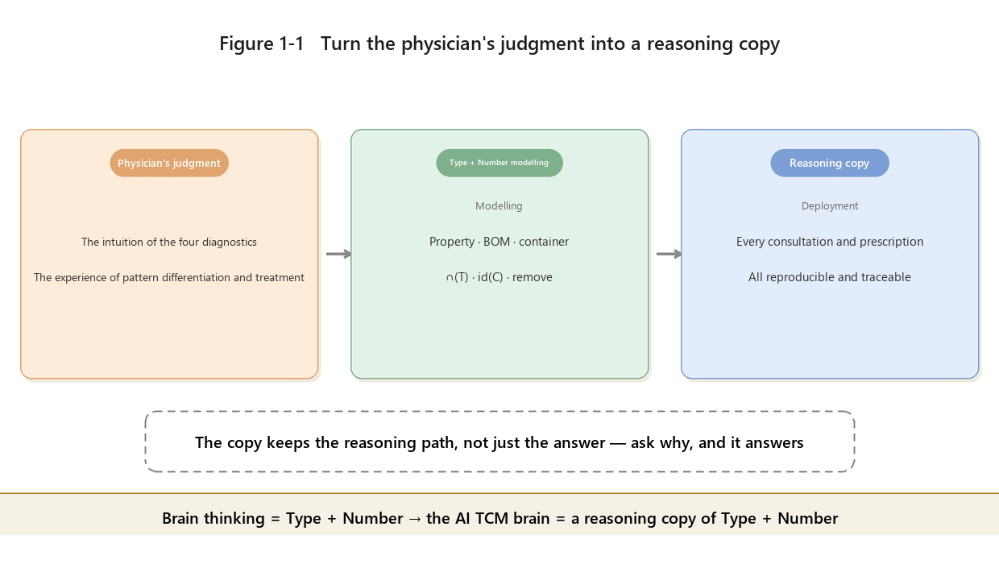

Figure 1-1 Turning the physician's judgment into a reason-able replica

The key to the replica is that it is reason-able. Ask it why it prescribed Guipi Decoction and it can answer: because the pattern type is heart-spleen dual deficiency; because a thin-weak pulse with palpitations and forgetfulness passes this pattern type's criteria; because the treatment method is to tonify and benefit the heart and spleen and to nourish the blood and calm the spirit; therefore the formula comes out of the method. Behind the answer there is a path you can question, and that path is paved with Type and Number.

## 1.2 Type and Number Land in Chinese Medicine

The brain thinks in Type plus Number. Number describes quantity - dose, pulse rate, days of illness; Type describes structure - what a pattern type looks like, what a formula is composed of, how the pathomechanism links up. Chinese medicine lacks neither: what it lacks is a language that writes "Type" clearly.

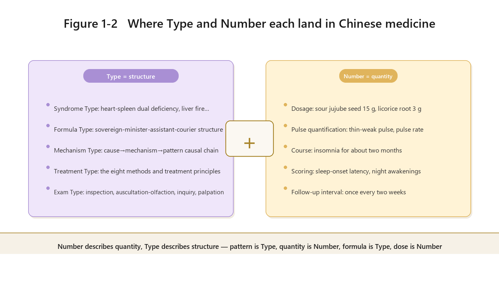

Figure 1-2 Where Type and Number each land in Chinese medicine

Traditional Chinese medicine emphasises "image" and "intuitive realisation", with little structuring - so from the same four-diagnostic information two physicians may write two different formulas, and neither can say exactly which link differs. Once Types are erected, the difference is forced onto the table: is it that F(T) was collected differently? Is it that the pathomechanism chain broke a link? Or is it that the treatment method took another route? Only when you can tell, can you speak of accuracy.

**Table 1-1 Where Type plus Number land in Chinese medicine**

| **Layer** | **Type (structure)** | **Number (magnitude)** |
| --- | --- | --- |
| Four diagnostics | Exam Type: four fields for inspection, auscultation-olfaction, inquiry and palpation | Tongue colour, pulse rate, days of illness |
| Differentiation | Syndrome Type: F(T) and ∩(T) | Symptom severity scoring |
| pathogenesis | Mechanism Type: the cause→mechanism→pattern chain | Stage of the illness |
| Treatment method | Treatment Type: therapeutic principle plus classification among the eight methods | Course length |
| Formula | Formula Type: the sovereign-minister-assistant-courier BOM | Herb and dose |
| Follow-up | Follow-up Type: version record | Therapeutic-effect difference |

## 1.3 How the Two Types Are Used in Consultation and Prescribing

The Space Type and the Time Type each handle half of consultation and prescribing. The Space Type handles "seeing clearly": it erects the structure of person, pattern and formula - properties are the X axis, composition the Y axis, the container the Z axis, and the three axes pin an object in the coordinate system. The Time Type handles "carrying through": diagnosis, treatment and adjustment are a series of actions, and each action is a move - Time Type = verb = function = move.

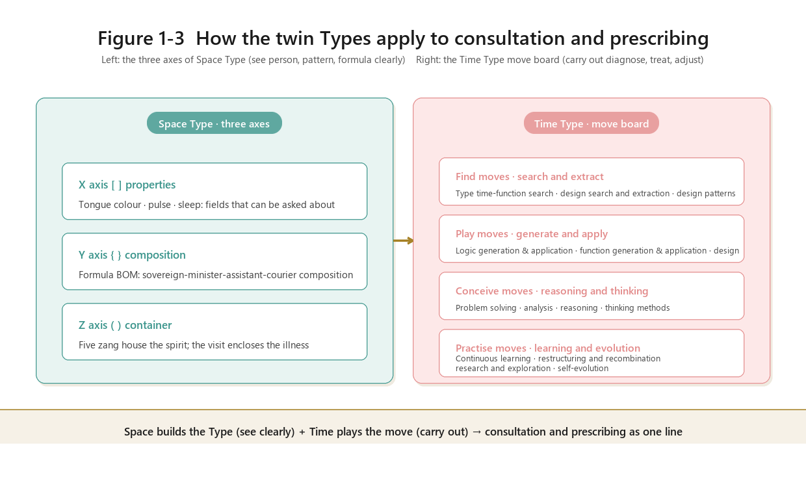

Figure 1-3 How the two Types are used in consultation and prescribing

**Table 1-2 The Space Type's three axes × Chinese medicine**

| **axis** | **Bracket** | **Where Chinese medicine lands** |
| --- | --- | --- |
| X axis · properties | [ ] | Tongue colour, pulse, sleep, bowels and urine ... the fields that can be asked about; property values are the options within a field |
| Y axis · composition | { } | Formula BOM: which herbs make up sovereign, minister, assistant and courier; the three remove levels correspond to the scale of modification |
| Z axis · container | ( ) | The body is the container (the five zang organs house the spirit; qi, blood and fluids); the visit encloses the illness; id(C) anchors identity |

The Time Type's move board has four groups and fourteen moves. This book lists only the headings and takes them directly; for the definitions and derivations of the moves, return to the original text on the Time Type.

**Table 1-3 The Time Type's move board × Chinese medicine (four groups)**

| **Set** | **Move** | **How to use consultation and prescribing** |
| --- | --- | --- |
| Find moves | Type time-function search · design search and extraction · design patterns | Find similar cases, extract pattern-type features, apply established formula combination patterns |
| Make the move | Logic generation and application · function generation and application · design | Pathomechanism inference, treatment-method generation, formula composition and modification (prescribing is design) |
| Devise moves | Problem solving · analysis · reasoning · thinking methods | Pattern differentiation, causal reasoning, reverse testing of the pattern from the formula, differential diagnosis |
| Practise the moves | Continuous learning · restructuring and recombination · research and exploration · self-evolution | Case archiving, adjustment restructuring, exploring new formulas, ever more accurate |

Join the two halves: spatial Type-building gives "person, pattern, formula" structure, and temporal move-making gives "diagnose, treat, adjust" action. The six output Types (Chapter 2) are the crystallisation of space, the six steps (Chapter 4) are the routines of time, and S1 to S7 (Chapter 5) are the concrete hand movements of each move.

## 1.4 Division of Labour with Mind AI as the Underlying Platform

This method runs on Mind AI. The division-of-labour principle in one sentence: LLM handles language, Mind Model handles intelligence. The LLM is responsible for understanding the chief complaint, writing the four-diagnostic record and recalling formula literature; the Mind Model is responsible for unifying knowledge, deep reasoning, long-term memory and continuous learning. The deduction of pattern differentiation and treatment is borne by the Mind Model, and the entry and exit of language by the LLM.

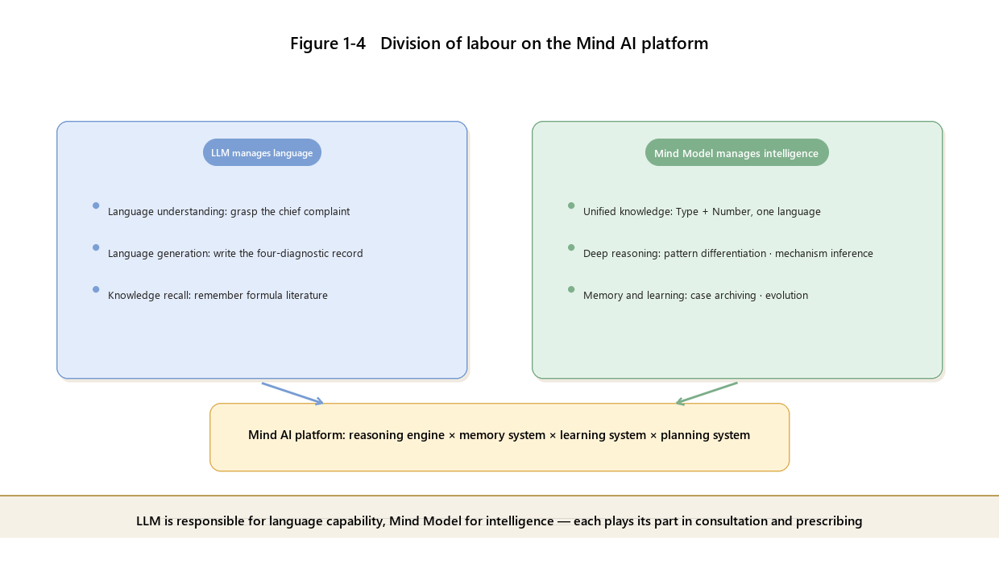

Figure 1-4 Division of labour with Mind AI as the underlying platform

The division of labour lands on every station of consultation and prescribing: the S1 four-diagnostic record is written by the LLM, the pattern differentiation and pathomechanism inference of S2 and S3 are reasoned by the Mind Model, literature lookup at S5 is joint work, and the case archiving and experience write-back of S7 are closed by the Mind Model's memory and learning capacity. Language input and output are never absent, and intelligent reasoning is never outsourced - that is the meaning of the underlying platform.

## 1.5 Where Accuracy Comes From

"Can an AI-written formula be trusted?" This question demands a structural answer, not a feeling. This book's answer is the four-layer accuracy guarantee, unfolded layer by layer in Chapter 3; here is one sentence previewing each: differentiation has criteria (only what passes ∩(T) enters the pattern type), inference has a skeleton (the pathomechanism chain links up), composition has validation (sovereign-minister-assistant-courier plus combination contraindications), and the whole process has evidence (every step points back to the four diagnostics). Only when all four layers pass may a formula leave.

The other half of accuracy comes from the temporal dimension: follow-up turns every therapeutic effect into experience for the next visit, the case file grows thicker and the criteria sharper. The four spatial layers govern "is this formula accurate"; temporal evolution governs "is the next formula more accurate".

> **Chapter focus**  
> The AI TCM brain is a reason-able replica of consultation-and-prescription thinking: behind every answer there is a path you can question.  
> Type describes structure, Number describes magnitude; erect the Type and accuracy finally has a consistent language.  
> The Space Type's three axes see "person, pattern, formula" clearly; the Time Type's move board carries "diagnose, treat, adjust" through.  
> Mind AI division of labour: LLM handles language, Mind Model handles intelligence; accuracy comes from four layers of guarantee plus temporal evolution.  

# Chapter Two Six Output Types: What Consultation and Prescribing Must Produce

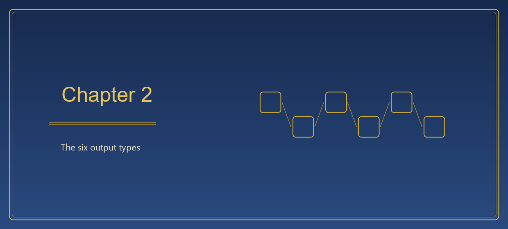

Consultation and prescribing is not a one-off conversation but a relay of six outputs: Exam Type, Syndrome Type, Mechanism Type, Treatment Type, Formula Type and Follow-up Type. Each is a Type, each with explicit fields and criteria. Once the Type is fixed, outputs become accumulable, comparable and acceptable.

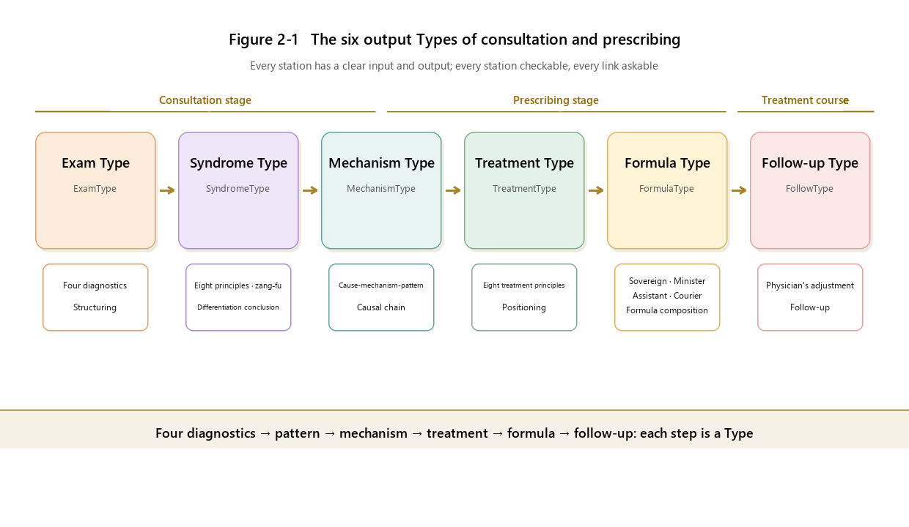

Figure 2-1 The six output Types of consultation and prescribing

Memorise the summary table first; the six sections that follow take it apart. Each section answers the same three things: what this Type's fields are (the X axis of properties), what it is composed of (the Y axis of composition), and which container it lives in (the Z axis of the container).

**Table 2-1 Master table of the six output Types**

| **Output Type** | **English name** | **One sentence** | **Criteria** |
| --- | --- | --- | --- |
| Exam Type | ExamType | A structured record of inspection, auscultation-olfaction, inquiry and palpation | Findings complete, no invented filling |
| Syndrome Type | SyndromeType | The conclusion of pattern differentiation | ∩(T) |
| Mechanism Type | MechanismType | The causal chain of cause → mechanism → pattern | Every link has four-diagnostic evidence |
| Treatment Type | TreatmentType | The bridge from pattern to formula | One pathomechanism, one method, link by link |
| Formula Type | FormulaType | The composition of sovereign, minister, assistant and courier | Combination validation + the three remove levels |
| Follow-up Type | FollowType | The Time Type of a course of treatment | Before-and-after comparison plus version record |

## 2.1 Exam Type: Structuring Inspection, Auscultation-Olfaction, Inquiry and Palpation

The Exam Type is the foundation of the whole road. It turns inspection, auscultation-olfaction, inquiry and palpation into four field groups, each with fillable properties and property values - a property is "a question that can be asked", and a property value is this visit's answer to it. Fix the fields and no information is lost; a missing field shows "not collected" instead of being silently skipped.

**Table 2-2 Exam Type field table**

| **Field group** | **Core properties** | **Property value examples (Ms. Lin)** |
| --- | --- | --- |
| Inspection | Complexion, body build, tongue colour, tongue coating, demeanour | Pale complexion; rather thin build; pale tongue; thin white coating; listless spirit |
| Auscultation-olfaction | Voice, breath, special odours | Faint voice; no special odour |
| Inquiry | Sleep, palpitations, appetite, bowels and urine, menstruation, emotions | Difficulty falling asleep with much dreaming and easy waking; palpitations and forgetfulness; poor appetite and dull intake; normal bowels and urine; scanty pale menses; much brooding |
| Palpation | Pulse, abdominal diagnosis, tenderness | Thin-weak pulse; abdomen soft without tenderness |

In practice there are two iron rules. First, objective findings come first: tongue and pulse findings are mandatory; if absent, mark "not collected" and put them on the follow-up question list, never fill them in by guessing. Second, degree and duration must go into the property values: "insomnia for about two months" and "waking two to three times a night" are far more useful than "sleeps badly" - the feature set F(T) used in later differentiation grows out of exactly this.

## 2.2 Syndrome Type: The Conclusion of Pattern Differentiation

The Syndrome Type is the conclusion of pattern differentiation, written as a two-level structure like "insomnia · heart-spleen dual deficiency pattern": disease name (insomnia) + pattern type (heart-spleen dual deficiency). It is not a sentence but a membership judgment of a set - [insomnia] is an abstract set, and for a patient to enter it the feature set F(T) must pass this pattern type's intersection criterion ∩(T).

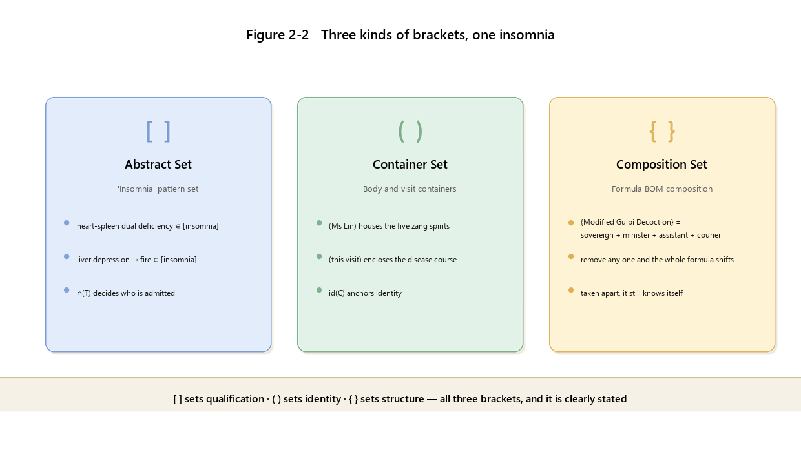

Figure 2-2 Three brackets, the same insomnia

Each of the three brackets has its duty at the point of differentiation: [ ] sets eligibility - does this presentation belong to insomnia, is it heart-spleen dual deficiency; ( ) sets identity - Ms. Lin is a container, inside which the five zang organs, spirit, qi and blood reside, (this visit) encloses this stretch of illness, and id(C) anchors the person and the illness; { } sets structure - what the formula is composed of, used in the next section and in 2.5.

**Table 2-3 Syndrome Type: localisation and criteria**

| **Steps** | **Content** | **Ms. Lin's judgment** |
| --- | --- | --- |
| Locating the disease name | Insomnia: chief complaint of inability to obtain normal sleep | Chief complaint of insomnia for about two months → disease name insomnia |
| Locating by the eight principles | Yin and yang, exterior and interior, cold and heat, deficiency and excess | Interior, deficiency, no marked cold signs → interior deficiency pattern |
| Zang-fu localisation | Which of heart, spleen, liver and gallbladder is involved | Palpitations and forgetfulness + poor appetite and dull intake → heart and spleen |
| F(T) comparison | The feature set compared one by one against candidate pattern types | Pale complexion, pale tongue, thin-weak pulse, scanty menses |
| Exclusion differential | Why a similar pattern type is not chosen | Not liver depression transforming into fire (no irritability, bitter taste or wiry pulse) |

## 2.3 Mechanism Type: The Middle Segment of the Causal Chain

The Syndrome Type answers "what it is", the Mechanism Type answers "why". It strings aetiology, pathomechanism and pattern manifestations into a causal chain: excessive brooding stealthily consumes heart blood, the spleen fails to transport, qi and blood have no source, the spirit is deprived of nourishment, and so there is insomnia. This chain is the middle segment of the deduction skeleton - it follows the four-diagnostic evidence and precedes the treatment method, formula and herbs (detailed in Chapter 3).

The Mechanism Type has two field rules. First, every link must point back to evidence in the four diagnostics: to say "the spleen fails to transport" there must be findings such as poor appetite, dull intake or fatigue holding it up; a link that cannot point back is speculation and must be cut. Second, the chain is ordered: scramble the causal order and the treatment method will seize the wrong focus - whether to tonify the blood first or strengthen the spleen first depends on which link is the main mechanism.

## 2.4 Treatment Type: The Bridge from Pattern to Formula

The Treatment Type is the bridge between pathomechanism and formula: the pathomechanism says "heart blood insufficient, spleen transport not robust, spirit deprived of nourishment", so the treatment method is set as "tonify and benefit the heart and spleen, nourish the blood and calm the spirit" - one pathomechanism, one method, corresponding link by link, no more and no less. The therapeutic principle is the general direction (tonify what is deficient), the treatment method is the concrete landing point (tonify heart and spleen, nourish the heart and calm the spirit), and with the classification among the eight methods added (this case belongs to the tonifying method), the three columns are complete and the Treatment Type is whole.

The Treatment Type has exactly one criterion: once the formula is written, every herb must point back to the treatment method, and every clause of the treatment method must point back to the pathomechanism. If the bridge is built with shoddy work, the formula becomes a heap of herbs - which is precisely the commonest of the five kinds of misuse in Chapter 6.

## 2.5 Formula Type: The Composition of Sovereign, Minister, Assistant and Courier

The Formula Type is this book's most important output; it is simply a BOM (a composition set { }): the base formula is the root, the four grades of sovereign, minister, assistant and courier are the trunk, and herbs and doses are the leaves. The sovereign herb targets the main pattern and main mechanism; the minister assists the sovereign; the assistant attends to concurrent patterns or guards against side effects; the courier harmonises the herbs and guides the formula to the channel. Every herb has a name, a dose and a task - missing any one of the three and the BOM is incomplete.

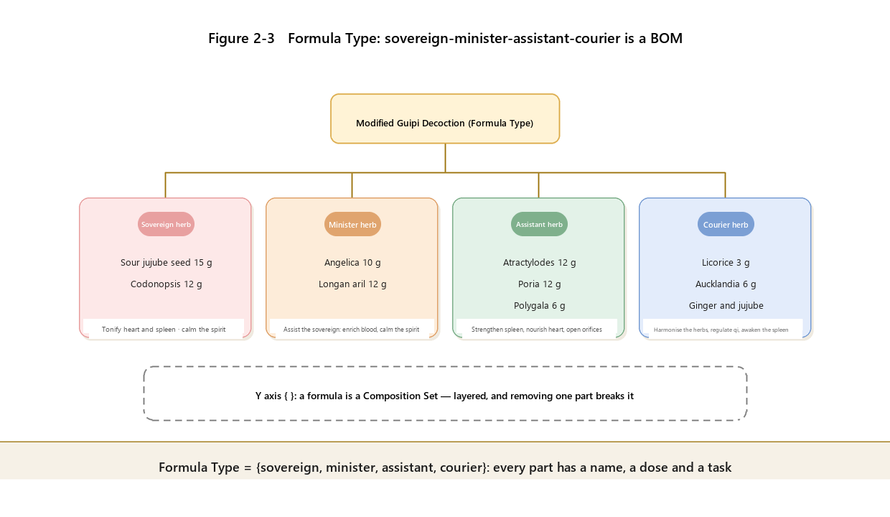

Figure 2-3 Formula Type: sovereign-minister-assistant-courier is a BOM

**Table 2-4 Formula Type BOM: Guipi Decoction with modifications (for demonstration only)**

| **level** | **Herbs and doses** | **Task** |
| --- | --- | --- |
| Sovereign | Astragalus root 15 g, codonopsis root 12 g, sour jujube seed 15 g | Tonify and benefit the heart and spleen, nourish the heart and calm the spirit, aimed straight at the main mechanism |
| Minister | Angelica root 10 g, longan aril 12 g, Poria with hostwood 12 g | Nourish the blood and calm the spirit, assisting the sovereign |
| Assistant | Atractylodes rhizome 12 g, polygala root 6 g | Strengthen the spleen and assist transport, calm the spirit and open the orifices, and attend to concurrent patterns |
| Courier | Aucklandia root 6 g (added near the end), licorice root 3 g, fresh ginger 3 slices, jujube 5 pieces | Regulate qi and awaken the spleen so that tonification does not stagnate, and harmonise the herbs |

Modification is the dynamic field of the Formula Type, and its scale is decided by the three remove levels: single herb, herb pair (corner), formula root (base formula). Before modifying, ask the counterfactual question - "take it away; does it still recognise itself?" Remove a single herb and the question is whether a task goes unfulfilled; remove an herb pair and the question is whether a pairing fails; remove the formula root and the question is whether the whole formula's skeleton still stands. Only when all three questions pass may you move at that level.

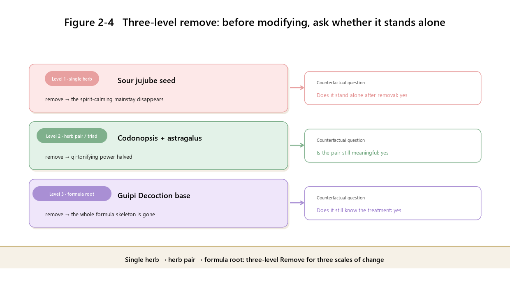

Figure 2-4 The three remove levels: before modifying, ask whether it still recognises itself when taken apart

**Table 2-5 The three remove levels × scale of modification**

| **Level** | **Object** | **The counterfactual question** | **Modification examples (for demonstration only)** |
| --- | --- | --- | --- |
| Level one | Single herb | Take it away: does the task go unfulfilled | Poor sleep with much dreaming → add Biota seed 10 g to strengthen the spirit-calming task |
| Level two | Herb pair / corner | Take them away: does the pairing fail | Codonopsis with astragalus is a qi-tonifying pair; do not lightly split it unless the formula is changed |
| Level three | Formula root / base formula | Take the skeleton away: does the treatment method still stand | Only if the pattern type changes (e.g. to liver depression transforming into fire) is the base formula changed |

## 2.6 Follow-up Type: The Time Type of a Course of Treatment

The Follow-up Type is the Time Type of a course of treatment: it stretches "diagnose, treat, adjust" into a timeline. There are four groups of fields - therapeutic-effect comparison (the difference between the before and after four diagnostics), pattern-type change (pattern kept or pattern changed), adjustment decision (keep, modify or change the formula, with reasons), and evolution record (what was learned this time, written back into the case file). Follow-up is not a fresh consultation but a comparison against the previous case file.

id(C) matters especially here: the container's identity must be anchored, so that "this stretch of Ms. Lin's illness" can be tracked, compared and accumulated. Every follow-up is a new version of the case file, and the old version is never overwritten - this is exactly where the Time Type's two moves, continuous learning and self-evolution, land.

> **Chapter focus**  
> Six output Types relayed: four diagnostics → pattern type → pathomechanism → treatment method → formula → follow-up; each Type has its fields and criteria.  
> Division of labour among the three brackets: [ ] sets eligibility, ( ) sets identity, { } sets structure; the pattern type is a membership judgment of the set.  
> The Formula Type is a BOM: sovereign, minister, assistant and courier are clearly graded, and every herb has a name, a dose and a task.  
> The scale of modification is decided by the three remove levels; the Follow-up Type anchors the course with id(C) so experience can accumulate.  

# Chapter Three　Four-Layer Accuracy Assurance

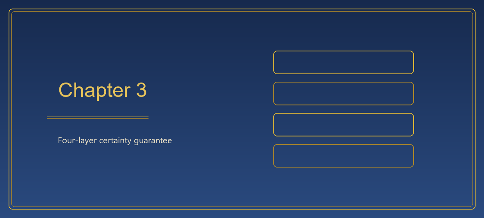

Accuracy cannot rest on feeling. This chapter breaks "why this formula can be trusted" into four layers: differentiation has criteria, inference has a skeleton, composition has validation, and the whole process has evidence. The four layers are four gates, each with its own question and its own return handling.

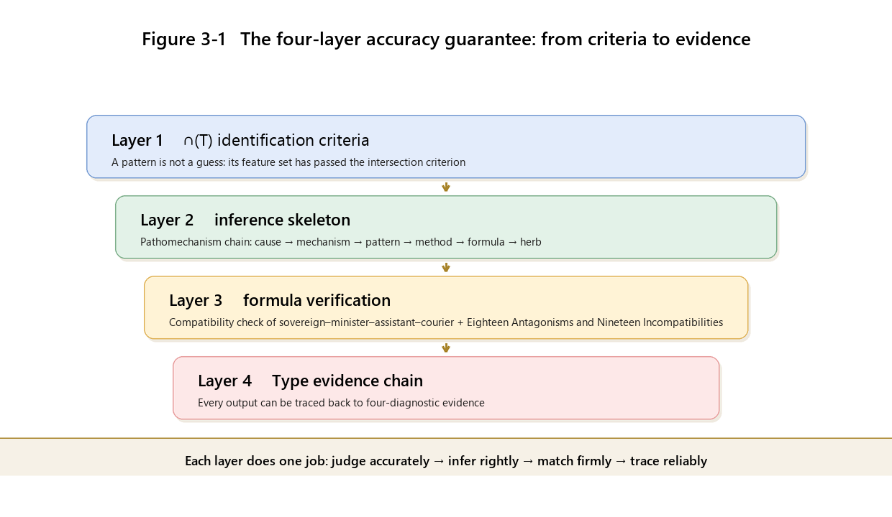

Figure 3-1 The four-layer accuracy guarantee: from criteria to evidence

Each of the four layers has its own return handling: if ∩(T) fails, return to supplement the four diagnostics; if the pathomechanism chain breaks a link, return and re-derive; if combination is doubtful, return and recompose; if the evidence chain breaks, return and complete it. Only with explicit return paths does the pipeline dare release work to the next gate - S1 to S7 in Chapter 5 put each of these return paths into the prompts.

## 3.1 Layer One: the ∩(T) Pattern-Differentiation Criterion

The first layer governs differentiation. A pattern type T is decided by two things: the feature set F(T) and the intersection criterion ∩(T). The patient's presentations make up a feature set, and candidate pattern types each have their own criteria - the two are intersected, and only what passes is admitted. This is not a lookup comparing a single symptom but a set judgment over the whole group of features, which is why the same chief complaint (insomnia) is triaged into four different pattern types and four different formulas.

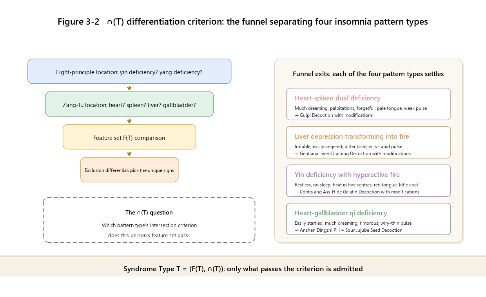

Figure 3-2 The ∩(T) differentiation criterion: the funnel separating four insomnia pattern types

**Table 3-2 ∩(T) differentiation: four insomnia pattern types (formulas for demonstration only)**

| **Pattern type** | **F(T) key features** | **∩(T) unique signs** | **Base formula** |
| --- | --- | --- | --- |
| Heart-spleen dual deficiency | Much dreaming and easy waking, palpitations and forgetfulness, poor appetite and fatigue | Pale complexion, thin-weak pulse | Guipi Decoction with modifications |
| Liver depression transforming into fire | Irritability and easy anger, bitter taste, constipation and dark urine | Wiry-rapid pulse, yellow coating | Gentiana Liver-Draining Decoction with modifications |
| Yin deficiency with hyperactive fire | Restlessness and insomnia, heat in the five centres, night sweats | Red tongue with little coating, thin-rapid pulse | Coptis and Ass-Hide Gelatin Decoction with modifications |
| Heart-gallbladder qi deficiency | Easily startled and much dreaming, prone to fright, short of breath | Wiry-thin pulse, easily startled by trifles | Anshen Dingzhi Pill combined with Sour Jujube Seed Decoction |

The funnel's last gate is the exclusion differential: you must be able to write "why it is not another pattern type". Ms. Lin has no irritability or bitter taste and her pulse is not wiry-rapid, so liver depression transforming into fire is out; she has no heat in the five centres and her tongue is not red, so yin deficiency with hyperactive fire is out. Only when the exclusion can be written does it mean ∩(T) was really run once, rather than an answer recited.

## 3.2 Layer Two: the Deduction Skeleton, a Chain of Pathomechanism Inference

The second layer governs inference. From cause to herb is a six-link deduction chain: cause → mechanism → pattern → method → formula → herb. Each link is one deductive inference (a Time Type reasoning move), and each link needs four-diagnostic evidence or the support of the link before it. If any link on the chain breaks, everything after it is void - this is the structured version of "the formula comes from the method, the method is established from the pattern".

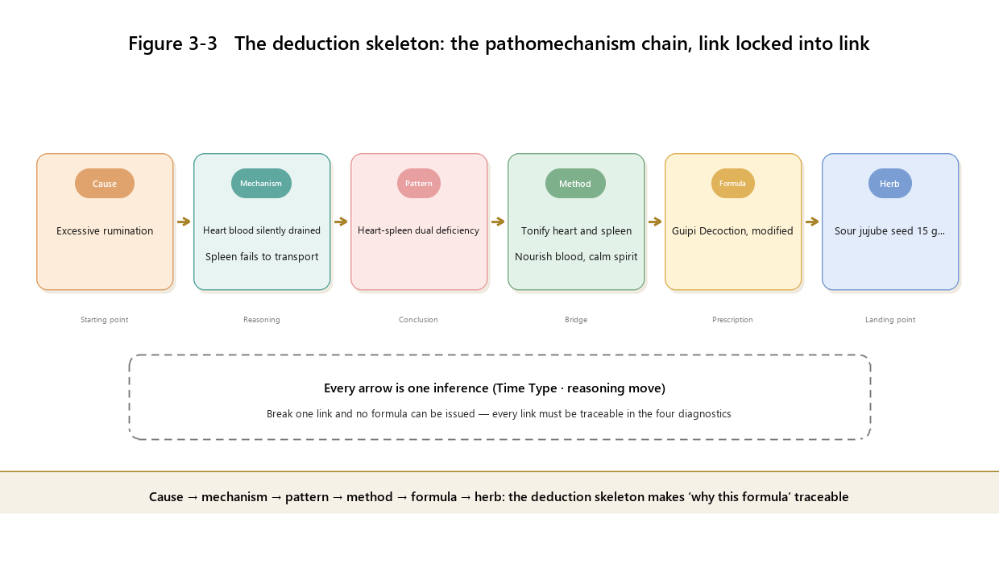

Figure 3-3 The deduction skeleton: the pathomechanism chain, link locked into link

**Table 3-3 Pathomechanism inference chain fields (Ms. Lin example)**

| **Link** | **Content** | **Supporting evidence** |
| --- | --- | --- |
| Cause | Excessive brooding | Inquiry: much brooding, clerical work |
| Mechanism | Stealthily consuming heart blood, the spleen failing to transport, qi and blood without a source | Palpitations and forgetfulness, poor appetite and dull intake, fatigue and weakness |
| Evidence | Heart-spleen dual deficiency (insomnia) | Pale complexion, pale tongue with thin white coating, thin-weak pulse |
| Method | Tonify and benefit the heart and spleen, nourish the blood and calm the spirit (the tonifying method) | Corresponding main mechanism: heart-spleen dual deficiency, spirit deprived of nourishment |
| Formula | Guipi Decoction with modifications | The base formula's indication matches the pattern type |
| Herb | Every herb of sovereign-minister-assistant-courier points back to the treatment method | See Table 2-4 and Table 5-4 |

## 3.3 Layer Three: Medical Validation of the Formula

The third layer governs composition. The deduction chain guarantees "the formula comes from the method", but even with the right method the formula can go crooked - hence validation. Validation has two gates: the structural gate and the safety gate. The structural gate checks whether sovereign, minister, assistant and courier are complete, whether each herb's task is clear, and whether any herb whose task cannot be stated has slipped in; the safety gate checks combination contraindications (the eighteen incompatibilities and nineteen mutual antagonisms), whether doses are within the customary range, and special-population warnings (pregnancy, menstruation, allergy history).

Validation is asked counterfactually - run the three remove levels again: take any single herb out of this formula, and which task goes unfulfilled? If you can answer, every herb is at its post; if you cannot, that herb is suspect. The handling of a failed validation is explicit: name the break point, return to S5 and recompose, and never release a formula carrying a doubt.

## 3.4 Layer Four: the Type Evidence Chain

The fourth layer governs verification. The Type evidence chain strings the six output Types into a retraceable road: the prescription points back to the treatment method, the treatment method to the pathomechanism, the pathomechanism to the pattern type, and the pattern type to the four diagnostics. When someone asks "on what grounds", every step can answer with the step before - like a medical record, and like the reasoning in a judgment.

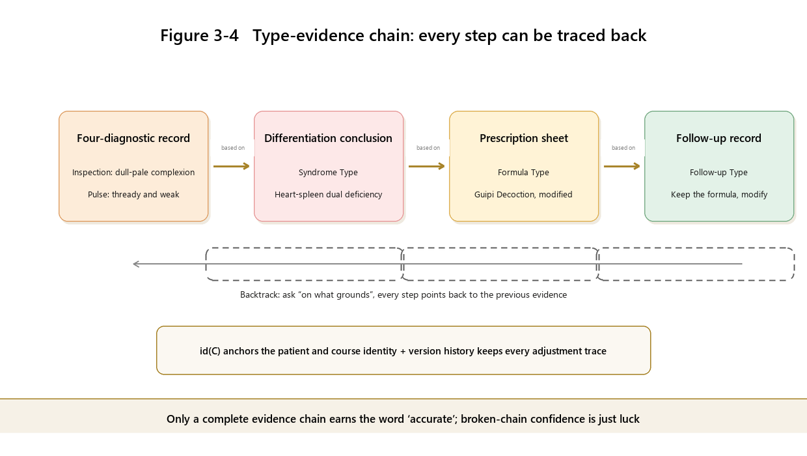

Figure 3-4 The Type evidence chain: every step can be traced back

**Table 3-4 Type evidence chain fields**

| **Output** | **What to store** | **Backtrack to** |
| --- | --- | --- |
| Exam Type | Original findings plus the not-collected list | The moment of consultation (dialogue record) |
| Syndrome Type | F(T) + ∩(T) comparison + exclusion differential | Exam Type |
| Mechanism Type | The causal chain link by link plus evidence references | Exam Type, Syndrome Type |
| Treatment Type | Therapeutic principle and treatment method plus the corresponding pathomechanism link | Mechanism Type |
| Formula Type | Sovereign-minister-assistant-courier plus reasons for modification plus the validation report | Treatment Type |
| Follow-up Type | Therapeutic-effect comparison + adjustment version | Previous case file (threaded by id(C)) |

## 3.5 Cross-Acceptance of Space and Time

The four layers are the gatekeeping of the spatial view - this formula, accurate at this moment. Do not forget the temporal view: the Follow-up Type brings therapeutic-effect feedback, letting criteria be tested and corrected. Space × time cross-acceptance means taking the follow-up result back to compare with the original four layers: the heart-spleen dual deficiency judged then - did sleep improve after the formula? If it did, the four layers' judgment is reinforced; if not, the file must be reopened - was F(T) collecting the wrong signs, or did the pathomechanism chain seize the wrong main mechanism?

This reverse checking is the concrete action of the Time Type's "self-evolution": at every cross-acceptance the case file gains one more page of conclusions, and the ∩(T) criteria gain one more degree of refinement. The four layers govern the lower bound of accuracy; evolution governs its upper bound.

> **Chapter focus**  
> Each of the four layers governs one thing: ∩(T) governs differentiation, the deduction chain governs inference, medical validation governs composition, and the Type evidence chain governs verification.  
> Only when the exclusion differential can be written out has ∩(T) really been run; a pathomechanism chain with one broken link invalidates everything after it.  
> Validation passes the structural gate and the safety gate; the remove counterfactual question is the fastest self-check.  
> The four spatial layers govern this formula; temporal evolution governs the next one; cross-acceptance makes the criteria sharper with use.  

# Chapter Four The Six Steps: An Operating Procedure for Using the Method Accurately

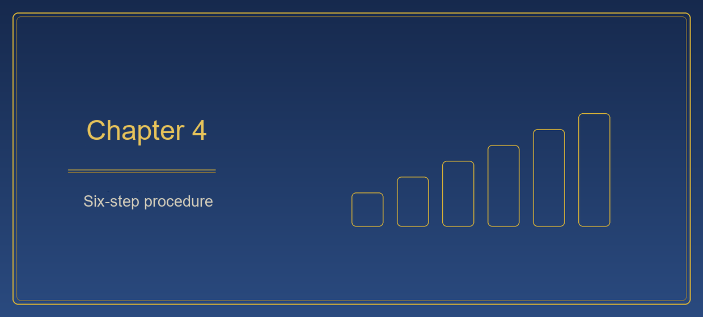

The output Types are the "things"; this chapter is the "actions". The six steps line up the outputs and criteria of the previous two chapters into a road that can be walked repeatedly: clarify the situation, build Types along the axes, pick the expansion pattern, generate output, criteria acceptance, archive and evolve. Walk it once per visit and the case file grows one page thicker.

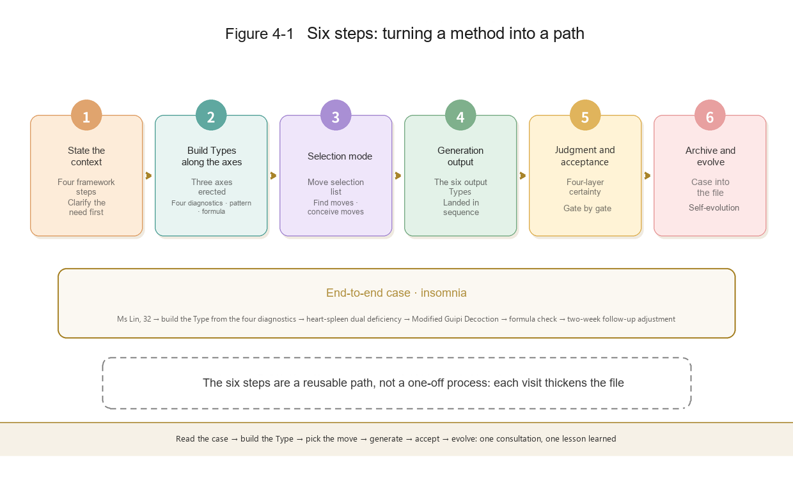

Figure 4-1 The six steps: walking the method into a road

## 4.1 Start with the Four-Step Framework to Clarify the Need

Before the six steps, run the four-step framework - this is the opening move of the Space Type, used to clarify "what this visit needs" instead of plunging into a pile of symptoms. The four steps in order are: fix the object (whose container is this, what is id(C)), fix the scope (what this visit will handle and what it will not), fix the goal (what the therapeutic-effect indicator is), and fix the constraints (constitution, menstrual period, drug allergies, life constraints).

**Table 4-1 The four-step framework × consultation and prescribing**

| **Steps** | **Questions to ask** | **Ms. Lin example** |
| --- | --- | --- |
| Fix the object | Whose container is it? What is id(C)? | Ms. Lin, 32, clerical work; this stretch of illness = insomnia for about two months |
| Fix the scope | What does this visit handle? What does it leave alone? | Handle the insomnia chief complaint; leave menstrual regulation alone for now and list it for later |
| Fix the goal | What is the therapeutic-effect indicator? | Sleep-onset latency shortened, night awakenings reduced, palpitations eased |
| Fix the constraints | Constitution, contraindications, life constraints? | Not pregnant; period approaching; avoid strong tea and coffee; high work stress |

## 4.2 Walk the Six Steps Once

Once the framework is clear, the six steps make their moves in order. Note how they correspond to the output Types: the first three steps are preparation (situation, Types, moves), the fourth generates the six output Types, the fifth runs the four layers of accuracy, and the sixth settles the result into the Time Type's evolution.

**Table 4-2 Summary of the six steps**

| **Step** | **Action** | **Output** | **Corresponding chapter** |
| --- | --- | --- | --- |
| 1 | Clarify the situation (four-step framework) | Situation statement: object, scope, goal, constraints | Section 4.1 of this chapter |
| 2 | Build Types along the axes (three axes) | Once the Exam Type fixes the fields, the skeleton of differentiation and formula is in place | Chapter 2 (output Types) |
| 3 | Pick the expansion pattern (the move board) | Move selection sheet: which moves this visit will use | Section 4.4 of this chapter |
| 4 | Generate the output | The six output Types land in order | Chapter 5 (drill) |
| 5 | Criteria acceptance (four layers) | A validation report; fail and the work is returned | Chapter 3 (accuracy) |
| 6 | Archive and evolve | Case into the file, experience written back, criteria refined | This chapter plus Chapter 6 |

## 4.3 Three-Layer Judgment: Body, Formula, Pattern

When you keep turning back to make judgments mid-operation, use the three-layer judgment of Type logic, asking three questions from outside inward: the container judgment - whose container does this question involve? The body is a container, inside which the five zang organs and the spirit reside; a visit is also a container, enclosing this stretch of illness, with identity anchored by id(C). The composition judgment - what is this formula composed of? The counterfactual questions of the three remove levels run here. The abstract judgment - does this presentation belong to [pattern type]? ∩(T) has the last word.

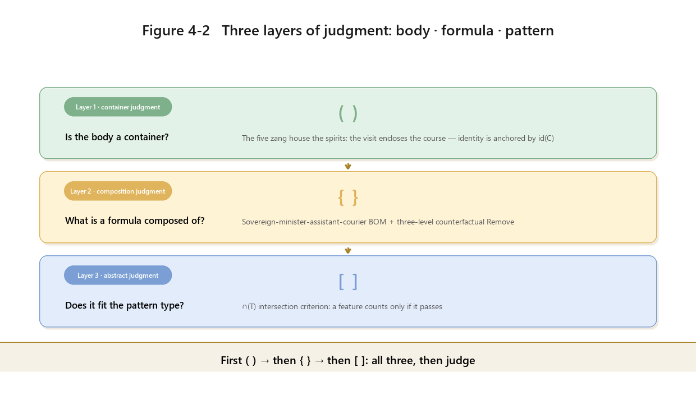

Figure 4-2 Three-layer judgment: body, formula, pattern

The order of the three layers cannot be scrambled: confirm the container and identity first, or you will attach the wrong record (applying someone else's case to this patient); then look at composition, or you will discuss herbs divorced from the formula's structure; only then make the abstract classification, so the criteria have something to attach to. Cases that get stuck usually skip a layer - talking about the pattern type while skipping the container is the commonest form.

## 4.4 Pick, Combine and Swap Moves

The Time Type's move board is not fully deployed at every visit; moves are picked by situation, combined by need and swapped by result. Pick moves by where the situation is difficult: if the pattern type is hard to differentiate, use "analysis plus reasoning"; if the formula is hard to compose, use "design search and extraction plus design patterns"; if the therapeutic effect will not move, use "problem solving plus restructuring and recombination". Combining moves strings front and back into a pipeline - S1 to S7 is itself a standard combination. Swapping moves is a diagnostic act: if this road will not move, go back one link, swap a move and push again.

**Table 4-3 Move selection sheet (situation → moves)**

| **Situation** | **preferred move** | **Combined usage** |
| --- | --- | --- |
| Four-diagnostic information in disorder | Analysis · Type time-function search | Analyse and split the fields first, then fill missed questions from similar cases |
| Pattern type hard to differentiate, signs atypical | Reasoning · thinking methods | Cross-validation: forward inference from signs to pattern plus reverse testing of the pattern from the formula |
| Formulas hard to compose, modification hesitant | Design search and extraction · design patterns | First search similar cases for established formula patterns, then adjust according to the BOM |
| Poor therapeutic effect; the cause must be found | Problem solving · reverse reasoning | Work back from failure: was F(T) wrong? Was the main mechanism misread? Was the dose insufficient? |
| After several visits it must sharpen | Continuous learning, self-evolution | Case-file review, writing conclusions back into the criteria |

> **Chapter focus**  
> The four-step framework clarifies the need first: fix the object, the scope, the goal and the constraints, then enter the six steps.  
> The six steps correspond to the output Types and the four layers of accuracy: three preparation steps, one generation step, one acceptance step and one evolution step.  
> The three-layer judgment runs from outside inward: (container) → {composition} → [abstract]; skipping a layer is the commonest cause of getting stuck.  
> Moves must be picked, combined and swapped; S1-S7 is itself a standard combination, drilled immediately in Chapter 5.  

# Chapter Five The S1-S7 Prompt Pipeline and the Insomnia Case

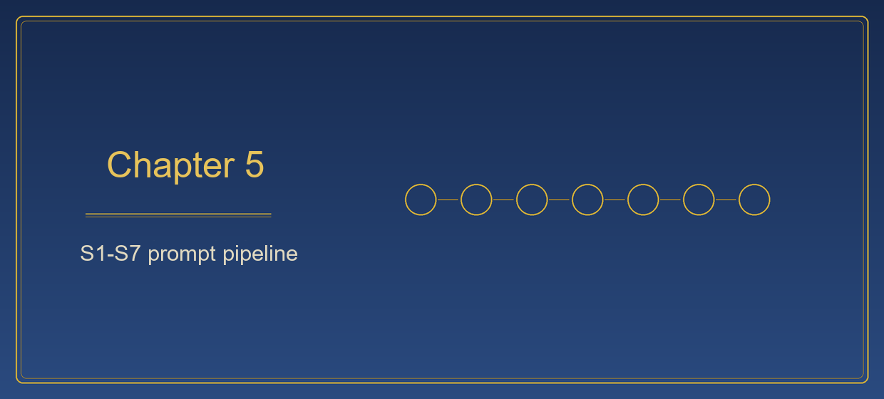

This chapter is the drill ground. The seven prompts S1-S7 correspond to the six output Types plus the validation report, and each is written as "task → input Type → output Type → criteria → prohibitions": the previous station's output is the next station's input, Type locked into Type. All of it is run through Ms. Lin's insomnia case - copy the prompts, swap in your own patient, and you have a usable method.

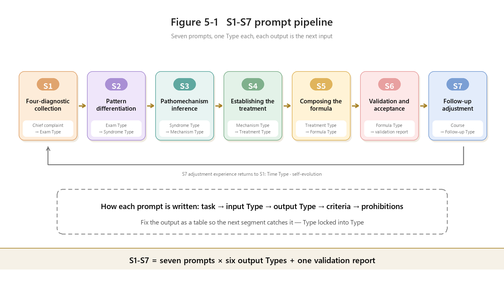

Figure 5-1 The S1-S7 prompt pipeline

## 5.1 S1-S7 at a Glance

Start with the whole picture: each of the seven stages handles one stretch of the road, and every input and output is an explicit Type. If validation at any stage sends the work back, return to that stage and redo it - the return paths are written in the last column of the table.

**Table 5-1 Master table of S1-S7**

| **Stage** | **Task** | **Input Type** | **Output Type** | **Fail and return** |
| --- | --- | --- | --- | --- |
| S1 | Four-diagnostic collection | Chief complaint dialogue | Exam Type | Missing field → follow-up question |
| S2 | Pattern differentiation | Exam Type | Syndrome Type | ∩(T) fails → return to S1 |
| S3 | Pathomechanism inference | Syndrome Type | Mechanism Type | Broken link → return to S2 |
| S4 | Establishing the treatment method | Mechanism Type | Treatment Type | No correspondence → return to S3 |
| S5 | Composing the formula | Treatment Type | Formula Type | Validation fails → return to S5 |
| S6 | Formula validation | The complete S1-S5 volume | review report | Any layer fails → return that section |
| S7 | Follow-up adjustment | Previous case file plus the new four diagnostics | Follow-up Type | Therapeutic effect doubtful → reopen the file |

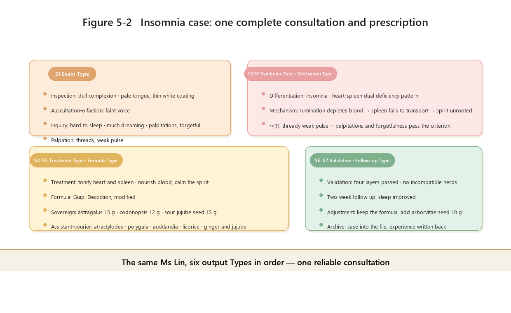

Figure 5-2 The insomnia case: one complete consultation and prescription

## 5.2 S1 Prompt: Four-Diagnostic Collection

S1 has exactly one task: turn the dialogue into a structured four-diagnostic record. The commonest mistake is slipping into judgment - which is why the prompt explicitly forbids writing a pattern type at this step.

**Prompt S1: four-diagnostic collection**

> [Task] You are a TCM consultation assistant. Organise the patient's chief complaint and dialogue into a structured four-diagnostic record (Exam Type).  
> [Input] The patient's chief complaint and dialogue record.  
> [Output format] A four-column table: inspection, auscultation-olfaction, inquiry, palpation; each column lists the concrete findings.  
> [Criteria] Tongue and pulse findings are mandatory; symptoms must include degree and duration; missing fields are marked "not collected" and listed in a follow-up question list.  
> [Prohibited] Do not write a pattern type or a prescription at this step; do not fill uncollected fields with speculation.  

**Table 5-2 S1 output example: Ms. Lin's Exam Type**

| **Field** | **Output content** |
| --- | --- |
| Inspection | Pale complexion, rather thin build, pale tongue, thin white coating, listless spirit |
| Auscultation-olfaction | Faint voice, no special odour |
| Inquiry | Insomnia for about two months: difficulty falling asleep, much dreaming and easy waking, waking two to three times a night; palpitations and forgetfulness; poor appetite and dull intake; fatigue and weakness; much brooding; scanty pale menses; normal bowels and urine |
| Palpation | Thin-weak pulse, abdomen soft without tenderness |
| Not collected | (None in this case; if present, list it on the follow-up question list, e.g. "recent medication history to be supplied") |

## 5.3 S2 Pattern Differentiation and S3 Pathomechanism Inference

S2 converges the Exam Type into a Syndrome Type; S3 expands the Syndrome Type into a Mechanism Type. One closes, one opens: closing must pass ∩(T), opening must be evidenced link by link.

**Prompt S2: pattern differentiation**

> [Task] Organise the Exam Type into a Syndrome Type.  
> [Steps] (1) Locate by the eight principles (2) Locate by zang-fu organs (3) List the feature set F(T) (4) Compare candidate pattern types using the intersection criterion ∩(T) (5) Write out the exclusion differential.  
> [Output] Disease name and pattern type name + the F(T) list + the ∩(T) comparison + an exclusion statement (why at least one similar pattern type is not chosen).  
> [Prohibited] When features are insufficient, output "pattern type undetermined" and list a follow-up question list; never guess.  

**Prompt S3: pathomechanism inference**

> [Task] Expand the Syndrome Type into a Mechanism Type: a causal chain of cause → mechanism → pattern.  
> [Output] A three-column chain table: link \| content \| four-diagnostic evidence; every link must point back to what the four diagnostics found.  
> [Prohibited] Do not introduce aetiological assumptions absent from the four diagnostics; any link that cannot point back to evidence must be deleted.  

**Table 5-3 S2-S3 output example: Syndrome Type and Mechanism Type**

| **Output** | **Content** |
| --- | --- |
| S2 · Syndrome Type | Insomnia · heart-spleen dual deficiency pattern |
| S2・F(T) | Difficulty falling asleep with much dreaming and easy waking, palpitations and forgetfulness, poor appetite and dull intake, fatigue and weakness, pale complexion, pale tongue with thin white coating, thin-weak pulse, scanty pale menses |
| S2・∩(T) | Thin-weak pulse + pale complexion + palpitations and forgetfulness pass the "heart-spleen dual deficiency" criterion; among the eight principles this is deficiency, and by zang-fu localisation it is heart and spleen |
| S2 · exclusion differential | Not liver depression transforming into fire (no irritability, bitter taste or wiry-rapid pulse); not yin deficiency with hyperactive fire (no heat in the five centres, no red tongue with little coating) |
| S3 · cause | Excessive brooding (inquiry: much brooding, clerical work) |
| S3 · mechanism | Stealthily consuming heart blood → the spleen fails to transport → qi and blood have no source → the spirit is deprived of nourishment (evidence: palpitations and forgetfulness, poor appetite and dull intake, fatigue) |
| S3 · pattern | Heart-spleen dual deficiency causing insomnia (evidence: pale complexion, pale tongue, thin-weak pulse) |

## 5.4 S4 Establishing the Treatment and S5 Composing the Formula

S4 builds the bridge, S5 crosses it. S4's output is the Treatment Type: one pathomechanism, one method. S5's output is a complete prescription sheet - base formula, sovereign-minister-assistant-courier, modifications, decoction and administration, and physician's instructions, with no column missing.

**Prompt S4: establishing the treatment method**

> [Task] From the Mechanism Type, establish the Treatment Type.  
> [Output] The therapeutic principle (e.g. tonify what is deficient) + the treatment method (e.g. tonify and benefit the heart and spleen, nourish the blood and calm the spirit) + its classification among the eight methods + one sentence on "why this method".  
> [Criteria] Each link of the treatment method must correspond to the pathomechanism chain; one pathomechanism, one method, no more and no less.  

**Prompt S5: composing the formula**

> [Task] From the Treatment Type, produce a Formula Type (prescription sheet).  
> [Output format] (1) The base formula name (2) Four columns for sovereign, minister, assistant and courier (herb + dose + task) (3) Modifications (each with its reason noted) (4) Decoction and administration plus physician's instructions.  
> [Criteria] Every herb must point back to the treatment method; doses must be within the customary range; check combination contraindications (the eighteen incompatibilities and nineteen mutual antagonisms) and special-population warnings first.  
> [Statement] Mark at the end: "For demonstration only; in clinical practice diagnosis and prescription are made by a qualified TCM physician."  

The S5 output example is the prescription sheet below. Read it against the BOM in section 2.5: sovereign-minister-assistant-courier is the structural column, modifications are the dynamic column, and the instructions are the advisory column - only with all three does the Formula Type land.

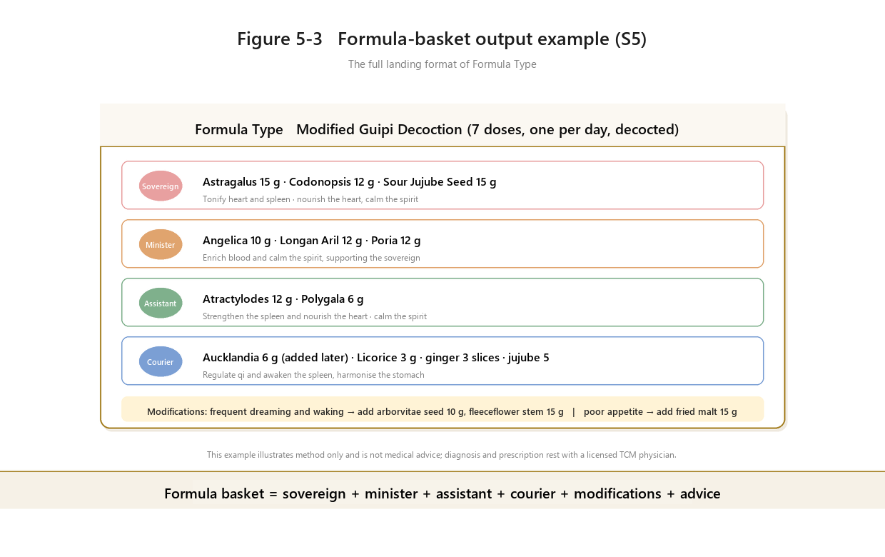

Figure 5-3 A prescription sheet output example (S5)

**Table 5-4 S5 output example: prescription sheet (Guipi Decoction with modifications, for demonstration only)**

| **Column** | **Content** |
| --- | --- |
| Base formula | Guipi Decoction with modifications, seven doses, one dose daily decocted in water |
| Sovereign | Astragalus root 15 g, codonopsis root 12 g, sour jujube seed 15 g - tonify and benefit the heart and spleen, nourish the heart and calm the spirit |
| Minister | Angelica root 10 g, longan aril 12 g, Poria with hostwood 12 g - nourish the blood and calm the spirit, assisting the sovereign |
| Assistant | Atractylodes rhizome 12 g, polygala root 6 g - strengthen the spleen and assist transport, calm the spirit and open the orifices |
| Courier | Aucklandia root 6 g (added near the end), licorice root 3 g, fresh ginger 3 slices, jujube 5 pieces - regulate qi and awaken the spleen, harmonise the herbs |
| Modification | Much dreaming and easy waking, marked → add Biota seed 10 g and Fleeceflower stem 15 g (strengthen the spirit-calming task); poor appetite and dull intake → add stir-fried malt 15 g (assist transport and open the appetite) |
| Decoction and administration | One dose daily, decocted in water and taken warm in two divided doses, the evening dose warm at bedtime |
| Physician's instructions | Avoid strong tea and coffee; keep regular bedtimes; soak the feet in warm water before sleep; follow up in two weeks |

> **Example statement: the herb doses in Table 5-4 serve only to demonstrate the method and do not constitute medical advice; in clinical practice please have a qualified TCM physician diagnose and prescribe, adjusted to individual constitution and regulation.**  

## 5.5 S6 Formula Validation and S7 Follow-up Adjustment

S6 is the last gate before the formula leaves: run the four layers of accuracy one by one and produce a validation report. If any layer fails, name the break point and send that section back for rework - a return is not a failure, it is this pipeline protecting itself.

**Prompt S6: formula validation**

> [Task] A four-layer accuracy formula validation report.  
> [Input] All outputs of S1-S5.  
> [Output] A four-layer checklist: (1) ∩(T) cross-check (2) link-by-link inspection of the pathomechanism chain (3) check of sovereign-minister-assistant-courier and combination contraindications (4) evidence-chain backtracking. Each layer is given "pass / fail plus reason".  
> [Handling] If any layer fails: name the section to be returned (S1-S5); never release a formula carrying a doubt.  

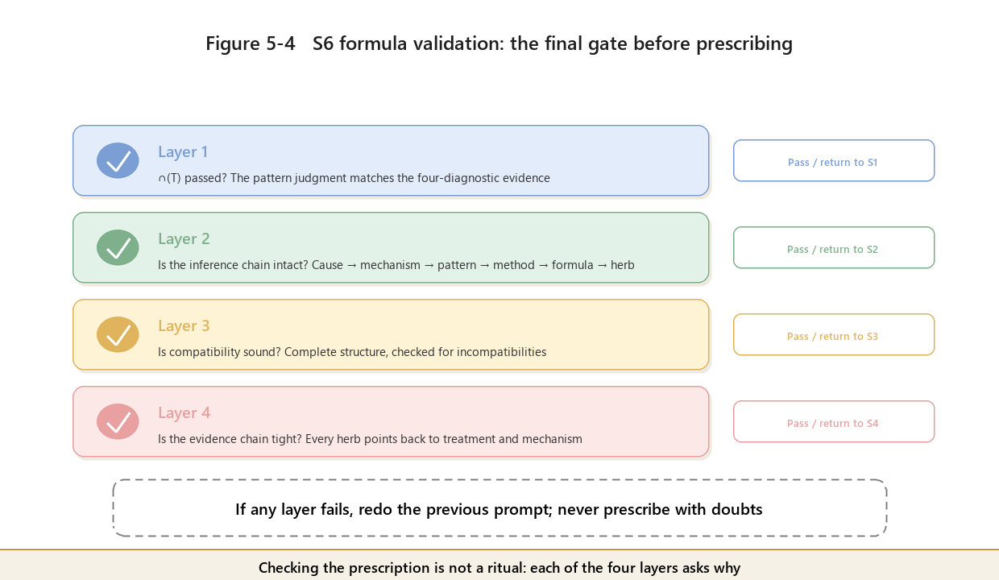

Figure 5-4 S6 formula validation: the last gate before the formula leaves

**Table 5-5 S6 validation report example**

| **Layer** | **Check** | **Result** |
| --- | --- | --- |
| One | Cross-check F(T) against ∩(T) | Pass: the eight principles, the zang-fu localisation and the feature set all match |
| Two | The pathomechanism chain link by link (cause, mechanism, pattern, method, formula, herb) | Pass: all six links are supported by four-diagnostic evidence |
| Three | Sovereign-minister-assistant-courier plus the eighteen incompatibilities and nineteen mutual antagonisms plus doses | Pass: structure complete, no combination contraindication, doses within the customary range |
| Four | Evidence-chain backtracking | Pass: every herb points back to the treatment method, every clause of the method points back to the pathomechanism |

S7 reconnects time: at the two-week follow-up, bring the previous case file and compare, decide whether to keep, modify or change the formula, and write this round's conclusions back into the case file. This is the closing move of the Time Type - therapeutic effect becomes experience, and experience becomes criteria.

**Prompt S7: follow-up adjustment**

> [Task] Adjust the formula at follow-up and archive it.  
> [Input] The previous case file (threaded by id(C)) plus this visit's four diagnostics.  
> [Output] (1) Therapeutic-effect comparison (the difference between the before and after four diagnostics) (2) Whether the pattern type changed (3) The adjustment decision (keep, modify or change the formula) and its reason (4) An evolution record (what was learned this time).  
> [Criteria] The reason for adjustment must point back to the therapeutic-effect comparison; changing the formula requires re-running S2-S6.  

**Table 5-6 S7 follow-up adjustment example (two weeks later)**

| **Column** | **Content** |
| --- | --- |
| Therapeutic-effect comparison | Able to fall asleep (latency shortened); night awakenings down from two to three times to once; palpitations reduced; appetite slightly returning; tongue and pulse unchanged |
| Pattern-type change | None: still heart-spleen dual deficiency, the direction of F(T) reinforcement is correct |
| Adjustment decision | Keep the formula and modify: add Biota seed 10 g to strengthen spirit-calming (dreaming persists); seven more doses |
| Evolution record | This case confirms that the "heart-spleen dual deficiency → Guipi Decoction" criterion works; "appetite not fully recovered" suggests the spleen can be attended to again next visit - write back into the case file |

> **Chapter focus**  
> S1-S7 = seven prompts × six output Types + a validation report; each prompt follows a fixed shape: task → input Type → output Type → criteria → prohibitions.  
> S1 collects only, never judges; S2 converges through ∩(T); S3 expands with evidence; S4 one pathomechanism, one method; S5 a complete prescription sheet.  
> If S6 fails any of the four layers the work is returned; S7 compares at follow-up, adjusts the formula and archives - experience is written back, and prescriptions get more accurate over time.  
> Formula and herb content is for demonstration only; in clinical practice a qualified TCM physician diagnoses and prescribes.  

# Chapter Six Misuse, Checklists and Maturity

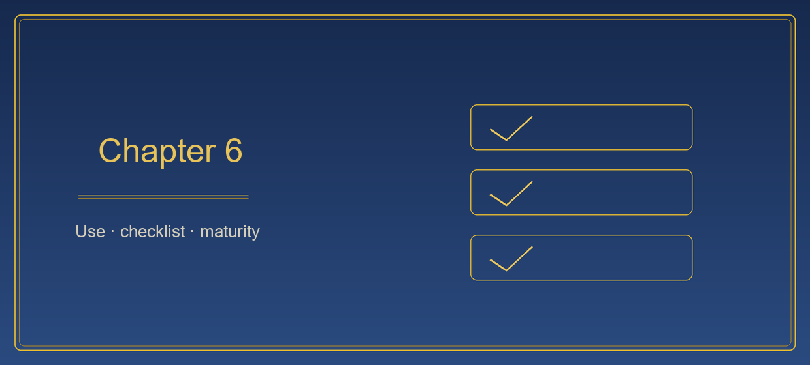

The final chapter closes with three pieces of protective gear: the five kinds of misuse keep you out of the commonest pits, the ten-question checklist lets you self-check before a formula leaves, and maturity L1-L4 tells you which level you are at and where to grow.

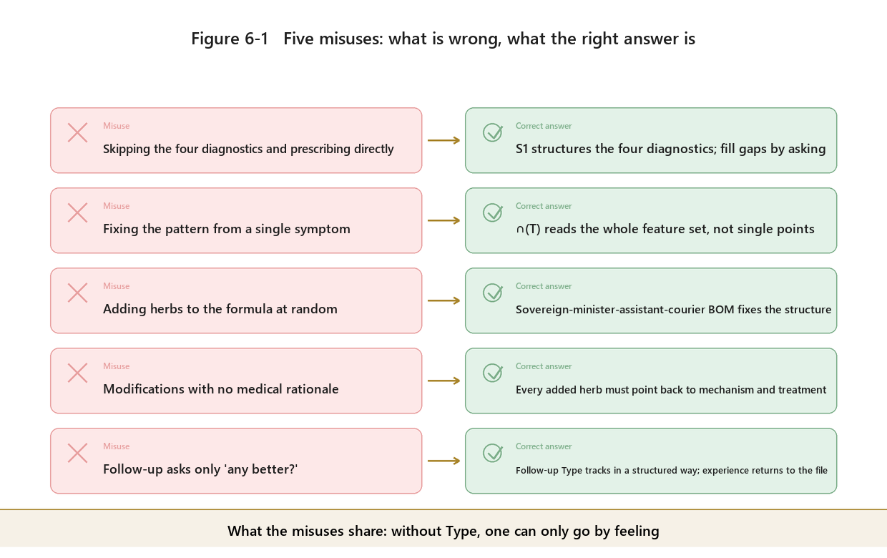

Figure 6-1 Five kinds of misuse: where the error is, and the correct answer

## 6.1 Five Misuses

The five kinds of misuse share one trait: without the Type, all that is left is feeling. The first four happen inside the process; the fifth happens outside it - treating follow-up as a mere courtesy call.

**Table 6-1 Comparison of the five kinds of misuse**

| **#** | **Misuse** | **Why it is wrong** | **Correct answer** |
| --- | --- | --- | --- |
| 1 | Skipping the four diagnostics and prescribing directly | Without the Exam Type the evidence chain breaks at its first step | S1 structures the four diagnostics first; missing fields trigger follow-up questions |
| 2 | Setting a pattern type from a single symptom | ∩(T) looks at the whole feature set, not a single point | Collect F(T) fully, then compare, then write the exclusion differential |
| 3 | Assembling herbs at random into a formula | No BOM structure; herbs whose task cannot be stated | Sovereign-minister-assistant-courier sets the structure; the remove counterfactual self-checks it |
| 4 | Modification without medical rationale | Add one herb that points nowhere in the pathomechanism and the formula falls apart | Each added herb carries its reason, pointing back to the treatment method |
| 5 | At follow-up only asking "feeling better?" | If therapeutic effect is not structured, experience cannot settle | The Follow-up Type's four columns are filled as usual and written back into the case file |

## 6.2 A Ten-Question Checklist

Before the formula leaves, pass ten questions one by one. If any question cannot be answered, return to the corresponding step - this checklist is the pocket edition of the four-layer accuracy guarantee.

**Table 6-2 The ten-question checklist**

| **#** | **Problem** | **Corresponding layer** |
| --- | --- | --- |
| 1 | Is the Exam Type complete? Do tongue and pulse have fields, and are gaps marked? | Evidence chain |
| 2 | Is F(T) complete? Are degree and duration written clearly? | ∩(T) |
| 3 | Has the ∩(T) comparison been run? Can the exclusion differential be written out? | ∩(T) |
| 4 | Does every link of the pathomechanism chain point back to the four diagnostics? | Deductive skeleton |
| 5 | Does the treatment method correspond one-pathomechanism-one-method to the pathomechanism? | Deductive skeleton |
| 6 | Can every herb's task be stated and pointed back to the treatment method? | prescription review |
| 7 | Is sovereign-minister-assistant-courier complete? Is there a herb whose task cannot be stated? | prescription review |
| 8 | Have the eighteen incompatibilities and nineteen mutual antagonisms been checked? Are doses within the customary range? | prescription review |
| 9 | Have special-population warnings been checked (pregnancy, menstruation, allergy)? | prescription review |
| 10 | Backtracking from the prescription to the four diagnostics, can every step answer "on what grounds"? | Evidence chain |

## 6.3 Maturity from L1 to L4

Maturity has four levels; what is measured is not how large the model is but how thick your case file is and how refined your criteria are. L1 can ask: four-diagnostic collection is complete, no field missing. L2 can differentiate: differentiation has criteria, and the reasons for ∩(T) and the exclusion differential can be stated. L3 can prescribe: the formula comes from the method, all four validation layers pass, and modifications are justified. L4 can evolve: cases are archived and written back, cross-acceptance is done honestly, and prescriptions get more accurate with use.

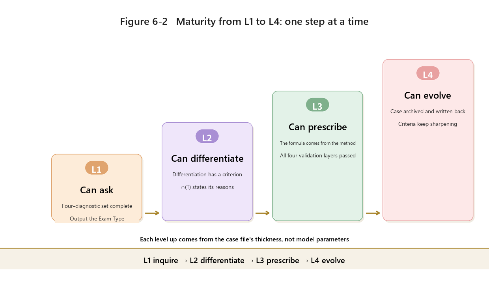

Figure 6-2 Maturity from L1 to L4: one step at a time

**Table 6-3 Maturity L1–L4**

| **Level** | **Name** | **Target metric** | **Upgrade action** |
| --- | --- | --- | --- |
| L1 | Can ask | Exam Type complete; not-collected items marked | Turn the follow-up question list into a habit |
| L2 | Can differentiate | ∩(T) comparison plus exclusion differential can be produced | Keep an F(T) record at every differentiation |
| L3 | Can prescribe | All four validation layers pass; modifications have reasons | The validation report enters the file, and the return rate falls |
| L4 | Can evolve | Cross-acceptance becomes routine; criteria keep sharpening | Case-file review + move restructuring |

> **Chapter focus**  
> The five kinds of misuse share a common trait: the Type is missing; the ten-question checklist is the pocket edition of the four-layer accuracy guarantee, passed question by question before a formula leaves.  
> Maturity is measured by the thickness of the case file: L1 can ask → L2 can differentiate → L3 can prescribe → L4 can evolve.  
> Returns and reviews are not setbacks; they are the only path to sharper criteria.  

# Review and close

Fold the whole book into one figure. The six output Types are the things, the four layers of accuracy are the gates, the six steps are the road, and S1-S7 is the feel of each move; the Space Type sees "person, pattern, formula" clearly, the Time Type carries "diagnose, treat, adjust" through, and Mind AI bears the whole journey.

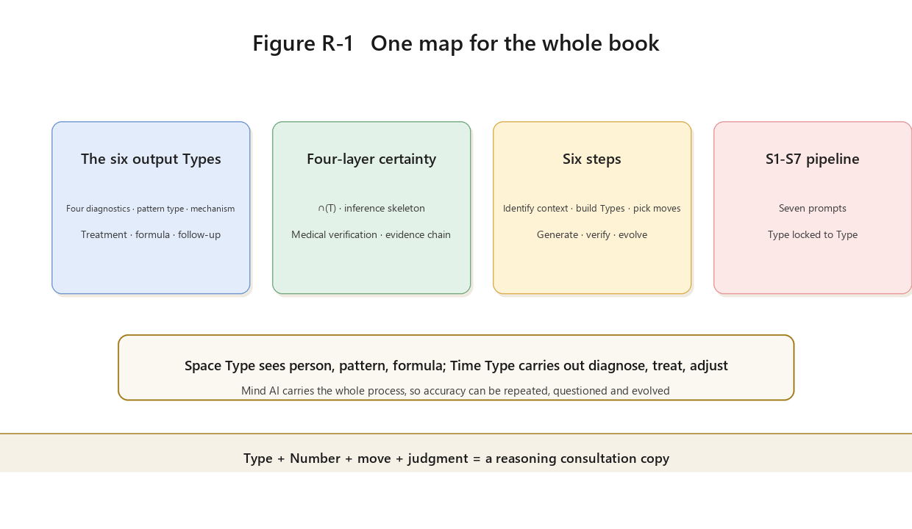

Figure R-1 The whole book in one figure

Take away three things. First, accuracy is structural: the output is a Type, the criterion is ∩(T), the evidence is a chain - with all three, one may speak of accuracy. Second, the method is repeatable: follow S1 to S7 and every visit runs on the same road, with return paths and evolution records. Third, getting more accurate with use is real: follow-ups write back into the case file, cross-acceptance sharpens the criteria, and L4 is not the end but the beginning.

**Table R-1 Book-wide checklist**

| **Chapter** | **What to take away** | **self-check** |
| --- | --- | --- |
| Chapter 1 (orientation) | A reason-able replica; Type plus Number; where the two Types land | Can explain this method to a colleague in one sentence |
| Chapter 2 (output) | The six output Types and the three brackets | Can state the fields and criteria of the six Types |
| Chapter 3 (accuracy) | four gates of accuracy | "Why is it accurate?" has four answers |
| Chapter 4 (operation) | Four-step framework + six steps + three-layer judgment | Follow the steps and one visit does not get stuck |
| Chapter 5 (drill) | S1-S7 and the insomnia case | Swap in your own patient and the pipeline still runs |
| Chapter 6 (advanced) | Misuse, ten questions, maturity | Know which L you are at and what to practise next |

# Appendix A Quick Reference: Terms, Moves, Notation

The terms, moves and notations used in this book are gathered in three tables. For theoretical detail return to the original Ontypology texts; here the only requirement is that they can be looked up when in use.

**Table A-1 Terminology quick reference**

| **Terminology** | **English / notation** | **In this book it means** |
| --- | --- | --- |
| Type | Type | A structured output unit; in English always Type, never Form |
| Exam Type | ExamType | A structured record of inspection, auscultation-olfaction, inquiry and palpation |
| Syndrome Type | SyndromeType | Differentiation conclusion: disease name + pattern type, F(T) passing ∩(T) |
| Mechanism Type | MechanismType | Cause→mechanism→pattern causal chain |
| Treatment Type | TreatmentType | Therapeutic principle + treatment method + classification among the eight methods |
| Formula Type | FormulaType | Sovereign-minister-assistant-courier BOM plus modifications plus instructions |
| Follow-up Type | FollowType | Therapeutic-effect comparison + adjustment decision + evolution record |
| Feature set | F(T) | The total set of features the Syndrome Type admits |
| Intersection criterion | ∩(T) | The rule that decides "does it belong to this Type" |
| Identity anchor | id(C) | Identity anchoring of the container (patient, course of illness) |
| Composition Set | { } | BOM: what it is composed of |
| Container Set | ( ) | Where does it live, and who is it |
| Abstract Set | [ ] | Which class it falls into |

**Table A-2 The Time Type's fourteen moves × Chinese medicine**

| **Set** | **Move** | **Where consultation and prescribing lands** |
| --- | --- | --- |
| Find moves | Type-time function search | Retrieve similar cases using the Exam Type |
| Find moves | Design search and extraction | Extract pattern-type features and established formula patterns from cases |
| Find moves | Design patterns | Apply a combination pattern (e.g. the sovereign-minister-assistant-courier structure) |
| Make the move | Logic generation and application | Reasoning generation for pattern differentiation and treatment |
| Make the move | Function generation and application | Generation of the treatment method and the formula |
| Make the move | Design (creation and innovation) | Formula composition and modification - prescribing is design |
| Devise moves | Problem solving | Attribution and countermeasures for poor therapeutic effect |
| Devise moves | Analysis | Splitting four-diagnostic information into fields, pattern-type differentiation |
| Devise moves | Reasoning (causal, reverse-causal, simulation, statistical, reverse) | The pathomechanism causal chain; reverse verification of the pattern from the formula |
| Devise moves | Thinking methods (forward, reverse, horizontal, vertical, first principles) | Multi-angle differentiation of difficult cases |
| Practise the moves | Continuous learning | Case archiving, experience accumulation |
| Practise the moves | Refactoring and recombination | Adjustment restructuring, formula regrouping |
| Practise the moves | R&D and exploration | New-formula exploration, treatment-method probing |
| Practise the moves | Self-evolution | Cross-acceptance writes back into the criteria, so prescriptions get more accurate |

**Table A-3 Notation quick reference**

| **Notation** | **Reading path** | **purpose** |
| --- | --- | --- |
| [ ] | Square brackets | Abstract set: does it belong to [insomnia] |
| ( ) | Parentheses | Container sets: (Ms. Lin), (this visit) |
| { } | Braces | Composition set: the BOM of {Guipi Decoction with modifications} |
| ∩(T) | Intersection criterion | The membership rule of a Type |
| F(T) | Feature set | The total set of features the Syndrome Type admits |
| id(C) | Identity anchor | Identity anchoring of the container |
| remove | removal criterion | Three-level counterfactual: single herb / herb pair / formula root |

> **Book-wide statement: the formulas and herbs in this book (including the herbs, doses and modifications in Ms. Lin's case) serve only to demonstrate the method and do not constitute medical advice; for clinical care please have a qualified TCM physician diagnose and prescribe.**  
> Type is Type, not Form. Theory is used, not taught; the platform is cited, not described.  

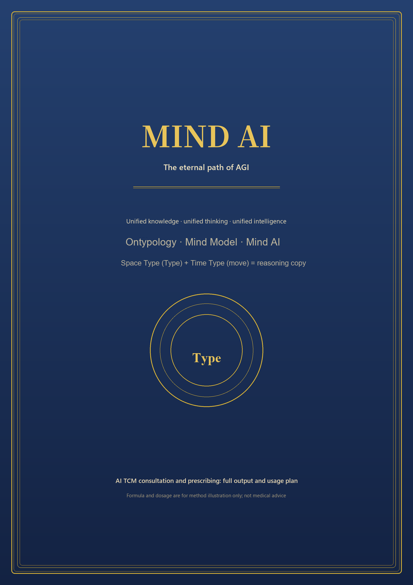
