# AIWargameBrain

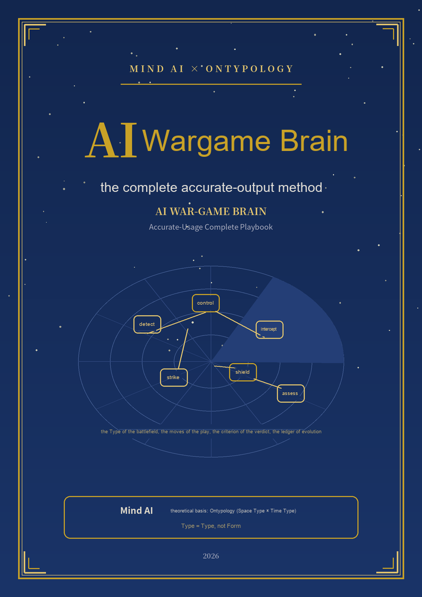

## Table of Contents

- **Before we begin - three conventions3**
- 0.1 Three Conventions and the Task Map3
- **Introduction - two languages, one measuring stick5**
- **Chapter 1 Getting to Know the AI Wargame Brain7**
- 1.1 What the AI Wargame Brain Is - a Reasonable Battlefield Replica7
- 1.2 GE26 and "WarMatrix" - a Benchmark Comparison8
- 1.3 The Two Types in Wargaming - Reading the Move Tray on the Battlefield10
- 1.4 The Mind AI Division of Labour - Where Accuracy Comes From11
- **Chapter 2 The Six Output Types - Scenario, Force, Action, Play, Verdict, Evolution12**
- 2.1 The Six Output Types at a Glance - Scenario, Force, Action, Play, Verdict, Evolution12
- 2.2 ScenarioType - Writing the Battlefield as Rules14
- 2.3 ForceType - Order of Battle and the Three Levels of remove15
- 2.4 ActionType - Course of Action and Rules of Engagement16
- 2.5 PlayType - the Play Log and the Time Container16
- 2.6 VerdictType - the Adjudication Funnel and Victory Criteria17
- 2.7 EvolutionType - the Evolution Ledger and After-Action Review18
- **Chapter 3 The Four Gates of Accuracy19**
- 3.1 Gate One - ∩(T) Criteria: Output Passes First19
- 3.2 Gate Two - the Deductive Skeleton: Causal Play Along the Event Chain20
- 3.3 Gate Three - Adversarial Validation: Red-Team Counterfactuals and Rule Checks21
- 3.4 Gate Four - the Type Evidence Chain: Traceable Play22
- 3.5 Space and Time Cross Acceptance22
- **Chapter 4 The Six Steps of Accurate Use24**
- 4.1 The Six Steps and the Four-Step Framework24
- 4.2 Step 1-2 Identify the Situation, Build Types by Axis25
- 4.3 Step 3-4 Select and Expand the Pattern, Generate Output26
- 4.4 Step 5-6 Criterion Acceptance, Archiving and Evolution26
- 4.5 Choosing, Combining and Switching Moves27
- **Chapter 5 The S1-S7 Prompt Pipeline and a Worked Play28**
- 5.1 The Pipeline at a Glance - Seven Prompts28
- 5.2 S1-S3 Mission Sheet, Scenario and Forces29
- 5.3 S4-S5 Play Execution and Adjudication30
- 5.4 S6-S7 Evolution Archiving and Acceptance Report32
- 5.5 Taiwan Strait Air Defence Counter-Air - Full Worked Example33
- **Chapter 6 Misuses, Checks and Maturity34**
- 6.1 Five Misuses34
- 6.2 The Ten-Question Checklist 35
- 6.3 Maturity L1-L436
- **Review - one play in one sentence37**
- **Appendix A Quick Reference: Terms, Moves, Notation39**

## Before we begin - three conventions

**On the wargaming table information was never scarce; what is scarce is "accurate". The longer the play log the better it looks, the faster the verdict the truer it seems - but nobody can answer: on what grounds is this output accurate? This book is the manual for that answer: a complete method for using the AI Wargame Brain to reach accurate output.**

### 0.1 Three Conventions and the Task Map

Before opening the book, three conventions. They bound the book and let every later chapter be used directly, without flipping back and forth.

> **Convention one: Type, not Form. Throughout the book "Type" is written Type in English - the scenario Type is ScenarioType, the force Type is ForceType, and so on. Not Form. Form is only outward shape; a Type carries rules, composition and identity - which is exactly what this book accepts against.**  
>   
>   

> **Convention two: use the theory, do not teach it. Ontypology (the Space Type and the Time Type) is the theoretical basis of the book, but the book does not restate the theory - it only uses the tools it has sharpened. The tools used: the three brackets [ ] { } ( ), the intersection criterion ∩(T), the identity id(C), the three levels of remove, the four-step framework, the three-layer judgement and the Time Type move tray.**  
>   
>   

> **Convention three: cite the platform, do not restate it. Mind AI is the underlying platform: the LLM handles language ability, the Mind Model handles intelligence. This book does not restate the platform architecture - where hands-on work is needed, it cites this division directly.**  
>   
>   

Next is the task map. Six tasks, one per chapter; follow it through and a play runs complete from start to archive.

**Table 0-1 Task map - six tasks, six landing points**

| **Task** | **the question the reader must answer** | **landing point** | **what is taken away** |
| --- | --- | --- | --- |
| **grasp the positioning** | What is the AI Wargame Brain and why is it needed? | Chapter 1 (orientation) | the positioning map of the reasonable replica |
| **build the output** | which "Types" must a play actually produce? | Chapter 2 (output Types) | the six output Types and their criteria |
| **guaranteed accuracy** | How is "accurate" accepted, rather than merely asserted? | Chapter 3 (accuracy) | four gates of accuracy |
| **learn the operation** | how is it used, step by step? | Chapter 4 (six steps) | the six-step operating flow |
| **live exercise** | how are the prompts written, what does a play look like? | Chapter 5 (pipeline) | seven prompts + a worked play |
| **self-check** | how are the common misuses avoided? how is maturity assessed? | Chapter 6 (checks) | misuse comparison + maturity model |

## Introduction - two languages, one measuring stick

**This book stands at the junction of two languages. One is the language of Ontypology: Type, the three brackets, criteria, moves. The other is the language of wargaming: scenario, order of battle, course of action, adjudication, after-action review. Reading this book requires no translation between them - because they were always two ways of saying the same thing.**

**Table D-1 Two languages compared - two ways of saying the same thing**

| **the language of Ontypology** | **the language of wargaming** | **where the join is** |
| --- | --- | --- |
| **Type** | one output document (scenario document, verdict, ...) | output is not a document format but a Type carrying criteria |
| **[ ] Abstract Set** | category rules (what counts as "interception"?) | check ∩(T) item by item; all must pass to enter the category |
| **{ } Composition Set** | order of battle, action steps, event script | BOM criterion + three levels of remove to grade severity |
| **( ) Container Set** | airspace, responsibility area, time axis | C = (id(C), S(C)): content changes, identity does not |
| **Time Type - moves** | play actions (reasoning, analysis, design, evolution) | reading the four sets and fourteen moves on the battlefield |
| **play log trace** | play process record | S(t+1) = g(S(t), move, event) |
| **evolution ledger (EvolutionLog)** | after-action lesson library | id(C) anchors identity; the ledger stores lessons |

> 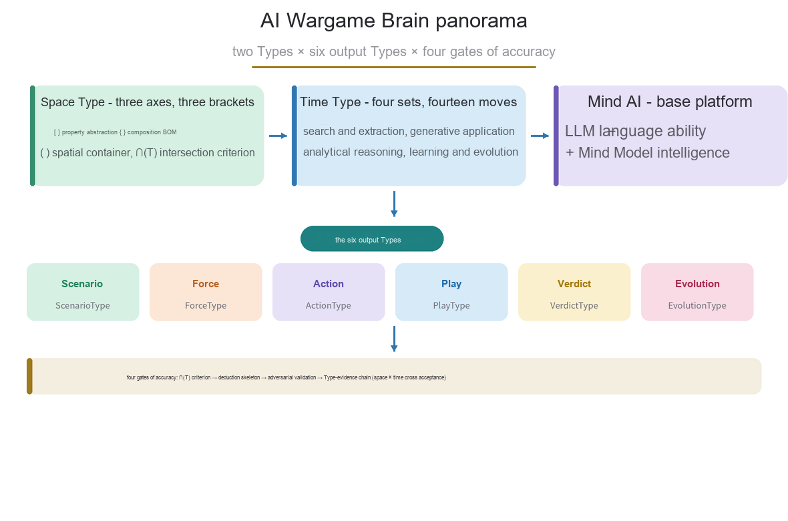  
>
> **Figure D-1 AI Wargame Brain panorama - two Types × six output Types × four gates of accuracy**  

There is only one measuring stick as well: the criteria. Ontypology supplies the way to write them (∩(T), id(C), remove), wargaming supplies their content (victory conditions, rules of engagement, force grading) - together they turn "accurate" from an adjective into a checklist that can be ticked.

> **Three ways to read - pick one to start. Commander's way (30 minutes): read Chapter 1 (orientation) first, then Chapter 3 (accuracy) to learn how acceptance works, and finally Chapter 6 (checks) to take away the ten questions. Staff officer's way (half a day): go through the chapters in order, and drill Chapter 5 (the pipeline) hardest - copy the seven prompts straight into your own play work. Builder's way (read while doing): work alongside Chapters 4 and 5, fitting the six steps and the seven prompts into your existing wargaming process, testing each stage with the four gates of accuracy as you install it.**  
>   
>   
>   

## Chapter 1 Getting to Know the AI Wargame Brain

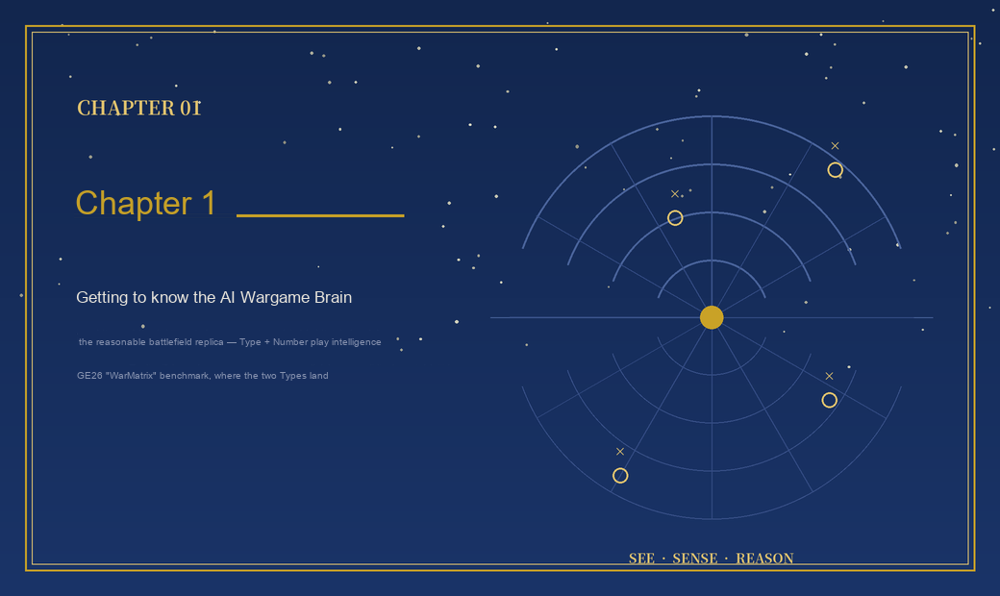

**This chapter first sets the position firmly: what the AI Wargame Brain is, what the GE26 play said to it, and how the two Types and Mind AI land in wargaming. With the position firm, the next five chapters have somewhere to land.**

### 1.1 What the AI Wargame Brain Is - a Reasonable Battlefield Replica

The essence of wargaming is to fight the battle once on the table. Traditional wargaming relies on people moving pieces and people adjudicating: when a game ends, the experience stays in the staff officer's head and resets when the team changes. The AI Wargame Brain changes exactly this - it writes the battlefield as Types, so that a play becomes an asset that accumulates, can be checked, and can evolve.

Its definition takes one sentence: the AI Wargame Brain is a "reasonable battlefield replica" built on the two Types of Ontypology as theory and Mind AI as the underlying platform. A replica is not a database - a database only holds numbers; a replica holds Type + Number. The twelve sorties on the report are numbers; "a strike package is probing the air-defence response" is a Type. Only a Type carries relations, rules and causality, and only then can it move.

> 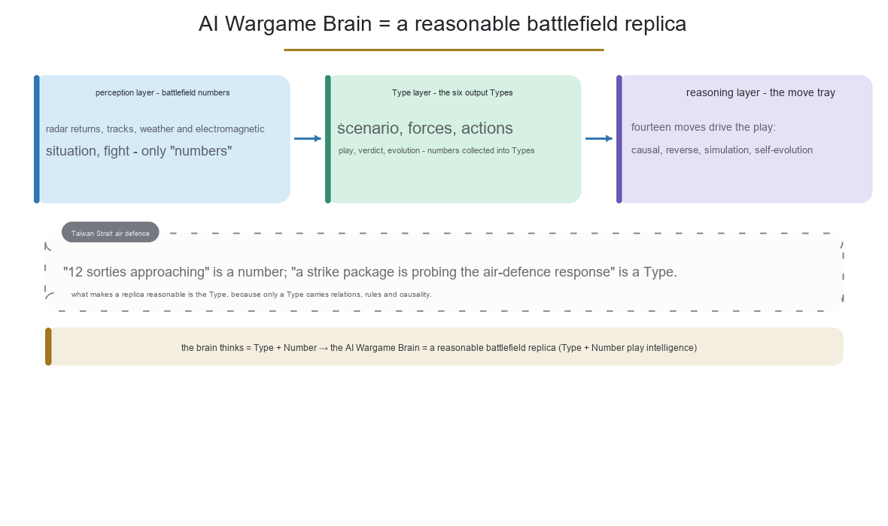  
>
> **Figure 1-1 The reasonable battlefield replica - perception layer, Type layer, reasoning layer**  

> **Three capabilities of the replica. It remembers - six output Types plus the evolution ledger make every play the foundation of the next. It moves - the fourteen moves of the Time Type move tray give the play moves to follow and traces to find. It judges - ∩(T), id(C) and the three levels of remove put the criteria inside the output, not inside the adjudicator's mood.**  
>   
>   
>   

### 1.2 GE26 and "WarMatrix" - a Benchmark Comparison

First record one fact: in the wargame designated GE26, the US Air Force for the first time activated an artificial-intelligence wargaming system, "WarMatrix". The significance is not the outcome of any one game but a displacement - AI moved from a calculation tool in the back room into the player's seat. AI wargaming went from a research topic to a working reality.

Once the displacement happens, the questions change. The old question was "can AI play"; the new one is "on what grounds does AI's play count". Unpacked, there are three issues:

> 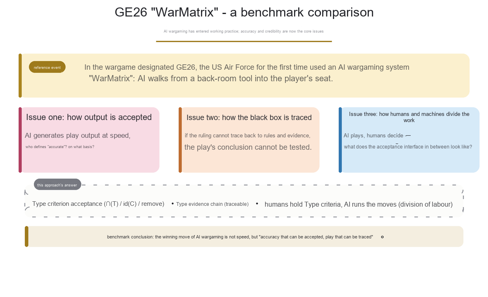  
>
> **Figure 1-2 The GE26 comparison - the three issues of AI wargaming**  

**Table 1-1 Benchmark comparison - the questions GE26 raises and this approach's answer**

| **question dimension** | **the questions GE26 brings to the fore** | **how this approach answers it** |
| --- | --- | --- |
| **output acceptance** | Who certifies "accurate" for play output generated at AI speed? | each of the six output Types has its ∩(T) entry criterion - pass first, then leave the room |
| **traceability** | if the ruling cannot trace back to rules and evidence, the conclusion cannot be tested | Type evidence chain: verdict ← play log ← action ← force ← scenario, every link checkable |
| **human-machine division of labour** | AI plays, humans decide - what does the acceptance interface between them look like? | AI runs the moves, humans hold the criteria - criteria written as human-readable Types make acceptance stand |
| **knowledge evolution** | after the play ends, where does what the AI learned live? | the evolution ledger records lessons and id(C) anchors identity - the scenario library grows once per loop |
| **theoretical root** | the stronger the system, the more it needs a clear account of "accurate" | the two Types of Ontypology: space raises the structure, time raises the play, and accuracy has grounds |

> **Benchmark conclusion: the winning move of AI wargaming is not generation speed but "accuracy that can be accepted, play that can be traced". GE26 put AI in the player's seat; the next question is to hand it a measuring stick - the remaining five chapters are the manual for that stick.**  
>   
>   

### 1.3 The Two Types in Wargaming - Reading the Move Tray on the Battlefield

The two Types land in wargaming, each governing half of time and space. The Space Type governs "the battlefield snapshot at each moment": property, composition and container, three axes that write who is who, what they are made of and within what bounds into a structure that can be judged. The Time Type governs "the advance between snapshots": moves are verbs, and everything a play does is on the move tray.

**Table 1-2 Where the Space Type lands on the battlefield - three axes, three brackets**

| **Tool** | **the Ontypology formulation** | **lands in wargaming** |
| --- | --- | --- |
| **[ ] Abstract Set** | properties and property values, T = (F(T), ∩(T)) | track attributes, identification parameters, weather and electromagnetic scale; entry depends entirely on ∩(T) |
| **{ } Composition Set** | BOM criterion + the three levels of remove | order of battle, units, weapon systems; essential / degraded / non-essential |
| **( ) Container Set** | C = (id(C), S(C)), and the axiom of invariance | airspace, responsibility area, mission sea area; tracks all replaced, identity unchanged |
| **Four framework steps** | tell sameness from difference → trigger abstraction → name the dimension → decide membership | set the framework before building Types - the identification dimensions grow out of it |

The Time Type half is the move tray. The fourteen moves fall into four sets: search and extraction, generative application, analytical reasoning, learning and evolution. They are not a taxonomy display but what every round of a play actually does - reverse reasoning to track enemy intent, causal reasoning to assess results, refactoring and recombination to rewrite the scenario.

> 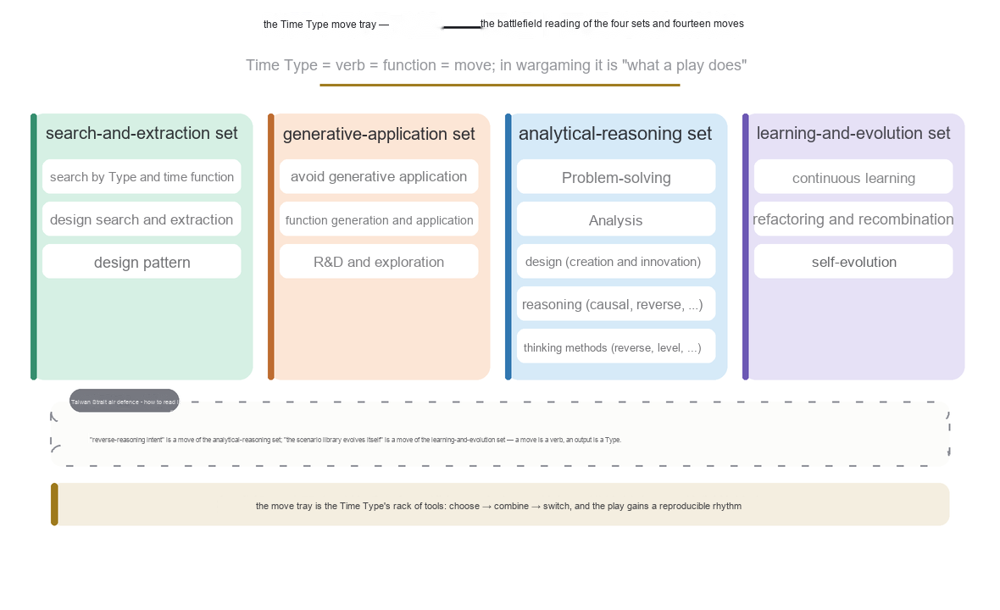  
>
> **Figure 1-3 The Time Type move tray - reading the four sets and fourteen moves on the battlefield**  

### 1.4 The Mind AI Division of Labour - Where Accuracy Comes From

Beneath it is the Mind AI platform. Convention three covered the division: the LLM handles language ability - reading the mission sheet, writing the scenario document, recalling historical cases; the Mind Model handles intelligence - unified knowledge, deep reasoning, long-term memory, self-evolution. Every output of the wargame brain is the result of the two working together: the LLM says it clearly, the Mind Model gets it right.

> 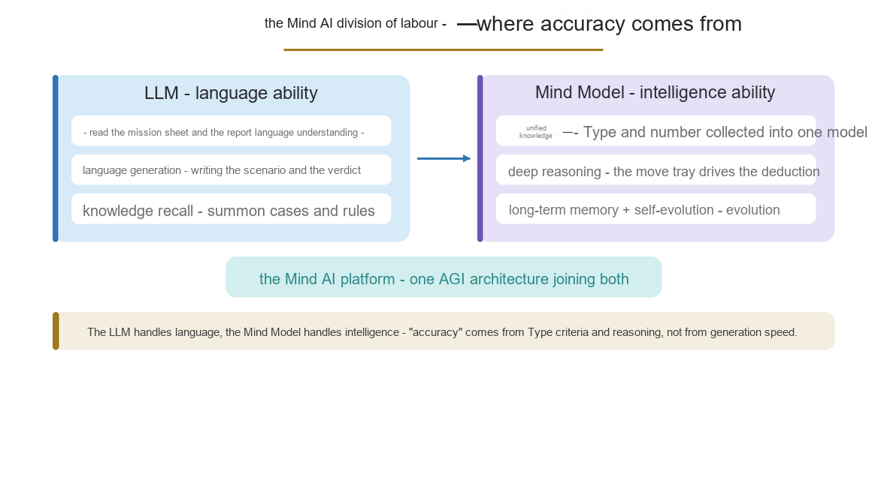  
>
> **Figure 1-4 The Mind AI division of labour - language ability and intelligence ability**  

**Table 1-3 The three sources of accuracy - set against the Mind AI division of labour**

| **where accuracy comes from** | **rests on** | **who is responsible** |
| --- | --- | --- |
| **Type criterion** | ∩(T), id(C) and the three levels of remove written into the output | Mind Model - unified knowledge and criteria-based reasoning |
| **Move** | fourteen moves drive causal, reverse and simulation reasoning | Mind Model runs the reasoning engine, the LLM lands the language |
| **Evolution ledger** | lessons settle, the scenario library version evolves | the Mind Model's memory and learning system |

> **One sentence for this chapter: GE26 proved AI can sit in the player's seat; what Ontypology and Mind AI must answer is how it plays accurately once seated.**  
>   

## Chapter 2 The Six Output Types - Scenario, Force, Action, Play, Verdict, Evolution

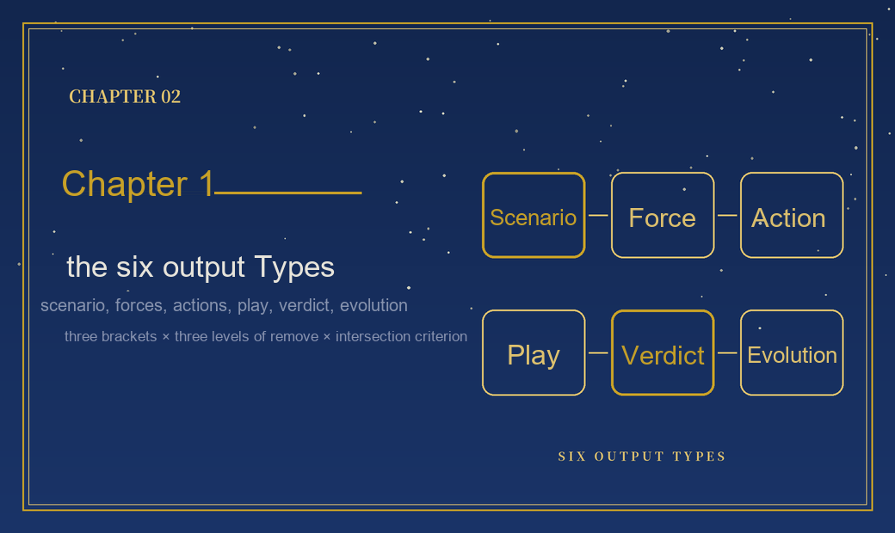

**A play must answer six questions: where the fight is, who fights, how they fight, what it becomes, who wins, what is learned. One question per Type, one Type per output - the six output Types are the shipping list of the AI Wargame Brain.**

### 2.1 The Six Output Types at a Glance - Scenario, Force, Action, Play, Verdict, Evolution

Start with the overview. The mnemonic is six words: scenario, force, action, play, verdict, evolution - the ScenarioType sets rules, the ForceType lists forces, the ActionType writes the plan, the PlayType shows the process, the VerdictType delivers the ruling, the EvolutionType stores the lessons. The six are not six unrelated documents but six faces of one Type Set: every output leaves the room carrying its own criteria.

> 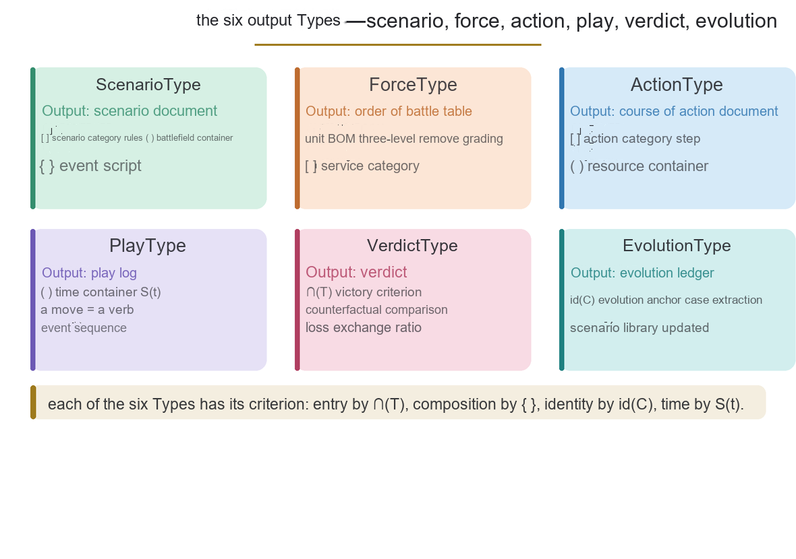  
>
> **Figure 2-1 The six output Types at a glance**  

**Table 2-1 Master table of the six output Types**

| **Output Type** | **Type** | **The question answered** | **deliverable** | **key criterion** |
| --- | --- | --- | --- | --- |
| **ScenarioType** | ScenarioType | where is the fight, under what conditions? | scenario document | T = (F(T), ∩(T)) entry |
| **ForceType** | ForceType | who fights? what are they made of? | order of battle table | BOM criterion + the three levels of remove |
| **ActionType** | ActionType | how is the fight fought? what are the rules? | course of action document | ROE compliance ∩(T) |
| **PlayType** | PlayType | what does it become? | play log | S(t+1) = g(S(t), move, event) |
| **Verdict Type** | VerdictType | who wins? on what grounds? | Verdict document | all victory criteria ∩(T) pass |
| **Evolution Type** | EvolutionType | what is learned? | Evolution ledger | id(C) anchoring + lessons booked |

> **six Types = six faces of a Type Set; a Unit Type = a Type Set = { components, (contents), [category] } - each output Type is a kind of Unit Type. Write all six in full and the play turns from "an activity" into "six projections of one reasonable replica".**  
>   
>   

### 2.2 ScenarioType - Writing the Battlefield as Rules

A scenario is not a story but a set of rules. A story may be vague; rules may not - because rules are what acceptance runs on. The ScenarioType writes the category rules first: F(T) lists the features required of an "air-defence counter-air scenario", and ∩(T) rules that all of them must pass for entry. What features? Intent, terrain and weather, time origin, escalation ladder - all four pass, and only then is it an air-defence counter-air scenario; miss one and it is background description, not a scenario.

Next, write the battlefield container. C = (id(C), S(C)): id(C) is the airspace and mission number, S(C) holds the endless stream of tracks and events. The axiom of invariance reads plainly here - tracks change batch after batch, but the responsibility area is still that responsibility area; if a play changes the mission number midway, what changed is not the contents but the identity, and a new version must be established.

Finally write the event script: harassment flight, probe, feint, electromagnetic suppression - a string of { } BOM. Each event passes the three levels of remove: drop the feint (non-essential) and the scenario still stands; drop the main attack event (essential) and the scenario is no longer this scenario.

> 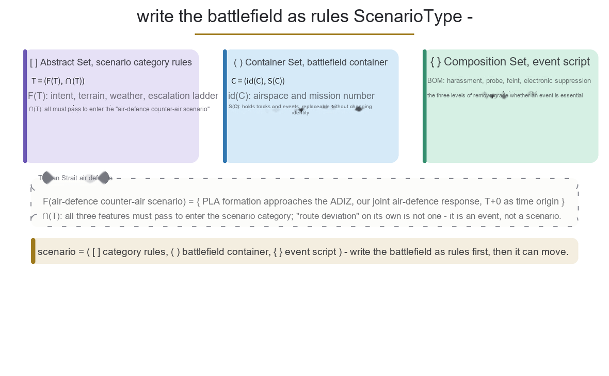  
>
> **Figure 2-2 The three brackets of the ScenarioType - rules, container, script**  

**Table 2-2 ScenarioType × Taiwan Strait air-defence counter-air - the three brackets**

| **Bracket** | **element** | **how the Taiwan Strait air-defence counter-air case is written** |
| --- | --- | --- |
| **[ ]** | category rules F(T) | F(T) = { PLA formation approaches the ADIZ, our joint air-defence response, T+0 as origin }; all ∩(T) must pass before it enters the scenario |
| **( )** | battlefield container C | id(C) = "Taiwan Strait air-defence responsibility area, west of the ADIZ"; S(C) holds track batches, replaceable without changing identity |
| **{ }** | event script BOM | harassment flight (essential), probe (essential), feint (non-essential), electromagnetic suppression (function-degraded) |

> **The full notation of the ScenarioType: scenario = ( [ ] category rules, ( ) battlefield container, { } event script ) - write the battlefield as rules first, then it can move and be judged.**  
>   

### 2.3 ForceType - Order of Battle and the Three Levels of remove

The order of battle (OOB) is the BOM of the force: open the units and see what they are made of. The BOM criterion asks "after it is taken away, does it still know itself" - take the fire-control radar out of an air-defence group and it is no longer an air-defence group, so the fire-control radar belongs in the BOM; peel the camouflage paint off the vehicle and it is still that vehicle, so the paint is only an accessory.

Once the components are listed, grade them with the three levels of remove: what loses identity when removed is an essential part; what loses function but keeps identity is a function-degraded part; what makes no difference either way is a non-essential part. One cut, and "important" turns from a matter of feeling into three statements that can each be verified.

> 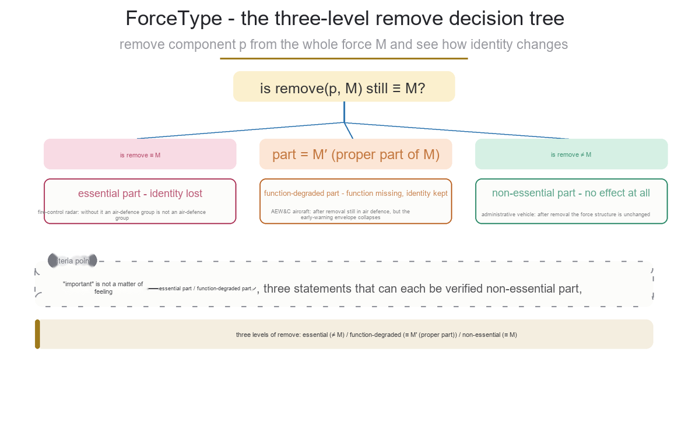  
>
> **Figure 2-3 The remove decision tree of the ForceType - three-level classification**  

**Table 2-3 ForceType × Taiwan Strait air-defence counter-air - remove grading of forces**

| **component p** | **the result of remove(p, M)** | **Grading** | **meaning during the play** |
| --- | --- | --- | --- |
| **fire-control radar** | ≢ M - the air-defence group is no longer an air-defence group | Essential part | the core of the force; a loss rewrites the force structure |
| **AEW&C aircraft** | ≡ M′ ⊂ M - still in air defence, but the early-warning envelope collapses | Function-degraded part | force degraded but the mission can continue - the play's compromise point |
| **administrative vehicle** | ≡ M - the force structure is completely unchanged | Non-essential part | does not enter the main play; may wait for a logistics scenario |

### 2.4 ActionType - Course of Action and Rules of Engagement

The course of action (COA) is the serialisation of moves: patrol, intercept, relocate, hold, engage - each is an action category [ ], each with its own ∩(T). "What counts as interception" must be defined first: station-holding, escort alongside, warning - all three features pass for entry; merely closing in is approach, not interception.

The steps of an action are a { } BOM, the resources of an action are a ( ) container - fuel, munitions and time sit in the mission resource pool; the sorties change again and again while the pool's identity and quota rules stay the same. The ROE is the compliance layer of ∩(T): ask "may we" first, then "is it worth it" - reverse the order and the verdict cannot be written.

> **Taiwan Strait air defence - ActionType starting point. Action categories [ ]: identify → warn → intercept and escort → manoeuvre to station → engage as circumstances require (the ROE ladder escalates step by step). remove grading: identify (essential), warn (essential), escort (function-degraded), flare release (non-essential).**  
>   
>   

### 2.5 PlayType - the Play Log and the Time Container

The output of the PlayType is the play log - not a running record but a re-runnable state sequence. Its notation: play log = ( time container ( ), event sequence { }, state function S(t) ). Each step forward, S(t+1) = g( S(t), move, event ): the battlefield state of the previous moment is pushed into the next by moves and events.

> 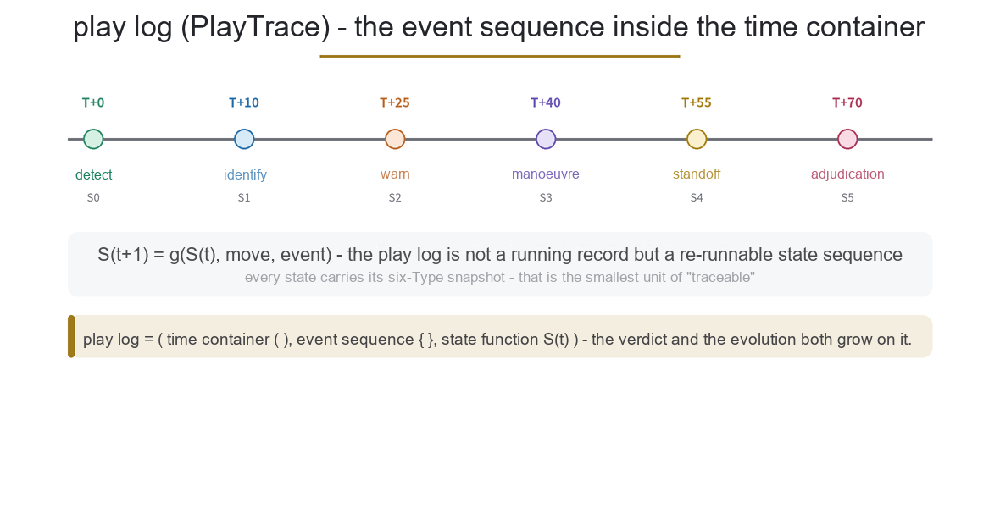  
>
> **Figure 2-4 The play log - event sequence and state advance inside the time container**  

**Table 2-4 The three-piece set of the PlayType**

| **component** | **notation** | **Acceptance point** |
| --- | --- | --- |
| **time container** | ( time axis id(play topic) ) | the time origin may not change mid-play; to change it, start a new log |
| **event sequence** | { detect, identify, warn, intercept, ... } | every event traces back to a move and a source |
| **state function** | S(t+1) = g( S(t), move, event ) | every step is re-runnable - same inputs, same states |

### 2.6 VerdictType - the Adjudication Funnel and Victory Criteria

The verdict is the output of the adjudication funnel. Four gates: rule compliance (check the ROE item by item), causal validity (trace the ruling back to the event chain), adversarial validity (run the red-team counterfactual), all criteria pass (test the ∩(T) victory conditions item by item). Only when all four pass does the verdict hold - if any gate jams, repair the output first; do not rush to declare the outcome.

> 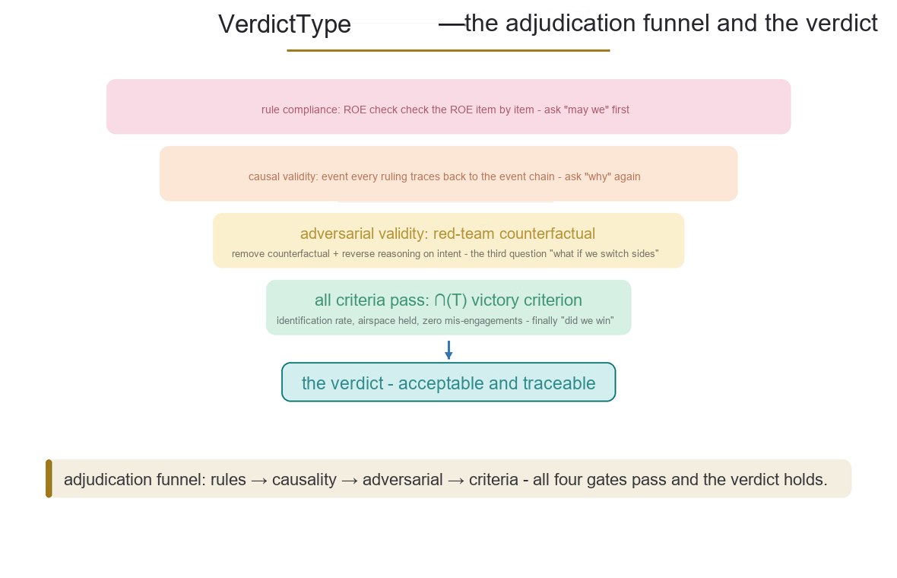  
>
> **Figure 2-5 The adjudication funnel of the VerdictType - all four gates pass, the verdict holds**  

**Table 2-5 VerdictType × Taiwan Strait air-defence counter-air - how victory criteria are written**

| **Criteria** | **the features of F(victory)** | **∩(T) test method** |
| --- | --- | --- |
| **air defence maintained** | airspace held, zero mis-engagements | airspace id(C) never lost, mis-engagements = 0 |
| **identification complete** | identification completion rate ≥ threshold | identification events ÷ incoming batches, checked batch by batch |
| **loss exchange** | the force structure is still sustainable | essential parts not all lost in remove; degraded parts replaceable |
| **rule compliance** | no ROE violation throughout | check every engagement event against the ROE ladder |

> **Set the criteria first, play afterwards. Victory criteria must be written before the play begins - criteria written afterwards are only a story.**  
>   

### 2.7 EvolutionType - the Evolution Ledger and After-Action Review

The play ends, but the lessons must not reset to zero. The output of the EvolutionType is the evolution ledger: evolution ledger = ( id(C) evolution anchor, lessons { } ). id(C) is the identity of the scenario library - however brutal the play, what changes is the content and the version, not "which scenario library this is"; lessons { } collects executable updates: which event script to tune, which grade to change, which criterion to tighten.

lands on the move tray; the EvolutionType is home turf for the three moves of the learning-and-evolution set: continuous learning settles lessons into the ledger, refactoring and recombination rewrite the scenario into a new version, and self-evolution lets the scenario library grow itself - when the next play starts, it is no longer the same as the last.

**Table 2-6 The three-piece set of the EvolutionType**

| **component** | **Content** | **evolution anchoring** |
| --- | --- | --- |
| **Identity anchor id(C)** | scenario library number, version number | a revision does not lose identity - the scenario library is still that scenario library |
| **lesson list** | identification chain delay, patrol-area positioning, ROE ladder | every lesson traces back to an event in the play log |
| **update order** | tune the event script, re-grade remove, tighten the criteria | after an update, run the three-layer judgement once |

> **six Types in a closed loop: scenario sets rules, force lists forces, action writes the plan, play shows the process, verdict delivers the ruling, evolution stores the lessons - the play books the ledger, the ledger feeds the scenario, and the loop grows round by round.**  
>   

## Chapter Three　Four-Layer Accuracy Assurance

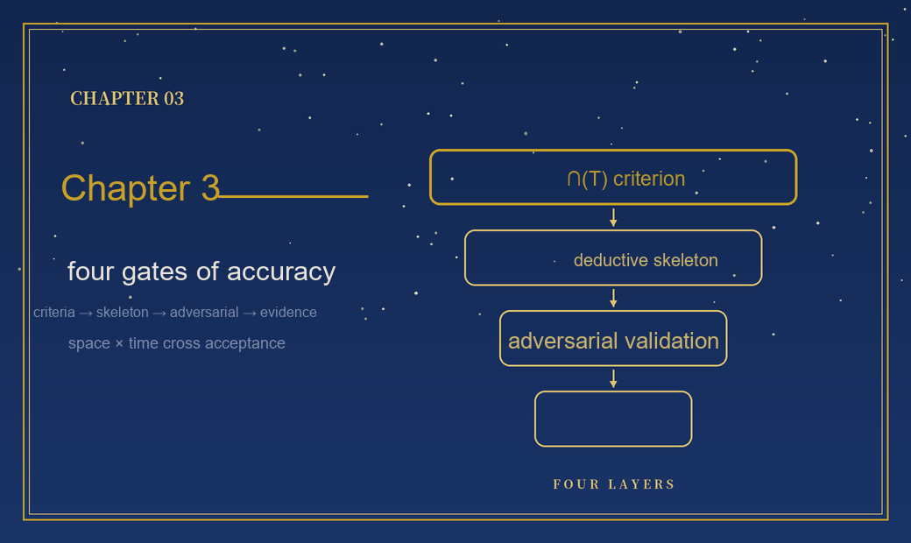

**"Accurate" is produced by acceptance, not by assertion. This chapter splits accuracy into four gates - criteria, skeleton, adversarial, evidence chain - each with a test that can be ticked off; finally it adds the cross acceptance of space and time. Only when all four pass does the output leave the room.**

### 3.1 Gate One - ∩(T) Criteria: Output Passes First

The first gate governs "does it fit the Type". Each of the six output Types has entry rules: the scenario must pass ∩(T) entry, the force must pass the BOM criterion and remove grading, the action must pass ROE compliance, the play log must pass state re-runnability, the verdict must pass the victory criteria, the evolution ledger must pass identity anchoring. Criteria are written before the output, not after the ruling - before leaving the room, ask: on what grounds is this output this Type?

Criteria are only accurate once tested against boundary cases. Does "route deviation" count as "harassment flight"? Does a "single-aircraft probe" count as a "strike package"? - test the boundary and the outline of the criterion becomes clear; a criterion that dares not face a boundary case is mostly a slogan.

> 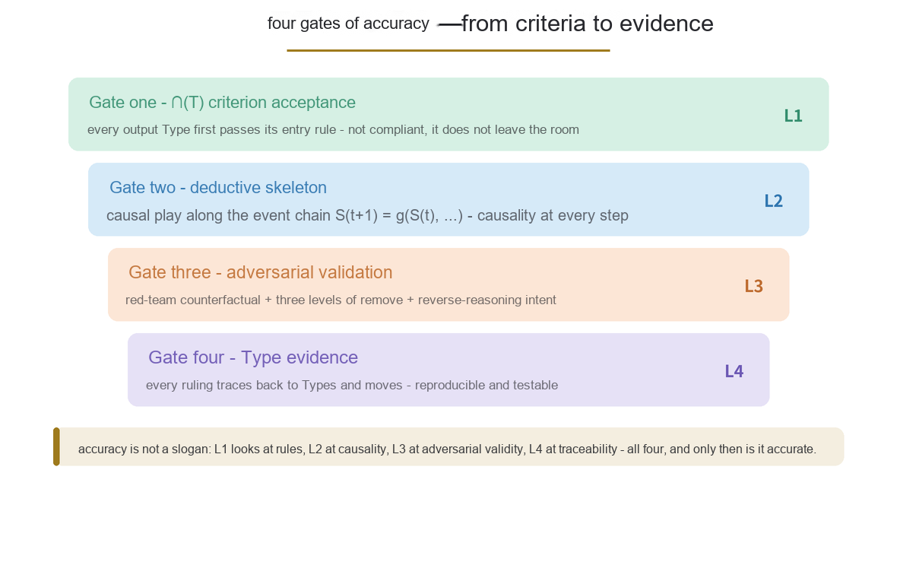  
>
> **Figure 3-1 The four gates of accuracy - from criteria to evidence chain**  

**Table 3-1 Master table of the four gates of accuracy**

| **Layer** | **what it guards** | **test method** | **when it fails** |
| --- | --- | --- | --- |
| **L1** | ∩(T) criteria - is the Type right | check the entry rules of the six Types item by item, test the criteria with boundary cases | output returned for revision, does not enter the play |
| **L2** | the deductive skeleton - does the causality run through | trace the event chain step by step; S(t) is re-runnable | fill the causal gap, re-run that section of the play |
| **L3** | adversarial validation - does it hold when you switch sides | red-team counterfactual + three levels of remove + ROE check | mark the weak point of the assumption and play one more round |
| **L4** | Type evidence chain - is the trace searchable | the verdict traces back item by item to Types and moves | add the missing link or lower the confidence of the conclusion |

### 3.2 Gate Two - the Deductive Skeleton: Causal Play Along the Event Chain

The second gate governs "does the reasoning run through". Every step of a play must stand on the causality of the previous step: detect → identify → warn → intercept → engage → assess, one event chain, with state advance S(t+1) = g( S(t), move, event ). The skeleton has one standard - the same inputs give the same states: re-runnable is reasoning; not re-runnable is improvisation.

> 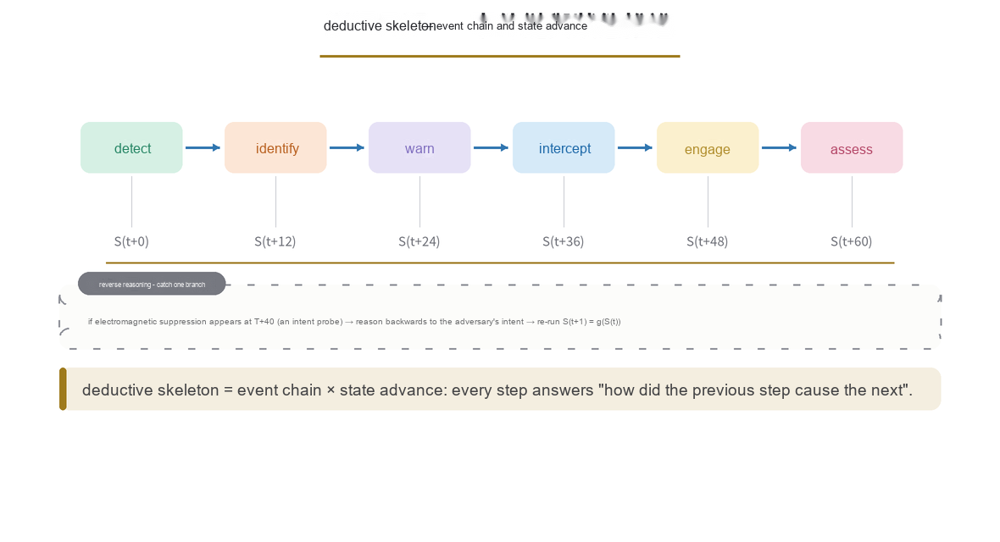  
>
> **Figure 3-2 The deductive skeleton - event chain and state advance**  

On the skeleton run the moves. The five moves of the analytical-reasoning set take turns here: causal reasoning works from cause to effect (what will this track do next), simulation reasoning plays the possible branches, statistical reasoning compares the frequency in historical cases, reverse reasoning works back from the result (what is the enemy's intent), and problem-solving and analysis break the deadlock open. Choose the right move and the skeleton walks steadily.

> **the proof view of the skeleton: the deductive skeleton writes "what should happen" as a re-runnable causal chain - every conclusion returns to its premises, and every premise carries a Type.**  
>   

### 3.3 Gate Three - Adversarial Validation: Red-Team Counterfactuals and Rule Checks

The third gate governs "has it been thought through from the other side". Playing against yourself, you always think you are right. Adversarial validation forces the output to face three challenges: the red team takes the enemy's viewpoint and plays it again (reverse thinking and level thinking are most useful here); remove counterfactuals - "what if there were no AEW&C", "what if the enemy adds electromagnetic suppression"; ROE compliance checks - be legal first, then talk about winning.

**Table 3-2 Adversarial validation checklist - tick off the three challenges one by one**

| **challenge** | **method** | **what to look at** |
| --- | --- | --- |
| **red team re-plays** | walk the event chain again from enemy intent (reverse reasoning) | does our judgement still hold under the enemy's optimum |
| **Counterfactual** | remove(component, M) replaced level by level and re-played | which component is the conclusion most sensitive to - mark the sensitive point |
| **rule check** | check every engagement event against the ROE ladder | if any one is non-compliant, the whole verdict section is returned |
| **statistical comparison** | compare the exchange ratio with similar historical plays | deviation beyond the threshold → go back and check the assumptions |

### 3.4 Gate Four - the Type Evidence Chain: Traceable Play

The fourth gate governs "can it be found". Every ruling must trace back link by link along the Types: verdict ← play log ← course of action ← order of battle ← scenario document - every link is a Type, every step carries its move and criterion result. Traced to the end, every sentence of the ruling has a source; a sentence whose source cannot be found should be deleted.

This is exactly the answer to the second question raised by the GE26 benchmark: how the black box is traced. The Type evidence chain is not a shackle for auditors but the basis of trust - without it, an AI play's conclusion can only ask others to "believe"; with it, the conclusion can be "reproduced" by anyone.

> **the three-column format of the evidence chain. Column one, Type ID: which Type this conclusion comes from (which scenario, which track, which event). Column two, move: which move the reasoning used (causal, reverse, simulation...). Column three, criterion result: the ∩(T) / remove / id(C) validation record at the time - a tick or a cross, both are kept.**  
>   
>   
>   

### 3.5 Space and Time Cross Acceptance

Finally cross the two Types for validation. The Space Type is the battlefield snapshot at each moment - property, composition and container, three axes; the Time Type is the causality between snapshots - moves pushing S(t) forward. Cross acceptance means: every cell of the space snapshot must match every beat of the time axis, and every change at a beat must find a landing point on the three axes.

> 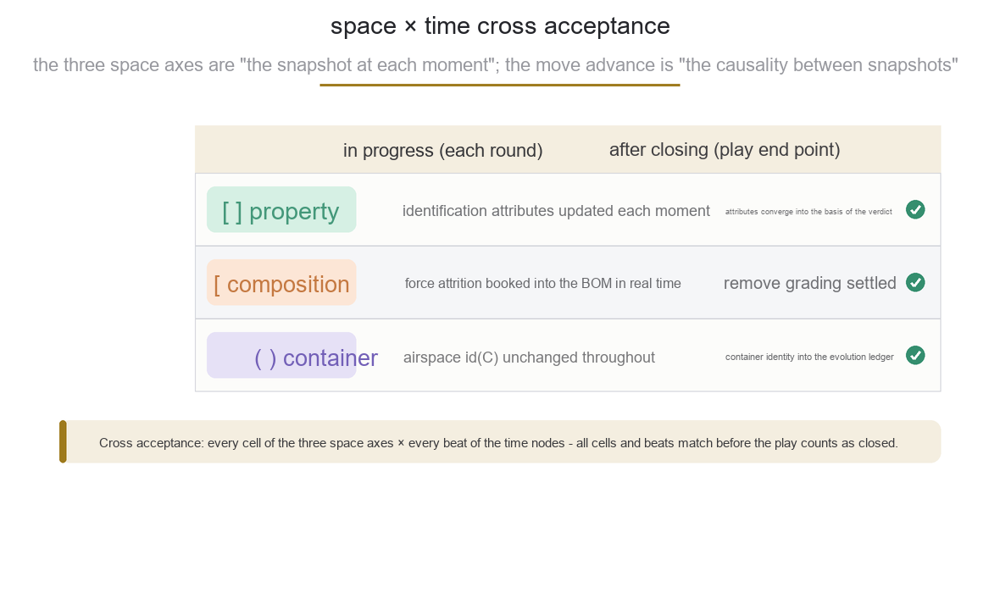  
>
> **Figure 3-3 Space × time cross acceptance**  

**Table 3-3 Cross-acceptance grid - every cell must match every beat before the play closes**

| **axis** | **in progress (each round)** | **after closing (play end point)** | **test method** |
| --- | --- | --- | --- |
| **[ ] Property** | identification attributes updated each moment | attributes converge into the basis of the verdict | every attribute change has an event source |
| **{ } Composition** | force attrition booked into the BOM in real time | remove grading settled | attrition and grading match item by item |
| **( ) Container** | airspace id(C) unchanged throughout | container identity written into the evolution ledger | id(C) matches before and after |

> **four gates in one sentence: L1 looks at rules, L2 at causality, L3 at adversarial validity, L4 at traceability - all four pass before anyone may say "this output is accurate".**  
>   

## Chapter 4 The Six Steps of Accurate Use

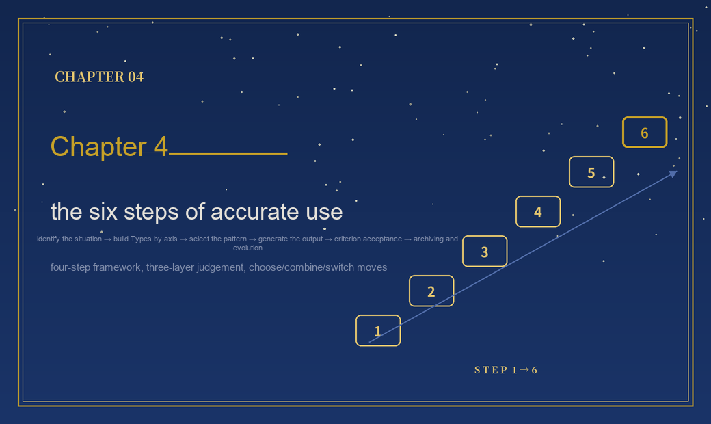

**A method must be copyable to be a method. This chapter condenses the Types and accuracy of the previous two chapters into a six-step operating flow - identify the situation, build Types by axis, select and expand the pattern, generate the output, criterion acceptance, archiving and evolution - each step with its entry conditions, actions and acceptance point.**

### 4.1 The Six Steps and the Four-Step Framework

The six steps are the main flow of a play; the four-step framework is the underlying action before Types are built - tell sameness from difference, trigger abstraction, name the dimension, decide membership. The relation: the four-step framework decides what the Type's skeleton looks like, the six steps decide how a play is walked through.

> 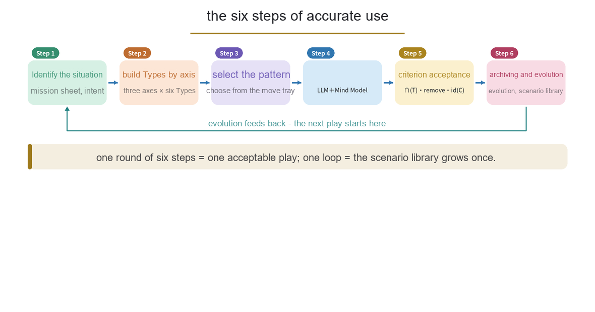  
>
> **Figure 4-1 The six steps - the complete loop of an acceptable play**  

**Table 4-1 Master table of the six steps**

| **Steps** | **entry condition** | **main action** | **Acceptance point** |
| --- | --- | --- | --- |
| **Step 1 Identify the situation** | mission sheet and intent complete | framework steps one and two: separate sameness, trigger abstraction | the situation is clear in one sentence |
| **Step 2 Build Types by axis** | situation established | framework steps three and four: name dimensions, assign membership; build the six Types | each of the six Types is its own Type |
| **Step 3 Select and expand the pattern** | the six-Type skeleton in hand | pick and combine moves from the tray | every Type gets its move |
| **Step 4 Generate the output** | move selected | LLM + Mind Model produce the six Types | output formed and readable |
| **Step 5 Criterion acceptance** | outputs complete | three-layer judgement + four gates of accuracy | all four gates pass |
| **Step 6 Archiving and evolution** | verdict holds | evolution ledger archived, scenario library updated | lessons booked, version chained |

> 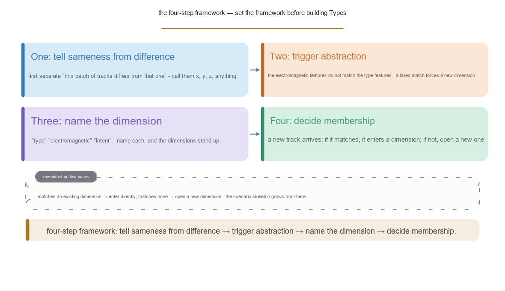  
>
> **Figure 4-2 The four-step framework - set the framework before building Types**  

### 4.2 Step 1-2 Identify the Situation, Build Types by Axis

Step 1 Identify the situation: read the mission sheet into a one-sentence intent, then use the first two steps of the four-step framework to separate sameness from difference - which track batches differ from which, and which differences have no existing dimension to sit on. The test for identifying a situation is crude but effective: can you explain in one sentence, to a layman, what this play is meant to prove.

Step 2 Build Types by axis: the last two framework steps name the dimensions and assign the new information, then the six Types start work - the ScenarioType sets the rules first, the ForceType does remove grading first, and the other four follow. The common mistake here is skipping the scenario and writing the action straight away: rules not yet set, plan already written - the order is inverted and everything is redone later.

> **Taiwan Strait air-defence counter-air - mission sheet starting point. Intent in one sentence: verify whether, in the situation "PLA formation approaches the ADIZ", the joint air-defence identification and interception flow can maintain airspace control within the ROE. Six-Type division: ScenarioType writes rules, ForceType writes the red and blue orders of battle, ActionType writes the ROE ladder, the remaining three are added after the play.**  
>   
>   

### 4.3 Step 3-4 Select and Expand the Pattern, Generate Output

Step 3 Select and expand the pattern: pick from the move tray. If the situation does not match an off-the-shelf move, combine or switch - a move is a verb, and verbs can be chained. Step 4 Generate the output: the LLM takes the language layer (make the Types read well, fill the tables), the Mind Model takes the reasoning layer (get causality, criteria and state advance right). The output must be readable - output written for people to read is output that can be accepted.

**Table 4-2 Move selection sheet - situation against move**

| **Situation** | **preferred move** | **backup move** |
| --- | --- | --- |
| **enemy intent unclear** | reverse reasoning (work back from the result) | simulation reasoning (play the branches) |
| **situation deadlocked** | problem-solving + analysis (break the deadlock) | level thinking (jump the frame) |
| **hard to tell which plan is better** | causal reasoning + statistical reasoning | design (create new tactics) |
| **identification repeatedly overturned** | search by Type and time function (find precedents) | design pattern (apply an identification pattern) |
| **the play's conclusion is counter-intuitive** | First-principles thinking | refactoring and recombination (reorder the event chain) |
| **output turns rigid after several rounds** | self-evolution + continuous learning | R&D and exploration (open a new branch) |

### 4.4 Step 5-6 Criterion Acceptance, Archiving and Evolution

Step 5 Criterion acceptance is where the book closes: pass the three-layer judgement layer by layer - the container judgement asks "is the airspace's identity independent of its contents", the BOM judgement asks "after taking the part away, is it still the same thing", the abstract judgement asks "does the new action enter this category" - then apply the overall acceptance of the four gates of accuracy. If acceptance fails, go back to the Type that has the problem; do not rewrite the book.

> 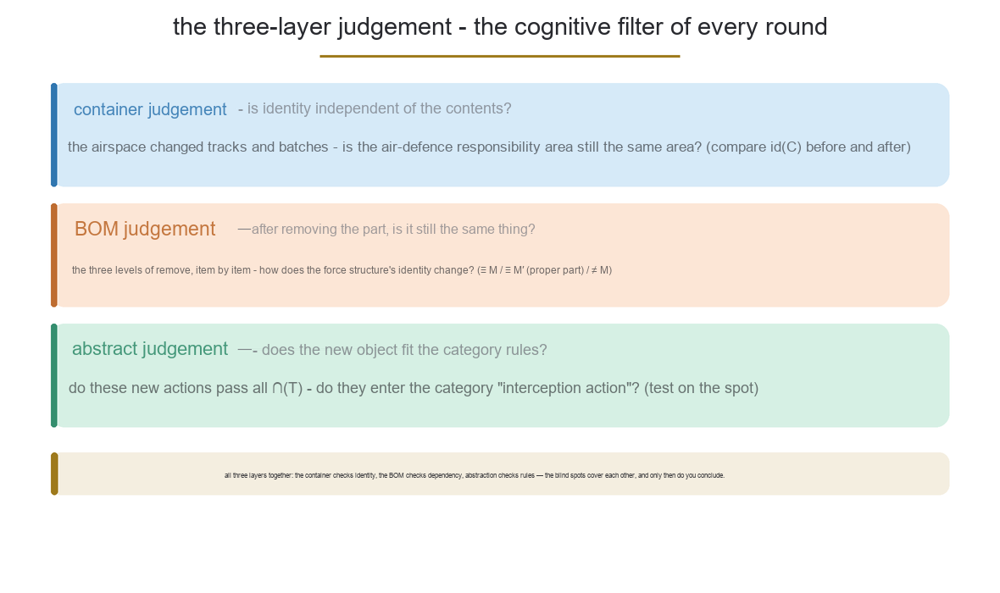  
>
> **Figure 4-3 The three-layer judgement - the cognitive filter of every round**  

Step 6 Archiving and evolution: once the verdict is settled, the evolution ledger registers three things - lessons, update orders, version number. Then back to Step 1: the foundation of the next play is this play's evolution ledger.

### 4.5 Choosing, Combining and Switching Moves

A move is not chosen once and kept to the end. During a play watch for three moments: choose at the start (pick the preferred move for the situation), combine at a deadlock (chain two or three moves to break the problem open), switch when a move fails (if three rounds of the same type of play bring nothing new, switch to the backup). Record switches in the play log - which move was swapped, why, and how the state moved afterwards are all part of the evidence chain.

**Table 4-3 Choosing, combining, switching - the actions at the three moments**

| **timing** | **symptom** | **Action** | **where it is recorded** |
| --- | --- | --- | --- |
| **Selecting moves** | new situation start | check Table 4-2 and enter with the preferred move | head of the play log |
| **Assembling moves** | stalemate, entangled causes | causal + reverse chained; problem-solving + design chained | play log event section |
| **Swapping moves** | three rounds with nothing new | switch to a backup move or open a new dimension (framework step four) | play log + evolution ledger |

> **the loop sentence of the six steps: one round of six steps = one acceptable play; one loop = the scenario library grows once.**  
>   

## Chapter 5 The S1-S7 Prompt Pipeline and a Worked Play

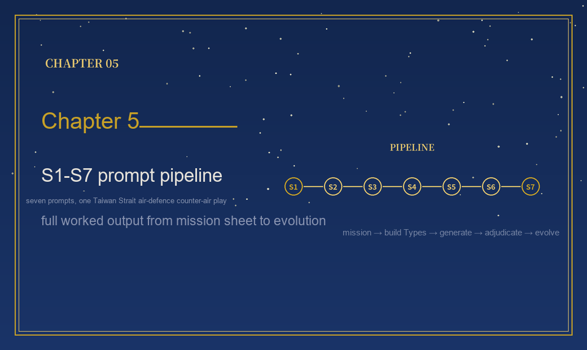

**This chapter fits the six steps into seven directly usable prompts, then uses the Taiwan Strait air-defence counter-air scenario to walk a play from mission sheet all the way to evolution ledger. The prompts can be copied and the worked outputs followed - but remember: every prompt carries its own criteria, and when output fails, it is the Type that changes, not the criterion.**

### 5.1 The Pipeline at a Glance - Seven Prompts

Seven prompts map to the seven nodes of a play: mission sheet, scenario, forces and actions, play execution, adjudication, evolution archiving, acceptance report. Each prompt fixes the same four things: the input Type, the moves used, the output Type, the acceptance criteria - the format is fixed so that output can be compared, verified and accumulated.

> 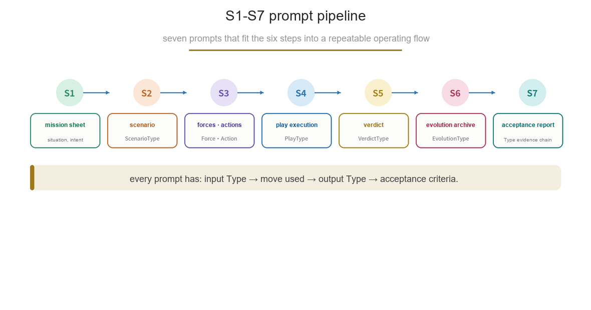  
>
> **Figure 5-1 The S1-S7 prompt pipeline**  

**Table 5-1 Master table of S1-S7**

| **Stage** | **Name** | **input Type** | **the Type of the output** | **Acceptance criteria** |
| --- | --- | --- | --- | --- |
| **S1** | play mission sheet | mission requirement | mission sheet | the situation is clear in one sentence |
| **S2** | scenario generation | mission sheet | ScenarioType | all ∩(T) pass + boundary cases decidable |
| **S3** | forces and actions | scenario document | order of battle table + course of action document | the three levels of remove complete + actions carry ∩(T) |
| **S4** | play execution | previous output | PlayType | re-runnable: same input, same state |
| **S5** | Ruling | play log | VerdictType | all four gates of the funnel pass |
| **S6** | evolution archiving | verdict + play log | EvolutionType | lessons traceable to events |
| **S7** | acceptance report | full six-Type file | acceptance report (Type evidence chain) | all four gates pass |

### 5.2 S1-S3 Mission Sheet, Scenario and Forces

S1 compresses the mission requirement into one mission sheet - intent in a sentence, scope settled in one breath, the six Types lined up in order. S2 generates the scenario document from the mission sheet: criteria first, boundary cases last. S3 works on forces and actions together: the order of battle gets remove grading, the course of action goes through the ROE ladder.

> **S1 play mission sheet prompt. You are the operations officer of the AI Wargame Brain. Compress the mission requirement into one "play mission sheet". Input: {mission requirement, scenario background, time window, own objectives}. Requirements: (1) write the intent in one sentence (what this play is meant to prove); (2) write the battlefield container id(C) (airspace / sea area / mission number) and the time origin T+0; (3) list the six-Type order of work: scenario → force → action → play → verdict → evolution; (4) write F(T): the category feature list of this scenario, for ∩(T) entry validation. Output: play mission sheet (within one page). Acceptance: the situation in one sentence, clear enough for a layman.**  
>   
>   
>   
>   
>   

> **S2 scenario document prompt. Based on the mission sheet, produce the "scenario document" (ScenarioType). Rules: (1) write F(T) item by item and put the ∩(T) criteria first - all features must pass before entering this scenario category; (2) battlefield container C = (id(C), S(C)): id(C) must not change throughout, S(C) lists what it holds (tracks, events, electromagnetic environment); (3) list the event script as a { } BOM, each event graded by the three levels of remove (essential / function-degraded / non-essential part); (4) append two boundary cases with readings, to test the criteria. Output: scenario document. Acceptance: all ∩(T) pass + boundary cases decidable.**  
>   
>   
>   
>   
>   
>   

> **S3 order of battle and course of action prompt. From the scenario document produce the "order of battle table" (ForceType) and the "course of action document" (ActionType). ForceType rules: open the BOM level by level down to units; tag every component with its remove grade and the reason. ActionType rules: give each action category [ ] its ∩(T) features item by item; order the steps as { }; mark the resource pool ( ) with its id; state the escalation conditions of the ROE ladder - compliance first, plan second. Output: order of battle table, course of action document. Acceptance: the three levels of remove complete + every action category has ∩(T).**  
>   
>   
>   
>   

With the three stages done, look at the first batch of output. Table 5-2 is the scenario document summary for the Taiwan Strait air-defence counter-air case - note how the criteria and boundary cases are written:

**Table 5-2 Worked output - scenario document (ScenarioType) summary**

| **Field** | **Content** |
| --- | --- |
| **scenario category** | air-defence counter-air scenario - all four ∩(T) features must pass for entry |
| **F(T)** | { PLA formation approaches the ADIZ, our joint air-defence response, T+0 as origin, escalation ladder tied to the ROE } |
| **battlefield container** | id(C) = "Taiwan Strait air-defence responsibility area, west of the ADIZ"; S(C) = track batches, electromagnetic environment, weather |
| **event script { }** | harassment flight (essential), probe (essential), electromagnetic suppression (function-degraded), feint (non-essential) |
| **boundary case** | single aircraft approaching → not a "formation", no entry, transfer to another scenario; deviation into the area → harassment, not a probe, event downgraded |

**Table 5-3 Worked output - order of battle table (ForceType) summary**

| **unit** | **Part** | **remove grading** | **play meaning** |
| --- | --- | --- | --- |
| **blue detection chain** | long-range early-warning radar, AEW&C aircraft, shipborne radar | radar essential, AEW&C degraded, shipborne non-essential | where identification capability comes from |
| **blue intercepting forces** | fighter patrol areas, surface-to-air missile batteries | all essential parts | the air-defence mainstay; one loss rewrites the force structure |
| **red strike package** | strike aircraft, escort aircraft, electronic-warfare aircraft | strike essential, escort essential, electronic warfare degraded | intent: probe the air-defence response |
| **support from both sides** | tankers, administrative vehicles | Non-essential part | does not enter the main play |

### 5.3 S4-S5 Play Execution and Adjudication

S4 opens the play. Rounds advance, one event and one state per round, every move tagged with its source - the quality of this stage decides whether adjudication can later pass the causal gate. S5 adjudicates through the four-gate funnel: what does not pass goes back to the corresponding Type for repair; never declare victory while carrying a fault.

> **S4 play execution prompt. Expand the play log (PlayType) as "rounds advance". (1) Write the event and the state each round: S(t+1) = g( S(t), move, event ), naming the move used that round (one of the fourteen moves of the Time Type); (2) events must be traceable: tag every event with its source Type (which track, which order); (3) when deadlocked, combine moves (e.g. causal plus reverse together), and record the reason for switching; (4) continue until the end condition holds or the round limit is reached. Output: play log. Acceptance: re-runnable - the same set of inputs gives the same set of states.**  
>   
>   
>   
>   
>   
>   

> **S5 adjudication prompt. From the play log produce the "verdict" (VerdictType), through the four gates of the adjudication funnel: rule compliance (check the ROE item by item) → causal validity (trace the event chain) → adversarial validity (red-team counterfactual + remove counterfactual) → all criteria pass (∩(T) victory criteria). Write pass / fail and the reason at every gate; if any gate fails, send the output back for revision. The verdict must carry the loss-exchange ratio and a confidence note. Output: verdict. Acceptance: all four gates pass + the victory criteria were set before the play began.**  
>   
>   
>   
>   
>   

> 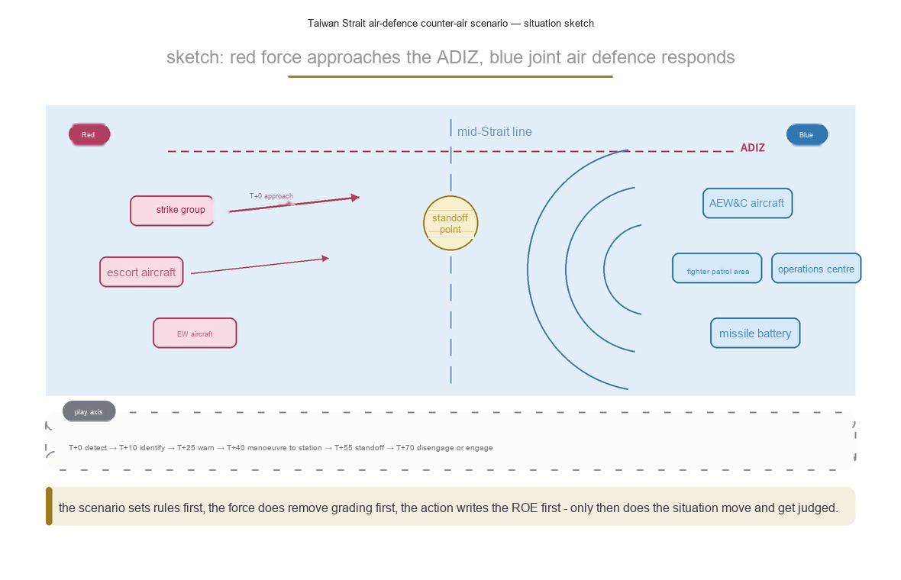  
>
> **Figure 5-2 Taiwan Strait air-defence counter-air - situation sketch**  

**Table 5-4 Worked output - course of action document (ActionType) summary**

| **action category** | **∩(T) features** | **the ROE ladder** |
| --- | --- | --- |
| **identify** | track confirmation + type discrimination + initial intent judgement: all three pass to count as identification | level 0: passive surveillance |
| **warn** | broadcast warning + record keeping + heading monitoring | level 1: communications warning |
| **intercept and escort** | station-holding + escort alongside + coercive heading: all three must pass to enter the category | level 2: intercept |
| **engagement** | escalation conditions met + commander approval; missing either, no entry | level 3: engagement (highest, approval required) |

**Table 5-5 Worked output - play log (PlayType) summary**

| **moment** | **event** | **state S(t)** | **Move** |
| --- | --- | --- | --- |
| **T+0** | 12 track batches approach the ADIZ | S0: 12 unknown track batches | statistical reasoning (compare with the norm) |
| **T+10** | 8 batches identified, 1 formation forms | S1: one strike package | reverse reasoning (judge intent) |
| **T+25** | broadcast a warning and monitor the heading | S2: standoff escalates | causal reasoning (derive the next step) |
| **T+40** | intercepting forces manoeuvre to station | S3: intercept complete | simulation reasoning (play the branches) |
| **T+55** | enemy formation turns away | S4: disengagement tendency clear | reverse reasoning (infer the intent) |
| **T+70** | end condition holds, handed to adjudication | S5: airspace held | problem-solving (assess the end state) |

**Table 5-6 Worked output - verdict (VerdictType) summary**

| **adjudication funnel** | **Result** | **Reason** |
| --- | --- | --- |
| **rule compliance** | Pass | zero engagements throughout, ROE ladder not violated |
| **causal validity** | Pass | six-event chain complete, every step's move traceable |
| **adversarial validity** | Pass | red-team counterfactual three rounds (add electronic warfare, change heading, feint turns into main attack) - conclusion unchanged |
| **all criteria pass** | Pass | identification completion 100%, airspace held, zero mis-engagements - all ∩(T) pass |
| **verdict** | holds | air defence maintained; loss exchange 0:0; confidence: high (evidence chain complete) |

### 5.4 S6-S7 Evolution Archiving and Acceptance Report

S6 writes the lessons into the evolution ledger - id(C) anchors identity, and every lesson traces back to an event. S7 assembles the six Types into an acceptance report: tick the four gates of accuracy one by one, check the cross-acceptance grid cell by cell, attach the three columns of the evidence chain - only when all four gates pass may this play be closed.

> **S6 evolution archiving prompt. From the verdict and the play log produce the "evolution ledger" (EvolutionType): (1) id(C) anchoring: scenario-library number and version - a revision does not lose identity; (2) lessons { }: write "traced event → lesson → update order" item by item; (3) update orders enter the library only after passing the three-layer judgement. Output: evolution ledger. Acceptance: every lesson traces back to an event in the play log.**  
>   
>   
>   
>   
>   

> **S7 acceptance report prompt. Assemble the six Types into the "acceptance report" (Type evidence chain): (1) tick the four gates of accuracy one by one: ∩(T) criteria / deductive skeleton / adversarial validation / Type evidence chain; (2) match the cross-acceptance grid cell by cell: the three space axes × the time nodes; (3) attach the three columns of the evidence chain: Type ID, move, criterion result; (4) list unpassed items in a "return list", naming which Type to repair. Output: acceptance report. Acceptance: all four gates pass before the case may be closed.**  
>   
>   
>   
>   
>   
>   

**Table 5-7 Worked output - evolution ledger (EvolutionType) summary**

| **lesson** | **traced event** | **update order (move)** |
| --- | --- | --- |
| **identification chain delay about 4 minutes** | T+0 → T+10 identification | add a second identification source (refactoring and recombination) |
| **patrol area positioned too far south** | T+40 station-holding | adjust the patrol-area lead (continuous learning) |
| **the ROE escalation tempo is slightly slow** | T+55 standoff | tighten the escalation threshold (self-evolution) |

### 5.5 Taiwan Strait Air Defence Counter-Air - Full Worked Example

Read the seven stages as one line: S1 the mission sheet sets "verify whether joint air defence can maintain airspace control within the ROE"; S2 the scenario document uses ∩(T) to set rules and id(C) to anchor the responsibility area; S3 the order of battle lists the fire-control radar as essential and the AEW&C aircraft as function-degraded, and the course of action locks engagement at ROE level 3; S4 the play log runs six rounds to the end condition; S5 the verdict passes all four gates and rules "air defence maintained"; S6 three lessons enter the evolution ledger; S7 the acceptance report ticks all four gates and closes the case.

> **written end to end - the output chain of one play: mission sheet → scenario document (rules set) → order of battle table (force grading) → course of action document (ROE ladder) → play log (six rounds of state advance) → verdict (four-gate funnel) → evolution ledger (three lessons) → acceptance report (all four gates). Every arrow on the chain is "one Type handed to the next"; at every handover stands a criterion - this chain is the Type evidence chain.**  
>   
>   
>   

> **one play, all six Types: with the Taiwan Strait air-defence counter-air round complete, what grows is not only a verdict but a scenario library smarter than yesterday's.**  
>   

## Chapter 6 Misuses, Checks and Maturity

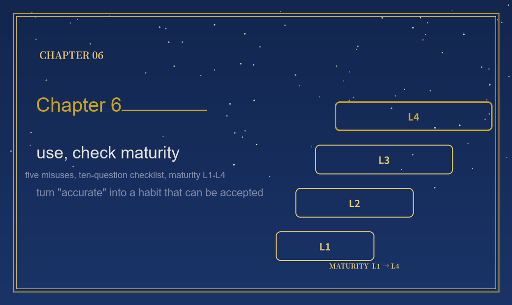

**The method is given; the last chapter governs using it correctly. Each of the five misuses has a criterion that stops it; the ten questions let anyone check an output in three minutes; maturity L1-L4 tells a team where it stands and where to go next.**

### 6.1 Five Misuses

Misuse is not frightening; not being able to accept is. Five common misuses - numbers without a Type, flattened brackets, identity drift, play without verdict, evolution amnesia - each has clear symptoms and a remedy; the earlier they are found, the less rework.

> 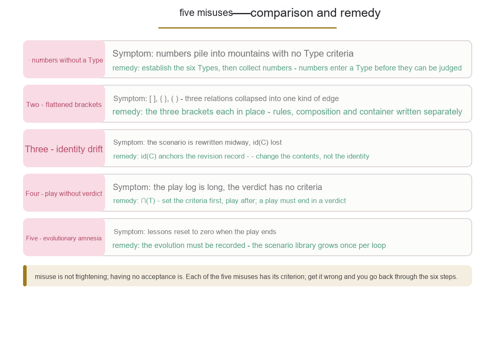  
>
> **Figure 6-1 Five misuses - symptoms and remedies**  

**Table 6-1 Misuse comparison table**

| **Misuse** | **Symptom** | **remedy** | **which step to return to** |
| --- | --- | --- | --- |
| **numbers without a Type** | reports pile up as numbers with no Type criteria | establish the six Types before collecting numbers - numbers enter a Type before they can be judged | Step 2 |
| **brackets flattened** | [ ], { }, ( ) - three relations drawn as one kind of edge | write rules, composition and container separately, each with its own criteria | Step 2 |
| **identity drift** | the scenario is rewritten midway, id(C) is lost | id(C) anchors the revision record - the contents change, the identity does not | Step 1／S2 |
| **play without verdict** | the play log is long and the verdict has no criteria | victory criteria set before the play - a play must end in a verdict | Step 5／S5 |
| **evolution amnesia** | lessons reset to zero when the play ends | the evolution ledger must be kept - the scenario library grows once per loop | Step 6／S6 |

### 6.2 The Ten-Question Checklist

Take any piece of AI wargame output - your own, someone else's, last round's - and run the ten questions over it. Three minutes; all pass and you continue, one jammed and you stop at that one.

**Table 6-2 The ten-question checklist**

| **#** | **what to ask** | **where to look** |
| --- | --- | --- |
| **1** | Is F(T) written? Are the ∩(T) criteria set? | head of the scenario document |
| **2** | has the criterion been tested with a boundary case? | tail of the scenario document |
| **3** | Is id(C) consistent throughout? Is a mid-way revision recorded? | container field at the head of every Type page |
| **4** | has every component passed the three levels of remove? | order of battle table |
| **5** | does every action category have ∩(T)? | course of action document |
| **6** | is every event tagged with its move and source Type? | play log |
| **7** | Is S(t) re-runnable? Same input, same state? | take a section of the play log and re-run it |
| **8** | do all four gates of the adjudication funnel have pass records? | Verdict document |
| **9** | can every lesson be traced back to an event? | Evolution ledger |
| **10** | are all four gates ticked? Is the evidence chain searchable? | acceptance report |

### 6.3 Maturity L1-L4

Maturity is not a medal but a signpost. L1 Type description - the six Types can be written; L2 criterion acceptance - ∩(T), id(C) and remove are executed in practice; L3 adversarial play - red-blue confrontation and counterfactuals pass; L4 self-evolution - the evolution ledger drives the growth of the scenario library. Every level has an acceptable threshold, and which level you stand on is judged by evidence, not by declaration.

> 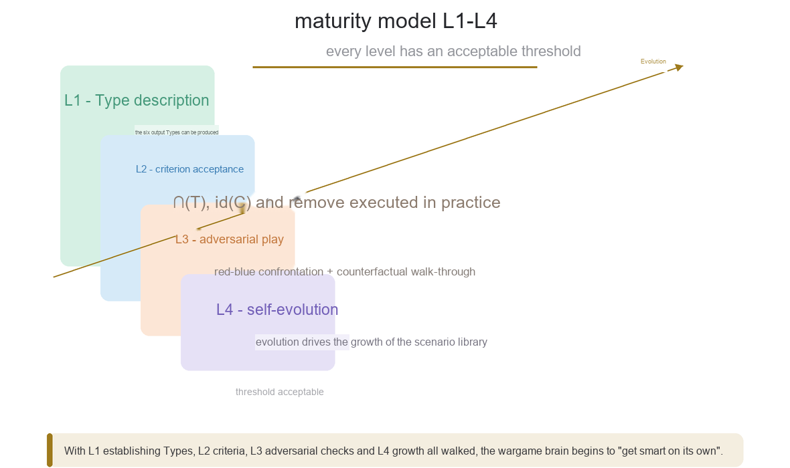  
>
> **Figure 6-2 Maturity L1–L4**  

**Table 6-3 Maturity thresholds**

| **level** | **pass line** | **acceptance evidence** |
| --- | --- | --- |
| **L1** | all six output Types written in full and written true | a complete six-Type play file |
| **L2** | all criteria landed - entry, grading and anchoring each recorded | all ten questions pass |
| **L3** | at least three red-team counterfactual rounds, conclusion robust | adversarial validation checklist + counterfactual record |
| **L4** | the evolution ledger drives scenario-library version growth over successive rounds | version chain + lesson trace-back rate |

## Review - one play in one sentence

**One full round through the book closes into three sentences.**

First sentence: the Types hold. Each of the six output Types does its job - scenario sets rules, force lists forces, action writes the plan, play shows the process, verdict delivers the ruling, evolution stores the lessons - and with the three brackets, the criteria and the anchoring each in place, the battlefield becomes a reasonable replica.

Second sentence: accuracy can be tested. The four gates - ∩(T) criteria, deductive skeleton, adversarial validation, Type evidence chain - can each be ticked, and only then is "accurate" the result of acceptance rather than a promotional adjective.

Third sentence: the ledger grows. The six steps go round and round, the evolution ledger page after page - the scenario library grows once per loop, and the AI Wargame Brain understands a little more of the battlefield than it did yesterday.

> 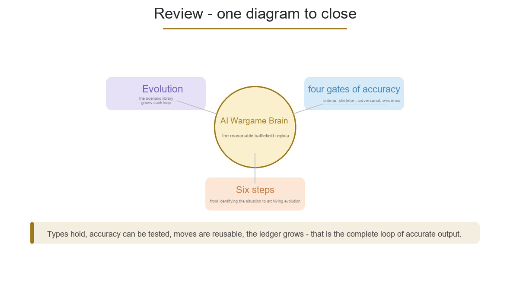  
>
> **Figure R-1 One diagram to close - the complete loop of Types, accuracy, moves and ledger**  

**Table R-1 Overall book checklist**

| **Chapter** | **closing** | **One sentence** |
| --- | --- | --- |
| **Chapter 1** | positioning and benchmark | GE26 put AI in the player's seat - this approach hands it a measuring stick |
| **Chapter 2** | the six output Types | one Type, one question, one output; every Type carries its own criteria |
| **Chapter 3** | four gates of accuracy | rules, causality, adversarial, traceability - all four pass to be called accurate |
| **Chapter 4** | six steps | one round of six steps = one acceptable play |
| **Chapter 5** | seven prompts | input Type, moves used, output Type, acceptance criteria |
| **Chapter 6** | checks and maturity | ten questions in three minutes; L1-L4 by evidence |

> **Last sentence: the "accuracy" of the AI Wargame Brain lies not in how large the model is but in how firmly the Types stand, how diligently the criteria are tested, and how honestly the evolution ledger is kept.**  
>   

## Appendix A Quick Reference: Terms, Moves, Notation

**Table A-1 Terminology quick reference**

| **Terminology** | **English** | **In one sentence** |
| --- | --- | --- |
| **Type** | Type | an output unit carrying rules, composition and identity - not Form |
| **ScenarioType** | ScenarioType | battlefield as rules: category rules + container + event script |
| **ForceType** | ForceType | the BOM and remove grading of the order of battle |
| **ActionType** | ActionType | course of action + ROE ladder |
| **PlayType** | PlayType | play log: time container + event sequence + state function |
| **Verdict Type** | VerdictType | the output of the four-gate adjudication funnel |
| **Evolution Type** | EvolutionType | evolution ledger: identity anchor + lesson list |
| **Three brackets** | Three Brackets | [ ] abstract, { } composition, ( ) container |
| **Intersection criterion** | ∩(T) | the acceptance rule that all features must pass for entry |
| **identity** | id(C) | a container marker that does not change with its contents |
| **Three levels of remove** | remove levels | Essential / function-degraded / non-essential part |
| **play log** | Trace | a re-runnable state sequence S(t) |
| **Evolution ledger** | EvolutionLog | archiving of lessons and update orders |
| **Move set** | Motion Board | master table of the four sets and fourteen moves of the Time Type |
| **Type evidence chain** | Type Evidence Chain | the verdict traces back to Types and moves |

**Table A-2 The fourteen moves of the Time Type × where they land in wargaming**

| **Set** | **Move** | **lands in wargaming** |
| --- | --- | --- |
| **Search and extraction** | Type-time function search | search the scenario library and historical cases for a similar play |
| **Search and extraction** | Design search and extraction | extract case patterns, organise enemy behaviour patterns |
| **Search and extraction** | Design patterns | apply a play script pattern (identification flow, interception pattern) |
| **generative application** | Logic generation and application | generate verdict rules and ROE logic |
| **generative application** | Function generation and application | generate the course of action (parameterised COA) |
| **generative application** | R&D and exploration | exploring new tactics, probing out-of-scope scenarios |
| **analytical reasoning** | Problem solving | breaking down a deadlocked situation |
| **analytical reasoning** | Analysis | force comparison, loss analysis |
| **analytical reasoning** | Design (creation and innovation) | innovative tactics, new action categories |
| **analytical reasoning** | reasoning (causal, reverse, ...) | advance the event chain, infer enemy intent, play branches, compare with historical cases |
| **analytical reasoning** | thinking methods (reverse, level, ...) | red-team viewpoint, out-of-frame scenarios, first-principles restatement |
| **learning and evolution** | Continuous learning | lessons settle into the evolution ledger |
| **learning and evolution** | Refactoring and recombination | scenario revision, event chain reordering |
| **learning and evolution** | Self-evolution | the scenario library grows itself, the criteria tighten automatically |

**Table A-3 Notation quick reference**

| **Notation** | **Read as** | **Meaning** |
| --- | --- | --- |
| **T = (F(T), ∩(T))** | category tuple | feature set + intersection criterion; all must pass for entry |
| **∩(T)** | Intersection criterion | only when ∀ features pass does the object belong to T |
| **C = (id(C), S(C))** | container tuple | Identity + internal space |
| **id(C)** | container identity | does not change as the contents change |
| **remove(p, M)** | removal criterion | the identity of the whole M after removing component p |
| **≢** **M／≡ M′ ⊂ M／≡ M** | three-level result | Essential / function-degraded / non-essential part |
| **S(t+1) = g(S(t), move, event)** | state advance | the advance function of the play log |
| **[ ]**　**{ }**　**( )** | Three brackets | three kinds of set: abstract, composition, container |
| **L1–L4** | four gates / four levels | four gates of accuracy; four maturity levels |

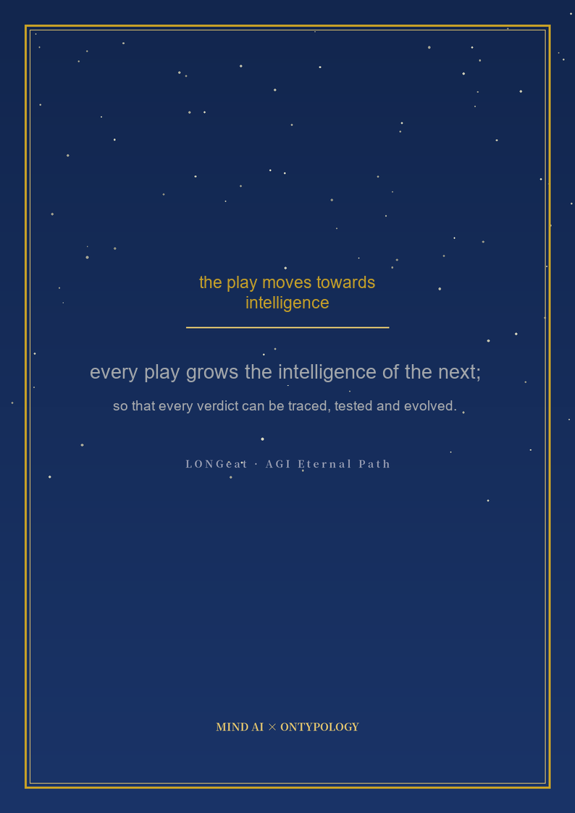
