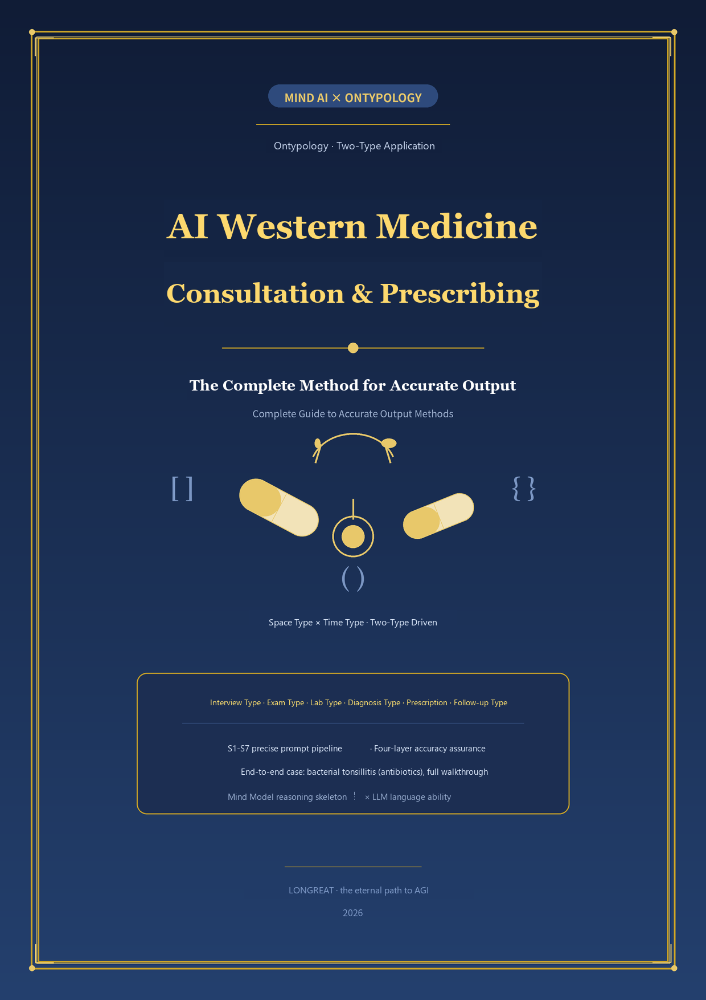

## CONTENTS

- **Before We Begin: Three Conventions** **3**
- **Introduction: Two Languages, One Stack of Outputs** **4**
- **Chapter 1 Getting to Know AI Western-Medicine Consultation and Prescribing** **5**
- 1.1 A Medical Replica That Can Be Reasoned 5
- 1.2 Type + Number: the Two Materials of a Record 5
- 1.3 How the Two Types Land in Consultation and Prescribing 6
- 1.4 The Mind AI Division of Labour at the Base　 7
- 1.5 Where “Accuracy” Comes From 7
- **Chapter 2 The Six Output Types** **9**
- 2.1 The Six Types at a Glance: One Care Pipeline 9
- 2.2 InterviewType, ExamType, LabType: Turning “What Was Heard” into “Structure” 10
- 2.3 DiagnosisType: Differential Is a Funnel, Not Guesswork 10
- 2.4 Prescription: One Prescription Slip Is One BOM 11
- 2.5 FollowType: the Course Is a Container, a Return Visit Is the Next Page 12
- **Chapter 3 Four-Layer Accuracy Assurance** **14**
- 3.1 Layer One · Criterion Funnel ∩(T) 14
- 3.2 Layer Two · Deductive Skeleton 15
- 3.3 Layer Three · Prescription Review 15
- 3.4 Layer Four · Type Evidence Chain 16
- 3.5 Space × Time Cross Acceptance 17
- **Chapter 4 Using It Accurately · the Six Steps** **18**
- 4.1 The Four-Step Framework: Identify the Situation First 18
- 4.2 The Six Steps End to End 18
- 4.3 Three-Layer Judgement: Is · Has · Right 19
- 4.4 Selecting · Assembling · Swapping Moves 20
- **Chapter 5 The S1–S7 Prompts and the Full Case** **22**
- 5.1 Pipeline Design: A Seven-Stage Relay 22
- 5.2 The Full Text of the Seven Prompts 23
- 5.3 Full Case Output 24
- 5.4 Prescription Slip and Review Report 25
- 5.5 Follow-Up Dose Adjustment and Common Errors 26
- **Chapter 6 Misuses, Checks, Maturity** **28**
- 6.1 Five Misuses 28
- 6.2 A Ten-Question Checklist 29
- 6.3 Maturity L1–L4 29
- **Review and Close** **30**
- **Appendix A Quick Reference: Terms, Moves, Notation** **32**
- A.1 Terminology Quick Reference 32
- A.2 The Time Type Move Tray × Where It Lands in Consultation and Prescribing 32
- A.3 Notation Quick Reference 33

# Before We Begin: Three Conventions

This is a “how to use it” book. It answers one question only: how, with the two Types of Ontypology — the Space Type and the Time Type — as the theoretical basis and Mind AI as the underlying platform, to make every output of AI Western-medicine consultation and prescribing accurate, checkable and traceable.

Before the main topic, three conventions. They run through the whole book and apply to every page.

> **The Three Conventions of This Book**  
> Convention one · Type. The Chinese 形 is rendered as Type, not Form. Compound terms such as SpecType and DiagnosisType always end in Type.  
> Convention two · use the theory, do not teach it. This book does not restate the principles of Ontypology (Space Type and Time Type); it only shows how to use them: the three brackets, the intersection criterion, the identity anchor, the three levels of remove, the four-step framework and the Time-Type move tray are all tools taken up and used as they are.  
> Convention three · cite the platform, do not restate it. This book does not restate the Mind AI platform itself; it cites it only where needed: the Mind Model provides the reasoning skeleton, the LLM provides language ability, and the two carry all output at the base.  

> Disclaimer (1): This book is a methodological demonstration of AI-assisted consultation and prescribing. All cases, drugs, doses and usages are format demonstrations of output and do not constitute medical advice; for actual diagnosis, treatment and medication, follow the instructions of a qualified physician and local drug regulations.  

This book is written output-first: every chapter answers “what to produce, how to produce it, how to accept it”. Readers can move each chapter’s output Types, criteria and prompts straight into their own clinical process and then adjust them to their specialty and regulations.

**Table 0-1 Task map: where to find the output you need**

| **What you want to do** | **Which chapter** | **The output you will get** |
| --- | --- | --- |
| Understand how the system is positioned | Chapter 1 (knowing the system) | The medical replica that can be reasoned, where the two Types land, the four questions of accuracy |
| Know what has to be produced | Chapter 2 (output Types) | Specifications of the six output Types and the prescription BOM |
| Know how accuracy is assured | Chapter 3 (accuracy assurance) | Four layers of accuracy: criteria, skeleton, review, evidence chain |
| Walk through one complete encounter | Chapter 4 (six steps) | The six-step method and the three-layer judgement |
| Get the prompts and examples in hand | Chapter 5 (prompts and case) | The full S1–S7 text + the complete bacterial tonsillitis output |
| Avoid common errors, assess maturity | Chapter 6 (misuses and checks) | Misuse comparison, ten questions, L1–L4 |

# Introduction: Two Languages, One Stack of Outputs

Before we start, one diagram and two tables lay out the terrain of the whole book: what each of the two languages of Ontypology governs, what they look like when they land on Western-medicine consultation and prescribing, and the three ways to read this book.

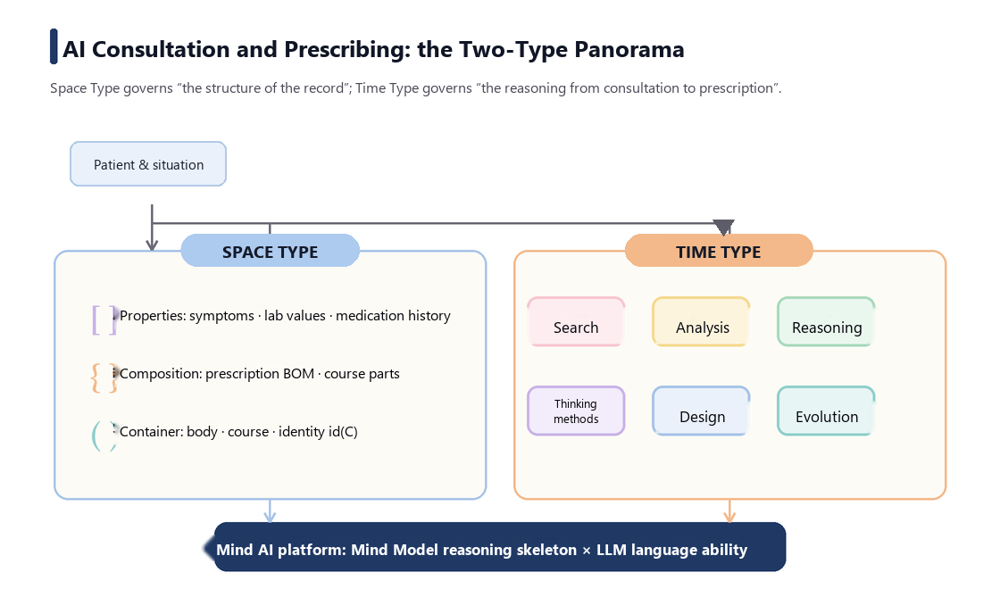

Figure D-1 The Two-Type panorama: the Space Type governs structure, the Time Type governs reasoning, Mind AI carries both at the base

**Table D-1 The two languages compared: Ontypology tools × where they land in consultation and prescribing**

| **Ontypology tool** | **The question it answers** | **Where it lands in consultation and prescribing** |
| --- | --- | --- |
| [ ] Property set (abstract) | What kind of thing is this | Fielding of symptoms, lab values and medication history |
| { } Composition set (BOM) | What is it made of | Prescription BOM: drug · dose · route · frequency · days |
| ( ) Container set (spatial container) | What is it inside | Body, course time, patient identity id(C) |
| ∩(T) Intersection criterion | What counts as valid | Differential funnel, medication condition criteria |
| remove, three levels | What happens if a part is removed | Three-level consequences of removing education / the primary drug / the days |
| The four-step framework | How the situation is identified | Building the situation Type for emergency, outpatient and chronic disease |
| The Time-Type move tray | Which move this step uses | Search · analysis · reasoning · design · evolution moves |
| Three-layer judgement | Is · has · right | Three-layer clearance: recognise the disease, assemble the prescription, check the drug |

**Table D-2 Three ways to read: open the book by your role**

| **Reading path** | **Who it suits** | **How to read** |
| --- | --- | --- |
| The quick read | Decision-makers who want to know what AI can do | Read Chapter 1 (knowing the system) and the maturity section of Chapter 6 (misuses and checks), about 15 minutes |
| The do-it version | Clinical teams that will actually adopt it | Work through Chapter 4 (six steps) and follow the full S1–S7 text in Chapter 5 (prompts and case) step by step |
| The audit version | Those responsible for quality and compliance | Accept item by item with the four layers of Chapter 3 (accuracy assurance) plus the ten-question checklist of Chapter 6 |

> Remember one thing before reading on: every output in this book obeys the same iron rule — write the criteria first, then look at the data; have the Type first, then the Number. Reverse the order and every accuracy assurance downstream fails.  

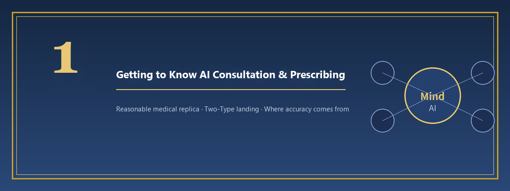

# Chapter 1 Getting to Know AI Western-Medicine Consultation and Prescribing

Treating “AI consultation and prescribing” as a chatbot Q&A is where most failure stories begin. This chapter repositions it first: AI Western-medicine consultation and prescribing is not a Q&A, it is the maintenance of a medical replica that can be reasoned — and all accuracy grows out of this positioning.

## 1.1 A Medical Replica That Can Be Reasoned

The value of a record is not that it is “written down” but that it can be “used”. Paper-record thinking writes symptoms as prose, stores diagnoses as impressions and scatters prescriptions across slips; at the return visit everything is asked again, so every encounter starts over in mid-air. A Type-structure replica puts every item where it can be computed: a symptom is a property, a diagnosis has criteria, a prescription has a composition, a return visit is the next page.

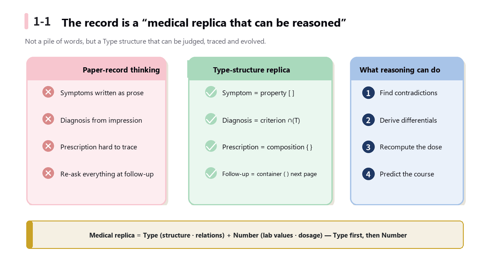

Figure 1-1 From paper record to a replica that can be reasoned: the left can only be read, the right can be reasoned

This replica has to answer four kinds of question: is there a contradiction between data items (for example, self-reported “no allergy” while taking an antihistamine); what can be derived from the available evidence (the differential diagnosis); what happens if one component is removed (a stop-the-drug simulation); and what should be looked at next time (follow-up design). Only when it can answer these four does it deserve the name “reasonable”.

## 1.2 Type + Number: the Two Materials of a Record

The brain thinks in Type + Number, and a medical record is the same. Number answers “how much” — temperature 38.4°C, white cells 12,600, a dose of 500mg. Type answers “what it is, what it is made of, where it is, whether it counts” — this is an infection rather than an allergy, this prescription has four components, this course is not finished, this value exceeds the criterion.

Type first, Number second: the number 38.4 only carries clinical meaning once it has been placed inside the Type “fever” (and that Type’s criteria). Every process in this book therefore builds the Type first and fills in the Number afterwards.

**Table 1-1 The division of labour between Type and Number in consultation and prescribing**

| **Material** | **The question it answers** | **An example in consultation and prescribing** |
| --- | --- | --- |
| Number | How much | T 38.4°C, HR 92, WBC 12,600, Penicillin V 500mg |
| Type | What it is · what it is made of | Bacterial tonsillitis, the four components of the prescription BOM, GAS confirmed |
| Type + Number | The number inside the Type | Centor 3 points (a score of the Type), a 10-day course (a number inside the container) |

## 1.3 How the Two Types Land in Consultation and Prescribing

The Space Type governs the structural side: it splits the record into three axes — property [ ], composition { } and container ( ). The Time Type governs the reasoning side: interview, analysis, reasoning, design and evolution are all verbs, all moves. One complete encounter = one space structure + a string of time moves.

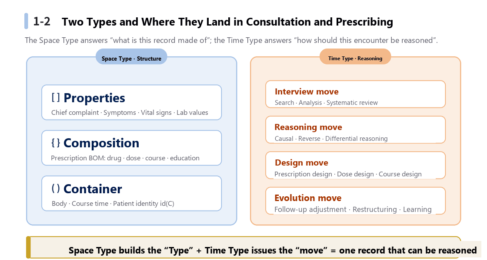

Figure 1-2 Where the two Types land: build the Type on the left, issue the move on the right

**Table 1-2 Where the Space Type lands: three brackets × consultation and prescribing**

| **Axis** | **Set** | **Where it lands in consultation and prescribing** | **Criterion** |
| --- | --- | --- | --- |
| X axis | [ ] property · abstract | Chief complaint, symptoms, vital signs, lab values, medication history | Fields complete, values carry units, abnormalities marked |
| Y axis | { } composition · BOM | Prescription BOM: drug, dose, route, frequency, days, education | Every part taken apart knows itself; the primary drug cannot be replaced |
| Z axis | ( ) container | Body, the course time container, patient identity id(C) | Identity stays the same within the course; separate encounters continue as the next page of the same container |

**Table 1-3 Where the Time Type lands: the four move groups × consultation and prescribing**

| **Move group** | **Representative moves** | **Use in consultation and prescribing** |
| --- | --- | --- |
| Search group | Type-time function search, design search and extraction | Find similar cases in the history base; extract medication rules from guidelines |
| Analysis group | Analysis, problem solving | Symptom decomposition, lab interpretation, contradiction detection |
| Reasoning group | Causal reasoning, reverse reasoning, thinking methods | From symptom to cause (causal); from lab result back to the source of infection (reverse) |
| Design group | Design, function generation, self-evolution | Prescription design, follow-up function generation, therapy restructuring and evolution |

## 1.4 The Mind AI Division of Labour at the Base

This book cites Mind AI but does not restate it: the LLM carries language ability — consultation dialogue, record narrative, patient education text; the Mind Model carries intelligence ability — criterion-based reasoning, BOM structure computation, cross-checking of contraindications, long-term memory and evolution. What consultation and prescribing need is neither “good at talking” nor “good at looking things up”, but the two in one.

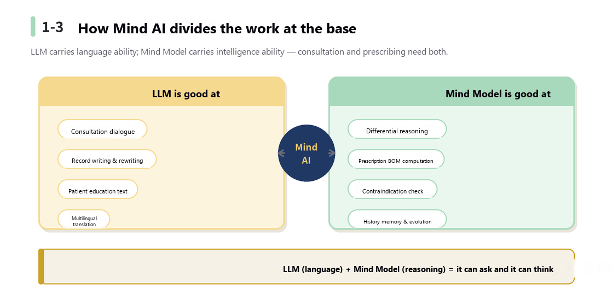

Figure 1-3 The Mind AI division of labour: language belongs to the LLM, intelligence to the Mind Model

## 1.5 Where “Accuracy” Comes From

Accuracy is not a talent of the model but the discipline of the process. This book splits accuracy into four layers of assurance and sets a gate at each: the first layer, the criterion funnel (∩(T)), decides “what counts”; the second, the deductive skeleton, decides “how the prescription is derived”; the third, the prescription review, decides “whether this drug is right”; the fourth, the Type evidence chain, decides “whether it can be found afterwards”. Only an output that passes all four may leave the door.

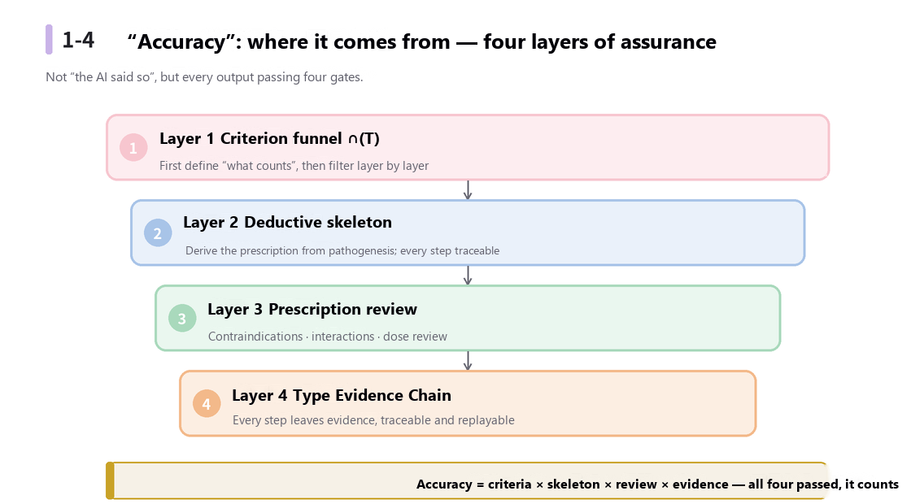

Figure 1-4 Four layers of accuracy: every output has to pass four gates

**Table 1-4 The four gates × where they land among the six Types**

| **Gate** | **What it guards** | **Which output Types it lands on** | **Route when it fails** |
| --- | --- | --- | --- |
| Layer one ∩(T) | What counts as valid | DiagnosisType · LabType | The hypothesis is stopped; go back to selecting the candidate set |
| Layer two Deductive skeleton | How the prescription is derived | Prescription · DiagnosisType | Walk backwards to find the break, return to S5 |
| Layer three Prescription review | Whether this drug is right | Prescription | Change the drug or adjust the dose, return to S6 |
| Layer four Type evidence chain | Whether it can be found afterwards | All six Types | Complete the chain or void it and re-run |

> **Chapter focus**  
> Chapter focus: (1) AI Western-medicine consultation and prescribing = maintaining a medical replica that can be reasoned; (2) Type first, Number second — every process builds the Type before filling in the Number; (3) the Space Type builds structure, the Time Type issues moves; (4) accuracy comes from four gates, not from the model’s confidence.  

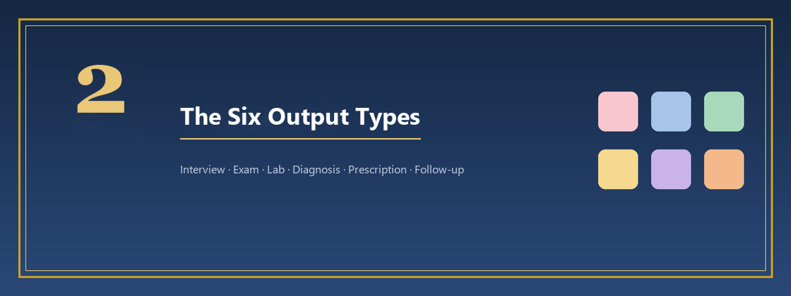

# Chapter 2 The Six Output Types

Every deliverable in the care process has its own Type, its own fields and its own acceptance standard. This chapter sorts the outputs from first visit to follow-up into six Types and shows what they look like on the bacterial tonsillitis case.

## 2.1 The Six Types at a Glance: One Care Pipeline

The six Types relay in the order of care: InterviewType collects the data, ExamType collects the physical findings, LabType collects the data interpretation, DiagnosisType collects the differential and the confirmation, the prescription collects the medication, FollowType collects what follows. The previous Type is the input of the next; the next is the acceptance of the previous.

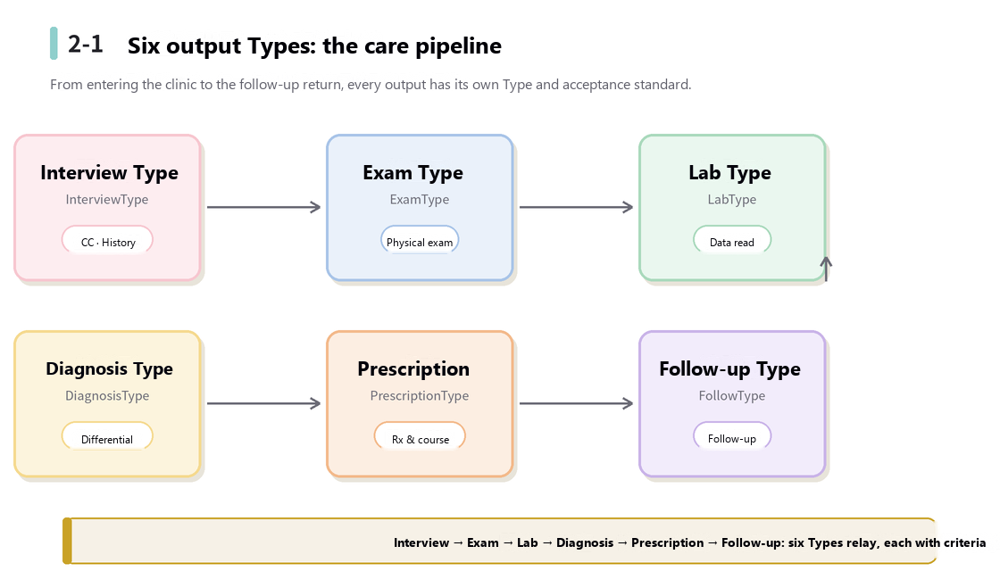

Figure 2-1 The six Types in relay: each Type has its deliverable and its acceptance standard

**Table 2-1 Master specification of the six output Types**

| **Output Type** | **English** | **Core content** | **Acceptance standard** |
| --- | --- | --- | --- |
| Interview Type | InterviewType | Chief complaint, history of present illness, past history, medication history, allergy history, review of systems | Fields complete; the patient’s own words retained |
| Exam Type | ExamType | Vital signs, physical examination findings | Negative findings recorded too |
| Lab Type | LabType | Test items, values, units, interpretation | Criteria written before interpretation |
| Diagnosis Type | DiagnosisType | Differential list, criterion scores, confirmed diagnosis | The differential converges from broad to narrow through a funnel |
| Prescription | PrescriptionType | Prescription BOM, course, education | Every component traceable to the pathogenesis |
| Follow-up Type | FollowType | Follow-up nodes, assessment items, dose-adjustment conditions | Next page in the same container; identity id(C) unchanged |

## 2.2 InterviewType, ExamType, LabType: Turning “What Was Heard” into “Structure”

The three Types of the first visit turn unstructured “feeling unwell” into computable fields. InterviewType keeps the patient’s words and also breaks them into fixed fields; ExamType records the physical findings, especially “what was not found” — negative evidence is extremely valuable in a differential diagnosis; LabType is “write the criteria first, then look at the data”, and adding criteria after seeing the data is forbidden.

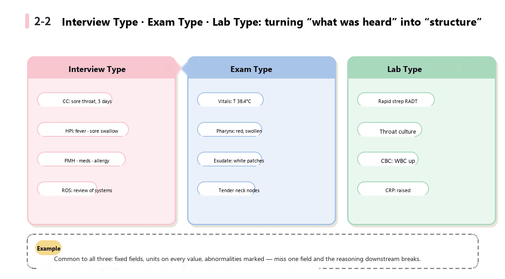

Figure 2-2 The first three Types: the fields and requirements of interview, exam and lab

**Table 2-2 InterviewType field card (InterviewType)**

| **Field** | **Content example (Ms Chen, 32)** | **Requirement at the Type level** |
| --- | --- | --- |
| Chief complaint CC | Sore throat for 3 days | The patient’s own words + duration |
| History of present illness HPI | Worse on swallowing, fever to 38.4°C, no cough | Aggravating / relieving factors mandatory |
| Past history PMH | No chronic disease; no recurrent tonsillitis | Negatives recorded too |
| Medication history | Occasional paracetamol; no long-term prescription drugs | Includes OTC and supplements |
| Allergy history | Reports no drug allergy | Explicitly record “yes / no / unknown” |
| Review of systems ROS | No rash, no joint pain, no asthma | Systems relevant to the differential must be asked |

## 2.3 DiagnosisType: Differential Is a Funnel, Not Guesswork

The core of DiagnosisType is a funnel: the candidate set has to be broad enough, and convergence has to rest on criteria. Take a sore throat: the first layer separates infection from non-infection, the second splits infection into viral and bacterial, the third scores with the Centor criteria, and the fourth confirms with RADT (rapid antigen detection test). Every layer has to record “on what grounds it was filtered out”.

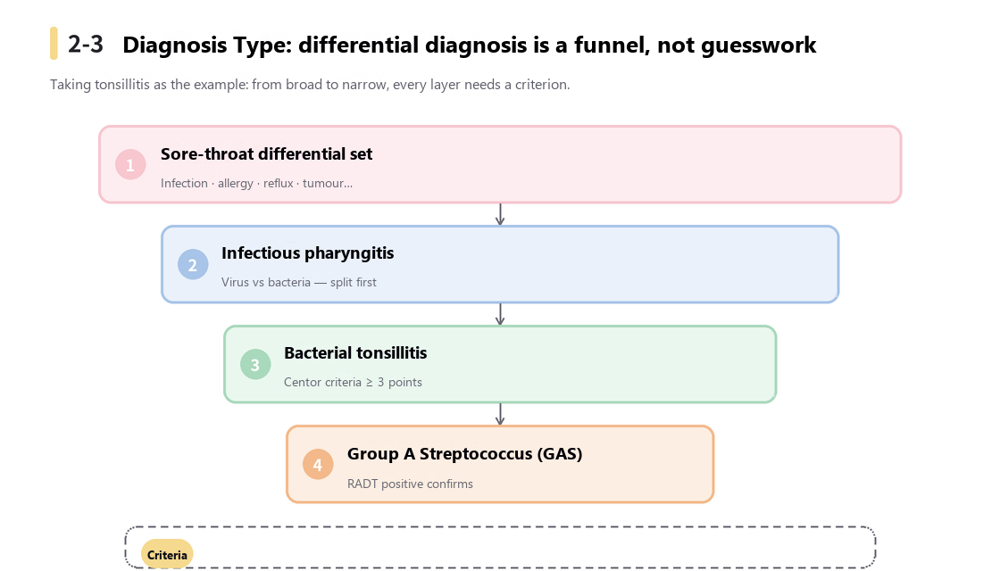

Figure 2-3 The diagnostic funnel: every layer of convergence has a criterion you can check

**Table 2-3 Differential comparison table (sore throat · excerpt)**

| **Candidate diagnosis** | **Supporting evidence** | **Opposing evidence** | **Criterion result** |
| --- | --- | --- | --- |
| Viral pharyngitis | Sore throat, fever | No cough, RADT positive | Excluded |
| Bacterial tonsillitis (GAS) | Centor 3, exudate, RADT positive | None | Confirmed |
| Infectious mononucleosis | Young, sore throat | No lymphadenopathy, no splenomegaly | Excluded · keep under observation |
| Peritonsillar abscess | Severe unilateral pain | No trismus, no muffled voice | Excluded |

## 2.4 Prescription: One Prescription Slip Is One BOM

A prescription is a composition set { }: taken apart, every piece knows itself. In this case the prescription BOM has four components — the primary drug, symptom relief, local treatment and education — and each has its own role and its own non-substitutability.

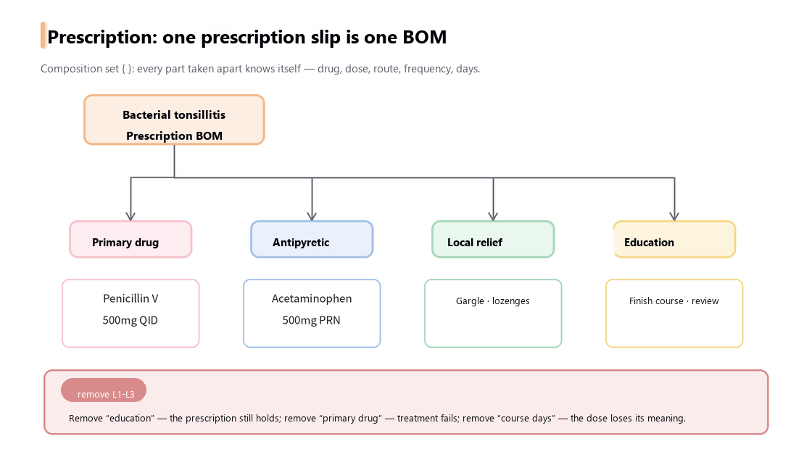

Figure 2-4 The prescription BOM: four components and the three-level consequences of remove

**Table 2-4 Prescription BOM specification (bacterial tonsillitis · demonstration only)**

| **Component** | **Drug / content** | **Dose · route · frequency** | **Days** | **Role** |
| --- | --- | --- | --- | --- |
| Primary drug | Penicillin V | 500mg · PO · QID | 10 days | Bactericidal · not to be replaced at will |
| Symptom relief | Acetaminophen | 500mg · PO · PRN (≤ QID) | As needed | Antipyretic and analgesic · supportive |
| Local treatment | Warm saline gargle | Every 4–6 hours | 10 days | Relief · supportive |
| Education | Finish the course · when to return | — | 10 days | Guarantees the course is completed |

> **remove three levels × prescription**  
> The three levels of remove applied to a prescription: remove the “education” component and the prescription still holds (level one: quality affected); remove the “primary drug” and the treatment fails (level two: function destroyed); remove the “course days” field and the meaning of the dose collapses, so the prescription cannot be executed (level three: meaning destroyed). When writing a prescription, level-three components must be marked in bold and never omitted.  

## 2.5 FollowType: the Course Is a Container, a Return Visit Is the Next Page

FollowType hangs on the container ( ): Day 0 to Day 30 are the same course-time container, and the patient identity id(C) does not change inside it — a new name, a new number or a referral does not change the identity. A return visit is not a fresh start but a new time slice of the same chain: only the differences are appended, never the whole text recopied.

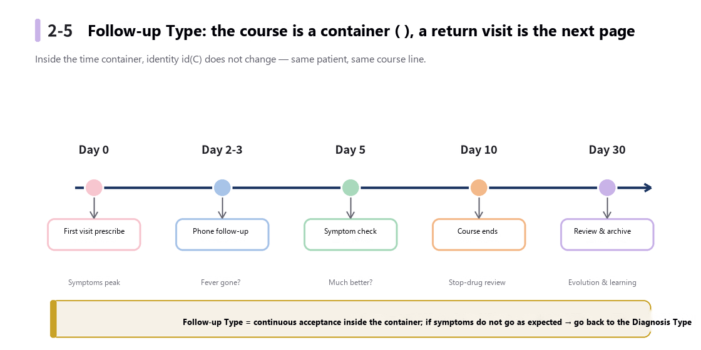

Figure 2-5 The follow-up timeline: five nodes inside the container

**Table 2-5 Follow-up node specification (FollowType)**

| **Node** | **Assessment items** | **Pass standard** | **Route when it fails** |
| --- | --- | --- | --- |
| Day 2–3 phone follow-up | Whether the fever has gone, change in pain | Fever gone · pain decreasing | Go back to DiagnosisType and re-judge |
| Day 5 symptom assessment | Swallowing, energy, appetite | Clearly improving | Bring the visit forward · consider complications |
| Day 10 course ends | Whether the course was completed | All medication taken · symptoms relieved | Re-educate those who did not finish |
| Day 30 review | Any recurrence | No recurrence | Repeated episodes → refer to ENT |

> **Chapter focus**  
> Chapter focus: (1) the six Types relay, the previous is input and the next is acceptance; (2) negative evidence must be recorded as well as positive; (3) diagnosis is a criterion funnel, not intuition; (4) a prescription is a BOM, and level-three components cannot be omitted; (5) follow-up continues as the next page inside the container, identity id(C) unchanged.  

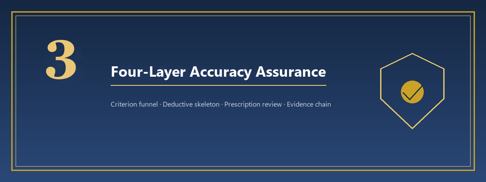

# Chapter 3 Four-Layer Accuracy Assurance

“Can you trust what the AI prescribes” is the life-or-death question for this system. The answer does not depend on how big the model is but on how strict the gates are. This chapter splits accuracy into four layers and explains, layer by layer, how each works on the tonsillitis case.

## 3.1 Layer One · Criterion Funnel ∩(T)

The spirit of the intersection criterion ∩(T) is: data ∩ criteria, and a hypothesis that fails the criteria may not go further. The practical order must never be reversed — write the criteria down first, then let the data in; if you look at the data first and then fit the criteria to it, that is hindsight, not reasoning.

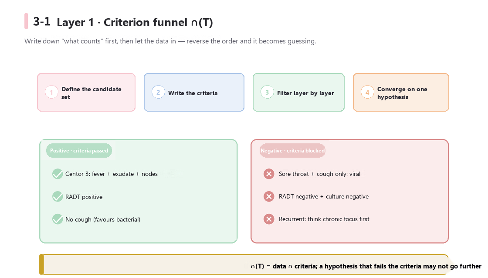

Figure 3-1 The criterion funnel: establish the criteria first, then filter the data

**Table 3-1 The ∩(T) criterion table · tonsillitis differential**

| **Criterion** | **How it is measured** | **Pass threshold** | **What it blocks** |
| --- | --- | --- | --- |
| Centor criteria | One point each for fever, absence of cough, cervical nodes, exudate | ≥ 3 points enters the bacterial hypothesis | Viral pharyngitis |
| RADT rapid test | Throat swab antigen test | Positive confirms GAS | Non-streptococcal infection |
| Course criterion | Days of symptoms and trend | > 3 days and worsening | Mild self-limiting sore throat |
| Red-flag criterion | Dyspnoea, trismus, drooling | Any one present → emergency referral | Abscess · epiglottitis |

## 3.2 Layer Two · Deductive Skeleton

A prescription has to grow along a visible chain of reasoning: cause → pathogenesis → evidence → principle → prescription. This chain is the deductive skeleton — it turns “prescribing” from table lookup into derivation. The check is simple: walk it backwards, and if any link does not match, the output goes back.

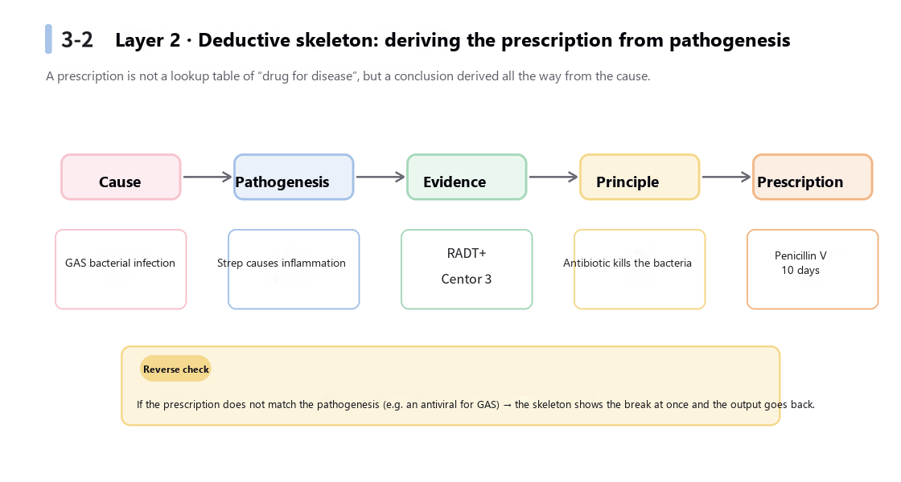

Figure 3-2 The deductive skeleton: from cause to prescription, link by link

**Table 3-2 The deductive skeleton · tonsillitis case**

| **Link** | **Content** | **Corresponding output Type** |
| --- | --- | --- |
| Cause | Group A Streptococcus (GAS) infection | DiagnosisType |
| Pathogenesis | The bacterium causes acute suppurative inflammation of the pharynx | DiagnosisType |
| Evidence | Centor 3 + RADT positive + raised WBC | ExamType · LabType |
| Principle | Antibiotic bactericidal + symptom relief | DiagnosisType |
| Prescription | Penicillin V 500mg QID × 10d | Prescription |

## 3.3 Layer Three · Prescription Review

Even when the diagnosis is right and the drug is right, the prescription has to pass one last gate before it leaves: the three questions of the prescription review — contraindications, interactions, dose. All three must answer “yes” for release; any “no” means changing the drug or going back to re-derive.

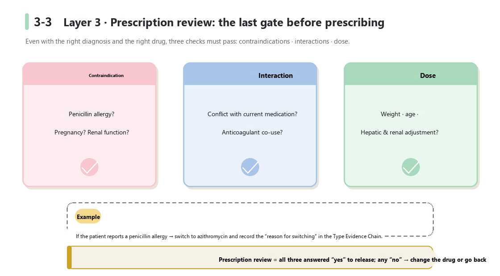

Figure 3-3 The three questions of the prescription review: the last gate before prescribing

**Table 3-3 Prescription review checklist · this case**

| **Check item** | **What is checked** | **Result in this case** | **Route** |
| --- | --- | --- | --- |
| Contraindication | Penicillin allergy history, pregnancy and breastfeeding, renal function | Allergy history negative · not pregnant or breastfeeding · renal function normal | Passed |
| Interaction | Conflict with current medication (e.g. anticoagulants) | No long-term medication | Passed |
| Dose | Adjustment for weight, age, hepatic and renal function | 32 years, 56kg, standard adult dose | Passed |
| Fallback plan | Alternative drug in case of allergy | Azithromycin, 5-day course (fallback) | Reserve |

> Disclaimer (2): Table 3-3 and every drug dose in this book are output demonstrations only and do not constitute medical advice; an actual prescription must be decided by a qualified physician according to the individual patient, local drug regulations and the latest guidelines.  

## 3.4 Layer Four · Type Evidence Chain

The Type evidence chain requires: every input has a source, every process has grounds, every output can be audited, and any moment can be replayed. In space, each output carries its evidence; in time, each change leaves a record. The two are cross-accepted and together form complete traceability.

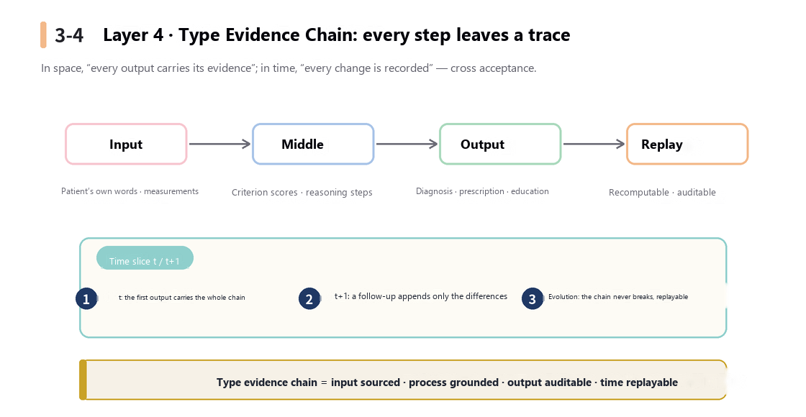

Figure 3-4 The Type evidence chain: four stages of trace plus time slices

**Table 3-4 The Type evidence chain · field specification**

| **Chain stage** | **What is kept** | **Where it is stored** | **What it is used for in audit** |
| --- | --- | --- | --- |
| Input | The patient’s own words, measurements, lab reports | InterviewType · ExamType · LabType | Replay what was relied on at the time |
| Middle | Criterion scores, reasoning steps, excluded hypotheses | DiagnosisType | Recompute whether the reasoning holds |
| Output | Diagnosis, prescription, education, review report | Prescription | Trace the source of the prescription |
| Replay | Differences at the return visit, reasons for dose change, efficacy | FollowType | Evolution and learning of the therapy |

## 3.5 Space × Time Cross Acceptance

The four gates act in both directions at once: in space they accept “is this output structurally complete”, in time they accept “does this change have a reason”. If either direction breaks, the whole chain fails.

**Table 3-5 Cross acceptance table**

| **Direction** | **Acceptance question** | **Example of failure** |
| --- | --- | --- |
| Space · structure | Are the six Types’ fields complete? Can the BOM parts be taken apart? Does the evidence attach? | The prescription has no days field; a lab value has no unit |
| Space · meaning | Are the level-three components there? Is the naming consistent? | The primary drug is written as “drug A” and cannot be traced |
| Time · order | Criteria before data? Skeleton before prescription? | Prescribe first and add the diagnostic reasons afterwards |
| Time · evolution | Is there a reason for the dose change? Does the container continue? | The return visit starts from scratch and the identity chain breaks |

> **Chapter focus**  
> Chapter focus: (1) ∩(T) establishes the criteria before filtering the data; (2) the prescription must be walkable backwards along the deductive skeleton to the cause; (3) all three questions of the prescription review must pass for release; (4) the Type evidence chain guarantees that any moment can be replayed; (5) space × time cross acceptance — missing either fails.  

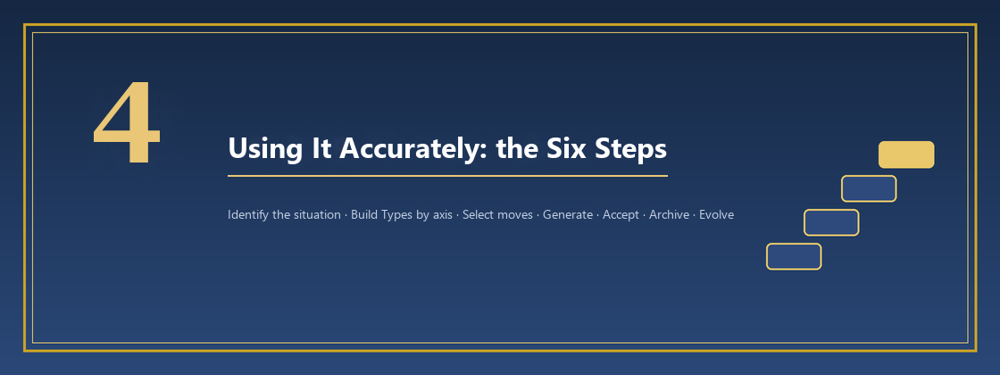

# Chapter 4 Using It Accurately · the Six Steps

The first three chapters gave the positioning, the output Types and the gates; this chapter strings them into one operable route: the six steps. Each step has an input, an output and an acceptance, and the chapter shows how to select, assemble and swap moves in two situations — acute infection and chronic disease.

## 4.1 The Four-Step Framework: Identify the Situation First

The four-step framework is the preparation before building the Type: identify the situation first, then fix the boundary, then set the fields, and finally set the criteria. If the situation is wrong, everything after it is wrong — the emergency situation and the chronic dose-adjustment situation use completely different moves.

**Table 4-1 The four-step framework × consultation and prescribing**

| **Step** | **Action** | **Demonstration on the tonsillitis case** |
| --- | --- | --- |
| Identify the situation | Emergency / outpatient / chronic? Acute or chronic? | Outpatient · acute infection · single episode |
| Fix the boundary | The scope and exclusions of this encounter | Limited to GAS pharyngitis; abscess and systemic disease excluded |
| Set the fields | The field list of the six Types in place | Six interview fields · four exam items · three lab items |
| Set the criteria | ∩(T) and the red-flag criteria first | Centor ≥ 3, RADT, red flag → immediate referral |

## 4.2 The Six Steps End to End

The six steps in order are: identify the situation, build the Types by axis, select the expansion pattern, generate the output, accept against the criteria, archive and evolve. The first three are preparation, the fourth is production, the fifth is the gate, and the sixth makes the system more accurate over time.

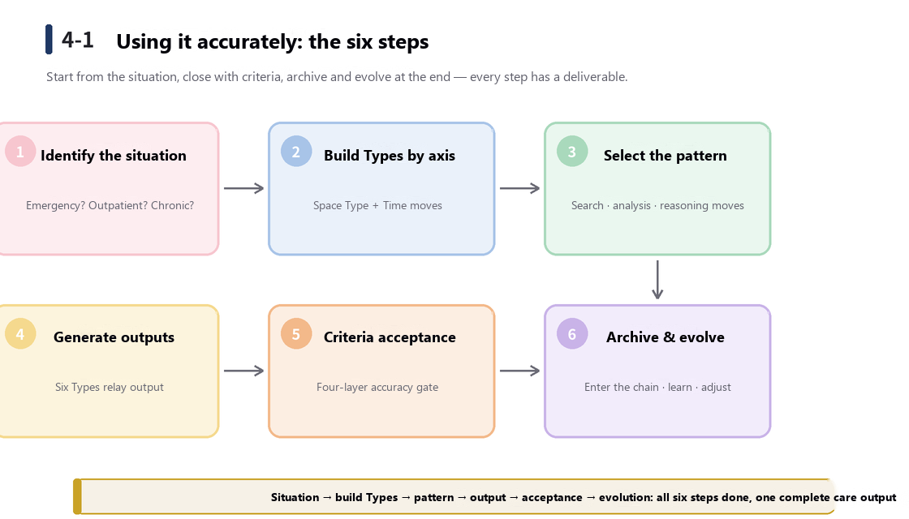

Figure 4-1 The six steps: every step has a deliverable

**Table 4-2 Six-step operation card**

| **Step** | **Input** | **Action** | **Output** | **Acceptance** |
| --- | --- | --- | --- | --- |
| 1 Identify the situation | Chief complaint | The four-step framework | Situation tag | The situation matches the chief complaint |
| 2 Build Types by axis | Situation tag | Build the Types with the three brackets | Six-Type skeleton | Fields complete |
| 3 Select the expansion pattern | Six-Type skeleton | Choose moves from the move tray | Move list | The moves match the situation |
| 4 Generate the output | Move list | The S1–S7 pipeline | Six-Type output | Format compliant |
| 5 Accept against the criteria | Six-Type output | The four layers of accuracy | Accepted output | All four layers passed |
| 6 Archive and evolve | Accepted output | Enter the chain · learn | Time slice | The chain is continuous |

## 4.3 Three-Layer Judgement: Is · Has · Right

The three-layer judgement of Type logic, applied to consultation and prescribing, becomes three questions: what is it (same-or-different judgement), what does it have (composition judgement), is it right (criterion judgement). The three pass from left to right, and only then does the output hold.

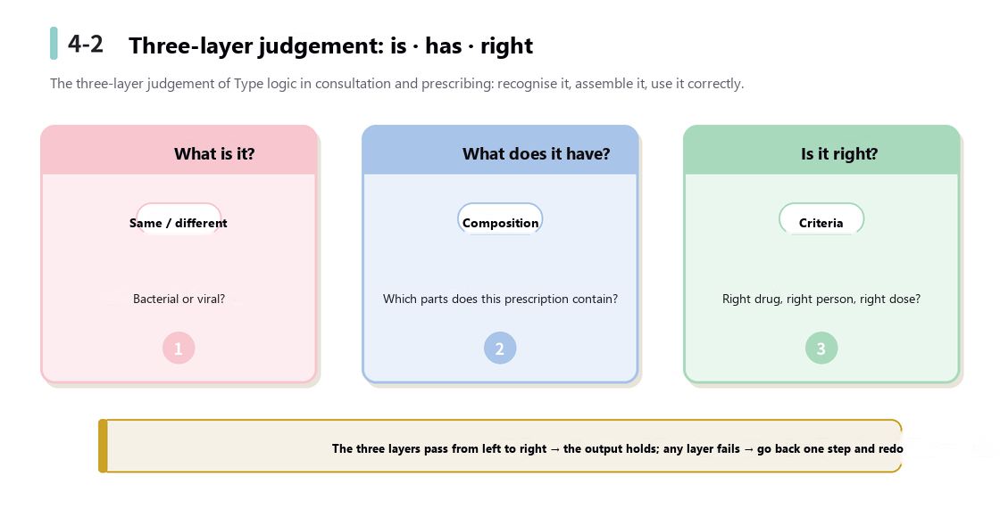

Figure 4-2 The three-layer judgement: recognise it, assemble it, use it correctly

**Table 4-3 The three-layer judgement · worked on the case**

| **Layer** | **Question** | **Answer in this case** | **If it fails** |
| --- | --- | --- | --- |
| Is | Bacterial or viral? | Bacterial (Centor 3 + RADT+) | Back to S4 to re-run the differential funnel |
| Has | Which components does the prescription contain? | Primary drug, relief, local, education — four | Back to S5 to complete the BOM |
| Right | Right drug for the person, the disease, the dose? | Penicillin V passes the three questions | Back to S6 to change the drug or adjust the dose |

## 4.4 Selecting · Assembling · Swapping Moves

The Time Type is a board of verbs: in the same patient situation, acute infection uses fast moves (search + causal reasoning + prescription design) and chronic dose adjustment uses long moves (history replay + statistical reasoning + ladder adjustment). Moves can be combined and can be swapped midway — when follow-up goes worse than expected, stop the “design move” first and go back to the “reasoning move” to re-differentiate.

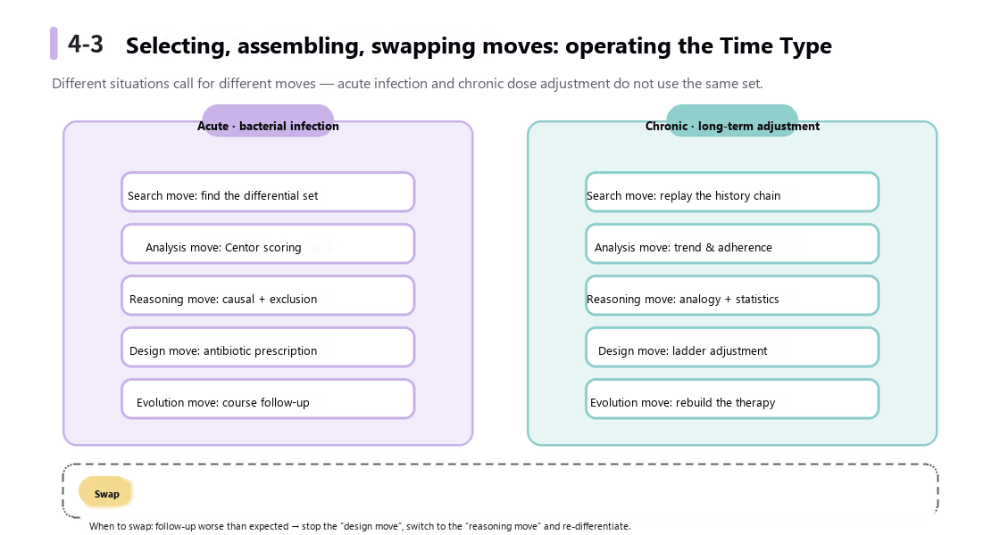

Figure 4-3 Move arrangement in the two situations

**Table 4-4 Selecting, assembling and swapping moves compared**

| **Action** | **Acute infection situation** | **Chronic dose-adjustment situation** |
| --- | --- | --- |
| Selecting moves | Search move (find the differential set) + reasoning move (causal) | Search move (replay the history chain) + reasoning move (statistical) |
| Assembling moves | Analysis + reasoning + design: score → confirm → prescribe | Analysis + design + evolution: trend → ladder → adjust |
| Swapping moves | No fever resolution at 48–72h → swap to a reasoning move and re-differentiate | Target not met in three months → swap to a design move and change to second-line drugs |

**Table 4-5 The six steps × misuse warning points**

| **Step** | **The most common shortcut** | **Warning signal** |
| --- | --- | --- |
| 1 Identify the situation | Starting without separating acute from chronic | The complaint says “recurrent” or “for years” yet an acute move is used |
| 2 Build Types by axis | Leaving fields blank to fill in later | More than two “to be filled” cells in the output table |
| 3 Select the expansion pattern | Using only the moves you are familiar with | A chronic case with no replay move at all |
| 4 Generate the output | Jumping straight to S5 for the prescription | The prescription has no corresponding DiagnosisType input |
| 5 Accept against the criteria | The review report says only “passed” | The three questions have no reason field of their own |
| 6 Archive and evolve | Closing the case without entering the chain | The next first visit starts asking from zero again |

> **Chapter focus**  
> Chapter focus: (1) the four-step framework comes first — a wrong situation makes everything wrong; (2) every one of the six steps has an input, an output and an acceptance; (3) the three-layer judgement “is · has · right” passes layer by layer; (4) moves can be selected, assembled and swapped, and a swap needs a trigger condition.  

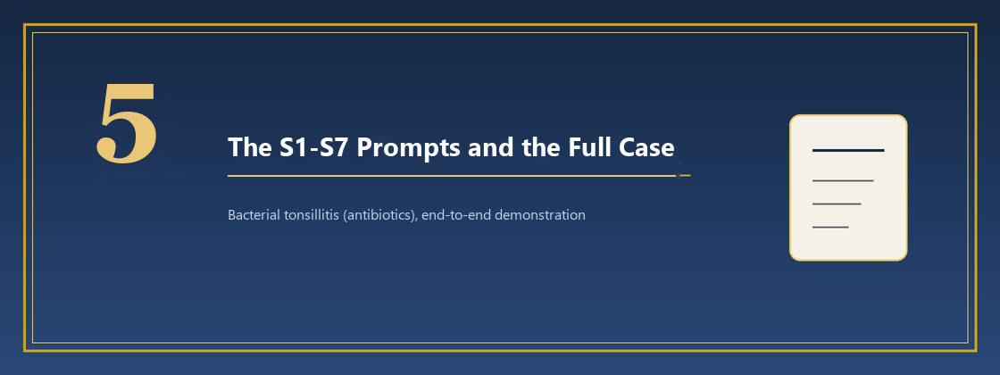

# Chapter 5 The S1–S7 Prompts and the Full Case

This chapter delivers two directly usable things: the full text of the seven prompts, and a complete worked output from consultation to follow-up. The case continues the bacterial tonsillitis example that runs through the book — Ms Chen, 32, sore throat for three days with fever.

## 5.1 Pipeline Design: A Seven-Stage Relay

Each of the seven prompts has its own job: S1 history taking, S2 examination planning, S3 lab interpretation, S4 differential diagnosis, S5 prescription generation, S6 prescription review, S7 education and follow-up. The output of one stage is the input of the next, and any stage can be audited or re-run on its own.

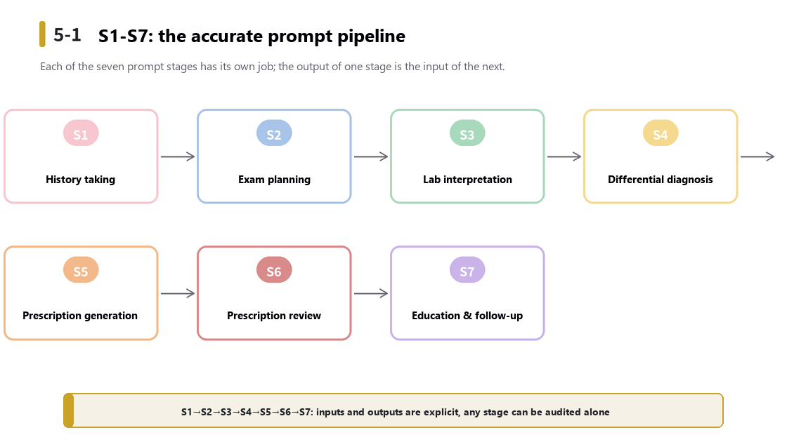

Figure 5-1 The seven-stage relay: inputs and outputs clear, auditable stage by stage

**Table 5-1 S1–S7 role table**

| **Stage** | **Role** | **Input** | **Output Type** |
| --- | --- | --- | --- |
| S1 | History taking | Patient statement | InterviewType |
| S2 | Examination planning | InterviewType | ExamType (planning) |
| S3 | Lab interpretation | Lab data + criteria | LabType |
| S4 | Differential diagnosis | InterviewType · ExamType · LabType | DiagnosisType |
| S5 | Prescription generation | DiagnosisType | Prescription |
| S6 | Prescription review | Prescription | Review report |
| S7 | Education and follow-up | Prescription + review report | FollowType |

## 5.2 The Full Text of the Seven Prompts

Below are prompts that can be copied and used directly. Items in 〔 〕 are variables to replace at use; every prompt has built-in format constraints and an honesty clause: “if unsure, say unsure”.

> **S1 History Taking**  
> You are a Western-medicine outpatient physician. Conduct a structured consultation with the patient and produce the “InterviewType”.  
> Fields: chief complaint CC (patient's words + days), history of present illness HPI (aggravating / relieving factors), past medical history PMH, medication history Med (including OTC), allergy history Allergy, review of systems ROS.  
> Requirements: (1) ask only 1–3 questions at a time, never all at once; (2) record negative evidence too; (3) fields the patient does not provide are filled “not provided”, and guessing values is forbidden.  
> Output format: a Markdown table with columns “field \| content \| data source (patient's words / physician's judgement)”.  

> **S2 Examination Planning**  
> Input: InterviewType 〔paste the S1 output〕.  
> Task: plan this physical examination and produce the “ExamType” plan sheet.  
> Requirements: (1) list the mandatory items and “what is to be confirmed by examining it”; (2) list the items the differential needs but that are not examined this time, with reasons; (3) red-flag items (dyspnoea, difficulty opening the mouth, neck mass) must be listed.  
> Output format: table “examination item \| purpose \| differential hypothesis served \| red-flag link”.  

> **S3 Lab Interpretation**  
> Input: ExamType 〔paste the S2 output〕 + lab data 〔paste the report〕.  
> Task: write the criteria first, then look at the data, and produce the “LabType” interpretation sheet.  
> Requirements: (1) for every lab item write the “criterion (threshold and direction)” before the value and the conclusion; (2) values must carry units; (3) items beyond the criterion are marked abnormal, stating which hypothesis they support or oppose.  
> Output format: table “item \| criterion \| value \| conclusion \| hypothesis supported / opposed”.  

> **S4 Differential Diagnosis**  
> Input: InterviewType + ExamType + LabType 〔paste the S1–S3 output〕.  
> Task: produce the “DiagnosisType”.  
> Requirements: (1) the differential list runs from broad to narrow with at least 3 candidates; (2) every candidate carries supporting and opposing evidence; (3) converge layer by layer through the criterion funnel, stating at each layer on what grounds the rest were filtered out; (4) the confirmed diagnosis carries a confidence level; (5) negative red flags are written too.  
> Output format: first the funnel table “layer \| criterion \| candidates \| result”, then the conclusion “confirmed diagnosis \| confidence \| still to be confirmed”.  

> **S5 Prescription Generation**  
> Input: DiagnosisType 〔paste the S4 output〕 + patient baseline data (age, weight, hepatic and renal function, allergy history, current medication).  
> Task: produce the “PrescriptionType” BOM.  
> Requirements: (1) BOM components: primary drug, symptom relief, local treatment, patient education; (2) each item states dose, route, frequency, days and total quantity; (3) the primary drug is marked “not freely replaceable” and the days are marked “level-three component”; (4) the primary drug carries a deductive-skeleton cross-reference (cause → principle → drug); (5) an alternative plan is reserved (in case of allergy).  
> Output format: prescription slip table + skeleton cross-reference table; end with a disclaimer.  

> **S6 Prescription Review**  
> Input: prescription 〔paste the S5 output〕 + patient baseline data.  
> Task: run the three prescription-review questions and produce the review report.  
> The three questions: (1) contraindication check (allergy history, pregnancy and lactation, hepatic and renal function, disease contraindications); (2) interaction check (current medication, food, laboratory interference); (3) dose check (adjustment for weight, age, hepatic and renal function).  
> Requirements: each question gives one of three states — pass / caution / block — with a reason; any “block” must come with an alternative drug and an alternative dose; release is forbidden unless all three pass.  
> Output format: table “check item \| what is checked \| result \| reason \| pathway”.  

> **S7 Education and Follow-Up**  
> Input: prescription + review report 〔paste the S5–S6 output〕.  
> Task: produce the “FollowType”.  
> Requirements: (1) every follow-up node (Day 2–3 / Day 5 / Day 10 / Day 30) carries assessment items and a pass standard; (2) every node states its “failing pathway” (which step to push back to and re-judge); (3) the education text comes in two versions, patient (plain language) and physician (brief); (4) the return red-flag list must be attached.  
> Output format: node table + two education versions + red-flag list.  

## 5.3 Full Case Output

Below are excerpts of the actual results produced for Ms Chen's case along S1–S7. The output trace of the whole pipeline is shown in the figure, then the details stage by stage:

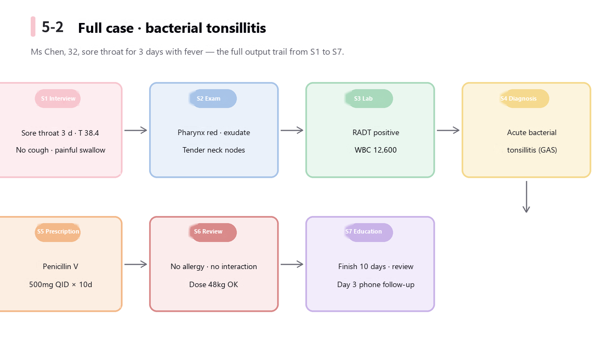

Figure 5-2 Case output trace: the seven-stage relay from consultation to education

First look at the InterviewType and the two Types of examination and laboratory:

**Table 5-2 Case output excerpt (1): InterviewType**

| **Field** | **Content** | **Source** |
| --- | --- | --- |
| Chief complaint CC | Sore throat for 3 days | Patient's own words |
| History of present illness HPI | Worse on swallowing, fever to 38.4°C, no cough | Patient's own words |
| Past medical history PMH | No chronic disease, no recurrent tonsillitis | Patient's own words |
| Medication Med | Occasionally takes paracetamol 500 mg | Patient's own words |
| Allergy Allergy | Reports no drug allergy | Patient's own words |
| ROS | No rash · no arthralgia · no wheeze | Consultation confirmation |

**Table 5-3 Case output excerpt (2): ExamType · LabType**

| **Item** | **Criterion** | **Value / finding** | **Conclusion** |
| --- | --- | --- | --- |
| Temperature | > 37.8°C counts as fever | 38.4°C | Abnormal · supports infection |
| Pharyngeal findings | Redness and swelling + exudate leans bacterial | Bilateral redness and swelling · white exudate | Abnormal · supports bacterial |
| Cervical lymph nodes | Tenderness and swelling count 1 point | Bilateral enlargement and tenderness | Abnormal · Centor +1 |
| Cough | Cough present leans viral | None | Negative · Centor +1 |
| RADT | Positive confirms GAS | Positive | GAS confirmed |
| WBC | > 10,000 supports bacterial | 12,600 /μL | Abnormal · supports bacterial |

Then the DiagnosisType funnel converges: layer one excludes red flags (no dyspnoea, no difficulty opening the mouth); layer two separates viral from bacterial (Centor 3 points); layer three confirms Group A Streptococcus by a positive RADT. Confirmed diagnosis: acute bacterial tonsillitis (GAS), high confidence.

## 5.4 Prescription Slip and Review Report

The prescription is produced in S5 and reviewed in S6. The prescription slip format is as follows (illustrative):

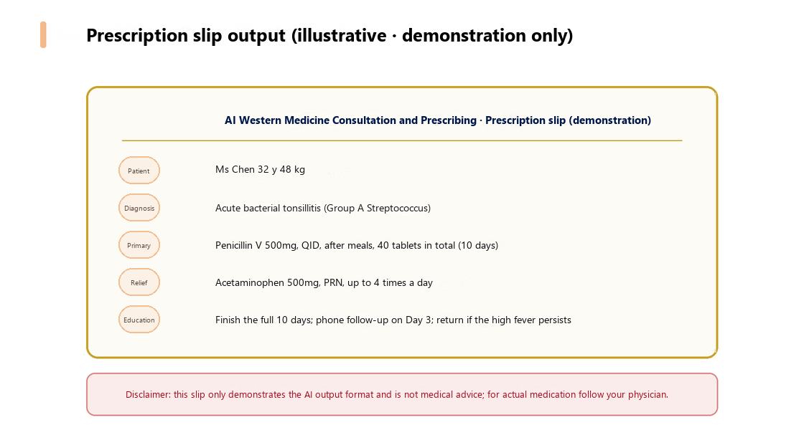

Figure 5-3 Prescription slip output format (demonstration only)

**Table 5-4 Prescription slip (full version · demonstration only)**

| **Component** | **Drug · content** | **Dose · route · frequency** | **Days · total quantity** | **Role marker** |
| --- | --- | --- | --- | --- |
| Primary drug | Penicillin V | 500 mg · PO · QID | 10 days · 40 tablets | Not freely replaceable |
| Symptom relief | Acetaminophen | 500 mg · PO · PRN (≤ QID) | As needed · ≤ 40 tablets | Adjunct |
| Local treatment | Warm salt-water gargle | Every 4–6 hours | 10 days | Adjunct |
| Patient education | Finish the course · return on red flags | — | 10 days | Level-three component |
| Alternative plan | Azithromycin (if allergic) | 500 mg · PO · QD | 5 days · 5 tablets | Fallback plan |

**Table 5-5 Review report**

| **Check item** | **What is checked** | **Result** | **Reason** |
| --- | --- | --- | --- |
| Contraindication | Penicillin allergy · pregnancy and lactation · renal function | Pass | Allergy history negative · not pregnant or lactating · renal function normal |
| Interaction | Conflict with current medication | Pass | No long-term medication; acetaminophen does not conflict with the primary drug |
| Dose | Adjusted for weight and age | Pass | 32 years old, 56 kg, adult standard dose |
| Release | All three questions pass | Release | May dispense |

> Disclaimer (3): the prescription in Table 5-4 and every drug dose in this book demonstrate output format only and do not constitute medical advice; for actual medication follow medical orders and the local drug regulations and latest clinical guidelines.  

## 5.5 Follow-Up Dose Adjustment and Common Errors

The FollowType is produced in S7. In this case the Day 3 telephone follow-up showed fever resolved and pain reduced — a pass; the Day 10 visit showed the 10-day course completed and symptoms relieved, so the course is closed. Had the fever not resolved at Day 3, the pathway would be to push back to S4 and re-run the differential (complication? resistance? wrong diagnosis?) rather than switching straight to a stronger drug — this is exactly the value of the deductive skeleton: going back has a named stop.

**Table 5-6 Common output errors in the case, compared**

| **Erroneous output** | **Where it goes wrong** | **The correct approach** |
| --- | --- | --- |
| Asking 20 questions at once | Heavy patient burden, poor answer quality | S1 limits to 1–3 questions per round |
| RADT result read first, Centor score filled in afterwards | Data before criteria, reasoning fails | S3 writes the criteria before the values |
| The prescription contains only the primary drug | BOM missing parts, patient education missing | S5 brings out all four components |
| Day 3 without fever resolution → escalate the antibiotic directly | Skipping re-differentiation | S7 pathway pushes back to S4 |
| A new table for the follow-up visit | The container breaks, identity drifts | Next page in the same container, id(C) unchanged |

**Table 5-7 S7 output excerpt: two education versions + red-flag list**

| **Version** | **Content** |
| --- | --- |
| Patient version (plain language) | Take the antibiotic four times a day for the full 10 days, and finish it even if you feel better; an unfinished course lets the bacteria come back. For the sore throat you may take a painkiller and gargle with warm salt water. |
| Physician version (brief) | Penicillin V 500 mg QID × 10 d, complete the course; acetaminophen PRN; saline gargle q4–6h. |
| Red-flag list (any one means return to clinic) | High fever above 39.5°C that will not settle, worsening difficulty swallowing, difficulty breathing or opening the mouth, a growing neck mass, or no improvement at all after 3 days. |

**Table 5-8 Follow-up record and dose-adjustment decision (time slice t → t+1)**

| **Time slice** | **Findings** | **Criterion comparison** | **Decision** |
| --- | --- | --- | --- |
| Day 3 telephone follow-up (t+1) | Fever gone, pain down from 8 to 3 | Pass standard: fever gone · pain reduced | Keep the prescription, no adjustment |
| (assumed) no fever resolution at Day 3 | Still 38.8°C, swallowing more painful | Fail: the pathway pushes back to S4 | Re-run the differential (complication? resistance?) → complication means referral to ENT |
| Day 10 case closed (t+2) | 10-day course completed, symptoms relieved | Pass standard: medication taken throughout · symptoms relieved | Case closed and entered into the chain; tagged “first GAS episode” for future retrieval |

**Table 5-9 Rules for using the prompts**

| **Rule** | **Explanation** |
| --- | --- |
| Variables in place before starting | Run with the variables in 〔 〕 (history, data, baseline information) unfilled and the output will inevitably contain guessed values |
| Accept stage by stage, then relay | S1 output does not go into S2 before passing format acceptance; the iron law of garbage in, garbage out is doubly true inside a pipeline |
| Keep the original output | Every re-run is saved as a new version; the Type evidence chain must be able to replay “what was seen at the time” |
| Prompts may be tuned, the skeleton may not be abandoned | Fields and criteria may be adjusted by specialty, but the order — criteria before data, skeleton before prescription — does not move |

> **Chapter focus**  
> Chapter focus: (1) the S1–S7 seven-stage relay, each stage with clear, auditable inputs and outputs; (2) prompts with built-in format constraints and honesty clauses; (3) all case output follows criteria before data; (4) the prescription slip and the review report come out together; (5) follow-up dose adjustment needs criteria and a pathway, and a time slice appends only the differences.  

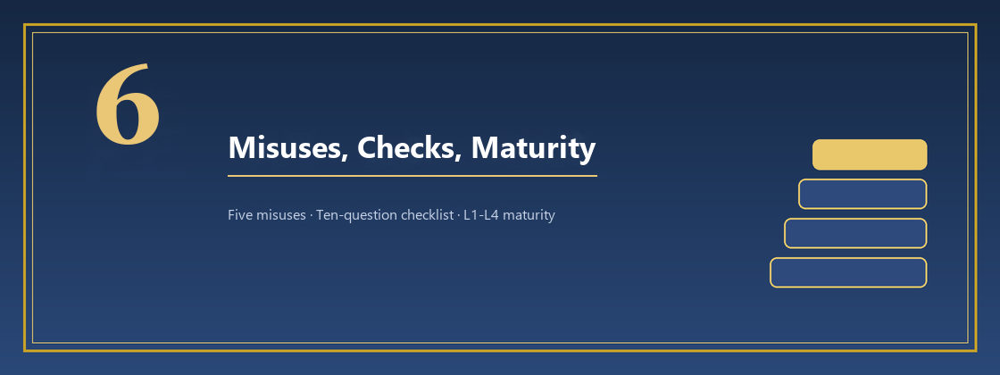

# Chapter 6 Misuses, Checks, Maturity

The last chapter delivers three governance tools: the misuse comparison table tells you where it will crash, the ten questions give you the acceptance Q&A, and the maturity model tells you which level you are on and what to add for the next.

## 6.1 Five Misuses

All five misuses share one feature: skipping the gate and adding the reason afterwards. The cure is not “being more careful” but writing the gate into the process — no pass, no output.

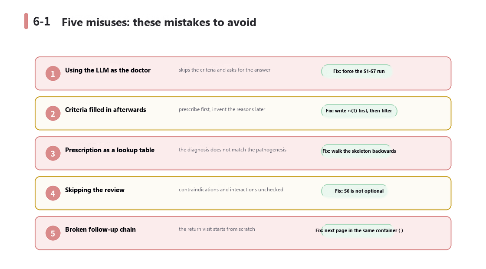

Figure 6-1 Five misuses and their remedies

**Table 6-1 Misuse comparison table**

| **Misuse** | **Typical presentation** | **Consequence** | **Remedy** |
| --- | --- | --- | --- |
| Treating the LLM as the physician | Skipping S1–S7 and asking for the answer | No criteria, no evidence | Force the seven-stage pipeline through |
| Criteria patched afterwards | Prescribe first, fit the reason later | Reasoning disguised as reasoning | ∩(T) first, order check |
| Prescription reduced to table lookup | The diagnosis does not match the pathogenesis | The same drug under a different disease name | Reverse walk of the deductive skeleton |
| Skipping the review | Contraindications and interactions unchecked | Medication safety event | S6 indispensable, three questions three states |
| The follow-up chain breaks | The follow-up visit starts from scratch | Fragmented history | Next page in the container · id(C) anchoring |

## 6.2 A Ten-Question Checklist

Before delivering or accepting any AI Western-medicine consultation and prescribing output, interrogate it with these ten questions one by one; whatever cannot be answered is not yet qualified.

**Table 6-2 The ten-question checklist**

| **#** | **Question** | **What a passing answer looks like** |
| --- | --- | --- |
| 1 | What is the situation label? | Emergency / outpatient / chronic clearly stated and consistent with the complaint |
| 2 | Were the criteria written first? | The criterion timestamp precedes the data entry |
| 3 | Is the differential list broad enough? | At least 3 candidates, including red-flag exclusion |
| 4 | On what grounds does each funnel layer filter? | Every layer has criteria and the reason the excluded ones were excluded |
| 5 | Is the prescription BOM complete? | All four present: primary drug · relief · local · education |
| 6 | Does the deductive skeleton reach the bottom? | Cause → pathogenesis → evidence → principle → prescription, link by link |
| 7 | Are all three review questions answered? | Each of the three gives pass / caution / block plus a reason |
| 8 | Are level-three components marked? | Days · primary drug marked on record |
| 9 | Is the follow-up pathway written? | Every node has a pass standard and a failing pathway |
| 10 | Is the evidence chain complete? | Four auditable stages: input · intermediate · output · replay |

## 6.3 Maturity L1–L4

Maturity has four levels: L1 answers, L2 screens, L3 follows up, L4 evolves. Upgrading is evidenced by the Type evidence chain; “it feels ready by now” is not accepted.

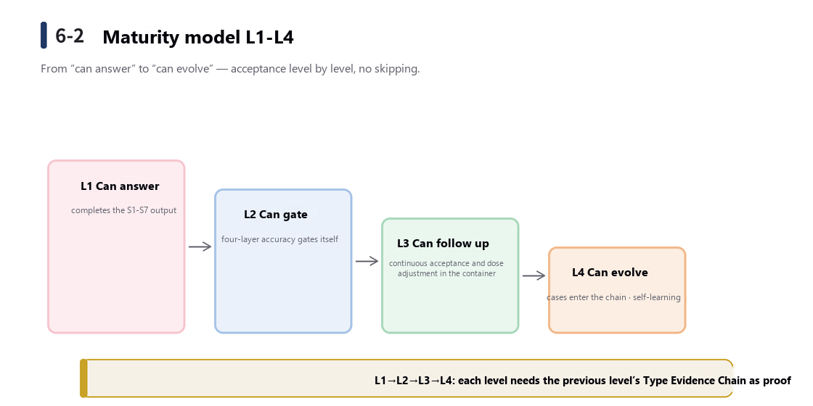

Figure 6-2 The maturity ladder: every level needs evidence

**Table 6-3 Maturity acceptance table**

| **Level** | **Capability** | **Acceptance condition** | **Common sticking point** |
| --- | --- | --- | --- |
| L1 Answers | Can run the seven stages and produce the six Types | Six Types format-compliant, fields complete | Unstable output format |
| L2 Screens | Four-gate accuracy blocks automatically | The five misuses intercepted automatically | The review gets skipped |
| L3 Follows Up | Continuous acceptance and dose adjustment inside the container | All follow-up nodes executed | The follow-up chain breaks |
| L4 Evolves | Cases enter the chain · self-learning | Dose-adjustment reasons replayable, therapy refactoring grounded | Evolution unrecorded |

**Table 6-4 Rollout blueprint: a suggested three-month rhythm**

| **Phase** | **Cycle** | **What to do** | **Completion criterion** |
| --- | --- | --- | --- |
| Month 1 · get it running | W1–W4 | Run the whole flow with a single disease (e.g. bacterial tonsillitis) along S1–S7 | 20 format-compliant outputs accumulated |
| Month 2 · put the gate in | W5–W8 | Switch on four-gate accuracy acceptance; spot-check three outputs a day against the skeleton | Interception rate of the five misuses ≥ 90% |
| Month 3 · add follow-up | W9–W12 | Switch on FollowType nodes and the dose-adjustment pathway; cases start entering the chain | Follow-up execution rate ≥ 80%, chain-break rate = 0 |
| Afterwards · evolve | Ongoing | Monthly review of dose-adjustment reasons, refactor the therapy template | Enter the L4 acceptance loop |

# Review and Close

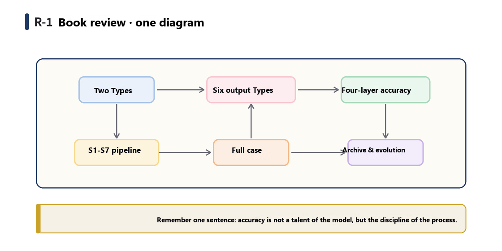

Figure R-1 The whole book in one diagram

> **Three takeaways**  
> R-1 If you remember only one sentence: accuracy is not a talent of the model but the discipline of the process.  
> R-2 If you use only one table: the two-language comparison in Table D-1 — the Space Type builds structure, the Time Type issues moves.  
> R-3 If you run the process only once: Chapter 4 (six steps) plus S1–S7 from Chapter 5 (prompts and case), and work one complete output through by the book.  

**Table R-1 Master toolbox of the book (deliverables by chapter)**

| **Chapter** | **Deliverable** | **What you can use straight away** |
| --- | --- | --- |
| Chapter 1 (understanding the system) | Positioning and where the two Types land | Type + Number division table, three-bracket landing table, four-gate table |
| Chapter 2 (output Types) | Specifications of the six output Types | Six-Type master specification, interview field card, prescription BOM specification |
| Chapter 3 (accuracy guarantee) | Four gates of accuracy | ∩(T) criteria table, deductive skeleton table, prescription review checklist |
| Chapter 4 (six steps) | Operating pathway | Six-step operation card, three-layer judgement table, misuse warning points |
| Chapter 5 (prompts and case) | The full S1–S7 text + the case | Seven prompts, prescription slip example, follow-up dose-adjustment decision table |
| Chapter 6 (misuse checks) | Governance tools | Misuse comparison table, ten-question checklist, maturity acceptance table |

> A final reminder: every case, drug and dose in this book demonstrates output format and does not constitute medical advice; AI is a screening tool, not the prescribing subject — the prescribing right, and the responsibility, rest with a qualified physician.  

# Appendix A Quick Reference: Terms, Moves, Notation

## A.1 Terminology Quick Reference

**Table A-1 Quick-reference glossary**

| **Term** | **English** | **In one sentence** |
| --- | --- | --- |
| Type | Type (not Form) | The structural unit that answers “what it is” |
| InterviewType | InterviewType | The structured output of history and complaint |
| ExamType | ExamType | The output of physical examination findings |
| LabType | LabType | The output of lab data interpretation |
| DiagnosisType | DiagnosisType | The output of the differential funnel and the confirmed diagnosis |
| Prescription | PrescriptionType | The output of the prescription BOM and the course |
| FollowType | FollowType | Nodes and pathways inside the course container |
| Intersection criterion | ∩(T) | Data ∩ criteria; what fails is stopped |
| Identity anchor | id(C) | The guarantee that identity does not change inside the container |
| Three levels of remove | remove L1/L2/L3 | Three-level grading of the consequences of removing components |
| Deductive skeleton | Deductive Skeleton | Cause → pathogenesis → evidence → principle → prescription |
| Type evidence chain | Type Evidence Chain | Traces at four stages: input · intermediate · output · replay |

## A.2 The Time Type Move Tray × Where It Lands in Consultation and Prescribing

**Table A-2 Move tray comparison table**

| **Move** | **Where consultation and prescribing land** |
| --- | --- |
| Type-time function search | Retrieve similar cases from the history library |
| Design search and extraction | Extract prescribing rules from clinical guidelines |
| Design patterns | Prescription pattern library (first-line drug templates) |
| Logic generation and application | Rule generation for the differential funnel |
| Function generation and application | Follow-up function (nodes · assessment · pathway) |
| Continuous learning | New cases enter the chain, guidelines update |
| Refactoring and recombination | Therapy refactoring (second-line drug combination) |
| Problem solving | Breaking down a difficult case |
| Analysis | Symptom and lab interpretation |
| Design (creation and innovation) | Individualised course design |
| Reasoning (causal, reverse, etc.) | From symptoms to cause, from laboratory back to the source of infection |
| Thinking methods | Forward · reverse · vertical · first principles |
| R&D and exploration | Exploring new therapies and new combinations |
| Self-evolution | Dose-adjustment reasons replayed, the system improves itself |

## A.3 Notation Quick Reference

**Table A-3 Notation table**

| **Notation** | **Reading** | **Purpose** |
| --- | --- | --- |
| [ ] | Property Set · Abstract Set | X axis: symptom and lab-value fields |
| { } | Composition Set · BOM | Y axis: prescription component composition |
| ( ) | Container Set | Z axis: body · course · identity |
| ∩(T) | Intersection criterion | The filter gate between data and criteria |
| id(C) | Container identity | Identity unchanged within the course |
| remove | Removal grading | Grading of consequences after a component is removed |
| t / t+1 | Time slice | Appending only the differences between first and follow-up visit |

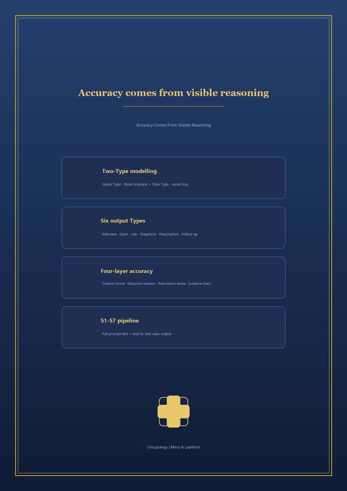
