# Genome-wide association study GWAS × Mind AI

## Accurate use and architecture: the complete content plan

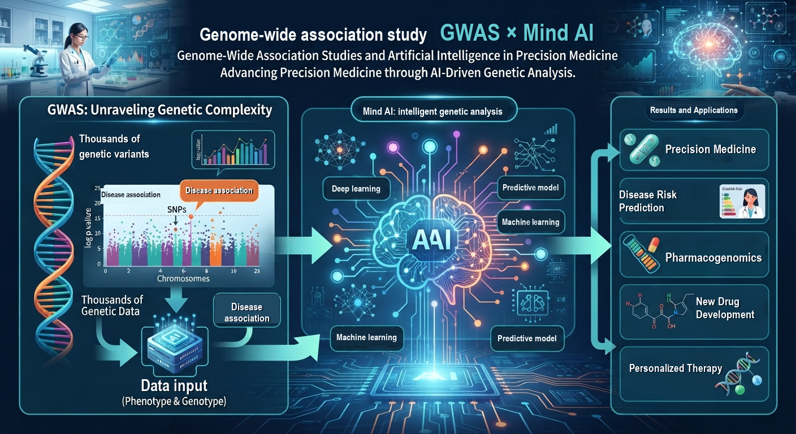

> **Theoretical foundation: Ontypology (Space Type, Time Type)**  
> **The underlying platform: Mind AI**  
> Taking the Type as the smallest descriptive unit; accuracy = reviewable accuracy  

## Table of Contents

- **Introduction See GWAS Clearly, Use It Accurately3**
- Intro-1 The Four Learning Questions5
- Intro-2 Dual-Track Readers and the Book's Routes6
- **Part One Positioning: Why GWAS Needs Types8**
- 1-1 What GWAS Is: A Genome-Wide Screening Machine8
- 1-2 Five Pain Points: The Results Are Always Misused9
- 1-3 Three-Layer Positioning: Root, Trunk, Fruit11
- **Part Two A Quick Tour of the Skeleton: One Chapter Erects the Skeleton of Types13**
- 2-1 The Cognitive Chain and the Core Propositions13
- 2-2 Three Axes and Three Brackets: The Descriptive Language of the Space Type14
- 2-3 The Time Type and the Four Function Questions16
- 2-4 Mind AI: The Position of the Underlying Platform17
- 2-5 GWAS ↔ Ontypology Mapping Summary Table18
- **Part Three The Space Type: The Types of GWAS20**
- 3-1 The Unit Type of the Research Object20
- 3-2 X-Axis Properties [ ]: Phenotype Type and Variant Type21
- 3-3 Y-Axis Composition { }: The BOM and the Three Remove Levels22
- 3-4 Z-Axis Container ( ): Cohorts and Populations23
- 3-5 Number = the Sub-Type Inside the Type: Genotype Count 0/1/224
- 3-6 The GWAS Version of the Three-Layer Judgment26
- **Part Four The Time Type: The Functions of GWAS28**
- 4-1 The Overall Function Chain: Types In, Types Out28
- 4-2 Seven Function Four-Question Cards28
- 4-3 Six-Group Mapping: Which Group GWAS Functions Belong To33
- 4-4 The Five Reasoning Families in GWAS33
- **Part Five Accurate Use: The GWAS Version36**
- 5-1 Body, Use, Accuracy: The Overall Architecture36
- 5-2 Three Kinds of Supplement: The GWAS Version36
- 5-3 The Six Proof Steps: A Complete Demonstration37
- 5-4 Eight Questions: The Checklist Before Handing Over39
- 5-5 The Misuse Comparison: 16 Kinds of GWAS Misuse40
- 5-6 The Route Decision Tree: How This GWAS Should Proceed42
- **Part Six The Overall Architecture: GWAS × Mind AI45**
- 6-1 Two Libraries, One Hub, One Loop × GWAS45
- 6-2 Reading Side by Side: Existing Frameworks in the GWAS Ecosystem46
- 6-3 Reviewable Accuracy: Four Acceptance Lines47
- 6-4 The Three Stages of AGI and GWAS's Position48
- **Part Seven The Complete Content Plan: Learn, Practise, Use, Teach, Build51**
- 7-1 Learn, Practise, Use, Teach, Build: Five Stretches of Road51
- 7-2 The Eight-Week Route51
- 7-3 Route Selection for Four Reader Situations53
- 7-4 The Four Stages of Building a Library54
- **Part Eight Conclusion: See GWAS Clearly, Use It Accurately57**
- 8-1 Book Review: Five Sentences57
- 8-2 Five Domains Side by Side: The Type Method Does Not Belong to GWAS Alone58
- 8-3 Vision: From GWAS to Unified Knowledge59
- **Appendix A Glossary60**
- **Appendix B Quick-reference cards63**
- B-3 Printable blank templates (full page)64
- **Appendix C Model answers to the exercises65**
- **Appendix D Index of figures and tables67**

## Introduction See GWAS Clearly, Use It Accurately

Genome-wide association study (GWAS) is one of the most powerful discovery engines in contemporary biomedicine: at genome-wide scale it examines, one by one, the association between hundreds of thousands to millions of genetic variants and phenotypes, fishing the clues of "gene and disease" out of massive data. Over more than a decade GWAS has found tens of thousands of association loci for thousands of phenotypes - height, diabetes, cardiovascular disease, psychiatric disorders - and has spawned a whole downstream industry chain: polygenic risk scores, Mendelian randomisation, fine-mapping.

But this engine has one acknowledged pain point: its results are easily misused. False associations slip into conclusions, effect sizes are overestimated, association is taken for causation, cross-population results are transplanted directly - every kind of misuse sends the subsequent mechanism research, drug development and clinical decisions down a wrong road. The problem is not that the statistics are insufficiently rigorous, but that "the research object and the process itself lack a descriptive language that writes the levels clearly".

What Ontypology provides is exactly this language: the Space Type answers "what Type the research object is", the Time Type answers "how the analysis workflow operates", and accurate use answers "how to judge and how to review". Underneath, Mind AI is the platform, so that knowledge, reasoning and learning are gathered into one architecture. This book has exactly one job - to see GWAS clearly and turn it into accurate use and architecture that can be taught, practised and reviewed.

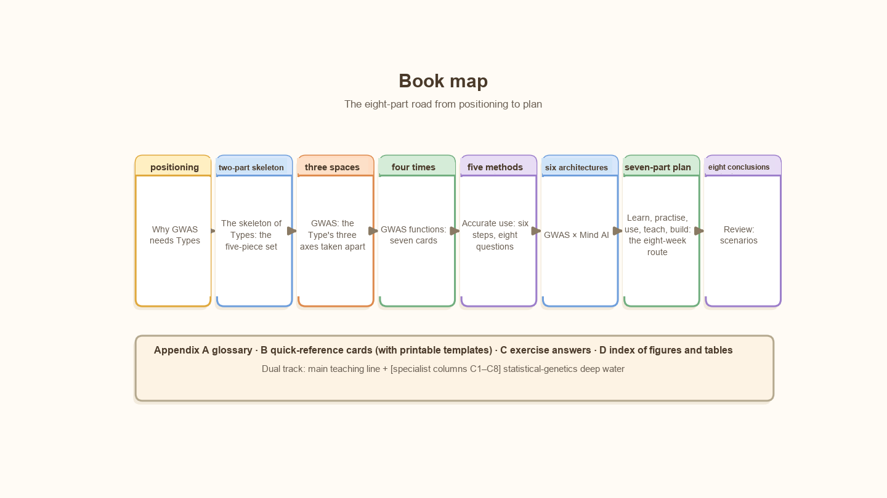

*Figure 0-1 Book map: the eight-part road from positioning to plan*

> **The book's conventions**  
> First, the theoretical foundation is Ontypology (the Space Type and the Time Type) and the underlying platform is Mind AI; the original theoretical content of the two is not restated in this book, only erected as a skeleton with architecture figures and illustrated summaries (Part Two).  
> Second, the book takes the Type as its smallest descriptive unit; notations such as the Type set { part, (content), [class] }, the three axes, the three-layer judgment and the four function questions follow the original Ontypology texts.  
> Third, this book focuses on method and architecture and does not implement a system; all GWAS content is grounded in real domain methods and conventions.  
> Fourth, dual-track reading: the main text is the teaching line; the specialist columns add the deep water of statistical genetics for researchers and engineers.  

### Intro-1 The four learning questions

Take any domain and ask four questions first: what is it? what is it composed of? where is it placed? how does it work? The first three are answered by the Space Type, the fourth by the Time Type. The answers for GWAS are the entire content of Parts Three and Four of this book.

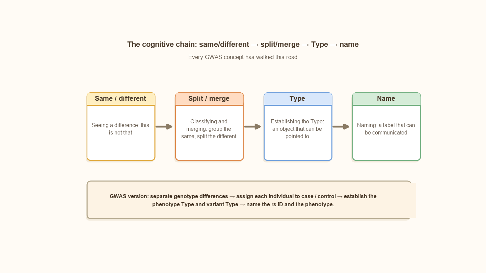

*Figure 0-2 The cognitive chain: from sameness and difference to a name - every GWAS concept has walked this road*

| **The learning question** | **How Ontypology asks** | **Where the GWAS answer lives** |
| --- | --- | --- |
| What is it? | X properties [ ]: dimension × scale | Part Three 3-2: the phenotype Type and the variant Type |
| What is it composed of? | Y composition { }: the BOM and the three remove levels | Part Three 3-3: the parts list of the research object |
| Where is it placed? | Z container ( ): C = (id(C), S(C)) | Part Three 3-4: cohort and population containers |
| How does it work? | The Time Type: a function = Types in, Types out | Part Four: the seven function cards of the GWAS workflow |

### Intro-2 Dual-track readers and the book's routes

The main text is written for "people who want to use GWAS accurately": biomedical researchers, data analysts, biotech and clinical teams. No prior study of Ontypology is needed - Part Two erects the skeleton in one chapter. Specialist columns C1 to C8 are for readers who need the deep water: core concepts of statistical genetics, mixed models, fine-mapping, polygenic risk scores, Mendelian randomisation and research ethics, one column per topic.

| **Reader** | **Suggested route** | **Key parts** |
| --- | --- | --- |
| Biomedical researchers | Introduction → One → Two → Three → Five → Appendix B | The Space Type and accurate use |
| Data analysts | Introduction → Two → Four → Five → Seven | The Time Type and process functions |
| Biotech and clinical teams | Introduction → One → Five → Six → Seven | Acceptance, architecture and rollout plan |
| Students and teachers | Read the book straight through plus each part's exercises → check answers in Appendix C | One concept, one figure, one example, one exercise |

> **[Exercise S00]**  
> Before you begin, write down your fourth question about GWAS: "how does it work?" Write three sentences in your own words, and rewrite them after finishing Part Four - the gap between the two is the road this book wants to walk with you.  

## Part One Positioning: Why GWAS Needs Types

This part first puts GWAS back where it belongs: what it does, how well it does it, and why its results are always misused. Only by seeing the pain points clearly do you know what the language of Types must supply.

### 1-1 What GWAS Is: A Genome-Wide Screening Machine

The basic move of GWAS is very plain: find a group of people, measure their phenotypes (height, disease status, blood indicators), read the variants across their genomes (usually hundreds of thousands to millions of single-nucleotide polymorphisms, SNPs), and then ask each SNP the same question - "do people carrying different genotypes differ systematically in phenotype?" Ask it at every locus in the genome, plot the answers as a Manhattan plot, and the significant peaks are candidate association loci.

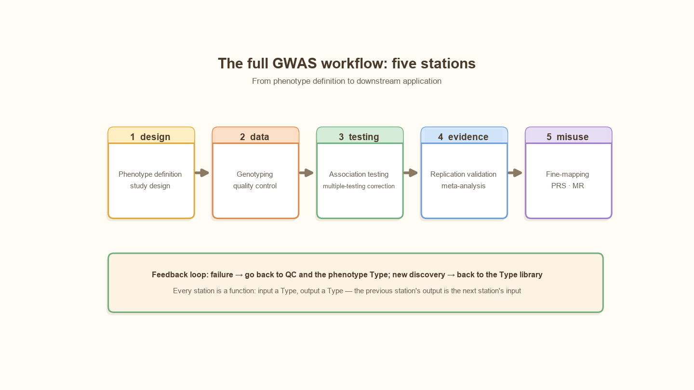

*Figure 1-1 The full GWAS workflow: five stations from phenotype definition to downstream application*

The power of this screening machine comes from "no prior position": there is no need to guess candidate genes first; one genome-wide sweep does it in one pass. Since the first GWAS in 2005 (age-related macular degeneration), the method has found tens of thousands of association loci for thousands of phenotypes, becoming public infrastructure for epidemiology, genetics and drug development.

> **In one sentence**  
> GWAS = testing, at genome-wide scale, the association of each variant with the phenotype one by one, and managing "the evidence of association" into a reviewable discovery process.  

### 1-2 Five Pain Points: The Results Are Always Misused

The GWAS methodological community is very rigorous, but GWAS's "downstream users" are spread across mechanism research, clinical practice, agriculture, forensics and consumer genetic testing - and every link can bend the results. The five commonest pain points are:

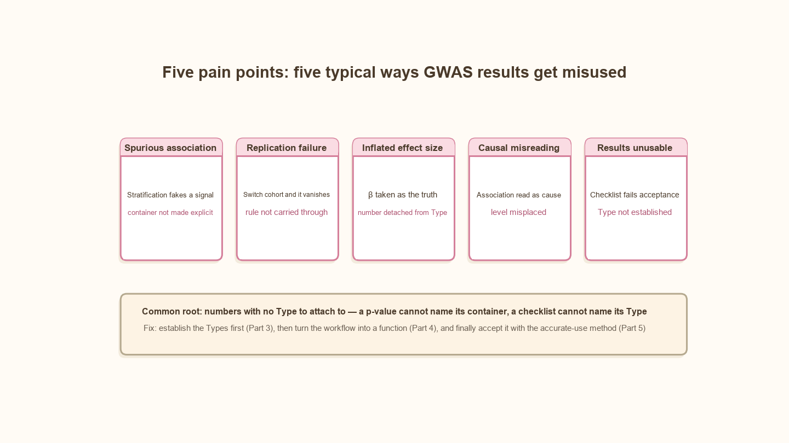

*Figure 1-2 Five pain points: five typical ways GWAS results are misused*

| **#** | **Pain point** | **What it looks like on the ground** | **An Ontypology diagnosis** |
| --- | --- | --- | --- |
| 1 | False association | Population stratification, sample quality and batch effects masquerading as signal | Container ( ) not written clearly: identity and level are confused |
| 2 | Replication failure | The same locus disappears in another cohort | Incomplete criteria: the [ ] rule does not run through all samples |
| 3 | Overestimated effect sizes | The discovery cohort's effect size treated as the true value | Numbers leaving the Type: the winner's curse |
| 4 | Causal misreading | "This gene causes the disease" said off the cuff | Level confusion: association is not causation; the Time Type was never walked |
| 5 | Results hard to use | Hundreds of loci piled in a list, impossible to accept | The Type was never erected: without a Type set, there is no judgment and no inheritance |

These five pain points share a common root: GWAS produces "numbers" - p values, effect sizes, locus lists - but the "Types" supporting those numbers (what the research object is, what it is composed of, where it is placed, how it is analysed) were never written down completely. Without the Type, numbers have nothing to depend on: a p value cannot say which container it was computed in, and a locus list cannot say which class it belongs to. This is precisely the lesson "Types first, then numbers" supplies.

> **[Specialist column] C1 A brief history of GWAS: from candidate genes to million-person studies**  
> The 1990s: the candidate-gene era - guess a gene first, then test its association with disease. Low hit rates and high replication failure, because "guessing" is itself a source of bias.  
> 2005: the first GWAS appeared (Klein et al., age-related macular degeneration, CFH gene) - genome-wide screening without a prior position entered the stage.  
> 2007: WTCCC (the Wellcome Trust Case Control Consortium) set the GWAS conventions with 14,000 people and 17 phenotypes: unified QC, unified criteria, open data.  
> From 2008: international consortia - GIANT (height), DIAGRAM (diabetes) and other meta-analyses pushed samples into the hundreds of thousands; the GWAS Catalog became the public register.  
> From 2018: the Biobank era - UK Biobank's 500,000 people, FinnGen, BioBank Japan and Taiwan Biobank turned GWAS into routine infrastructure; mixed models (SAIGE, REGENIE) solved large samples and unbalanced case ratios.  
> The 2020s: million-person studies and multi-ancestry GWAS rose, with the centre of gravity shifting to fine-mapping, functional annotation, polygenic risk scores and cross-population transferability.  
> An Ontypology reading: the history of GWAS is a history of "erecting Types ever more accurately" - from guessing to census, from solitary work to consortia, from discovery to reviewable application.  

### 1-3 Three-Layer Positioning: Root, Trunk, Fruit

Look at GWAS through Ontypology's three-layer positioning and the position is obvious. Ontology is the root - it asks "what is there in this world of the genome": individuals, variants, phenotypes, populations; these "what is there" are the premises GWAS stands on. Ontypology is the trunk - it asks "what Type these things are, how to judge them, how they operate": writing the research object as a Type set, the workflow as functions, and the judgment as reviewable reasoning. Accurate use of GWAS is the fruit - once the Types are erected, every step of the workflow has criteria, and results become acceptable, inheritable and applicable.

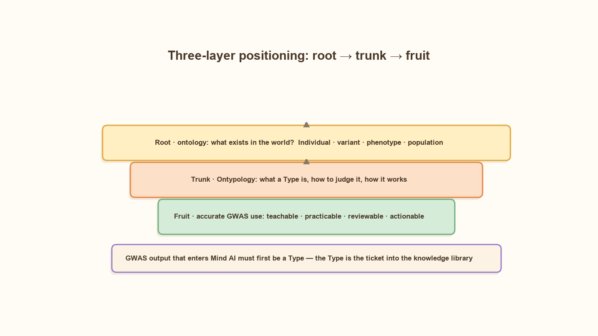

*Figure 1-3 Three-layer positioning: root (ontology) → trunk (Ontypology) → fruit (accurate use of GWAS)*

Placing GWAS within this positioning brings a practical bonus too: when GWAS outputs are to enter the Mind AI platform - to be stored, reasoned over and learned - they must first be "Types". The Type is the ticket for knowledge to enter the library.

> **[Exercise E01]**  
> Use the five pain points to check a GWAS report you are familiar with (or the results section of a paper): how many pain points does it hit? For each, try to identify whether it is "container not written clearly, rule not applied throughout, numbers leaving the Type, or level confusion".  

> **[Exercise E02]**  
> Why does "Types first, then numbers" exactly explain GWAS replication failure? Explain in two sentences: if the "Type" of an association (the research object and the rules) is not written clearly, what quietly changes when you move to another cohort?  

## Part Two A Quick Tour of the Skeleton: One Chapter Erects the Skeleton of Types

This book does not restate the existing theory of Ontypology and Mind AI - those have their own volumes. But to write GWAS clearly with Types, the skeleton must first be erected: the cognitive chain, the three axes and three brackets, the three-layer judgment, the four function questions, the position of Mind AI, and the mapping summary table between GWAS and Ontypology. This chapter is the foundation of the book, and every part afterwards returns here to draw on it.

### 2-1 The Cognitive Chain and the Core Propositions

A Type is born along a fixed cognitive chain: first the sense of "sameness and difference", then the acts of "splitting" and "combining", and finally the Type is born, and a Type must have a name. Two core propositions run through the book: wherever there is combination there is a Type - as soon as you combine things into a whole, there is a Type there; number = the sub-Type inside the Type, counted by comparison - number always depends on a Type already identified, counting under the same Type how many times its sub-Type occurs. The conclusion is one sentence: Types first, then numbers.

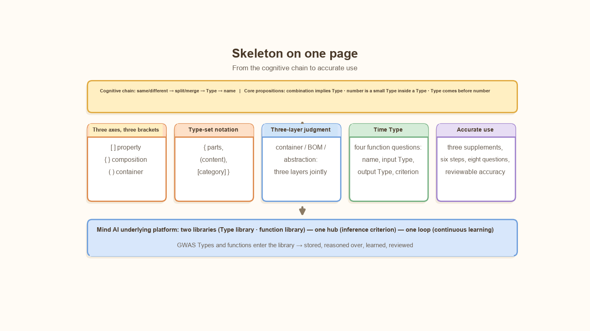

*Figure 2-1 The one-page skeleton figure: from the cognitive chain to accurate use*

### 2-2 Three Axes and Three Brackets: The Descriptive Language of the Space Type

The Space Type describes an object completely with three axes and three kinds of bracket: X-axis properties [ ] answer "what it looks like" - dimension and scale, where a property is a question that can be asked and a property value is the concrete answer; Y-axis composition { } answers "what it is composed of" - the bill of materials (BOM) and the three remove levels; Z-axis container ( ) answers "where it is placed" - C = (id(C), S(C)), identity and internal space, with the axiom of invariance: swap the content, id(C) unchanged. The unit Type gathers the three into the complete notation: Type set = { part, (content), [class] }.

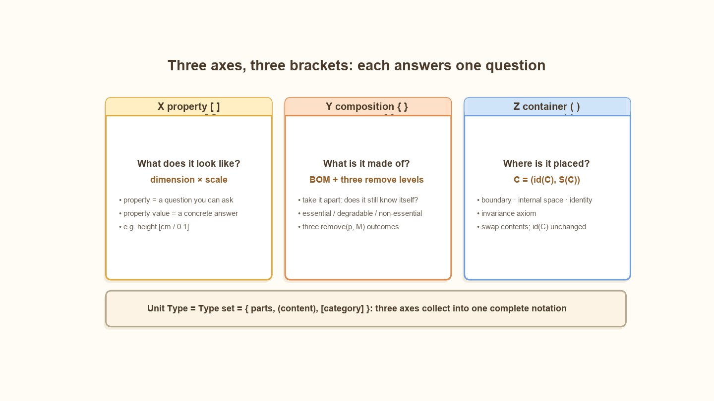

*Figure 2-2 Three axes and three brackets: X properties, Y composition and Z container each answer one question*

The three remove levels answer "how vital is a part": remove the part from the whole - remove an essential part and identity is lost (remove(p,M) ≢ M); remove a function-degraded part and function is missing but identity survives (remove(p,M) ≡ M′ ⊂ M); remove a non-essential part and nothing is affected (remove(p,M) ≡ M). The three-layer judgment splits judgment into three layers: the container layer verifies id(C), the composition layer verifies the remove grading, and the abstract layer verifies the class criterion T = (F(T), ∩(T)) - the three layers act jointly, none may be missing.

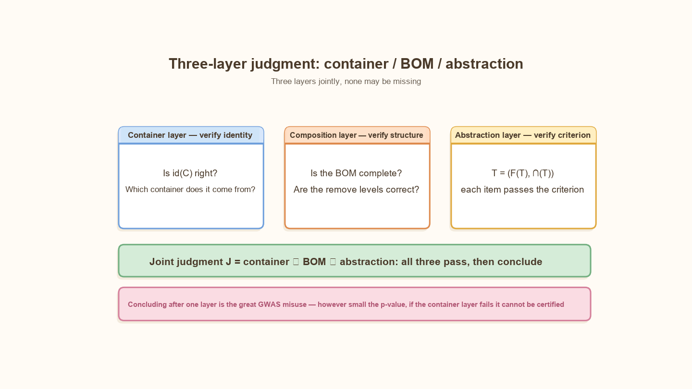

*Figure 2-3 The three-layer judgment: container / BOM / abstract, all three jointly, none may be missing*

### 2-3 The Time Type and the Four Function Questions

The Time Type is the Type of verbs: a function = a method = a move = a service = a dharma gate. For a verb to take shape, write out the four function questions in full - name, input Type, output Type, criteria. The Time Type depends on the Space Type: input a Type, output a Type. Choosing a function has four fixed steps: ask the purpose, match the function group, fill in the four questions, review on duty. Accurate use is gathered as: three kinds of supplement ([ ] supplements the rule, ( ) the identity, { } the structure), the six proof steps (clarify the whole → describe along the axes → write the Type set → fix the proposition → criteria and reasoning → three-layer check), the eight-question checklist and the misuse comparison. Accuracy = reviewable accuracy.

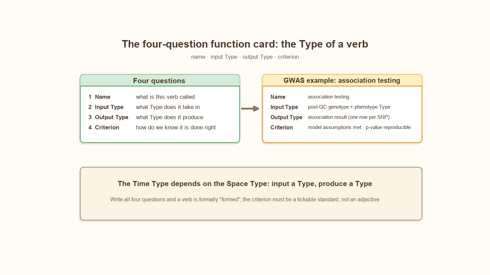

*Figure 2-4 The function four-question card: name, input Type, output Type, criteria*

### 2-4 Mind AI: The Position of the Underlying Platform

Mind AI is the practical platform of Ontypology and the Mind Model, aiming at an intelligence architecture on the road to AGI: it runs on two libraries (Type library, function library), one hub (reasoning and criteria hub) and one loop (continuous learning loop), with the LLM responsible for language capability and the Mind Model for intelligence capability. This book gathers GWAS knowledge and processes into Types and functions precisely so that they can enter this platform - to be stored, reasoned over, learned and reviewed.

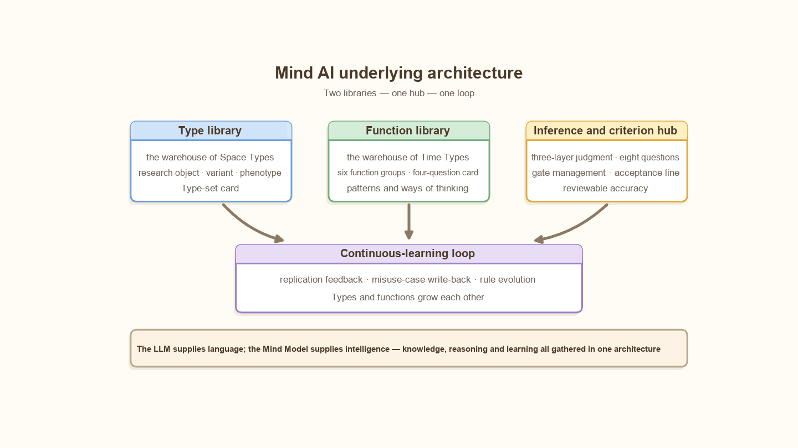

*Figure 2-5 Mind AI's underlying architecture: two libraries, one hub, one loop*

### 2-5 GWAS ↔ Ontypology Mapping Summary Table

Finally, line the two sides up. This mapping summary table is the book's converter: every part that follows merely unfolds one row of this table into a method.

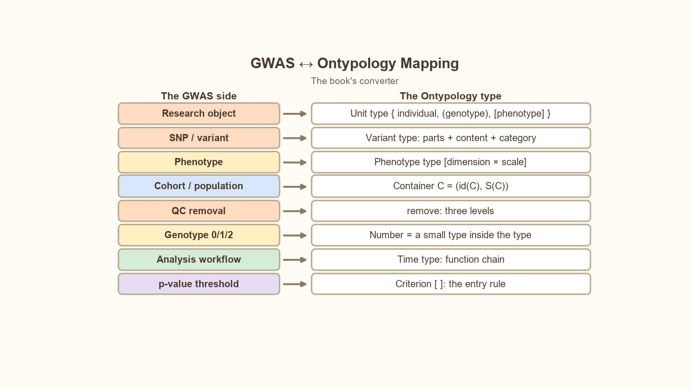

*Figure 2-6 GWAS ↔ Ontypology mapping summary table: the book's converter*

| **The things of GWAS** | **The Type of Ontypology** | **Which axis / which question it falls on** |
| --- | --- | --- |
| The research object (an individual in a cohort) | Unit Type { individual, (genotype), [phenotype] } | The complete notation of the Type set |
| SNP / variant | Variant Type: parts + content + class | Y composition { }: the parts of the genome |
| Phenotype (height, disease status) | Phenotype Type [dimension × scale] | X properties [ ] |
| Cohort / population | Container C = (id(C), S(C)) | Z container ( ) |
| QC exclusion rules | Three levels of remove | Y composition: the essential-part criterion |
| Genotype count 0/1/2 | Number = the sub-Type inside the Type, counted by comparison | Type before number |
| The analysis flow (QC → testing → replication) | The Time Type: the function chain | The Function Four Questions |
| The p value and the criterion (5×10⁻⁸ etc.) | Criterion [ ]: the entry rule | The abstract layer of the three-layer judgment |

> **[Exercise E03]**  
> Without the book, draw a simplified version of the one-page skeleton figure (Figure 2-1): the cognitive chain, the three axes, the three-layer judgment, the four function questions and accurate use, each with a one-sentence definition. Then compare with 2-1 to 2-4 and fill the gaps.  

> **[Exercise E04]**  
> Pick three rows from the mapping summary table and add one concrete example from your own GWAS practice to each (e.g. "phenotype Type [dimension × scale]" → "height, unit centimetres, scale to 0.1").  

## Part Three The Space Type: The Types of GWAS

This part takes the GWAS research object apart: individual, variant, phenotype, cohort - what Type is each? Write them out with the three axes and three brackets and you will find that the most intractable problems in the GWAS workflow - population stratification, sample quality, phenotype heterogeneity - are in fact different faces of "Types that were never erected".

### 3-1 The Unit Type of the Research Object

The object of judgment in GWAS is "an individual in a cohort". Written in Type-set notation: unit Type = { individual (part), (genotype content), [phenotype class] }. Parts are what can be taken apart in this Type - sample, DNA, genotype, phenotype record, covariates; content is what can be replaced without changing identity - genotype readings may be re-read when the genotyping platform is updated, but the individual is still that individual; the class is the open rule that decides which category it belongs to - case / control / quantitative-trait individual.

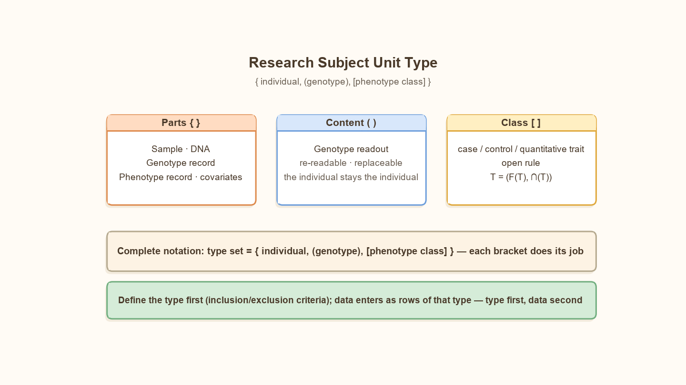

*Figure 3-1 The unit Type of the research object: { individual, (genotype), [phenotype class] }*

Types first, then data. Many people think GWAS is "a data table first, then analysis"; Ontypology takes the opposite view: define the individual's Type first (the entry specification), and only then do data arrive as rows. This is why the "inclusion and exclusion criteria" in a study design document matter so much - they are this Type's [ ] entry rule.

> **The Type is not a metaphor**  
> The header of a GWAS data table is a Type by nature: a shared list of questions (ID, sex, age, PC1..PCk, phenotype, genotype columns) that itself holds no answers but prescribes where the answers live. Every subject is one entity row. This is the same structure as the RDB's "the header is the Type, the data rows are entities".  

### 3-2 X-Axis Properties [ ]: Phenotype Type and Variant Type

A property is a dimension made up of "dimension × scale". The dimension of a phenotype Type answers "what is measured", the scale answers "to what fineness": height (centimetres, scale 0.1), disease status (binary: case/control), blood lipids (mmol/L, scale 0.01), age at onset (years). The scale is not a small matter - with different scales of phenotype definition, the same GWAS reaches different conclusions: "type 2 diabetes" defined by physician diagnosis codes, by a fasting-glucose cut-off, or by self-report are three different phenotype Types.

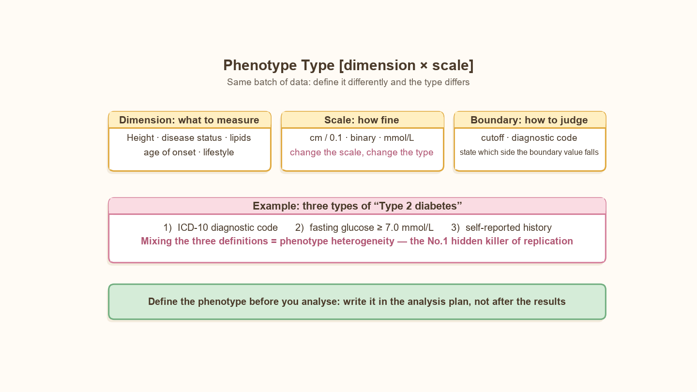

*Figure 3-2 Phenotype Type [dimension × scale]: the same data, a different definition, a different Type*

The variant Type also falls on the X axis: a SNP's properties include chromosomal position, reference/alternate alleles, variant class (SNP/indel/CNV), minor allele frequency (MAF) and functional annotation (intronic/exonic/regulatory). These properties are "the questions that can be asked", and each concrete locus gives its own answer under each question.

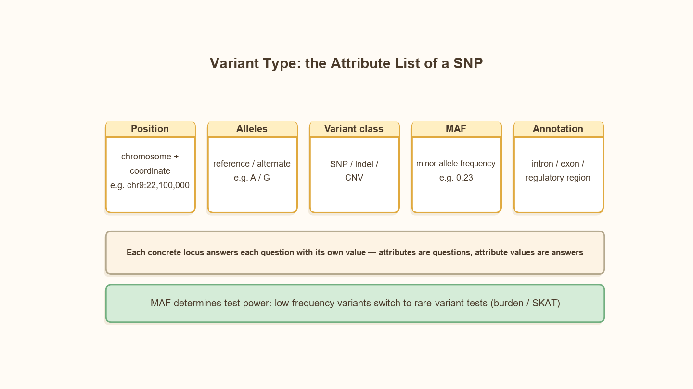

*Figure 3-3 The variant Type: a SNP's property list and scales*

### 3-3 Y-Axis Composition { }: The BOM and the Three Remove Levels

The BOM (bill of materials) of a GWAS study, taken apart, is: study protocol, subjects, biological samples, genotype data, phenotype data, covariates, analysis scripts, output reports. Use the remove criterion to grade each part - take the part away; does the study still stand?

| **Three levels of remove** | **Definition** | **GWAS part examples** | **Consequence of removal** |
| --- | --- | --- | --- |
| Essential part | Identity lost after removal | Genotype data, phenotype data, sample identity | The study is no longer GWAS |
| Function-degraded part | Function missing but identity survives | Covariates (age, sex, PCs), replication cohort, fine-mapping | Only preliminary discovery remains; credibility degraded |
| Non-essential part | No effect at all after removal | Aesthetic layout, secondary annotations, incidental questionnaires | No effect |

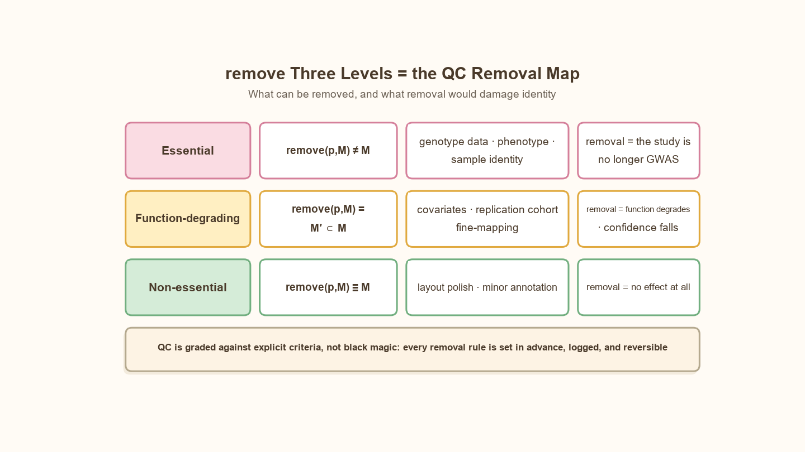

*Figure 3-4 The three remove levels = the QC exclusion map: what can be excluded, and what damages identity when excluded*

QC exclusion rules are exactly where the remove criterion is applied: excessive sample missingness, sex inconsistency, unhandled relatedness, abnormal heterozygosity - each exclusion rule answers "is this sample or locus a problem with an essential part, or noise in a non-essential part?" Think of QC as the three remove levels, and exclusion stops being black magic and becomes graded judgment with criteria.

### 3-4 Z-Axis Container ( ): Cohorts and Populations

Container C = (id(C), S(C)): identity id(C) and internal space S(C). Axiom of invariance: ∀ e₁, e₂ ∈ S(C), replacing e₁ with e₂ does not change id(C). GWAS containers nest layer by layer: the biobank (UK Biobank, Taiwan Biobank) is the outermost container, the cohort is the container at the study level, the population is the container at the genetic-structure level, and the pedigree is the innermost container.

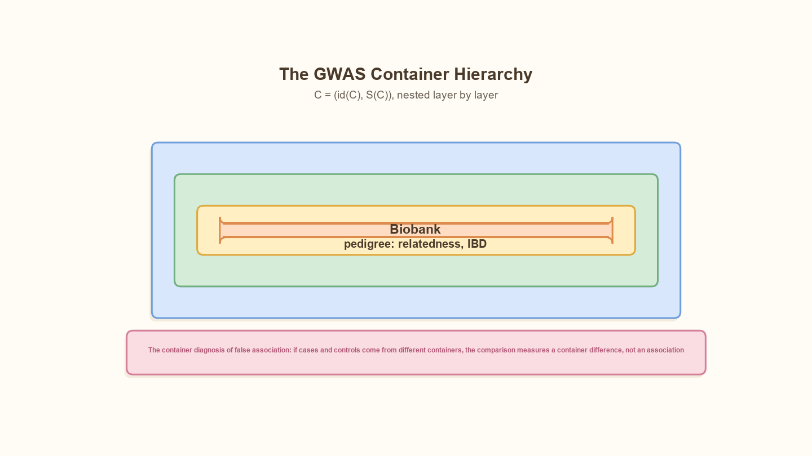

*Figure 3-5 GWAS container hierarchy: biobank → cohort → population → pedigree*

The container Type solves GWAS's first pain point - population stratification. The typical source of so-called false association is that "cases and controls come from different population containers": allele-frequency differences between populations masquerade as disease association. In container language: what you are comparing is actually the difference between two containers, not the association between the contents of a container and the phenotype. PCA correction, genomic control and mixed models all do the same thing - subtract the container effect from the comparison.

> **Identity and appearance**  
> id(C) is the cohort's identity: samples can be swapped and data re-read, but the cohort's protocol and entry specification do not change. In meta-analysis "which id is this cohort" must be explicit - sample overlap (the same id counted once by each of two studies) is the most hidden source of misuse in meta-analysis.  

### 3-5 Number = the Sub-Type Inside the Type: Genotype Count 0/1/2

Genotype coding 0/1/2 is the textbook example of "number = the sub-Type inside the Type, counted by comparison": first erect the Type (this locus has two alleles, A and a), and only then can you count (how many copies of the minor allele a this individual carries - 0, 1 or 2). Allele frequency, MAF and Hardy-Weinberg testing all "count sub-Types under the same Type". This is why "Type before number" is especially easy to verify in GWAS: even the most basic number, the genotype, depends on the variant Type.

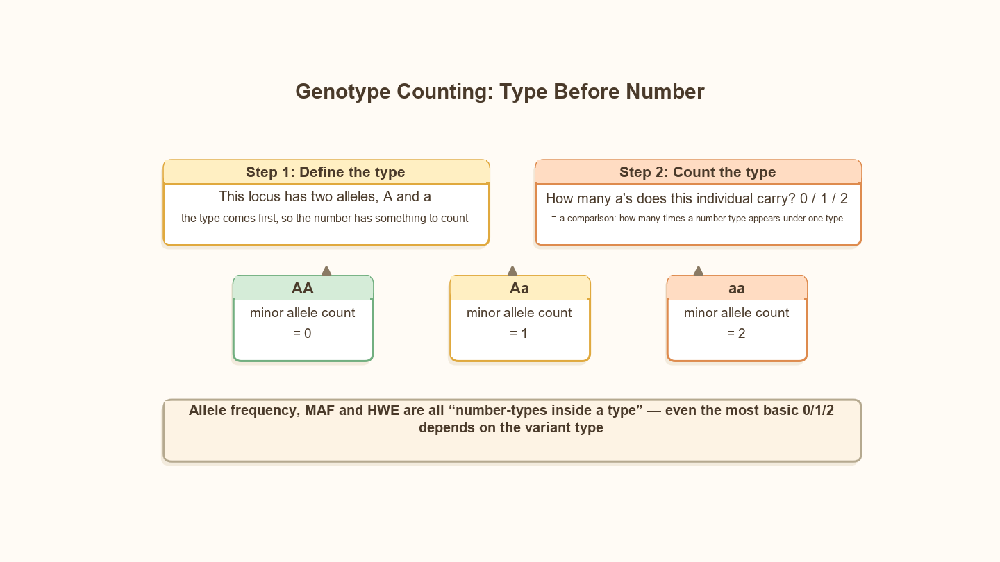

*Figure 3-6 Genotype count: the GWAS version of "Type before number"*

> **[Specialist column] C2 The core four of statistical genetics: HWE, MAF, LD, PCA**  
> Hardy-Weinberg equilibrium (HWE): in a randomly mating population, genotype frequencies p²/2pq/q² are determined by allele frequencies. Departure from HWE usually signals a quality problem (genotyping error) or an evolutionary force (selection, admixture) - HWE testing in controls is a standard GWAS QC step.  
> Minor allele frequency (MAF): the frequency of the less common allele. MAF determines test power - low-frequency variants need larger samples; rare variants with MAF < 1% require rare-variant tests (burden test, SKAT).  
> Linkage disequilibrium (LD): the non-random combination of alleles at neighbouring loci (r², D′). LD makes GWAS significant signals "come out in patches" - SNPs within the same LD block come and go together, which is the problem fine-mapping exists to solve.  
> Principal component analysis (PCA): compress genome-wide variation into a few principal components that capture population genetic structure. Putting the first few PCs into the regression model as covariates is the standard way to correct population stratification - the mathematisation of container effects.  

### 3-6 The GWAS Version of the Three-Layer Judgment

Apply the three-layer judgment to the everyday GWAS question: "is this association result trustworthy?" The container layer verifies identity - which cohort does the data come from? Did the samples pass QC? Was population stratification handled? The composition layer verifies structure - are the essential parts all present (genotype + phenotype + covariates)? Is the remove grading correct (which were excluded, which retained at a degraded level)? The abstract layer verifies criteria - does it pass ∩(T)? (p value past the threshold, effect size plausible, direction replicable, biologically explicable). The three layers act jointly, none may be missing - concluding from the p value alone is the typical misuse of making only one layer of judgment.

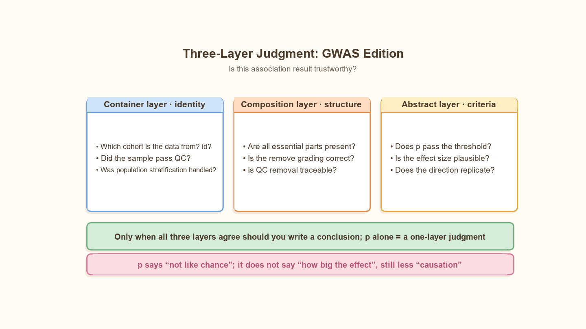

*Figure 3-7 The GWAS version of the three-layer judgment: is this association result trustworthy?*

> **[Exercise E05]**  
> Write your study's (or a GWAS paper's) phenotype as a phenotype Type [dimension × scale]: what is measured? the unit? the scale? how are boundary values judged? Then answer: if the scale were changed to another definition, would the study's conclusion change?  

> **[Exercise E06]**  
> List the BOM of a GWAS study (at least 8 parts) and grade it with the three remove levels. Which part do most people mistake for "non-essential" when it is actually essential or function-degraded?  

> **[Exercise E07]**  
> Why is "cases and controls come from different populations" an error at the container layer rather than the abstract layer? Explain in the language of C = (id(C), S(C)): where does the comparison happen, and where is the bias hidden?  

## Part Four The Time Type: The Functions of GWAS

Only once the Space Type is erected can verbs take the stage. The GWAS analysis workflow is a function chain: each step inputs a Type and outputs a Type, and the previous step's output Type is exactly the next step's input Type. This part writes the seven core steps of the workflow as seven function four-question cards - name, input Type, output Type, criteria - and each card can be taken directly to check your analysis script.

### 4-1 The Overall Function Chain: Types In, Types Out

Read the whole GWAS workflow as Types in and Types out: raw data Type (genotype + phenotype before QC) → post-QC data Type → corrected testing Type → association result Type → significant discovery Type → replication Type → downstream application Type (fine-mapping, PRS, mechanism research). No link of the function chain may be skipped - skipping QC and testing directly is stuffing a Type whose identity was never verified into the function.

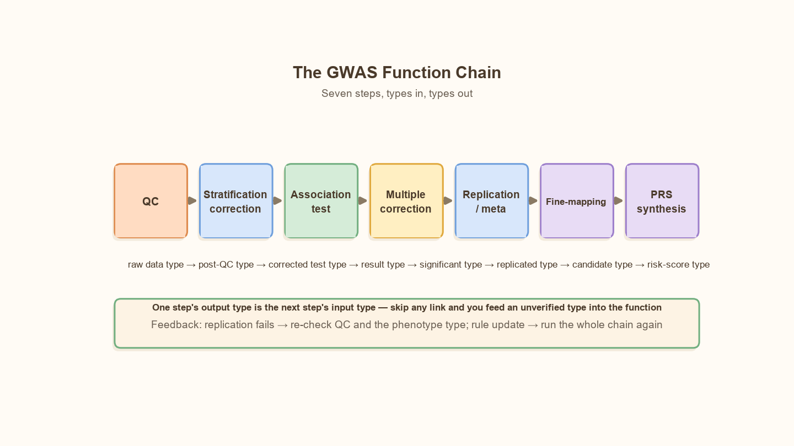

*Figure 4-1 The GWAS function chain: seven steps, Types in and Types out*

### 4-2 Seven Function Four-Question Cards

The seven cards below are the core of this part. Each card has one figure and one example: the left half is the four function questions (name / input Type / output Type / criteria), the right half is the commonest misuse warning for that step.

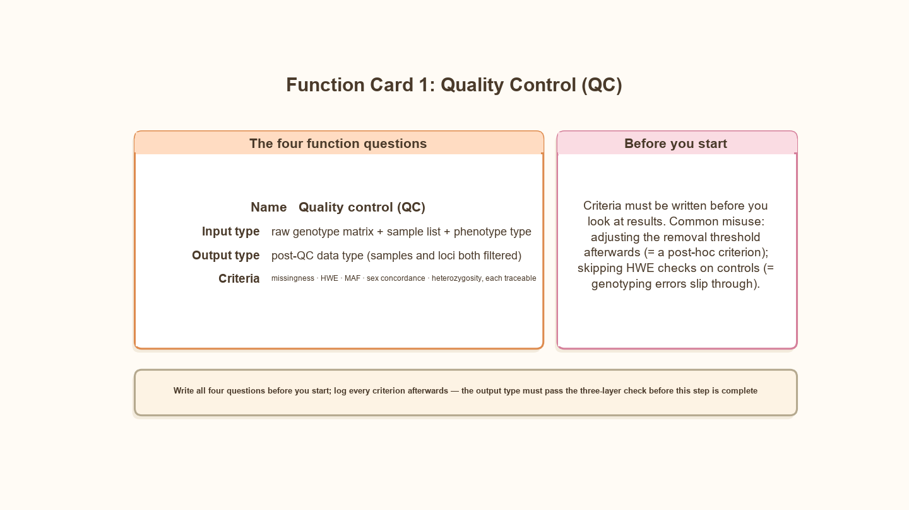

*Figure 4-2 Function card one: quality control QC*

Example: in a cohort of 100,000, exclude samples with missingness > 5% (essential part damaged - the genotype reading is untrustworthy), loci with missingness > 5%, and controls with HWE p < 10⁻⁶ (suspected genotyping error). QC criteria must be written into the analysis plan and fixed before looking at results - post-hoc criteria means quietly changing the [ ] rule into the [ ] result.

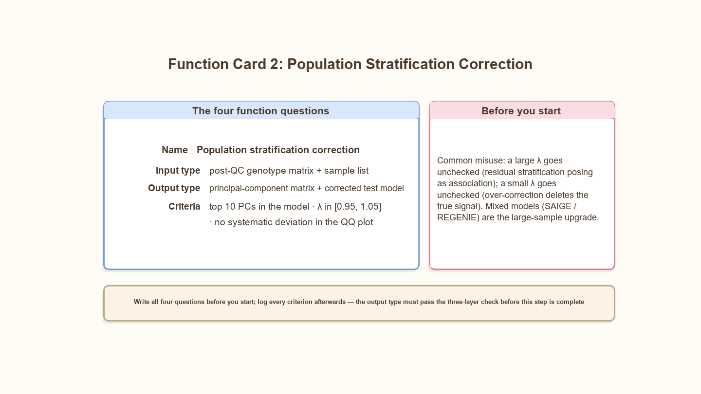

*Figure 4-3 Function card two: population stratification correction*

Example: run PCA on the genotype matrix, take the first 10 principal components as covariates in the regression model, and draw a QQ plot to check whether the genomic inflation factor λ is close to 1. λ far above 1 indicates residual stratification or quality problems; λ below 1 indicates over-correction - container effects must be subtracted, but not together with the true signal.

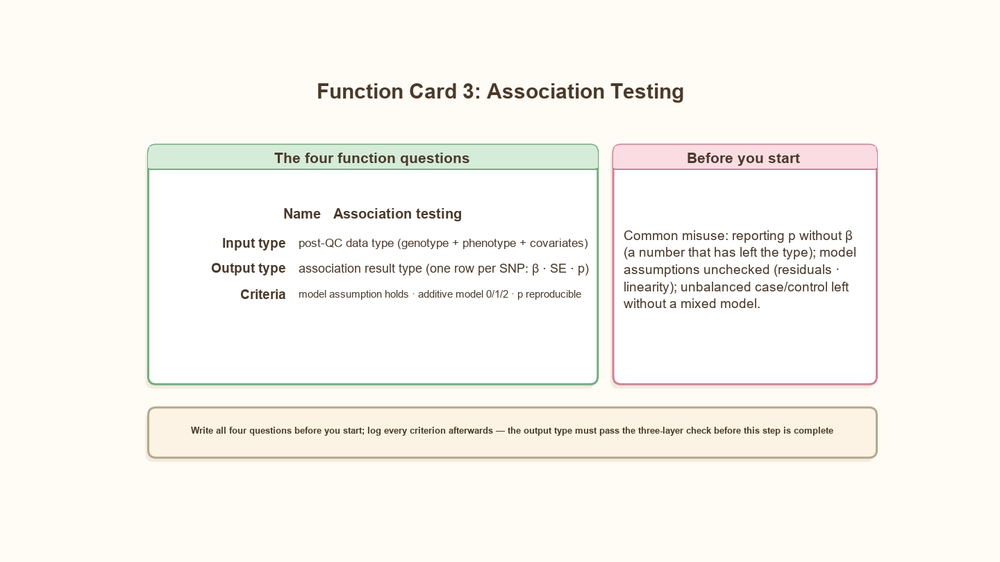

*Figure 4-4 Function card three: association testing*

Example: run logistic regression (case/control) or linear regression (quantitative phenotype) for each SNP, coding genotype additively as 0/1/2, with age, sex and the first 10 PCs as covariates. For large samples or complex relatedness, switch to a mixed model (BOLT-LMM, SAIGE, REGENIE). The output of this step is an association result Type of "one row per locus".

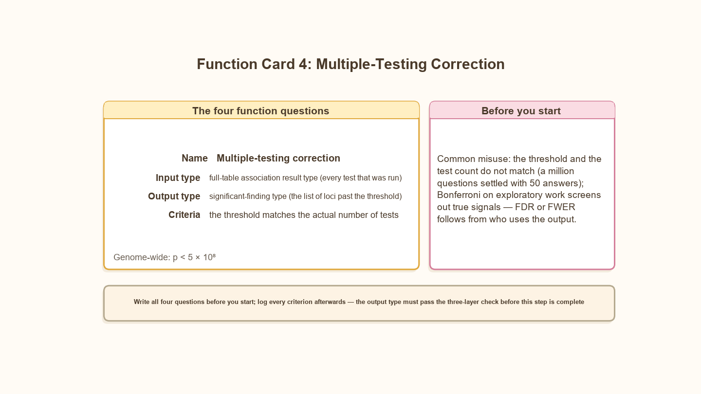

*Figure 4-5 Function card four: multiple-testing correction*

Example: for one million independent tests, the Bonferroni threshold is 0.05/1,000,000 = 5×10⁻⁸ - the acknowledged source of genome-wide significance. If you care about only 50 pre-specified hypotheses, the threshold can be relaxed to 0.05/50. The essence of multiple-testing correction: the criterion [ ] must match "how many questions you actually asked".

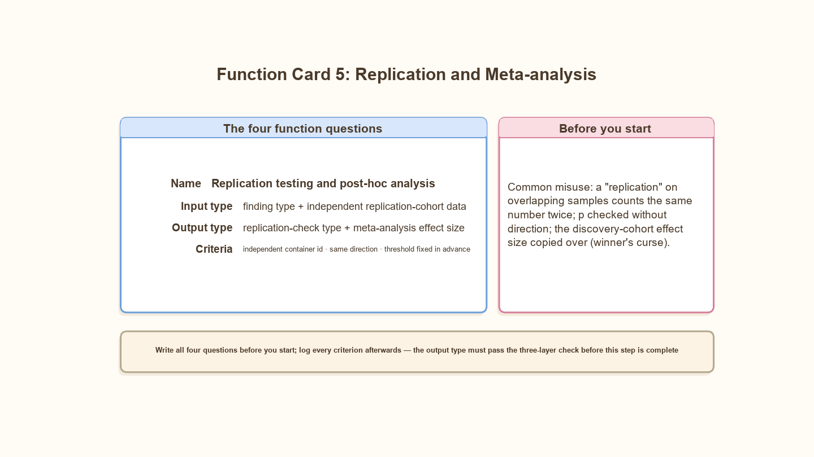

*Figure 4-6 Function card five: replication and meta-analysis*

Example: obtain an association between rs12345 and type 2 diabetes in the discovery cohort (OR = 1.15), verify in an independent replication cohort that the direction agrees and p < 0.05, then run a fixed-effect or random-effect meta-analysis. The replication cohort must be a different container id - a "replication" with overlapping samples is not replication, it is counting the same number twice.

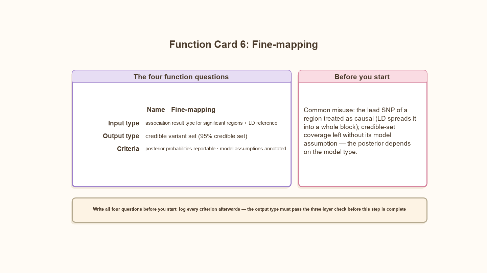

*Figure 4-7 Function card six: fine-mapping*

Example: within a significant region 30 SNPs are in high linkage; use fine-mapping (SuSiE, FINEMAP etc.) to compute a posterior probability for each variant and select a credible set covering 95% confidence. The output Type is refined from "a region" to "a list of candidate causal variants" - this is the bridge from association to mechanism research.

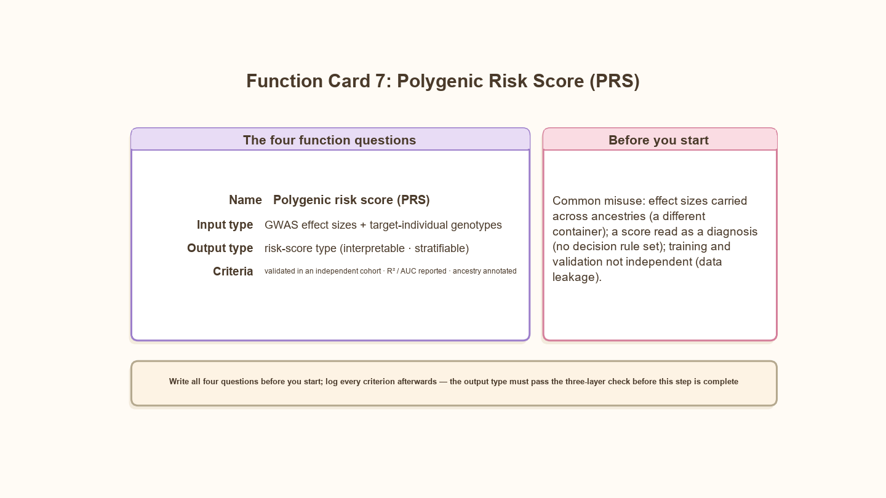

*Figure 4-8 Function card seven: polygenic risk score PRS*

Example: weight and combine the GWAS effect sizes into a score PRS = Σ βᵢ × genotypeᵢ, and evaluate in an independent cohort how much of the disease it explains (Nagelkerke R², AUC). PRS is "the combined Type of thousands of small-effect Types" - each locus contributes a little, and together they become a new judgeable Type. Before cross-population application it must be recalibrated: the effect sizes come from one container, and only that container can be transferred to directly.

### 4-3 Six-Group Mapping: Which Group GWAS Functions Belong To

The Time Type's function library has six function groups. Put the seven GWAS cards in: QC and correction belong to the "analysis and problem-solving group" (taking a problem apart and solving it piece by piece); association testing and multiple-testing correction belong to the statistical reasoning of the "reasoning group"; replication and meta-analysis belong to the "cognition and extraction group" (finding stable Types among existing discoveries); fine-mapping and PRS belong to the "design and generation group" (generating usable new Types from discoveries); and the continuous optimisation of the whole process - going back to change QC rules, updating phenotype definitions - belongs to the continuous learning of the "growth and maintenance group". The research and exploration group opens the next round: new phenotypes, new populations, new methods.

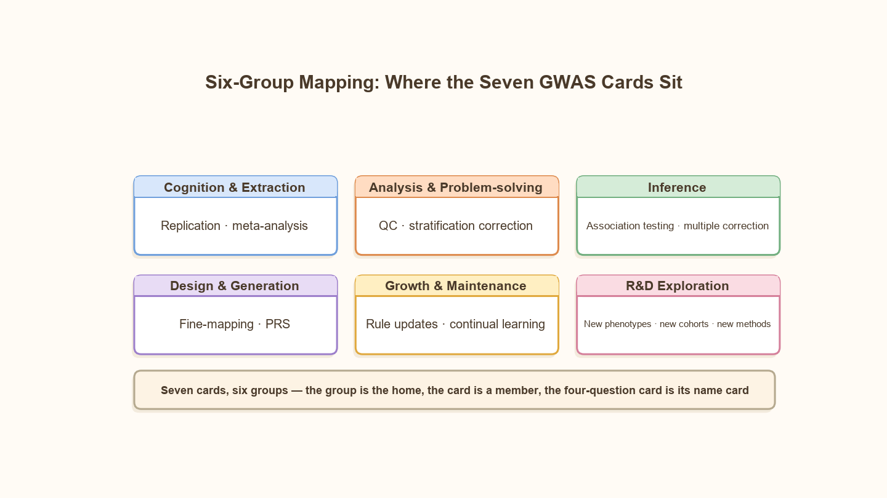

*Figure 4-9 Six-group mapping: where the seven GWAS cards sit in the function library*

### 4-4 The Five Reasoning Families in GWAS

The Time Type's five reasoning families each have a shop floor in GWAS: statistical reasoning is the main engine (p values, confidence intervals, posterior probabilities); causal reasoning is the follow-up question at the meta level (is this association causal? - MR and experimental validation); reverse-causal reasoning is backtracking (seeing a phenotype difference, inferring which variant is acting); simulation reasoning is counterfactual (if this genotype changed, what would happen to risk? - TWAS, gene-network simulation); reverse reasoning learns from failure (a replication failure backtracks to a QC gap). Choosing a reasoning family has the same four steps as choosing a function: ask the purpose, match the group, fill in the four questions, review on duty.

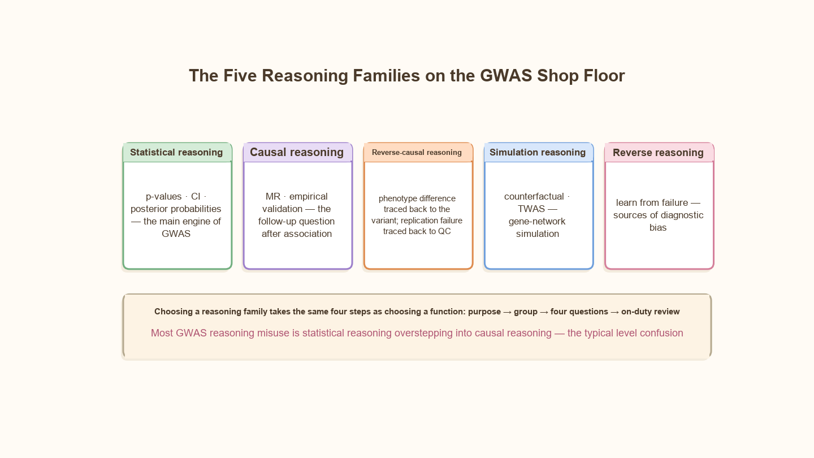

*Figure 4-10 The five reasoning families on the GWAS shop floor*

> **[Specialist column] C3 Where 5×10⁻⁸ comes from: an Ontypology reading of multiple testing**  
> The genome-wide significance threshold p < 5×10⁻⁸ is not arbitrary: in European populations there are about one million "independent" tests (LD compresses six million SNPs into about one million effective tests), and Bonferroni gives 0.05/1,000,000 = 5×10⁻⁸.  
> An Ontypology reading: the threshold is simply the criterion ∩(T) of the abstract layer, and its value depends on "how many questions you asked" - the number of questions belongs to the Type, not to the numbers.  
> Thresholds differ for multi-ancestry studies: African populations have shorter LD and more effective tests, so the threshold must be stricter; East Asian populations the reverse. Before transplanting a threshold, ask: in my container, how many effective tests are there?  
> Alternative route: false discovery rate (FDR) control governs "the proportion of false positives in the discovery list" and suits exploratory research; Bonferroni governs "the probability of at least one false positive" and suits confirmatory research. Which criterion to choose depends on who will use the output Type.  

> **[Exercise E08]**  
> Write a function four-question card for an analysis step you know best (not limited to GWAS): name, input Type, output Type, criteria. The criteria column must be written as "standards you can tick off", not adjectives like "good quality".  

> **[Exercise E09]**  
> Suppose you do GWAS in two cohorts and then meta-analyse, and later find that the two cohorts share 5% of samples. Using the language of "container id and contents", explain: why does this invalidate replication? How should it be remedied?  

> **[Exercise E10]**  
> Why is PRS = Σ βᵢ × genotypeᵢ a "combined Type" rather than a simple sum? Answer with "numbers depend on Types": does each βᵢ still mean anything once it leaves the variant Type and the container it belongs to?  

## Part Five Accurate Use: The GWAS Version

The tools are all in place. This part gathers them into a method: facing a GWAS project or a set of GWAS results, how to use it accurately step by step and to self-accept before handing it over. Accuracy is reviewable accuracy - others can tick off and reproduce your reasoning sentence by sentence.

### 5-1 Body, Use, Accuracy: The Overall Architecture

The overall architecture of accurate use is three words: body, use, accuracy. Body is the Space Type - are the research object's Types erected (Part Three); use is the Time Type - are the four questions written for each function of the workflow (Part Four); accuracy is criteria and review - the three-layer judgment, the eight-question check, the misuse comparison (this part). Missing any one of the three and GWAS results remain at the level of "numbers", unable to become acceptable "discoveries".

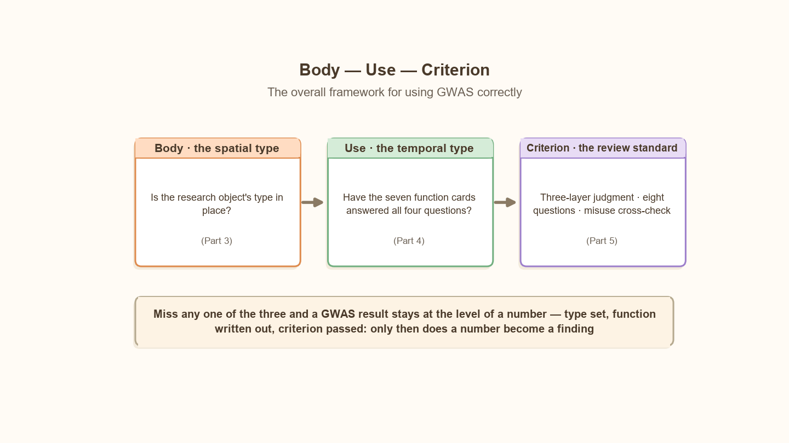

*Figure 5-1 Body, use, accuracy: the overall architecture of accurate GWAS use*

### 5-2 Three Kinds of Supplement: The GWAS Version

The three supplements of accurate use each have a landing point in GWAS: [ ] supplements the rule - every criterion in the analysis plan (inclusion and exclusion, QC thresholds, significance thresholds, replication standards) is an open rule, not a hard-coded list, so new samples can be judged by the same set of rules; ( ) supplements identity - every sample, every cohort and every data set has an unchanging identity marker (sample id, cohort id, database accession), so content can be re-read but identities cannot be confused; { } supplements structure - the study's BOM and three remove levels are written clearly, so what is missing and what is degraded is obvious at a glance.

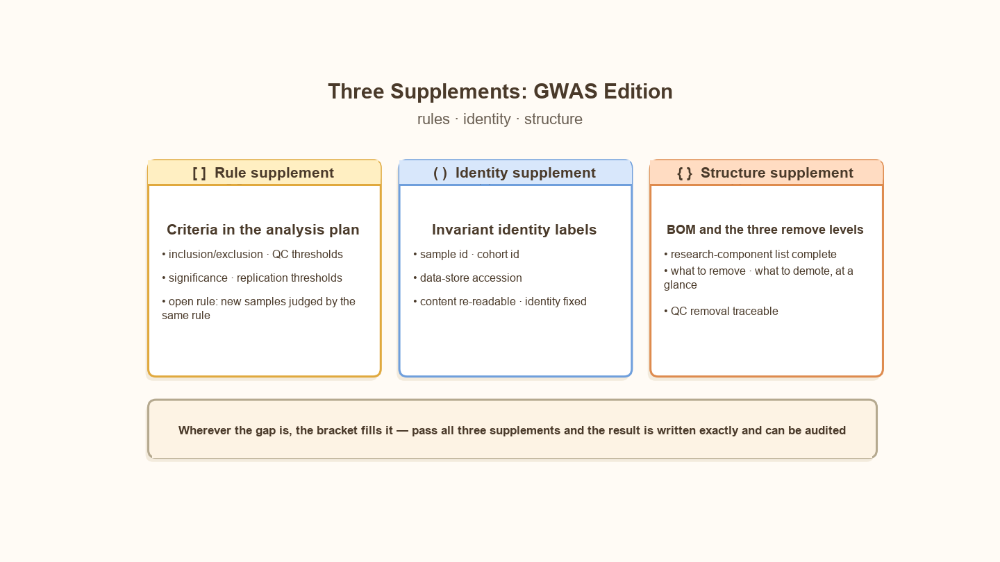

*Figure 5-2 The three kinds of supplement, GWAS version: rule, identity, structure*

> **The acceptance lines of the three kinds of supplement**  
> [ ] rule: all criteria are fixed before looking at results (analysis plan / registration); new samples can be judged by the same rule.  
> ( ) identity: every data set can be traced to its source container; when studies are merged there is no sample overlap, or overlap has been quantified and handled.  
> { } structure: BOM complete, the three remove levels distinct; QC exclusion records traceable to each rule.  

### 5-3 The Six Proof Steps: A Complete Demonstration

Walk the six steps with a proposition of real form: "In cohort X, the minor allele of rs12345 is associated with height."

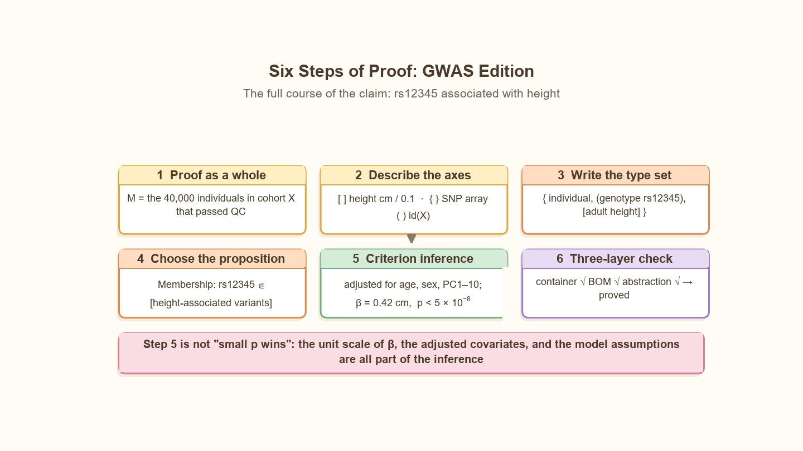

*Figure 5-3 The six proof steps, GWAS version: the whole course of one association proposition*

| **Steps** | **Operation** | **The output of this case** |
| --- | --- | --- |
| 1 Clarify the whole | Which whole is the object of judgment | M = the 40,000 individuals in cohort X that passed QC |
| 2 Describe along the axes | One pass of description per axis | [ ] height in cm / 0.1; { } SNP array + imputation; ( ) cohort X, id(X) |
| 3 Write the Type set | Complete notation | { individual, (genotype rs12345), [adult height quantitative trait] } |
| 4 Fix the proposition | Choose attribution / invariance / grading | Attribution: rs12345 ∈ [height-associated variants] |
| 5 Criteria and reasoning | Reason step by step with the criteria | Linear regression β = 0.42 cm, p = 3×10⁻¹⁰ < 5×10⁻⁸; corrected for age, sex and PC1-10 |
| 6 Three-layer check | Conclude after the three layers act jointly | Container ✓ (same cohort, same correction) / BOM ✓ (QC complete) / abstract ✓ (threshold passed, direction replicated) → proved |

Note that the reasoning in step five is not "smaller p wins": the unit and scale of the effect size β, the covariates corrected for, and the model assumptions (normal residuals, linearity) are all part of the reasoning. The three-layer check in step six matters more - if the container layer fails (residual population stratification), the abstract layer's p value, however small, cannot prove anything.

### 5-4 Eight Questions: The Checklist Before Handing Over

Every GWAS report, analysis script and downstream application passes the eight questions before being handed over. The eight questions are the acceptance standard of the three kinds of supplement.

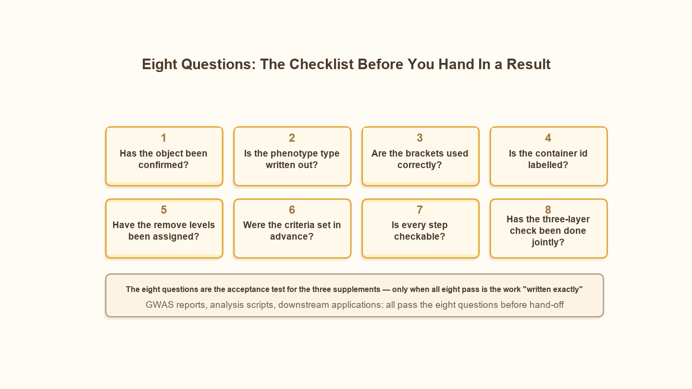

*Figure 5-4 The eight questions, GWAS version: the checklist before handing over results*

| **#** | **Check question** | **Pass standard** |
| --- | --- | --- |
| 1 | Is the object identified? | Can state in one sentence "which whole am I analysing" (cohort + phenotype + generation) |
| 2 | Is the phenotype Type written clearly? | Dimension, scale, boundary values and measurement method defined before analysis |
| 3 | Are the brackets right? | { } parts, ( ) content, [ ] criteria each in place |
| 4 | Is the container id marked out? | Every data source identifiable; sample overlap checked |
| 5 | Has remove been graded? | Each QC exclusion recorded one by one, each with its level |
| 6 | Are the criteria fixed first? | Thresholds and rules written before looking at results (analysis plan / registration) |
| 7 | Is every step checkable? | The script is reproducible and the numbers match item by item |
| 8 | Has the joint three-layer check been done? | Only when the container, composition and abstract layers all pass may a conclusion be written |

### 5-5 The Misuse Comparison: 16 Kinds of GWAS Misuse

The common root of misuse is "the levels were not written clearly". The 16 common kinds of misuse fall into four groups: misuse of the Type, misuse of numbers, misuse of the container, and misuse of reasoning.

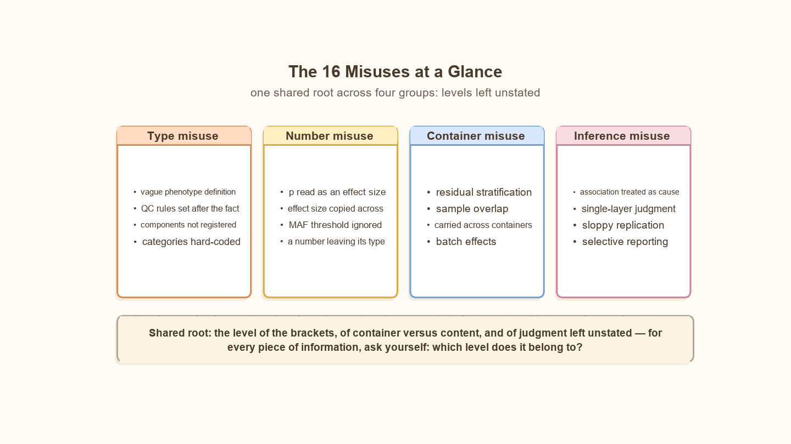

*Figure 5-5 The 16-misuse comparison: four groups, one common root*

| **Set** | **Misuse** | **Where the problem lies** | **The correct way** |
| --- | --- | --- | --- |
| Type | Vague phenotype definition | Dimension and scale not written clearly; case boundaries drift | Phenotype Type [dimension × scale]: erect first, then act |
| Type | Post-hoc QC rules | Setting the exclusion line after seeing results = quietly changing the criteria | Rules fixed first, registered for the record |
| Type | Parts left unregistered | BOM items missing; degraded parts passed off as essential parts | BOM plus the three remove levels written out in full |
| Type | Class written as a fixed list | New variant classes cannot be classified | Use the open rule T = (F(T), ∩(T)) |
| Number | Treating the p value as an effect size | Reading "not zero" as "very important" | Report p and β separately, with confidence intervals |
| Number | Transplanting effect sizes wholesale | The discovery cohort's β treated as the true value (winner's curse) | Taking a replication cohort or shrinkage estimates as the standard |
| Number | Ignoring the MAF threshold | Using the wrong test for low-frequency variants; power collapses | Stratified testing by MAF |
| Number | Numbers leaving the Type | Numbers without their Type (unit, scale, container) | Every number labelled with the Type it belongs to |
| Container | Residual population stratification | Container effect masquerading as association | PCA + mixed model + λ check |
| Container | Sample overlap | Meta-analysis counts the same id twice | De-duplicate across studies, quantify and handle overlap |
| Container | Transplanting across containers | Applying PRS thresholds directly to heterogeneous populations | Recalibrate, or change the container criterion |
| Container | Batch effects | Technical batches confounded with phenotype | Batch-balanced design plus batch covariates |
| Reasoning | Association taken as causation | Level confusion: correlation has the last word | MR / experiment / temporal order to complete the causal chain |
| Reasoning | Single-layer judgment | Concluding from the p value alone | Joint three-layer check |
| Reasoning | Careless replication | Recomputing in the same container without checking direction | Independent container + consistent direction + threshold |
| Reasoning | Selective reporting | Reporting only the significant ones; the report is incomplete | Full result tables made public, with significance graded and labelled |

### 5-6 The Route Decision Tree: How This GWAS Should Proceed

Different situations take different routes. The decision tree forks first at the "phenotype Type": quantitative traits go to linear regression, binary traits to logistic regression; then asks about "sample structure": relatedness or imbalance means a mixed model; then asks about the "variant spectrum": rare variants go to burden/SKAT; finally asks "who will use the output Type": mechanism research goes to fine-mapping, clinical risk to PRS, causal inference to MR.

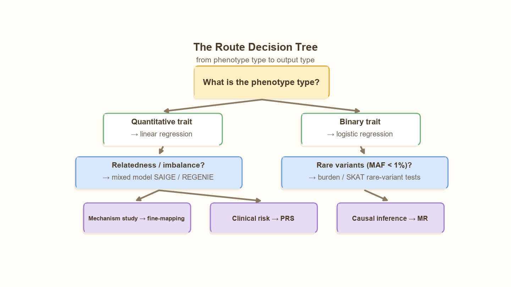

*Figure 5-6 The route decision tree: from phenotype Type to output Type*

> **[Specialist column] C4 Mixed models and the Biobank era**  
> When samples reach the hundred-thousand level, the case ratio is highly unbalanced (1:100) and individuals are related, traditional regression produces a flood of false positives. Mixed models put "genetic background similarity" into the model: BOLT-LMM (large-sample quantitative traits), SAIGE (unbalanced case-control) and REGENIE (two-stage, fast, supports rare variants) became the Biobank-era trio.  
> An Ontypology reading: what the mixed model does is exactly the refinement of the container layer - upgrading "genetic structure" from a few coarse PCs to a genome-wide similarity matrix, so the container effect is subtracted more cleanly. The input Type gains one more part, the "similarity matrix", and the criteria gain convergence and model-assumption checks.  
> Practical reminder: using a mixed model does not exempt you from QC. Basic remove criteria such as sample missingness, HWE and MAF still come first - however strong the model, it cannot digest a Type whose identity was never verified.  

> **[Exercise E11]**  
> Use the six proof steps to write an association proposition you care about (not necessarily GWAS) as complete reasoning: one short paragraph per step, and the fifth step's criteria must state numerical thresholds.  

> **[Exercise E12]**  
> Among the 16 kinds of misuse, pick the three you consider commonest and write one "field situation + correct wording" contrast card for each (format: one sentence of situation, one sentence of misuse label, two sentences of corrective action).  

> **[Exercise E13]**  
> A colleague says: "The p value of my SNP is 10⁻²⁰, so it must be an important gene." Use the eight questions and the misuse table to diagnose which rules this sentence breaks, and write the correct reply (within three sentences).  

## Part Six The Overall Architecture: GWAS × Mind AI

The method is gathered; this part puts it into a larger architecture: how GWAS Types and functions operate on the Mind AI platform, how reviewable accuracy lands as acceptance lines, and how this road relates to the three stages of AGI.

### 6-1 Two Libraries, One Hub, One Loop × GWAS

Mind AI's operating skeleton is two libraries, one hub, one loop: the Type library stores Types, the function library stores functions, the reasoning and criteria hub performs the three-layer judgment, and the continuous learning loop lets the system grow. Once GWAS is put in, every cell has a clear landing point.

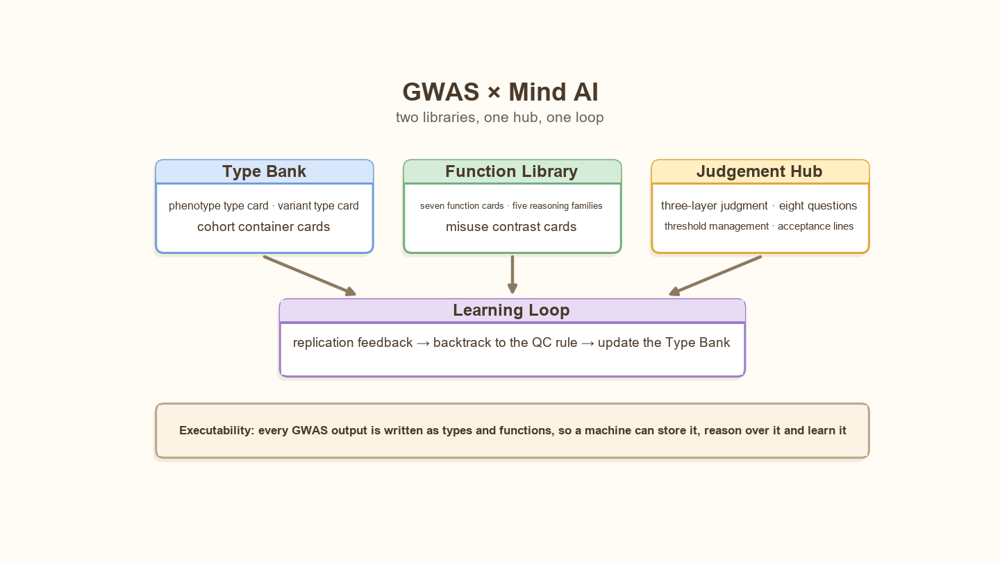

*Figure 6-1 GWAS × Mind AI: where two libraries, one hub and one loop land*

| **Component** | **Where GWAS lands** | **Concrete example** |
| --- | --- | --- |
| The Type library | The Types of research object, variant, phenotype and cohort | Phenotype Type card, variant Type card, cohort container card |
| Function library | Seven function cards plus the five reasoning families | QC functions, testing functions, fine-mapping functions |
| The criteria hub | Three-layer judgment + eight questions + threshold management | The 5×10⁻⁸ threshold, QC thresholds, replication standards |
| The learning loop | Replication feedback, misuse cases, rule evolution | Replication failure → backtrack to the QC rule → update the Type library |

This landing map answers the last question of "why GWAS needs Types": executability. When every GWAS output is written as Types and functions, only then can a machine store it, reason over it and learn it - this is exactly the divide between Mind AI and a traditional "results report".

### 6-2 Reading Side by Side: Existing Frameworks in the GWAS Ecosystem

The GWAS community is not without standards - on the contrary, it has a mature code. Ontypology is not in competition with them; it gathers the scattered codes into one language that "sees the levels".

| **Existing frameworks** | **What does it govern** | **How to read Ontypology** |
| --- | --- | --- |
| STREGA reporting guidelines | What a GWAS paper must report | The complete notation of the output Type - which is exactly the { } structural supplement |
| GWAS Catalog | A global discovery register | The public edition of the Type library: standardised deposit of discovery Types |
| UK Biobank／FinnGen／Taiwan Biobank | Standardised containers | A large container with an explicit id(C), S(C) open to audit studies |
| GWAS QC conventions (Anderson et al.) | Sample and locus QC rules | The existing practice of the three remove levels - criteria fixed first |
| Meta-analysis conventions (sample overlap check) | Cross-study merging discipline | ( ) identity supplement: across containers, always check id |

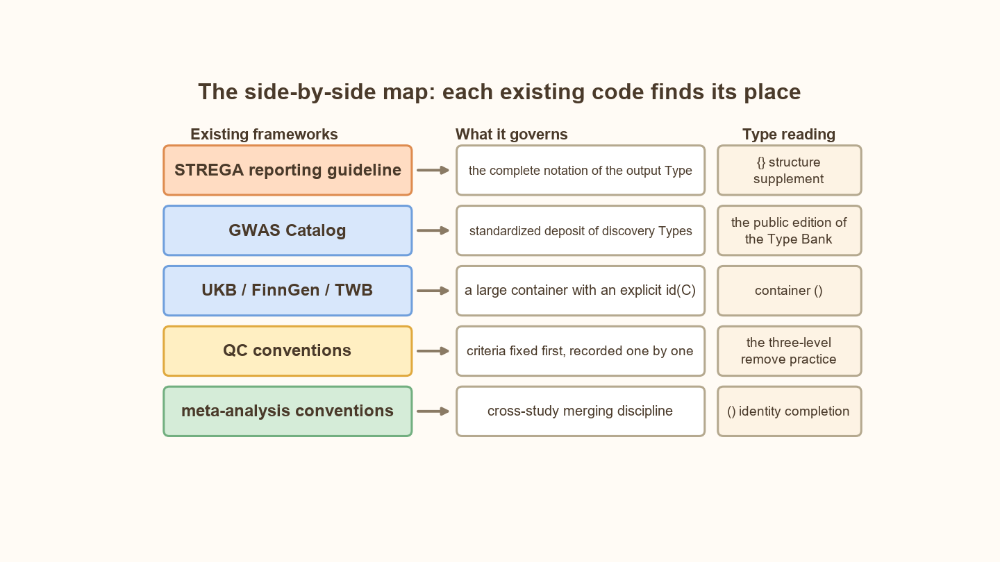

*Figure 6-2 The side-by-side map: each existing code finds its place*

### 6-3 Reviewable Accuracy: Four Acceptance Lines

"Accuracy = reviewable accuracy" lands in GWAS as four acceptance lines, each higher than the last: reproducible (same data, same script, same result), portable (a different machine or a different person runs it and gets the same result), auditable (all criteria and decision points are on record, and the eight questions are checkable one by one), and inheritable (the Type library and function cards are complete, so a newcomer can take over and reuse them correctly). Only when all four lines pass does a GWAS output upgrade from "a paper" to "an asset".

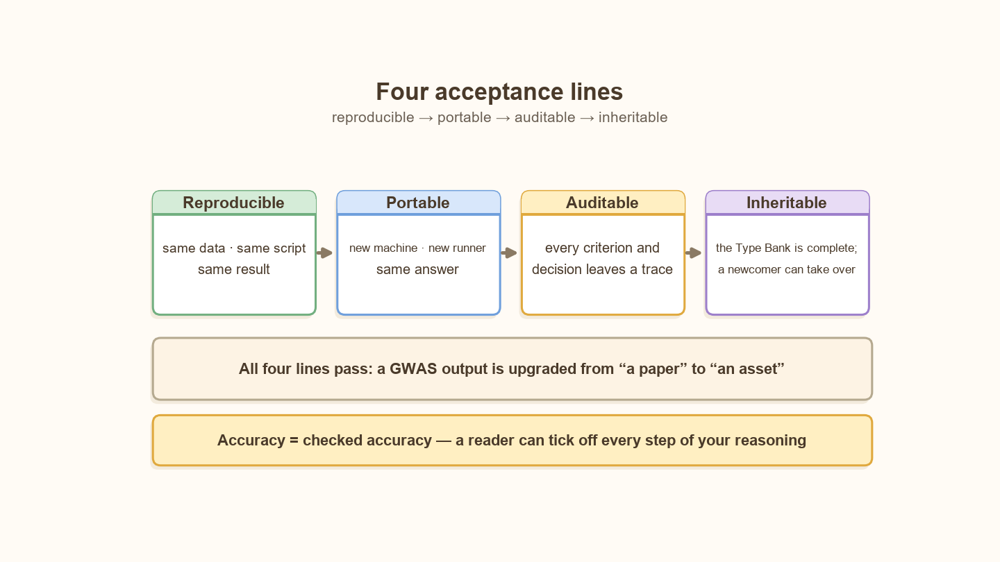

*Figure 6-3 The four acceptance lines: reproducible → portable → auditable → inheritable*

### 6-4 The Three Stages of AGI and GWAS's Position

Mind AI's vision advances along the three stages of AGI: unified knowledge, unified thinking, unified intelligence. GWAS has a role at each stage: in unified knowledge, GWAS discoveries are turned into Types and stored, coexisting in one Type library with Types from Chinese medicine, enterprise and world models; in unified thinking, GWAS's five reasoning families share the same reasoning and criteria hub with other domains; in unified intelligence, the system can autonomously propose hypotheses, design studies and discover cross-domain bridges on top of the Type library - for example reasoning together about the causal inference of genetic association, drug mechanisms and the Types of environmental exposure.

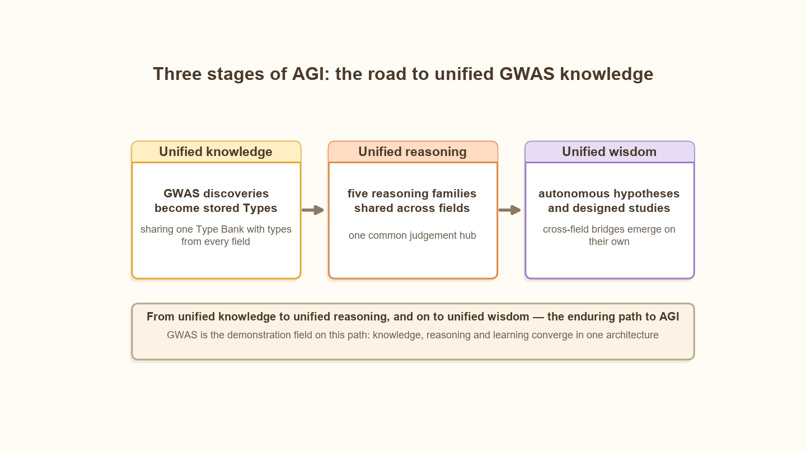

*Figure 6-4 The three stages of AGI: the road to unified GWAS knowledge*

> **[Specialist column] C5 Fine-mapping and functional annotation: from peak to mechanism**  
> Behind one significant peak in GWAS there is usually a whole block of linkage disequilibrium - tens to hundreds of SNPs "coming and going together". Which is the true causal variant? Fine-mapping uses Bayesian methods (SuSiE, FINEMAP, CAVIAR) to compute a posterior probability for each variant and outputs a 95% credible set.  
> Functional annotation connects candidate variants to the molecular layer: eQTL (a variant affects gene expression), chromatin accessibility (affects regulatory elements), protein structure prediction (affects amino acids). TWAS and colocalisation further ask: are this GWAS signal and this eQTL signal the same causal variant?  
> An Ontypology reading: fine-mapping "refines a blurred Type into a set of candidate Types" - the reverse of σ substitution: not swapping content but raising the resolution of the content. Functional annotation, in turn, places the variant Type into larger Type networks (gene Type, regulatory Type, pathway Type), joined by ι nesting and Type relations.  
> Reviewability reminder: the coverage of a credible set depends on model assumptions (the upper bound on the number of causal variants, the prior), which must be noted when reporting - numbers depend on Types, and posterior probabilities depend on the model Type.  

> **[Specialist column] C7 Mendelian randomisation: pushing association towards causation**  
> Mendelian randomisation (MR) uses genetic variants as instrumental variables: genotypes are randomly allocated at fertilisation, approximating a natural randomised controlled trial, so the causal effect can be estimated from the chain "variant → exposure → outcome". Three basic assumptions: relevance (the instrument is associated with the exposure), independence (the instrument is not associated with confounders), and exclusion restriction (the instrument affects the outcome only through the exposure).  
> GWAS is the raw-material factory for MR: the GWAS summary statistics of exposure and outcome (β, SE) supply two-sample MR. Pleiotropy (one variant affecting several pathways) is the largest source of violated assumptions - MR-Egger, weighted median, MR-PRESSO and other sensitivity analyses test it one by one.  
> An Ontypology reading: MR is the causal-reasoning function of the Time Type - input Type = the association result Types of two GWAS plus the instrumental variant Type, output Type = the causal effect Type, criteria = the three assumptions verifiable one by one. If the assumptions are not written out in full, the criteria column of the four function questions is left blank - and going on duty will certainly go wrong.  

> **[Exercise E14]**  
> Draw a "two libraries, one hub, one loop" landing map for your own domain (not limited to GWAS): what Types go in the Type library, what functions in the function library, what thresholds the criteria hub governs, and where the learning loop feeds back from.  

> **[Exercise S01]**  
> Of the four acceptance lines, which has your research passed so far? Pick one that has not passed and write three concrete strengthening actions (they must be verifiable; "strengthen management" is not allowed).  

## Part Seven The Complete Content Plan: Learn, Practise, Use, Teach, Build

This part gives an executable landing plan: how to learn this method, how to practise it into your hands, how to use it in a project, how to teach it to a team, and how to build your own Type library and function library. The plan is not a progress chart - every week has a reviewable output.

### 7-1 Learn, Practise, Use, Teach, Build: Five Stretches of Road

Learn - read the skeleton smoothly: the one-page figure of Part Two, the Types of Part Three and the seven cards of Part Four, each restated in your own words. Practise - write the exercises of each part, especially the six proof steps and the eight questions, going through them at least twice in full. Use - pick a real project or a public GWAS data set and run from phenotype Type definition to eight-question acceptance. Teach - explain the seven function cards to a colleague; whatever you cannot explain clearly is what you have not yet understood. Build - organise this project's Types and functions into the first version of your own Type library and function library.

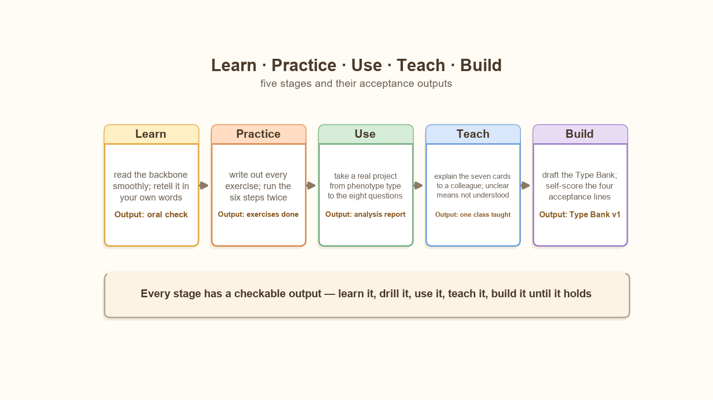

*Figure 7-1 Learn, practise, use, teach, build: five stretches of road and their acceptance outputs*

### 7-2 The Eight-Week Route

Eight weeks is not a progress chart but an output accumulation chart: each week delivers one card, one set of exercises and one eight-question self-check. The first two weeks erect Types (Space Type plus phenotype Type), weeks three and four walk the function chain (seven cards), week five is accurate use (six steps plus eight questions), week six is misuse and route selection, week seven is the complete demonstration (a full run on a public data set), and week eight is library building and review (four acceptance lines).

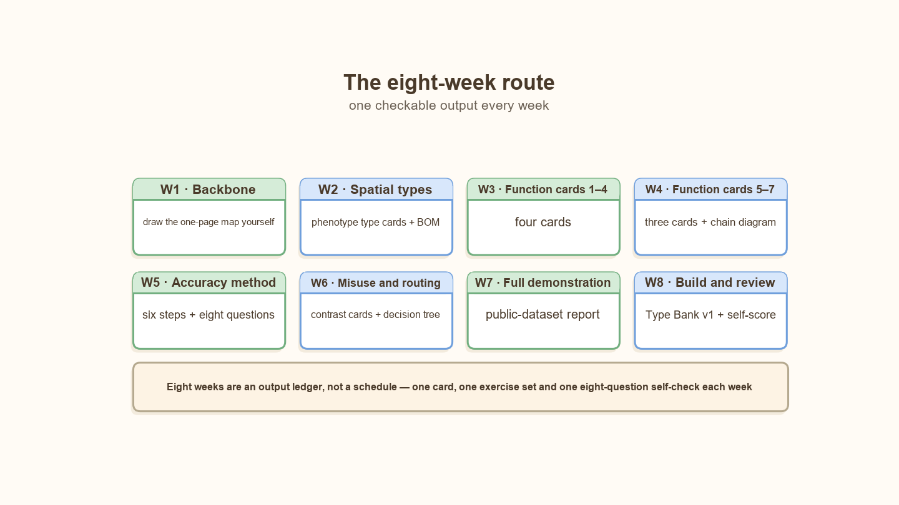

*Figure 7-2 The eight-week route: one reviewable output per week*

| **Week** | **Topic** | **Output** |
| --- | --- | --- |
| 1 | Skeleton plus the cognitive chain | The one-page skeleton figure (self-drawn) plus terminology cards |
| 2 | Spatial Type | Phenotype Type card + BOM + remove grading table |
| 3 | Function cards 1-4 | Four cards: QC, correction, testing, multiple-testing correction |
| 4 | Function cards 5-7 | Three cards for replication / fine-mapping / PRS plus the chain figure |
| 5 | Accurate Usage Methods | One six-step demonstration plus an eight-question checklist |
| 6 | Misuse and route selection | Three misuse contrast cards plus a route decision tree to fill in |
| 7 | Complete demonstration | A full-run report on a public data set (all eight questions passed) |
| 8 | Library building and review | First version of the Type library plus a self-assessment against the four acceptance lines |

### 7-3 Route Selection for Four Reader Situations

Different readers start on different roads. Researchers attack the phenotype Type and the criteria first, analysts the function chain and reproducibility, clinical and regulatory readers the acceptance lines and misuse, students read the main line straight through. Choosing a route is not a shortcut - it is spending your effort first on the stretch you will use first.

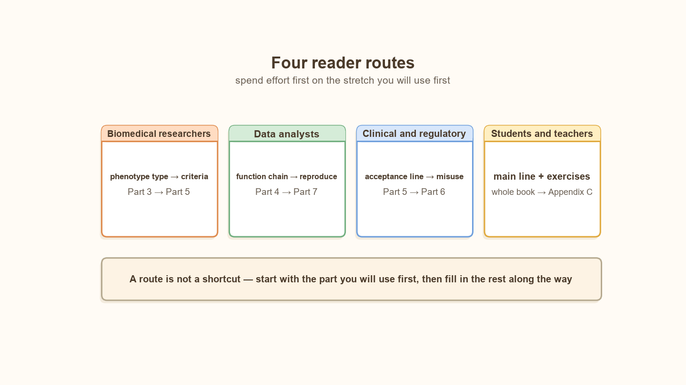

*Figure 7-3 Route selection for four reader situations*

### 7-4 The Four Stages of Building a Library

The cultivation of the Type library and function library goes through four stages: single card (one Type card or function card per project), grouped cards (similar Types gathered into groups, with relations established between cards), judgeable (the criteria hub can perform the three-layer judgment and eight-question check on the cards), evolvable (the learning loop writes replication results and misuse cases back into new rules). The dividing line at all four stages is "reviewable output" - the number of cards is not the goal; being judgeable and reusable is.

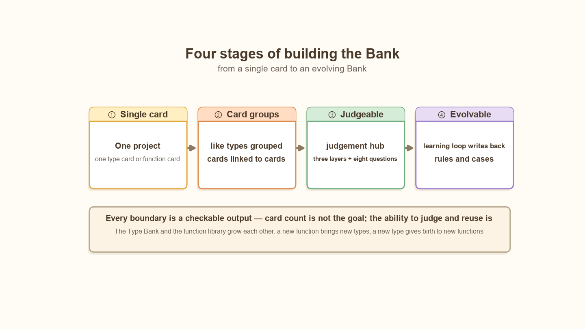

*Figure 7-4 The four stages of library building: from a single card to evolvable*

> **[Specialist column] C6 Clinical translation of PRS: after the score comes the decision**  
> Between polygenic risk scores and clinical practice stand three doors: the performance door (R² and AUC reach a clinically usable level), the transferability door (cross-population effect attenuation - a PRS trained on Europeans loses power in East Asians and must be re-estimated in local cohorts), and the decision door (does the score change medical decisions? randomised trials and clinical benefit assessments must show that "using PRS is better than not").  
> Current state: PRS for blood lipids, breast cancer and coronary heart disease have entered some clinical pilots; most guidelines still recommend them only as a reference for risk stratification, not as an independent basis for diagnosis.  
> An Ontypology reading: PRS is a composite Type - the combined Type of thousands of variant Types' effects. Clinical translation is exactly the three-layer judgment: the container layer (which population is it valid for?), the composition layer (how much is lost when environment and family history are missing?), and the abstract layer (what is the decision criterion? where is the cut-off drawn, and who drew it?).  

> **[Specialist column] C8 Ethics and multi-ancestry: the justice of containers**  
> By the early 2020s about eighty percent of GWAS participants had European ancestry - a serious container imbalance. The consequences are direct: PRS loses power across populations, drug-target discovery is biased towards variants common in Europeans, and health disparities are widened.  
> Multi-ancestry GWAS is part of the solution: cross-population meta-analysis (MR-MEGA, MANTRA) can exploit LD differences between populations to improve fine-mapping resolution; local biobanks (Taiwan Biobank, BioBank Japan, H3Africa) diversify the containers.  
> Ethical dimensions: the scope of informed consent (may GWAS be done? may it be used commercially?), return of results (should significant incidental findings be told to subjects?), privacy (genotypes can be re-identified, requiring access control and data use agreements), and the risk of genetic discrimination (the boundary between insurance and employment).  
> An Ontypology reading: the container ( ) has an id, and also a boundary responsibility. The manager of id(C) has a fiduciary duty towards the contents of S(C) - a container is not a neutral shell but the structured residue of a promise.  

> **[Exercise S02]**  
> Design a trimmed version of the eight-week route for your team (compressing eight weeks into four): which four weeks' outputs are kept? What replaces the acceptance of the four dropped weeks? Write the reasons for the trade-off (one sentence each).  

## Part Eight Conclusion: See GWAS Clearly, Use It Accurately

Reviewing the whole book, one sentence closes it: every pain point of GWAS is what a Type looks like when it was never properly erected; erect the Type and numbers have something to depend on, and results become reviewable.

### 8-1 Book Review: Five Sentences

| **Part** | **One sentence** |
| --- | --- |
| Part 1 | GWAS is a genome-wide screening machine, but its results are often misused - all five pain points have their root in Types that were never properly erected. |
| Part 2 | The five-piece skeleton: the cognitive chain, the three axes and three brackets, the three-layer judgment, the four function questions, and two libraries, one hub, one loop. |
| Part 3 | The Space Type: the research object { individual, (genotype), [phenotype] }, the phenotype Type, the variant Type, containers and the three remove levels. |
| Part 4 | The Time Type: the GWAS workflow = a chain of seven function four-question cards, Types in and Types out, with the five reasoning families each on their own shop floor. |
| Parts Five to Seven | Body, use, accuracy; the three kinds of supplement; the six steps; the eight questions; the 16 kinds of misuse; the route decision tree; learn, practise, use, teach, build and the eight-week route. |

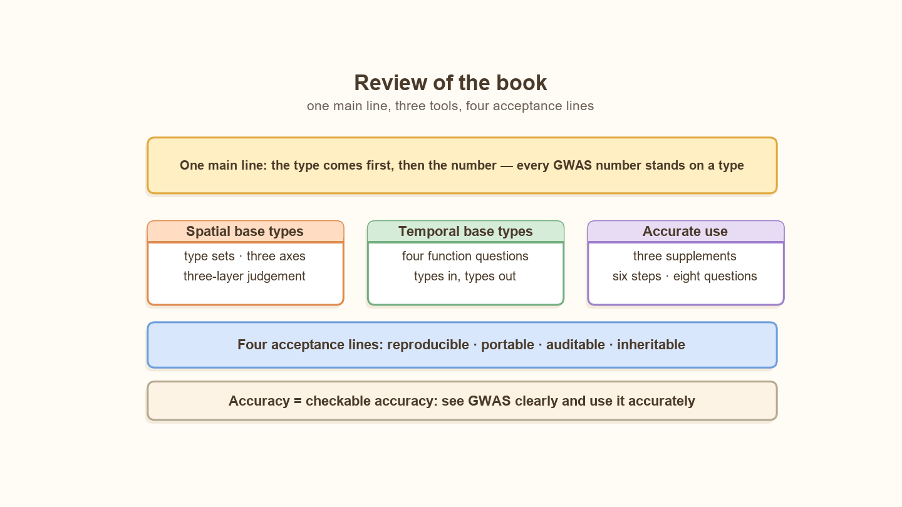

*Figure 8-1 Book review: one main line, three tools, four acceptance lines*

### 8-2 Five Domains Side by Side: The Type Method Does Not Belong to GWAS Alone

Finally, pull the camera back. This book's method - erect Types, write functions, set criteria, three-layer check - works simultaneously in five domains: philosophy (ontology is the root, Ontypology the trunk), biology (the Types and functions of GWAS), language (phenotype definition is like defining word meaning; scale is the semantic field), programming (an analysis script is the implementation of the four function questions; testing is the criteria), and organisation (governance of a cohort container is like enterprise data governance). One method holding across five domains is the evidence that "Type" is explicit learning.

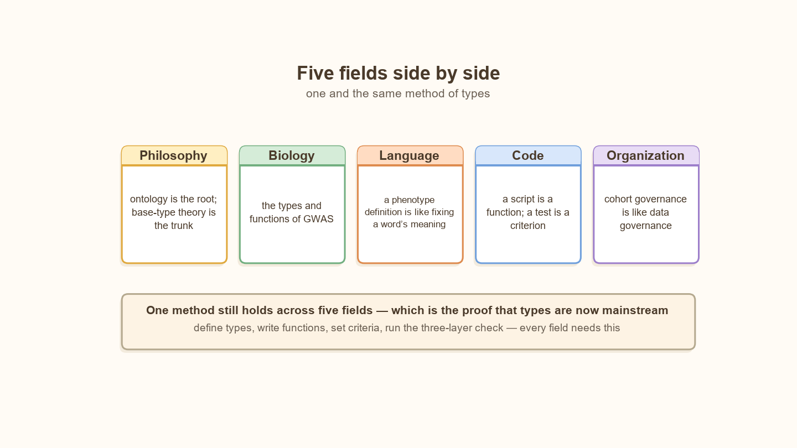

*Figure 8-2 Five domains side by side: the same Type method*

### 8-3 Vision: From GWAS to Unified Knowledge

GWAS is only the starting point. When every domain - medicine, engineering, language, organisation - writes its knowledge as Types and functions, unified knowledge has a foundation; when the reasoning and criteria hub is shared across domains, unified thinking has a skeleton; when the learning loop lets the Type library grow on its own, unified intelligence has an engine. See the Type clearly, turn it into explicit learning, and embody it as Mind AI - this is the road of Ontypology, and also the road of GWAS from a discovery engine to an intelligence asset.

> **The closing sentence of the book**  
> Types first, then numbers; erect the Type and every number in GWAS stands firm. Accuracy = reviewable accuracy - see GWAS clearly, and use it accurately.  

> **[Exercise S03]**  
> A letter to yourself three months from now: summarise in five sentences the five things you most want to keep from this book (one sentence per part). Come back in three months and compare - did the Types stay?  

## Appendix A　Glossary

| **Terminology** | **English** | **In one sentence** |
| --- | --- | --- |
| Type | Type | A fully described object (Type-set notation) |
| Unit Type | Unit Type | { part, (content), [class] } the union of the three kinds of set |
| Type set | Type Set | The complete notation of the unit Type |
| Spatial Type | Spatial Type | The static face of the Type (noun): three axes, three brackets, three-layer judgment |
| Temporal Type | Temporal Type | The dynamic face of the Type (verb): a function = Types in, Types out |
| Property, property value | Property・Value | The dimension × scale question, and the concrete answer |
| Container | Container | C = (id(C), S(C)); axiom of invariance: swap the content, id unchanged |
| Three levels of remove | Remove Grading | Essential / function-degraded / non-essential part |
| Three-layer judgement | Three-Layer Judgment | Joint judgment of the container / BOM / abstract layers |
| The Function Four Questions | Function Card | Name, Input Type, Output Type, Criteria |
| Accuracy | Verifiable Accuracy | Reviewable accuracy: the reader can tick off and reproduce the reasoning sentence by sentence |
| GWAS | Genome-Wide Association Study | Genome-wide association study |
| SNP | Single Nucleotide Polymorphism | Single-nucleotide polymorphism: the commonest form of genetic variant |
| MAF | Minor Allele Frequency | Minor allele frequency |
| HWE | Hardy-Weinberg Equilibrium | Hardy-Weinberg equilibrium: the baseline Type of genotype frequencies |
| LD | Linkage Disequilibrium | Linkage disequilibrium: the non-random combination of neighbouring loci |
| PCA | Principal Component Analysis | Principal component analysis: the mathematisation of population structure |
| QC | Quality Control | Quality control: where the remove criterion is applied |
| fine-mapping | Fine-Mapping | Fine-mapping: from a region to candidate causal variants |
| credible set | Credible Set | Credible set: a list of variants covering a specified posterior probability |
| PRS | Polygenic Risk Score | Polygenic risk score: the combined Type of effect sizes |
| MR | Mendelian Randomization | Mendelian randomisation: using genetic variants to infer causation |
| meta-analysis | Meta-Analysis | Meta-analysis: the combined Type of cross-cohort results |
| Mind AI | Mind AI | The Ontypology practical platform: two libraries, one hub, one loop |
| The Type library | Type Library | The warehouse of Types: the archive of the Space Type |
| Function library | Function Library | The warehouse of functions: the archive of the Time Type |

## Appendix B　Quick-Reference Cards

This appendix collects three quick-reference cards: B-1 the Type-set card, B-2 the function four-question card, and B-3 the printable blank templates. B-3 is laid out as a full page and can be photocopied directly.

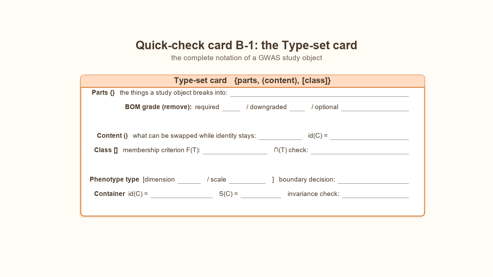

*Figure B-1 Quick-reference card B-1: the Type-set card - the complete notation of a GWAS research object*

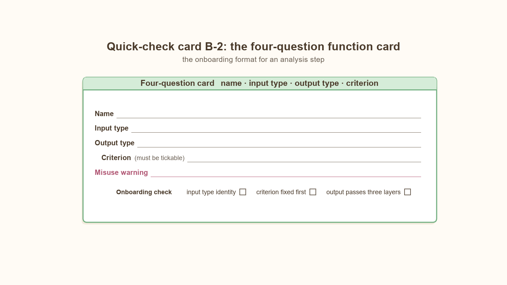

*Figure B-2 Quick-reference card B-2: the function four-question card - the on-duty format of an analysis step*

### B-3 Printable blank templates (full page)

The templates below are laid out as full pages and can be photocopied directly: the left column is the Type-set card, the middle the function four-question card, the right the eight-question checklist. Print one of each at the start of every GWAS project, fill them in and pin them to the first page of the protocol.

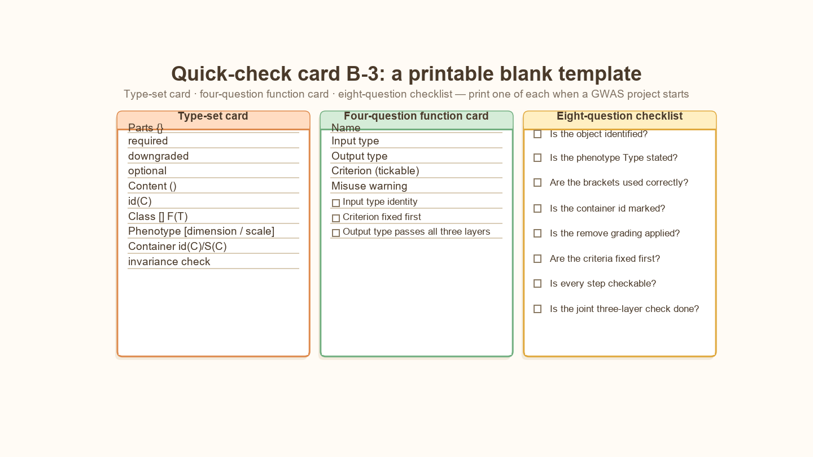

*Figure B-3 Printable blank templates: Type-set card, function four-question card, eight-question checklist (photocopy edition)*

## Appendix C　Model Answers to the Exercises

Below are model answers for E01 to E14 and S01 to S03. The answers are not the only possible wording - what matters is whether the thinking "identify the Type first, then discuss the numbers" has been walked steadily.

| **Question** | **Model answers** |
| --- | --- |
| E01 | Model: a certain report reports only p values and no effect sizes (numbers leaving the Type), and the age distribution of cases and controls was not corrected (container not written clearly). Diagnosis: pain points 3 and 1; remedy: add β and 95% CI, put age into the covariates, re-run and report λ. |
| E02 | Replication failure is often because the original study's "Type" was not written clearly: the phenotype definition (scale), QC thresholds (rules) and sample source (container) quietly differ in the new cohort. Different Types mean incomparable numbers - and the same locus naturally fails to show up. |
| E03 | Model: the cognitive chain = sameness and difference → splitting and combining → Type → name; the three axes = what it looks like / what it is composed of / where it is placed; the three-layer judgment = container, BOM and abstract acting jointly; the four function questions = name, input Type, output Type, criteria; accuracy = reviewable accuracy. |
| E04 | Three model rows: phenotype Type → "type 2 diabetes, binary scale, defined by ICD-10 diagnosis"; container → "Taiwan Biobank, id = TWB, recruited 2012-2020"; number → "rs12345 minor allele count 0/1/2, MAF = 0.23". |
| E05 | Model: height [centimetres / 0.1], measured with a stadiometer. If the scale were changed to "self-reported height", the systematic bias (about +1.5 cm) and the increased variance would dilute the effect size - the Type changed, and the numbers of the conclusion changed with it. |
| E06 | Model: study protocol (essential), subjects and sample identity (essential), genotype (essential), phenotype (essential), covariates (function-degraded - not fatal when missing but credibility drops), replication cohort (function-degraded), aesthetic layout (non-essential). What is most often mistaken for non-essential is "covariates" - without them, population-stratified false associations masquerade as discoveries. |
| E07 | The object of comparison should be the association between "genotype ↔ phenotype" within the same container (a structure inside S(C)), but cases and controls belong to different containers (different id(C)), so the comparison in fact measures "the allele-frequency difference between two containers" - a container-layer difference masquerading as an abstract-layer association. The correction = subtract the container effect (PCs, mixed model) from the comparison. |
| E08 | Model card (population stratification correction): name = population stratification correction; input Type = genotype matrix + sample list; output Type = principal component matrix + corrected model; criteria = first 10 PCs, λ ∈ [0.95, 1.05], no systematic deviation in the QQ plot. |
| E09 | Sample overlap = the contents of the same id(C) counted once by each of two studies as independent contents, which is counting the same Type's numbers twice - the standard error of the meta-analysis is underestimated and significance is overestimated. Remedy: quantify the overlap (LD-score regression or an overlap matrix) and switch to a corrected formula, or remove the overlapping samples and recompute. |
| E10 | Each βᵢ is an effect estimated "in a specific container of the discovery cohort, under a specific phenotype Type" - it depends on the variant Type and the container Type. Leave the container (cross-population), leave the phenotype definition (change the scale), and the number βᵢ loses accuracy. So PRS is a combined Type of effects that carry Types, not a bare sum of numbers. |
| E11 | See the complete demonstration in 5-3 (rs12345 and height); when setting your own question, check: all six steps present, step five has numerical thresholds, step six has a conclusion for each of the three layers. |
| E12 | Model card: situation = "p = 10⁻²⁰ so this gene is important"; misuse = misuse of numbers (p taken as effect size); correction = additionally report β and CI; calibrate the effect size with a replication cohort. Two other suggested picks: residual population stratification, sample overlap. |
| E13 | It breaks three: p taken as effect size (numbers), single-layer judgment (reasoning), association taken as causation (reasoning). Reply: "A p value only says this association does not look random; it does not say how large the effect is, still less that it is causal - please add the effect size and confidence interval, and replicate in an independent cohort before discussing importance." |
| S01 | Model: the "portable" line has not been passed. Actions: (1) containerise the script (Docker image + locked dependencies); (2) fix the random seed and the output hash; (3) run once on a new machine and compare hashes - after these three steps the portability line can be ticked. |
| S02 | Model: keep weeks 1, 5, 7 and 8 (skeleton, accurate method, complete demonstration, library building); replace the dropped function-card weeks with a "spot test on the seven cards" - reason: the method is the trunk and the cards can be self-taught; the complete demonstration and library building cannot be replaced, they are the floor of reviewable output. |
| S03 | Five model sentences: (1) all five pain points are Types that were never erected; (2) the three axes and three brackets are the minimal complete set of description; (3) the GWAS workflow is a chain of seven function cards; (4) accuracy = reviewable accuracy, and the eight questions are the acceptance lines; (5) Types first, then numbers - every number must be labelled with the Type it depends on. |

## Appendix D　Index of Figures and Tables

| **No.** | **Figure name** | **Part** |
| --- | --- | --- |
| Figure 0-1 | Book map | Guided reading |
| Figure 0-2 | Cognitive chain | Guided reading |
| Figure 1-1 | The five stations of the full GWAS workflow | 1-1 |
| Figure 1-2 | The five pain points | 1-2 |
| Figure 1-3 | Three-layer positioning | 1-3 |
| Figure 2-1 | The one-page skeleton figure | 2-1 |
| Figure 2-2 | Three axes, three brackets | 2-2 |
| Figure 2-3 | Three-layer judgement | 2-2 |
| Figure 2-4 | The function four-question card | 2-3 |
| Figure 2-5 | Two Libraries, One Hub, One Loop | 2-4 |
| Figure 2-6 | The mapping summary table | 2-5 |
| Figure 3-1 | The unit Type of the research object | 3-1 |
| Figure 3-2 | Phenotype Type | 3-2 |
| Figure 3-3 | Variant Type | 3-2 |
| Figure 3-4 | The three remove levels = the QC map | 3-3 |
| Figure 3-5 | Container hierarchy | 3-4 |
| Figure 3-6 | Genotype count | 3-5 |
| Figure 3-7 | The GWAS version of the three-layer judgment | 3-6 |
| Figure 4-1 | The function chain | 4-1 |
| Figure 4-2 | Function card one: QC | 4-2 |
| Figure 4-3 | Function card two: stratification correction | 4-2 |
| Figure 4-4 | Function card three: association testing | 4-2 |
| Figure 4-5 | Function card four: multiple-testing correction | 4-2 |
| Figure 4-6 | Function card five: replication and meta-analysis | 4-2 |
| Figure 4-7 | Function card six: fine-mapping | 4-2 |
| Figure 4-8 | Function card seven: PRS | 4-2 |
| Figure 4-9 | Six-group mapping | 4-3 |
| Figure 4-10 | The five reasoning families | 4-4 |
| Figure 5-1 | Body, use, accuracy | 5-1 |
| Figure 5-2 | Three supplements | 5-2 |
| Figure 5-3 | The six proof steps | 5-3 |
| Figure 5-4 | Eight questions | 5-4 |
| Figure 5-5 | 16 kinds of misuse | 5-5 |
| Figure 5-6 | The route decision tree | 5-6 |
| Figure 6-1 | Two libraries, one hub, one loop × GWAS | 6-1 |
| Figure 6-2 | The side-by-side map | 6-2 |
| Figure 6-3 | The four acceptance lines | 6-3 |
| Figure 6-4 | The three stages of AGI | 6-4 |
| Figure 7-1 | Learn, practise, use, teach, build | 7-1 |
| Figure 7-2 | The eight-week route | 7-2 |
| Figure 7-3 | Route selection for four readers | 7-3 |
| Figure 7-4 | The four stages of library building | 7-4 |
| Figure 8-1 | Book review | 8-1 |
| Figure 8-2 | Five domains side by side | 8-2 |
| Figure B-1 | The Type-set card | Appendix B |
| Figure B-2 | The function four-question card | Appendix B |
| Figure B-3 | Printable blank templates | Appendix B |

> **The end of the book**  
> See the Type clearly, turn it into explicit learning, embody it as Mind AI.  
> Every number in GWAS stands on a Type; once the Type stands firm, discoveries become reviewable, inheritable and growable.
