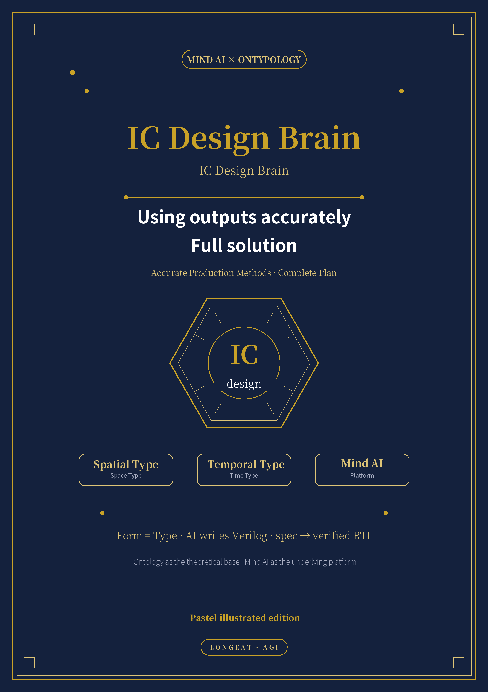

## Contents

- **Before We Begin: Three Conventions 3**
- **Introduction: Two Languages, Three Ways to Read 5**
- **Chapter 1 Understanding the IC Design Brain 7**
  - 1.1 The Brain = a Design Replica That Can Reason 7
  - 1.2 Design = Type + Number 8
  - 1.3 The Dual Type × IC Design 9
  - 1.4 Mind AI: Division of Labour in the Underlying Platform 10
  - 1.5 AI-Written Verilog: Where Accuracy Comes From 10
- **Chapter 2 The Six Output Types 12**
  - 2.1 Why the Output Type Comes First 12
  - 2.2 SpecType and InterfaceType 13
  - 2.3 ModuleType: BOM and the Three remove Levels 14
  - 2.4 TimingType 15
  - 2.5 VerifyType and PatternType 16
  - 2.6 The Six Types at a Glance 16
- **Chapter 3 The Four-Layer Accuracy Guarantee 18**
  - 3.1 Layer One: ∩(T) Criteria First, Layer Two: Deductive Skeleton Constraints 19
  - 3.2 Layer Three: Formal and Simulation Verification 19
  - 3.3 Layer Four: The Type Evidence Chain 20
  - 3.4 Space × Time Cross-Acceptance 20
- **Chapter 4 Using It Accurately: the Six Steps 22**
  - 4.1 Step One: Identify the Context — the Four-Step Framework for Requirements 23
  - 4.2 Step Two: Build Types by Axis, Step Three: Select the Move 23
  - 4.3 Step Four: Generate Output: Hand the Types to AI 24
  - 4.4 Step Five: Verify Against Criteria, Step Six: Archive and Evolve 25
  - 4.5 Three-Layer Judgement: the Last Line Before Acceptance 25
- **Chapter 5 AI-Written Verilog: a Manual for Accurate Use 26**
  - 5.1 The Seven-Stage Prompt Pipeline S1–S7 26
  - 5.2 From SpecType to InterfaceType: the Types of a UART 28
  - 5.3 ModuleType: uart_tx and uart_rx 28
  - 5.4 TimingType and VerifyType: Waveforms, testbench and assertion 30
  - 5.5 Common Errors and Corrections 32
- **Chapter 6 Misuse Comparison, Checklist, Maturity 34**
  - 6.1 Five Misuses Compared 34
  - 6.2 The Ten-Question Checklist 35
  - 6.3 Maturity L1–L4 35
- **Review: one sentence to take the whole book away 37**
- **Appendix A Quick Reference 38**
  - A.1 Terms and Notation at a Glance 38
  - A.2 The Temporal Type Move Set × Uses in the IC Pipeline 38

# Before We Begin: Three Conventions

This is a "how to use it" manual. The IC design brain turns the specs, architectures, timing, verification and lessons in a design team's heads into types that can be reasoned over, judged, and grown. The Spatial Type and the Temporal Type of Ontypology are its theoretical base, and Mind AI is the platform that carries it—but this book neither restates the theory nor introduces the platform; you only need to know how to give instructions, how to accept, and how to make outputs accurate. Before you open it, three conventions.

> **Convention 1 · Type = Type**  
> "Type" is always the English for Type, never Form. SpecType, ModuleType, Type-Driven Design—throughout the book.  
> A type is not a folder and not a classification label; a type is a structure that yields its own criteria and supports reasoning.  

> **Convention 2 · Use the theory, do not teach it**  
> The Spatial Type's three brackets, ∩(T), id(C), the remove criterion and the four-step framework, plus the Temporal Type's move set (fourteen moves)—  
> This book only uses them and does not restate their arguments. When you need the principles, go back to Spatial Type and the Temporal Type volume of Ontypology.  

> **Convention 3 · Reference the platform, do not describe it**  
> Mind AI appears in this book only as the "underlying platform": the LLM handles language and inductive statistics, the Mind Model handles intelligence and deductive reasoning.  
> This book is about how to get IC design right on top of it, not about what the platform itself looks like.  

**Table 0-1 Task Map: Which Chapter to Turn to for the Problem You Want to Solve**

| **Your situation** | **What you actually need** | **Corresponding in this book** |
| --- | --- | --- |
| AI writes my Verilog, but I do not dare use the output | Accuracy must be able to state its grounds | Chapter 3 (four-layer accuracy) |
| The spec is written, yet AI still answers one squeeze at a time | Turn outputs into six types and generate in segments | Chapter 2 (output type vocabulary) |
| Every prompt has to teach from scratch | Six steps + prompt pipeline S1–S7 | Chapters 4 and 5 |
| The verification report is beautiful; when something breaks, no one can find the cause | Type evidence chain: outputs must trace back to requirements | Chapters 3 and 5 |
| The team reads the spec differently and RTL versions collide | Shared type vocabulary and intersection criteria ∩(T) | Chapters 2 and 6 |
| Want to know whether the team is using it correctly | Misuse comparison, ten-question checklist, maturity L1–L4 | Chapter 6 (using it right and upgrading) |

# Introduction: Two Languages, Three Ways to Read

> 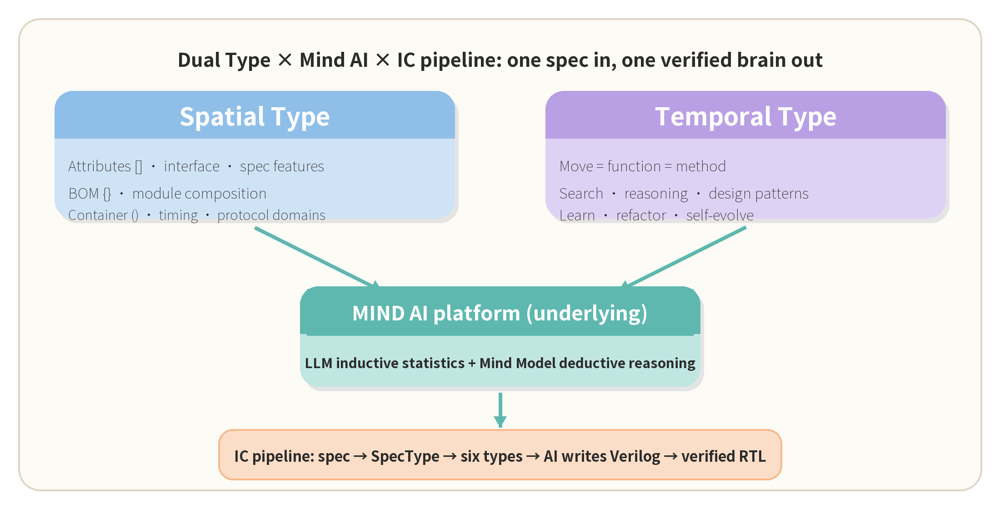  
> Figure D-1 Dual Type × Mind AI × IC Pipeline: the Whole Picture of This Book  

This book speaks two languages at once: one is the language of types—spec type, interface type, module type—which talks about structure and criteria; the other is the language of chips—Verilog, testbench, timing diagrams—which talks about implementation and verification. The two meet in a single sentence: every RTL output rests on a type, and every type stands on a criterion.

**Table D-1 The Two Languages Compared**

| **Aspect** | **The language of types (Spatial Type)** | **The language of chips (IC design)** |
| --- | --- | --- |
| Basic unit | Type | Module / signal / timing |
| Description tool | [ ] properties, { } BOM, ( ) containers | parameter, port, clock domain |
| Judgement tool | ∩(T) criteria, remove three levels, id(C) | assertion, coverage, sign-off |
| Dynamic method | The move set's fourteen moves (Temporal Type) | Design flow, refactoring, verification strategy |
| Output | A type that yields criteria | verified RTL |

Three ways to read, choose by the time you have. The first, the "half-hour read": read only Before We Begin, the Introduction, and each chapter's highlights box and review—build the vocabulary first, come back when you need it. The second, the "one-week read": read in chapter order and run the checklist at the end of each chapter, comparing it against your team's most recent RTL. The third, the "project read": when starting a new project, run Chapter 4's six steps as the SOP and copy Chapter 5's S1–S7 prompts directly—this is the most practical one.

> **Example: the running case of this book—the UART transceiver**  
> A module small enough to read in one go and large enough that timing and verification cannot be dodged: uart_top.  
> From spec sentence to verified RTL: six output types, six steps and S1–S7 all drilled through one running case to the end.  

# Chapter 1 Understanding the IC Design Brain

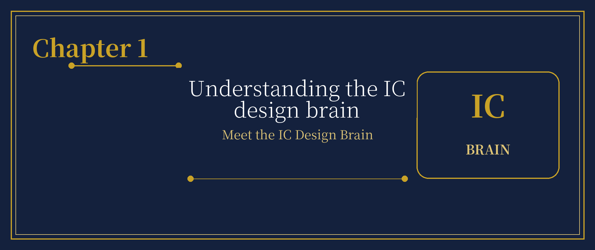

Chapter image · a design replica that can reason

The "IC design brain" is not an EDA tool, nor a cloud folder. It is a design replica that organises IC design knowledge, thinking and evolutionary capability into types and keeps them running on Mind AI—ask it "why does this need a pipeline register here" and it can give the reason; change the spec and it knows which RTL and verification must move with it.

## 1.1 The Brain = a Design Replica That Can Reason

Most design teams' "knowledge base" is dead: spec sheets sit on cloud drives, nobody remembers the timing diagram version, verification reports are disconnected from the design. Files are findable, answers are not. The design brain has exactly one threshold—three things must stay alive: knowledge (the type repository can be reasoned over), thinking (the move set can be invoked), and evolution (the evidence chain can accumulate).

> 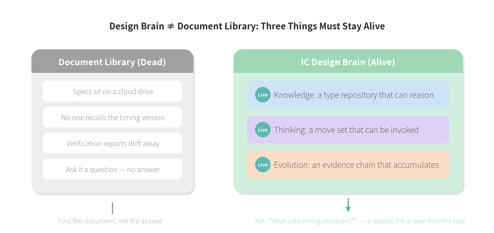  
> Figure 1-1 Design Brain ≠ Document Repository: Three Things Must Stay Alive  

"Alive" has a concrete meaning. When a new engineer asks "why does baud_gen divide by 434", the brain reasons out the answer from the timing type (TimingType) and the spec type (SpecType) instead of sending him to dig through an email from six months ago. When the spec changes from 8N1 to 7E2, the brain lists the affected interface types, module types and verify types instead of waiting for verification to fail.

## 1.2 Design = Type + Number

Of course a chip is full of numbers: bits, frequency, delay, area, yield. But what supports those numbers is the type—how modules compose, how signals connect, how interfaces meet, how versions continue. Numbers describe quantity and law; types describe structure, composition, relation and evolution. Thinking through a design needs both, and in that order: types first, numbers after. If the type is wrong, correct numbers are useless—no matter how precisely the bit width is computed, a wrong interface means starting over.

> 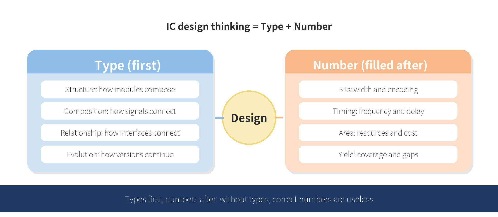  
> Figure 1-2 Design = Type + Number: Types First, Numbers After  

## 1.3 The Dual Type × IC Design

The Spatial Type handles "static types": it describes a design object with three axes—[ ] property axis holds spec features and interface parameters, { } BOM axis holds module composition and sub-units, ( ) container axis holds clock, protocol and verification domains; then ∩(T) criteria establish "what counts as acceptable", id(C) anchors module identity, and the three remove levels mark how heavy a part is. The Temporal Type handles "dynamic moves": design patterns, reasoning, thinking methods, search and extraction, refactoring and recombination, self-evolution—a move set that can be invoked and combined.

> 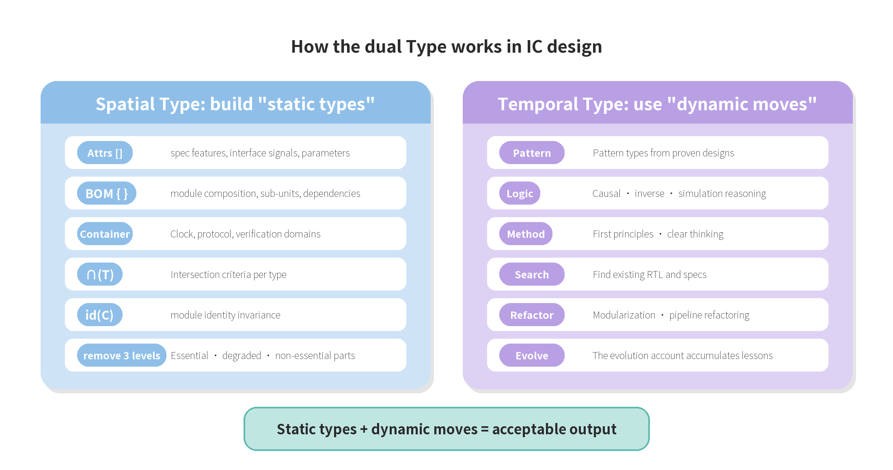  
> Figure 1-3 How the Dual Type Applies to IC Design: Static Types + Dynamic Moves  

**Table 1-1 Division of Duties of the Dual Type in IC Design**

| **Tools (use only, do not teach)** | **Spatial Type · usage** | **Temporal Type · usage** |
| --- | --- | --- |
| Three brackets | [ ] spec and parameters, { } module composition, ( ) clock/protocol domains | Choose which bracket to expand at each stage of the flow |
| ∩(T) criteria | The intersection criteria of each type: what passes, what does not | Reasoning moves deduce from criteria as premises |
| id(C) | Module identity anchor: still the same module after refactoring | The safety basis of the refactoring and recombination move |
| remove, three levels | Essential / function-degraded / non-essential part | Counterfactual reasoning when cutting cost and simplifying |
| The four-step framework | Identify spec dimensions from requirement noise | The standard opening for the problem-solving and analysis moves |

## 1.4 Mind AI: Division of Labour in the Underlying Platform

The IC design brain lives on Mind AI. The platform's division of labour takes one sentence: the LLM handles language ability, the Mind Model handles intelligence. The LLM excels at language understanding, generation and knowledge recall—it is the one that turns types into Verilog text; the Mind Model excels at unified knowledge, deep reasoning, long-term memory and thinking management—it is the one that constrains generation, checks criteria and traces evidence. Only the two combined can be called accurate.

> 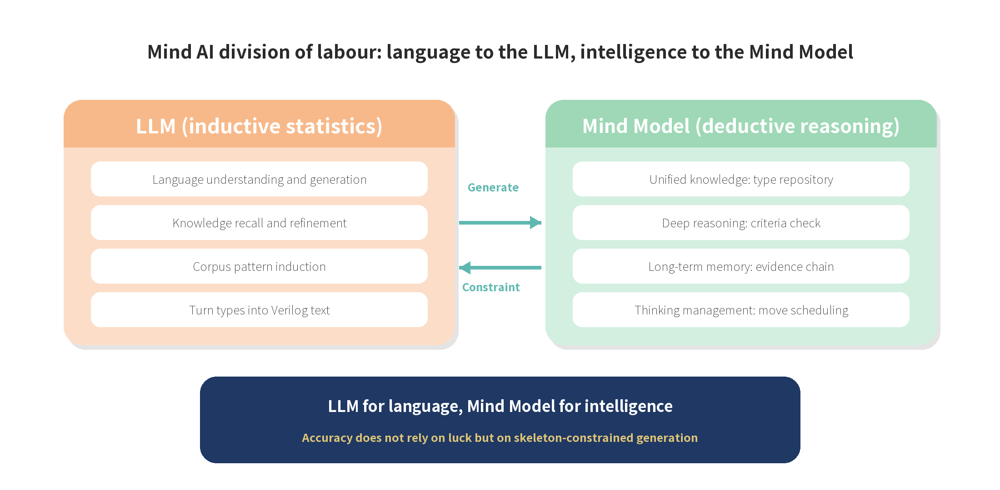  
> Figure 1-4 Mind AI Division of Labour: Language to the LLM, Intelligence to the Mind Model  

This division of labour directly determines how the book should be used: do not stake "accuracy" on switching to a model that writes Verilog better; accuracy comes from establishing the types well, writing the criteria clearly, and letting the deductive skeleton constrain generation. Models change generations, but types and criteria stay in the brain—that is the asset that accumulates.

## 1.5 AI-Written Verilog: Where Accuracy Comes From

AI-written Verilog is this brain's core production line: spec in, verified RTL out. The common myth is that "the longer the prompt, the more accurate"—in fact the opposite is true: asking AI to write a whole chip at once is the biggest source of inaccuracy. Accuracy comes from three constraints: segmented generation (one task per segment), per-segment acceptance (every segment has criteria), and an unbroken evidence chain (every output is traceable). These three land respectively in Chapter 2's output types, Chapter 3's accuracy guarantee and Chapter 5's prompt pipeline.

> **Chapter highlights**  
> Design brain = a design replica that can reason: knowledge, thinking and evolution must all stay alive.  
> Design = Type + Number, and types first, numbers after; the Spatial Type governs static structure, the Temporal Type governs dynamic method.  
> Mind AI division of labour: the LLM supplies language, the Mind Model supplies intelligence; accuracy does not rely on luck but on constraints.  

# Chapter 2 The Six Output Types

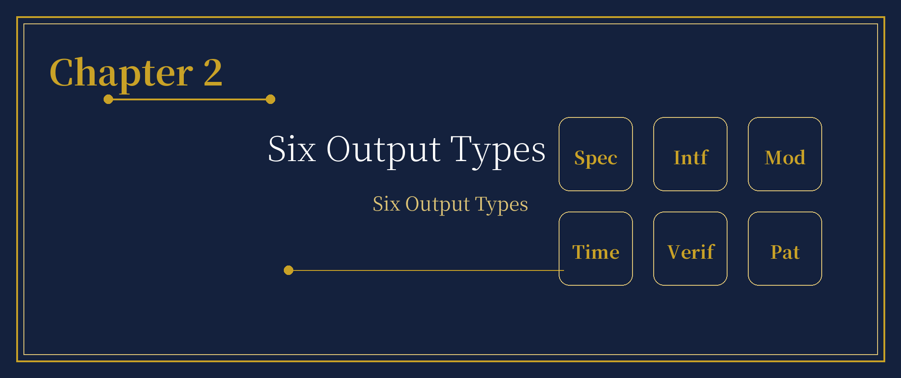

Chapter image · six types that yield criteria

"Accurate output" presupposes that the output has been defined. Establish IC design outputs as six types, each with bracket notation, intersection criteria and an acceptance question—after that, every generation and every delivery is merely placing something into the matching type. This chapter establishes all six types at once; the chapters that follow live on them.

## 2.1 Why the Output Type Comes First

Without types, outputs are loose parts: an email, a Word file, a commit, a waveform screenshot—no shared criteria, no provenance, no version. Once types are established, an output has three things: identity (which type this is), criteria (what passing looks like), and relation (which parent type it hangs under). The six output types cover the IC design pipeline end to end: spec → interface → module → timing → verify → pattern.

> 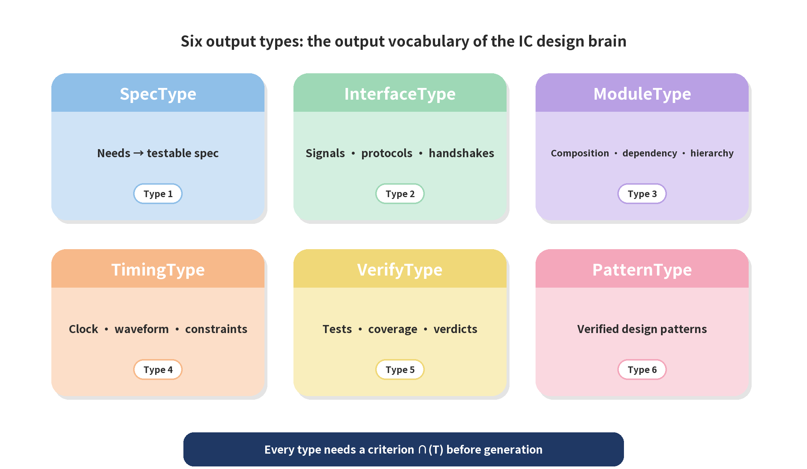  
> Figure 2-1 Six Output Types: the IC Design Brain's Output Vocabulary  

## 2.2 SpecType and InterfaceType

The spec type (SpecType) is the pipeline's first type: it establishes requirement sentences as judgeable specs. A valid spec sentence can always state "what will measure it at acceptance"—transmission rate 115200 bps, data format 8N1, error rate below 10⁻⁶: these are [ ] properties; "needs FIFO buffering" is a { } composition requirement; "single 50 MHz clock domain" is a ( ) container declaration. Any adjective that cannot be measured in a requirement sentence (high performance, elegant, robust) is sent back to be rewritten.

**Table 2-1 SpecType Criteria: a Health Check for Spec Sentences**

| **Check item** | **∩(SpecType) question** | **Failing example** |
| --- | --- | --- |
| Measurable | What number measures it at acceptance? | "fast transmission" |
| Attributable | Which bracket does it fit: [ ], { } or ( )? | "should feel futuristic" |
| Decidable | Will two engineers reach the same conclusion? | "use as few resources as possible" |
| Traceable | Can you say which requirement sentence it comes from? | Specs the engineer added themselves |

The interface type (InterfaceType) is the contract between a module and the outside world: port list, bit width, direction, handshake protocol, clock-domain attribution. What the interface type cares about most is "lining up"—the output width of the upper module against the input width of the lower one, the semantics of valid/ready, the polarity of reset, all settled once at the interface-type level. Changing the interface = changing the contract, which must go back to the spec type and reopen a version.

> **Example: the spec type and interface type of the UART**  
> SpecType: 115200 bps, 8N1, single clock domain, frame error rate below 10⁻⁶, built-in 16-byte FIFO.  
> InterfaceType: clk, rst_n (container); tx_data[7:0], tx_start, tx, tx_busy (transmit side);  
> rx, rx_data[7:0], rx_valid (receive side)—every signal has a direction, a bit width and a clock-domain attribution.  

## 2.3 ModuleType: BOM and the Three remove Levels

The module type (ModuleType) records composition with { } BOM: uart_top = { uart_tx, uart_rx, baud_gen, fifo }. The criterion follows "still recognises itself when removed"—take baud_gen away and it is still a "thing" (a divider), so it goes into the BOM; take "operating frequency" away and it is nothing, so it goes into [ ] properties. The full three-bracket notation is shown in Figure 2-2.

> 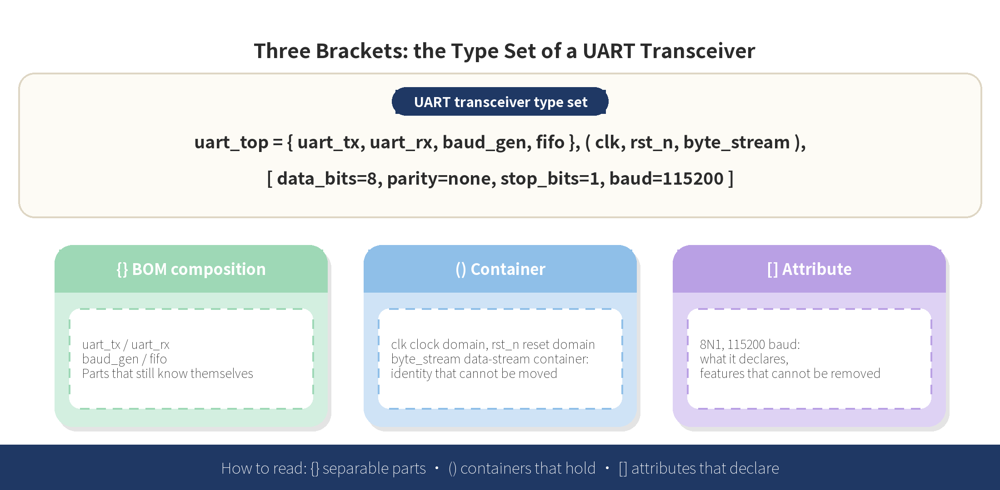  
> Figure 2-2 Three-Bracket Notation: the Type Set of a UART Transceiver  

Then use the remove criterion to grade every part in the BOM: those whose removal loses identity are essential parts, those whose function degrades but whose identity survives are function-degraded parts, and those with no effect at all are non-essential parts. When cutting cost, simplifying, or negotiating an ECN, this grading is the only common language—"what happens if we drop the fifo" should not depend on an argument; the remove criterion was written long ago.

> 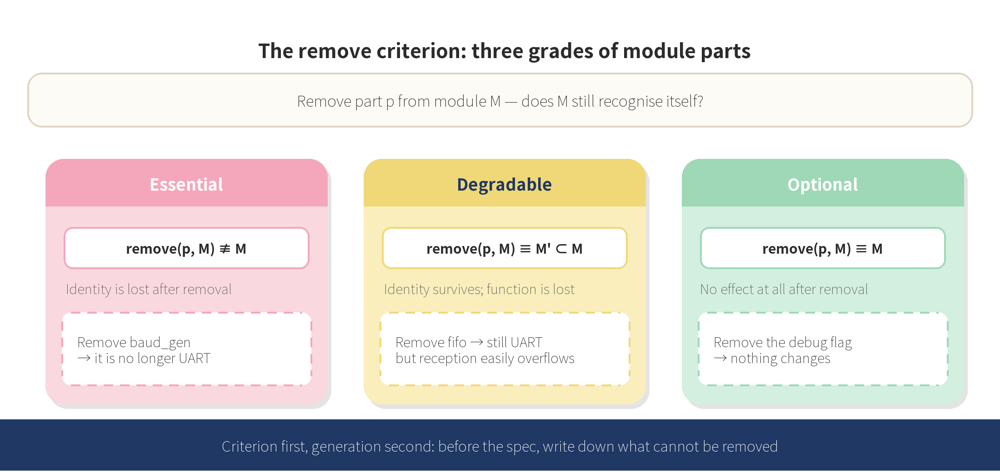  
> Figure 2-3 The remove Criterion: Three-Level Classification of Module Parts  

**Table 2-2 The BOM and remove Grading of uart_top**

| **Part** | **remove criterion** | **Grading** | **Consequence of removal** |
| --- | --- | --- | --- |
| baud_gen | remove(p, M) ≢ M | Essential part | No longer a UART: it has no bit boundary at all |
| uart_tx | remove(p, M) ≢ M | Essential part | Loss of identity: only the receiver remains |
| uart_rx | remove(p, M) ≢ M | Essential part | Loss of identity: only the transmitter remains |
| fifo | remove(p, M) ≡ M' ⊂ M | Function-degraded part | Still a UART, but overflow-prone and the CPU must serve it in real time |
| debug_uart flag | remove(p, M) ≡ M | Non-essential part | Removable directly in the production version |

## 2.4 TimingType

The timing type (TimingType) collects everything "dynamic": clock frequency, bit period, setup/hold time, reset sequence, cross-domain synchronisation. It is the dynamic projection of container ( ) in the Spatial Type—each clock domain is a container, and every crossing of a container boundary needs a bridge (a synchroniser). The criteria of the timing type are always scope-visible: any timing claim must be drawable as a waveform and writable as an assertion.

**Table 2-3 TimingType Essentials: a Checklist for a Valid Timing Type**

| **Essential** | **Content** | **Acceptance method** |
| --- | --- | --- |
| Clock spec | Frequency, duty cycle, jitter tolerance | SDC constraints + measurement points |
| Frame timing | The boundaries of the start, data and stop bits | Waveform + baud_tick alignment |
| Reset sequence | Synchronous/asynchronous, polarity, release timing | Reset waveform + reset assertion |
| Cross-domain | Which signals cross clock domains, and which bridge is used | CDC report + synchroniser list |

## 2.5 VerifyType and PatternType

The verify type (VerifyType) establishes "how to prove it is right" as a type: testbench structure, stimulus strategy, self-checking, coverage targets, criteria sign-off sheet. The ∩(T) of the verify type is especially strict—"simulation passed" does not count; "coverage met + criteria signed off item by item" counts. The pattern type (PatternType), in turn, is the repository that lands the Temporal Type in the IC domain: every verified design pattern (handshake protocol, cross-domain FIFO, divider, edge detection, and so on) is collected as a type, carrying its own criteria and known pits, ready for the move set to invoke directly—this is the physical form of the "design search and extraction" and "design pattern" moves in the IC pipeline.

**Table 2-4 The Criteria of VerifyType and PatternType**

| **Type** | **∩(T) criteria (pass line)** | **Common failures** |
| --- | --- | --- |
| VerifyType | self-checking + coverage met + item-by-item criteria sign-off | "Visual verification" with nothing but a waveform screenshot |
| PatternType | Reusable + criteria attached + pit records | A code snippet pasted on the wiki and maintained by nobody |

## 2.6 The Six Types at a Glance

**Table 2-5 The Six Output Types at a Glance: One Page**

| **Output type** | **The question it answers** | **Centre of gravity of the three brackets** | **Acceptance criteria** |
| --- | --- | --- | --- |
| Spec Type | What does it do? | [ ] property-led | Every sentence measurable and decidable |
| Interface Type | How does it face outward? | [ ]＋( ) | It lines up and it speaks clearly |
| Module Type | What is it composed of? | { } BOM-led | BOM criteria + remove grading |
| Timing Type | When does it move? | ( ) container-led | Scope-visible, assertion-ready |
| Verify Type | How is rightness computed? | All three brackets used | Coverage met + item-by-item sign-off |
| Pattern Type | What is reused? | { }＋[ ] | Criteria attached + pit records |

> **Chapter highlights**  
> Only when the output type is fixed can there be accuracy: the type gives identity, criteria and relations.  
> Six types run the whole pipeline: SpecType → InterfaceType → ModuleType → TimingType → VerifyType → PatternType.  
> Every type needs ∩(T); the BOM uses the "still recognises itself when removed" criterion, and parts are graded by the three remove levels.  

# Chapter 3 The Four-Layer Accuracy Guarantee

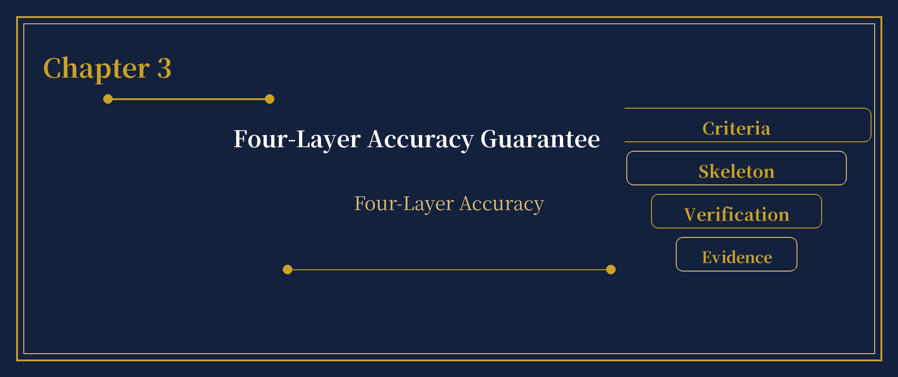

Chapter image · accuracy is grown

The core question of "using outputs accurately" is: where exactly does accuracy come from? The answer is not "pick a stronger model" and not "check it a few more times"—accuracy is structural; it grows layer by layer from four guarantees: ∩(T) criteria, the deductive skeleton, formal verification and the type evidence chain. Each layer blocks one kind of inaccuracy; miss one layer and one kind of error slips through.

> 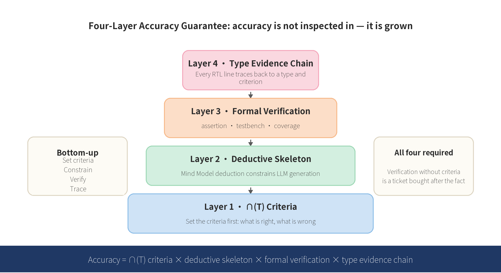  
> Figure 3-1 Four-Layer Accuracy Guarantee: Bottom-Up, None Can Be Missing  

## 3.1 Layer One: ∩(T) Criteria First, Layer Two: Deductive Skeleton Constraints

The first layer is ∩(T) criteria first: before any output is generated, write down "what counts as right and what counts as wrong". The spec type's criteria are measurable sentences; the interface type's criteria are a connection checklist; the module type's criteria are the BOM criterion and the remove grading. Patching criteria afterwards is the most insidious inaccuracy—thinking about acceptance standards only after the RTL is written is like letting the candidate set the exam.

The second layer is the deductive skeleton: the Mind Model deduces the skeleton structure of the output from the types and criteria, and the LLM only fills flesh inside the skeleton. Take Verilog: the skeleton decides how many always blocks the module has, how many states the state machine has, who drives each output—these are the conclusions of reasoning; the LLM is responsible for writing the skeleton into fluent code. A wrong skeleton is caught by the first layer's criteria, a wrong statement is caught by the third layer's verification; the LLM's freedom is limited to "writing the dialogue" rather than "deciding the structure", which is what makes accuracy controllable.

> **The two layers in one phrase**  
> Criteria say "what counts as right", the skeleton says "how it grows"; criteria first and generation after, skeleton first and flesh after.  
> Reverse the order (generate first, patch criteria afterwards, let the LLM improvise the architecture) and the four layers collapse into one.  

## 3.2 Layer Three: Formal and Simulation Verification

The third layer is verification: lint, simulation, assertion, coverage. The key insight here is that "the object of verification is the criteria, not the code"—every self-checking item in the testbench must point back to a specific clause of ∩(T); every hole in the coverage report must have a disposition (add a test or open a gap ticket). Running simulation without reading coverage is like sitting an exam and never marking the paper.

**Table 3-1 Verification Means and the Inaccuracy Each Blocks**

| **Means** | **What it blocks** | **Evidence output** |
| --- | --- | --- |
| Lint / syntax check | Bit-width mismatch, latch inference, undriven signals | lint log (zero-warning acceptance) |
| Directed simulation | Compare every functional point in the spec one by one | self-checking pass record |
| Random + coverage | Corner cases and combinatorial explosion | Coverage report + gap list |
| assertion | Timing and protocol violations (e.g. start bit too wide) | Violation waveform + property list |

## 3.3 Layer Four: The Type Evidence Chain

The fourth layer is the type evidence chain: every output can be asked for its provenance. Any piece of RTL must trace back to "which type it hangs on, which moves were used, which criterion it passed, which entry in the evolution account it lands in". If any link in the chain breaks, the output is rejected. This layer blocks "right but unable to say why it is right"—such an output is, when something goes wrong, as good as never verified.

> 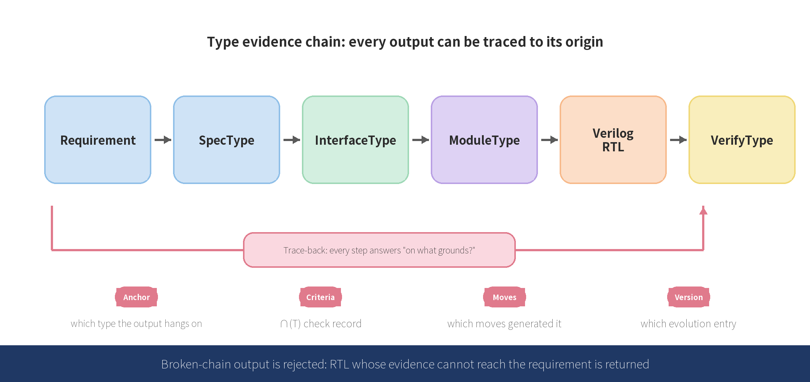  
> Figure 3-2 Type Evidence Chain: from Requirement Sentence to Verify Type, Every Link Traceable  

> **Example: the UART's evidence chain looks like this**  
> "stop-bit check of the rx module" → attached to VerifyType → criterion V-3 "frame error rate &lt; 10⁻⁶"  
> → Derived from the spec type by the "causal reasoning" move → version v1.2 (evolution account: stop-bit miss fixed on 7/19).  

## 3.4 Space × Time Cross-Acceptance

How is the four-layer guarantee accepted? Cross-check the Spatial Type against the Temporal Type: statically, see whether the types are complete—all six types present, all criteria set, notation complete; dynamically, see whether the moves are in place—invocations justified, reasoning steps complete, evolution records archived. Only when both axes pass is the output accepted; static passes but dynamic fails gives a reminder (fixable); any absence blocks outright (not acceptable).

> 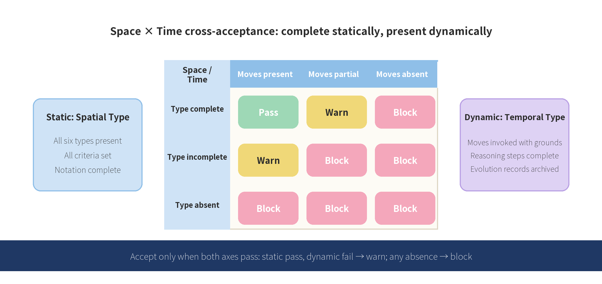  
> Figure 3-3 Space × Time Cross-Acceptance Matrix  

**Table 3-2 Acceptance Comparison of the Four Accuracy Layers**

| **Layer** | **Acceptance question** | **Passing evidence** | **Handling when it fails** |
| --- | --- | --- | --- |
| ∩(T) criteria | Were the criteria set before generation? | Criteria sign-off sheet (with date) | Return and re-establish |
| Deductive skeleton | Was the skeleton deduced? | Reasoning step record | Return to S4 |
| Formal verification | Is coverage met? | Coverage report | Add tests |
| Type evidence chain | Does every line trace back? | Evidence chain spot check | Broken ones are rejected |

> **Chapter highlights**  
> Accuracy is structural: ∩(T) criteria → deductive skeleton → formal verification → type evidence chain; none of the four layers can be missing.  
> The object of verification is the criteria, not the code; an output with a broken evidence chain is rejected even if it is right.  
> Cross-acceptance: space checks type completeness, time checks move readiness; both axes must pass before delivery.  

# Chapter 4 Using It Accurately: the Six Steps

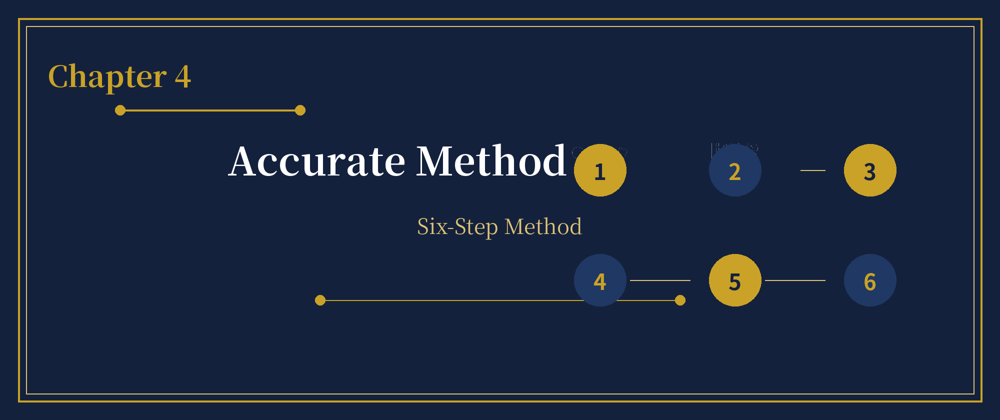

Chapter image · one cycle of six steps

Theory stops here; what follows is the operating manual. The six steps are the SOP that lands the previous two chapters on every design task: identify the context, build types by axis, select the move, generate output, verify against criteria, archive and evolve. The six steps are one cycle—failing acceptance does not mean starting over but returning to the matching step to make it up. The running case, the UART transceiver, accompanies you the whole way.

> 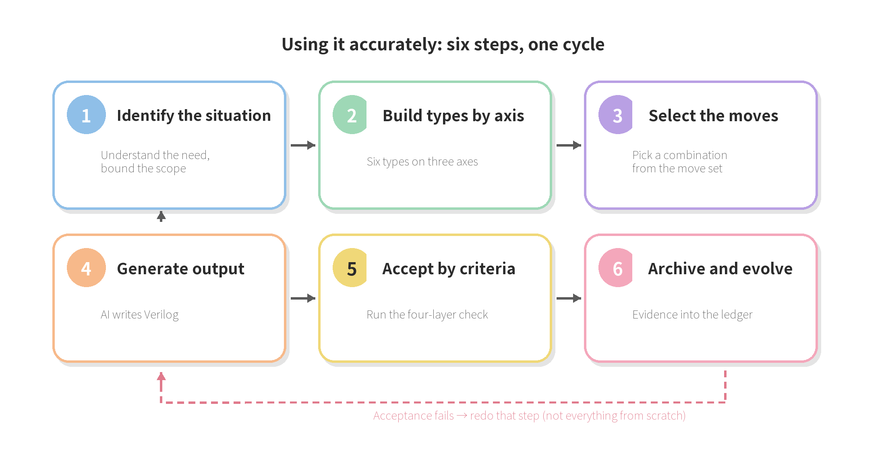  
> Figure 4-1 One Cycle of Six Steps: Fail Acceptance, Return to the Matching Step  

## 4.1 Step One: Identify the Context — the Four-Step Framework for Requirements

The first thing to do with a requirement is not to write code but to identify the context—use the four-step framework to organise requirement noise into dimensions. Distinguish similarities and differences: compare requirement sentences in pairs until you can say "this is not that"; trigger abstraction: abstract only when the new difference does not match existing dimensions (comparison failure); name the dimension: circle differences of the same kind and name them; decide attribution: attach every requirement to the matching dimension, and open a new dimension only when it does not fit.

> 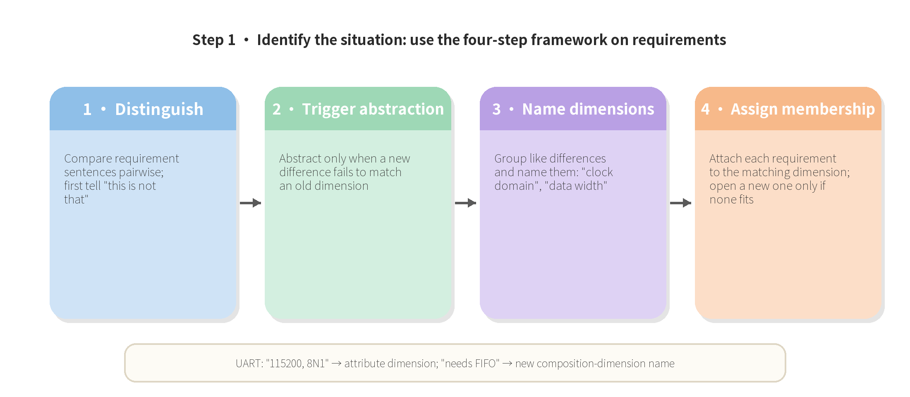  
> Figure 4-2 Identify the Context: a UART Drill with the Four-Step Framework  

> **Example: the identified result of the UART requirement sentences**  
> "115200 bps, 8N1" → comparison failed on the data-format dimension → dimension named "frame format", attached to [ ] properties.  
> "needs FIFO buffering" → a compositional difference → named "buffer depth", attached to the fifo part requirement in { } BOM.  
> "Single 50 MHz clock domain" → container declaration → attached to ( ), and at the same time a reverse criterion "no cross-domain" is set.  

## 4.2 Step Two: Build Types by Axis, Step Three: Select the Move

Step two writes the identified result as a six-type draft: the three axes take their places—[ ] property axis holds spec parameters, { } BOM axis holds module composition, ( ) container axis holds clock and protocol domains—and each type carries ∩(T). Step three picks moves from the move set: this is not mysticism but choosing a function against a task list—to decompose use "problem-solving", to compare use "analysis", to reuse use "design pattern", to give reasons use "reasoning", to break the frame use "thinking method". The moves chosen are recorded in the worksheet, for the evidence chain to check later.

**Table 4-1 Move Selection Sheet for the UART Project (excerpt)**

| **Task** | **The moves chosen (Temporal Type)** | **Output type** | **What evidence is left** |
| --- | --- | --- | --- |
| Decompose functional requirements | Problem-solving · analysis | SpecType | Requirement dimension table |
| Decide module boundaries | Design pattern (divide and conquer) | ModuleType | BOM criteria record |
| Derive the baud divisor | Reasoning · causal reasoning | TimingType | Divisor formula + rationale for the remainder rounding |
| Choose the FIFO depth | Reasoning · simulation reasoning | ModuleType | Overflow simulation data |
| Cross-domain handling decision | Thinking method · first principles | TimingType | Cross-domain list + synchroniser selection |
| debug circuit trade-off | Analysis + remove criterion | ModuleType | Non-essential part list |

## 4.3 Step Four: Generate Output: Hand the Types to AI

Step four is when AI finally enters. Generation follows the dependency of types: spec type → interface type → module type → timing type → verify type; each type is delivered with its corresponding prompt section (Chapter 5, S1–S7). There are three iron rules during generation: generate one type per pass, every generated artefact must carry its own criteria check, and any "function AI added itself" must be flagged for arbitration—the last one blocks the LLM's inductive habits from quietly slipping into the design.

> 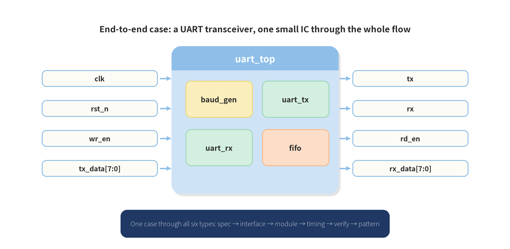  
> Figure 4-3 Running Case: the ModuleType and InterfaceType of uart_top  

**Table 4-2 Six Steps × UART Outputs**

| **Step** | **The UART's behaviour** | **Output** | **Acceptance point** |
| --- | --- | --- | --- |
| I. Identify the context | Organise seven requirements, establish three dimensions | Requirement dimension table | No residual comparison failures |
| II. Build types by axis | Write the six-type draft + ∩(T) | Six-type worksheet | Every type has criteria |
| III. Select the move | Pick six moves, record the worksheet | Move list | Every move maps to a task |
| IV. Generate output | S1–S7 segmented generation | uart_tx／uart_rx RTL | One type per pass |
| V. Verify against criteria | Run the four layers once | Sign-off sheet + coverage | Cross-acceptance: both axes pass |
| VI. Archive and evolve | Enter the evolution account, open a gap ticket | Evolution record | No break in the evidence chain |

## 4.4 Step Five: Verify Against Criteria, Step Six: Archive and Evolve

Step five runs Chapter 3's four accuracy layers in full and performs cross-acceptance: statically check type completeness (six types present, criteria set, notation complete), dynamically check move readiness (invocation justified, reasoning complete, records archived). There are only three ways to handle a failure: fix the RTL, fix the testbench, fix the criteria—note the third: the criteria themselves can be wrong, but changing criteria must go back to the spec type and reopen a version; no on-the-spot watering down.

Step six is the key to the brain growing: record this round's criteria sign-off sheet, coverage gaps, lessons and refactoring decisions in the evolution account. The Temporal Type's three moves—continuous learning, refactoring and recombination, self-evolution—all live off this account: when the next UART project starts, the brain first opens the previous account and the pit need not be hit twice.

## 4.5 Three-Layer Judgement: the Last Line Before Acceptance

Before accepting any output, sweep it with the three-layer judgement of type logic: layer one, container judgement—is it in the right ( )? (are the clock and protocol domains right); layer two, BOM structural dependency judgement—are its relations with the parts in { } right? (does the remove grading match the dependency chain); layer three, abstraction rule judgement—does it satisfy the open rules of ∩(T)? (is the new requirement attached to the right dimension). Only when all three pass may it enter the evolution account.

> **Chapter highlights**  
> The six steps are the SOP: identify the context → build types by axis → select the move → generate output → verify against criteria → archive and evolve.  
> The four-step framework identifies requirements, the move set picks the method, type dependencies fix the generation order; AI generates one type per pass.  
> Fail acceptance, return to the matching step; before acceptance run the three-layer judgement: container, BOM, abstraction.  

# Chapter 5 AI-Written Verilog: a Manual for Accurate Use

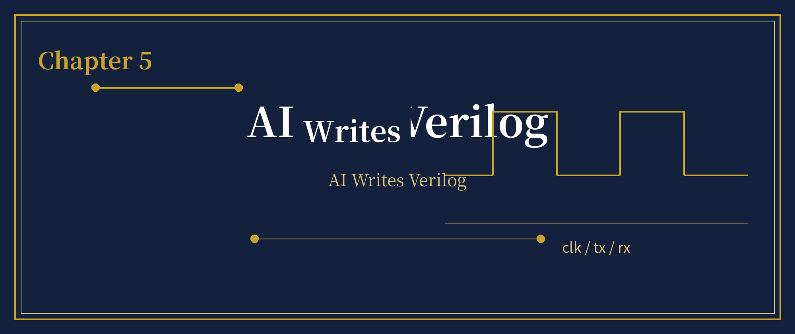

Chapter image · waveforms and moves

This chapter is the implementation chapter of the whole pipeline: the accurate way to use AI-written Verilog. The principles were established in Chapter 3—segmented generation, per-segment acceptance, an unbroken evidence chain; here they become operations you can copy directly: the S1–S7 seven-stage prompt pipeline, complete UART modules, testbenches and a comparison of common errors. All code is written in Verilog/SystemVerilog and can go straight to a simulator.

## 5.1 The Seven-Stage Prompt Pipeline S1–S7

S1–S7 is the six steps projected onto the prompt layer: one task per segment, acceptance criteria per segment. Asking AI to "write the complete UART directly" usually yields code nobody dares use; with the seven-stage pipeline, each stage's output is the next stage's input and is itself an acceptable intermediate output.

> 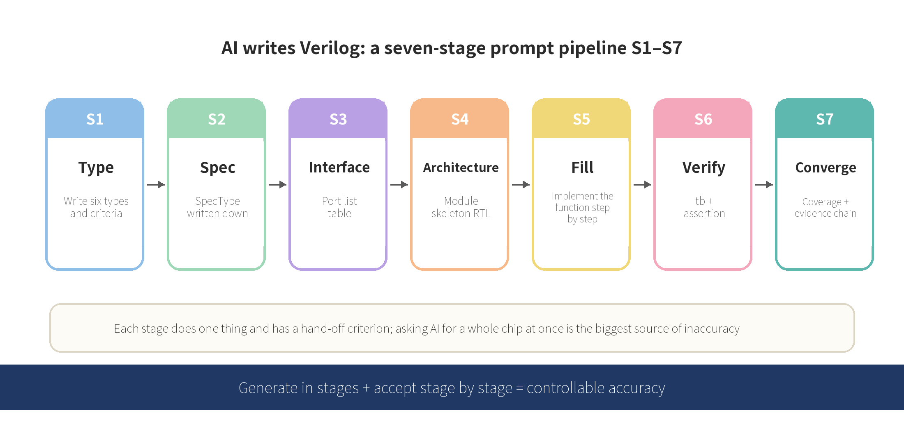  
> Figure 5-1 The S1–S7 Seven-Stage Pipeline: One Type and One Criterion per Stage  

**Table 5-1 S1–S7 Prompt Essentials and Output Types**

| **Stage** | **Name** | **Prompt essentials (instructions given to the AI)** | **Output type** |
| --- | --- | --- | --- |
| S1 | Establish types | "List the six types for this case and the intersection criteria of each type; do not write code" | Six-type worksheet |
| S2 | Spec | "Write the SpecType from the requirement sentences, each sentence with an acceptance metric" | Spec type |
| S3 | Interface | "Define the port list per the spec type: name, bit width, direction, clock domain" | InterfaceType |
| S4 | Architecture | "Give the module skeleton per the interface type: block partition, state machine, drive relations; leave the function empty for now" | ModuleType skeleton |
| S5 | Fill | "Implement the function block by block, one always block at a time, keeping the skeleton structure" | Full RTL |
| S6 | Verification | "Write a self-checking testbench and assertions per ∩(T)" | VerifyType |
| S7 | Convergence | "Run coverage, list the gaps, summarise the evidence chain" | Sign-off package |

> **Example: the actual S1 prompt (ready to use)**  
> "Here is a UART transceiver requirement: 115200 bps, 8N1, 50 MHz single clock domain, 16-byte FIFO.  
> Please do not write code yet. Use the six output types of Ontypology to list the worksheet for this case: for each type write the bracket notation and the  
> intersection criteria ∩(T), and use the remove criterion to grade the BOM parts. Output as a Markdown table."  

## 5.2 From SpecType to InterfaceType: the Types of a UART

S2–S3 establish the type before writing code. The spec type was identified in Chapter 4; here it is landed as the port contract table of the interface type—this table is the sole basis for the S4 skeleton, and AI may not add or remove signals on its own.

**Table 5-2 uart_top Interface Type: Port Contract Table**

| **Signal** | **Direction** | **Bit width** | **Container attribution** | **Semantics** |
| --- | --- | --- | --- | --- |
| clk | in | 1 | 50 MHz clock domain | Global clock |
| rst_n | in | 1 | Reset domain | Active low, asynchronous release |
| tx_data | in | 8 | 50 MHz clock domain | Transmit data (valid when tx_busy=0) |
| tx_start | in | 1 | 50 MHz clock domain | Transmit start pulse |
| tx | out | 1 | Serial port | Serial output (idle high) |
| tx_busy | out | 1 | 50 MHz clock domain | Transmitting flag |
| rx | in | 1 | Serial port | Serial input (idle high) |
| rx_data | out | 8 | 50 MHz clock domain | Receive data |
| rx_valid | out | 1 | 50 MHz clock domain | Receive-complete pulse |

## 5.3 ModuleType: uart_tx and uart_rx

The result of S4–S5: two directly simulatable Verilog files. The skeleton comes first (three blocks: baud generator, shift register, bit counter), then block-by-block filling—the code you see was generated in exactly that order. Note that each always block does one thing and each register has a single driver: this is discipline locked at the skeleton layer, not left to AI's self-awareness.

#### Listing 5-1 uart_tx.v — transmitter (8N1, complete module)

> // uart_tx.v — UART transmitter: 1 start bit + 8 data bits + 1 stop bit  
> module uart_tx #(  
> parameter CLK_FREQ = 50_000_000,  
> parameter BAUD = 115_200  
> )(  
> input wire clk,  
> input wire rst_n,  
> input wire [7:0] tx_data,  
> input wire tx_start,  
> output reg tx,  
> output reg tx_busy  
> );  
> localparam integer DIV = CLK_FREQ / BAUD; // 50e6/115200 = 434  
> reg [15:0] baud_cnt;  
> reg baud_tick;  
> reg [3:0] bit_idx;  
> reg [9:0] shift_reg; // {stop, data[7:0], start}  
> // divider: one baud_tick per bit (dynamic projection of the Timing Type)  
> always @(posedge clk or negedge rst_n) begin  
> if (!rst_n) begin  
> baud_cnt <= 16'd0;  
> baud_tick <= 1'b0;  
> end else if (baud_cnt == DIV - 1) begin  
> baud_cnt <= 16'd0;  
> baud_tick <= 1'b1;  
> end else begin  
> baud_cnt <= baud_cnt + 16'd1;  
> baud_tick <= 1'b0;  
> end  
> end  
> // transmit control: after loading, shift out bit by bit on baud_tick  
> always @(posedge clk or negedge rst_n) begin  
> if (!rst_n) begin  
> tx <= 1'b1;  
> tx_busy <= 1'b0;  
> bit_idx <= 4'd0;  
> shift_reg <= 10'd0;  
> end else if (!tx_busy) begin  
> if (tx_start) begin  
> shift_reg <= {1'b1, tx_data, 1'b0}; // stop＋data＋start  
> tx_busy <= 1'b1;  
> bit_idx <= 4'd0;  
> end  
> end else if (baud_tick) begin  
> tx <= shift_reg[0];  
> shift_reg <= {1'b1, shift_reg[9:1]};  
> if (bit_idx == 4'd9) tx_busy &lt;= 1'b0; // stop bit sent  
> else bit_idx <= bit_idx + 4'd1;  
> end  
> end  
> endmodule  

#### Listing 5-2 uart_rx.v — receiver (midpoint sampling, complete module)

> // uart_rx.v — UART receiver: detect the start bit, then sample at each bit midpoint  
> module uart_rx #(  
> parameter CLK_FREQ = 50_000_000,  
> parameter BAUD = 115_200  
> )(  
> input wire clk,  
> input wire rst_n,  
> input wire rx,  
> output reg [7:0] rx_data,  
> output reg rx_valid  
> );  
> localparam integer DIV = CLK_FREQ / BAUD;  
> // two-flop synchroniser (boundary bridge of container ( ))  
> reg rx_ff1, rx_ff2, rx_sync;  
> always @(posedge clk or negedge rst_n) begin  
> if (!rst_n) begin  
> rx_ff1 <= 1'b1; rx_ff2 <= 1'b1; rx_sync <= 1'b1;  
> end else begin  
> rx_ff1 <= rx; rx_ff2 <= rx_ff1; rx_sync <= rx_ff2;  
> end  
> end  
> reg [15:0] baud_cnt;  
> reg [3:0] bit_idx;  
> reg busy;  
> reg [7:0] shift_reg;  
> always @(posedge clk or negedge rst_n) begin  
> if (!rst_n) begin  
> baud_cnt <= 16'd0; bit_idx <= 4'd0; busy <= 1'b0;  
> rx_data <= 8'd0; rx_valid <= 1'b0; shift_reg <= 8'd0;  
> end else begin  
> rx_valid <= 1'b0;  
> if (!busy) begin  
> if (rx_sync == 1'b0) begin // detect start bit  
> busy <= 1'b1;  
> bit_idx <= 4'd0;  
> baud_cnt &lt;= DIV / 2; // midpoint, half a bit later  
> end  
> end else if (baud_cnt == DIV - 1) begin  
> baud_cnt <= 16'd0;  
> if (bit_idx == 4'd0) begin  
> if (rx_sync == 1'b1) busy &lt;= 1'b0; // false start, discard  
> else bit_idx <= 4'd1;  
> end else if (bit_idx <= 4'd8) begin  
> shift_reg <= {rx_sync, shift_reg[7:1]};  
> bit_idx <= bit_idx + 4'd1;  
> end else begin // stop-bit midpoint  
> busy <= 1'b0;  
> if (rx_sync == 1'b1) begin  
> rx_data <= shift_reg;  
> rx_valid <= 1'b1;  
> end  
> end  
> end else begin  
> baud_cnt <= baud_cnt + 16'd1;  
> end  
> end  
> end  
> endmodule  

## 5.4 TimingType and VerifyType: Waveforms, testbench and assertion

With the RTL in hand, the timing type nails down "the dynamic": one frame = 1 start bit + 8 data bits + 1 stop bit, baud_tick defines each bit boundary, and the sampling point falls at the bit midpoint. The verify type then turns criteria into something executable—a self-checking testbench checks ∩(T) item by item, and assertions write the timing contract into the code.

> 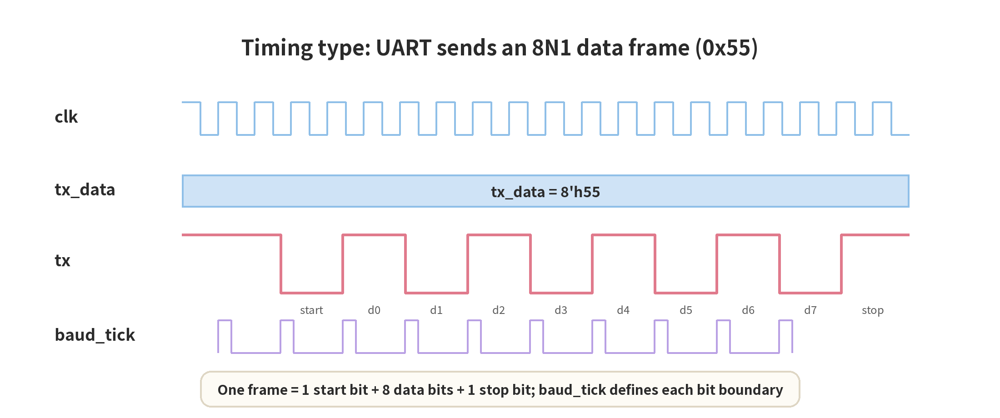  
> Figure 5-2 TimingType: the Waveform of One Frame Sending 0x55 (8N1)  

#### Listing 5-3 tb_uart_tx.sv — self-checking testbench (excerpt)

> `timescale 1ns/1ps  
> module tb_uart_tx;  
> reg clk = 1'b0, rst_n = 1'b0, tx_start = 1'b0;  
> reg [7:0] tx_data = 8'h00;  
> wire tx, tx_busy;  
> // smaller divisor speeds up simulation: DIV = 10  
> uart_tx #(.CLK_FREQ(1_000_000), .BAUD(100_000)) dut (  
> .clk(clk), .rst_n(rst_n), .tx_data(tx_data),  
> .tx_start(tx_start), .tx(tx), .tx_busy(tx_busy));  
> always #500 clk = ~clk; // 1 MHz  
> // checker: compare bit by bit against ∩(TimingType)  
> task check_byte(input [7:0] exp);  
> integer i;  
> begin  
> @(negedge tx); // start bit  
> #(5 * 10_000); // align to bit midpoint  
> for (i = 0; i < 8; i = i + 1) begin  
> if (tx !== exp[i]) $fatal(1, "data bit %0d mismatch", i);  
> #10_000;  
> end  
> if (tx !== 1'b1) $fatal(1, "stop bit mismatch");  
> end  
> endtask  
> initial begin  
> #20_000 rst_n = 1'b1;  
> @(posedge clk); tx_data <= 8'h55; tx_start <= 1'b1;  
> @(posedge clk); tx_start <= 1'b0;  
> check_byte(8'h55);  
> $display("PASS: 0x55 transmitted correctly");  
> $finish;  
> end  
> endmodule  

#### Listing 5-4 Assertion examples for the timing contract (SystemVerilog)

> // Verify Type: write ∩(TimingType) as an executable contract  
> property p_idle_high;  
> @(posedge clk) disable iff (!rst_n)  
> !tx_busy \|-&gt; tx == 1'b1; // tx must be high when idle  
> endproperty  
> a_idle_high: assert property (p_idle_high)  
> else $error("tx idle level violation");  
> property p_busy_stable;  
> @(posedge clk) disable iff (!rst_n)  
> tx_busy &amp;&amp; !tx_start \|=&gt; tx_busy \|\| !tx_busy; // changed only by the state machine  
> endproperty  

> 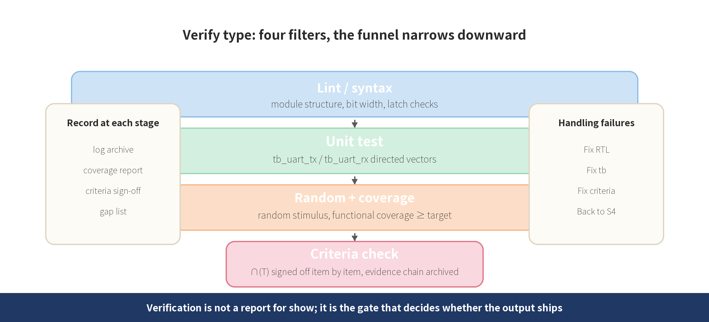  
> Figure 5-3 VerifyType: a Verification Funnel with Four Filters  

## 5.5 Common Errors and Corrections

Finally, lay out the five most common inaccuracies in AI-written Verilog for comparison. They are all "type errors"—the interface type not locked, the timing type not established, criteria patched afterwards—not syntax errors; the compiler catches syntax errors, and only the four accuracy layers catch type errors.

**Table 5-3 Common Errors in AI-Written Verilog**

| **Symptom** | **Diagnosing the type** | **Correction** |
| --- | --- | --- |
| AI adds signals nobody asked for | Interface type not locked: port contract not established first | S3 contract table first, no additions or deletions during generation |
| Bit width 7:0 written as 8:0 | ∩(T) not checked: interface criteria missing | Automatic contract-table comparison + zero-warning lint acceptance |
| always block drives the same register twice | Skeleton layer lost: letting the LLM improvise the structure | S4 skeleton first, fill block by block |
| Asynchronous signals go straight into the comparator | Container ( ) not established: cross-domain crossing undeclared | Cross-domain list + two-flop synchroniser |
| Deliver as soon as simulation passes | Verify type missing ∩(T): visual verification | self-checking + coverage + item-by-item sign-off |

> **Chapter highlights**  
> S1–S7 seven-stage pipeline: one type per pass, criteria per stage, AI may not add functions on its own.  
> Complete uart_tx / uart_rx modules + self-checking testbench + assertions, all directly simulatable.  
> AI inaccuracy is mostly a type error, not a syntax error; lock the interface, build the skeleton, set the criteria up front.  

# Chapter 6 Misuse Comparison, Checklist, Maturity

Chapter image · the posture of acceptance

The method is handed to you; the last chapter is about using it right. First look at five misuses—all of them look like they are in use but are not; then a ten-question checklist to ask yourself item by item before acceptance; finally maturity L1–L4, so the team knows how far it has grown and where it grows next.

## 6.1 Five Misuses Compared

The common trait of misuse is that "the type becomes a ritual": brackets are drawn, criteria are written, but nobody acts on them. The figure and the table below break all five misuses open at once.

> 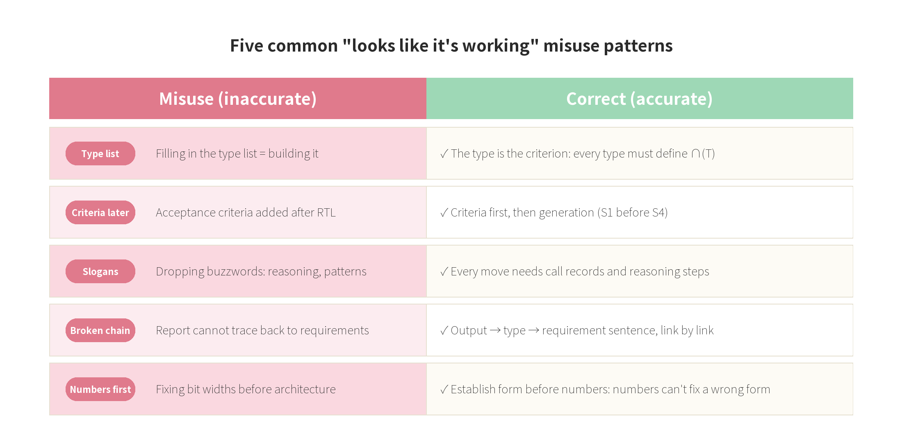  
> Figure 6-1 Misuse Comparison: Five Common "Looks Like It Is in Use"  

**Table 6-1 Misuse Comparison and Corrective Actions**

| **Misuse** | **Typical scene** | **Corrective action** |
| --- | --- | --- |
| Type as folder | Six types listed and the work is called done, criteria column blank | Every type must fill ∩(T); blanks may not enter the flow |
| Criteria patched afterwards | RTL written first, then asking AI to "help me think of tests" | S1 order locked: criteria are produced before generation |
| Moves as slogans | Saying "we use first principles" in a meeting, with no reasoning record | Move invocation must leave a worksheet and reasoning steps |
| Broken evidence chain | A beautiful verification report that cannot trace back to requirements | Spot-check the evidence chain; broken ones are rejected |
| Numbers before types | Argue 8 vs. 16 bits first, then think about architecture | Types first, numbers after; numerical disputes go back to [ ] property arbitration |

## 6.2 The Ten-Question Checklist

**Table 6-2 Ten Questions Before Acceptance (any "no" = return)**

| **#** | **Ask yourself before acceptance** | **Where is the evidence** |
| --- | --- | --- |
| 1 | Does every output type have ∩(T)? | Six-type worksheet |
| 2 | Were the criteria set before generation? | Sign-off sheet date |
| 3 | Is the interface contract table locked? | port contract table |
| 4 | Are the BOM criteria and the remove grading written? | BOM list |
| 5 | Does every cross-domain signal have a synchroniser bridge? | Cross-domain list |
| 6 | Does each always block do one thing? | Skeleton document |
| 7 | Is the testbench self-checking? | tb source |
| 8 | Coverage met, gaps handled? | Coverage report |
| 9 | Are move invocations and reasoning steps recorded? | Worksheet |
| 10 | Does the evidence chain trace back to the requirement sentence? | On-chain spot check |

## 6.3 Maturity L1–L4

Maturity is not an appraisal, it is navigation. L1 type vocabulary: the whole team speaks one type language, six types are written but not judged; L2 type criteria: every type yields ∩(T), criteria are set but not traced; L3 type evidence chain: outputs are traceable and auditable, but by hand; L4 self-evolution: the evolution account drives refactoring and exploration, and the brain grows itself. L1→L2 is a method problem, L2→L3 a discipline problem; only L3→L4 is a real design brain.

> 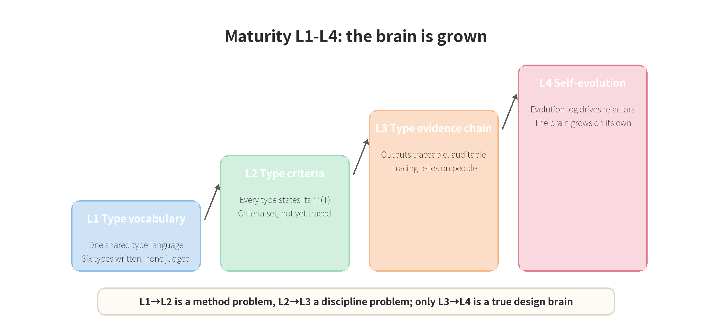  
> Figure 6-2 Maturity Ladder: L1 Type Vocabulary → L4 Self-Evolution  

**Table 6-3 Maturity L1–L4 and Upgrade Actions**

| **Level** | **What meeting the bar looks like** | **Blocker warning** | **Upgrade action** |
| --- | --- | --- | --- |
| L1 Type vocabulary | Six type names unified across documents | One term, three readings | Run a type-vocabulary alignment workshop |
| L2 Type criteria | Every type has ∩(T) and someone has signed it off | Criteria written but nobody uses them | Criteria sign-off: no sign-off, no generation |
| L3 Type evidence chain | Spot-check three RTL sections; all traceable | Tracing back depends on phoning people | Evolution account + routine on-chain spot checks |
| L4 Self-evolution | New projects automatically surface old lessons | The same pit hit twice | Move set × evolution account closed loop |

> **Chapter highlights**  
> All five misuses turn the type into a ritual: the type as folder, criteria patched afterwards, moves as slogans, broken evidence chains, numbers before types.  
> Any "no" on the ten questions means return; maturity L1→L4 is three upgrades: method, discipline, closed loop.  

# Review: one sentence to take the whole book away

> 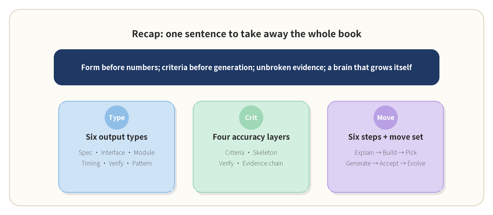  
> Figure R-1 One-Page Review  

R-1 A type is the atom of this method. The six output types—spec, interface, module, timing, verify, pattern—establish IC design outputs as types with identity, criteria and relations; three-bracket notation and ∩(T) criteria turn "accuracy" into something that can be written on paper.

R-2 Accuracy is grown from four layers. ∩(T) criteria first, deductive skeleton constraining generation, formal verification as the gate, type evidence chain for traceability—miss one layer and one kind of error slips through. Acceptance looks at two axes: space checks type completeness, time checks move readiness.

R-3 The usage is six steps plus S1–S7. Identify the context, build types by axis, select the move, generate output, verify against criteria, archive and evolve; AI generates one type per pass and the evidence chain never breaks. Grow to L4 and the brain grows itself.

> **Types first, numbers after; criteria first, generation after; unbroken evidence, the brain grows on its own**  

# Appendix A Quick Reference

## A.1 Terms and Notation at a Glance

**Table A-1 Terms at a Glance (Type = Type)**

| **Term** | **English** | **One-sentence definition** |
| --- | --- | --- |
| Type | Type | A structure that yields criteria and supports reasoning |
| Spec type | SpecType | A spec structure that is measurable and decidable |
| Interface type | InterfaceType | The module's external port contract |
| Module type | ModuleType | The compositional type described by the BOM structure |
| Timing type | TimingType | The dynamic type of clocks, frame timing and cross-domain crossing |
| Verify type | VerifyType | A type that turns criteria into executable checks |
| Pattern type | PatternType | Reusable design patterns with criteria and known pits |
| Intersection criteria | ∩(T) | The open rule that decides whether a new member belongs |
| Identity anchor | id(C) | The basis for container identity invariance |
| remove criterion | remove(p, M) | Remove a part, check identity, grade into three levels |
| Move set | Motion Set | The Temporal Type's fourteen moves: function = method = move |
| Evolution account | EvolutionLog | An accumulating account of lessons, refactors and gaps |
| Type evidence chain | Type Trace | The evidence chain tracing output back to types and requirements |

## A.2 The Temporal Type Move Set × Uses in the IC Pipeline

**Table A-2 The Fourteen Moves: Moves Used in This Book and Where They Land**

| **Moves (Temporal Type)** | **Its place in the IC pipeline** | **Chapter in this book** |
| --- | --- | --- |
| Type-temporal function search | Search the type repository for existing specs and RTL | 4.3、5.1 |
| Design search and extraction | Extract reusable patterns from past cases | 2.5 |
| Design pattern | Pattern invocation: handshake, cross-domain FIFO, divider, and so on | 2.5、4.2 |
| Logic generation and application | Deducing and deciding criteria | 3.1 |
| Function generation and application | Package repeated flows as prompt functions | 5.1 |
| Continuous learning | Daily bookkeeping of the evolution account | 4.4 |
| Refactoring and recombination | Modularisation and pipelining (guaranteed by id(C)) | 4.4 |
| Problem-solving | Requirement decomposition and problem analysis | 4.1 |
| Analysis | Comparison, remove counterfactual analysis | 4.2、5.5 |
| Design (creation and innovation) | Architecture design and trade-offs | 4.3 |
| Reasoning | Causal, reverse-causal, simulation, statistical, reverse reasoning | 3.1、4.2 |
| Thinking method | Forward, reverse, horizontal, vertical, first principles | 4.2 |
| R&D and exploration | New-architecture PoC and alternative evaluation | 3.4 |
| Self-evolution | Maturity L4: the evolution account drives the brain's growth | 6.3 |

