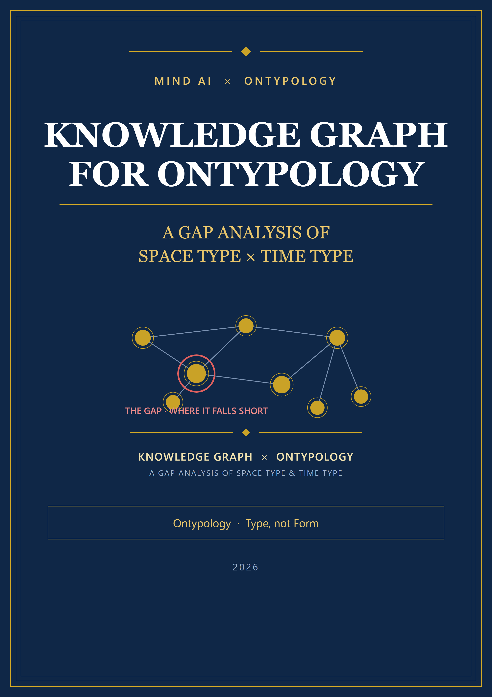

## Contents

- Before We Begin Three Conventions
- Introduction The Gap Between Two Languages
- Chapter 1 What a Knowledge Graph Carries
  - 1.1 Nodes, Edges, Properties
  - 1.2 Triples: Telling the World One Sentence at a Time
  - 1.3 The Line Between Strength and Weakness
- Part I · Space Type: Four Gaps
- Chapter 2 Gap One · The Brackets Flattened
  - 2.1 Three Brackets, Three Semantics
  - 2.2 The Flattening Up Close: The Lid's Three Identities
  - 2.3 Three Consequences of Semantic Loss
- Chapter 3 Gap Two · Identity Drift
  - 3.1 The Identity Anchor id(C): Content May Change, Identity May Not
  - 3.2 Four Scenes of Drift
  - 3.3 The Cost of an Absent Invariance Axiom
- Chapter 4 Gap Three · The Graph Cannot Judge
  - 4.1 Judgment Is a Funnel, Not a Lookup
  - 4.2 The Difference Between a Lookup and a Rule
  - 4.3 The Three remove Levels: Counterfactuals Do Not Fit on an Edge
- Chapter 5 Gap Four · Generation Amnesia
  - 5.1 The Generation Chain of a Type
  - 5.2 The Four-Step Framing Process: Dimensions Are Forced Out
  - 5.3 Three Costs of Storing Only Results
- Part II · Time Type: Three Gaps
- Chapter 6 Gap Five · The Vanishing Verb
  - 6.1 Time Type = Verb = Function = Move
  - 6.2 A Move Must Carry Everything That "Doing" Requires
  - 6.3 After the Decline into a Label
- Chapter 7 Gap Six · Reasoning in Absentia
  - 7.1 Five Kinds of Reasoning, Five Paths "Not on the Graph"
  - 7.2 "Related" Is Not "Therefore"
  - 7.3 The Graph Walks Old Paths; Reasoning Opens New Ones
- Chapter 8 Gap Seven · Evolution in Absentia
  - 8.1 Self-Evolution: Knowledge Flows with Time
  - 8.2 The Graph Does Not Grow by Itself
  - 8.3 Three Concrete Ways It "Cannot Grow"
- Chapter 9 Synthesis · Between the Two Types
  - 9.1 The Panorama of the Seven Gaps
  - 9.2 Seven Faces of the Same Gap
  - 9.3 Misuse at a Glance: Five Ways We "Think the Graph Can"
  - 9.4 Checklist: Which Questions Not to Hand to the Graph
- Review Leaving with a Sense of the Gap
  - R-1 A Three-Sentence Summary
  - R-2 What This Book Does Not Contain (One More Reminder)
  - R-3 How to Use This Analysis
- Appendix Terms and Gaps at a Glance

## Before We Begin Three Conventions

BEFORE WE BEGIN

This is a book that does exactly one thing: it takes the **knowledge graph** (KG), as applied to **Ontypology** - the Space Type and the Time Type - and examines, one by one, the places where the graph cannot say it clearly, cannot store it, cannot judge it, and cannot keep up. In other words, this is a **gap analysis** , not a textbook on knowledge graphs and not a restatement of Ontypology.

To keep the analysis clean and sharp, three conventions are set before we begin:

***Convention One · Type, Not Form*** *In this book, the Ontypology concept of a form is always written Type, never Form. Space Type, Time Type, Unit Type.*

***Convention Two · No Restating of Ontypology*** *This book assumes you have already read the Space Type and the Time Type. Brackets, criteria, axioms and other terms are named only where the analysis needs them; they are not taught again.*

***Convention Three · Gaps Only*** *This book proposes no remedies, builds no systems, and draws no future roadmap. Each chapter answers one question only: here, what exactly is the knowledge graph missing?*

**Table 0-1 Task map: the seven gaps and where they are discussed**

| Part | Chapter | Gap | In one sentence |
| --- | --- | --- | --- |
| Starting point | Ch. 1 | The KG baseline | First take stock of what a knowledge graph actually carries |
| Space | Ch. 2 | Bracket flattening · three relations, one edge | Three relations are flattened into one kind of edge |
| Space | Ch. 3 | Identity drift · no identity anchor | The graph has no identity anchor to hold |
| Space | Ch. 4 | The graph cannot judge · lookup is not judgment | A lookup is not a judgment |
| Space | Ch. 5 | Generation amnesia · results only | Only the result is stored, never the process |
| Time | Ch. 6 | The vanishing verb · moves become labels | A move degrades into a label |
| Time | Ch. 7 | Reasoning in absentia · the graph walks old paths | The graph walks old paths; reasoning opens new ones |
| Time | Ch. 8 | Evolution in absentia · the graph does not grow | The graph does not grow by itself |
| Synthesis | Ch. 9 | Overall diagnosis of the seven gaps | Seven faces of the same gap |
| Review | Review | The checklist | Leave with the checklist, and you will know where a graph can be used |

## Introduction The Gap Between Two Languages

INTRODUCTION

**Both the knowledge graph and Ontypology "describe the world", but their languages are different by nature.**

The language of a knowledge graph is nouns and relations: it states the world one sentence at a time - "the cup's material is glass", "the lid belongs to the cup", "there is a cup on the table". Nodes record things, edges record relations, properties record labels. The strength of this language is **remembering and connecting** : millions of statements pile into a net, and lookups are fast.

The language of Ontypology is types and criteria: the Space Type uses three kinds of brackets to express three entirely different relations - [ ] says "is a member of a category", { } says "is a part of a whole", ( ) says "is contained inside"; each relation carries its own criterion (the intersection criterion, the remove criterion, the invariance axiom). The Time Type switches to another language: verbs, functions, methods, moves - it says "how to do", not "what there is".

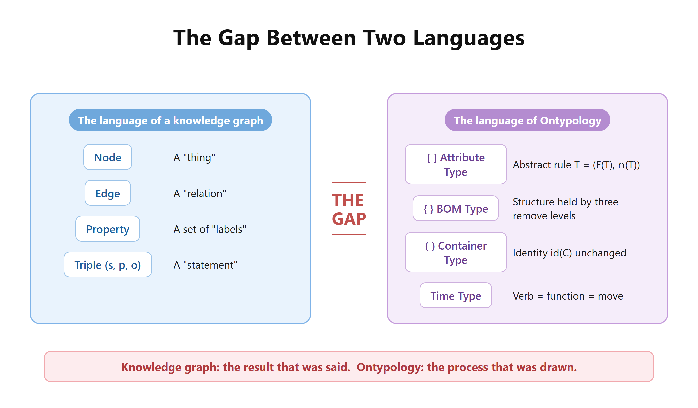

*Figure D-1 The gap between two languages: the KG stores the result that was said, Ontypology asks about the process that was drawn*

Place the two languages side by side, and the gap appears at once: Ontypology asks "how was this Type drawn?", "why is this identity the same one?", "how is this judgment made?"; the knowledge graph answers "I have an edge here", "let me look it up for you". **The gap is not a bug; it is the boundary of a language** - the seven chapters that follow trace this boundary and mark the gaps one by one.

***How this book proceeds*** *Chapter 1 measures the KG baseline; Chapters 2 to 5 walk through the four gaps of the Space Type; Chapters 6 to 8 walk through the three gaps of the Time Type; Chapter 9 draws the synthesis; the checklist comes last.*

## Chapter 1 What a Knowledge Graph Carries

CHAPTER 1 · WHAT A KG CARRIES

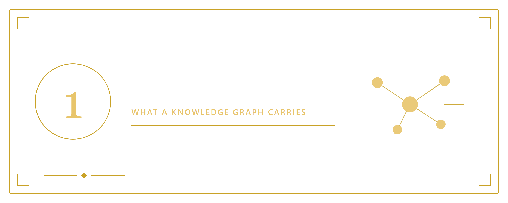

To talk about gaps, you must first take stock. When a knowledge graph goes out to do business, it carries only three things: **nodes, edges, and properties** . Everything it does well, and everything it does badly, traces back to these three.

### 1.1 Nodes, Edges, Properties

A node is a "thing" in the world: a person, a cup, a city. An edge is a "relation" between things: knows, belongs to, is located in. A property is a "label" on a thing: colour = white, material = glass. Stack the three together, and the world is stated as a net.

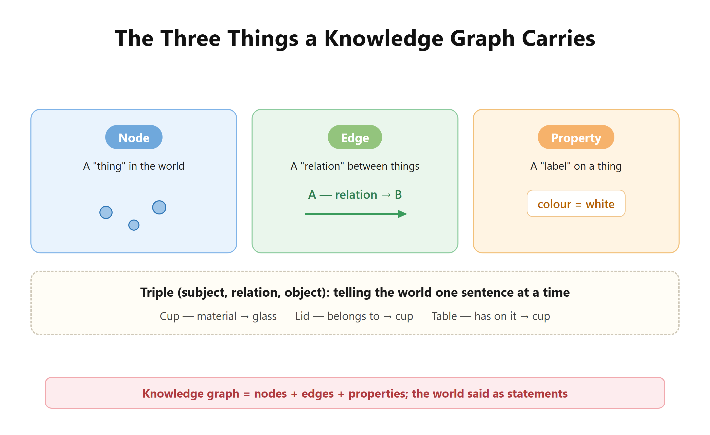

*Figure 1-1 The three things a knowledge graph carries: nodes, edges, properties*

**Table 1-1 The three carriers × their corresponding semantics in Ontypology**

| KG carrier | Semantics in a KG | Corresponding notion in Ontypology | Gap preview |
| --- | --- | --- | --- |
| Node | A "thing" | An instance of a Type (Unit Type) | A Type has identity and criteria; a node has only a pointer |
| Edge | A "relation" | The three brackets: [ ], { }, ( ) | Three semantics are flattened into one (Chapter 2) |
| Property | A set of "labels" | The Attribute Type: abstract rule T = (F(T), ∩(T)) | Labels are dead; rules are alive (Chapter 4) |

### 1.2 Triples: Telling the World One Sentence at a Time

The smallest unit of the three carriers is the **triple** (subject, relation, object) - a statement that can be judged true or false. The whole knowledge graph is billions of such statements stacked together. Its philosophy of expression is simple: **only what can be said as a sentence can be stored** . That philosophy gave the KG its queryability, and it also planted the common root of the seven gaps in this book - some things simply cannot be said as sentences.

### 1.3 The Line Between Strength and Weakness

Cut the KG's capability along the line between "storage and access" and "judgment, generation and action", and the boundary is clear: on the left is its kingdom, on the right is its frontier.

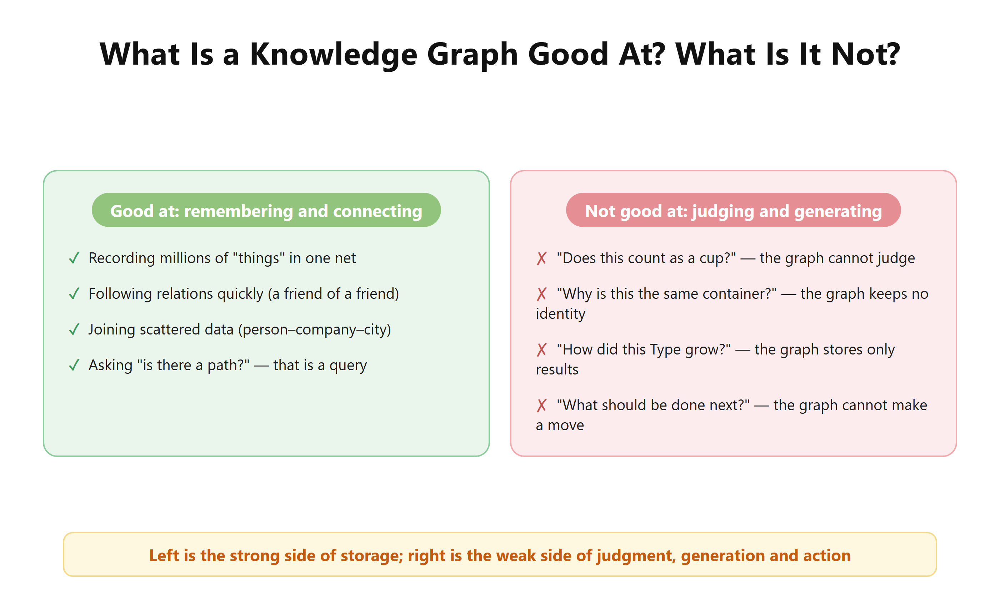

*Figure 1-2 What is a knowledge graph good at? What is it not good at?*

The seven gaps analysed in this book all fall on that frontier on the right. They are not cases of "the KG doing a poor job"; they are cases of "the KG's language having no such sentence". With this ruler in hand, we enter the Space Type.

## Part I · Space Type: Four Gaps

PART I · SPACE TYPE

The Space Type answers "what it is, what it has, where it is" - the three axes of attribute [ ], bill of materials { }, and spatial container ( ) together form the coordinate system of a Type. For a knowledge graph to catch these three axes in one net, the first thing it runs into is the bracket.

The four chapters of the space part follow the order in which the walls are hit: first the most intuitive one, **structure** (the brackets are flattened); then **identity** (id(C) has nowhere to sit); then **judgment** (∩(T) cannot be looked up); and finally **generation** (no one remembers how the Type grew). The four are layered - each gap is often the breeding ground for the next.

## Chapter 2 Gap One · The Brackets Flattened

CHAPTER 2 · THE THREE BRACKETS FLATTENED

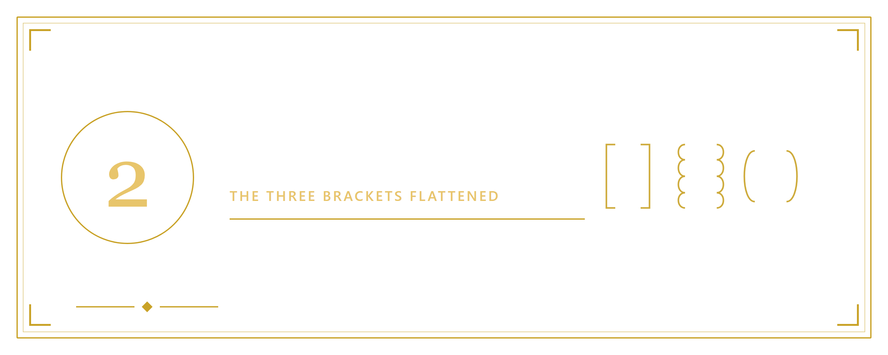

### 2.1 Three Brackets, Three Semantics

Each of the three axes of the Space Type carries one kind of bracket. The three brackets are not decoration; they are three **completely different relations** : [ ] says "abstraction" - a category defined by the intersection of features; { } says "composition" - the structure of a bill of materials; ( ) says "container" - what is loaded inside a space. Each has its own criterion: abstraction is verified by the intersection criterion ∩(T); composition is graded by the remove criterion; containment guards identity by the invariance axiom.

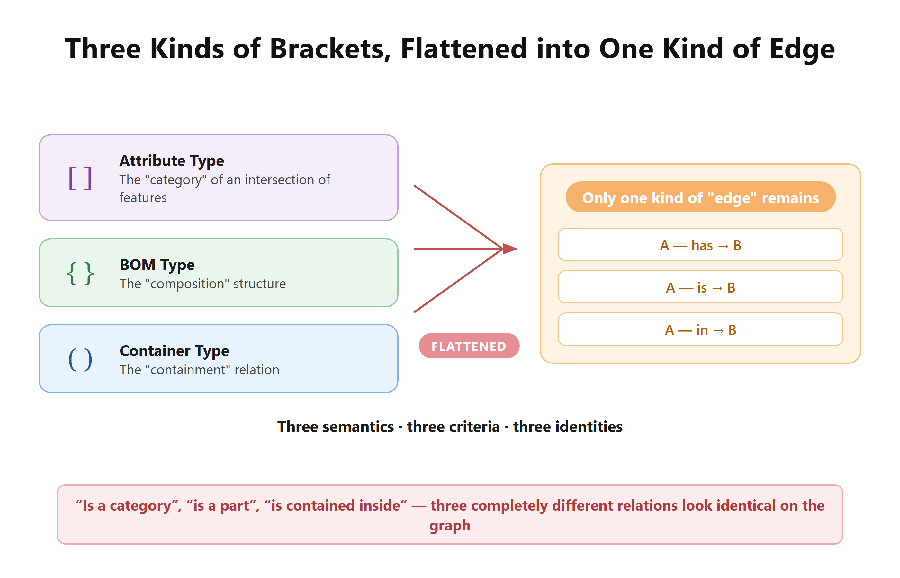

*Figure 2-1 Three kinds of brackets, flattened into one kind of edge*

**Table 2-1 Three bracket semantics × a single kind of edge**

| Bracket | Relational semantics | Criterion it carries | What remains after flattening |
| --- | --- | --- | --- |
| [ ] | Abstraction: is a member of this category | Intersection criterion ∩(T) | One undifferentiated "has/is" edge |
| { } | Composition: is a part of the whole | The three-level remove criterion | The same - the edge cannot say "what happens if removed" |
| ( ) | Container: is inside the identity | Invariance axiom id(C) | The same - the edge cannot say "replacing it changes nothing" |

### 2.2 The Flattening Up Close: The Lid's Three Identities

Take the cup lid as the scene. Ask three questions: Does the lid "belong to" the lid category? Does the lid "compose" the cup? Is the lid "contained in" the cup? Three questions, three relations, three criteria, three ways of verification. But once flattened into one kind of edge, all the graph shows is "lid - has an edge - cup". A query cannot tell which kind it is, and a judgment cannot tell which rule to use.

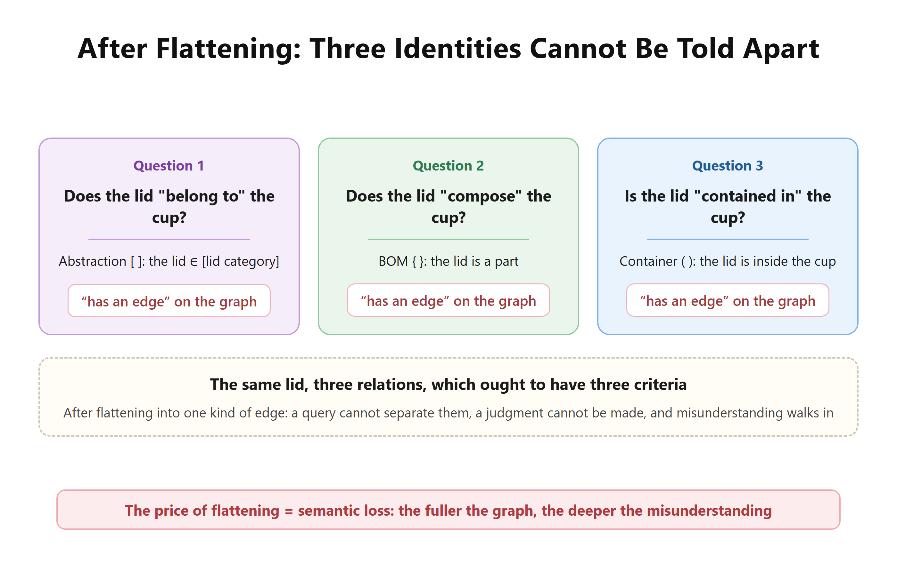

*Figure 2-2 After flattening: the lid's three identities can no longer be told apart*

**Table 2-2 Semantic loss after flattening**

| Question to ask | The language it needs | Can the flattened graph answer? |
| --- | --- | --- |
| Is a kettle a cup? | [ ] + ∩(T), verified on the spot | No - there is no rule on the edge to verify |
| Which level of part is the steering wheel? | { } + the three remove levels | No - there is no level on the edge to distinguish |
| After replacing the contents, is it still the same? | ( ) + the invariance axiom | No - there is no identity on the edge to guard |

### 2.3 Three Consequences of Semantic Loss

• **Query confusion** : the same edge carries three kinds of question, and the answer that comes back does not match the question.

• **Judgment impossible** : the criterion used to hang on the bracket; once the bracket is flattened, the criterion loses its link (Chapter 4 deals with this in full).

• **Misunderstanding walks in** : readers fill the blank with their own semantics - the fuller the graph, the more misunderstandings they fill in.

***Three semantics → one kind of edge: structural information is not "simplified", it is "thrown away"***

## Chapter 3 Gap Two · Identity Drift

CHAPTER 3 · THE DRIFTING IDENTITY

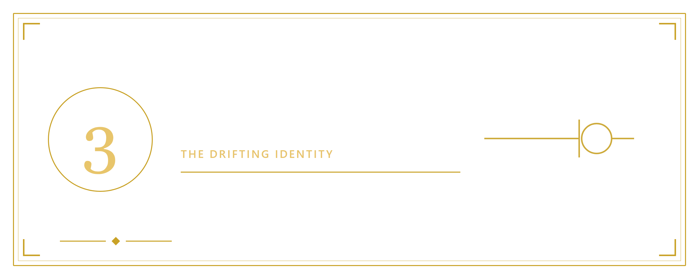

### 3.1 The Identity Anchor id(C): Content May Change, Identity May Not

At the core of the spatial container Type is **identity** . A container C = ( id(C), S(C) ): the content S(C) may be replaced freely, while the identity id(C) does not move. Fill the cup with water, then with coffee - it is still the same cup. The invariance axiom writes this down as an axiom: for all e1, e2 ∈ S(C), replacing e1 with e2 does not change id(C). This is what makes a container a container.

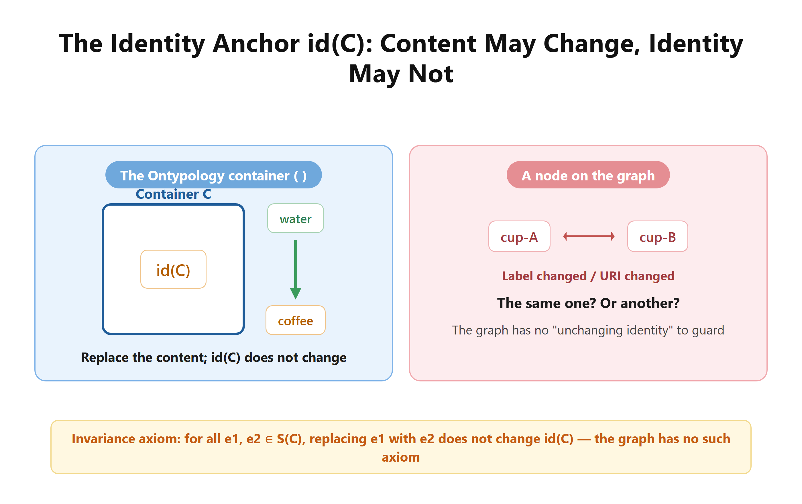

*Figure 3-1 The identity anchor id(C): content may change, identity may not*

**Table 3-1 Two ways of writing identity**

| Aspect | How Ontypology writes it | How a KG writes it |
| --- | --- | --- |
| Identity anchor | id(C): explicit, does not vary with content | Node URI / label: merely a pointer |
| Invariance | An axiom: replacing content does not change identity | No corresponding semantics - change is just change |
| Nesting | Containers nest layer by layer, each guarding its own id | Subgraph membership relies on edges; no inside/outside semantics |

### 3.2 Four Scenes of Drift

Without an identity anchor, editing becomes a disaster. Four scenes recur: **renaming** - change the label, and all the relations under the old name break into islands; **merging** - two nodes become one, and their old relations do not know whom to follow; **splitting** - one node is cut into two, and the properties do not know how to be divided; **versioning** - an update overwrites, and the previous version vanishes from the graph without a trace.

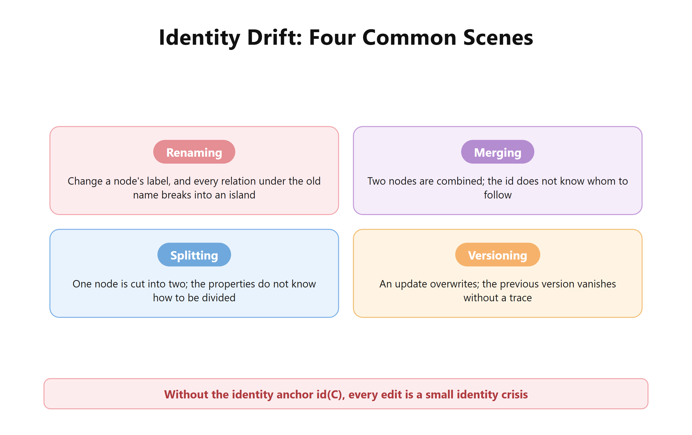

*Figure 3-2 Identity drift: four common scenes*

### 3.3 The Cost of an Absent Invariance Axiom

Look one level deeper: drift is not merely "hard to maintain in engineering"; it is **the semantic impossibility of judging sameness** . Ontypology asks "after the content is replaced, is it still itself?" and has an axiom underneath the question; the KG asks the same question with only the equality of URIs at hand. URI equality means "the pointer has not changed", not "the identity has not changed" - the pointer is attached by people; the identity is carried by the Type itself. Treating the pointer as the identity is the root of drift.

***id(C) is the identity anchor of the Type; a URI is only the graph's name tag - a name tag can be reattached; an identity anchor does not drift***

## Chapter 4 Gap Three · The Graph Cannot Judge

CHAPTER 4 · A GRAPH CANNOT JUDGE

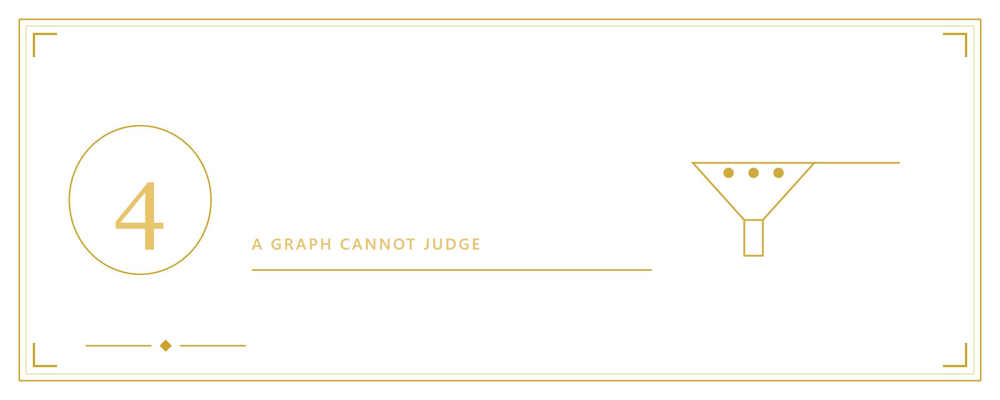

### 4.1 Judgment Is a Funnel, Not a Lookup

Judgment in Ontypology is a **funnel** : a new object enters and passes through every feature of ∩(T) - can it hold liquid? can it be held and drunk from? Only if it passes all of them does it belong to [cup]. This is an open rule: a new member that is not on any list is verified on the spot, by the same rule.

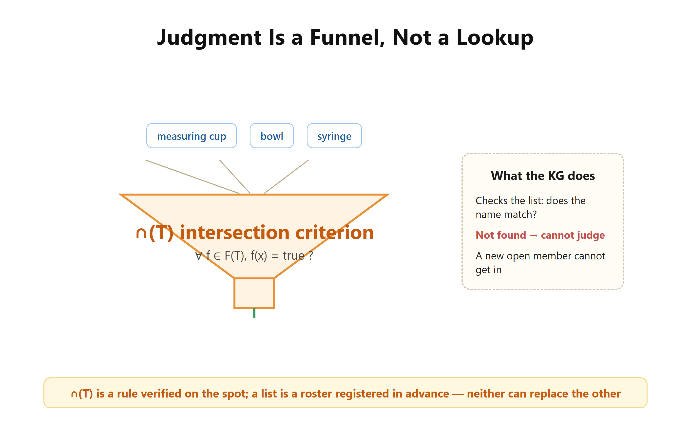

*Figure 4-1 Judgment is a funnel, not a lookup*

**Table 4-1 ∩(T) verified on the spot × KG lookup**

| Aspect | ∩(T) judgment | KG lookup |
| --- | --- | --- |
| Mechanism | Verify the features one by one | Search the existing edges one by one |
| New members | Open - the rule applies to all alike | Closed - if it is not found, it cannot be judged |
| Borderline cases | The completeness of F(T) decides their fate | No notion of "borderline", only presence or absence |
| Output | A judgment of "belongs / does not belong" | A set of statements that are "related" |

### 4.2 The Difference Between a Lookup and a Rule

It is not that a KG cannot classify at all - an ontology also has a class hierarchy. But a class hierarchy stores "memberships already acknowledged", which amounts to a pre-registered list; ∩(T) stores "verifiable rules", which are exam papers handed out on the spot. What the list finds, the list is good for; what the list does not find - say, a straw cup never seen before - the list stays silent, and the rule speaks. **A lookup answers "has this been registered?"; a judgment answers "does this count as one of these?"**

### 4.3 The Three remove Levels: Counterfactuals Do Not Fit on an Edge

The criterion on the composition axis is even more demanding: the remove criterion asks a **counterfactual** - "what happens if the part is taken away?" Essential part: identity is lost after removal. Function-degrading part: function is missing but identity survives. Non-essential part: no effect at all. The three-level classification rests entirely on this hypothetical question.

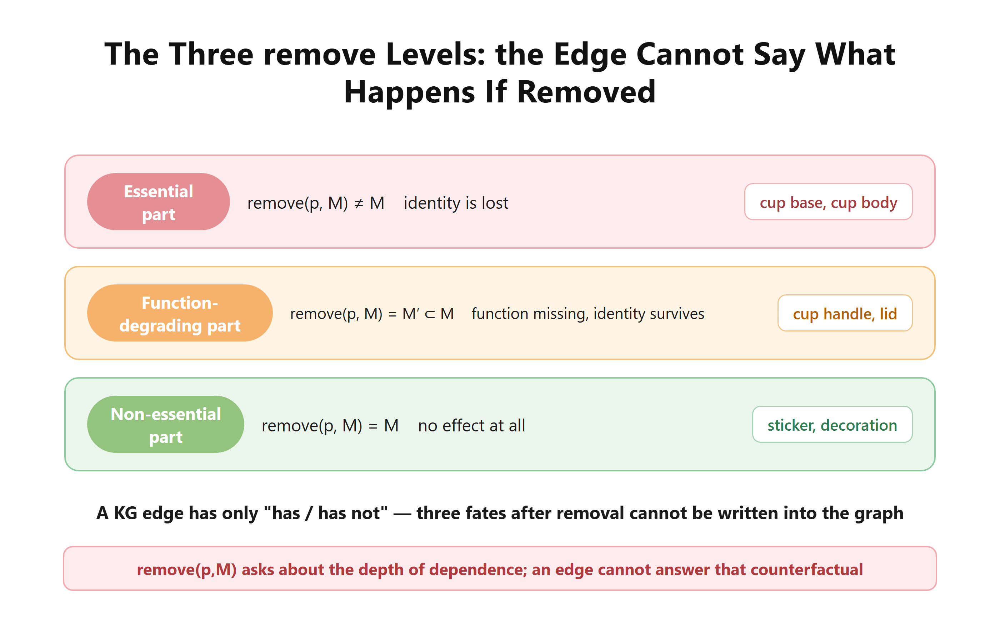

*Figure 4-2 The three remove levels: the edge cannot say "what happens if it is removed"*

**Table 4-2 The three remove levels × what an edge can express**

| Level | Result of remove(p, M) | Example | Can one edge express it? |
| --- | --- | --- | --- |
| Essential part | ≠ M identity lost | Cup base, cup body | No - the edge has no "consequence" field |
| Function-degrading part | = M' ⊂ M function degraded | Cup handle, lid | No - the edge has no "degree" field |
| Non-essential part | = M no effect | Sticker, decoration | No - the edge has no "hypothesis" field |

The three "no"s point to one thing: the KG's edge is a **statement about what has happened** , while remove asks about a **hypothesis about what has not happened** . A statement is stored in the graph as data; a hypothesis has to be run inside a criterion - the graph cannot judge because the criterion was never part of the graph's language.

***A query walks over "edges that already exist"; a judgment runs "rules that are not yet verified" - the two live on different language layers***

## Chapter 5 Gap Four · Generation Amnesia

CHAPTER 5 · AMNESIA OF GENERATION

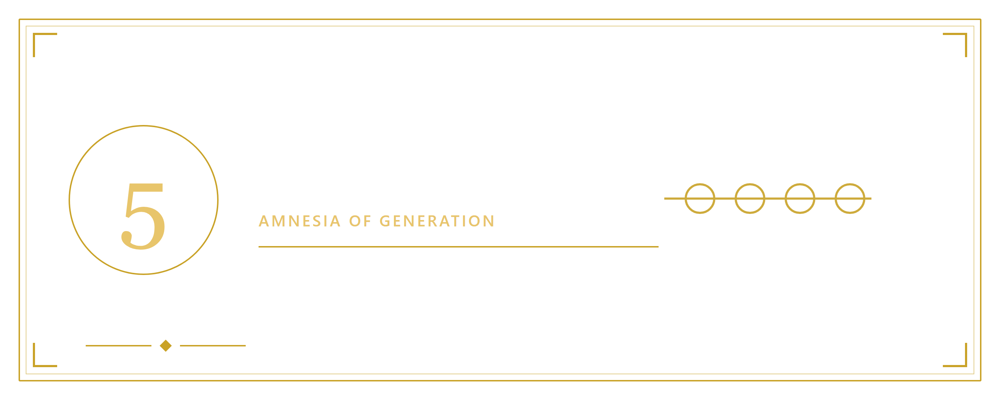

### 5.1 The Generation Chain of a Type

A Type is not born ready-made. Ontypology writes the birth of a Type as a chain: **difference → division → Type → name** . Only after seeing "this is not the same as that" can a boundary be drawn; only when the boundary is drawn does the Type appear; only when the Type has a name can it enter the world of knowledge. This chain is the production line of cognition - the Type is its product.

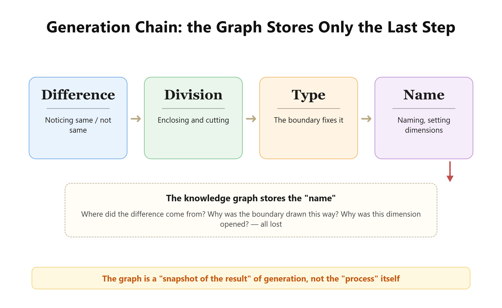

*Figure 5-1 The generation chain of a Type: the graph stores only the last step*

**Table 5-1 The four steps of the generation chain × what the graph retains**

| Step | What cognition is doing | Can a KG store it? |
| --- | --- | --- |
| Difference | Detecting difference: same / not same | No - difference is a feeling, not a statement |
| Division | Enclosing and cutting: drawing a boundary | No - a boundary is an action, not data |
| Type | The boundary fixes the Type: recognizing "one thing" | Partly - only the node after the Type is fixed |
| Name | Naming and setting up dimensions | Yes - name labels are the KG's home turf |

### 5.2 The Four-Step Framing Process: Dimensions Are Forced Out

Deeper still: even "dimensions" themselves are products of generation. The four-step framing process describes how dimensions are born: distinguish differences, **failed contrast** , name the dimension, assign membership. The first three cups differ only in colour; the fourth cup brings a "lid" - it matches neither the colour axis nor the material axis, and the **failed contrast** forces cognition to set up a new axis. The "lid" dimension is forced out by failure.

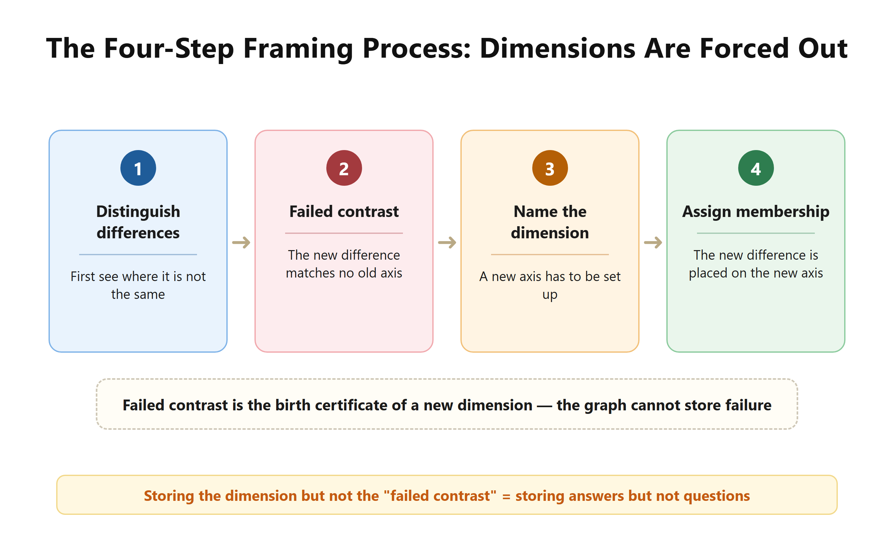

*Figure 5-2 The four-step framing process: dimensions are forced out*

Of course, a KG schema also has properties and classes. But every field in a schema appears in the posture of "already established" - nowhere in the graph is there an account of "why this dimension exists". The birth certificate of the dimension, **failed contrast** , has nowhere to be stored.

### 5.3 Three Costs of Storing Only Results

• **It cannot give reasons** : why these dimensions? The graph can only shrug - the dimensions are inherited, not explained.

• **It cannot take in new differences** : when a new difference matches no old axis, a person should open a new axis; the graph only stuffs it into the nearest old field.

• **It cannot go back** : if a Type was drawn wrongly, one needs to trace "which step drew the boundary wrong"; the graph has no steps, so there is nothing to trace.

***The graph is a "snapshot of the result" of generation; the "process" of generation - difference, division, failed contrast - is lost entirely***

## Part II · Time Type: Three Gaps

PART II · TIME TYPE

Time Type = verb = function = method = move = function = service = discipline. The Space Type answers "what it is"; the Time Type answers "how to do it" - search, extraction, design patterns, logic generation, continuous learning, refactoring and recombining, problem solving, analysis, design, reasoning, methods of thinking, R&D and exploration, self-evolution: each one is an executable method.

The knowledge graph is a static world of nouns. The three chapters of the time part aim at its three soft spots: **verbs cannot be stored** (moves degrade into labels), **reasoning cannot travel** (the graph only walks old paths), **evolution cannot keep up** (the graph does not grow by itself). Each is deeper than the last - from "cannot be expressed" to "cannot be computed" to "cannot grow".

## Chapter 6 Gap Five · The Vanishing Verb

CHAPTER 6 · THE VANISHING VERB

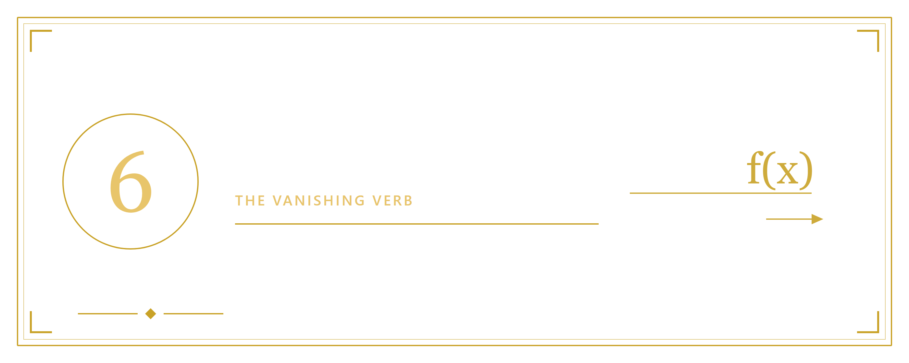

### 6.1 Time Type = Verb = Function = Move

First, name the substance of the Time Type: it is neither an "event" nor a "timestamp", but a **verb** - a set of synonyms that says its identity completely: verb = function = method = move = service = discipline. Type-Time Function Search, design search and extraction, design patterns, logic generation and application, continuous learning, refactoring and recombining, problem solving, analysis, design, reasoning, methods of thinking, R&D and exploration, self-evolution - thirteen names, thirteen executable methods.

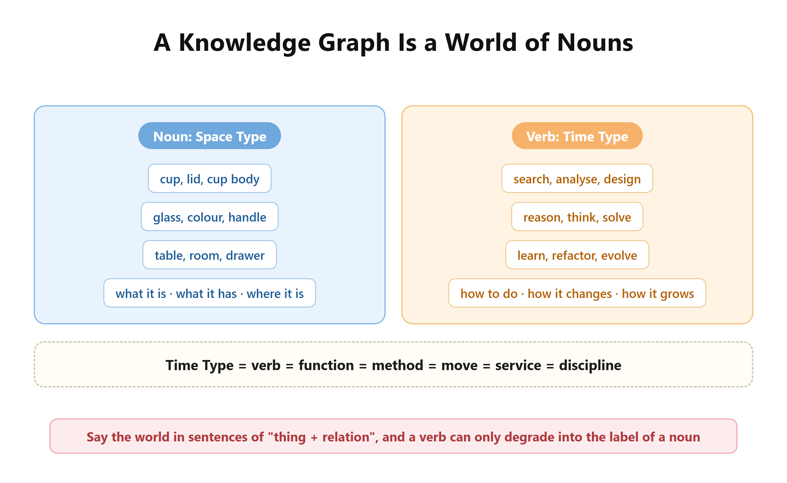

*Figure 6-1 A knowledge graph is a world of nouns*

**Table 6-1 What the Time Type carries (named, not restated)**

| Time Type | What kind of "doing" it is | What remains after being stored as a label |
| --- | --- | --- |
| Type-Time Function Search | Going out with criteria to find a Type | A "search" node with no criterion to run |
| Design pattern | A reusable template for making a move | A description with no "usage" |
| Logic generation and application | Generating rules, then applying them | A few statements with no "generation" |
| Reasoning (causal, effect-to-cause, simulation, statistical, reverse) | Walking in a direction to a new conclusion | One "related" edge with no direction to walk |
| Methods of thinking (forward, reverse, lateral, vertical, first principles) | Looking at the same problem from another angle | One sentence: "used first principles" |
| Problem solving, analysis, design | Turning the unknown into the known with a method | The conclusion "solved", with no process |
| Continuous learning, refactoring, self-evolution | Changing itself, growing itself | "Version 2", with no way to ask what changed |

### 6.2 A Move Must Carry Everything That "Doing" Requires

The difference between a move and a label is clearest when taken apart. A complete Time Type must carry a triad: **input** (with what problem does it come in), **method** (by what steps does it unfold), **output** (with what answer does it go out). Only with all three can a move "run".

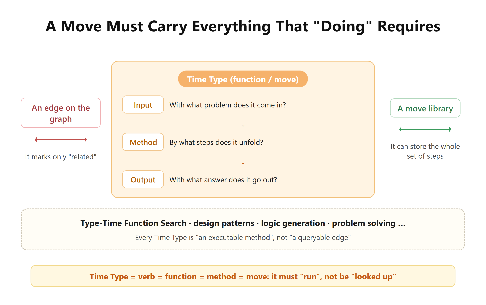

*Figure 6-2 A move must carry everything that "doing" requires*

**Table 6-2 The functional triad × what an edge can express**

| Component of a move | What it carries | Can an edge / a node provide it? |
| --- | --- | --- |
| Input | The shape of the problem: what comes in | No - an edge does not separate the input end from the output end |
| Method | The steps that unfold: what is done first, then next | No - steps are a sequence; edges are static |
| Output | The shape of the answer: what goes out | No - a statement does not distinguish "did" from "done" |

### 6.3 After the Decline into a Label

When a move is stored as an edge like "X - is - a design pattern", the whole triad evaporates: input and output no longer line up, no one remembers the steps, and executability drops to zero. What remains is a **name** - the graph can tell you "this move exists", but it cannot help you "make this move". A verb that enters the library of nouns is asked to be nothing more than a catalogue card.

***A Time Type wants to "run": input → method → output; a graph can only "look up": subject → relation → object***

## Chapter 7 Gap Six · Reasoning in Absentia

CHAPTER 7 · REASONING IN ABSENTIA

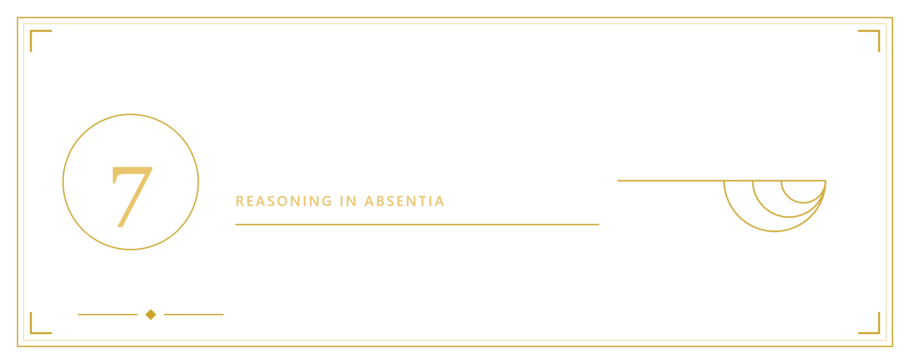

### 7.1 Five Kinds of Reasoning, Five Paths "Not on the Graph"

Reasoning is the heart of the Time Type. Ontypology names five kinds: **causal reasoning** (from cause to effect), **effect-to-cause reasoning** (from effect back to cause), **simulative reasoning** (a trial run in the mind), **statistical reasoning** (probability from a distribution), **reverse reasoning** (walking it backwards). Add the family of methods of thinking - forward, reverse, lateral, vertical, first principles - and every move by which humans "think things through" hangs under the Time Type.

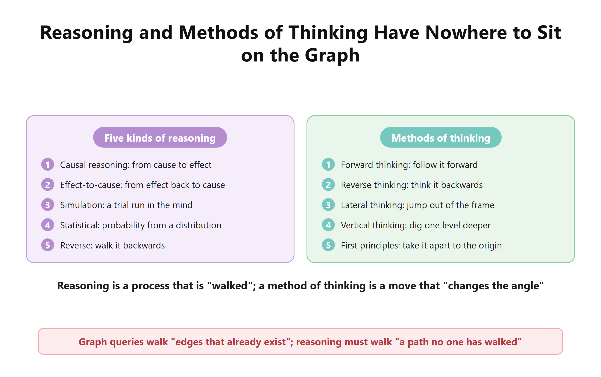

*Figure 7-1 Reasoning and methods of thinking have nowhere to sit on the graph*

**Table 7-1 Five kinds of reasoning × what a KG can express**

| Reasoning | The path it must take | What a KG can offer |
| --- | --- | --- |
| Causal | Cause → effect: direction plus mechanism | An undirected "related" edge, with no mechanism |
| Effect-to-cause | Effect → cause: tracing backwards | Edges do not carry directional semantics; abductive tracing has nowhere to go |
| Simulative | Change one assumption, and the world changes with it | The graph is a snapshot; there is no "what if it changed" to run |
| Statistical | Probability from distributions and frequencies | The graph stores individuals, not distributions |
| Reverse | Counterfactual: what could have been | Statements say only "what is", never "what could have been" |

### 7.2 "Related" Is Not "Therefore"

Take a classic scene. On the graph, "the rooster crows" and "daybreak" are often connected - that is **correlation** , the KG's home turf. But reasoning asks about **causation** : who makes what happen? The answer is that the Earth's rotation brings daybreak; the rooster's crow merely co-occurs. Mistaking correlation for causation is the most common way reasoning on a graph goes wrong; and the graph itself has no field to warn you that "this edge has no causal direction".

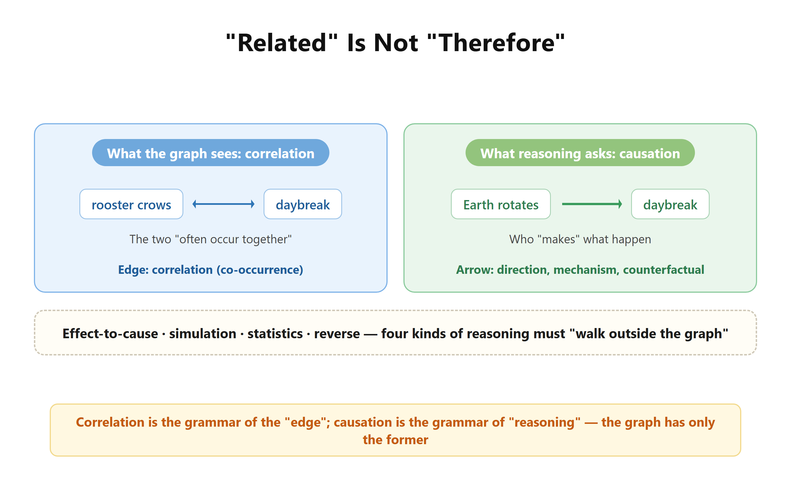

*Figure 7-2 "Related" is not "therefore"*

### 7.3 The Graph Walks Old Paths; Reasoning Opens New Ones

Put the difference at its sharpest: **a graph query walks over edges that already exist** - every step of the query was laid down beforehand by someone (or some other process); **reasoning walks a path no one has walked yet** - the next step of a cause, the next scene of a simulation, another world of a counterfactual, are not in the graph and must be "opened up" by reasoning. That is why reasoning cannot be outsourced to lookup: the limit of a query is the boundary of the graph, while the job of reasoning is to cross that boundary.

• **The same holds for methods of thinking** : lateral thinking has to jump out of the frame; first principles has to be taken apart back to the origin - both are acts of "switching to another graph", not acts of "walking this graph".

• **The same holds for causation** : an arrow needs direction and mechanism; a KG edge carries only the three words "is related".

• **Conclusion** : reasoning in absentia is not a missing feature; it is a missing sentence in the language.

***A query answers "what is on the graph"; reasoning answers "what will the world do" - different levels of question, different kinds of answer***

## Chapter 8 Gap Seven · Evolution in Absentia

CHAPTER 8 · EVOLUTION IN ABSENTIA

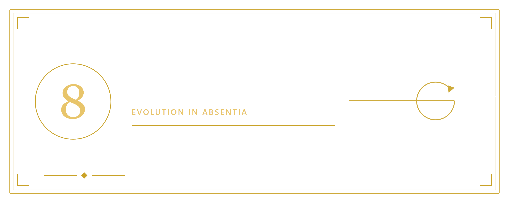

### 8.1 Self-Evolution: Knowledge Flows with Time

The summit of the Time Type is **self-evolution** . Its cycle has four stations: **continuous learning** (new experience comes in), **refactoring and recombining** (old knowledge is put back in place), **R&D and exploration** (pushing into the unknown), **self-evolution** (the next version of itself). The four stations join end to end; knowledge is no longer a "thing put away" but "a river that flows".

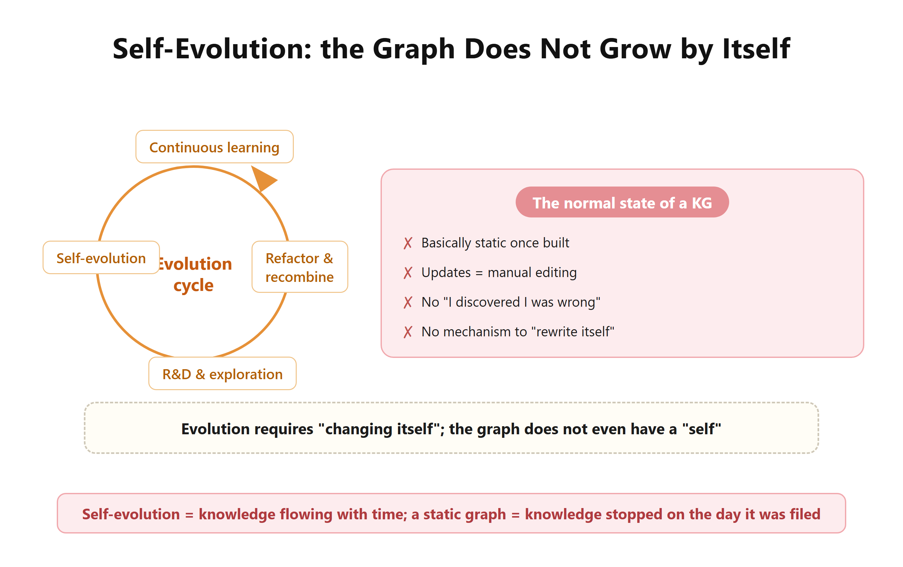

*Figure 8-1 Self-evolution: the graph does not grow by itself*

**Table 8-1 The four stations of evolution × the normal state of a KG**

| Station | What it requires | The normal state of a KG |
| --- | --- | --- |
| Continuous learning | New knowledge comes in and is placed automatically | Basically static after filing; updates are manual |
| Refactoring and recombining | Old knowledge is re-placed and restructured | Changing the structure = a rebuild project; no "refactoring" semantics |
| R&D and exploration | Pushing into the unknown, allowing failure | The graph takes in only "confirmed", never "on the way" |
| Self-evolution | Changing itself, leaving a trail of evolution | There is no "self" to change, and no trail to leave |

### 8.2 The Graph Does Not Grow by Itself

Evolution in absentia runs one level deeper than the previous two gaps: the vanishing verb is **cannot express** , reasoning in absentia is **cannot compute** , evolution in absentia is **cannot grow** . For the first two one can still say "switch to another system"; evolution in absentia points at the nature of the knowledge carrier itself - a book that cannot rewrite itself cannot hold a river that flows.

### 8.3 Three Concrete Ways It "Cannot Grow"

• **It cannot discover that it is wrong** : self-evolution requires "noticing the error"; the graph has no criterion, so there is no way to notice.

• **It cannot rewrite itself** : refactoring means changing the skeleton; the graph's skeleton (the schema) is locked down by people.

• **It cannot record its growth** : evolution needs a trail - what changed from v1 to v2, and why; the graph has only the present state.

***A static graph = knowledge stopped on the day it was filed; self-evolution = knowledge flowing with time***

## Chapter 9 Synthesis · Between the Two Types

CHAPTER 9 · BETWEEN SPACE TYPE AND TIME TYPE

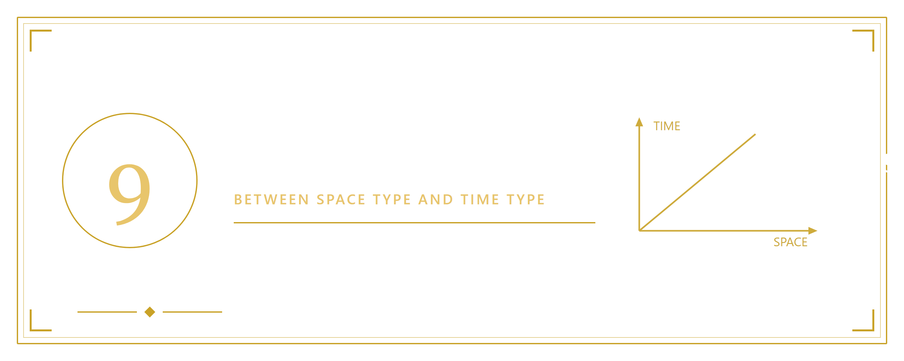

### 9.1 The Panorama of the Seven Gaps

Put the seven gaps back into the coordinate system of space and time: the horizontal axis is the Space Type - the four gaps go deeper along "structure → identity → judgment → generation"; the vertical axis is the Time Type - the three gaps go higher along "expression → reasoning → evolution". Where the two axes meet is where the generation of a Type and the execution of a move interweave - and it is also the deepest opening of all.

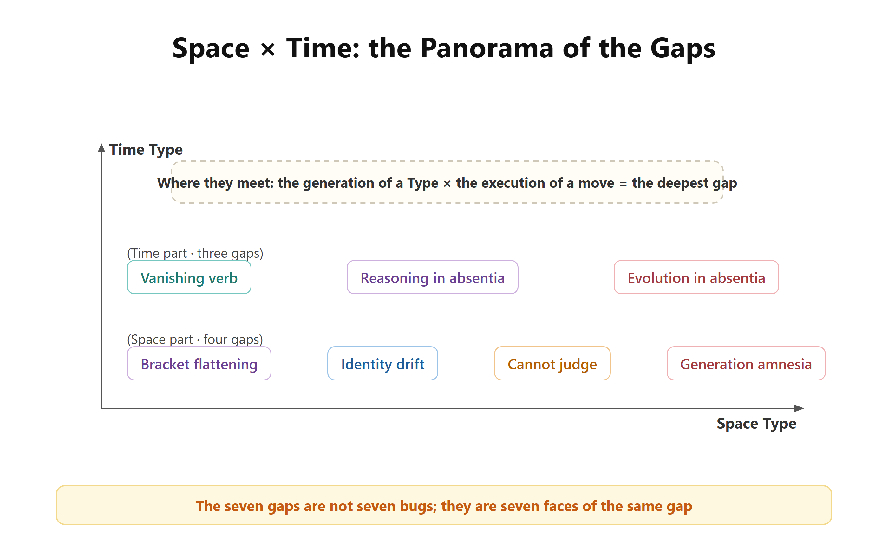

*Figure 9-1 Space × time: the panorama of the gaps*

**Table 9-1 The seven gaps at a glance**

| # | Gap | What Ontypology requires | What the KG gives | Depth |
| --- | --- | --- | --- | --- |
| 1 | Bracket flattening | Three relations, three criteria | One kind of edge | Structural layer |
| 2 | Identity drift | id(C) + the invariance axiom | URI / label | Identity layer |
| 3 | The graph cannot judge | ∩(T), remove, three-level judgment | Lookup | Judgment layer |
| 4 | Generation amnesia | Difference → division → Type → name | A snapshot of the result | Generation layer |
| 5 | The vanishing verb | Function: input → method → output | A label | Expression layer |
| 6 | Reasoning in absentia | Five kinds of reasoning, methods of thinking | Graph query | Computation layer |
| 7 | Evolution in absentia | Learn → refactor → explore → evolve | A static graph | Growth layer |

### 9.2 Seven Faces of the Same Gap

The seven gaps are not seven independent bugs. Turn the negative over and look: they share one root - **the language of a knowledge graph is "statements"; the language of Ontypology is "Types and moves"** . A statement is "a result that has been said"; a Type needs "a process that has been drawn"; a move needs "a method that can run". Three sentences sum up the gap:

• The four gaps of the space part: **the process of a Type** has no place in statements - brackets, identity, criteria and generation are all products of process.

• The three gaps of the time part: **the method of a move** cannot run inside statements - verbs, reasoning and evolution are all the working of method.

• The synthesis: storing the world as "statements" is the KG's choice; that choice made querying possible, and it also destined the seven gaps.

### 9.3 Misuse at a Glance: Five Ways We "Think the Graph Can"

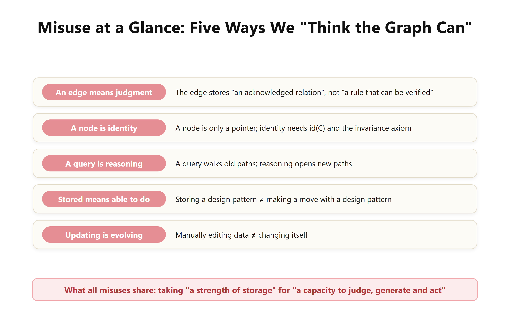

*Figure 9-2 Misuse at a glance: five ways we "think the graph can"*

**Table 9-2 The misuse table**

| Misuse | Why it does not hold | Related gap |
| --- | --- | --- |
| Thinking an edge means judgment | An edge stores "an acknowledged relation"; a criterion needs "a rule verified on the spot" | Gaps 1 and 3 |
| Thinking a node is identity | A node is a pointer; identity needs id(C) and the invariance axiom | Gap 2 |
| Thinking a query is reasoning | A query walks old paths; reasoning opens new ones | Gap 6 |
| Thinking stored means able to do | Storing a design pattern ≠ making a move with it | Gap 5 |
| Thinking updating is evolving | Manually editing data ≠ changing itself | Gap 7 |

### 9.4 Checklist: Which Questions Not to Hand to the Graph

Finally, turn the seven gaps into eight practical questions. Before using a graph for anything, run through this list - the more questions you hit, the less this matter should be handed to a knowledge graph.

**Table 9-3 The checklist (eight questions)**

| # | Question | The gap behind it |
| --- | --- | --- |
| 1 | Does this matter require telling apart "is a category, is a part, or is contained inside"? | Gap 1 · Bracket flattening |
| 2 | Do you need to judge "after the content changes, is it still itself"? | Gap 2 · Identity drift |
| 3 | Do you need to "judge on the spot" an unseen new thing? | Gap 3 · The graph cannot judge |
| 4 | Do you need to answer "what happens if this is removed"? | Gap 3 · remove |
| 5 | Do you need to explain "how this Type came into being"? | Gap 4 · Generation amnesia |
| 6 | Do you need to "make a move / run a method"? | Gap 5 · The vanishing verb |
| 7 | Do you need to "derive the unknown from the known" or "think counterfactually"? | Gap 6 · Reasoning in absentia |
| 8 | Do you need knowledge to "grow by itself and correct itself"? | Gap 7 · Evolution in absentia |

## Review Leaving with a Sense of the Gap

REVIEW

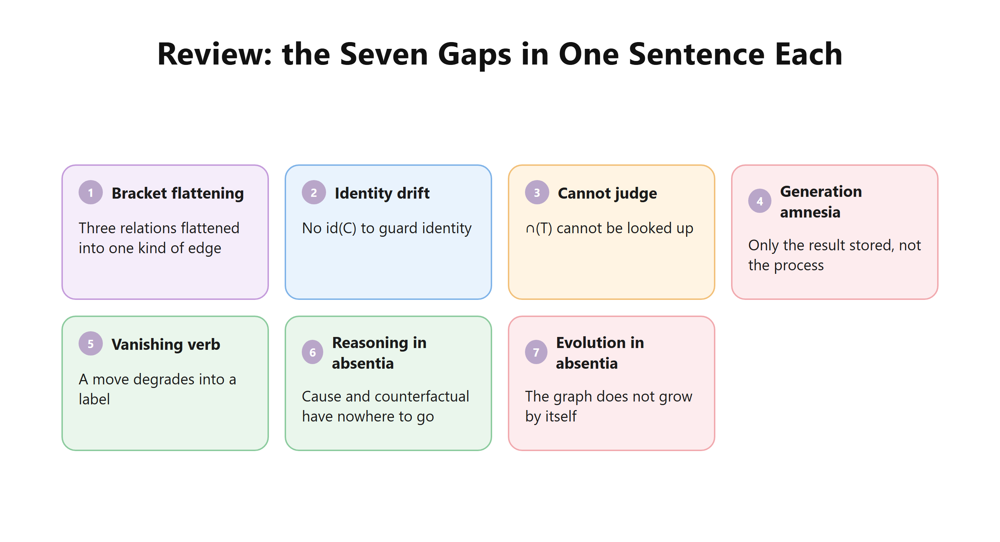

*Figure R-1 The seven gaps, one sentence each*

### R-1 A Three-Sentence Summary

• **The language of a knowledge graph is the statement** : nodes, edges and properties, three carriers that turn the world into sentence after sentence.

• **The language of Ontypology is the Type and the move** : the Space Type needs "the process of drawing a Type"; the Time Type needs "the method of running a move".

• **The seven gaps are seven faces of the same gap** : process and method have no place in a world of statements.

### R-2 What This Book Does Not Contain (One More Reminder)

By the three conventions: this book does not restate the original Ontypology, build any system, or propose any remedy. If, by this point, your mind is starting to produce "then why not switch to..." - stop first: seeing the gaps clearly is analysis; rushing to patch them will blur the gap again.

### R-3 How to Use This Analysis

• **When choosing an approach** : the more items of the checklist (Table 9-3) a task hits, the less it should be handed to a KG.

• **When modelling** : when the thought "represent it with an edge..." appears, run it through the misuse table (Table 9-2) first.

• **When reading a graph** : the graph gives you "related"; you must supply "therefore" yourself - and the cut you make is exactly where the gap lies.

## Appendix Terms and Gaps at a Glance

APPENDIX

**Table A-1 Terms at a glance (Ontypology ↔ Knowledge Graph)**

| Ontypology term | Notation | Nearest thing in a KG | Where the gap lies |
| --- | --- | --- | --- |
| Type | — | Class / node type | A Type carries criteria and generation; a class carries only a name |
| Space Type | — | (no equivalent) | The three spatial axes = three relations + three criteria |
| Time Type | — | (no equivalent) | Verb = function = move; it must "run" |
| Attribute Type | [ ] | Property / class | Open rule vs. closed list |
| BOM Type | { } | Composition relation | The three remove levels do not fit on an edge |
| Container Type | ( ) | Containment relation | id(C) and the invariance axiom are absent |
| Intersection criterion | ∩(T) | (no equivalent) | A rule verified on the spot, not a query |
| Feature set | F(T) | Property list | The completeness of F(T) is a stance; a label is not |
| remove criterion | remove(p,M) | (no equivalent) | A counterfactual question: what happens if removed |
| Identity | id(C) | URI / primary key | A pointer can be reattached; identity does not drift |
| Invariance axiom | Invariance | (no equivalent) | Replacing content does not change identity |
| Generation chain | Difference → Division → Type → Name | Schema / modelling | The graph stores the result, not the process |
| Failed contrast | Failed Contrast | (no equivalent) | The birth certificate of a dimension has nowhere to be stored |
| Type-Time Function Search | — | Graph traversal | Finding a Type with criteria vs. walking along edges |
| Design patterns | — | Pattern node | A template must be executable; a description cannot be used |
| Reasoning | — | Graph query / reasoner | Opening a new path vs. walking an old one |
| Methods of thinking | — | (no equivalent) | Changing the angle is changing the graph, not walking it |
| Self-evolution | — | Version update | Changing itself vs. manually editing data |

A Type answers "what it is"; a Time Type answers "how to do it". The knowledge graph has recorded the shadow of the Type, but it has let go of the Type's generation, identity, criteria and moves. Only by seeing these seven gaps clearly do you know where the boundary of a graph lies - this is the starting point of the analysis, not the end.

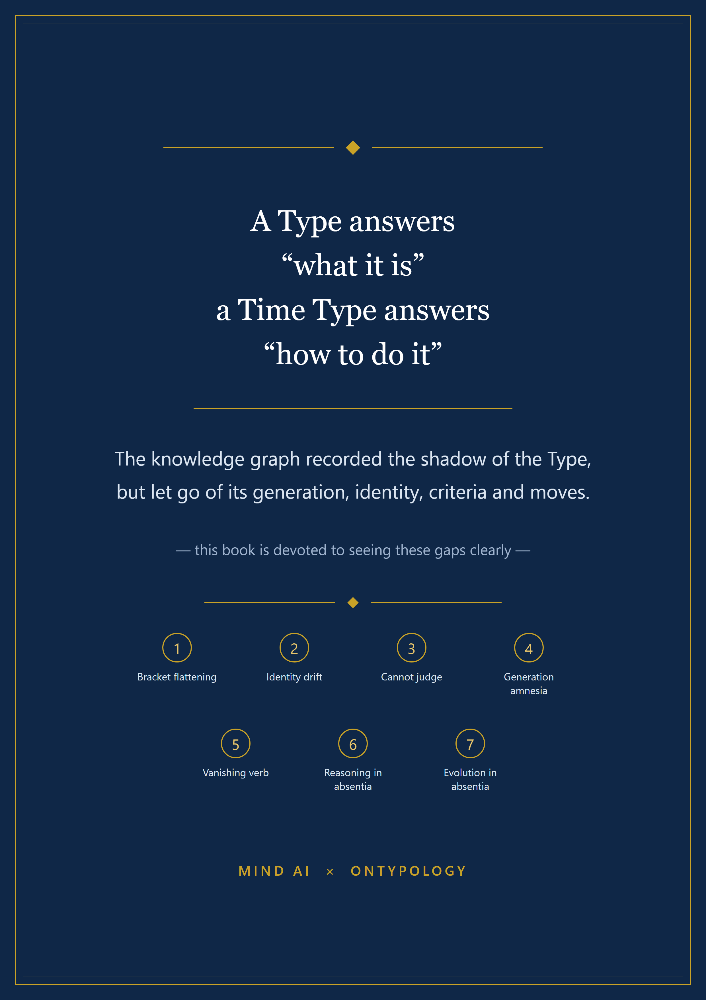
