# LLM vs Mind Model

## Two Paths of the Same Extraction and Compression

LLM is the interface of language: compress statistics, and reach the limit of language

Mind Model is the knowledge of spatiotemporal structure: compress spatiotemporal structure, and reach the backbone of the world

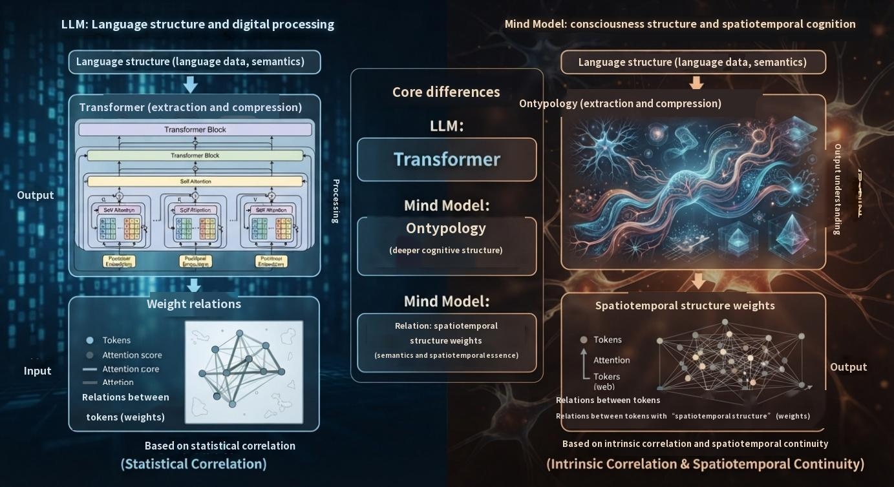

# Executive Summary

Large language models (LLMs) and the Mind Model are two ways of walking the same road of cognitive compression. Both start from “language structure”, both take “extraction and compression” as their method, and both condense knowledge into “the relations between a token and other tokens (weights)”. There is only one real divergence: what is compressed into the weights—the statistical regularities of language, or the spatiotemporal structure behind language.

> LLM = language structure → Transformer (extraction and compression) → relations between a token and other tokens (weights)  
> Mind Model = language structure → Ontypology (extraction and compression) → relations between tokens and tokens’ “spatiotemporal structure” (weights)  

On the language plane this difference carries no visible cost; but once we move toward world models and physical AI—which demand state, transition, identity and temporal order—it becomes a decisive divide. A world model must write “what the world is right now and how it will change next” as a structure that can be reasoned over; physical AI must preserve, in real space and time, the criteria of identity, composition and temporal order. Purely statistical weights describe what the world “looks like”; weights of spatiotemporal structure answer what the world “is, and how it will change”.

This white paper compares LLMs and the Mind Model through “three commonalities and five differences”, explains why the Mind Model is necessary, and sets out the division of labour among the three: the LLM is the interface of language, the Mind Model is the knowledge backbone of spatiotemporal structure, and world models and physical AI are where understanding lands—the three complement one another rather than replace one another.

> **Keywords: LLM · Mind Model · Ontypology · Type · Extraction and compression · Spatiotemporal structure · World model · Physical AI**  

# Contents

- **Chapter 1** Two Paths: One Starting Point, Two Kinds of Extraction and Compression
- **Chapter 2** Similarities, Differences and Characteristics
- **Chapter 3** The Necessity of the Mind Model
- **Chapter 4** The Relationship with World Models, Physical AI and Industrial-Grade AI
- **Conclusion** From Relations to Structure, from Structure to Understanding

> *This white paper focuses on the comparison between LLM and Mind Model, and on why the Mind Model is necessary.*  

# Chapter 1 Two Paths: One Starting Point, Two Kinds of Extraction and Compression

## 1.1 The Common Starting Point: Language Structure

Most human knowledge survives in the form of language. Syntax, semantics and pragmatics—this “language structure”—is the public interface of civilisation and the first, and largest, body of data any machine encounters when it tries to understand the world. LLM or Mind Model, both choose to start here: instead of inventing another kind of knowledge input, they digest the language humans have written down.

The method of digestion is the same: extraction and compression. Faced with almost unlimited text, one must extract the regularities that recur, then compress those regularities into a finite representation. This is exactly what “learning” looks like on a machine—the same act as the brain compressing experience into concepts. Language structure is the raw material; extraction and compression is the method. This holds for both.

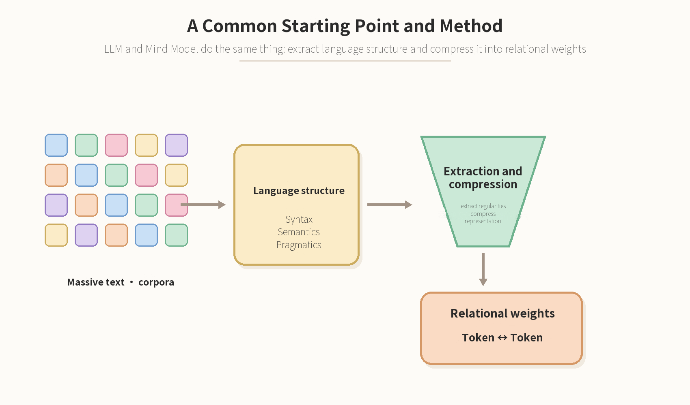

Figure 1-1 A common starting point and method: from massive corpora to relational weights

## 1.2 Reading the Two Formulas Side by Side

Place the two formulas side by side: the starting point is the same, the method is the same, and the form of the output is the same—both are “weights of relations”. The difference is compressed into the modifier at the end: the LLM’s weights describe the relations between tokens; the Mind Model’s weights describe the relations between tokens and tokens’ “spatiotemporal structure”.

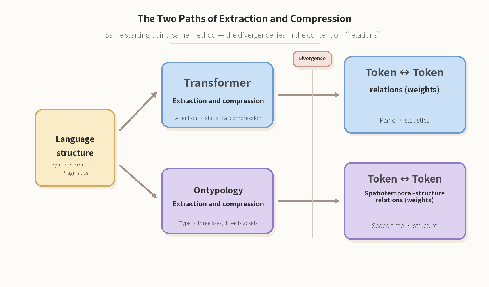

Figure 1-2 The two paths of extraction and compression: the divergence lies in the content of the “relations”

## 1.3 The Point of Divergence: The Content of Relations

The relations an LLM learns are relations on a “plane”: which word often appears with which words, which words are similar in which contexts, what is most likely to come next. These relations are statistically computed by the Transformer through attention, and their power is astonishing—enough to support fluent language generation and knowledge recall.

The Mind Model takes one step further: each token is no longer merely a position in a sequence; it carries its “spatiotemporal structure”—what it looks like, what it is made of, what its identity is, how it behaves over time. The relations between tokens are therefore not merely “how similar”, but “how composed, how classified, how dependent, how evolved”.

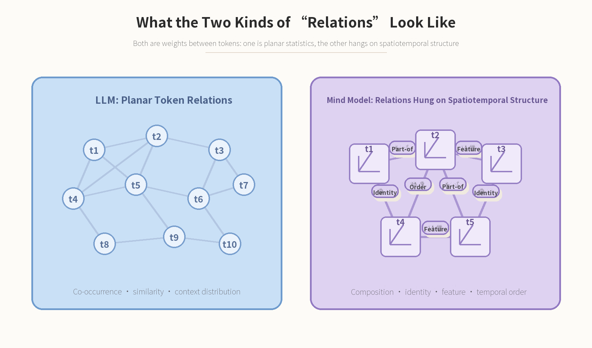

Figure 1-3 Two kinds of “relations”: statistical relations on a plane, versus relations that carry spatiotemporal structure

> **One sentence to sum up this chapter: the same in compression, different in content. Compress statistics, and you reach the limit of language; compress spatiotemporal structure, and you reach the backbone of the world.**  

# Chapter 2 Similarities, Differences and Characteristics

## 2.1 Three Commonalities: Starting Point, Method, Output

LLMs and the Mind Model share three commonalities. First, the same starting point: language structure—both recognise language as the primary site of knowledge, and both learn from human text. Second, the same method: extraction and compression—neither builds its archive by hand, item by item; both let regularities emerge from the data and then compress them into a finite representation. Third, the same output: relational weights—both produce “weights of the relations between a token and other tokens”; knowledge is written as relations, not as a list.

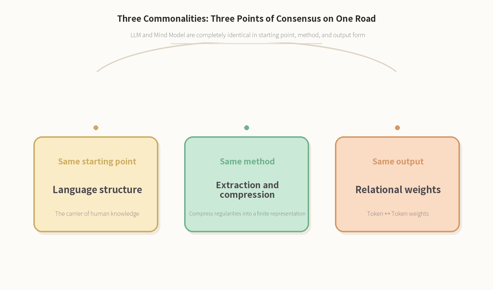

Figure 2-1 Three commonalities: three shared points along one road

## 2.2 Five Differences: The Comparison Table

What really separates the two are five aspects: what is compressed, the form of the relations, the appearance of knowledge, the mode of reasoning, and learning and updating.

| **Aspect** | **LLM** | **Mind Model** |
| --- | --- | --- |
| **What is compressed** | Statistical regularities of language: co-occurrence, distribution, context | Spatiotemporal structure behind language: the composition, identity, features and temporal order of a Type |
| **Form of relations** | Token ↔ Token relations on a plane | Token ↔ Token spatiotemporal-structure relations |
| **Appearance of knowledge** | Distributed weights, implicitly emergent, grounds hard to trace | Explicit structure of Types, identifiable, nameable, re-checkable |
| **Mode of reasoning** | Probabilistic generation: predict the next token | Structural judgement: recognition, classification and operation of types |
| **Learning and updating** | Training and fine-tuning: batch updates, high cost | Augmentation and reconstruction: types evolve one at a time, incrementally |

Table 2-1 Five differences between LLM and Mind Model

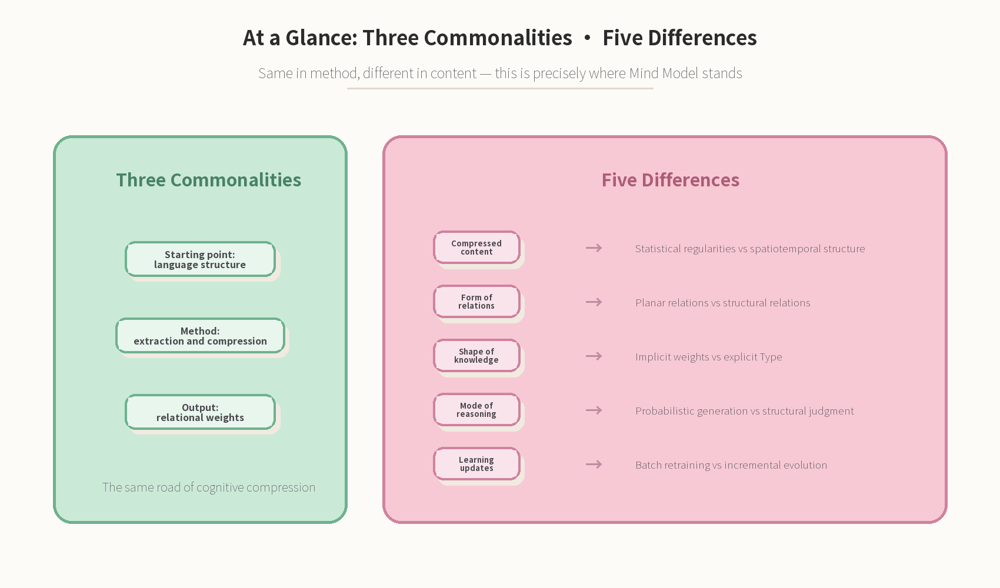

Figure 2-2 Similarities and differences at a glance: three commonalities, five differences

## 2.3 The LLM’s Characteristics: The Pinnacle of the Language Plane

The LLM takes “extraction and compression” to its limit on the language plane: language understanding and generation, contextual generalisation, cross-lingual transfer, knowledge recall, creative expression, scale effects. It is a machine that brings “expression” to near perfection—and for that very reason it has become everyone’s first window onto AI. This is the LLM’s true historical position: the pinnacle of the language plane, not the whole of intelligence.

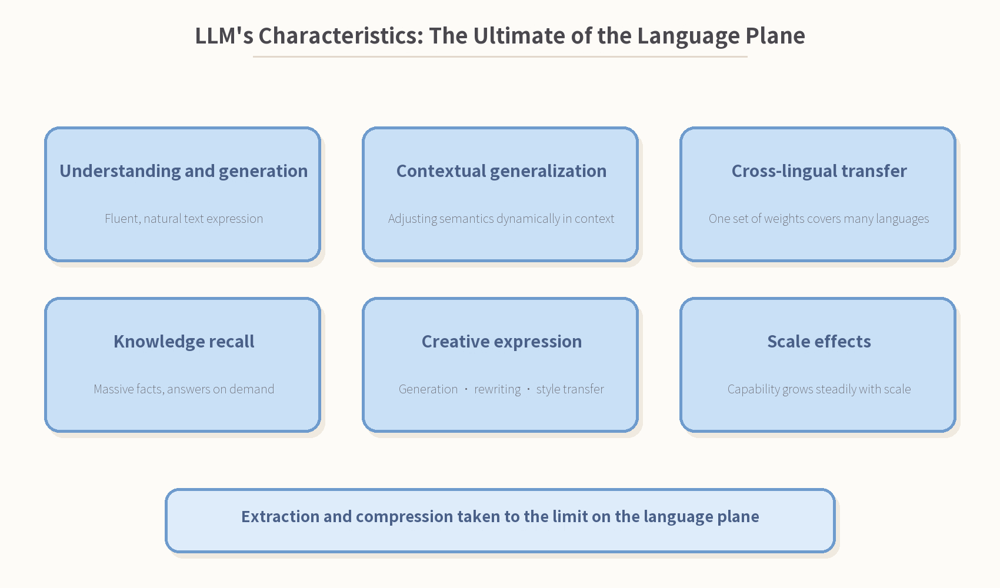

Figure 2-3 The LLM’s characteristics

## 2.4 The Mind Model’s Characteristics: The Backbone of the Spatiotemporal Plane

The Mind Model compresses “extraction and compression” one layer further onto the spatiotemporal plane: structure precedes the individual, identity remains constant, composition can be taken apart and judged, abstractions can be grouped and classified, temporal order is type-in and type-out, and everything is identifiable and re-checkable. Its product is not “a model that talks better” but a knowledge backbone that “can be inspected, taught and evolved”—for the first time, knowledge has an address that can be verified item by item.

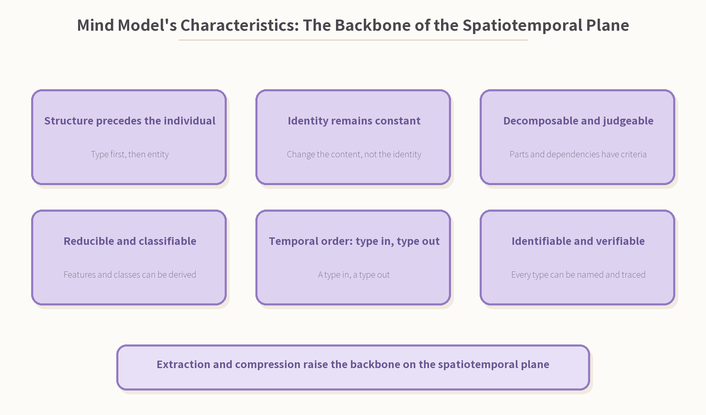

Figure 2-4 The Mind Model’s characteristics

## 2.5 The Three Relational Coordinates of Spatiotemporal Structure

The so-called “spatiotemporal structure” is defined, in Ontypology, by the spatial framework and written with three axes and three brackets:

- **[Abstract] Similarity and feature relations—which types is this type like? What features does it have? This is the coordinate of classification and recognition (X axis).**
- **{BOM} Composition and structural relations—what parts is it made of? How do the parts depend on each other? This is the coordinate of disassembly and assembly (Y axis).**
- **(Container) Identity and spatial relations—what is its identity? Inside whose interior does it lie? After its contents are replaced, is it still itself? This is the coordinate of identity (Z axis).**

The three coordinates upgrade a token from “a position in a sequence” to a Type that can be located, disassembled, classified and tracked.

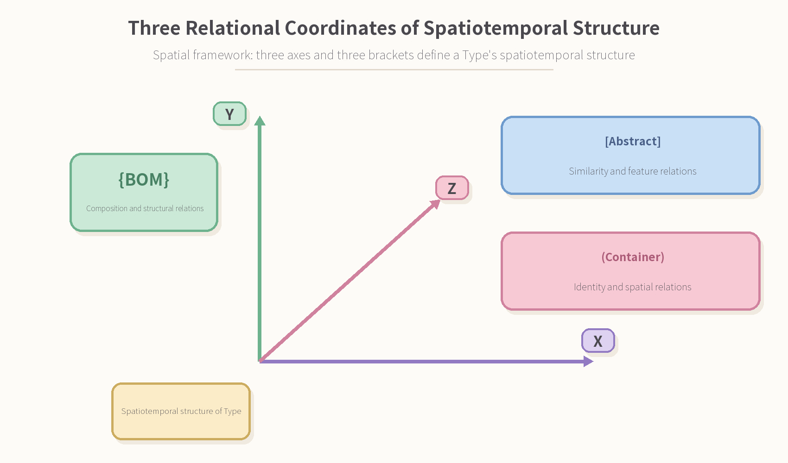

Figure 2-5 The three relational coordinates of spatiotemporal structure: the three axes and three brackets of the spatial framework

## 2.6 The Spatiotemporalisation of Tokens and the Two Appearances of Weights

When every token carries spatiotemporal structure, the weights between tokens acquire a different texture: weights no longer answer only “how alike are they”, but “how are they composed, how are they classified, how do they depend, how do they evolve”. The product of compression changes accordingly—the LLM’s weights are a distributed cloud, emerging as a whole and hard to trace case by case; the Mind Model’s weights are a structured net of types, in which every node can be identified, named and re-checked.

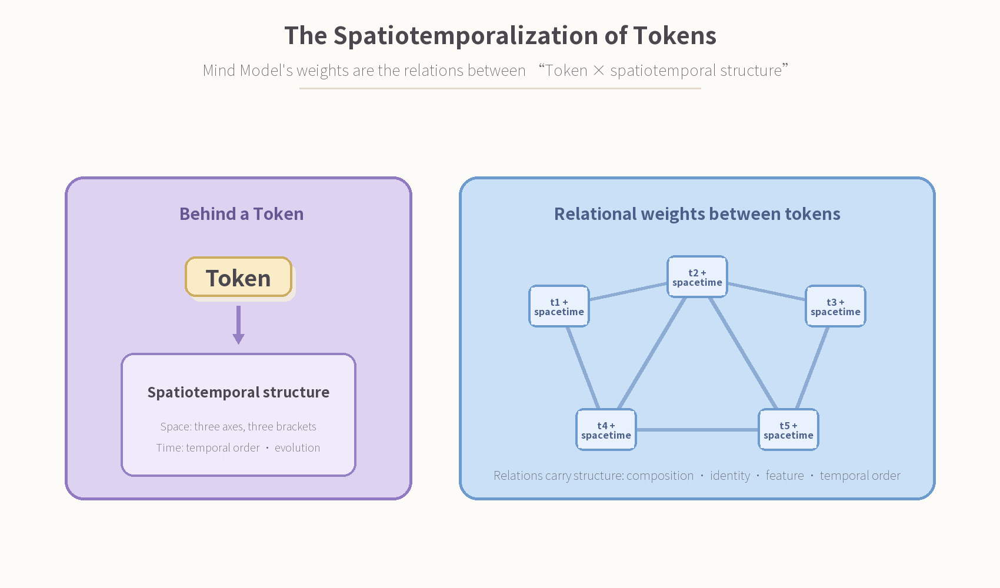

Figure 2-6 The spatiotemporalisation of tokens: structure carried within relations

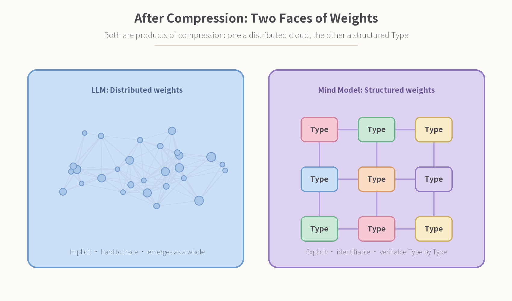

Figure 2-7 After compression: two appearances of weights

# Chapter 3 The Necessity of the Mind Model

## 3.1 The Boundaries of LLM Capability: Boundaries Are Positioning

The LLM’s boundaries are not failures; they are its positioning. Within the language plane it is nearly perfect; but when a task demands “understanding” rather than mere “expression”, the gaps appear exactly where spatiotemporal structure is absent:

- **Statistical similarity ≠ structural understanding: knowing “what it is like” is not knowing “what it is, and what it is made of”.**
- **Hallucination and untraceable grounds: weights are distributed—the answer can be stated, but its source cannot be checked.**
- **No persistent identity or memory: the same object struggles to keep a constant identity across different conversations.**
- **High cost of updating: injecting one new piece of knowledge often means retraining and fine-tuning in batches.**
- **Cross-domain knowledge hard to unify: knowledge in language, mathematics, physics, engineering and other domains is hard to reason across within a single representation.**

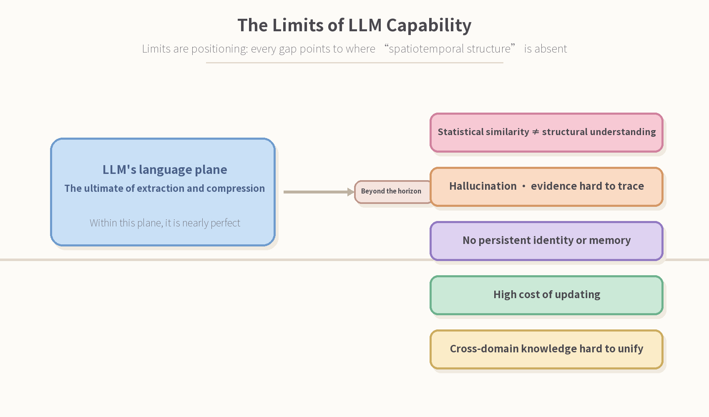

Figure 3-1 The LLM’s capability boundaries: every gap lies where spatiotemporal structure is absent

## 3.2 Five Pillars: From Language Ability to Intelligent Ability

Closing these five gaps does not require more parameters; it requires a representational system that can stand knowledge up as structure. The Mind Model supports “intelligent ability” with five pillars:

- **Unified knowledge: a single model covers cross-domain knowledge—language, mathematics, physics, engineering and everyday experience share one representation.**
- **Deep reasoning: structural judgement and operations on types—not association alone, but derivation by composition, identity and features.**
- **Spatiotemporal understanding: state, structure and temporal order all present—this is the ticket into world models.**
- **Continuous evolution: augmentation, reconstruction, constant learning—new knowledge enters incrementally, without starting over in batches.**
- **Verifiable and trustworthy: identifiable, nameable, re-checkable—every answer can be returned to its type and inspected item by item.**

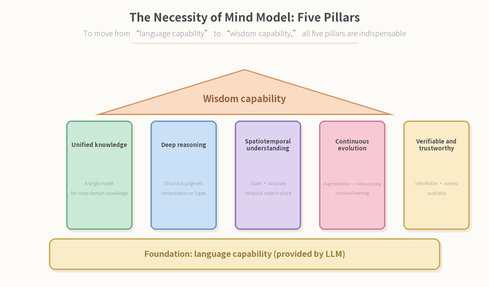

Figure 3-2 The necessity of the Mind Model: five pillars

## 3.3 Complementary, Not a Replacement

The relationship between LLM and Mind Model is not either/or. The LLM handles language ability—listening, speaking, reading and writing; the Mind Model handles intelligent ability—understanding, reasoning, memory and learning. The former is the best interface between humans and machines; the latter is the world that ought to stand behind the interface. Only together do they form a complete intelligent system.

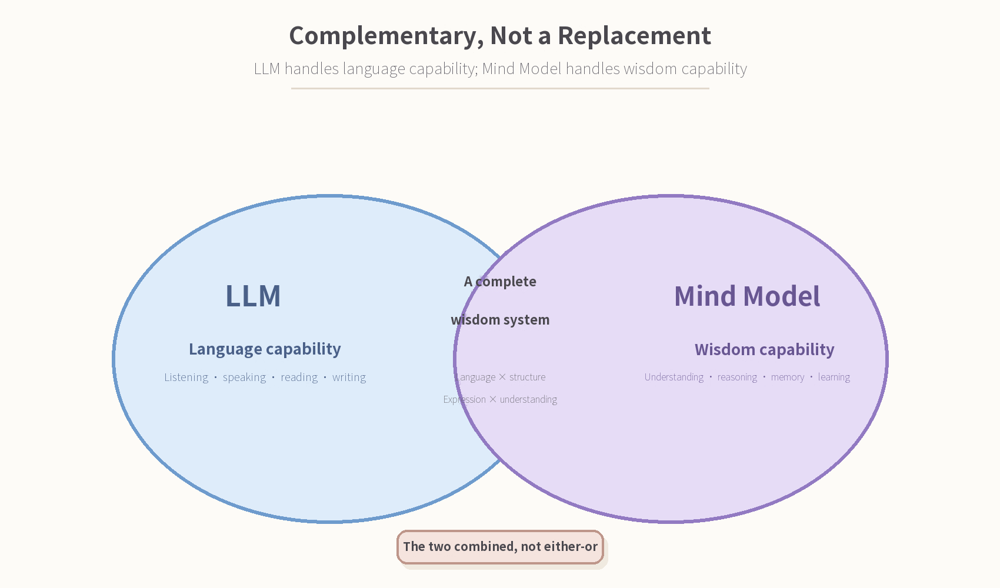

Figure 3-3 Complementary, not a replacement: language ability × intelligent ability

# Chapter 4 The Relationship with World Models, Physical AI and Industrial-Grade AI

## 4.1 What a World Model Needs

A world model is the system’s internal model of its environment. It must answer four questions: what state is the world in right now (state)? How does the state change (transition)? Why does it change this way (causality)? What happens next (prediction)? All four are structural questions: the state must be represented, the transition must be written as workable laws, causality needs traceable grounds, and prediction needs a base that can be reasoned over. Purely statistical language weights can describe what the world “looks like”; a world model needs what the world “is, and how it will change”.

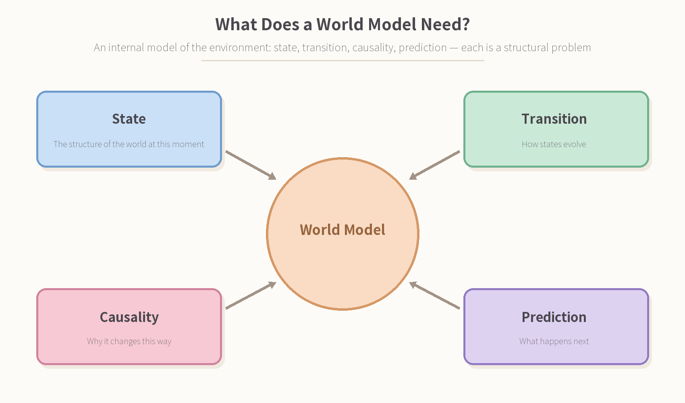

Figure 4-1 The four elements of a world model: state, transition, causality, prediction

## 4.2 What Physical AI Needs

Physical AI pulls the problem into real space and time: a robot acting in the real world must understand embodiment (its own body and range of action), temporal control (the order and rhythm of actions), spatial localisation (position, pose, distance) and persistent identity (walk into the kitchen: is the cup still that cup?). These needs share one thing: each is a need for “spatiotemporal structure”—exactly the question that the Mind Model’s representational system is built to answer.

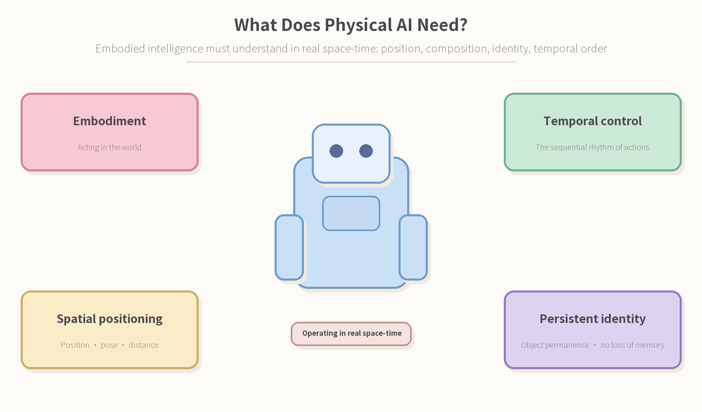

Figure 4-2 The spatiotemporal needs of physical AI

## 4.3 What Industrial-Grade AI Needs

Industrial AI brings intelligence onto production lines and into machine rooms: smart manufacturing, yield optimisation, predictive maintenance, digital twins… The demands industry places on AI are utterly different from those of a showroom—it does not want “wow”, it wants “trust”.

These boil down to six things: stable and reliable (round-the-clock operation without interruption), traceable (every decision has grounds), precise and controllable (clear criteria, closed-loop control), domain knowledge (the deep waters of process, equipment and yield), continuous optimisation (incremental learning without downtime), and safety and compliance (auditable, acceptable). The six share one thing: they are demands for “structure”, not for “probability”—exactly what the Mind Model answers with verifiability, clear criteria and incremental evolution.

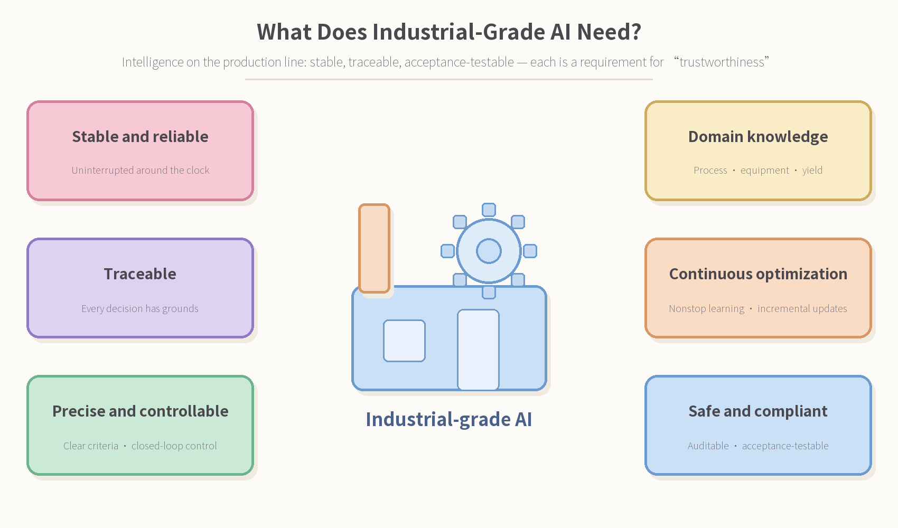

Figure 4-3 The six requirements of industrial-grade AI

## 4.4 Mind AI

The LLM is the language interface—it hears human intent and speaks the system’s thinking out loud; the Mind Model is the knowledge backbone of spatiotemporal structure—it stands the world’s states and transitions up as computable types; Mind AI is environment and embodiment—it verifies and lands them in real space and time.

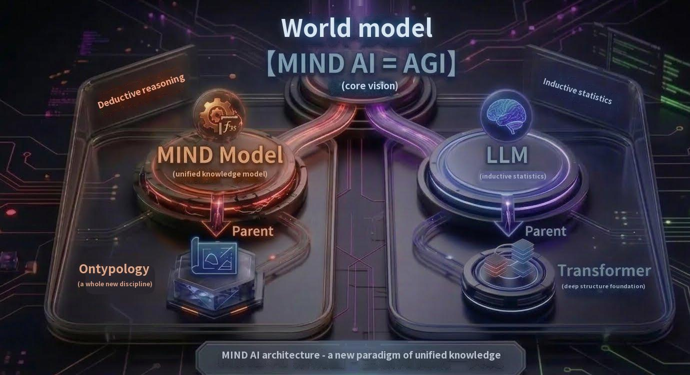

Figure 4-4 Mind AI

| **What world models and physical AI need** | **The Mind Model’s corresponding representation** |
| --- | --- |
| State | The appearance of a Type at time t (spatial structure) |
| Transition | Type in, type out: one type enters, one type is produced (temporal structure) |
| Causality | Derivation from structural dependency and operations |
| Prediction | Deriving subsequent types by operating on types |
| Persistent identity | (Container) Identity and spatial relations |
| Composition and components | {BOM} Composition and structural relations |
| Category and features | [Abstract] Similarity and feature relations |

Table 4-1 Mapping table: world-model needs and their spatiotemporal-structure counterparts

# Conclusion From Relations to Structure, from Structure to Understanding

The LLM has proved one thing: compress language into weights of relations, and a machine can speak. The Mind Model is to accomplish the next thing: compress the spatiotemporal structure behind language into weights of relations, and a machine can understand the world.

The two paths are not rivals but a relay. The pinnacle of the language plane meets the backbone of the spatiotemporal plane—world models gain states and transitions they can reason over, physical AI gains identity and temporal order it can follow. From the relations of tokens, to the structure of space and time, to an understandable world: this is the next step of extraction and compression, and this is where the necessity of the Mind Model lies.

Figure 5-1 The relay of two paths: from relations to structure, from structure to understanding

> **The LLM is the interface of language; the Mind Model is the knowledge backbone of spatiotemporal structure.**  
> Compress statistics, and you reach the limit of language; compress spatiotemporal structure, and you reach the backbone of the world.
