# Palantir and Ontypology

The relationship, the exact method of use, the architecture, and a complete content plan

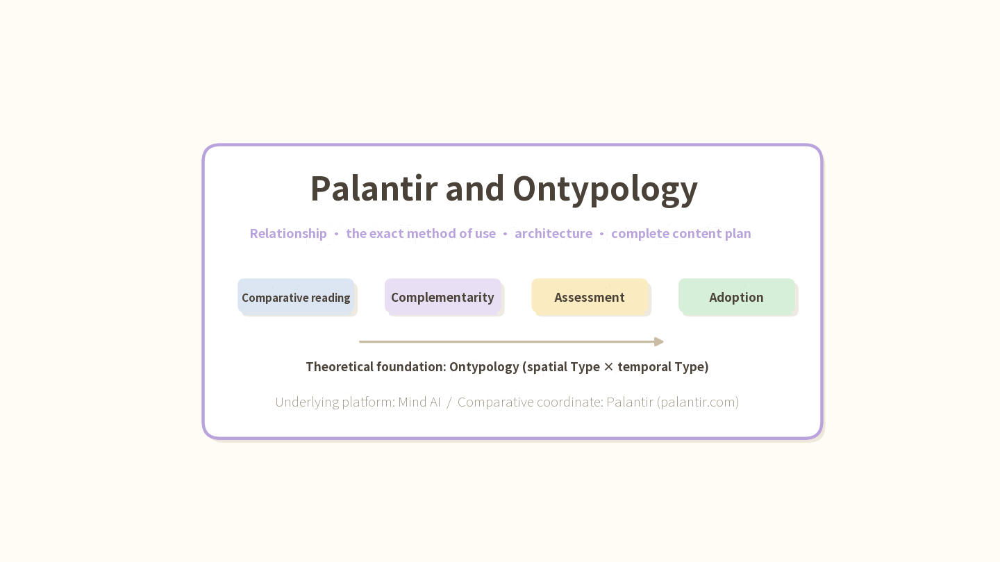

Theoretical foundation: Ontypology (spatial Type × temporal Type)

Underlying platform: Mind AI | Comparative coordinate: Palantir (palantir.com)

## Contents

  - **Foreword This booklet does only one thing<TAB>5**
- Reader's convention: dual-track reading<TAB>6
- How to use this book: three reading paths<TAB>6
- Sources and verification statement<TAB>7
  - **Part 1 Knowing Palantir: platform panorama and the starting point of the relation<TAB>8**
- 1.1 Why Palantir<TAB>8
- 1.2 What Palantir is<TAB>8
- 1.3 The four operating systems<TAB>8
- 1.4 Foundry Ontology: the heart of Palantir<TAB>10
- 1.5 AIP: binding AI to enterprise data, logic and action<TAB>11
- 1.6 Part summary<TAB>12
  - **Part 2 A quick tour of the Ontypology backbone<TAB>14**
- 2.1 The cognitive chain: the birth of a Type<TAB>14
- 2.2 Spatial Type: three axes and the unit Type<TAB>15
- 2.3 Three-layer judgment<TAB>17
- 2.4 Temporal Type: Type in, Type out<TAB>17
- 2.5 The method of exact use<TAB>19
- 2.6 Part summary<TAB>19
  - **Part 3 Comparative reading: Palantir Ontology × Ontypology<TAB>21**
- 3.1 Why they can be read together: two practices of one cognitive chain<TAB>21
- 3.2 Reading one: semantic elements ↔ spatial Type<TAB>22
- 3.3 Reading two: kinetic elements ↔ temporal Type<TAB>23
- 3.4 Reading three: dynamic elements ↔ generation and evolution<TAB>23
- 3.5 The master comparison table and one sentence<TAB>24
- 3.6 The difference in depth: same chain, different depth<TAB>26
- 3.7 Cross-domain reading cases<TAB>26
- 3.8 Three brackets × three questions of object modelling<TAB>27
- 3.9 Closing the comparative reading<TAB>28
  - **Part 4 Complementary integration: Mind AI × Palantir<TAB>30**
- 4.1 Layered positioning: who sits where<TAB>30
- 4.2 Architectural docking: two libraries, one hub, one loop × Foundry / AIP<TAB>31
- 4.3 Complementary division of labour: one full loop<TAB>32
- 4.4 Integration scenarios<TAB>32
- 4.5 Before and after integration<TAB>33
  - **Part 5 Assessment and transcendence: Palantir through Ontypology<TAB>36**
- 5.1 Three strengths: they confirm Ontypology<TAB>36
- 5.2 Limitation one: a Type without the theory<TAB>37
- 5.3 Limitation two: notation and criteria missing<TAB>37
- 5.4 Limitation three: the distance to abstraction and cross-domain unity<TAB>38
- 5.5 The point of transcendence: adding "the cognitive Type"<TAB>39
- 5.6 Misuse warning: five common misreadings<TAB>40
  - **Part 6 Adoption guide: the method of exact use in practice<TAB>42**
- 6.1 Three supplements: setting rules for the object model<TAB>42
- 6.2 The six-step proof<TAB>42
- 6.3 A full worked example: a transfer order<TAB>44
- 6.4 The four-question function card: writing an Action Type as a temporal Type<TAB>44
- 6.5 The eight-question checklist<TAB>45
- 6.6 The great misuse comparison<TAB>46
- 6.7 Adoption FAQ<TAB>47
  - **Part 7 The overall architecture: philosophy—method—practice<TAB>49**
- 7.1 The substance–function–precision architecture<TAB>49
- 7.2 The master relation map<TAB>49
- 7.3 The three stages of AGI and Palantir's position<TAB>50
  - **Part 8 A complete content plan + a complete framework plan<TAB>53**
- 8.1 Plan goals and the dual-track reader<TAB>53
- 8.2 Content module plan: M1–M8<TAB>53
- 8.3 Framework plan: learn, practise, use, teach, build — an eight-week route<TAB>54
- 8.4 Choosing a path by situation<TAB>55
- 8.5 Four stages of library building and acceptance criteria<TAB>56
- 8.6 Teaching and outreach, and the next step<TAB>58
- 8.7 Conclusion: one sentence<TAB>58
  - **Appendix A Terminology<TAB>60**
  - **Appendix B Quick-reference cards<TAB>61**
- B-1 Comparative quick reference (one page)<TAB>61
- B-2 Eight-question checklist (printable)<TAB>61
- B-3 Blank templates: four-question function card + Type-set card (printable)<TAB>61
  - **Appendix C Practice answer key<TAB>63**
  - **Appendix D Figure index<TAB>66**
- **Chapter navigation table**

| **Part** | **What question it answers** | **Relational aspect** |
| --- | --- | --- |
| Foreword | What this booklet does, and how to read it | Task and conventions |
| Part 1 | What is Palantir? | Understanding and sources |
| Part 2 | What parts make up the Ontypology backbone? | Theoretical foundation |
| Part 3 | How do the two sides line up? | Comparative reading |
| Part 4 | How do Mind AI and Palantir divide the work? | Complementarity and integration |
| Part 5 | Where is it strong, what does it lack, what does it transcend? | Assessment and transcendence |
| Part 6 | How is the method used exactly? | Adoption and application |
| Part 7 | In what architecture is the whole book assembled? | Overall architecture |
| Part 8 | How do content and framework land? | The complete plan |
| Appendices | Where to look things up, how to verify? | Quick reference and answers |

 

# Foreword This booklet does only one thing

This booklet does exactly one thing: it explains the relationship between Palantir and Ontypology clearly and accurately, and it provides a complete plan for both content and framework.

Palantir is one of the companies that uses "the Type of the enterprise world" most deeply today—it turns objects, actions and processes into a universal logic layer, so that data becomes decisions, decisions become actions, and actions settle back into data. Ontypology is the discipline that sees "Type" itself clearly: what a Type is, how to recognise it, how to name it, how to judge it, how it operates. The two set out from different foothills, yet they climb the same mountain.

This book takes Ontypology (spatial Type and temporal Type) as its theoretical foundation, Mind AI as its underlying platform, and Palantir (palantir.com) as its comparative coordinate. Four task dimensions are completed as one whole: first comparative reading, then complementary integration, then assessment and transcendence, and finally adoption in practice—with "the method of exact use" carried through the entire book.

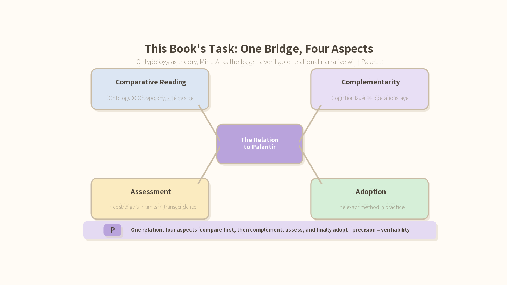

**Figure 0-1 The task of this book: one bridge, four dimensions**

> **About this book**  
> ◆ Theoretical foundation: Ontypology (spatial Type × temporal Type)  
> ◆ Underlying platform: Mind AI (seeing Types clearly, turning them into a prominent discipline, putting them into practice)  
> ◆ Comparative coordinate: Palantir (Gotham / Foundry / Apollo / AIP)  
> ◆ Deliverables: the exact method of use + a complete content plan + a complete framework plan, with abundant figures and text  
> ◆ Scope: no system implementation required—this book discusses relationships, methods and plans, not system implementation  

## Reader's convention: dual-track reading

The main text is written for every reader who wants to "put Type to work"—business decision-makers, consultants, product and data professionals, and academic researchers. Each part also has a [Professional column], written for engineering and architecture readers who need implementation detail: ontology engineering, master data management, API contracts, event-driven design, governance and similar topics. The two tracks run separately and do not interfere with each other.

Each part ends with exercises and a summary; the exercise answer key is collected in Appendix C. The diagrams in this book use a pastel palette in which colour has a division of labour: yellow = property, orange = composition, blue = container, green = time, purple = summary, pink = misuse—blue-violet Palantir blocks represent the operational coordinate, and purple Mind AI blocks represent the cognitive coordinate.

Terminology: the English for xíng is "Type". Each of the three brackets has its own duty: { } composition, [ ] property, ( ) container. Every occurrence of the word "exact" in this book means the same thing: an exactness that can be re-checked.

## How to use this book: three reading paths

The same book, three workable ways through it—choose one according to the time and task at hand:

| **Reading path** | **Time** | **Route** | **Suited to** |
| --- | --- | --- | --- |
| Quick overview | Two hours | Foreword → Figure 1-3 → 3.5 comparative-reading master table → 8.6 summary | Just want to know "what the relationship is" |
| Method reading | One day | Part 2 → Part 6 → Appendix B quick-reference cards | Want to start adoption and acceptance |
| Full reading | One week | Read straight through + complete exercises E01–E09 | Want to teach, promote, build a library |

> **Key line of this part**  
> Comparative reading is not about ranking; it is mutual confirmation. Assessment is not fault-finding; it is seeing the Type more clearly.  

What this book does and does not discuss is agreed up front—clear scope keeps expectations from slipping:

| **This book covers** | **This book does not cover** |
| --- | --- |
| The relational narrative: comparative reading, complementarity, assessment, application | System implementation, code, deployment architecture |
| The exact method of use and acceptance discipline | Product purchasing advice, quotations and contracts |
| A complete content and framework plan (teachable, practicable, buildable) | Palantir internal secrets or non-public information |
| Architecture diagrams and illustrated summaries of the theoretical backbone | Chapter-by-chapter reproduction of the original Ontypology texts |

## Sources and verification statement

All descriptions of Palantir in this book are based on public sources and were verified in October 2026. Quotations and positioning follow the official statements; interpretation and assessment are written from the standpoint of Ontypology, and the two are marked separately in the text.

| **Category** | **Source** | **Used in this book** |
| --- | --- | --- |
| Official product positioning | palantir.com (platform pages, Foundry Ontology, AIP) | The semantic/kinetic/dynamic elements, the three connections, Writeback and audit |
| Public company information | Wikipedia and other public sources (verified 2026-10) | Founding, revenue, product-line history, customer cases |
| Theoretical foundation | The Ontypology document series | Spatial Type, temporal Type, the method of exact use |
| Platform vision | Mind AI overview | Two libraries, one hub, one loop; the three stages of AGI |

Statement: This book is a work of relation research and methodology; it does not represent the position of Palantir Technologies. Product names and trademarks belong to their respective owners. The assessment in this book takes Ontypology as its measure and judges the matter as it stands—re-checkable and open to debate.

# Part 1 Knowing Palantir: platform panorama and the starting point of the relation

To discuss a relationship, one must first know the other party. This part neither praises nor disparages: based on public sources, it lays out Palantir's corporate outline, its four operating systems, and the two hearts most relevant to this book—Foundry Ontology and AIP.

> **Map of this part**  
> 1.1 Why Palantir \| 1.2 A company sketch \| 1.3 The four operating systems  
> 1.4 Foundry Ontology (heart one) \| 1.5 AIP (heart two) \| 1.6 Summary  
> After this part you will know what Palantir is and where its "Type" lives.  

## 1.1 Why Palantir

Ontypology holds: where there is union, there must be a Type. When an organisation brings thousands of data points, processes and decisions together to operate as one, a Type must be supporting it. Palantir's core products have turned exactly this into engineering at the level of a prominent discipline: its Foundry Ontology is officially positioned as a universal logic layer that "integrates the semantic, kinetic, and dynamic elements of your business".

These three words fall precisely on the two sides of Ontypology: the semantic element answers "what it is"—the spatial Type; the kinetic element answers "what it will do"—the temporal Type; the dynamic element answers "making a Type out of a Type"—generation and evolution. Reading Palantir through Ontypology is like taking a ruler you have ground yourself and measuring a bridge someone else has built—the ruler and the bridge confirm each other.

## 1.2 What Palantir is

Palantir Technologies is an American software company founded in 2003 and headquartered in Miami, Florida. Its main products are data integration and analysis software, and its customers include government agencies, state and local governments, international organisations and private enterprises. Public figures show revenue of about US$4.48 billion in 2025, with roughly 4,400 employees.

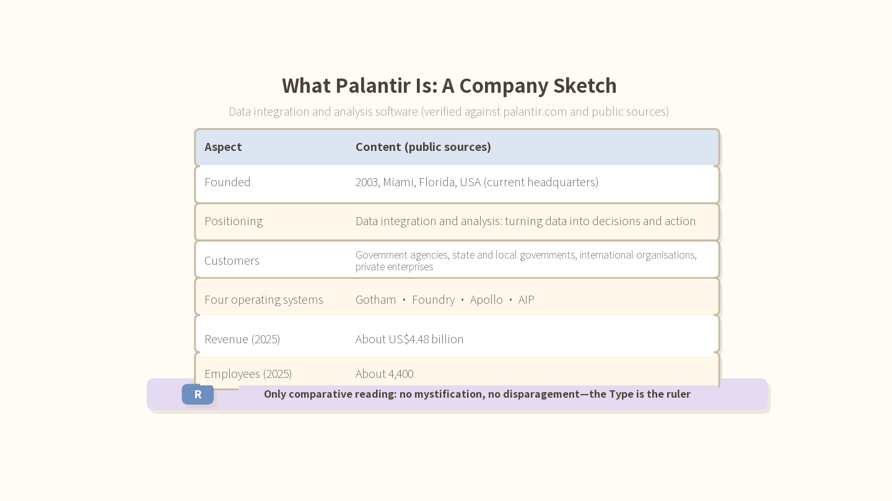

**Figure 1-1 A quick sketch of Palantir (verified against palantir.com and public sources)**

To Ontypology, Palantir's importance lies not in its scale but in the fact that it proves one thing: engineering "Type" as a first-class citizen works. It abstracts the enterprise's objects, actions and processes into a reusable layer of logic, on which people make decisions, write actions back, and keep learning—this is industrial-grade evidence that "where there is union, there must be a Type".

Public sources also show the breadth of its deployment: commercial customers include aerospace (Airbus), finance (Morgan Stanley), manufacturing (Merck KGaA) and automotive (Fiat Chrysler); in healthcare, the National COVID Cohort Collaborative (N3C) federated electronic health record network runs on Foundry and has produced a large number of peer-reviewed papers; NHS England also uses its platform. Apollo is one of only five SaaS products approved by the US Department of Defense for mission-critical national security systems (IL5). After AIP was launched, Palantir also ran five-day intensive boot camps to take customers "from zero to use case" quickly.

The significance of these facts for this book is that the samples used for comparative reading are systems that actually run in the real world, not architecture diagrams on paper.

## 1.3 The four operating systems

Palantir has four main operating systems: Gotham, Foundry, Apollo and AIP. Gotham is defence and intelligence software (released in 2008, supporting alerts, geospatial analysis and prediction); Foundry is a data integration platform for commercial and civil government use; Apollo is a cross-environment continuous integration / continuous delivery (CI/CD) platform responsible for software delivery and configuration management; AIP is an artificial intelligence platform released in 2023 that brings large language models and agents into enterprise operations inside private networks.

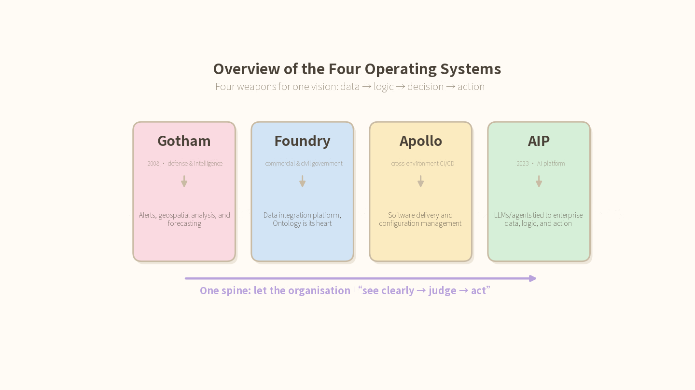

**Figure 1-2 The four operating systems at a glance: data → logic → decision → action**

In the language of Ontypology: Foundry gives Type a home (data integration and models), Apollo gives Type feet (delivery into any environment), and Gotham and AIP give Type two ways of being used (defence decisions and AI decisions). Four instruments, one axis: letting an organisation "see clearly → judge → act".

## 1.4 Foundry Ontology: the heart of Palantir

Palantir describes it officially as follows: "The Foundry Ontology is the heart of Palantir Foundry. It integrates the semantic, kinetic, and dynamic elements of your business"—Foundry Ontology is the heart of Foundry, integrating the semantic, kinetic and dynamic elements of the enterprise so that teams can coordinate and automate decisions in complex situations. The official text also says it builds a universal logic layer out of "objects, actions, and processes of your business".

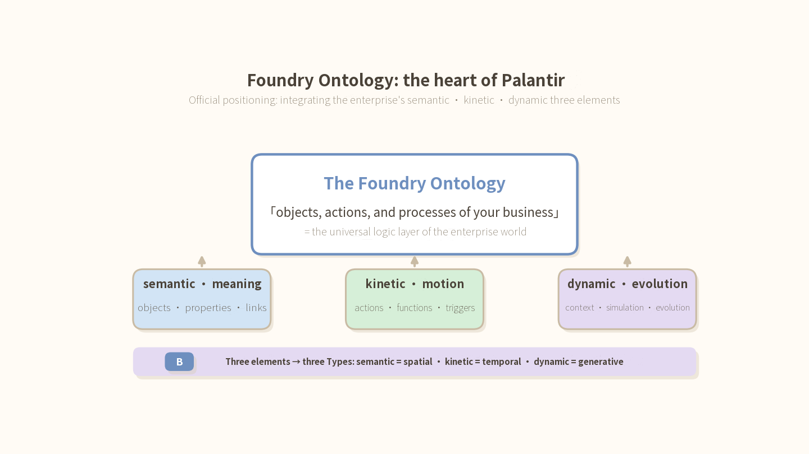

**Figure 1-3 Foundry Ontology: the semantic, kinetic and dynamic elements**

This is exactly the main battlefield of the comparative reading in Part 3. First, remember three names: semantic elements—objects, properties, links—answering "what it is"; kinetic elements—actions, functions, triggers—answering "what it will do"; dynamic elements—scenarios, simulation, evolution—answering "what it will become".

> **[Professional column C1] The forward-deployed engineer and the frontline of the "Type"**  
> Palantir has a famous role called forward-deployed engineer: stationed directly at the customer site, translating the customer's business into objects and actions in the Ontology. The substance of this role is exactly what Ontypology calls recognising the whole → describing along axes → writing the Type set—except that they mostly rely on experience and intuition, lacking a verifiable notation and criteria.  
> The "six steps of proof" in Part 6 of this book amount to writing the forward-deployed engineer's tacit knowledge into a prominent-discipline process: any team can follow the table and verify item by item. This is one concrete landing point of "seeing the Type clearly and turning it into a prominent discipline".  

## 1.5 AIP: binding AI to the enterprise's data, logic and action

AIP (Artificial Intelligence Platform) is Palantir's AI platform. The official description is "a decision-centric system at the heart of AIP that integrates AI with enterprise data, logic, and action"—a decision-centric system that integrates AI with the enterprise's data, logic and action. It makes three connections: connecting AI to enterprise data (Connect AI to Enterprise Data); connecting AI to enterprise logic (Connect AI to Enterprise Logic—existing business logic, ML models and optimisers become deterministic tools for the AI); and connecting AI to enterprise systems of action (Connect AI to Enterprise Systems of Action—decisions synchronised safely back to operational databases and edge platforms).

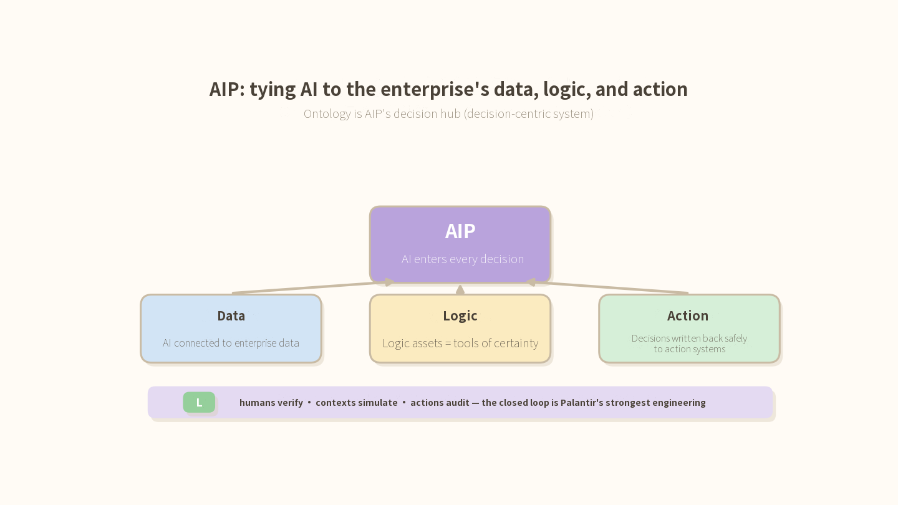

**Figure 1-4 AIP's three connections: data, logic, action**

Note Palantir's insistence on governance: the AI's suggestions must be human-validated, scenarios must be simulated, and actions must be auditable. In the language of Ontypology, this is "the output Type must pass three layers of checking"—the machine may propose a Type, but the criteria remain with people.

## 1.6 Part summary

> **Key lines of this part**  
> ◆ Palantir engineers the enterprise world's "Type": objects, actions and processes become a universal logic layer.  
> ◆ Foundry Ontology's semantic, kinetic and dynamic elements line up exactly with Ontypology's two sides and generation.  
> ◆ AIP's "human-verifiable, auditable" and Ontypology's "verifiable precision" are the same insistence.  
>
> **Exercise E01 Platform sketch**  
> ① In your own words, explain what each of the four operating systems (Gotham / Foundry / Apollo / AIP) is responsible for.  
> ② What question does each of Foundry Ontology's three elements (semantic / kinetic / dynamic) answer?  
> ③ Where do AIP's three "Connect AI" links connect? Why is "human validation" important?  

# Part 2 A quick tour of the Ontypology backbone

This part raises the backbone of Ontypology—not by re-teaching the theory chapter by chapter, but by architecture diagrams plus text summaries, assembling every part that the comparative readings from Part 3 onward will need. Readers already familiar with Ontypology can skim; newcomers are advised to read it in order—it is also the map of the whole book.

> **Map of this part**  
> 2.1 The cognitive chain \| 2.2 Spatial Type: three axes and the unit Type \| 2.3 Three-layer judgment  
> 2.4 Temporal Type: a Type in, a Type out \| 2.5 The method of exact use \| 2.6 Summary  
> After this part you will have all the Ontypology parts needed for comparative reading.  

First, answer "why Type is needed". Mathematics describes quantity, relations and laws; Ontypology describes structure, composition, connection, evolution and essence—the brain thinks with Type + number. Human intelligence is constituted jointly by "Type" and "number", yet the study of Type has long been scattered and unsystematised; Ontypology sees Type clearly and turns it into a prominent discipline, aiming to build a unified cognitive theory that crosses language, mathematics, science, philosophy, engineering and business. Everything in the world can be expressed and understood through Type—this is the starting point of every method in this book.

## 2.1 The cognitive chain: the birth of a Type

A Type is the boundary drawn by division and union, a "thing" we can recognise and name. The birth of a Type follows a fixed cognitive chain: first the feeling of sameness and difference, then the act of dividing and uniting, and only then does a Type emerge—and a Type must have a name. The brain has walked this road for hundreds of millions of years; Ontypology writes it down clearly and turns it into a prominent discipline.

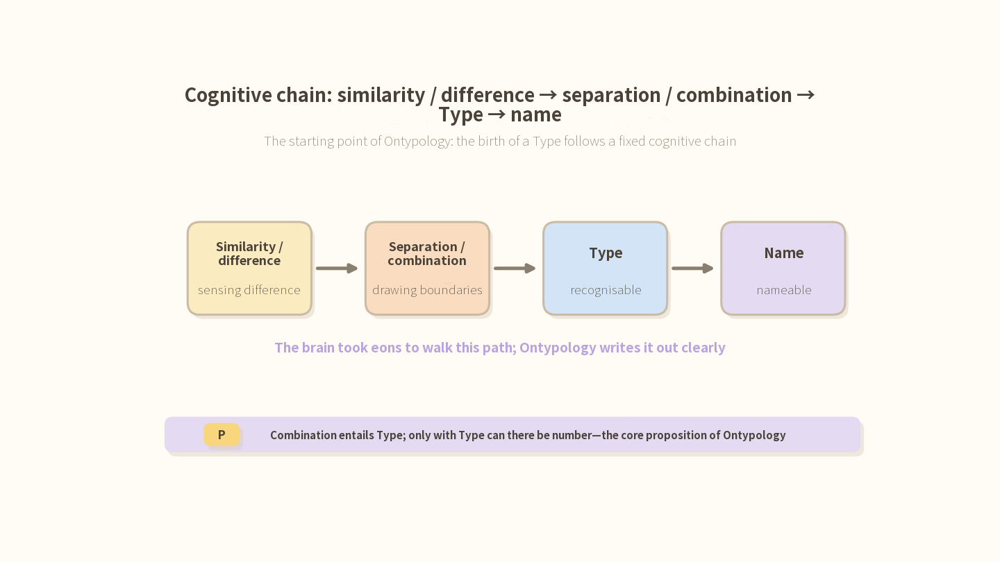

**Figure 2-1 The cognitive chain: sameness/difference → division/union → Type → name**

There are two core propositions: where there is union, there must be a Type; number = a small Type inside a Type · secondary comparison—first there is Type, then there is number. These two sentences will return again and again in the comparative reading in Part 3: every Object Type in Palantir is the boundary of some "union" being drawn out.

## 2.2 Spatial Type: three axes and the unit Type

The spatial Type is the "substance" of Type—the noun side, answering "what it is". It consists of three axes: the X property axis [ ] (dimension × scale); the Y bill of materials { } (after being taken apart, does it still recognise itself—three levels of remove: required parts, function-degraded parts, non-essential parts); and the Z container axis ( ) (C = (id(C), S(C)), the invariance axiom).

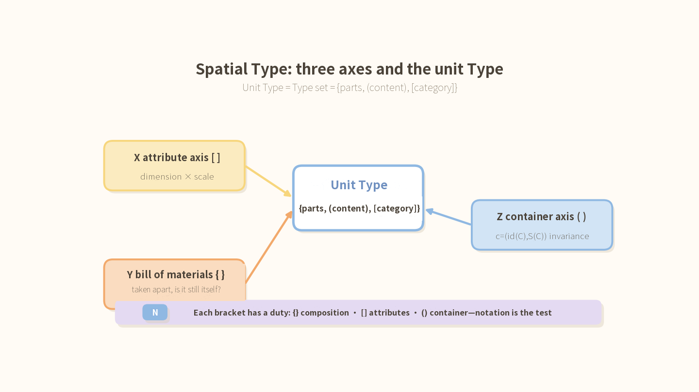

**Figure 2-2 The three axes of the spatial Type and the unit Type**

**Unit Type = Type set = {parts, (contents), [category]}. The Type set of a cup is written {handle, base, lid, body, (coffee), [white]}: the parts compose it, the contents can be replaced, the category gives the scale. Swap the coffee and it is still the same cup—what changes is the content; what does not change is the Type.**

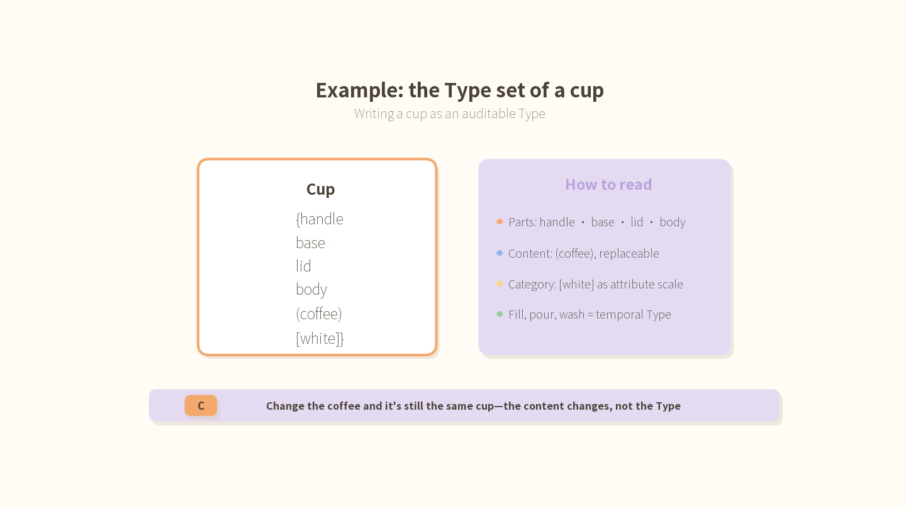

**Figure 2-3 Example: the Type set of a cup**

## 2.3 Three-layer judgment

A Type is judged through three layers: the container layer (( ) is the identity still there—the invariance axiom), the BOM layer ({ } is the structure right—the three-level remove criteria), and the abstraction layer ([ ] is the category right—T = (F(T), ∩(T)) intersection criteria, where F(T) is the fixed features and ∩(T) is the open slot). The three layers are written jointly as J = J_C ∧ J_B ∧ J_T; none may be missing.

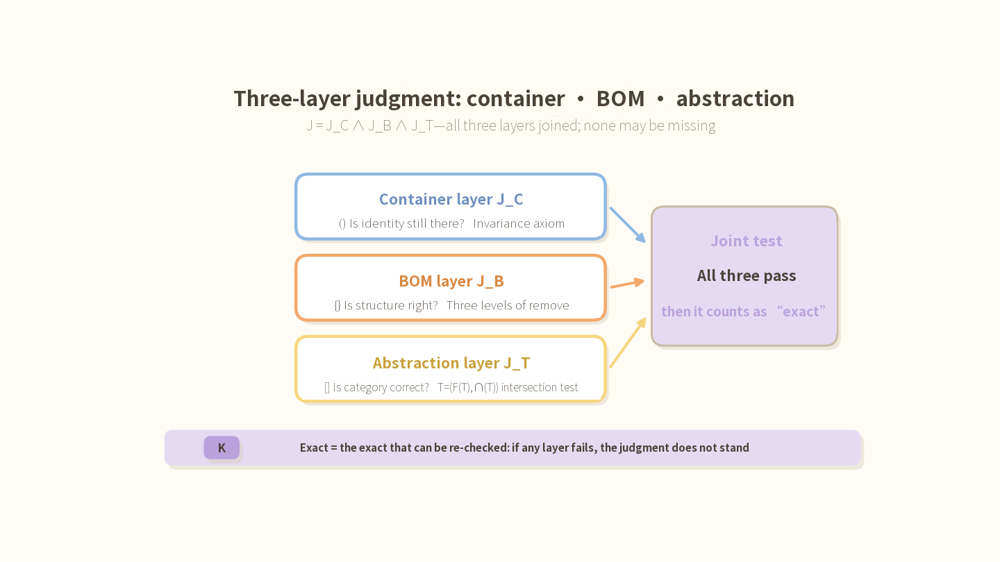

**Figure 2-4 Three-layer judgment: container, BOM, abstraction**

The "open slot" of the abstraction layer is worth remembering: a Type has a boundary, but the boundary learns—new members can join at any time, and the Type does not fall apart. When Part 5 assesses Palantir's limits, this ruler will come in handy.

## 2.4 Temporal Type: Type in, Type out

The temporal Type is the "use" of Type—the verb side, answering "what it will do". It equals function = method = move = service = dharma-gate; defined in one sentence: input one Type, output one Type (op : Type → Type). The temporal Type rests on the spatial Type—first the Type, then the action; and the new Type produced by the action in turn enriches the Type library—substance and function as one, growing each other.

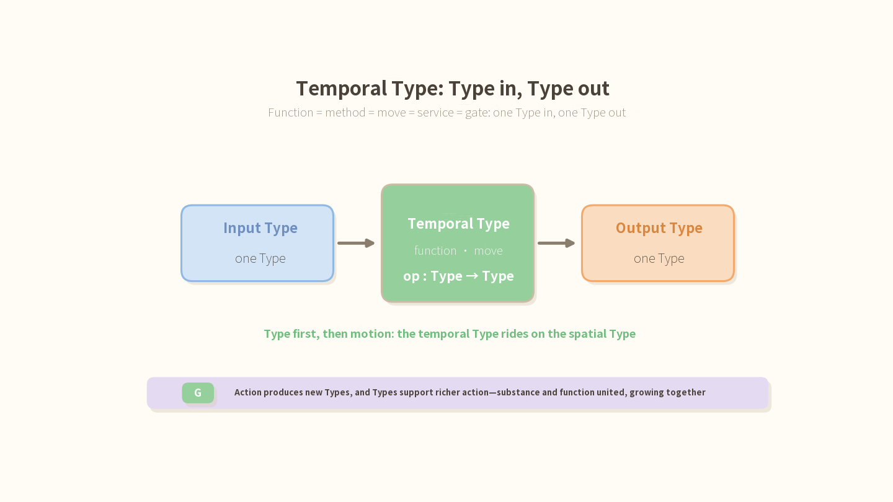

**Figure 2-5 Temporal Type: Type in, Type out**

The temporal Type function library falls into six groups: cognition and extraction (search, design search and extraction, design patterns); generation and application (logic generation, function generation); problem-solving and creation (solving, analysis, design); reasoning and thinking (causal, counter-causal, simulation, statistical and reverse reasoning; forward, reverse, horizontal, vertical and first-principles thinking); growth and maintenance (continuous learning, refactoring and reorganisation, self-evolution); and exploration (R&D exploration). Every function can be described with the four-question function card: name, input Type, output Type, criteria.

| **Function group** | **Representative functions** | **Use in comparative reading of Palantir** |
| --- | --- | --- |
| Cognition and extraction | Search, designed search and extraction, design patterns | Recognise Types in existing systems, find ready-made solution Types |
| Generation and application | Logic generation, function generation | Generate models and action Types from Type sets |
| Problem-solving and creation | Problem-solving, analysis, design | Reasoning through decision situations and producing plans |
| Reasoning and thinking | Causal, reverse-causal, simulation, statistical, reverse reasoning; the five styles of thinking | Scenario simulation, counterfactuals, path selection |
| Growth and maintenance | Continuous learning, refactoring and reorganisation, self-evolution | Decision sedimentation, Type library refactoring |
| Exploration | R&D exploration | Type-forming vanguard for new businesses and new domains |

## 2.5 The method of exact use

Ontypology engineers "exactness" into the method of exact use, gathered into one overall architecture: substance (spatial Type)—function (temporal Type)—precision (verifiable exactness). Three instruments: three supplements ([ ] rules, ( ) identity, { } structure), the six-step proof (identify the whole → describe by axis → write the Type set → select the proposition → reason with criteria → check three layers), and the eight-question checklist. There is also a misuse comparison table that matches each common misreading with its correction.

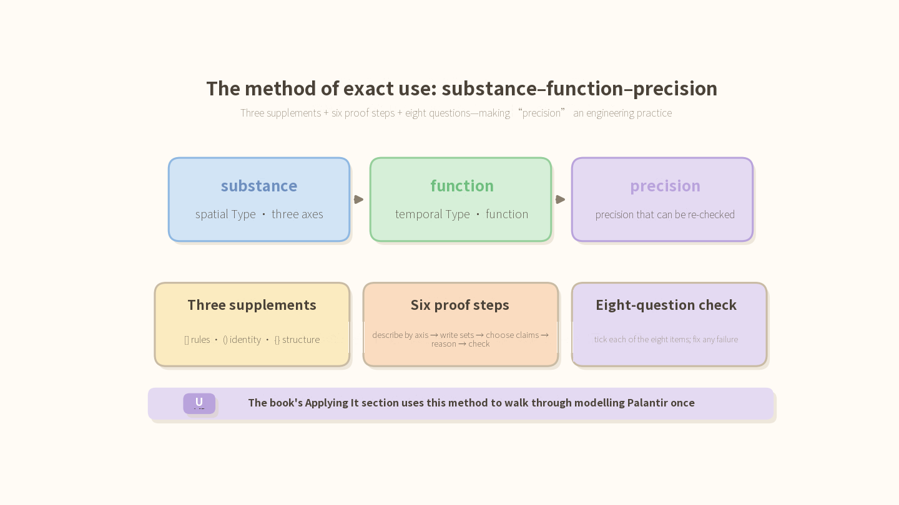

**Figure 2-6 The method of exact use: substance, function, precision**

Part 6 of this book applies this whole method to Palantir scenarios—the three supplements help you build the object model strictly, the six steps help you make judgments re-checkable, and the eight questions help you close and accept the work.

## 2.6 Part summary

> **Key lines of this part**  
> ◆ Cognitive chain: sameness/difference → division/union → Type → name; where there is union there must be a Type, and only when there is a Type is there number.  
> ◆ Spatial Type = substance: the three axes [ ] { } ( ), the Type set {parts, (content), [category]}, three-layer judgment.  
> ◆ Temporal Type = function: one Type in, one Type out; the six function groups, the four-question function card.  
> ◆ The method of exact use = precision: three kinds of supplementation + six steps of proof + eight questions—precision means verifiable precision.  
>
> **Exercise E02 Backbone sketch**  
> ① Write out the Type set of a cup, marking its parts, content and category.  
> ② What does each of J = J_C ∧ J_B ∧ J_T in the three-layer judgment check? What happens if one layer is missing?  
> ③ Using the four-question function card, describe "pouring water" as a temporal Type.  

# Part 3 Comparative reading: Palantir Ontology × Ontypology

This part is the main axis of the book. We read Palantir Ontology's three elements—semantic, kinetic, dynamic—one to one against Ontypology's spatial Type, temporal Type, and generation and evolution. The comparative reading keeps three rules of discipline: first, keep the original terminology of both sides; second, give a reason for every correspondence; third, state every difference in depth plainly, without vagueness.

> **Map of this part**  
> 3.1 Why comparative reading is possible \| 3.2 Semantic ↔ spatial \| 3.3 Kinetic ↔ temporal \| 3.4 Dynamic ↔ evolution  
> 3.5 Master table and one sentence \| 3.6 Difference in depth \| 3.7 Cases across domains  
> 3.8 Three brackets, three questions \| 3.9 Closing—after this part you will have the six-aspect comparative-reading master table.  

## 3.1 Why they can be read together: two practices of one cognitive chain

Palantir starts from engineering practice: first there is the project site, and gradually the layer of universal logic called Ontology settles out. Ontypology starts from cognitive theory: first ask "what a Type is", then derive the notation, the criteria and the functions. The two paths go their own way, yet meet halfway up the mountain—both find that the world's operation must stand on a layer of "Type".

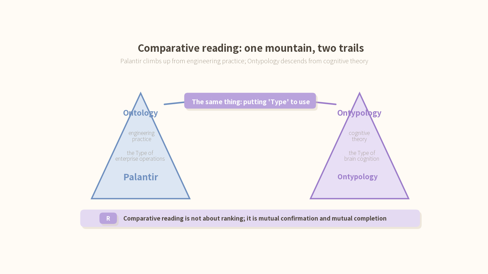

**Figure 3-1 The master comparison diagram: one mountain, two climbing routes**

The meeting point is no accident. Ontypology says "where there is union, there must be a Type": when an organisation unites data, processes and decisions into one body, a Type must support it. Palantir names this Type "Ontology"; Ontypology names it Type—different names for the same kind of thing being identified.

## 3.2 Reading one: semantic elements ↔ spatial Type

Semantic elements answer "what it is"—exactly the home turf of the spatial Type. Item by item: Palantir's Object Type corresponds to the unit Type: a reusable Type; Object corresponds to an instance of a Type: a concrete individual of the same Type; Property corresponds to the [ ] property axis: dimension × scale; Link corresponds to the relation between Types: belonging and cross-reference; Interface corresponds to the ( ) container: identity id(C) and invariance.

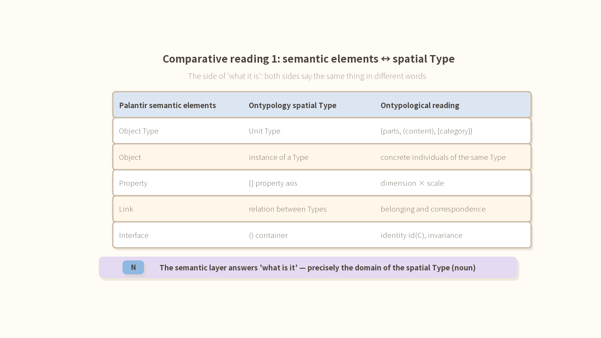

**Figure 3-2 Semantic elements ↔ spatial Type**

Note one asymmetry: most of Palantir's Property definitions are "field-list" descriptions, whereas Ontypology's [ ] requires "dimension definition + scale unit + boundary values"; Palantir's model dependencies are mostly implicit in the schema, whereas Ontypology's { } requires the three levels of remove to be stated explicitly—which parts are required, which are function-degraded, which are non-essential. The value of comparative reading lies precisely in such gaps: where the two are isomorphic, they confirm each other; where they diverge, they complete each other.

## 3.3 Reading two: kinetic elements ↔ temporal Type

Kinetic elements answer "what it will do"—the home turf of the temporal Type. Palantir's Action Type corresponds to the function (move · method): a reusable operation; Action corresponds to one execution of the function; Function corresponds to the temporal Type itself (op : Type → Type); Trigger corresponds to the trigger condition: take up the post when the situation matches; Writeback corresponds to the output Type returning to the system: closure and auditability.

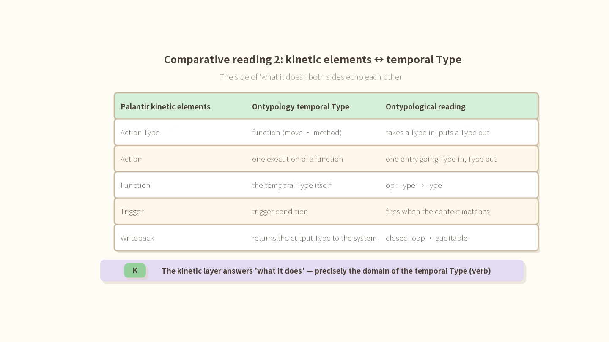

**Figure 3-3 Kinetic elements ↔ temporal Type**

"Writeback" deserves a second look. Palantir's official text says AIP lets the Ontology "safely synchronize decisions back to operational databases, edge platforms, and other systems of action"—synchronising decisions safely back into systems of action. Reading through Ontypology: the output Type returns to the world and leaves an audit trail—this is the closed-loop version of "input one Type, output one Type". What the engineering world took decades to build, Ontypology predicted structurally with a single phrase: "Type in, Type out".

## 3.4 Reading three: dynamic elements ↔ generation and evolution

Dynamic elements answer "what it will become"—corresponding to Ontypology's generation and evolution. Scenario corresponds to the simulation branch of the five reasoning families: hypothesise a Type and derive an output Type; Decision corresponds to the path-choosing decision tree: compare several Types and choose one; learning and sedimentation correspond to continuous learning and self-evolution: decisions settle into new Types and enter the library.

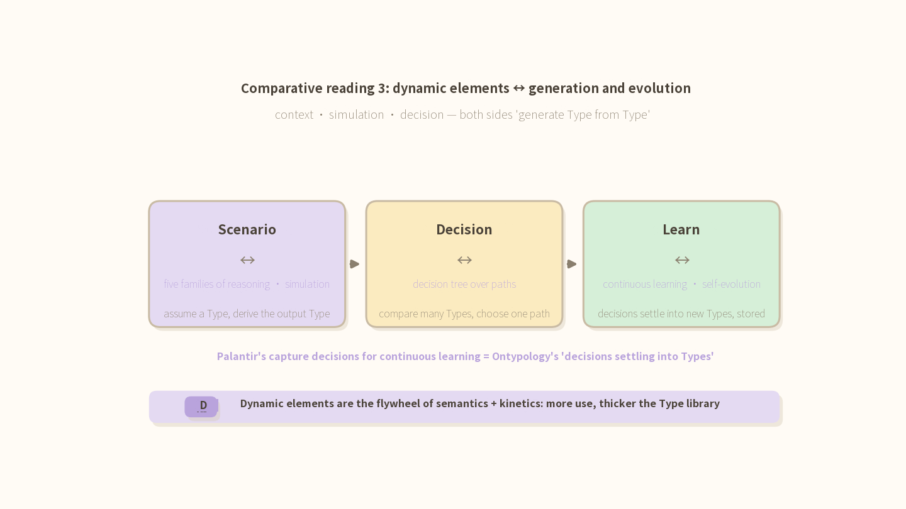

**Figure 3-4 Dynamic elements ↔ generation and evolution**

Palantir says "capture decisions for continuous learning"—capture decisions and keep learning. Reading through Ontypology: the more it is used, the thicker the Type library; the thicker the Type library, the more accurate the decisions. This is the flywheel of substance and function as one; each side has drawn half of it.

## 3.5 The master comparison table and one sentence

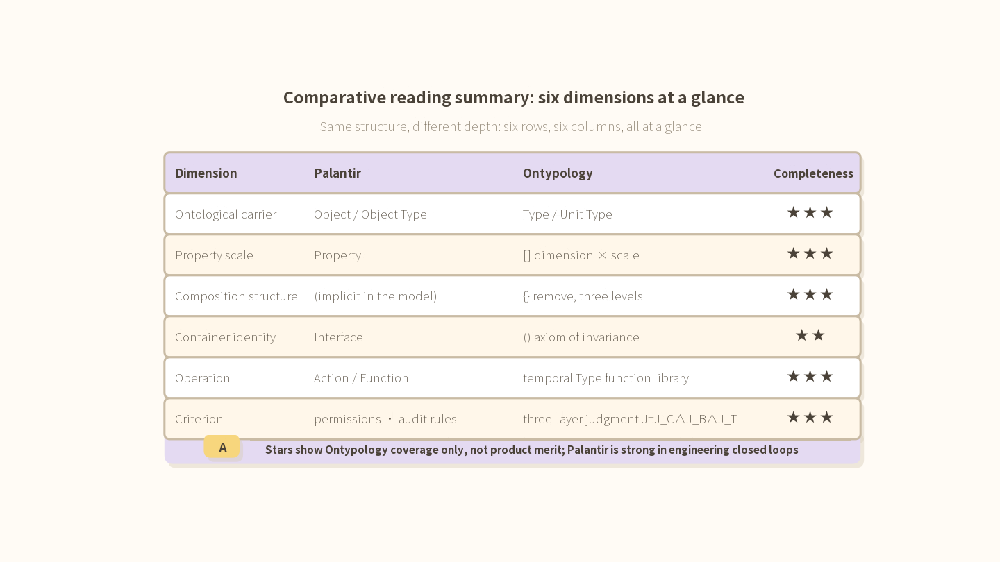

**Figure 3-5 The master comparison table: six dimensions at a glance**

Open the master table one level further and it becomes a desk quick reference—look up row by row and write the reason row by row during a comparative reading:

| **Aspect** | **Palantir's term** | **Ontypology's term** | **One-line reason** |
| --- | --- | --- | --- |
| Ontological carrier | Object / Object Type | Type / unit Type | Both are "reusable things" |
| Attribute scale | Property | [ ] dimension × scale | Both describe "how far it is measured" |
| Compositional structure | Dependency and composition (schema) | { } three levels of remove | Both answer "take it apart—is it still itself?" |
| Container identity | Interface, id | ( ) id(C), invariance | Both answer "is it still it?" |
| Operation | Action / Function | Temporal Type function library | Both are "a Type in, a Type out" |
| Criteria | Permissions, audit rules | Three-layer judgment J = J_C ∧ J_B ∧ J_T | Both answer "what counts as correct" |

The star ratings in the master table only indicate "coverage by Ontypology theory", not a product score—Palantir is strong in engineering closure and deployment; Ontypology is strong in notation, criteria and cognitive depth. Compressing the comparative reading into one sentence gives Palantir's own phrase, "objects, actions, and processes of your business":

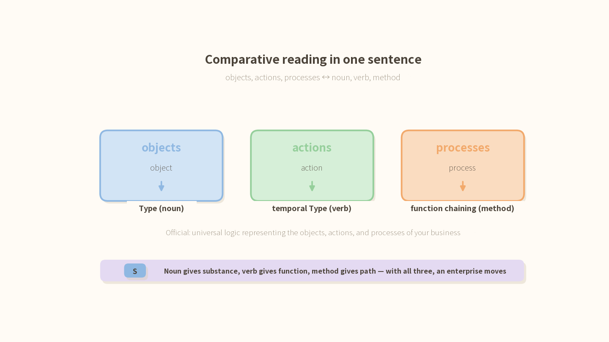

**Figure 3-6 One-sentence comparative reading: objects · actions · processes ↔ noun · verb · method**

> **One-sentence comparison**  
> objects are Types (nouns), actions are temporal Types (verbs), processes are function chaining (methods). Nouns give substance, verbs give function, methods give the path—only when all three words are present can an enterprise move.  

## 3.6 The difference in depth: same chain, different depth

Standing on the same cognitive chain, the two sides deepen in different directions. Palantir deepens from "Type" onward: naming, modelling, deciding, acting, auditing—using Type to the limit; Ontypology deepens from "sameness and difference" forward: the cognitive chain, the three axes, the three-layer judgment, the function library, evolution—seeing Type through to the bottom.

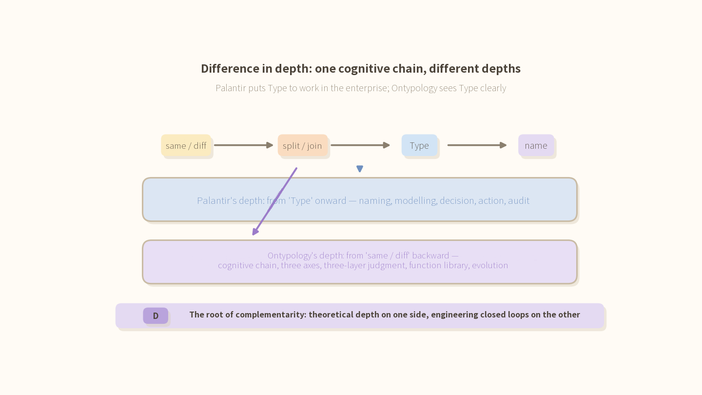

**Figure 3-7 The difference in depth: one cognitive chain, different depths**

This difference is precisely the root of complementarity: the theoretical depth Palantir lacks, Ontypology has; the engineering closure Ontypology lacks, Palantir has. Part 4 unfolds along this sentence.

## 3.7 Cross-domain reading cases

The comparative method is independent of domain. Consider four cases side by side: supply chain (objects = orders, factories, parts; actions = transfer, rescheduling), urban governance (objects = road network, traffic flow, signals; actions = timing adjustment, dispatch), healthcare (objects = beds, tests, medication; actions = bed transfer, preparation, notification), finance (objects = accounts, positions, limits; actions = review, risk control, closing).

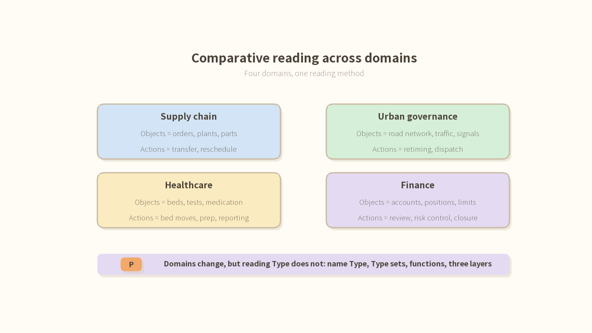

**Figure 3-8 Cross-domain reading cases side by side**

Domains vary endlessly, but the way of reading Type does not change: identify the Type → write the Type set → choose the function → pass the three layers. These four steps work in any domain, because they are not domain knowledge but knowledge of "Type" itself.

Read the four cases one level deeper and the same "rhythm of Type" appears repeatedly: first establish objects (identify Types), then establish actions (choose functions), then establish criteria (pass the three layers). A "parts shortage" in supply chain and a "bed shortage" in healthcare are the same kind of problem at the level of Type—a shortage is one Type, allocation is one function, uninterrupted supply is one criterion. Domains are only the clothing of Type; Type is the lining. This is the practical meaning of Ontypology's claim that "everything in the world can be expressed and understood through Type".

## 3.8 Three brackets × three questions of object modelling

Tighten the comparative reading one more notch. When building an object model for Palantir, Ontypology asks three questions: with { } ask "after being taken apart, does it still recognise itself" (structure); with [ ] ask "is the dimension right, is the scale right" (property); with ( ) ask "who is id(C), is invariance upheld" (identity).

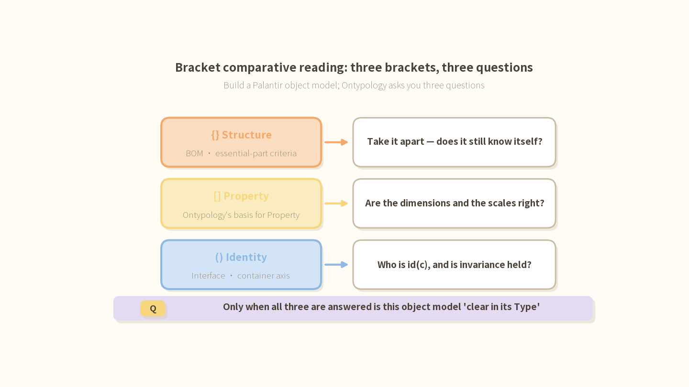

**Figure 3-9 Three brackets × three questions of object modelling**

Only when all three questions can be answered is the object model "clearly typed". A model that cannot answer them is most likely standing right on the misuse that Part 5 will discuss.

## 3.9 Closing the comparative reading

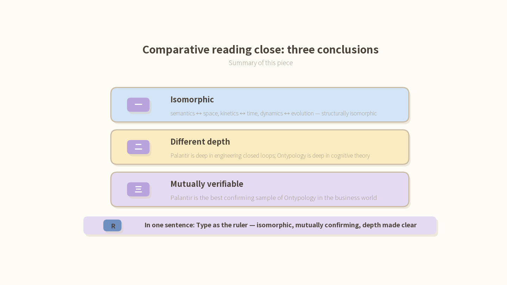

**Figure 3-10 Closing the comparative reading: three conclusions**

> **Key lines of this part**  
> ◆ Isomorphism: semantic ↔ spatial, kinetic ↔ temporal, dynamic ↔ evolution—structurally isomorphic, mutually confirming.  
> ◆ Different depths: Palantir is deep in the engineering closed loop; Ontypology is deep in cognitive theory.  
> ◆ Mutually evidential: Palantir is Ontypology's best confirming sample in the enterprise world.  
>
> **[Professional column C2] Ontology engineering × Ontypology: a vocabulary comparison**  
> Common terms in ontology-engineering practice—concept, entity, relationship, axiom, TBox/ABox—roughly correspond to Ontypology terms: concept ↔ Type, entity ↔ Type instance, relationship ↔ Type relation, axiom ↔ criterion, TBox ↔ the definition of a Type set, ABox ↔ the contents of the Type library.  
> The gap lies in how self-aware the criteria are: ontology engineering's axiom stresses logical consistency, while Ontypology's three-layer judgment adds two more rulers—identity invariance and the three levels of remove. Adding these two rulers to ontology engineering is the entry point to "doing ontology engineering with Ontypology".  
>
> **Exercise E03 Filling in the comparison table**  
> ① For the five terms Object Type, Property, Link, Action Type and Writeback, write in one sentence each the corresponding Ontypology term and the reason.  
> ② How does Ontypology read "capture decisions for continuous learning"?  
> ③ Choose a domain you know well (such as catering, education or logistics) and write out the comparison for three object Types and two action Types.  

# Part 4 Complementary integration: Mind AI × Palantir

Once the comparative reading has made "isomorphism and difference in depth" clear, complementary integration follows naturally. This part answers: which layer does Mind AI sit on, and which does Palantir? How is the labour divided? How is the interface agreed?

> **Map of this part**  
> 4.1 Layered positioning \| 4.2 Two libraries, one hub, one loop × Foundry/AIP \| 4.3 Division of work in the closed loop  
> 4.4 Integration scenarios \| 4.5 Before-and-after comparison  
> After this part you will have a concept diagram of layered collaboration and a table of interface conventions.  

## 4.1 Layered positioning: who sits where

Return to Ontypology's three-layer architecture: the philosophical layer is the root (ontology—asking "what there is"), the method layer is the trunk (Ontypology—what a Type is, how to judge it, how it operates), and the practice layer is the fruit (where Type is put to work). Mind AI and Palantir both sit in the practice layer, but with different divisions of labour:

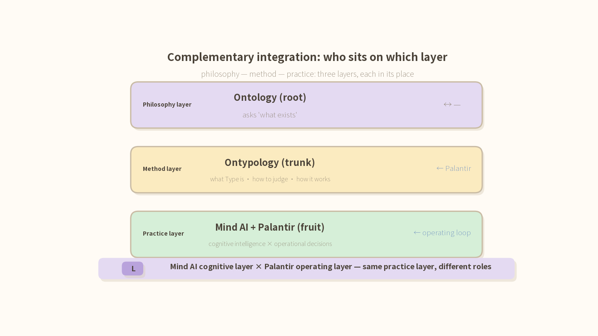

**Figure 4-1 Layered positioning: philosophy, method, practice**

**Mind AI stands on the cognitive-intelligence layer: managing the Type library and the function library, doing understanding, reasoning, learning and creation—seeing Type clearly and turning it into a prominent discipline; Palantir stands on the operational-decision layer: managing the enterprise's objects, actions and decision loops—putting Type to work on site. One layer governs "the intelligence of Type", the other "the operations of Type".**

## 4.2 Architectural docking: two libraries, one hub, one loop × Foundry / AIP

Mind AI's practice architecture can be summarised as two libraries, one hub and one loop: the Type library (unified knowledge), the function library (ways of thinking), the hub (understanding and reasoning), and the loop (learning and evolution). How these four dock with Palantir is conceived as follows: the Type library feeds the Ontology (identified Types become Object Types), the function library feeds AIP (thinking and reasoning become decision methods), the hub connects to AIP's reasoning layer, and the loop takes over decision sedimentation from Writeback.

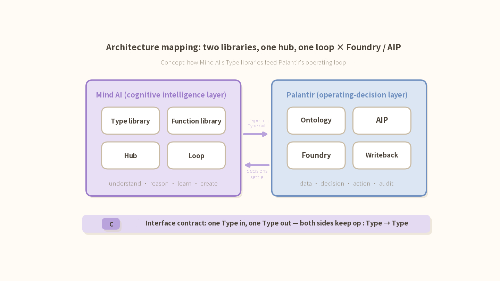

**Figure 4-2 Concept of architectural docking: two libraries, one hub, one loop × Foundry / AIP**

There is only one interface agreement, yet it is everything: input one Type, output one Type (op : Type → Type). If both sides keep this agreement, the interface will always connect. The specific docking can be written as an agreement table:

| **Interface direction** | **Content** | **Convention** |
| --- | --- | --- |
| Type library → Ontology | Recognised Types become Object Types | Every unit Type enters the library with three kinds of supplementation |
| Function library → AIP | Thinking and reasoning become decision methods | Every action Type carries a four-question card |
| Hub ↔ AIP reasoning | Understanding and reasoning call on each other | The reasoning process is auditable, the criteria replayable |
| Writeback → loop | Decisions settle back into the Type library | Every execution leaves a trace of a Type in and a Type out |

## 4.3 Complementary division of labour: one full loop

Draw the division of labour as one loop: Type library (Mind AI) → modelling (Ontology) → decision (AIP) → action (Writeback) → learning (sedimentation) → Type library (thicker).

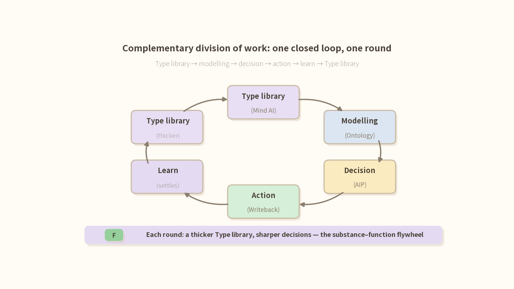

**Figure 4-3 Complementary division of labour: one full loop**

With each circuit, the Type library grows thicker and decisions become more accurate. Palantir's strength is the middle section (the engineering loop from modelling to action); Mind AI's strength is the two ends (the cognitive depth of the Type library and the evolutionary mechanism of learning)—the ends give intelligence, the middle gives power.

## 4.4 Integration scenarios

How the two work together in four domains: city traffic lights (Mind AI produces traffic-flow Types and a timing function library; Palantir produces signal objects and writes the timing back), supply-chain transfer (Mind AI produces shortage projection and causal reasoning; Palantir produces order objects and lands the actions), hospital bed management (Mind AI produces bed Types and three-layer judgment; Palantir produces bedside systems and leaves an audit trail), financial risk control (Mind AI produces position Types and counterfactual simulation; Palantir produces limit actions and a review loop).

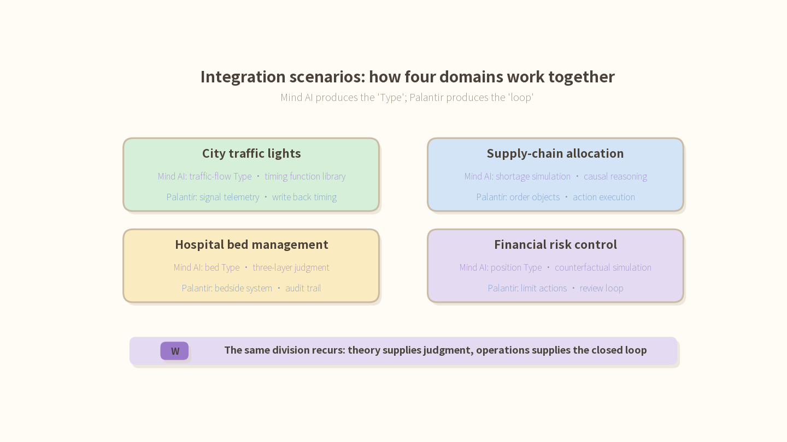

**Figure 4-4 Integration scenarios: how the two work together in four domains**

The same division of labour recurs: the theoretical layer gives judgment, the operational layer gives closure. This is not product bundling but a division of labour over Type—and therefore it holds for any comparable platform; Palantir is simply the sample that has walked furthest among them.

## 4.5 Before and after integration

Before integration, an organisation's data tables, reports, models and processes each have their own names and do not line up—the essence of a silo is not that data does not flow, but that Type does not connect. After integration, everything shares the same set of Types: Type library, function library, decision loop and systems of action recognise one another.

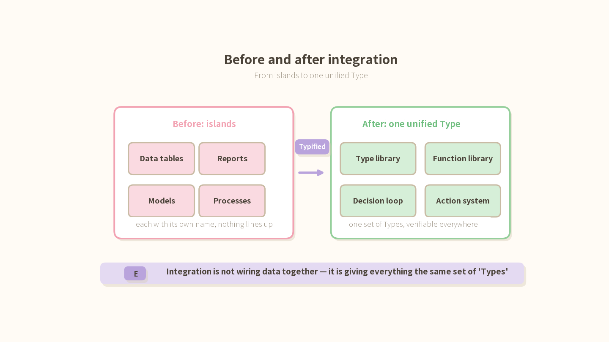

**Figure 4-5 Before and after integration: from silos to a unified Type**

The essence of integration is not connecting data lines but giving everything the same set of "Types". No matter how many data lines are connected, if Type does not connect it is still a silo—this is also the Ontypology diagnosis of why many digital-transformation projects fail.

A word on governance is worth adding: once Type connects, an organisation's memory no longer lives only in individuals. A newcomer taking over a process needs only to read its Type set and four-question card to stand on the shoulders of predecessors—Type is the organisation's explicit memory. Palantir uses forward-deployed engineers to move tacit knowledge into systems; Ontypology uses notation and method to move tacit knowledge into books and classrooms; Mind AI is to move it into an intelligent architecture that can reason and learn. Three roads, one direction.

> **[Professional column C3] MDM × Ontypology: the Type of master data**  
> Master data management (MDM) deals with "the customer, product and supplier that the whole company uniquely recognises"—in Ontypology's words, it establishes the unit Type for key entities: id(C) fixes identity, { } fixes composition, [ ] fixes scale. MDM's golden-record mechanism is in substance an engineering implementation of ( ) container invariance.  
> Run an MDM project through the three kinds of supplementation: every master-data domain needs identity rules, composition criteria and scale definitions—only with all three does MDM upgrade from "cleaning data" to "establishing Types".  
>
> **Key lines of this part**  
> ◆ Mind AI stands at the cognitive-intelligence layer, Palantir at the operational-decision layer—both in the practice layer, with different divisions of work.  
> ◆ One interface convention: a Type in, a Type out.  
> ◆ The essence of integration: give everything the same set of Types.  
>
> **Exercise E04 Designing the complementarity**  
> ① In one sentence, explain the layered division of work between Mind AI and Palantir.  
> ② Draw the closed loop "Type library → modelling → decision → action → learning → Type library" and mark which segment is Mind AI's strength and which is Palantir's.  
> ③ Choose an organisation you know and diagnose whether its "Types do not connect", then propose three recommendations for Type-forming it.  

# Part 5 Assessment and transcendence: Palantir through Ontypology

The discipline of assessment is honesty: first the strengths, then the limits, and finally the transcendence. There is only one ruler—the re-checkability of Ontypology. Measuring Palantir with this ruler is not to rank who is higher, but to see "the engineering of Type" more clearly.

> **Map of this part**  
> 5.1 Three strengths \| 5.2 A Type without the theory \| 5.3 Missing notation and criteria \| 5.4 Abstraction and cross-domain reach  
> 5.5 Three directions of transcendence \| 5.6 Five common misreadings  
> After this part you will have an honest comparison of strengths and weaknesses, and a route to transcendence.  

## 5.1 Three strengths: they confirm Ontypology

The first strength is the closed loop: data → decision → action → feedback, one ring all the way through—confirming Ontypology's flywheel of "substance and function as one, growing each other". The second is writeback: decisions synchronised safely back into systems of action—confirming "the output Type returns to the world". The third is the operational ontology: a universal logic of objects, actions and processes—confirming "where there is union, there must be a Type".

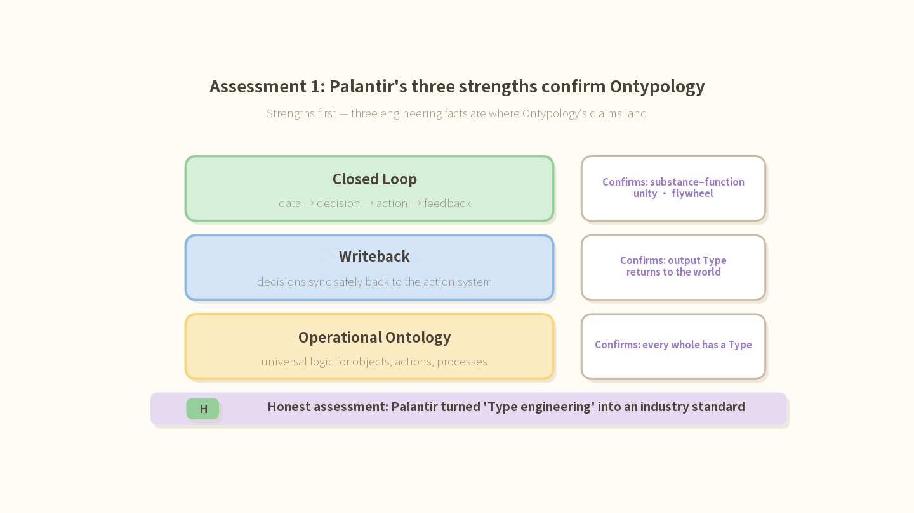

**Figure 5-1 Three strengths that confirm Ontypology**

All three are engineering facts, not marketing language—they can be verified in official documentation, customer cases and product behaviour. A company that has turned "the engineering of Type" into an industry standard deserves careful comparative reading by Ontypology.

## 5.2 Limitation one: a Type without the theory

The limitation is not in function but in self-awareness. Palantir can build an object model yet cannot say clearly "what a Type is"—it has no cognitive chain, no definition of Type, and no re-checkable system of criteria. Its knowledge settles in engineers' intuition and project conventions, not in a theory that can be taught, practised and re-checked.

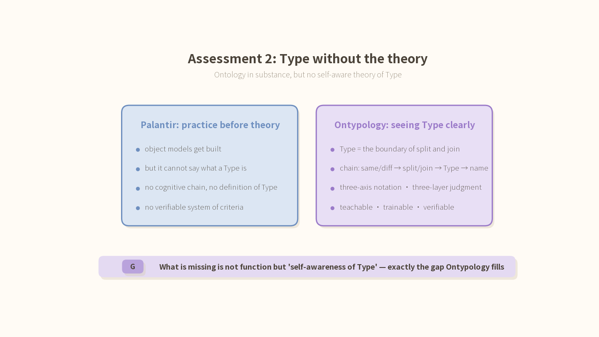

**Figure 5-2 A Type without the theory: practice precedes theory**

By analogy: Palantir is like a master of unmatched martial skill who has never written a manual—every move works, but disciples can only learn by stealing. What Ontypology does is write the manual: Type = the boundary drawn by division and union, the cognitive chain, the three-axis notation, the three-layer judgment—teachable, practicable, re-checkable.

## 5.3 Limitation two: notation and criteria missing

The same object model can be written more strictly with Ontypology: the ordinary approach writes a "field list", while Ontypology writes the Type set {parts, (contents), [category]}; the ordinary approach tables decomposition with "dependencies", while Ontypology uses the three levels of remove (required parts, function-degraded parts, non-essential parts); the ordinary approach classifies with tags, while Ontypology uses the ∩(T) intersection criteria; the ordinary approach judges with permission rules, while Ontypology uses the joint three-layer J = J_C ∧ J_B ∧ J_T.

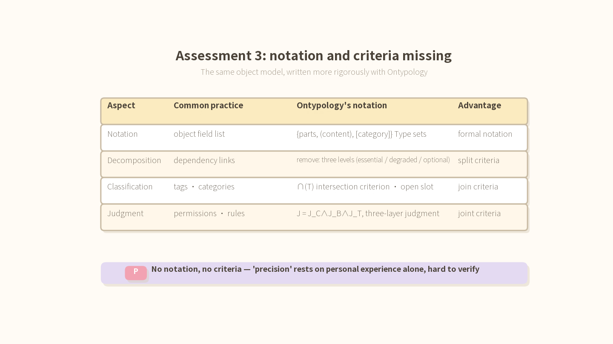

**Figure 5-3 The contrast when notation and criteria are missing**

Without notation and criteria, a model's "exactness" can rely only on personal experience—when the person leaves, the exactness disperses. For consultant-style delivery centred on talent (such as the forward-deployed engineer model), this is a structural risk; the remedy is the method of exact use in Part 6.

## 5.4 Limitation three: the distance to abstraction and cross-domain unity

Enterprise classification trees grow quickly and change slowly: when new businesses, new jurisdictions or new data types arrive, a closed classification tree must be redrawn. Ontypology's solution is T = (F(T), ∩(T))—F(T), the fixed features, guards the essence of the Type, while ∩(T), the open slot, is left for new members. A Type has a boundary, but the boundary learns.

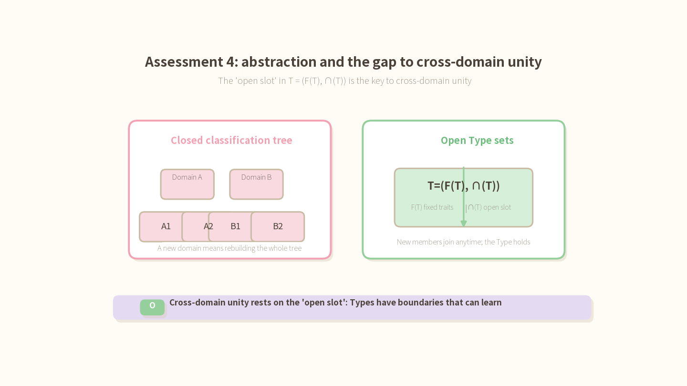

**Figure 5-4 Closed classification tree vs open slot**

Cross-domain unity (unified knowledge → unified thinking → unified intelligence) needs exactly this open Type. Palantir's Ontology is optimised for the operations of a single enterprise and is naturally closed; Ontypology is designed for "a unified cognition crossing language, mathematics, science, philosophy, engineering and business" and is naturally open—the two have different radii of applicability; this is not a matter of better or worse but of orientation.

## 5.5 The point of transcendence: adding "the cognitive Type"

Transcendence goes in three directions: notation (the Type set, the three axes, the three levels of remove, making the model teachable and re-checkable), criteria (the three-layer judgment, the eight questions, making "exactness" into engineering), and evolution (the function library, continuous learning, self-evolution, letting the system grow by itself).

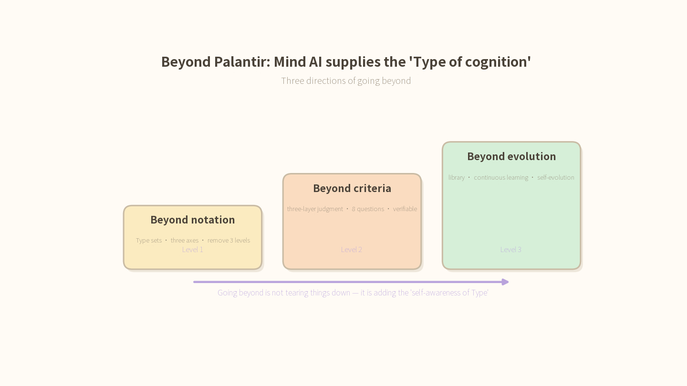

**Figure 5-5 The three directions of transcendence**

Transcendence is not tearing down and starting over—Palantir's engineering loop is accepted wholesale; transcendence means adding "the self-awareness of Type", so that those who can already walk know why they walk steadily.

## 5.6 Misuse warning: five common misreadings

Reading Palantir through Ontypology, there are five pits to avoid:

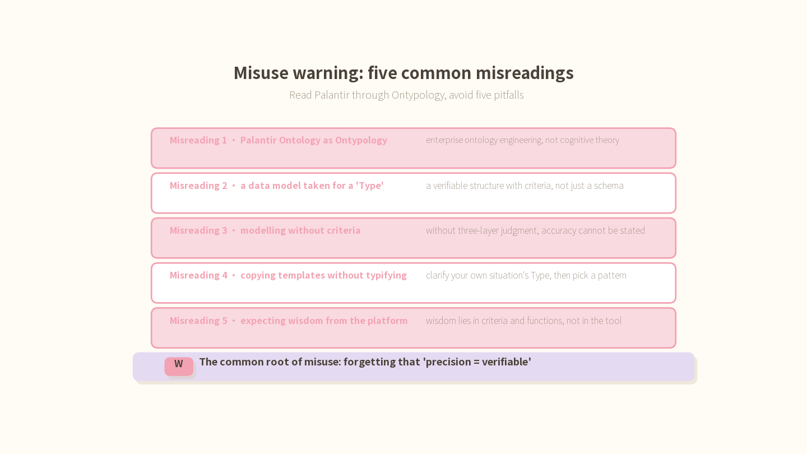

**Figure 5-6 Five misuse warnings**

Expand the five misuses into a comparison table, and diagnosis and correction become clear at a glance:

| **Misreading** | **Symptom** | **Ontypology diagnosis** | **Correction** |
| --- | --- | --- | --- |
| Treating the Ontology as Ontypology | Assuming a model means a theory | Confusing implementation with a prominent discipline | Distinguish: Ontypology is the ruler, the Ontology is the bridge being measured |
| Treating the schema as the Type | Plenty of models but no way to judge | Missing the three-axis notation and criteria | Add Type sets and the three-layer check |
| Modelling without criteria | No one can say whether it is exact | J not jointly satisfied | Establish a criteria table and walk the six steps of proof |
| Copying templates without Type-forming | Does not fit, and gets messier with use | The Type of the situation is not recognised | Recognise the Type first, then choose the pattern |
| Waiting for the platform to grow intelligence | Buying more and more tools | Intelligence lies in criteria, not tools | Build the Type library, teach the method, keep the eight questions |

The five misuses share a single root: forgetting that "exact = re-checkable". Mistaking Palantir's capability list for Ontypology, mistaking the schema for Type, mistaking the platform for intelligence—as long as you remember "a Type must pass three layers of checking", all five pits can be avoided.

> **[Professional column C4] Why knowledge graphs are not enough: from GraphRAG to the Mind Model**  
> The industry commonly uses knowledge graphs (Neo4j, Stardog, Neptune) plus GraphRAG to patch the LLM's weakness in reasoning. The Ontypology diagnosis of their limits: limited expressive power (only nodes and edges—cannot write {parts, (content), [category]} or the three levels of remove); the reasoning layer lacks criteria (path queries ≠ three-layer judgment); abstract Types are hard to express (there is nowhere to put the open slot).  
> The Mind Model's position: not another, bigger graph, but a unified knowledge model built on the Ontypology architecture—the Type library (knowledge unification) + the function library (thinking unification) + the hub and loop (intelligence unification). Palantir's Ontology goes as far as "the unification of enterprise operations"; the Mind Model heads for "the unification of cross-domain cognition".  
>
> **Key lines of this part**  
> ◆ Three strengths, three confirmations: closed loop, Writeback, operational ontology—the engineering of Type, an industry standard.  
> ◆ The limits lie in self-awareness: a Type without the theory, missing notation and criteria, an insufficient open slot.  
> ◆ Three directions of transcendence: notation, criteria, evolution—adding the Type of cognition.  
>
> **Exercise E05 Assessment practice**  
> ① Give an example showing how Palantir's "closed loop" confirms the unity of substance and function.  
> ② What does "a Type without the theory" mean? Why do "teachable, verifiable" matter?  
> ③ Using T=(F(T),∩(T)), explain why the open slot is the key to cross-domain unification.  

# Part 6 Adoption guide: the method of exact use in practice

This part moves Ontypology's method of exact use wholesale into Palantir scenarios: the three supplements help you build the object model strictly, the six-step proof helps you make judgments re-checkable, the four-question function card helps you write Action Types clearly, and the eight-question list helps you close and accept. The method is independent of platform—you can use it on any comparable platform.

> **Map of this part**  
> 6.1 Three kinds of supplementation \| 6.2 Six steps of proof \| 6.3 A complete demonstration \| 6.4 The four-question function card  
> 6.5 The eight-question checklist \| 6.6 A master table of misuse \| 6.7 Adoption FAQ  
> After this part you will have an adoption method you can follow step by step.  

## 6.1 Three supplements: setting rules for the object model

To build an object model, Ontypology requires three supplements: the [ ] rule supplement—every Property is given a dimension definition, a scale unit and boundary values; the ( ) identity supplement—every object is given an id(C) naming rule and invariance conditions; the { } structure supplement—every model marks required parts, function-degraded parts and non-essential parts.

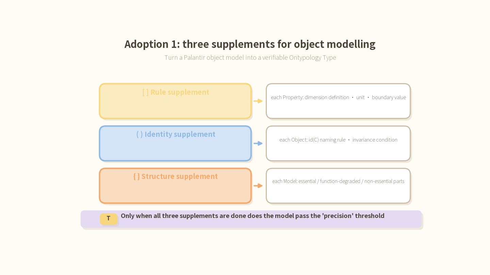

**Figure 6-1 Three supplements: rules, identity, structure**

Only after the three supplements are done does the model pass the threshold of "exactness". In practice it is recommended to make a modelling checklist: before any Object Type enters the library, all three columns must be filled—a blank field blocks the gate.

## 6.2 The six-step proof

To judge a Type and prove a proposition, go through six steps: identify the whole (recognise the Type to be judged) → describe by axis (X[ ] Y{ } Z( )) → write the Type set ({parts, (contents), [category]}) → select the proposition (what is to be proved) → reason with criteria (remove, ∩(T), invariance, layer by layer) → check three layers (J = J_C ∧ J_B ∧ J_T).

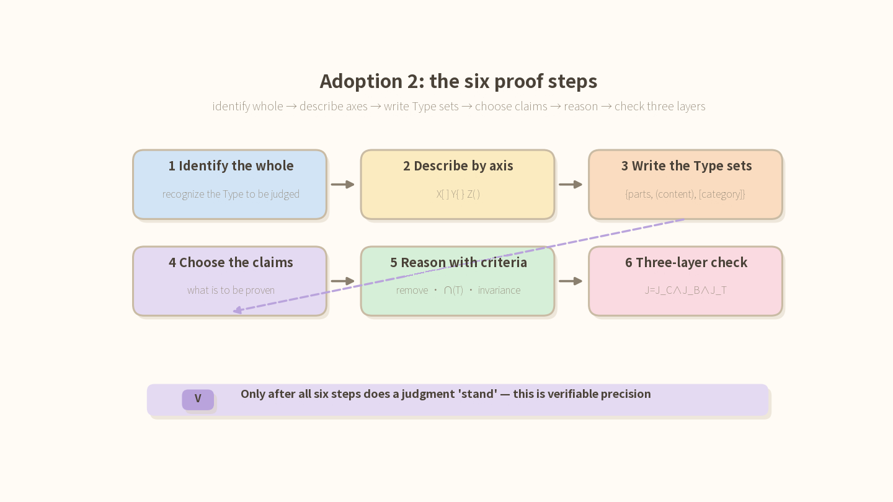

**Figure 6-2 The six-step proof**

The value of the six steps lies in the order: identify the whole before breaking it into axes, write the notation before fixing the proposition, reason the criteria before going through the checks—follow the order and the conclusion stands naturally; skip steps and you are most likely at the beginning of a misuse. In practice each step has an output, which makes a convenient working paper:

| **Step** | **Output** | **Common sticking point** |
| --- | --- | --- |
| 1 Recognise the whole | The Type's name and one-sentence definition | Misidentify the whole and everything after goes wrong |
| 2 Describe along the axes | Three-axis description table (X/Y/Z) | Missing an axis: writing attributes but not composition |
| 3 Write the Type set | {parts, (content), [category]} | Mixing content with parts |
| 4 Choose the proposition | The judgment sentence to be proved | The proposition is too large or too vague |
| 5 Reasoning by criteria | remove, ∩(T), invariance derivation | Jumping to a conclusion without the criteria |
| 6 Three-layer check | J = J_C ∧ J_B ∧ J_T cross-check table | Checking only one layer and calling it done |

## 6.3 A full worked example: a transfer order

Scenario: a supply-chain hub receives a transfer order T-2042 and asks "should it be released?" Walk the whole way with the six steps:

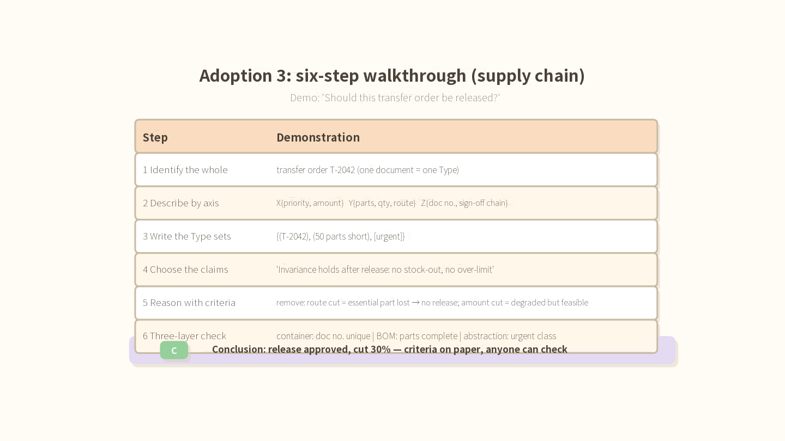

**Figure 6-3 A full six-step worked example: transfer order T-2042**

The conclusion is "can be released, but at 30% reduced amount"—what matters is that how the conclusion was reached is all written on paper: anyone can re-check it, re-derive it and argue with it. This is what "exact = verifiable exactness" looks like in a real decision.

## 6.4 The four-question function card: writing an Action Type as a temporal Type

Every Action Type should have a four-question function card: name (what action it is), input Type (identify the whole: what Type comes in), output Type (Type in, Type out: what Type goes out), criteria (three-layer check: how it counts as correct).

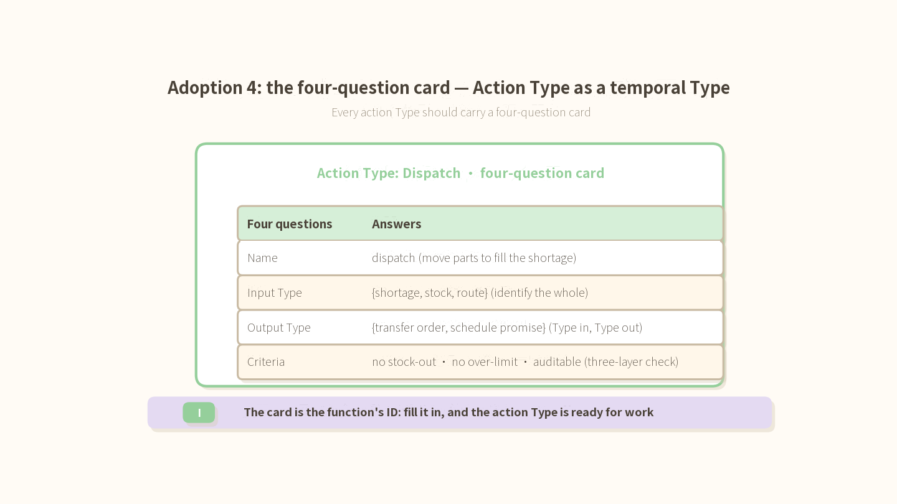

**Figure 6-4 A four-question function card demonstration: Dispatch**

The four-question card is the function's identity document: if it can be filled in, the Action Type is fit for duty. For large-scale adoption, it is recommended that each Action Type have one card, and that cards enter the library and travel with the model—when the model is revised, the card is revised with it.

## 6.5 The eight-question checklist

Before an adoption project closes, tick off the eight questions one by one: is the whole identified? are all three axes described? is the Type set complete? is the proposition selected? has the criteria reasoning been walked? have the three layers been checked? is the four-question card filled in? has the misuse comparison been reviewed?

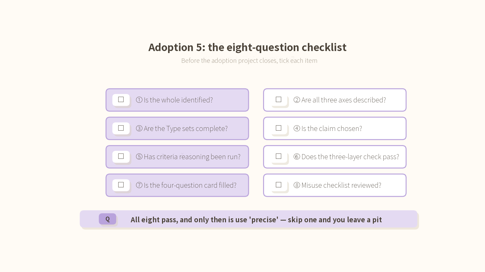

**Figure 6-5 The eight-question checklist**

Only when all eight questions pass is it "exact use"—miss one question and you leave one pit. Making the eight questions into an acceptance table is the shortest path from "exactness" as a personal quality to "exactness" as organisational discipline.

## 6.6 The great misuse comparison

Finally, match the common adoption ailments with their Ontypology diagnoses in one table—symptom → diagnosis → direction of correction, ready to consult at any time:

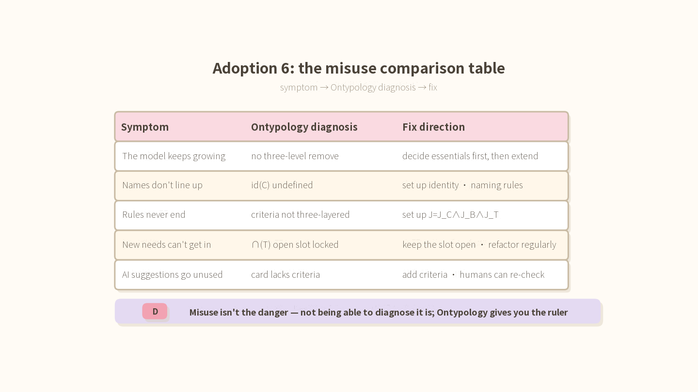

**Figure 6-6 The great misuse comparison: symptom → diagnosis → correction**

Misuse is not frightening; what is frightening is being unable to diagnose it. Ontypology gives you the diagnostic ruler: for model bloat check remove; for naming chaos check id(C); for rule explosion check the three-layer structure; for new requirements stuck check the open slot; for AI suggestions you dare not use check the four-question card.

## 6.7 Adoption FAQ

The questions most often asked during adoption are gathered into an FAQ table, to align expectations in advance:

| **Common question** | **Ontypology's answer** |
| --- | --- |
| Must we finish cleaning the data before starting? | Not necessarily all at once—first recognise "the Type to be judged", and data cleaning follows the Type's priority order. |
| Who fills in the four-question card? | People who understand the business fill in the content, people who understand the method keep the format; half an hour sitting together beats each working alone. |
| Is the three-layer check too heavy? | Do a full check on critical decision Types first and sample the rest—put the weight where the risk is. |
| Does it conflict with existing platforms (including Palantir-style ones)? | No—the ruler at the method layer and the platform at the tool layer are two different things; the ruler measures the platform, the platform carries the ruler. |
| How soon will results show? | A pilot process usually shows results within six weeks: the basis of decisions shifts from "a feeling" to "a working paper". |

> **[Professional column C5] API contracts and event-driven design: the system side of the temporal Type**  
> From an engineering perspective, "a Type in, a Type out" corresponds to the API contract: the request schema is the input Type, the response schema the output Type, and error codes plus rate-limit rules are the criteria. Translate every service contract into a four-question card and the microservice map instantly becomes a function-library map.  
> In an event-driven architecture, an event is precisely the trace of "a Type in, a Type out": each event carries a change (a delta) of the Type, and the event stream sediments into an auditable history of decisions—exactly the system-side implementation of Palantir's "capture decisions for continuous learning". The Writeback pattern is the synchronous version of "the output Type returns to the system".  
>
> **Key lines of this part**  
> ◆ The three kinds of supplementation set the rules: rules, identity, structure—the library admits nothing until all three columns are filled.  
> ◆ The six steps follow their order: recognise → describe along axes → Type set → proposition → criteria → three layers.  
> ◆ The four-question card is the action Type's identity card; the eight-question checklist is the acceptance discipline.  
>
> **Exercise E06 Supplementation practice**  
> ① Choose an object model you want to build (such as "course", "fleet", "account") and draft the content of the three kinds of supplementation.  
> ② With the six steps of proof, walk through the transfer order in 6.3 again, but change the situation to "shipping route cut"; does the conclusion change?  
> ③ Fill in a four-question function card for the action Type "Approve".  

# Part 7 The overall architecture: philosophy—method—practice

The first six parts have covered comparative reading, complementarity, assessment and adoption. This part puts all the parts back into one overall architecture: substance, function and precision without a word missing, the master relation map at a glance, and the three stages of AGI showing the distance ahead.

> **Map of this part**  
> 7.1 The substance–function–precision overall architecture \| 7.2 The overall relationship map \| 7.3 The three stages of AGI  
> After this part you will have an assembly diagram of the whole book.  

## 7.1 The substance–function–precision architecture

The whole book closes in three characters: substance (spatial Type—the Type set and the three axes, giving structure), function (temporal Type—the function library and the four-question card, giving action), precision (the method of exact use—the six steps and the eight questions, giving re-checking). The landing points are the two coordinates of the practice layer: Mind AI (the cognitive-intelligence layer) × Palantir (the operational-decision layer).

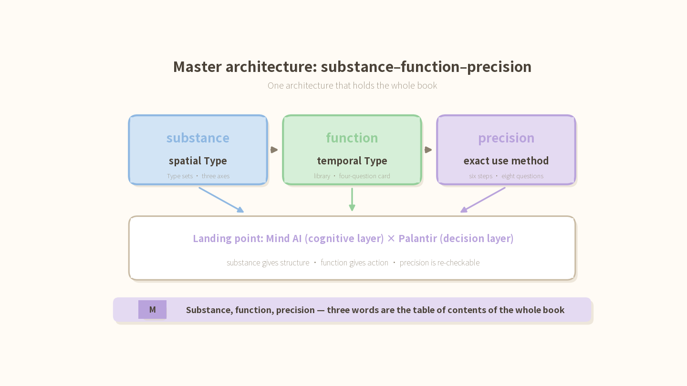

**Figure 7-1 The substance–function–precision architecture**

The three characters substance, function and precision are the whole book's table of contents: Parts 1 and 2 give substance, Parts 3 and 4 give function, Parts 5 and 6 give precision, and this part together with Part 8 combine the three into one plan.

## 7.2 The master relation map

Connect the four positions into one great road: ontology (the root · what there is) → Ontypology (the trunk · what a Type is) → Mind AI (the fruit · cognitive intelligence) ↔ Palantir (confirmation · operational decisions) → the industrial world. Theory guides practice forward, practice verifies theory back—a two-way arrow, neither end dispensable.

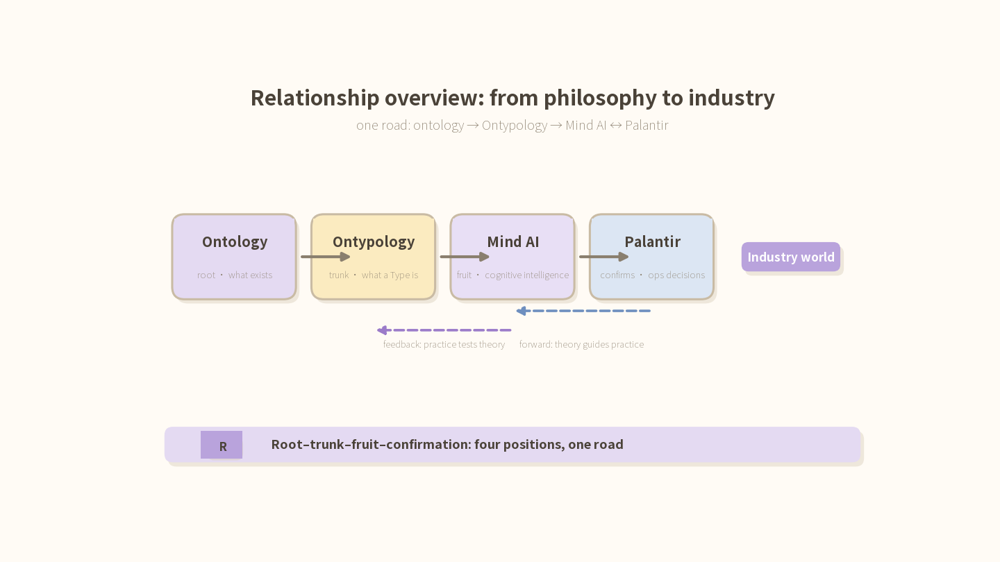

**Figure 7-2 The master relation map: from philosophy to industry**

This diagram is also the full unfolding of the book's title: "the relationship between Palantir and Ontypology" = a relation of confirmation (Palantir confirms that the engineering of Type works) + a relation of complementarity (theoretical depth completes engineering, engineering closure completes theory) + a relation of comparative reading (two routes up the same mountain) + a relation of application (the method of exact use applies both ways).

## 7.3 The three stages of AGI and Palantir's position

Mind AI's vision has three stages: unified knowledge (building a unified knowledge representation), unified thinking (building unified reasoning and thought), and unified intelligence (integrating knowledge, thinking, memory, learning and creation).

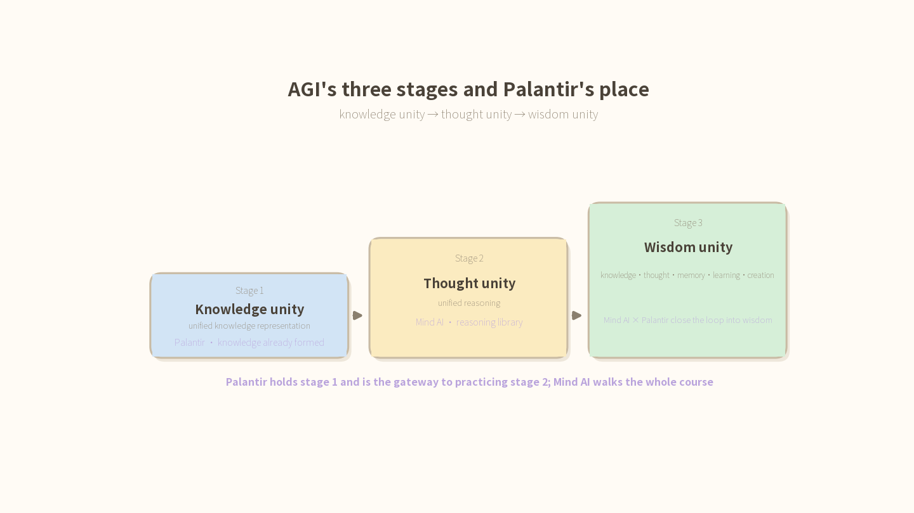

**Figure 7-3 The three stages of AGI and Palantir's position**

Palantir's position is clear: it has taken the first stage to industry level within the enterprise—enterprise knowledge is typed into an Ontology; it also stands at the entrance to the second stage—AIP brings reasoning and decisions into the operational loop. Mind AI is to walk the whole way: to let the intelligence of Type serve not just one enterprise's operations but become cross-domain unified and self-evolving—from unified knowledge to unified thinking, and from unified thinking to unified intelligence.

| **Stage** | **Task** | **Mind AI's role** | **Palantir's position** |
| --- | --- | --- | --- |
| Knowledge unification | A unified knowledge representation | Type library, Type-set notation | Enterprise knowledge already Type-formed (Ontology) |
| Thinking unification | Unified reasoning and thinking | Function library, hub reasoning | AIP reasoning enters the operational loop (the entrance) |
| Intelligence unification | Knowledge, thinking, memory, learning, creation | The full two-libraries-one-hub-one-loop course | The closed loop gives intelligence operational soil |

> **[Professional column C6] Reading governance, permissions and audit through Ontypology**  
> The heaviest topic in enterprise adoption is often governance: who can see, who can change, and who is accountable after a change. The Ontypology reading: permission is the gatekeeping rule of the ( ) container (the access boundary of id(C)); audit is the trace of the temporal Type (the record of a Type in and a Type out left by every function execution); regulatory compliance is the external constraint on the [ ] scale (the lawful range of a dimension).  
> Write governance as an extension of the three kinds of supplementation, and governance documents stop being a pile of clauses and become part of the model: following the Type, following the version, following the four-question card. Palantir's audit capability and Ontypology's verifiability claim meet completely here.  
>
> **Key lines of this part**  
> ◆ Substance gives structure, function gives action, precision gives verification—three words contain the whole book.  
> ◆ Root—trunk—fruit—confirmation: one great road, two-way feedback.  
> ◆ Palantir stands firm on the enterprise edition of knowledge unification; Mind AI heads for the full three stages.  
>
> **Exercise E07 Architecture integration**  
> ① Without the book, draw the substance–function–precision overall architecture and mark the positions of Mind AI and Palantir.  
> ② Using the four words "confirmation, complementarity, comparative reading, application", write one sentence each explaining this book's view of the relationship.  
> ③ Among the three stages of AGI, how far has Palantir come? What are your criteria?  

# Part 8 A complete content plan + a complete framework plan

This part turns the whole book into an executable plan: how to compile the content, how to build the framework, how to walk eight weeks, how to choose a situation, how to build the Type library, and how to pass acceptance. This is where "the complete plan for content and framework" lands.

> **Map of this part**  
> 8.1 Goals and the dual track \| 8.2 The eight modules \| 8.3 Learn, practise, use, teach, build: eight weeks \| 8.4 Choosing a path by situation  
> 8.5 Library building and acceptance \| 8.6 Teaching and promotion \| 8.7 Conclusion  
> After this part you will have a complete plan that is teachable, practicable and buildable.  

## 8.1 Plan goals and the dual-track reader

The plan has three goals: first, teachable—any instructor can run a course following the modules; second, practicable—any team can get up to speed following the eight weeks; third, buildable—any organisation can build its own Type library following the four stages. The dual-track reader is the same as in the book: the main text for decision-makers and consultants, the professional columns for architects and engineers.

| **Reader** | **Suggested path** | **Key modules** |
| --- | --- | --- |
| Decision-maker / consultant | Foreword → 1 → 3 → 5 → 8 | Comparative reading, assessment, plan |
| Architect / engineer | 2 → 3 → 6 → 7 → professional columns | Backbone, comparative reading, adoption, architecture |
| Instructor / educator | The whole book + Appendix B quick-reference cards | The eight-week route, exercises and answers |
| Researcher | 1 → 2 → 3 → 5 → 7 | Relational narrative, theoretical depth |

## 8.2 Content module plan: M1–M8

The eight modules correspond to the book's eight parts and can be split or combined: corporate training takes M3–M6 (comparative reading, complementarity, assessment, adoption), instructor training takes all eight modules, and a one-day workshop takes M2 + M6 (backbone + adoption).

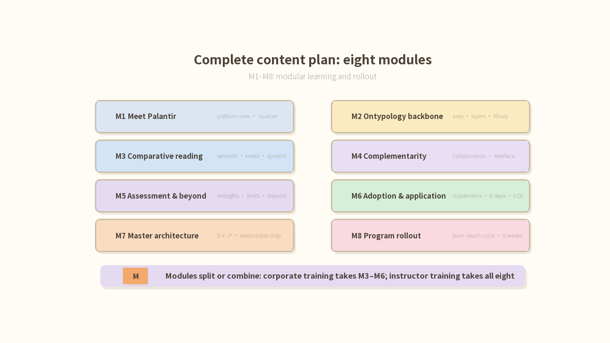

**Figure 8-1 The eight modules: M1–M8**

The deliverable of each module is "one concept, one diagram, one example, one exercise": the concept explained thoroughly, the diagram in place, the case landed, the exercise passed. This is the core discipline of the pastel teaching method, and also the origin of the book's density of text and figures.

## 8.3 Framework plan: learn, practise, use, teach, build — an eight-week route

The framework adopts five characters: learn (backbone and comparative reading), practise (the four-question card and the six steps), use (pick one situation and walk the whole way), teach (explain it to peers), build (Type library fundamentals and acceptance). The eight-week route arranges the five characters into a timetable:

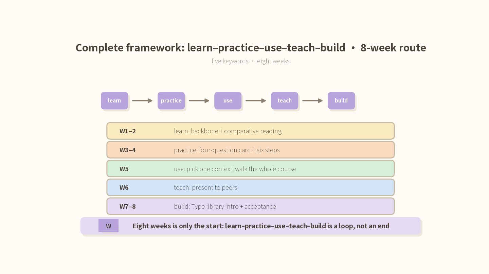

**Figure 8-2 Learn, practise, use, teach, build — an eight-week route**

Only when each week's deliverables are listed clearly can the route be walked solidly—learn, practise, use, teach, build, with an output every week:

| **Week** | **Theme** | **Deliverable** |
| --- | --- | --- |
| W1–2 | Learn: backbone + comparative reading | Reading notes + one comparative-reading table (six aspects) |
| W3–4 | Practise: four-question cards + six steps | Three four-question cards + one working paper from a six-step drill |
| W5 | Use: walk a situation end to end | A complete Type-forming report for one situation |
| W6 | Teach: explain to peers | One set of teaching materials + one peer-teaching session |
| W7–8 | Build: Type library fundamentals + acceptance | A Type-library prototype + the eight-question acceptance sheet |

Eight weeks is only the start—learn, practise, use, teach, build is a cycle, not an endpoint. It is recommended to re-run the second half (use → teach → build) once a quarter, letting the Type library grow with the business.

## 8.4 Choosing a path by situation

Not every situation takes the same path. The principle is: first recognise the Type of the situation, then choose the method—to judge "what a thing is", take the spatial Type (three axes + Type set); to "do a thing", take the temporal Type (pick the function + four-question card); to "prove whether it is right", take exact use (six steps + eight questions).

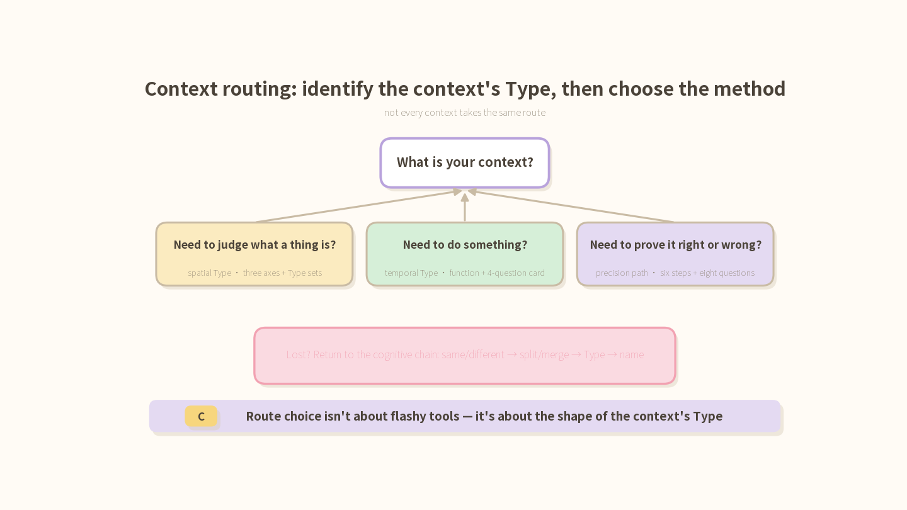

**Figure 8-3 Choosing a path by situation: first recognise the Type of the situation**

When lost, return to the cognitive chain: sameness/difference → division/union → Type → name. This chain is universal navigation—when you do not know which road to take, it is usually that "the Type has not been recognised yet", not that "there are not enough methods".

## 8.5 Four stages of library building and acceptance criteria

A Type library is not built in a day. Four stages: recognise Types (identify and name what is at hand) → model (the Type set + four-question cards enter the library) → enter the loop (connect to the decision loop and begin writeback) → evolve (continuous learning, refactoring and reorganisation).

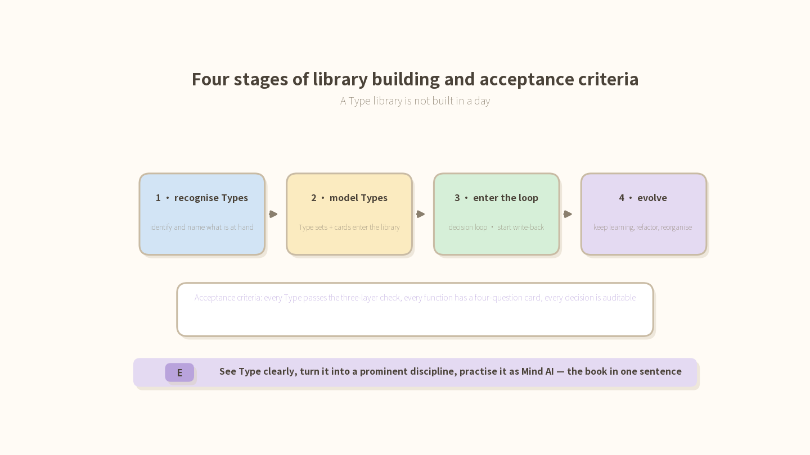

**Figure 8-4 Four stages of library building and acceptance criteria**

There are three acceptance criteria, and none may be waived: every Type passes the three-layer check, every function has a four-question card, and every decision is auditable. Only when all three pass is the Type library "exact". The acceptance table looks like this:

| **Acceptance item** | **Check method** | **Passing standard** |
| --- | --- | --- |
| Types pass three layers | Sample walk through J = J_C ∧ J_B ∧ J_T | 100% of samples pass; failures go on the rectification list |
| Functions have four-question cards | Inventory action Types × cards | 100% coverage; no blank fields on any card |
| Decisions are auditable | Spot-check decision traces | Every execution can replay its Type in and Type out |

> **[Professional column C8] From pilot to scale: the adoption roadmap**  
> Large-scale adoption should avoid "doing it all in one step". Ontypology recommends a three-stage road: pilot (pick one high-pain, measurable process, complete one full Type-forming in six weeks), expand (replicate the method to three processes while establishing naming rules and a criteria table), scale (establish the governance rhythm of the Type library—versioning, quarterly refactoring, eight-question spot checks).  
> Each stage's gate is guarded by the eight questions: the pilot must pass the eight questions before expanding, and the expansion must pass them before scaling. A Type library grown this way fears neither staff turnover nor tool changes—because precision lies in the method, not in individual memory.  

## 8.6 Teaching and outreach, and the next step

The last mile of the plan is outreach. Three parallel recommendations for teaching and outreach: first, run courses—open classes with the eight modules, teaching the main text and the professional columns on separate tracks; second, co-create—write case studies together with adopting organisations and turn typed reports into teaching material; third, set the standard—use the eight questions and the three acceptance criteria as a public assessment, so that "exactness" becomes a threshold the industry can understand.

This book is the first step of the relation narrative. The map for the next step is already drawn: expand Part 3's comparative table into a cross-platform reading series (measuring each vendor with the same ruler), turn Part 6's method into a template library of working papers, and turn Part 8's plan into a certification and instructor system. Every road keeps the same discipline—exact = verifiable exactness. The road is long; the ruler is in hand.

## 8.7 Conclusion: one sentence

Back to the beginning. Ontypology's task is "to see Type clearly, turn it into a prominent discipline, and put it into practice as Mind AI"; this book has taken one extra step—carrying the ruler of Type to Palantir, measuring out confirmation, complementarity and points of transcendence, and also a set of executable plans.

> **Key lines of this part**  
> ◆ Comparative reading: semantic ↔ spatial, kinetic ↔ temporal, dynamic ↔ evolution—isomorphic mutual confirmation.  
> ◆ Complementarity: the cognitive-intelligence layer × the operational-decision layer—both ends give intelligence, the middle gives power.  
> ◆ Transcendence: notation, criteria, evolution—adding the Type of cognition.  
> ◆ Adoption: three kinds of supplementation + six steps + four-question cards + eight questions—precision means verifiable precision.  
> ◆ Plan: M1–M8 + learn, practise, use, teach, build + the four stages of library building—teachable, practicable, buildable.  

See Type clearly, turn it into a prominent discipline, and put it into practice as Mind AI—this is the book in one sentence.

> **[Professional column C7] Type-library governance and data quality**  
> The daily operation of a Type library after launch is harder than building it: Types grow, criteria loosen, names drift. Ontypology's governance trio: versioning (Type sets and four-question cards follow the model version), periodic refactoring (re-examining the three levels of remove, taking stock of open slots), eight-question spot checks (sampling with the eight questions each quarter).  
> In Ontypology almost every data-quality problem can be attributed to one of the three layers: a quality incident = J passed but the world changed (invariance broke); data drift = the [ ] scale is off; subject confusion = id(C) governance has loosened. Treating the cause beats buying another cleaning tool.  
>
> **Exercise E08 Plan design**  
> ① Arrange a variant of the "eight-week route" for your organisation and mark each week's output.  
> ② Using situation-based path selection, pick a path for each of three different situations and explain why.  
> ③ Among the four stages of library building, which stage is your organisation at now? What is the next step?  
>
> **Exercise E09 Comprehensive practice**  
> ① Choose a real business process and Type-form it end to end: recognise the Type → write the Type set → choose the action Type → fill in the four-question card → six-step proof → eight-question acceptance.  
> ② Write a one-page "relationship statement" for that process: how does it work on a Palantir-style platform? What can a Mind AI-style Type library add?  
> ③ Self-check against the five misuse warnings and write three commitments to correction.  

# Appendix A Terminology

The left column is the Ontypology term, the middle column the Palantir counterpart, and the right column a plain explanation for the general reader. Throughout the book, "Type" always means xíng.

| **Ontypology** | **Palantir (comparative)** | **One-sentence explanation** |
| --- | --- | --- |
| Type | Ontology concept / Object Type | Something recognisable and nameable |
| Unit Type | Object Type | The basic unit of a Type = the Type set |
| Type set {parts, (content), [category]} | Object model | The notation of a Type |
| Spatial Type (noun, substance) | the semantic element | What it is |
| Temporal Type (verb, function) | the kinetic element | What it will do |
| Generation and evolution | the dynamic element | What it will become |
| [ ] attribute axis | Property | dimension × scale |
| { } bill of materials / three levels of remove | Composition and dependency (schema) | Take it apart—is it still itself? |
| ( ) container, id(C), invariance | Interface, identity | Is it still it? |
| Function op : Type → Type | Action Type / Function | One Type in, one Type out |
| Four-question function card | (No counterpart; an Ontypology addition) | The function's identity card |
| Three-layer judgment J = J_C ∧ J_B ∧ J_T | Permissions and audit rules | Verifiable criteria |
| ∩(T) open slot | (No counterpart; an Ontypology addition) | A Type's boundary learns |
| Type library | Ontology instance data | Where Types are kept |
| The method of exact use | Governance and acceptance practice (approximate) | Making precision into engineering |
| Mind AI | The Palantir platform (comparative coordinate) | The platform that puts Types into practice |

# Appendix B Quick-reference cards

## B-1 Comparative quick reference (one page)

| **Question** | **In Palantir's language** | **In Ontypology's language** |
| --- | --- | --- |
| What is it made of? | Object model, properties | { } bill of materials, three levels of remove |
| What category is it? | Object Type, classification | [ ] attribute axis, ∩(T) categorisation |
| How does it change, how does it move? | Actions, functions, triggers | Temporal Type, four-question function card |
| What counts as done right? | Permissions, audit, human validation | Three-layer judgment, eight questions |
| How does a decision land? | Writeback, systems of action | The output Type returns to the world |
| How does it get more exact with use? | capture decisions, learning | Continuous learning, self-evolution |

## B-2 Eight-question checklist (printable)

> **Eight-question checklist**  
> □ ① Is the whole recognised? □ ⑤ Has the reasoning by criteria been walked?  
> □ ② Are all three axes described? □ ⑥ Has the three-layer check passed?  
> □ ③ Is the Type set complete? □ ⑦ Is the four-question card filled in?  
> □ ④ Is the proposition chosen? □ ⑧ Has the misuse table been reviewed?  
> Only when all eight pass is it "exact use". Project: ________ Date: ________ Checked by: ________  

## B-3 Blank templates: four-question function card + Type-set card (printable)

| **Four-question function card (blank)** | **Entry** |
| --- | --- |
| Name | ________________________________ |
| Input Type | ________________________________ |
| Output Type | ________________________________ |
| Criteria | ________________________________ |

| **Type-set card (blank)** | **Entry** |
| --- | --- |
| Type name | ________________________________ |
| Parts { } | ________________________________ |
| Content ( ) | ________________________________ |
| Category [ ] | ________________________________ |
| Three levels of remove | Required: ______ Degraded: ______ Non-essential: ______ |

# Appendix C Practice answer key

> **E01 Platform sketch**  
> ① Gotham = defence and intelligence (alerts, geospatial analysis, prediction); Foundry = the data-integration platform for commercial and civil government (the Ontology is its heart); Apollo = cross-environment CI/CD software delivery; AIP = the AI platform that binds LLMs and agents to enterprise data, logic and action.  
> ② The semantic element answers "what it is"; the kinetic element answers "what it will do"; the dynamic element answers "what it will become".  
> ③ Data, logic and systems of action. "Human validation" = the criteria lie with people: machines may propose Types, people guard the three-layer check—this is the precondition for auditability and trust.  

> **E02 Backbone sketch**  
> ① {handle, base, lid, body, (coffee), [white]}—four parts, the content (coffee) is replaceable, and the category [white] gives the scale.  
> ② J_C checks identity invariance (the container), J_B checks structural correctness (BOM / three levels of remove), J_T checks correct categorisation (∩(T)). With a layer missing the judgment fails: one may misidentify the object, mis-split the parts or misclassify it.  
> ③ Name: pouring water; input Type: {pitcher, water}; output Type: {cup, filled cup}; criteria: no spill, no overflow, the cup's identity unchanged (three-layer check).  

> **E03 Filling in the comparison table**  
> ① Object Type ↔ unit Type (both are reusable Types); Property ↔ [ ] (both are dimension scales); Link ↔ Type relation (both are attribution and correspondence); Action Type ↔ function (both are reusable operations); Writeback ↔ the output Type returning to the world (both are closed-loop landing).  
> ② Decisions sediment into new Types that enter the library: the more it is used, the thicker the Type library, the more exact the decisions—this is the flywheel of the unity of substance and function.  
> ③ A reference line of thought (catering): object Types = dishes, tables, orders; action Types = serving a dish, joining tables. Comparative reading: dish ↔ unit Type {items, (customisation), [category]}; serving ↔ function {order} → {serving slip}.  

> **E04 Designing the complementarity**  
> ① Mind AI stands at the cognitive-intelligence layer (the Type library and reasoning), Palantir at the operational-decision layer (objects and the action loop)—both in the practice layer, with different divisions of work.  
> ② Mind AI's strength = both ends (the Type library, learning sedimentation); Palantir's strength = the middle (the engineering closed loop of modelling, decision and action).  
> ③ Diagnostic measures: do things go by different names (id(C)), is splitting governed by criteria (remove), are decisions auditable (three-layer check). Three remedies = three kinds of supplementation + naming rules + the eight acceptance questions.  

> **E05 Assessment practice**  
> ① Example: a supply-chain closed loop—data (inventory) → decision (replenishment) → action (placing an order) → feedback (delivery) in a cycle; it corresponds to Ontypology's flywheel in which "actions produce new Types and Types support actions".  
> ② "A Type without the theory" = models can be built, yet the definition and criteria of the Type cannot be stated; knowledge stops at individual intuition. Only what is teachable and verifiable can scale and survive the departure of individuals.  
> ③ F(T) guards the Type's essential features, and the ∩(T) open slot admits new members—cross-domain unification needs exactly a Type whose boundary learns; a closed taxonomy has to be redrawn whenever a new domain appears.  

> **E06 Supplementation practice**  
> ① Example (course): [ ] rules = credit scale, hour boundaries; ( ) identity = the course code id(C) is unique, syllabus invariance; { } structure = required (required part), elective (degraded part), audit (non-essential part).  
> ② Under the "route cut" situation, the three levels of remove derive: the shipping route is a required part, so a route cut = loss of a required part → no release; the conclusion changes from "release at reduced amount" to "reroute or postpone".  
> ③ Approve: name = approval; input Type = {application, evidence}; output Type = {approval or rejection}; criteria = permission compliance, amount limit, auditability.  

> **E07 Architecture integration**  
> ① See Figure 7-1: substance (spatial Type) – function (temporal Type) – precision (the method of exact use), landing at Mind AI × Palantir.  
> ② Confirmation = Palantir proves that the engineering of Type works; complementarity = theory supplements engineering and engineering supplements theory; comparative reading = two routes up the same mountain; application = the method of exact use applies both ways.  
> ③ It has walked the first stage solidly (enterprise knowledge Type-formed into the Ontology) and entered the gateway of the second (AIP's reasoning-and-decision loop). Criteria: whether knowledge is uniformly represented, whether reasoning enters the operational closed loop.  

> **E08 Plan design**  
> ① Reference outputs: W1–2 reading notes + comparative-reading table; W3–4 three four-question cards + one six-step drill; W5 a complete Type-forming report for one situation; W6 one peer-teaching session; W7–8 a Type-library prototype + the eight-question acceptance sheet.  
> ② Judging "what it is" → spatial Type; "doing a thing" → temporal Type; "proving right or wrong" → six steps + eight questions. The reasons all start from "what the Type of the situation looks like".  
> ③ Self-assess against the four stages (recognise Types → model → enter the loop → evolve); the next step = the deliverable of the next stage (naming table / Type sets + four-question cards / writeback connections / refactoring rhythm).  

> **E09 Comprehensive practice**  
> ①②③ are open practice questions. Acceptance follows the eight questions + three acceptance criteria: Types pass three layers, functions have four-question cards, decisions are auditable; the misuse self-check covers at least three of the five misreadings, and the commitments to correction must be executable and checkable.  

# Appendix D Figure index

All the diagrams in the book at a glance, for easy reference when teaching and re-checking. Figure numbers follow the parts; the colour code: yellow = property, orange = composition, blue = container, green = time, purple = summary, pink = misuse.

| **Part** | **Figure no.** | **Content** |
| --- | --- | --- |
| Foreword | Figure 0-1 | This book's task: one bridge, four aspects |
| Part 1 · Knowing Palantir | Figures 1-1 to 1-4 | Company sketch, the four platforms, the three elements of the Ontology, the three AIP connections |
| Part 2 · The Ontypology backbone | Figures 2-1 to 2-6 | Cognitive chain, three axes, Type set, three-layer judgment, a Type in and a Type out, substance–function–precision |
| Part 3 · Comparative reading | Figures 3-1 to 3-10 | The climb, semantic, kinetic, dynamic, master table, depth, cases, three questions, closing |
| Part 4 · Complementarity and integration | Figures 4-1 to 4-5 | Layered positioning, architecture docking, closed-loop division, integration scenarios, before and after |
| Part 5 · Assessment and transcendence | Figures 5-1 to 5-6 | Three strengths, a Type without the theory, missing notation, the open slot, transcendence, misuse |
| Part 6 · Adoption and application | Figures 6-1 to 6-6 | Three kinds of supplementation, six steps, demonstration, four-question card, eight questions, misuse table |
| Part 7 · Overall architecture | Figures 7-1 to 7-3 | Substance–function–precision, overall relationship map, the three stages of AGI |
| Part 8 · The complete plan | Figures 8-1 to 8-4 | The eight modules, the eight-week route, situation-based path selection, library building and acceptance |
