# Vision-Language-Action Models

## Mind AI & Ontypology

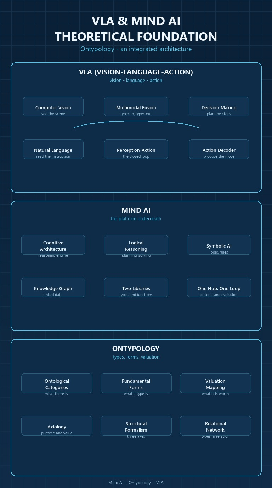

## Contents

- Preface The map of this book3
- Reading guide Three pairs of glasses and the notation4
- Part 1 Positioning - why VLA needs types7
- 1-1 What VLA is: one sentence, three modalities7
- 1-2 Five pain points: the type was never established7
- 1-3 Root, trunk, fruit: three layers of positioning9
- 1-4 Three questions of VLA: the spine of the book9
- Part 2 Backbone at a glance - the toolbox and the mapping table11
- 2-1 Cognitive chain and VLA chain: two chains stacked11
- 2-2 Six tools, one page11
- 2-3 The mapping table: VLA x Ontypology12
- Part 3 Spatial types - the types of the robot's world15
- 3-1 Unit type: the standard way to write a type set15
- 3-2 [ ] the attribute axis: dimension x scale15
- 3-3 { } the composition axis: BOM and three grades of removal = safety map16
- 3-4 ( ) the container axis: working units and the invariance axiom17
- 3-5 Three-layer judgement: the intake funnel18
- 3-6 Five types, one card each19
- Part 4 Temporal types - the action chain of VLA21
- 4-1 An action is a temporal type21
- 4-2 The six-station chain: see, read, think, act, check, learn21
- 4-3 The four-question function card: one card per move22
- 4-4 Three roads of action representation: three ways to make a type23
- 4-5 Five families of reasoning and how to choose a thinking style24
- 4-6 Single system and dual system: two tempos25
- 4-7 The type-in, type-out loop26
- Part 5 Using VLA accurately - body, use, accuracy27
- 5-1 Body, use, accuracy: an overview27
- 5-2 Three kinds of completion: make the type usable27
- 5-3 Six steps of proof: a full walk-through28
- 5-4 Four layers of accuracy and the six log fields29
- 5-5 The eight questions: a checklist before delivery30
- 5-6 Sixteen misuses: four groups of case notes31
- 5-7 The routing decision tree32
- Part 6 The whole architecture - two libraries, one hub, one loop34
- 6-1 Two libraries, one hub, one loop x VLA34
- 6-2 Reading the ecosystem: where each VLA lands34
- 6-3 Data and benchmarks: the type library and the criterion36
- 6-4 Mind AI: the platform underneath (cited, not restated)36
- 6-5 Four acceptance lines and three unifications37
- Part 7 A complete content plan - learn, practise, use, teach, build39
- 7-1 Learn, practise, use, teach, build: five words, one loop39
- 7-2 The eight-week route40
- 7-3 Four stages of building the library41
- 7-4 Routing by situation: four kinds of reader41
- 7-5 Three PoC situations and the FAQ42
- Part 8 Conclusion - five fields, one road44
- 8-1 Five fields side by side44
- 8-2 Three consecutive goals45
- Closing words46
- Appendix A Glossary and table of notation47
- Appendix B Lookup cards49
- Appendix C Answers to the exercises51
- Appendix D Index of figures and tables54

## Preface The map of this book

This booklet answers three questions: what does the type called VLA look like, how does it move accurately, and how do we turn “accurate” into a whole practice that can be checked, taught and deployed?

VLA - vision, language, action - is the multimodal foundation model that lets a robot see the scene, understand the instruction and produce the motion. In a few short years it has moved from the laboratory into factories and homes, and become the hottest battlefield of embodied intelligence. Behind the excitement sits an old problem: describing something beautifully is not the same as using it accurately. This book takes Ontypology (spatial types and temporal types) as its theory and Mind AI as its platform, and sets out how VLA is used accurately, how the architecture is laid out, and a complete content plan.

**Table 0-1 The map of this book**

| Part | The question it answers | Core output |
| --- | --- | --- |
| Reading guide | How should this book be read? | Three pairs of glasses, the notation |
| Part 1 Positioning | Why does VLA need types? | Five pain points, root-trunk-fruit, three questions |
| Part 2 Backbone | What is in the toolbox? | Six tools, the mapping table |
| Part 3 Spatial types | What do the types of the robot's world look like? | Five types, three axes, safety map, three-layer judgement |
| Part 4 Temporal types | How does a VLA action work? | Six stations, four-question cards, three roads |
| Part 5 Accurate use | How is it used accurately? | Three completions, six steps, eight questions, sixteen misuses |
| Part 6 Architecture | How is the whole system laid out? | Two libraries, one hub, one loop; four acceptance lines |
| Part 7 Content plan | How to learn, practise, use, teach and build? | Eight-week route, four stages, routing by situation |
| Part 8 Conclusion | Where does all this lead? | Five fields side by side, three consecutive goals |
| Appendices A-D | Findable, printable, checkable. | Glossary, lookup cards, answers, index |

Some sixty pages and more than forty figures, read on two tracks: the main text carries the method and the architecture, while the professional columns take you into the field - the short history of VLA, the sources, the benchmarks and the trends of 2026. Every part ends with exercises; the answers are in Appendix C.

## Reading guide Three pairs of glasses and the notation

Most people reading the VLA literature wear the glasses of the model: they look at architecture, parameters and benchmark scores. Those glasses are necessary, but worn alone they hide two more fundamental questions - what kind of type is VLA actually handling, and on what grounds can the action it produces be called accurate?

So this book asks you to put on three pairs of glasses, stacked.

- Glasses of Ontypology:
- See the world as types and the operations of types - the spatial type asks what it is, the temporal type asks how it moves.
- Glasses of VLA:
- See the model as a function chain of type in, type out - image and instruction are the types coming in, the action is the type going out.
- Glasses of practice:
- See deployment as checkable accuracy - every step has a criterion, a log and an acceptance line, and an error can be found and fixed.

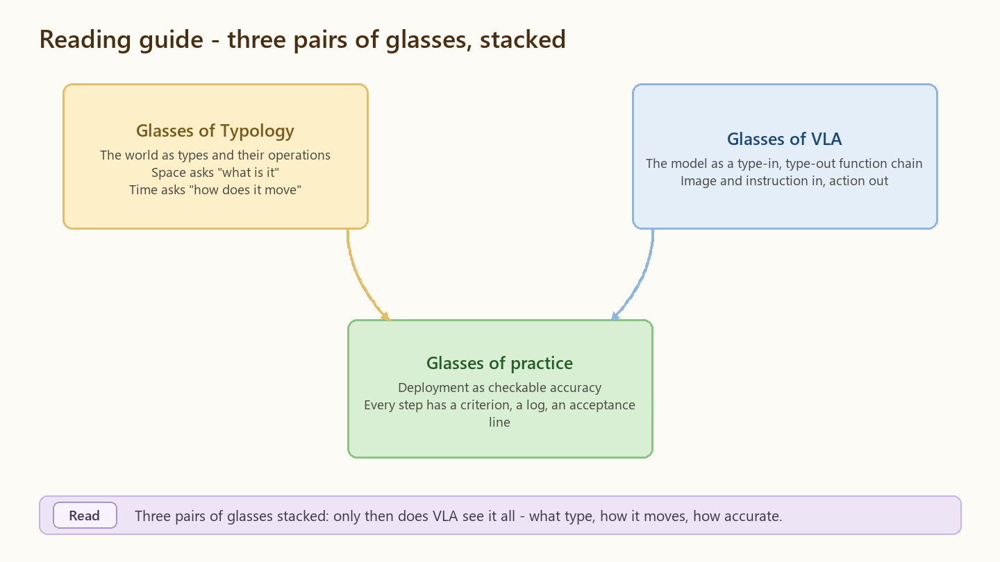

*Figure D-1 Three pairs of glasses stacked: Ontypology x VLA x practice*

### The notation at a glance

| Symbol | Read as | In one sentence |
| --- | --- | --- |
| [ ] | attribute | What features does it have? Dimension x scale, written clearly. |
| { } | composition | What is it made of? List it as a BOM. |
| ( ) | container | Where does it sit? Write identity id(C) and content S(C) apart. |
| { parts, ( content ), [ class ] } | unit type | A type that can be pointed at on its own. |
| op: type -> type | temporal type (function) | An action is a function: one type in, one type out. |
| ≡ ≢ ⊂ | identical / different / degraded | The three outcomes of a comparison, each in its place. |
| ∩(T) | abstraction criterion | On what grounds does it belong to this class? The intersection decides. |
| J = J_C ∧ J_B ∧ J_T | three-layer judgement | Container, composition and abstraction layer together - none may be missing. |

> **How to read**
>
> From the front: fifty minutes on Parts 1 and 2 gives you the whole map.
> With a question in hand: engineers go straight to Parts 4 and 5, researchers to Parts 3 and 4 plus the columns, and those who must teach or introduce it to Parts 5 and 7.
> As a reference: the lookup cards in Appendix B can be photocopied, and B-3 is a blank template to take straight to your own task.

## Part 1 Positioning - why VLA needs types

### 1-1 What VLA is: one sentence, three modalities

In one sentence: give the robot a picture (or a clip) of the scene and one instruction in natural language, and VLA outputs executable low-level actions directly - it fuses seeing, reading and acting into a single flow. The body of that flow is usually a vision-language model (VLM) that first understands image and text, plus an action decoder that translates what has been understood into what can be done.

Each of the three modalities brings its own type: vision brings the scene type - what is on the table and where; language brings the instruction type - what it is being asked to do; action brings the temporal type - how to do it step by step. The talent of VLA is to let these three types hand over inside one model.

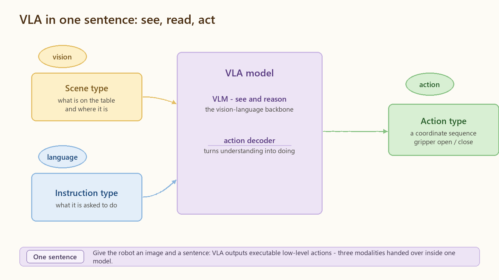

*Figure 1-1 VLA in one sentence: see the scene (vision) + understand the instruction (language) -> produce the action (temporal type)*

In 2023 RT-2 from Google DeepMind established the paradigm: distil web knowledge into robot control and open up perception, reasoning and control as one flow. OpenVLA, Octo, pi0, Helix, GR00T, Gemini Robotics and SmolVLA followed, pushing VLA to the centre of embodied intelligence.

### 1-2 Five pain points: the type was never established

VLA is powerful, but using it brings plenty of frustration. Lay that frustration out and almost all of it falls back to a single root: the type was never established.

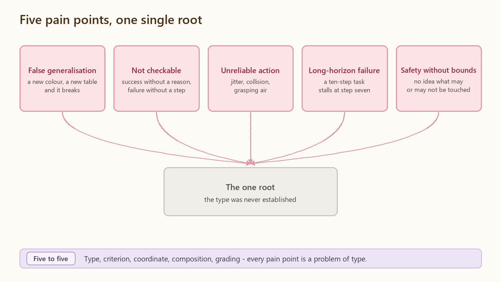

*Figure 1-2 Five pain points, one single root: the type was never established*

#### Pain point one - false generalisation

The demo stacks blocks; change the colour or the table and it collapses. The class of the type ([ ]) was never established, so the model recognises similarity of pixels, not identity of type.

#### Pain point two - not checkable

It succeeds without knowing why, and fails without knowing which step broke. With no criterion and no log, accuracy exists only inside the demo video.

#### Pain point three - unreliable action

Jitter, collision, grasping air. The action has no type of its own (coordinates, scale, constraints), so the numbers look like an action and fall apart on contact with the floor.

#### Pain point four - long-horizon failure

A ten-step task stalls at step seven. Sub-tasks have no type and the order has no type; stretch the horizon and the composition collapses.

#### Pain point five - safety without bounds

No idea what may be touched and what may not. Safety constraints never entered the type and were never graded, so the guard rails can only be added afterwards.

These five pain points correspond exactly to the five starting points of Ontypology: class, criterion, coordinate, composition, grading. Every tool in the rest of this book treats one of them.

### 1-3 Root, trunk, fruit: three layers of positioning

How do the theory and the platform of this book sit? The clearest way is the three layers of root, trunk and fruit.

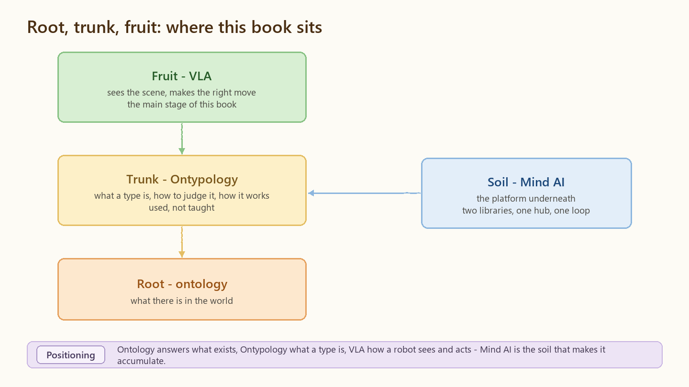

*Figure 1-3 Root, trunk, fruit: ontology is the root, Ontypology the trunk, VLA the fruit in the orchard*

| Layer | Role | Place in this book |
| --- | --- | --- |
| Root | Ontology - the study of what there is | Not restated here; it supplies the ground for “what there actually is in the world”. |
| Trunk | Ontypology - what a type is, how to judge it, how it works | Used, not taught; the three axes, three-layer judgement and function library are the toolbox of this book. |
| Fruit | VLA - the fruit of embodied intelligence | The main stage: applying types and functions to seeing, reading and acting. |
| Soil | Mind AI - the platform underneath | Cited, not restated; two libraries, one hub, one loop carry the deployment of types and functions. |

> **Positioning in one sentence**
>
> Ontology answers what the world contains, Ontypology answers what a type is, how to judge it and how it works, and VLA answers how a robot sees the scene and makes the right move - while Mind AI is the platform that lets all of it accumulate and be checked.

### 1-4 Three questions of VLA: the spine of the book

From now on, whenever a VLA topic appears, ask these three questions first; the answers sit in three parts of this book.

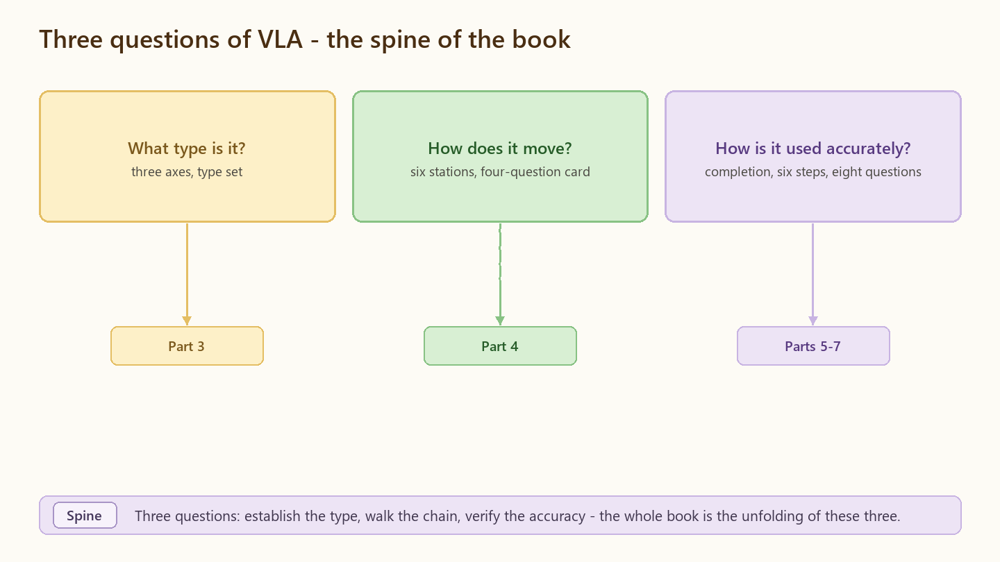

*Figure 1-4 Three questions of VLA: what type is it, how does it move, how is it used accurately*

| Question | Follow-up | Where the answer is |
| --- | --- | --- |
| What type is it? | What attributes, composition and container do the scene, the object, the task and the instruction each have? | Part 3 Spatial types |
| How does it move? | See, read, think, act, check, learn - what are the function and the criterion at each station? | Part 4 Temporal types |
| How is it used accurately? | What to complete, what to check, which misuses to avoid, how to accept? | Parts 5, 6 and 7 |

> **Exercise E01**
>
> You have a VLA transport task: put the cup on the table into the sink. Write down at least four types in this task and describe each one's attributes, composition and container in a sentence.
> Then say which of the five pain points it resembles if the model succeeds in your kitchen and fails in the office pantry, and what the root is.
> Hint: first list the things that can be recognised, then apply the three axes.

## Part 2 Backbone at a glance - the toolbox and the mapping table

This part opens the toolbox in one go: each tool gets one sentence and one figure, without restating the theory. Parts 3 and 4 then pick the tools up one by one.

### 2-1 Cognitive chain and VLA chain: two chains stacked

The cognitive chain says: same and different -> split and merge -> type -> name. The brain first tells this from that, cuts the different apart and circles the same together; a boundary is born and becomes a type, and then the type is given a name.

The working chain of VLA says: see -> read -> think -> act. The robot first tells this from that in the image (see), recognises the object named in the instruction (read), decides what to do (think) and finally produces the action (act).

The two chains are really two age groups of the same thing: every station forward on the VLA chain is one more step on the cognitive chain. Stacking the chains gives the backbone of this book.

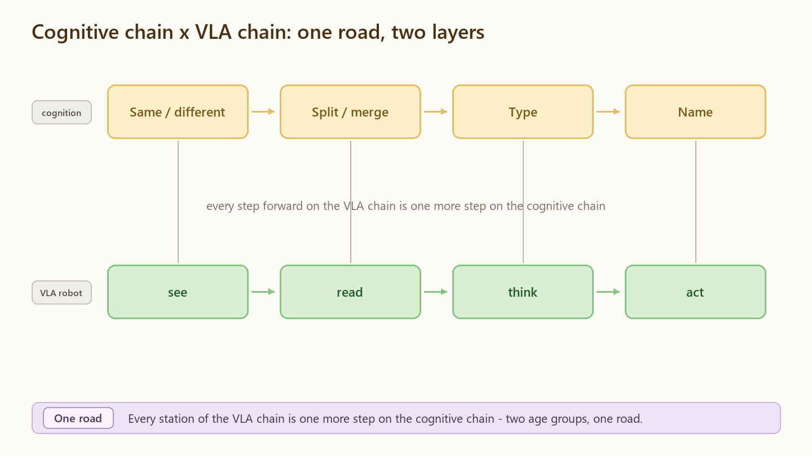

*Figure 2-1 Cognitive chain x VLA chain: one road, two age groups*

### 2-2 Six tools, one page

The toolbox holds six tools, and the colour code runs through every figure in the book: yellow = attribute, orange = composition, blue = container, green = time, purple = summary, pink = misuse.

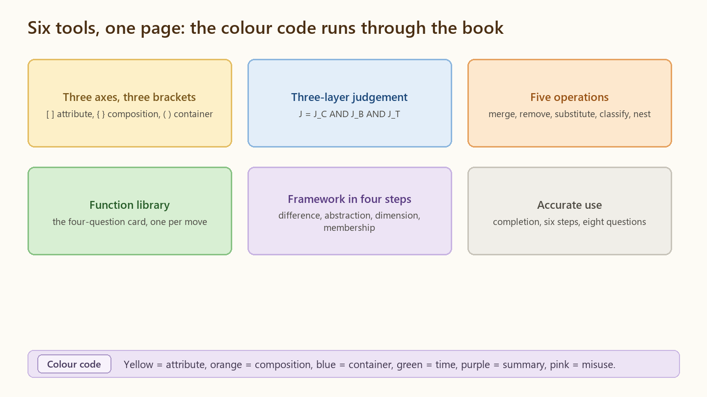

*Figure 2-2 The six-tool board: three axes and three brackets, three-layer judgement, five operations, function library, framework in four steps, accurate use*

| Tool | In one sentence | Where it is used |
| --- | --- | --- |
| Three axes, three brackets | [ ] attribute, { } composition, ( ) container - three axes describe a type in three dimensions. | Part 3 |
| Three-layer judgement | Container, composition and abstraction layer together: J = J_C AND J_B AND J_T. | Parts 3 and 5 |
| Five operations | merge types, remove, substitute, classify by intersection, nest. | Parts 3 and 4 |
| Function library | The rack of temporal types: the four-question card, one card per move. | Part 4 |
| Framework in four steps | tell same from different -> trigger abstraction -> name the dimension -> judge membership. | Parts 3 and 5 |
| Accurate use | Three completions + six steps of proof + eight questions + the list of misuses. | Part 5 |

### 2-3 The mapping table: VLA x Ontypology

The table below is the backbone of the whole book: on the left the working language of VLA, on the right the descriptive language of Ontypology. Every later part returns to this table.

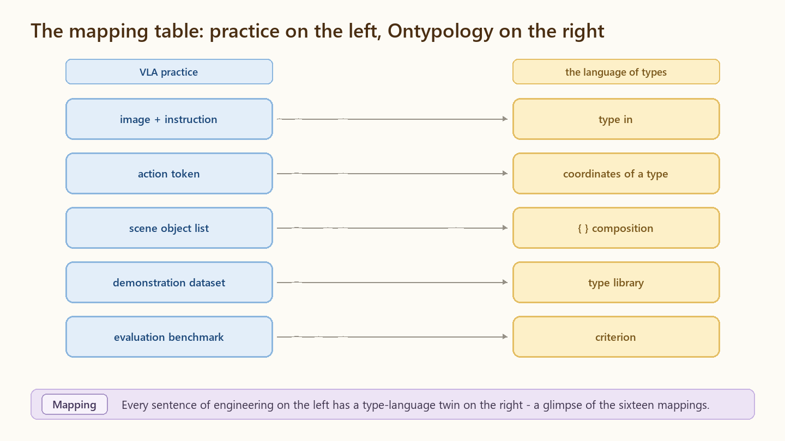

*Figure 2-3 The mapping table as an image: the world of VLA on the left, the language of types on the right*

| VLA practice | The language of types | Read across in one sentence |
| --- | --- | --- |
| image + instruction input | type in | Two types enter: the scene type and the instruction type. |
| action output | a temporal type is produced | op: type -> type, one function acting out a new type. |
| action token (256 cells etc.) | coordinates of a type | Quantise continuous motion into a scale; the number is a small type inside the type. |
| joint angles, end-effector pose | a number is a small type | First the type (arm, end effector), then the number. |
| list of scene objects | { } the composition axis | Lay out the BOM: what is on the table, item by item. |
| safety constraints, keep-out zones | three grades of removal | Essential, degraded and non-essential parts - grading is the safety map. |
| workspace, camera field of view | ( ) container | C = (id(C), S(C)): the identity stays, the content changes. |
| task instruction | name + task type | A type must have a name; the instruction is the name of the task type. |
| action chunk (a stretch of action) | function composition | Several moves become one form, producing a chain of types at once. |
| generalisation ability | abstraction generation | Holding identity across scenes and across robots - only that is real generalisation. |
| demonstration dataset | type library | Open X-Embodiment and the like: a large library across containers. |
| evaluation benchmark | criterion | LIBERO and the like: the ruler of checkable accuracy. |
| System 2, slow thinking | reasoning and thinking styles | The slow layer manages understanding and planning. |
| System 1, fast reflex | direct functions | The fast layer manages the 50 Hz feel. |
| frequency-domain action coding (FAST) | change of scale basis | The same type, described in another set of coordinates, costs less. |
| failure detection and feedback | abductive reasoning | Reasoning back from the result to the cause is what lets the loop grow. |

> **The backbone in one sentence**
>
> VLA is a function chain of type in, type out: the incoming types (scene, instruction) pass through six station functions, the outgoing type (action) returns to the world, and the world sends the result type back - and the two libraries, one hub and one loop grow along this chain.

> **Exercise E02**
>
> Check yourself against the mapping table: in your own VLA application, what concrete thing does each of the columns action token, demonstration dataset and safety constraint correspond to? One line each.
> Which of the five pain points do you meet most often, and which column of the mapping table is its cure?

## Part 3 Spatial types - the types of the robot's world

To use a robot accurately you must first describe the world it faces accurately. The spatial type answers what it is: three axes, one type set and one set of judgements that turn everything in the scene into a type that can be pointed at, compared and checked.

### 3-1 Unit type: the standard way to write a type set

A type that can be pointed at on its own is written as a type set: { parts, ( content ), [ class ] }. The braces list the composition, the parentheses hold the content, the brackets mark the class. For example the cup of hot water on the table: { body, ( hot water ), [ container ] }. Take the water out - is it still a cup? Pour in ice water - is it still the same cup? These two questions are exactly the lead-in to removal and substitution later on.

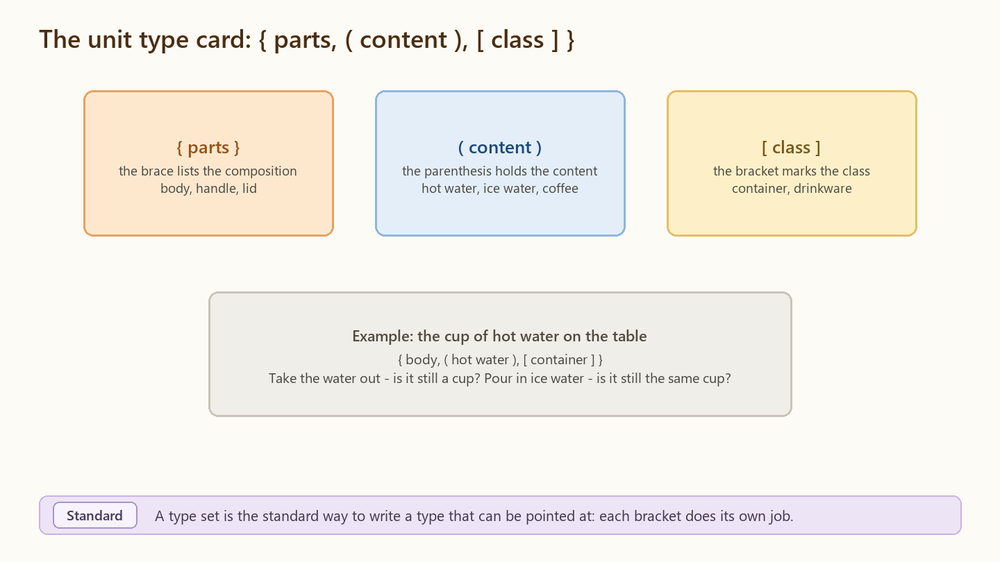

*Figure 3-1 The unit type card: { parts, ( content ), [ class ] } - each bracket does its own job*

In the world of VLA five types are used most: scene type, object type, robot type, task type and instruction type. Each can be written as a type set, and each has its own three axes.

### 3-2 [ ] the attribute axis: dimension x scale

Attributes are written in the brackets: one attribute equals one dimension, and a dimension must carry a scale. Pose is two dimensions (position and orientation); position has three sub-dimensions x, y and z, each with a scale (metres, millimetres, or cells?). If the scale is not written clearly the number has no right to enter the type - a number is a small type inside the type; first the type, then the number.

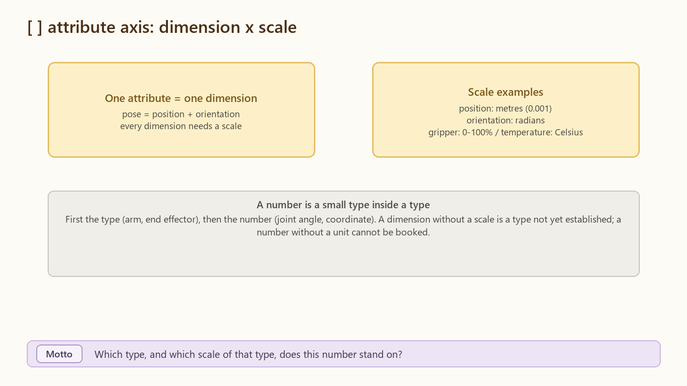

*Figure 3-2 [ ] the attribute axis: dimension x scale - a number is a small type inside the type*

| Object type | Key dimensions | Choice of scale | The usual trap |
| --- | --- | --- | --- |
| cup | position, orientation, capacity, temperature | metres / radians / millilitres / Celsius | Quaternions and Euler angles mixed, so the orientation scale is inconsistent. |
| block | position, colour, size, stacking order | metres / colour chip / centimetres / integer | Colour compared by raw RGB: change the light and it is no longer recognised. |
| drawer | opening, resistance, content list | percentage / newtons / BOM | The opening is measured without a zeroed scale, so fully closed does not read zero. |

> **The scale motto**
>
> A dimension without a scale is a type not yet established; a number without a unit is a number that cannot be booked. Every coordinate VLA outputs must be able to answer: on which scale of which type does this number stand?

### 3-3 { } the composition axis: BOM and three grades of removal = safety map

Composition is written in the braces, like a bill of materials (BOM). The BOM of a scene type is what is on the table; the BOM of a robot type is which parts this robot is made of. With the list in hand you can ask “take a part off - does it still recognise itself?” - and that gives the three grades of removal:

| Grade | Symbol | Criterion | In VLA |
| --- | --- | --- | --- |
| essential part | ≢M | Remove it and this type is no longer this type. | The robot's end effector; the core object of the task. |
| function-degraded part | ≡M′ ⊂ M | Still recognised when removed, but one grade lower in function. | Lose the camera and it falls back to blind operation; lose the light and it switches to contour recognition. |
| non-essential part | ≡M | Remove it and the type is unchanged. | Decoration, background clutter - not in the task BOM. |

Grade every item of the scene BOM and you get a safety map: essential parts are the red line (never touch, never lose), degraded parts the amber line (may retreat, may not be destroyed), non-essential parts the green line (may be cleared). That map is the ancestor of the guard rails in Part 5.

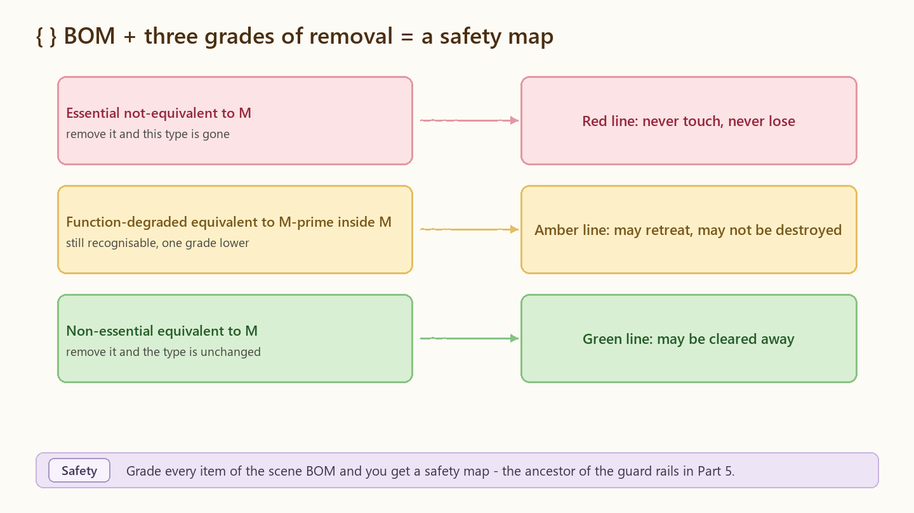

*Figure 3-3 { } BOM + three grades of removal = a safety map anyone can read*

### 3-4 ( ) the container axis: working units and the invariance axiom

The container is written in parentheses. The workspace is a container: C = (id(C), S(C)) - identity and content written apart. Today there is a cup on the table, tomorrow a coffee pot; the content S(C) of the container changed, the identity id(C) did not: it is still the working unit of this desk. This invariance axiom is the first insurance against amnesia when the scene changes.

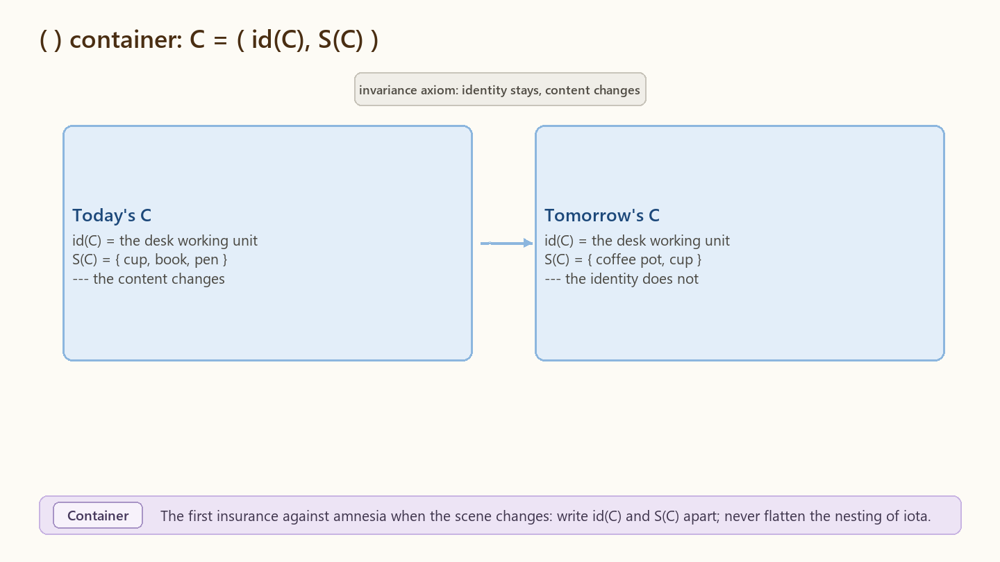

*Figure 3-4 ( ) container: C = (id(C), S(C)) - the identity stays, the content changes*

The container also governs admission: which types may enter it? No food in the tool area; no people inside the safety cage. Admission rules are written on the container instead of relying on the model to know better. Nesting tells us that a container holds containers (the toolbox inside the working unit), and that chain may not be flattened at will - flatten it and the identity is lost.

> **Professional column C1 Embodiment transfer and cross-container generalisation**
>
> Cross-container generalisation is one of the hardest exams for VLA: a model learns on robot A in scene A and drifts on robot B. Open X-Embodiment proved with 22 embodiments and a million episodes that cross-embodiment learning works (the RT-X series), and pi0 trained on 8 embodiments can drive single and dual arms; Gemini Robotics 1.5 goes further and separates the reasoning layer (think it through before moving) from the action layer, so that action knowledge can move across platforms.
> Read it with Ontypology: cross-container generalisation is the problem of anchoring identity. Generalisation is not pixels looking alike; it is that id(C) changed while the class [ ] and the composition { } are still recognised. Write container identity and content apart into the type at training time, and at transfer time only S(C) changes.

### 3-5 Three-layer judgement: the intake funnel

Once the type is established, how do you judge whether it is the type we want? Three layers stand together: the container layer J_C (is it in the right container?), the composition layer J_B (is the BOM complete, is what should be there there?) and the abstraction layer J_T (by the criterion of the intersection, does it belong to the class the task needs?). J = J_C AND J_B AND J_T - none may be missing; two layers out of three is not acceptance.

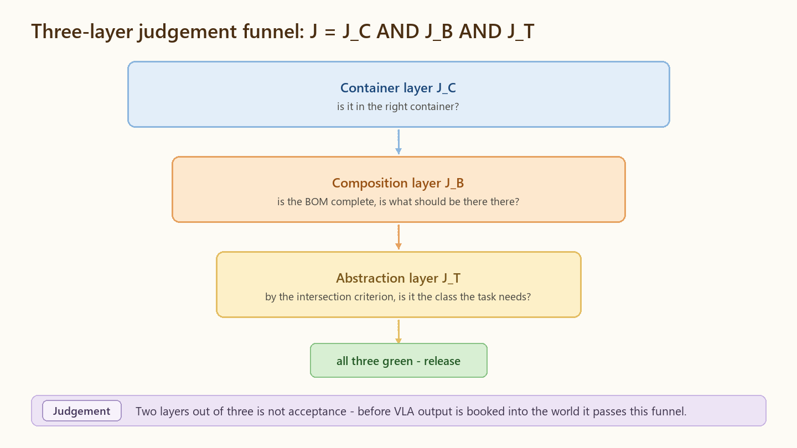

*Figure 3-5 The three-layer judgement funnel: J = J_C AND J_B AND J_T*

Before VLA output is booked into the world it passes this funnel: is the target object of the action inside the right working unit (container layer)? are the parts at the grasp point complete (composition layer)? does this step belong to the right task class (abstraction layer)? Only three greens release it - and that is the skeleton of the check station in Part 5.

> **Exercise E03**
>
> Task: take the bowl out of the microwave. Write the type set of the microwave door and mark its three grades of removal for this task.
> What are id(C) and S(C) of the microwave? Today the bowl becomes a plate - which one changes, which one stays?

### 3-6 Five types, one card each

The five types most used in the VLA world are made into lookup cards, each with three axes and one sentence. Writing a task or building a type library starts from these five cards.

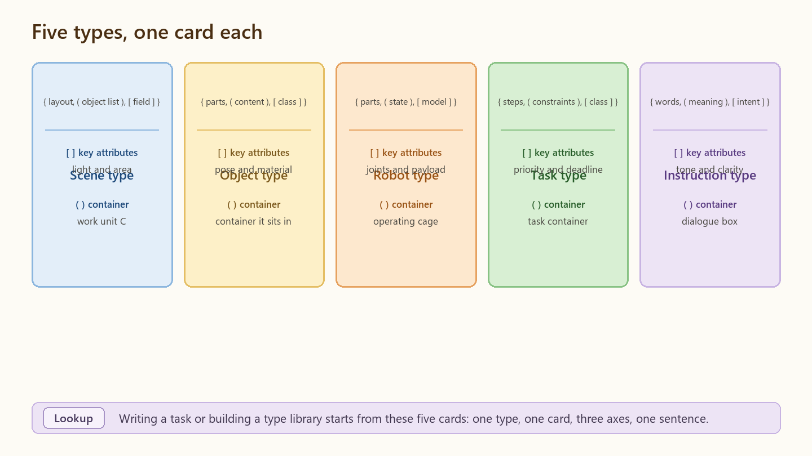

*Figure 3-6 Five lookup cards: scene, object, robot, task, instruction*

| Type | How the type set is written | [ ] key attributes | { } key composition | ( ) container |
| --- | --- | --- | --- | --- |
| scene type | { layout, ( object list ), [ field class ] } | light, area, traffic lines | table BOM, floor BOM | working unit C |
| object type | { parts, ( content ), [ class ] } | pose, material, temperature | detachable parts | the container it sits in |
| robot type | { parts, ( state ), [ model ] } | joint angles, payload | arm, hand, camera, base | operating cage |
| task type | { steps, ( constraints ), [ class ] } | priority, deadline | sub-task list | task container |
| instruction type | { words, ( meaning ), [ intent class ] } | tone, clarity | object words, action words, condition words | dialogue box |

## Part 4 Temporal types - the action chain of VLA

The spatial type answers what it is; the temporal type answers how it moves. In the world of verbs a type is a function: op: type -> type - one type in, one type out. Every action, every stretch of reasoning and every feedback of VLA is such a function.

### 4-1 An action is a temporal type

Reaching out is a function: give it the type hand at A, cup at B, and it produces the new type hand beside B. Grasping is the next function: give it hand beside the cup, fingers open, and it produces hand holding the cup. An action is not a string of mysterious numbers but a chain of types - at every link you can tell what came in and what went out.

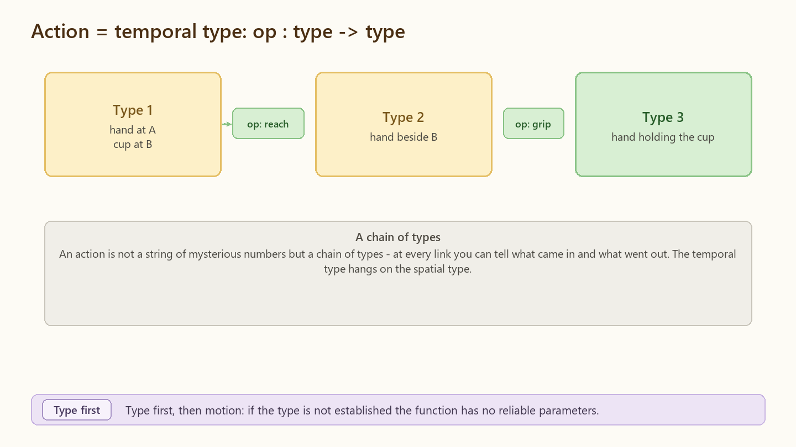

*Figure 4-1 Action = temporal type: op: type -> type, a chain of types link by link*

> **Type first, then motion**
>
> The temporal type hangs on the spatial type. Both the input and the output of an action must be established types - if the type is not established the function has no reliable parameters, and numbers (joint angles, speeds) always stand behind the type.

### 4-2 The six-station chain: see, read, think, act, check, learn

Lay out one complete run of VLA and you find six functions handing over. Each station has its own input type, output type and criterion, and each station can be checked.

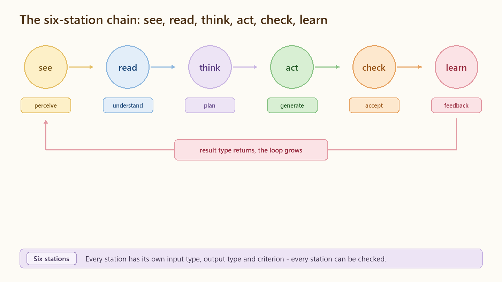

*Figure 4-2 The six-station chain: see -> read -> think -> act -> check -> learn, type in and type out*

| Station | In plain words | Input type | Output type | Criterion |
| --- | --- | --- | --- | --- |
| (1) see | perceive the scene | image frame | scene type | detection consistency: objects do not jump between frames. |
| (2) read | understand the instruction | instruction type + scene type | task type | semantic alignment: the object named in the instruction is recognised. |
| (3) think | plan the steps | task type + scene type | plan type (chain of sub-tasks) | feasibility: the order of steps obeys physics and safety. |
| (4) act | produce the action | plan type + current state type | action block (coordinate sequence) | dynamically feasible: no overspeed, no overload, no self-collision. |
| (5) check | accept and release | action block + safety type | release / return | release only when the three-layer judgement J is all green. |
| (6) learn | feedback and evolution | execution result type | update type (criteria, weights) | checkable accuracy: what was changed can be looked up in the ledger. |

### 4-3 The four-question function card: one card per move

Every function entering the library answers four questions: what is it called (name), what does it eat (input type), what does it spit out (output type), and on what grounds is it right (criterion). The four-question card is the standard format of the function library and the smallest unit of team communication.

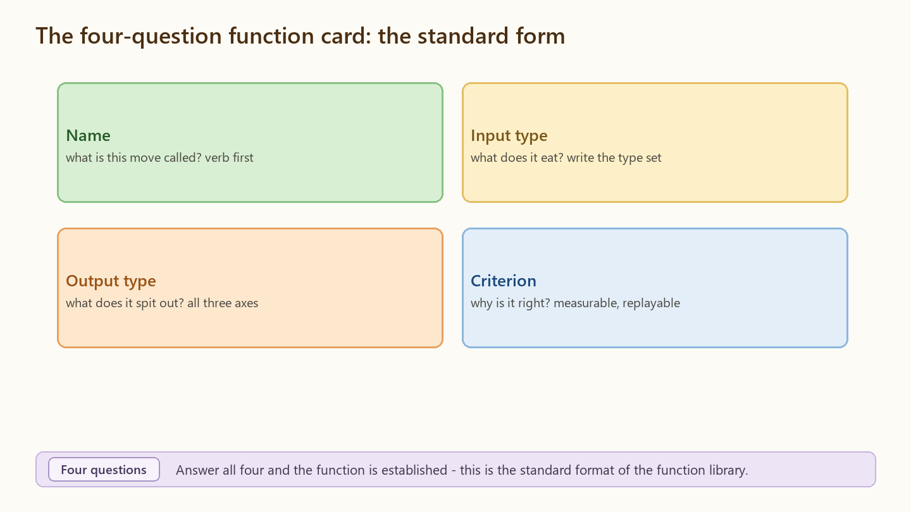

*Figure 4-3 The standard form of the four-question card: name, input type, output type, criterion*

Take the most critical station, act, as an example: name = action generation; input type = the plan type and the current state type; output type = an action block (a sequence of coordinates including end-effector pose and gripper opening); criterion = dynamically feasible, smooth velocity profile, and never entering the red line of the safety map. Answer all four and the function is established.

### 4-4 Three roads of action representation: three ways to make a type

How is an action written as a type? The field has three roads. All three answer the same question - with which scale and which coordinates do we write continuous motion as a type the model can produce and the robot can take.

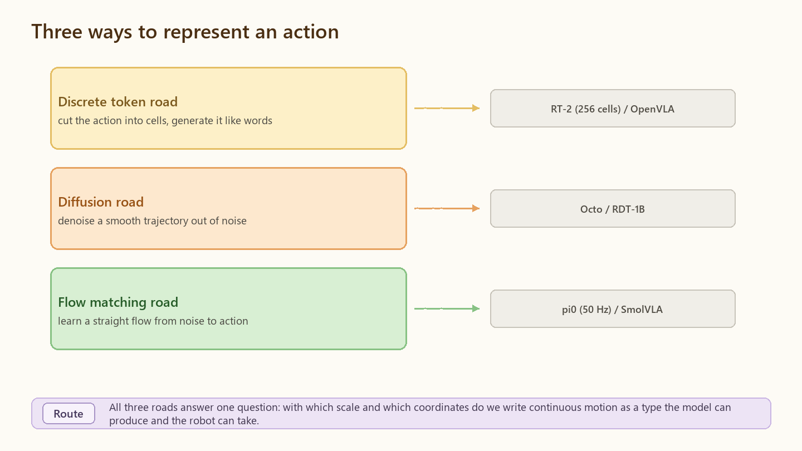

*Figure 4-4 Three roads of action representation: discrete tokens, diffusion, flow matching*

| Road | In one sentence | Representatives | Strength | Weakness |
| --- | --- | --- | --- | --- |
| discrete tokens | Cut the action into cells and generate it like words. | RT-2 (256 cells), OpenVLA | Isomorphic to language models, simple to train, emergent reasoning. | Quantisation loss; high-frequency, many-degree-of-freedom motion struggles. |
| diffusion | Denoise a smooth trajectory out of noise. | Octo, RDT-1B | Handles multi-modal distributions; smooth motion. | Iterative denoising adds latency. |
| flow matching | Learn a straight flow from noise to action. | π0 (50Hz) , SmolVLA | High frequency, continuous, good feel, scales well. | Training and scheduling are more complex. |

> **Professional column C2 The detail behind the three roads**
>
> Discretisation descends from the idea of quantisation: write a continuous quantity as a finite number of cells. RT-2 takes 6 degrees of freedom plus the gripper plus an end flag - 8 dimensions in all - cuts each into 256 cells, and the action becomes a sentence. The loss is precision; the remedy is special tokens and a finer scale.
> pi0-FAST (2025) offers a third way: move the action sequence into the frequency domain with a discrete cosine transform and code it there - the same trajectory, written in another set of coordinates, costs less, and decoding restores it. Read it with Ontypology: a change of scale basis. The type did not change, the coordinates describing it did. This reminds us that the type of an action and the way it is written are two different things; conflate them and you mistake quantisation for the action itself.
> The 2026 front line: streaming action coding (ActionCodec2 and its like) decodes and plays at the same time, without waiting for the whole stretch - which corresponds to the Ontypology principle that a function chain need not be produced in one go but can hand over link by link.

### 4-5 Five families of reasoning and how to choose a thinking style

Inside the think station the five families take turns: causal reasoning moves from cause to effect (see the cup at the table edge -> infer that it will fall); abductive reasoning moves from effect back to cause (task failed -> trace which link broke); simulation reasons by rehearsing first (what if I grasp here); statistical reasoning takes the trend from the demonstrations (most demos do it this way); inverse reasoning works backwards from the goal (cup into the box -> open the box -> then grasp the cup).

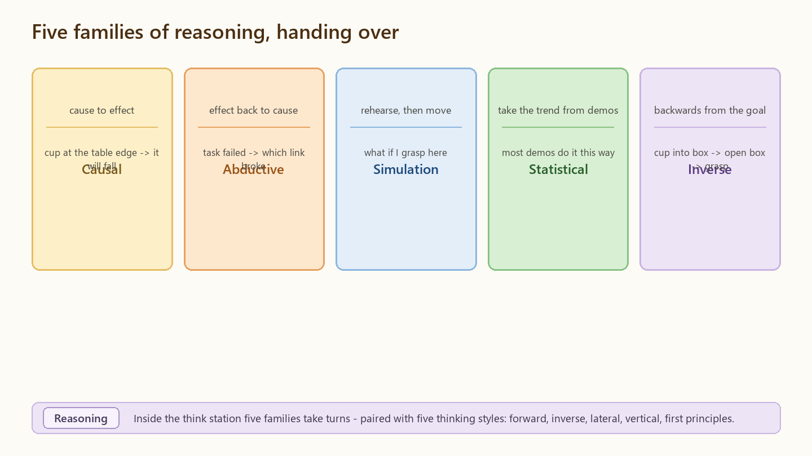

*Figure 4-5 The five families handing over: causal, abductive, simulation, statistical, inverse*

| Thinking style | How it walks | In a VLA situation |
| --- | --- | --- |
| forward thinking | push forward from the situation to the goal | Standard task execution, six stations in order. |
| inverse thinking | work backwards from the goal | Long-horizon decomposition: write the completion condition first, then schedule the sub-tasks backwards. |
| lateral thinking | change the representation and look again | Change the basis of the action representation (tokens to flow); retry from another camera view. |
| vertical thinking | decompose layer by layer | Break tidy the desk into grasp, place and sort. |
| first principles | go back to physics and constraints | Extreme cases: when the model is entirely wrong, recompute the grasp point from friction and centre of mass. |

### 4-6 Single system and dual system: two tempos

The VLA family has two heartbeats. The single system (RT-2, OpenVLA, pi0) completes understanding and action in one forward pass - simple architecture, low latency. The dual system (Helix, GR00T N1) separates slow thinking from fast reflex: System 2 is an internet-scale vision-language model that sees and thinks it through, System 1 is a high-frequency visuomotor policy that delivers the feel. The two layers are trained end to end together and hand over in a latent representation.

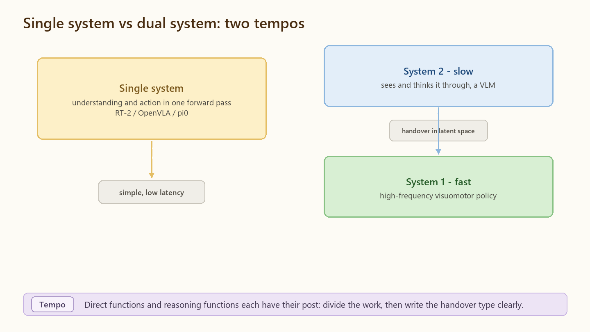

*Figure 4-6 Single system vs dual system: one beat, or slow thinking with fast acting*

Read it with Ontypology: these are two tempos of a function. Direct functions (fast, regular, high frequency) and reasoning functions (slow, flexible, low frequency) each have their post; mix them into one tempo and either slow thinking drags the feel down or fast reflex makes the decisions. Divide the work, then write the handover type clearly - that is what decides a dual-system design.

### 4-7 The type-in, type-out loop

Walking the six stations is not the end: the action returns to the world, the world sends the result type back (did the cup really go into the box?), and the learn station writes the result back into the criteria and the function library - types and functions grow each other on this loop. One more demonstration thickens the type library by a layer; one more pass of the criteria crystallises a move in the function library.

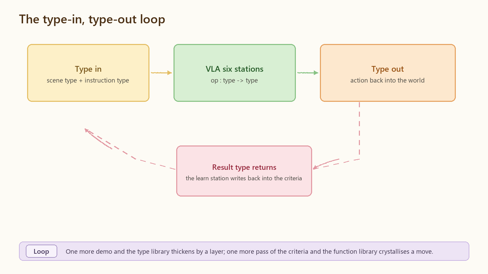

*Figure 4-7 The type-in, type-out loop: the action returns to the world, the world sends the result type back*

> **Professional column C3 Sources on datasets: the golden age of type libraries**
>
> Open X-Embodiment (2024): 21 institutions together, 22 robot embodiments, more than a million demonstration episodes, released as RT-1-X and RT-2-X - the first proof that a cross-embodiment type library can raise a general policy.
> DROID (2024): about 76,000 trajectories over 564 scenes, taking the road of scene diversity; BridgeData V2 filled in household tabletop tasks by low-cost crowd-sourcing.
> Read it with Ontypology: a dataset is a type library. Collecting demonstrations is not piling up videos, it is booking the mapping from scene type to action type cell by cell. The quality of the ledger (whether the types are established accurately) sets the ceiling of the model - research in 2026 even found that some high benchmark scores are close to retrieving neighbouring demonstrations (kNN can do it), which is the alarm bell asking whether the library holds new types and whether the model really abstracts.

> **Exercise E04**
>
> Task: put the red brick on the table into the box. Write a four-question card for the move grasp (one line each for name, input type, output type, criterion).
> If this task were designed as a dual system, which of the six stations would System 1 and System 2 each own, and what is the handover type?

> **Exercise E05**
>
> Which concept of this part does each description violate? (a) Every joint angle the model outputs is trustworthy, never mind the unit. (b) If the task fails, just run it again; no need to know which step broke. (c) Just throw all the demonstration videos in; never mind whether the scene type is established correctly.
> Hint: scale, abductive reasoning, library quality.

## Part 5 Using VLA accurately - body, use, accuracy

The first two parts established types and functions; this part answers the third question of VLA: how is it used accurately? The answer has three layers - body (tools and ledger), use (the walk through six stations), accuracy (criteria and checks). Accuracy is not a feeling; it is checkable accuracy.

### 5-1 Body, use, accuracy: an overview

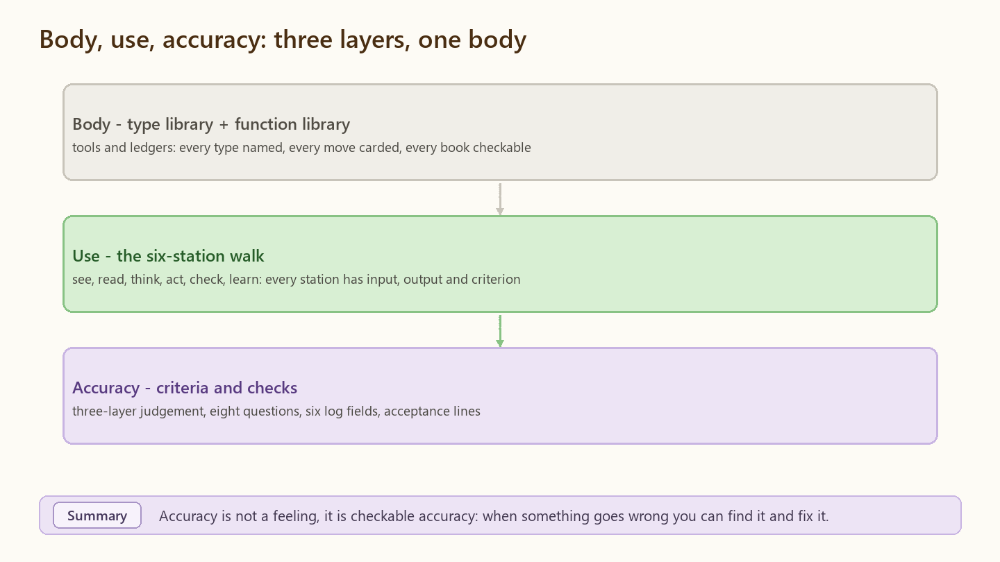

*Figure 5-1 Body, use, accuracy: tools underneath, the walk on stage, criteria to close*

| Layer | What it is | In VLA deployment |
| --- | --- | --- |
| body | type library + function library: tools and ledger | Demonstrations become the type library; the six station functions enter the function library; every type has a name, every move a card. |
| use | the walk of the six-station chain | See, read, think, act, check, learn - every station has input type, output type and criterion. |
| accuracy | criteria and checks | Three-layer judgement + eight questions + six log fields + acceptance lines; an error can be found again. |

### 5-2 Three kinds of completion: make the type usable

To make a type judgeable, three completions are needed: rules into [ ], identity into ( ), structure into { }.

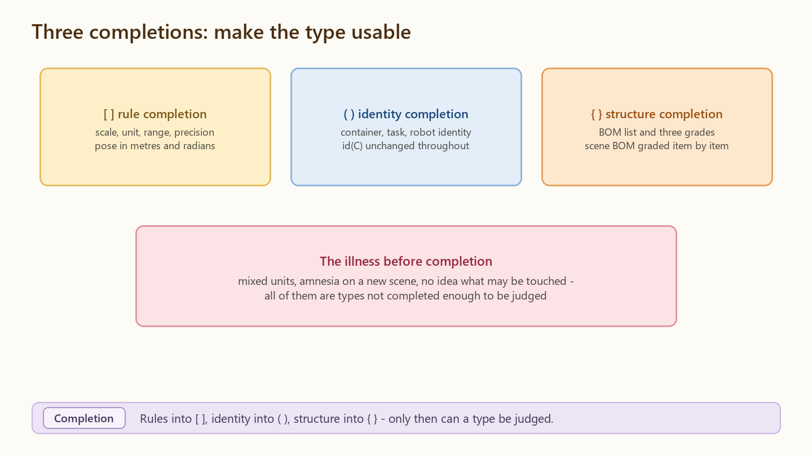

*Figure 5-2 Three kinds of completion: [ ] rules, ( ) identity, { } structure*

| Completion | What is added | A VLA example | The illness before it |
| --- | --- | --- | --- |
| [ ] rule completion | scale, unit, value range, precision | End-effector pose unified in metres and radians; gripper opening 0-100%; speed limits written into the attributes. | Mixed dimensions in the numbers, so one action has two readings. |
| ( ) identity completion | container identity, task identity, robot identity | Working unit id(C) unchanged throughout; a single task id; model and calibration version on file. | Amnesia on a new scene; drift when transferring across robots. |
| { } structure completion | BOM list and three grades of removal | Scene BOM graded item by item; task BOM naming essential and disposable parts. | No idea what may be touched; on failure, no idea which part is missing. |

### 5-3 Six steps of proof: a full walk-through

Walk the method once: the task is to put the red brick on the table into the box. The six steps run from naming the whole to the three-layer check, and every step leaves a trace that can be checked.

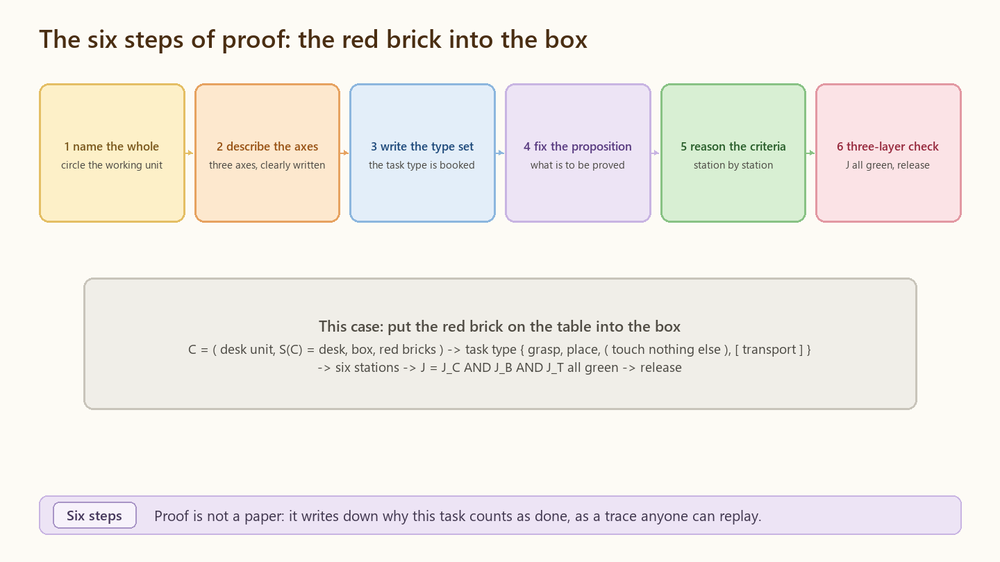

*Figure 5-3 The six steps end to end: the red brick into the box*

| Step | What is done | How it is written here |
| --- | --- | --- |
| (1) name the whole | circle the working unit first | C = ( desk working unit, S(C) = desk, box, some red bricks ). |
| (2) describe the axes | write the three axes clearly | [ ] pose, size and colour scale of the red brick; { } three items of the table BOM; ( ) working unit and safety boundary. |
| (3) write the type set | the task type is booked | Task type = { grasp the red brick, put it in the box, ( constraint: touch nothing else ), [ transport class ] }. |
| (4) fix the proposition | what is to be proved | Proposition: this task can be completed by the six-station chain, and id(C) never changes throughout. |
| (5) reason the criteria | reason station by station | see (three items match) -> read (the object is unique) -> think (a two-step plan) -> act (grasp and place) -> check (three greens) -> learn (the result is booked). |
| (6) the three-layer check | J = J_C ∧ J_B ∧ J_T | J_C: all inside the desk unit - yes; J_B: the red brick is there, the box is there - yes; J_T: it belongs to transport - yes. Release. |

> **The spirit of the six steps**
>
> Proof is not a paper: it writes down why this task counts as done, as a trace that can be checked. Walk the six steps and anyone holding the record can replay your judgement.

### 5-4 Four layers of accuracy and the six log fields

Accuracy has four layers, each resting on the one below: data accuracy (the type is right, the demonstrations are clean) -> model accuracy (it learned the pattern of the type, not a coincidence of pixels) -> execution accuracy (the action lands as written) -> review accuracy (every step is booked, a fault can be found).

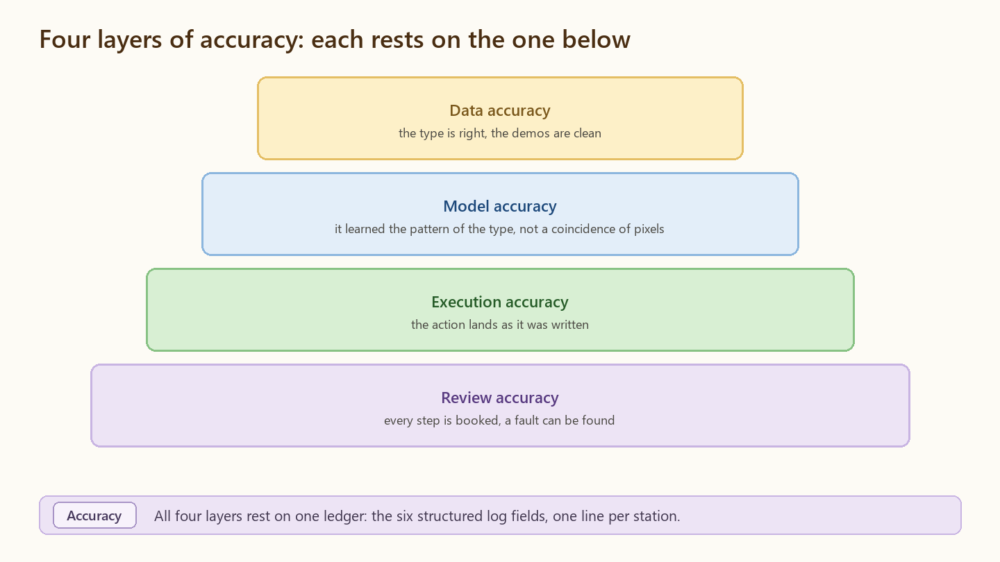

*Figure 5-4 Four layers of accuracy: data, model, execution, review*

All four layers rest on one ledger - the six structured log fields: timestamp, input type, output type, criterion, three-layer verdict, remark. One line per station. The log is not for the auditor; it is for the next you, the one who fails.

| Timestamp | Input type | Output type | Criterion | Three-layer verdict | Remark |
| --- | --- | --- | --- | --- | --- |
| T+0.0s | image frame x1 | scene type | detection consistency | — | three objects booked |
| T+0.4s | instruction + scene type | task type | semantic alignment | — | object locked on the red brick |
| T+1.2s | plan type + state type | action block x1 | dynamically feasible | — | grasp form, speed 80% |
| T+1.6s | action block + safety type | release | three-layer judgement | J all green | into execution |

### 5-5 The eight questions: a checklist before delivery

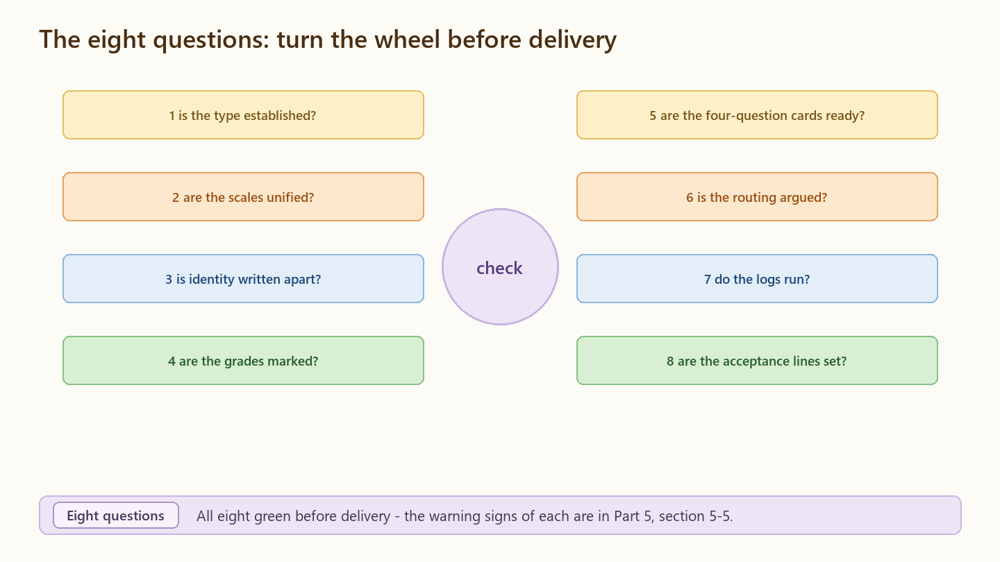

*Figure 5-5 The eight-question wheel: turn it once before every delivery*

| # | The eight questions | The warning sign of a fail |
| --- | --- | --- |
| 1 | Is the type of this task established? Are the three axes written? | The task description is one sentence of natural language with no type set. |
| 2 | Are the scales and units unified? | The same pose, two programs, two readings. |
| 3 | Are container identity and content written apart? | Changing the table means retraining. |
| 4 | Are the BOM and the three grades marked? | The safety boundary relies on the model should know. |
| 5 | Does every station have its four-question card? | The act station cannot state its criterion. |
| 6 | Can the choice of action representation be argued? | Everyone uses tokens, so we use tokens. |
| 7 | Do the six log fields run? | A failure can only be reproduced, never traced back. |
| 8 | Are the three-layer judgement and the acceptance lines set? | Success rate is the only indicator. |

### 5-6 Sixteen misuses: four groups of case notes

Misuses fall into four groups: type layer, action layer, criterion layer and system layer. Four in each - all of them illnesses you really meet in the clinic.

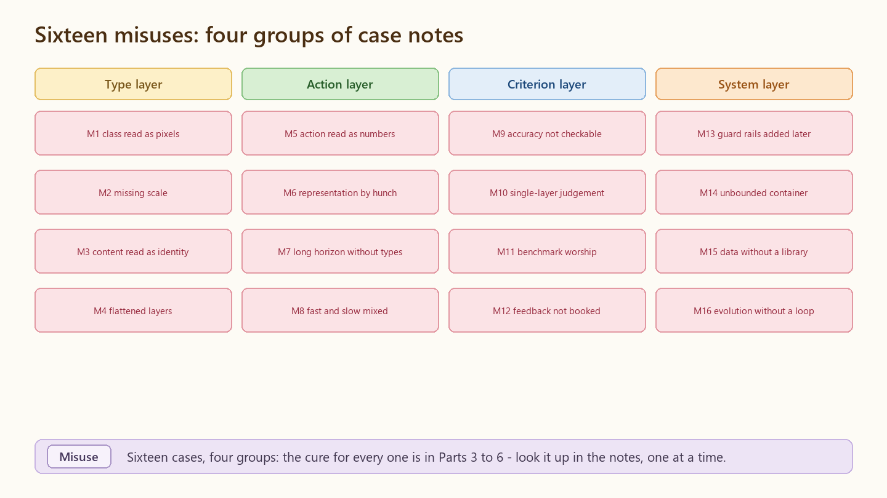

*Figure 5-6 Sixteen misuses: the four groups at a glance*

| Group | Misuse | Symptom | Cure |
| --- | --- | --- | --- |
| type layer | M1 class read as pixels | Change the light and the object is no longer recognised. | Establish the class by the intersection criterion; compare types, not pixel distances. |
|  | M2 missing scale | A number with no unit. | Write the scale of every dimension before it can be booked. |
|  | M3 content read as identity | Change the drink and it is a new cup. | Write id(C) and S(C) apart. |
|  | M4 flattened layers | Nested containers flattened into one table. | Establish the container chain in layers; never flatten it at will. |
| action layer | M5 action read as numbers | Looking at joint-angle curves, never at the chain of types. | Write every stretch of action as op: type -> type. |
|  | M6 representation by hunch | Coarse quantisation even when precision is short. | Choose the road by the three task questions (precision, frequency, multi-modality). |
|  | M7 long horizon without types | A ten-step task with no sub-task types. | Decompose into sub-task types first, then schedule. |
|  | M8 fast and slow mixed | Slow reasoning stuffed into a high-frequency control loop. | Split the frequencies in a dual system; write the handover type clearly. |
| criterion layer | M9 accuracy not checkable | Success rests on a demo video. | Six log fields plus four acceptance lines. |
|  | M10 single-layer judgement | Only the class is checked, never the container. | J = J_C AND J_B AND J_T, standing together. |
|  | M11 benchmark worship | A high benchmark score is taken as ready for production. | A benchmark is one criterion, not all of them. |
|  | M12 feedback not booked | What was fine-tuned cannot be stated. | Keep an update type for every update; the ledger can be checked. |
| system layer | M13 guard rails added later | Deploy first, think about safety afterwards. | Establish the safety type first; grade the parts first. |
|  | M14 unbounded container | The robot can walk out of the working unit. | Write the admission rules on the container. |
|  | M15 data without a library | Demonstrations piled into a video store. | Establish the type of every demonstration, then shelve it, classified and graded. |
|  | M16 evolution without a loop | Model and data each go their own way. | Close the type-in, type-out loop and let the learn station write back. |

### 5-7 The routing decision tree

Facing a new task, three junctions decide: do we need VLA at all, which action representation, and which system tempo?

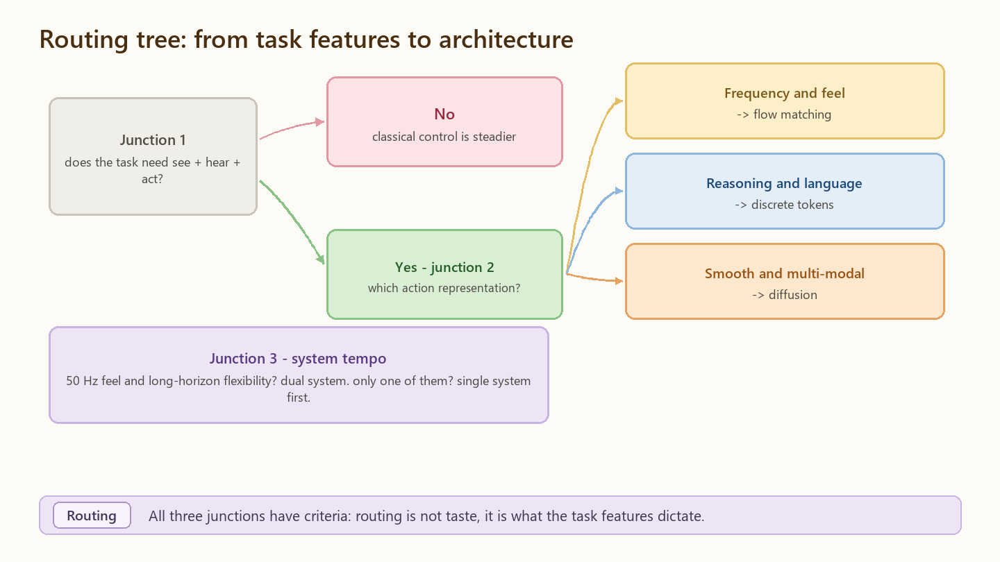

*Figure 5-7 The routing decision tree: from task features to architecture*

| Junction | What is asked | How to walk it |
| --- | --- | --- |
| Junction 1 - do we need VLA | Does the task need seeing, understanding and acting in one? | Only then go to VLA; pure repetitive motion is steadier under classical control. |
| Junction 2 - action representation | Which weighs most: precision, frequency or multi-modality? | Frequency and feel -> flow matching; reasoning and language -> discrete tokens; smooth and multi-modal -> diffusion. |
| Junction 3 - system tempo | Do you want a 50 Hz feel, or long-horizon flexibility? | Both -> dual system; only one -> get a single system running first. |

> **Professional column C4 Reading a benchmark as a criterion**
>
> LIBERO (since 2023): 130 tasks in four suites - spatial, object, goal and long-horizon - and now the health check of VLA. By 2026 models pass more than 95% of it, which raises the awkward question of how much of your high score is kNN retrieval.
> CALVIN tests long-horizon language-conditioned sequences; SIMPLER evaluates real robots in a simulator (real to sim) and saves hardware cost; the 2026 BEHAVIOR Challenge puts 100 long-horizon household chores on the table and tests a whole workflow rather than a single move.
> Read it with Ontypology: a benchmark is the ruler of a criterion. Choosing a benchmark is choosing which J you want to pass; a high score only says that one particular intersection was passed, not that the three-layer judgement is all green.

> **Professional column C5 Safety and human-robot collaboration**
>
> Robot safety is not a new problem for VLA; it is an old problem in a new variant. ISO 10218 and ISO/TS 15066 set the floor for force and speed in collaborative robots. The new risk VLA brings is uncertainty plus generativity - the model will make moves it never rehearsed.
> Engineering answers with three guard rails: an input guard rail (the scene type must pass the three-layer judgement before admission), a process guard rail (the action block passes the safety type check, and the red line of removal grades may not be crossed) and an output guard rail (the result is booked back, and any anomaly stops the run). The 2026 research topic of low-latency action verifiers is exactly the Ontypology instance of a process guard rail: verify the type before you move.
> The principle in one sentence: trust is never assumed - verify identity at every run, and govern admission in every container.

> **Exercise E06**
>
> Check this task description with the three completions: have the robot tidy up the things on the table. Say what is missing in [ ], ( ) and { }, and add one line to each.
> Walk this task through the six steps of proof (writing up to step 4 is enough).

> **Exercise E07**
>
> Recognise the misuse: (a) our model scores 96% on LIBERO, so straight to the production line; (b) 500 demonstration clips, all in one folder, named by date; (c) add the safety guard rails once the launch settles down. Which M does each hit, and what is the cure?

## Part 6 The whole architecture - two libraries, one hub, one loop

With the method in hand, how is the system laid out? One overview runs through the whole book: two libraries, one hub, one loop - the type library stores types, the function library stores moves, the hub arbitrates criteria, the loop evolves in closed form. Every working component of VLA finds its seat on this map.

### 6-1 Two libraries, one hub, one loop x VLA

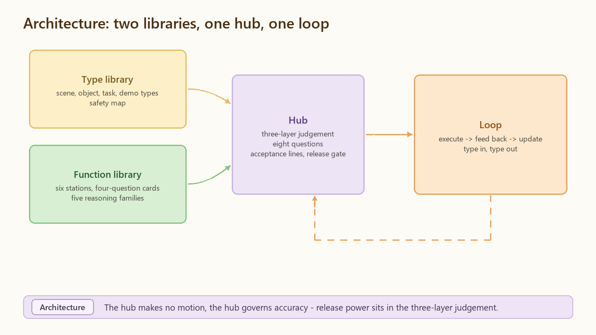

*Figure 6-1 The architecture: two libraries, one hub, one loop x VLA*

| Component | What it stores | Its counterpart in VLA practice |
| --- | --- | --- |
| type library | type sets and type relations: scene, object, task, demonstration types | Demonstration databases, scene annotation, task specifications, safety maps. |
| function library | four-question cards: six station functions + five reasoning families + thinking styles | Policy weights, action decoders, verifiers, prompt and flow templates. |
| hub | criteria and arbitration: three-layer judgement, eight questions, acceptance lines | Acceptance services, log review, release gate. |
| loop | the type-in, type-out loop: execute -> feed back -> update | Deployment monitoring, failure tracing, periodic fine-tuning and library building. |

> **The hub in one sentence**
>
> The hub makes no motion; the hub governs accuracy. However large the model, the release power sits in the three-layer judgement - the direct projection of the Mind AI architecture of two libraries, one hub and one loop onto the VLA scene.

### 6-2 Reading the ecosystem: where each VLA lands

Put the mainstream VLAs on the map of Ontypology and each one's trade-offs become obvious.

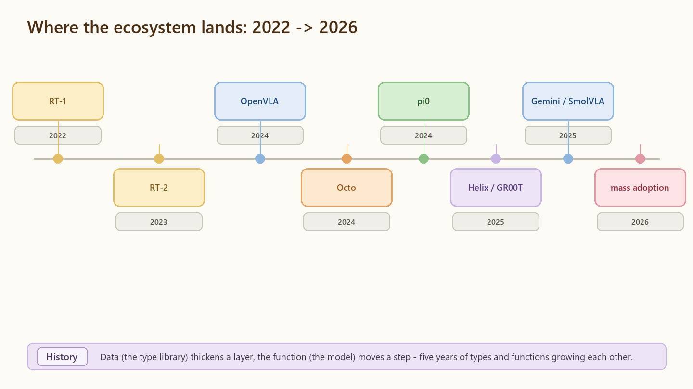

*Figure 6-2 Where the ecosystem lands: from RT-1 to SmolVLA*

| Model | Year and institution | Architecture | Action representation | Where it lands in Ontypology |
| --- | --- | --- | --- | --- |
| RT-1 | 2022 · Google | single system | discrete tokens | The pioneer of coordinate-based action. |
| RT-2 | 2023 · Google DeepMind | single system | discrete tokens (256 cells) | Web knowledge distilled into action; emergence = abstraction generation. |
| OpenVLA | 2024, Stanford and others | single system | discrete tokens (7B) | A product of the open type library (Open X-Embodiment). |
| Octo | 2024 · UC Berkeley | single system | diffusion (27M/93M) | Lightweight generalist; block-wise attention = substitute the content, keep the identity. |
| π0 | 2024 · Physical Intelligence | single system | flow matching (50 Hz) | High-frequency feel; 8 embodiments across containers. |
| π0-FAST | 2025 · Physical Intelligence | single system | frequency-domain tokens | The textbook case of a change of scale basis. |
| Helix | 2025 · Figure AI | dual system | continuous (high frequency) | Full upper-body control of a humanoid; slow thinking, fast acting. |
| GR00T N1 | 2025 · NVIDIA | dual system | diffusion-based | A humanoid foundation model; human video plus synthetic data. |
| Gemini Robotics | 2025 · Google DeepMind | single system + reasoning layer | continuous | Reasoning and action in separate layers; cross-platform transfer. |
| SmolVLA | 2025 · Hugging Face | single system (asynchronous) | flow matching (450M) | A community type library (LeRobot); runs on consumer hardware. |

### 6-3 Data and benchmarks: the type library and the criterion

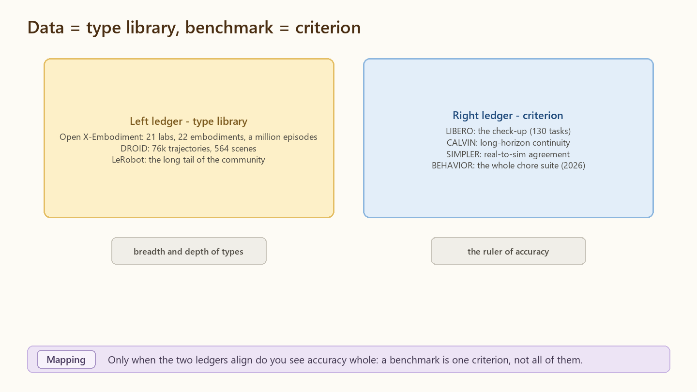

*Figure 6-3 Data = type library, benchmark = criterion: the division of the two ledgers*

The left ledger is the type library: Open X-Embodiment (21 institutions, 22 embodiments, a million episodes) covers the breadth of types; DROID (76k trajectories, 564 scenes) covers the depth of scenes; the LeRobot community data covers the long tail of variety. The right ledger is the criterion: LIBERO is the check-up, CALVIN the long horizon, SIMPLER the real-to-sim agreement, BEHAVIOR the whole chore suite. Only with the two ledgers aligned do you see accuracy whole.

### 6-4 Mind AI: the platform underneath (cited, not restated)

This book does not restate Mind AI; it only fixes its seat in the VLA scene: the type library inherits the types of Part 3, the function library the functions of Part 4, the hub the criteria of Part 5, and the loop the type-in, type-out cycle. The vision of the platform is three unifications - unified knowledge (the type library), unified thinking (the function library and reasoning) and unified intelligence (evolution in a loop); VLA is the decisive step on that road where intelligence enters the physical world.

> **Professional column C6 A short history of VLA: from RT-1 to 2026**
>
> In December 2022 Google released RT-1: 130k demonstration episodes, 13 robots, more than 700 tasks, cutting robot action into tokens and generating them with a Transformer - the industry saw the shadow of the GPT moment for robots for the first time. In July 2023 RT-2 fine-tuned a VLM directly into a policy and emergent task understanding appeared; the word VLA became a paradigm.
> 2024 was the open-source year: OpenVLA put a 7B VLA into the open; Octo proved a lightweight generalist feasible; at the end of the year pi0 pushed the feel to 50 Hz with flow matching. 2025 was the year of divergence: Helix and GR00T went humanoid, Gemini Robotics went for reasoning, SmolVLA came down to consumer grade. 2026 is the year of deployment: streaming coding, action verification, memory mechanisms, model distillation and service-isation are the main battlefield - the literature has passed 2,500 papers, and herds of VLA robots are appearing on production lines.
> Read it with Ontypology: this short history is the history of types and functions growing each other - the data (type library) thickens a layer and the function (model) takes a step; the function takes a step and forces the data to establish finer types.

> **Professional column C7 Efficiency and mass deployment**
>
> A model that moves is only the starting point; one that moves on time, on a power budget and without drama is a product. Deployment in 2026 has four lessons: visual token pruning (keep only the visual types relevant to the action), action streaming (decode and play without waiting for the whole stretch), lighter verifiers (low-latency action verification inside the control loop) and service scheduling (hundreds of robots sharing a model cluster, queued by control frequency).
> The small-model road is just as striking: SmolVLA with 450M parameters approaches large models on community data, and TinyVLA shows that architecture and data curation pay better than piling on parameters. Read it with Ontypology: a number is a small type inside the type - parameter count is a scale, not an identity; establish the type correctly and a small model can still hold the identity of the task.

### 6-5 Four acceptance lines and three unifications

Before launch all four lines must be green: the data line (the type library is booked and fully graded), the model line (benchmark and in-house test set both pass), the execution line (consecutive success on the real robot, zero safety crossings) and the review line (logs replayable, failures locatable). Four green lines and only then do you talk about scaling and mass production.

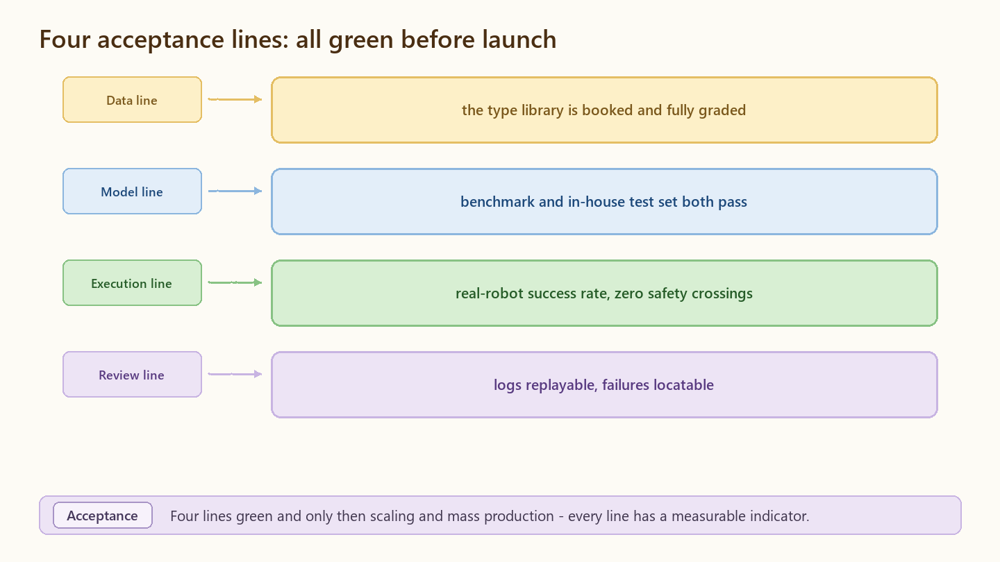

*Figure 6-4 Four acceptance lines: data, model, execution, review*

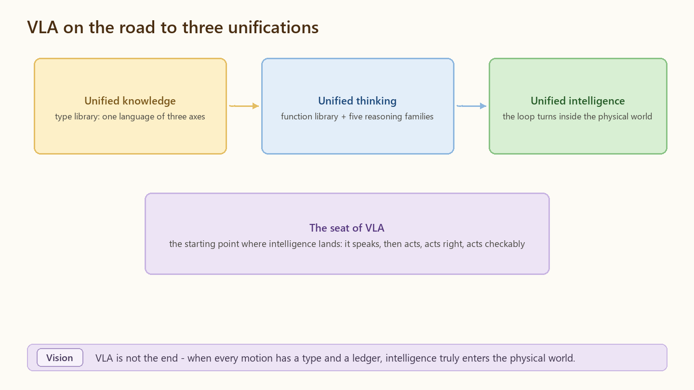

*Figure 6-5 VLA on the road to three unifications: unified knowledge -> unified thinking -> unified intelligence*

> **Exercise E08**
>
> Your team is building a warehouse-picking VLA. Fill its components into the two libraries, one hub and one loop (one concrete item per box) and say which indicator each of the four acceptance lines uses.
> Pick two models from the ecosystem table and explain what deployment differences their action representations bring.

## Part 7 A complete content plan - learn, practise, use, teach, build

Method and architecture are in place; now arrange them into a road that can be walked: how to learn, how to practise, how to use, how to teach, how to build a library. This part is for the people who are going to do it.

### 7-1 Learn, practise, use, teach, build: five words, one loop

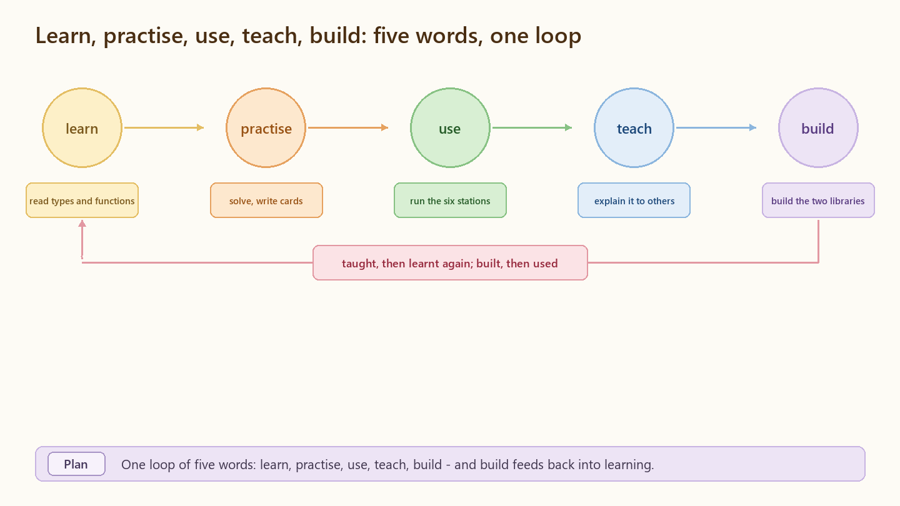

*Figure 7-1 Learn, practise, use, teach, build: five words, one loop*

| Word | The verb | The output | The usual mistake |
| --- | --- | --- | --- |
| learn | read types, read functions | your own notebook of types | Reading papers only, never establishing a type by hand. |
| practise | solve exercises, write cards | exercises + four-question cards | Copying the examples without adapting them to your own task. |
| use | take on a task, run the six stations | field records and logs | Starting with the hardest task available. |
| teach | explain it to someone else | course kit and lookup cards | Teaching conclusions without the criteria. |
| build | build the type and function libraries | the team's two libraries | Piling data into a store without establishing types. |

### 7-2 The eight-week route

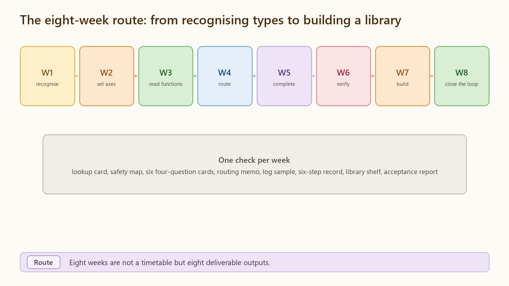

*Figure 7-2 The eight-week route: from recognising types to building a library*

| Week | Theme | What is done | The check |
| --- | --- | --- | --- |
| week 1 | recognise types | Read Parts 1 and 2; write the task in your hand as a type set. | The five lookup cards are filled in. |
| week 2 | set the axes | Three axes plus the three grades of removal; draw the safety map. | The safety map is reviewed. |
| week 3 | know the functions | Read Part 4; write one four-question card for each of the six stations. | Six cards complete. |
| week 4 | route | Choose among the three roads of action representation; walk the decision tree. | A written case for the choice. |
| week 5 | complete the types | The three completions; write the first batch of six-field logs. | The log runs end to end. |
| week 6 | verify accuracy | Walk the six steps of proof once, end to end; self-check with the eight questions. | A record of the six steps. |
| week 7 | build the library | Establish types from the demonstrations and shelve them; mark the grades. | The first batch is on the shelf. |
| week 8 | close the loop | Run one PoC situation; set the four acceptance lines. | The acceptance report. |

### 7-3 Four stages of building the library

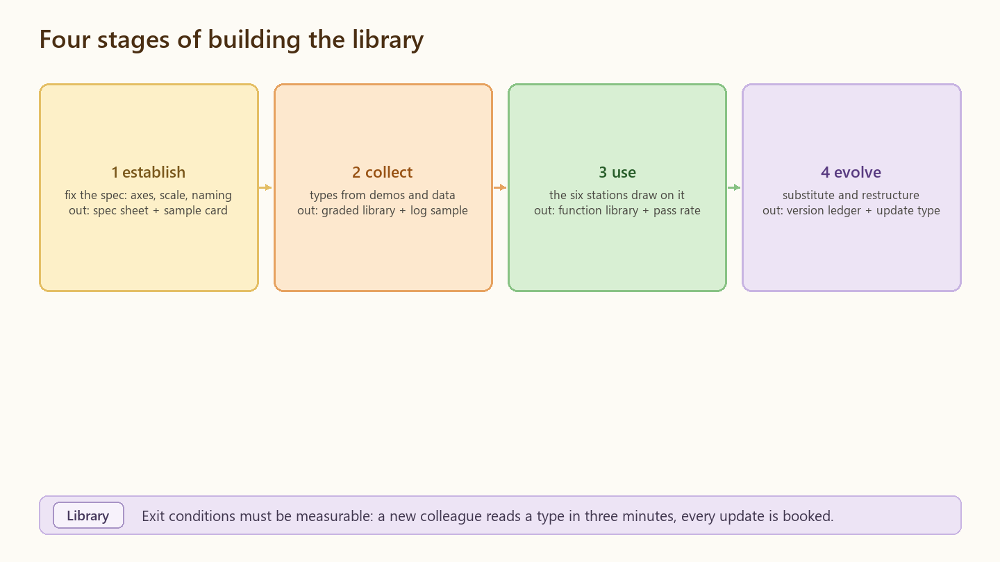

*Figure 7-3 Four stages: establish, collect, use, evolve*

| Stage | Focus | Output | Exit condition |
| --- | --- | --- | --- |
| (1) establish | fix the spec of a type: axes, scale, naming | type specification + sample cards | A new colleague reads a type in three minutes. |
| (2) collect | establish types from demonstrations and data and shelve them | graded type library + sample logs | Every type named, every grade marked. |
| (3) use | draw on them in the six-station chain | function library + pass rate | The pass rate of the criteria is quantifiable. |
| (4) evolve | update the loop: substitution, restructuring | version ledger + update types | Every update can be looked up in the ledger. |

### 7-4 Routing by situation: four kinds of reader

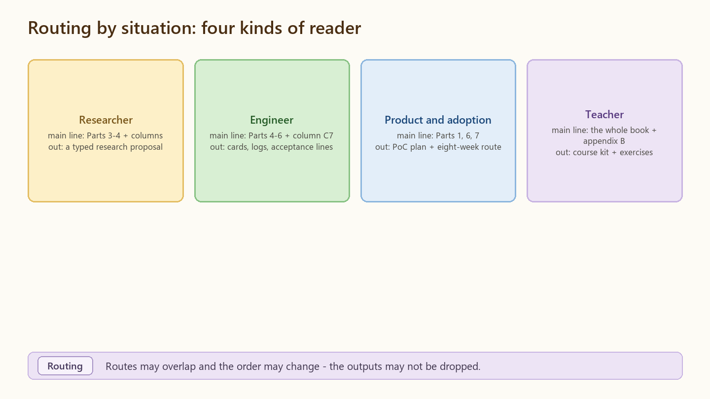

*Figure 7-4 Routing by situation: researcher, engineer, product, teaching*

| Reader | Main line | Read first | Key output |
| --- | --- | --- | --- |
| researcher | the theory of types and action representation | Parts 3 and 4 plus columns C2 and C3 | A typed description for a research proposal. |
| engineer | deployment and review | Parts 4, 5 and 6 plus column C7 | The trio of four-question cards, logs and acceptance lines. |
| product and adoption | the plan and its acceptance | Parts 1, 6 and 7 | A PoC plan plus the eight-week route. |
| teacher | material and exercises | the whole book plus Appendix B | A lookup-card course kit plus exercise sets. |

### 7-5 Three PoC situations and the FAQ

Acceptance is not a slogan; it comes out of three concrete situations:

| Situation | Task | The types it really tests | Threshold of success |
| --- | --- | --- | --- |
| tabletop transport | put the given object into the given container | object type, task type | 50 consecutive runs at 95% or better, logs covering everything. |
| long-horizon chores | a tidy-up flow of three steps or more | a chain of sub-task types | 80% or better completion, failures traceable to a station. |
| factory inspection | look, record and report | scene type, report type | 99% or better anomaly detection, zero safety crossings. |

### FAQ, quick questions and quick answers

| Question | Answer |
| --- | --- |
| Can we start without a real robot? | Yes. SIMPLER-style real-to-sim evaluation and simulators (CALVIN, ManiSkill and the like) let you get the method running first and add the hardware later. |
| How many demonstrations are enough? | First ask whether the type is established accurately. With a good type, a few dozen episodes can be fine-tuned; with a bad one, ten thousand are wasted. |
| How to choose an open-source model? | Follow the decision tree of Part 5: choose the action representation by precision, frequency and multi-modality, then the size by compute. |
| What should the team establish first? | Two cards: the five-type lookup card and the four-question function card. With the cards, communication is accurate. |
| How do we convince management? | Talk in terms of the four acceptance lines: data, model, execution, review - each has a quantifiable indicator. |

> **Exercise E09**
>
> Turn the eight-week route into your own version: replace the themes of two weeks and state the reason and the check for each replacement.

> **Exercise E10**
>
> Your scene must choose an action representation. Write three key requirements (any three of precision, frequency, multi-modality, compute, generalisation) and walk the decision tree to a choice with reasons.

> **Professional column C8 On the way to Mind AI: where VLA sits among the three unifications**
>
> Unified knowledge: the scene, task and demonstration types of VLA enter the type library and share one language of three axes with the types of other fields - the world a robot understands, the world a person understands and the world an organisation understands are written in the same ledger.
> Unified thinking: the six-station chain and the five reasoning families are members of the function library already; VLA connects these functions to the physical world and gives thinking an outlet in motion.
> Unified intelligence: the type-in, type-out loop turns inside the physical world - every run is an experiment, every log is evidence. The 2026 enthusiasm for memory mechanisms, action verification and model distillation is really about smoothing this loop.
> VLA is not the end but the starting point where intelligence lands: when every motion of a robot has a type and a ledger, AGI will not only speak but act, act right and act checkably.

> **Exercise S01**
>
> Design your own four-stage plan for building the library: write the output and the exit condition of each stage, and mark the stage you are stuck in.
> Hint: exit conditions must be quantifiable.

> **Exercise S02**
>
> Pick a real task (home, laboratory or factory) and write a PoC situation card: the task, the types it really tests, the threshold of success, the risks and the three grades of removal.

> **Exercise S03**
>
> Turn the lookup cards of this book into a half-day workshop: four sessions, each with a theme, an activity and a checkpoint.

## Part 8 Conclusion - five fields, one road

Finally, pull the camera back. The problems of VLA - types not established, accuracy not checkable - do not belong to robotics alone; they belong to every field that must describe the world accurately and get the action right. Put five fields side by side and the method is the same.

### 8-1 Five fields side by side

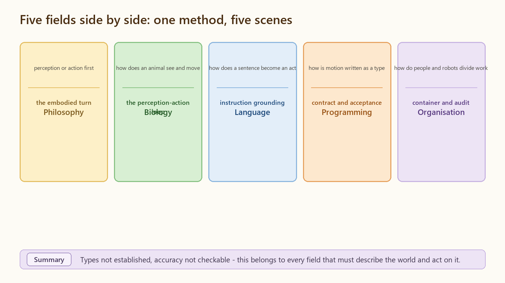

*Figure 8-1 Five fields side by side: one set of types and methods, five scenes*

| Field | The problem of types | What VLA suggests |
| --- | --- | --- |
| philosophy | which comes first, perception or action? | The embodied turn: cognition is not in the head but in the cycle of type in, type out. |
| biology | how does an animal see and then move? | The perception-action cycle is a six-station chain polished over aeons. |
| language | how does a sentence become an act? | Instruction grounding: a noun must land on a type, a verb must land on a function. |
| programming | how is motion written as a reliable type? | Contract and acceptance: op: type -> type is a function signature plus a criterion. |
| organisation | how do people and robots divide the work? | Container and audit: every unit has an identity, every decision has a ledger. |

### 8-2 Three consecutive goals

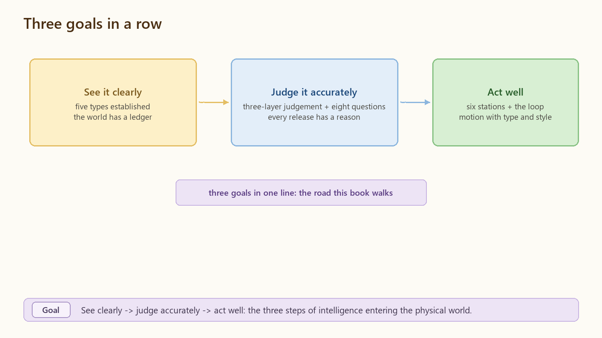

*Figure 8-2 Three consecutive goals: see clearly -> judge accurately -> act well*

See it clearly: five types established, the world has a ledger. Judge it accurately: the three-layer judgement and the eight questions turn, every release has grounds. Act well: the six stations and the loop run, motion has type and style. The three goals form one line, and that line is the road this book has walked from the first page to here.

> **The whole book in one sentence**
>
> VLA is a function chain of type in, type out: establish the type, ask the function clearly, turn the criterion into practice - see clearly, judge accurately, act well, and only then does intelligence truly enter the physical world.

> **Exercise E11**
>
> Work backwards from the table of five fields: what is the counterpart problem of your VLA task in the field of language? (Hint: instruction grounding.) Write one example of an ambiguous instruction and its solution.

> **Exercise E12**
>
> Map the three consecutive goals onto your own project: write one quantifiable indicator of success for each.

> **Exercise E13**
>
> A combined question: pick a VLA model you know (inside or outside the ecosystem table) and write a 300-word review in the language of types - a third on the five types, a third on action representation, a third on criteria.

> **Exercise E14**
>
> A combined question: suppose you must explain accurate VLA to a colleague who has not read this book, with only three figures. Which three do you choose (you may ask for new ones), and what one sentence goes with each?

## Closing words

This booklet started from three questions: what type VLA is, how it moves, and how it is used accurately. Eight parts later the answer is already on your lookup card - but the real answer is written in the log of your next task.

Ontypology makes one promise: see the type clearly and accuracy has a root. VLA offers one opportunity: let intelligence not only speak but act, and act checkably. On the two libraries, one hub and one loop, these two sentences are the same sentence.

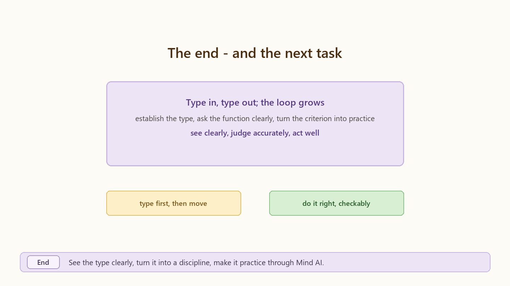

*Figure E-1 The end of the book: type in, type out, the loop grows*

> **The end**
>
> For the next task: establish the type first, then move. - See the type clearly, turn it into a discipline, make it practice through Mind AI.

## Appendix A Glossary and table of notation

**Table A-1 Glossary**

| Term | In one sentence |
| --- | --- |
| type | The boundary drawn by splitting and merging; the smallest unit of description that can be pointed at and named. |
| unit type | A type that can be pointed at on its own, written { parts, ( content ), [ class ] }. |
| type set | The standard way to describe a unit type with three brackets. |
| spatial type | The type that describes what it is: noun, static, three axes. |
| temporal type | The type that describes how it moves: verb, dynamic, function, op: type -> type. |
| attribute [ ] | The feature axis of a type: dimension x scale. |
| composition { } | The parts axis of a type: the BOM list. |
| container ( ) | The where axis of a type: C = (id(C), S(C)), identity and content written apart. |
| three grades of removal | Essential part, function-degraded part and non-essential part - the grading is the safety map. |
| three-layer judgement | Container layer J_C, composition layer J_B and abstraction layer J_T standing together: J = J_C AND J_B AND J_T. |
| abstraction criterion | On what grounds does it belong to this class: the criterion is set by the intersection. |
| abstraction generation | Draw the common type out of concrete types; the Ontypology name for generalisation. |
| substitution | Change the content, keep the identity: the content-replacement operation. |
| merge types | Combine two types into one. |
| nesting | A container inside a container: the hierarchy of types, never flattened at will. |
| four-question function card | The format for shelving a function: name, input type, output type, criterion. |
| type in, type out | How a function acts: one type in, one type out, growing in a loop. |
| checkable accuracy | Accuracy means criteria, logs and acceptance lines, so that anyone can replay the judgement. |
| VLA | Vision-language-action model: a multimodal foundation model that sees the scene, reads the instruction and produces the action. |
| VLM | Vision-language model: the perception and reasoning core of VLA. |
| action decoder | The module that translates a latent representation into an executable action. |
| action representation | The format in which an action is written as a type: discrete tokens, diffusion or flow matching. |
| action block | A continuous sequence of actions; the output of function composition. |
| System 1 / System 2 | The two layers of a dual system: fast reflex and slow reasoning. |
| demonstration data | The booked data of the mapping from scene type to action type; the source of the type library. |
| safety map | The scene BOM annotated with the three grades of removal as red, amber and green. |
| two libraries, one hub, one loop | The overall architecture: type library + function library + criterion hub + closed loop. |

**Table A-2 Table of notation**

| Symbol | Read as | Symbol | Read as |
| --- | --- | --- | --- |
| [ ] | attribute bracket | op: type -> type | temporal type (op: Type -> Type) |
| { } | composition bracket | J = J_C ∧ J_B ∧ J_T | three-layer judgement standing together |
| ( ) | container bracket | C = (id(C), S(C)) | container = identity + content |
| ≡ ≢ ⊂ | identical / different / degraded | M′ ⊂ M | function-degraded part |
| ∩(T) | abstraction criterion | { parts, ( content ), [ class ] } | how a unit type is written |

## Appendix B Lookup cards

### B-1 The four-question function card (lookup format)

| Field | The question | What to write |
| --- | --- | --- |
| name | What is this move called? | Verb first, so the effect is obvious at a glance. |
| input type | What type does it eat? | Write the type set clearly; mark anything missing. |
| output type | What type does it spit out? | All three axes of the produced type. |
| criterion | On what grounds is it right? | Measurable, checkable, replayable. |

### B-2 The eight-question tick list

| 1 is the type established? | 2 are the scales unified? | 3 is identity written apart? | 4 are the grades marked? |
| --- | --- | --- | --- |
| 5 are the cards complete? | 6 is the routing argued? | 7 do the logs run? | 8 are the acceptance lines set? |

### B-3 Blank template (photocopiable)

**[type set card]**

| Task name |  |
| --- | --- |
| Working unit id(C) |  |
| Content S(C) |  |
| Object type { parts, ( content ), [ class ] } |  |
| [ ] attributes and scales |  |
| { } BOM and three grades of removal |  |
| Task type |  |

**[four-question function card]**

| Name |  |
| --- | --- |
| Input type |  |
| Output type |  |
| Criterion |  |

**[eight-question tick list] 1 2 3 4 5 6 7 8**

## Appendix C Answers to the exercises

These are model answers; what matters is the criterion and the walk. Your task is different, so your answer may differ - but the standard of whether the type is established accurately and whether the criterion is stated clearly does not change.

**Table C-1 E01-E07**

| Exercise | Model answer |
| --- | --- |
| E01 | Four types: the cup { body, ( water ), [ container ] }, the sink { basin, ( space ), [ container ] }, the tabletop container C = ( kitchen table, S(C) ), and the task type { grasp the cup, put it down, ( touch nothing else ), [ transport ] }. Success in the kitchen and failure in the pantry is pain point one, false generalisation: the class [ ] was never established, so the model recognises pixels rather than types. |
| E02 | Filling the self-check from the table scores full marks. If the worst is long-horizon failure, the cure is the mapping row action chunk = function composition: establish the sub-task types first, then schedule the chain of types. |
| E03 | The door type = { door body, ( seal ), [ opening part ] }; for this task it is an essential part (open the door or the bowl never comes out). id(C) is the identity of the microwave working unit; S(C) is the current content (the bowl). Bowl becomes plate: S(C) changes, id(C) does not. |
| E04 | Four-question card: name = grasp; input type = { hand, ( fingers open ), [ end effector ] } + object type; output type = { hand, ( holding the object ), [ end effector ] }; criterion = contact force in range, object does not slip, pose error below the scale tolerance. Dual system: System 2 owns see, read and think, System 1 owns act; the handover type is the latent representation of the task type and the plan type. |
| E05 | (a) Missing scale - a number without a scale cannot be booked. (b) Missing abductive reasoning - a failure must be traced back from its result. (c) Library quality - establish the type of a demonstration before shelving it. |
| E06 | [ ] missing scale: add a measurable state of tidied up (the table BOM back to zero, or the coordinates inside their home range). ( ) missing identity: add id(C), which desk's working unit it is. { } missing structure: add the table BOM and the three grades. Six steps up to 4: (1) unit = the desk (2) describe the three axes (3) task type = { tidy up, ( back in place ), [ organising ] } (4) proposition = tidying decomposes into a chain of put-back functions and id(C) never changes. |
| E07 | (a) M11 benchmark worship: a benchmark is one criterion; add your own test set and a real-robot run. (b) M15 data without a library: establish types from the demonstrations and shelve them, classified and graded. (c) M13 guard rails added later: establish the safety type first and grade the parts first. |

**Table C-2 E08-E14**

| Exercise | Model answer |
| --- | --- |
| E08 | Type library = shelf scene types, order task types, goods object types; function library = the six station functions plus picking-pattern cards; hub = the acceptance service (three-layer judgement plus release); loop = log feedback plus monthly fine-tuning. Four lines: data line = coverage of the type library and completeness of grading; model line = benchmark and the order test set both pass; execution line = hourly pick success at or above target with zero safety crossings; review line = failures traceable to a station. On models: OpenVLA (tokens) has higher reasoning latency but grounds language well; pi0 (flow matching) gives a good high-frequency feel but is more complex to deploy. |
| E09 | Example: replace week 4 with a data engineering week (collecting demonstrations and establishing types) and fold week 7 into a safety acceptance week (the three grades and guard-rail drills); the check becomes the pass rate of establishing types from data plus the safety drill record. |
| E10 | Example requirements: high-frequency feel (50 Hz), multi-modal grasping, single-card compute -> decision tree: frequency dominates, so flow matching; multi-modal, so flow matching or diffusion; single-card compute, so a 450M-class small model. Conclusion: a SmolVLA-class flow-matching configuration. |
| E11 | The counterpart in language is instruction grounding. Example: bring me the red thing, with two red objects on the table. Solution: add a dimension in [ ] (colour plus size) to lock the unique object, and add a clarifying sub-function at the read station (ask back when ambiguous). |
| E12 | See it clearly = 100% coverage of the five types (every object in the task has a name and a card); judge it accurately = 100% pass rate on the eight questions and a quantifiable interception rate of the three-layer judgement; act well = 50 consecutive runs at 95% or better with zero safety crossings. |
| E13 | Example (OpenVLA): five types - scene type and instruction type in, task type in the middle, action block out, and the coordinate form of the type is clear (discrete tokens); action representation - the token road, good language grounding but limited precision; criteria - a high benchmark score, but build your own test set against kNN illusion, and fill in the six log fields. |
| E14 | Three examples: Figure 3-1 (the type set card - how the world establishes types), Figure 4-2 (the six-station chain - how an action walks), Figure 5-1 (body, use, accuracy - where accuracy comes from). One sentence each: establish the type, walk the chain, verify the accuracy. |

**Table C-3 S01-S03**

| Exercise | Model answer |
| --- | --- |
| S01 | Establish: a type specification plus ten sample cards, exit when a new colleague reads a type in three minutes. Collect: the first 50 demonstrations established and shelved, exit when every type is named and every grade marked. Use: two real tasks through the six stations, exit on the pass-rate report. Evolve: monthly substitution and restructuring, exit when the version ledger can be checked. |
| S02 | Situation card example (kitchen tidy-up): task = dishes into the dishwasher, worktop back to zero; the types it really tests = the tableware object type and the worktop scene type; threshold = 30 consecutive runs at 90% or better with full log coverage; risks = fragile items (essential, red line), wet and slippery (speed-degraded part), rubbish (non-essential, green line). |
| S03 | Half-day course: session one, an hour on establishing types (the five lookup cards in practice); session two, an hour on walking the chain (a table-top walk through the six stations); session three, an hour on verifying accuracy (the six steps and the eight questions); session four, half an hour on building the library (the four-stage plan) plus half an hour of review. The checkpoint of each session is one card handed in. |

## Appendix D Index of figures and tables

**Table D-1 Index of figures**

| Figure | Title | Part |
| --- | --- | --- |
| Figure D-1 | Three pairs of glasses stacked | Reading guide |
| Figure 1-1 | VLA in one sentence: three modalities in one | Part 1 |
| Figure 1-2 | Five pain points, one root | Part 1 |
| Figure 1-3 | Root, trunk, fruit: three layers | Part 1 |
| Figure 1-4 | The three questions of VLA | Part 1 |
| Figure 2-1 | Cognitive chain x VLA chain | Part 2 |
| Figure 2-2 | The six-tool board | Part 2 |
| Figure 2-3 | The mapping table as an image | Part 2 |
| Figure 3-1 | The unit type card | Part 3 |
| Figure 3-2 | [ ] the attribute axis | Part 3 |
| Figure 3-3 | { } BOM plus three grades of removal: the safety map | Part 3 |
| Figure 3-4 | ( ) the container | Part 3 |
| Figure 3-5 | The three-layer judgement funnel | Part 3 |
| Figure 3-6 | Five lookup cards | Part 3 |
| Figure 4-1 | Action = temporal type | Part 4 |
| Figure 4-2 | The six-station chain | Part 4 |
| Figure 4-3 | The four-question card format | Part 4 |
| Figure 4-4 | Three roads of action representation | Part 4 |
| Figure 4-5 | Five families of reasoning | Part 4 |
| Figure 4-6 | Single system vs dual system | Part 4 |
| Figure 4-7 | The type-in, type-out loop | Part 4 |
| Figure 5-1 | Body, use, accuracy | Part 5 |
| Figure 5-2 | Three kinds of completion | Part 5 |
| Figure 5-3 | The six steps of proof end to end | Part 5 |
| Figure 5-4 | Four layers of accuracy | Part 5 |
| Figure 5-5 | The eight-question wheel | Part 5 |
| Figure 5-6 | Sixteen misuses | Part 5 |
| Figure 5-7 | The routing decision tree | Part 5 |
| Figure 6-1 | The architecture: two libraries, one hub, one loop | Part 6 |
| Figure 6-2 | Where the ecosystem lands | Part 6 |
| Figure 6-3 | Data = type library, benchmark = criterion | Part 6 |
| Figure 6-4 | Four acceptance lines | Part 6 |
| Figure 6-5 | VLA on the road to three unifications | Part 6 |
| Figure 7-1 | Learn, practise, use, teach, build | Part 7 |
| Figure 7-2 | The eight-week route | Part 7 |
| Figure 7-3 | Four stages of building the library | Part 7 |
| Figure 7-4 | Routing by situation | Part 7 |
| Figure 8-1 | Five fields side by side | Part 8 |
| Figure 8-2 | Three consecutive goals | Part 8 |
| Figure E-1 | The closing card | Closing words |

**Table D-2 Index of tables (selected)**

| Table | Title | Part |
| --- | --- | --- |
| Table 0-1 | The map of this book | Preface |
| Table 2-1 | The mapping table (16 rows) | Part 2 |
| Table 4-1 | The six-station chain | Part 4 |
| Table 5-1 | The three kinds of completion | Part 5 |
| Table 5-2 | Sixteen misuses | Part 5 |
| Table 6-1 | The ecosystem table (10 models) | Part 6 |
| Table 7-1 | The eight-week route | Part 7 |
| Table A-1 | Glossary (27 entries) | Appendix A |
| Tables C-1 to C-3 | Answers to the exercises (17) | Appendix C |
