# World Model Brain

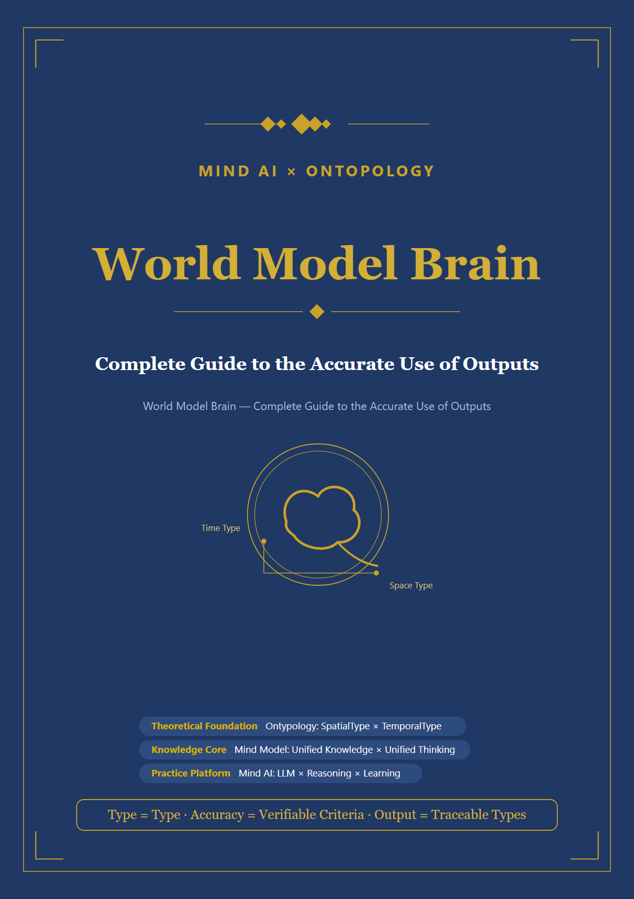

## TABLE OF CONTENTS

- **Preface: Three Conventions 3**
- **Introduction: The World Model Brain in One Diagram 5**
- **Chapter 1 The World Model Brain: A Brain That Builds Types for the World 7**
- 1.1 What Is a World Model: Putting the World into Types 7
- 1.2 What Is a Brain: A Thinking Body of Type + Number 8
- 1.3 Space Type Takes Its Seat: Three Axes and Three Brackets of the World 8
- 1.4 Time Type Takes Its Seat: The Verb Deck of the World 9
- 1.5 Where the Two Types Meet: World State = Type × Motion 10
- **Chapter 2 Five Deliverables: What the World Model Brain Hands Over 12**
- 2.1 The Deliverable Chain at a Glance: Build Type → Make Move → Simulate → Judge → Evolve 12
- 2.2 Deliverable 1: WorldType 12
- 2.3 Deliverable 2: MotionType 14
- 2.4 Deliverable 3: Trace 14
- 2.5 Deliverable 4: Verdict 15
- 2.6 Deliverable 5: EvolutionLog 16
- **Chapter 3 Where Accuracy Comes From: Four Layers of Accuracy Guarantees 18**
- 3.1 What "Using It Accurately" Means 18
- 3.2 Layer 1: The Intersection Criterion ∩(T) — Membership Acceptance 19
- 3.3 Layer 2: The Invariance Axiom and id(C) — Identity Anchoring 20
- 3.4 Layer 3: The Three remove Levels — Structural Dependence 20
- 3.5 Layer 4: The Type Evidence Chain — Traceability 21
- 3.6 Cross Acceptance: Space Criteria × Time Criteria 22
- **Chapter 4 How to Use Deliverables Accurately: Six Steps 23**
- 4.1 The Six Steps at a Glance 23
- 4.2 The Running Example: One Judgment by a Meal-Delivery Robot 24
- 4.3 Walking All Six Steps, Cell by Cell 24
- 4.4 Criterion Acceptance: Three-Layer Judgment 26
- 4.5 Using Time Type: Picking, Composing, and Swapping Moves 26
- **Chapter 5 Misuse Comparisons and the Checklist 28**
- 5.1 Five Kinds of Misuse 28
- 5.2 The Ten-Question Checklist 29
- 5.3 Maturity L1–L4: Four Grades of Deliverables 30
- **Review: Key Points Recap and Self-Check 31**
- **Appendix: Quick Reference for Terms and Notation 33**

## Preface: Three Conventions

The World Model is moving from a term in academic papers into the daily work of robots, simulation systems, and decision platforms. Yet the question that follows is rarely answered head-on: what the World Model Brain hands over — a description of the world, a simulated inference, a recommended action — how exactly should it be used for the use to count as "accurate"? A world model used inaccurately is more dangerous than no world model at all, because it delivers wrong answers with confidence.

This book answers only one question: how the deliverables of the World Model Brain can be used accurately. It is a complete program — first define the deliverables clearly (Chapter 2), then define where accuracy comes from (Chapter 3), then give an operable method of use (Chapter 4) and an error-proofing mechanism (Chapter 5). Before we begin, we set down three conventions that run through the whole book.

#### Convention 1: The English for 形 is Type, not Form

In Ontypology, 形 is always written in English as Type. The WorldType is WorldType, the MotionType is MotionType, and the abstract category is T = (F(T), ∩(T)). The word Form never appears in this book — it is a misunderstanding in the history of translation, not our language. Wherever the word Type appears in this book, read it as Type.

#### Convention 2: Ontypology Is Only Used, Not Taught

The theoretical foundation of this book is the two halves of Ontypology: Space Type and Time Type. Space Type answers what the world "is"; Time Type answers how the world "moves". This book takes its tools out and uses them — the three brackets, the Intersection Criterion, the Invariance Axiom, the three remove levels, the Four-Step Framing, the Three-Layer Judgment, the Motion Deck — but does not restate the theory itself. For the full theoretical argument, return to Ontypology: Space Type and Ontypology: The Time Type Volume; this book is only responsible for applying them to world models.

#### Convention 3: Mind AI Is Only Cited, Not Described, and There Is No System Implementation

The underlying platform is Mind AI — an AGI practice platform combining Ontypology, the Mind Model, and LLMs. The World Model Brain is built on it: the LLM provides language ability, the Mind Model provides intelligence ability. This book cites this division of labor but does not restate the platform introduction; for the full introduction, see Introducing Mind AI. Likewise, this book discusses methods and usage and contains no system implementation — it is a program for "how to use it accurately", not a specification for "how to build it".

| **Chapter** | **Question answered** | **Core deliverable** |
| --- | --- | --- |
| Preface & Introduction | What are the three conventions? What does the book's map look like? | Reading contract |
| Chapter 1 | What is the World Model Brain? How do the two Types take their seats? | Worldview |
| Chapter 2 | What does the World Model Brain hand over? | Five deliverables: Type, Move, Trace, Verdict, Log |
| Chapter 3 | Where does accuracy come from? | Four layers of accuracy guarantees |
| Chapter 4 | How are deliverables used? | The six-step method of use |
| Chapter 5 | How to prevent errors and accept? | Misuse comparison + checklist + maturity |
| Review & Appendix | How to review quickly and look things up? | Self-check sheet + terms and notation quick reference |

*Table 0-1 The book's task map: each chapter answers one question and hands over one verifiable thing*

## Introduction: The World Model Brain in One Diagram

Before opening any chapter, look at one diagram first. The World Model Brain can be compressed into one sentence: a brain that takes the two Types of Ontypology as its theoretical foundation, the Mind Model as its knowledge core, and Mind AI as its practice platform — building Types for the world, building Moves for change, and accepting every deliverable against criteria.

> 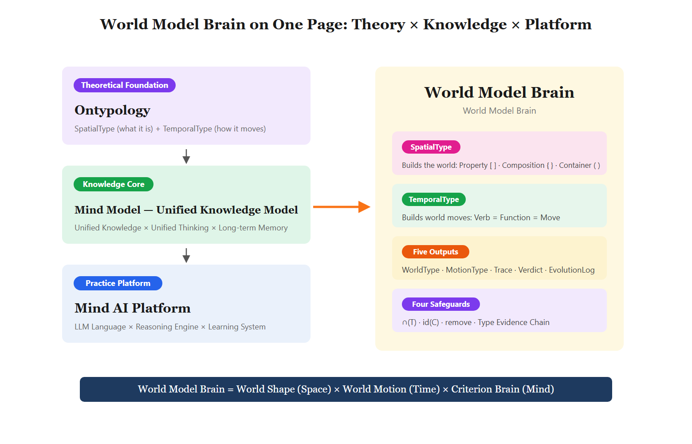  
> *Figure D-1 The World Model Brain in one diagram: theory × knowledge × platform, deliverables rest on the four guarantee layers*  

The diagram reads bottom-up. The bottom layer is the theoretical foundation: Ontypology hands the world's structure to Space Type and the world's change to Time Type. The middle layer is the Mind Model: it unifies knowledge and thinking in one architecture, making the world model not just "a world in storage" but "a world that reasons". The top layer is the Mind AI platform: the LLM's language ability and the Mind Model's intelligence ability divide the labor here. Standing on these three layers, the World Model Brain hands over five deliverables and submits to acceptance by four layers of accuracy guarantees.

| **Aspect** | **Who is responsible** | **In one sentence** |
| --- | --- | --- |
| Space Type | Ontypology | Answers "what it is": Property[ ], Composition{ }, Container( ) |
| Time Type | Ontypology | Answers "how it moves": verb ＝ function ＝ Move |
| Knowledge & Thinking | Mind Model | Unified knowledge representation + unified reasoning and thinking |
| Language & Implementation | Mind AI platform | LLM handles language, Mind Model handles intelligence |
| Accuracy acceptance | Chapter 3 of this book | ∩(T), id(C), remove, Type Evidence Chain |

*Table D-1 Two Types × platform division of labor: who is responsible for what, in one table*

#### Three Ways to Read This Book

If you want to get hands-on fast, read the Six Steps in Chapter 4 and the checklist in Chapter 5 and follow them before going to work. If you want to know what you are actually using, read Chapters 1 and 2 and load the worldview and the five deliverables into your head. If you are responsible for acceptance, read Chapters 3 and 5 and turn the four guarantee layers and the ten questions into an acceptance sheet. All three readings converge on the same sentence: for deliverables to be used accurately, let the criteria speak first.

> **◆ Introduction key points**  
> World Model Brain ＝ the world's Type (Space) × the world's Motion (Time) × the criteria brain (Mind).  
> Five deliverables: WorldType, MotionType, Trace, Verdict, EvolutionLog — one chain, not five reports.  
> Accuracy is not an adjective; it is the result of four stacked criteria layers.  

**Chapter 1 The World Model Brain: A Brain That Builds Types for the World**

### 1.1 What Is a World Model: Putting the World into Types

First, rule out three misunderstandings. A world model is not a photograph of the world — a photo has only an appearance, no structure; not a database of the world — a database has only records, no criteria; and not a copy of a knowledge graph — a graph has nodes and edges but lacks abstract rules and structures of thought. A world model is a "reasoning-capable replica" of the world: it not only remembers what the world looks like, it can answer "if this, then what happens to the world".

Ontypology's answer to the world model is one sentence: everything in the world can be expressed and understood through Types. Putting the world into Types means describing the world's structure with three axes (Space Type), recording the world's change as Moves (Time Type), and then verifying every description and every change against criteria. Only a world built this way is a world that can be reasoned about.

> 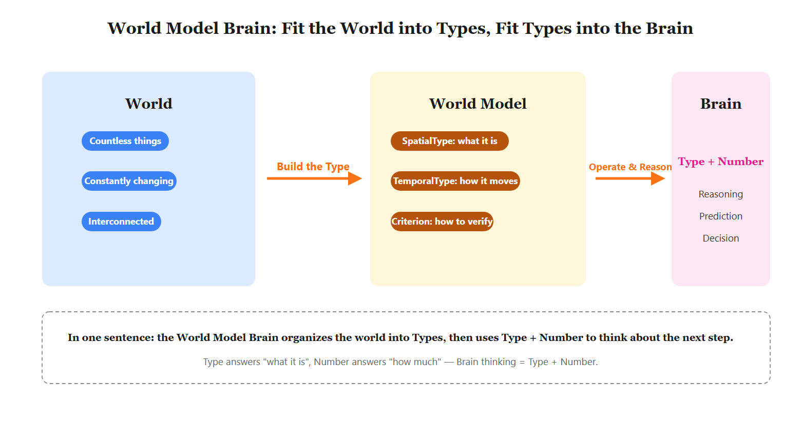  
> *Figure 1-1 The World Model Brain: putting the world into Types, and Types into the brain*  

Figure 1-1 is the foundation of the whole book. On the left is the world: all things, constantly changing, mutually related. In the middle is the act of building Types: use Space Type to describe "what it is", Time Type to describe "how it moves", and criteria to govern "how to verify". On the right is the brain: holding Types and Numbers, it reasons, predicts, and decides. Only when the three pieces fit together do you get the World Model Brain — remove any one piece and it degrades into a database, a slide deck, or a chatbot.

**The minimal unit of a world model ＝ WorldType · every step of change in the world ＝ MotionType**

### 1.2 What Is a Brain: A Thinking Body of Type + Number

Ontypology has one proposition that runs through the whole book: brain thinking ＝ Type + Number. Type answers "what it is"; Number answers "how much". Mathematics describes quantities, relations, and regularities; Ontypology describes structure, composition, relations, evolution, and essence. Missing either one, thinking goes lame — Number without Type turns the world into a pile of digits; Type without Number turns the world into a pile of names.

The World Model Brain is a brain that holds a world model and can think about its next step with Type + Number. It does four things: builds Types for the world (organizing scenes into WorldTypes), builds Moves for change (organizing verbs into MotionTypes), simulates and judges (unrolling the process, issuing the verdict), and self-evolves (writing experience back into the model). What these four things produce — Types, Moves, Traces, Verdicts, Logs — are the five deliverables that Chapter 2 unpacks one by one.

Here we must be especially clear about what the World Model Brain is "not". It is not a Q&A bot: a chatbot gives answers made of language, the World Model Brain gives verifiable deliverables. It is not an optimization engine either: an optimization engine gives only the optimal solution, while the World Model Brain also gives you criteria, reasons, and the scope of validity. One-sentence positioning — the World Model Brain is a thinking body that organizes the world into Types, change into Moves, and conclusions into verdicts.

### 1.3 Space Type Takes Its Seat: Three Axes and Three Brackets of the World

Space Type describes a Type with three axes: the X axis is Property — what it looks like; the Y axis is Composition — what it is made of; the Z axis is Container — what it holds where. Each axis has its own bracket: Property uses square brackets [ ], Composition uses curly braces { }, Container uses parentheses ( ). This notation is carried over wholesale onto the world model: every scene, every device, every route in the world can be described once with three axes and recorded with three brackets.

| 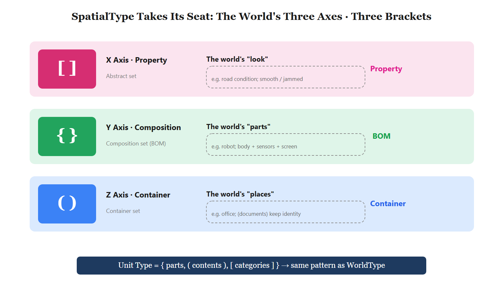 *Figure 1-2 Space Type takes its seat: three axes, three brackets, applied directly to the world* |  |  |  |
| --- | --- | --- | --- |
| **Axis** | **Bracket** | **Question answered** | **World model example** |
| X axis, Property | [ ] | What does it look like? | Traffic: [Smooth] / [Congested]; floors: [2F]–[12F] |
| Y axis, Composition (BOM) | { } | What is it made of? | Robot ＝ {Chassis, Sensors, Screen}; Elevator ＝ {Cabin, Door, Buttons} |
| Z axis, Container | ( ) | What does it hold where? | Elevator cabin (passengers): swap the passengers, still the same elevator |

Two disciplines govern the use of these three axes. The first is the BOM criterion's mnemonic: taken apart, does it still recognize itself? A sensor taken off the robot is still a sensor, so it goes into { }; the state "in motion" taken apart is nothing at all, so it does not go into { } — that is a Property. The second discipline comes from the Four-Step Framing: the world keeps producing new differences — new traffic conditions, new equipment, new regulations — and whenever a batch of new differences fails to match existing dimensions (a failed comparison), run one cycle of "discriminate similarities and differences → trigger abstraction → name a dimension → judge membership". If the new thing matches an existing dimension, hang it directly on it; only if it does not match do you open a new dimension. The axes of a world model are not drawn once and fixed — they grow along with the world.

### 1.4 Time Type Takes Its Seat: The Verb Deck of the World

The world moves. Space Type cannot say how the world moves, just as a photograph cannot tell a story. Time Type supplies the other half: Time Type ＝ verb ＝ function ＝ method ＝ Move. Every kind of change in the world — moving, waiting, reasoning, deciding, learning — can be named and collected into a "Motion Deck". Every action of the World Model Brain is picking one Move from the deck, or composing several into one.

| 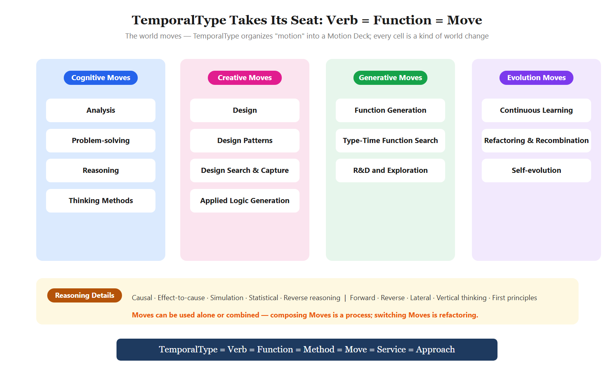 *Figure 1-3 The Time Type Motion Deck: collecting the world's "motion" into fourteen moves* |  |  |
| --- | --- | --- |
| **Group** | **Moves** | **Where it is used in the world model** |
| Cognitive moves | Analysis, Problem Solving, Reasoning, Thinking Methods | Read the situation: what this traffic is and where the problem lies |
| Creative moves | Design, Design Patterns, Design Search & Extraction, Logic Generation & Application | Create new solutions: plan routes, apply proven patterns |
| Generative moves | Function Generation & Application, Time Function Search, R&D and Exploration | Grow new capabilities: compose new functions, search for usable moves |
| Evolutionary moves | Continuous Learning, Restructuring & Reorganization, Self-Evolution | Write experience back into the model to smooth the next run |

The reasoning Moves deserve a closer look, because they are the engine of the Trace. Causal reasoning asks "what causes what"; effect-to-cause reasoning asks in reverse "what caused this outcome"; simulation reasoning pushes the world one step forward inside the brain; statistical reasoning reads possibility out of distributions; backward reasoning works from the goal back to the path. The thinking methods listed alongside it — forward, backward, lateral, vertical, first principles — are the postures for making the move. The same situation, cut into with different reasoning Moves, unrolls into different versions of the Trace; the differences between versions are exactly what the Verdict must explain.

### 1.5 Where the Two Types Meet: World State = Type × Motion

The two Types meet on the time axis: the world at each "moment" is a WorldType; each "action" is applying a MotionType. Pushing the world from t0 to t1 means making the Move g on the WorldType S0 to get S1. What the World Model Brain remembers is not only every state but every Move between states — this is its fundamental difference from a database.

> 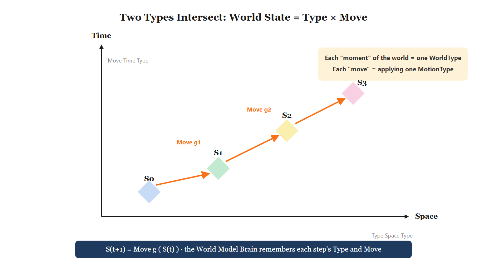  
> *Figure 1-4 The two Types meet: the world evolves move by move*  

**S(t+1) ＝ Move g ( S(t) ) · the world model remembers the Type and the Move of every step**

One final emphasis on the division of labor, the coordinate the whole book returns to: Space Type cannot say how the world moves; Time Type cannot say what it is that moves. To describe a world, both Types must appear; to accept a deliverable, both the Space criteria and the Time criteria must be checked. Any deliverable missing one side must be labeled downgraded — this rule becomes the formal cross acceptance in Chapter 3.

> **◆ Chapter key points**  
> World model ＝ a reasoning-capable replica of the world: describable, simulatable, verifiable, evolvable.  
> WorldType inherits the unit Type's three axes: Property[ ], Composition{ }, Container( ); the BOM criterion mnemonic ＝ taken apart, does it recognize itself?  
> Time Type ＝ verb ＝ Move: four groups, fourteen moves; the reasoning moves are the engine of simulation.  
> World state ＝ Type × Motion: S(t+1) ＝ g(S(t)); neither of the two Types can be missing.  

**Chapter 2 Five Deliverables: What the World Model Brain Hands Over**

### 2.1 The Deliverable Chain at a Glance: Build Type → Make Move → Simulate → Judge → Evolve

The World Model Brain hands over five deliverables: WorldType, MotionType, Trace, Verdict, EvolutionLog. They are not five independent reports but one chain of deliverables — building a Type hands over a WorldType, making a Move hands over a MotionType, simulating hands over a Trace, judging hands over a Verdict, learning hands over an EvolutionLog. The most common mistake of those who read deliverables is to take one link off the chain and use it alone; the correct way is to read along the chain: first the Type, then the Move, then the Trace, only then trust the Verdict, and finally audit the Log.

| 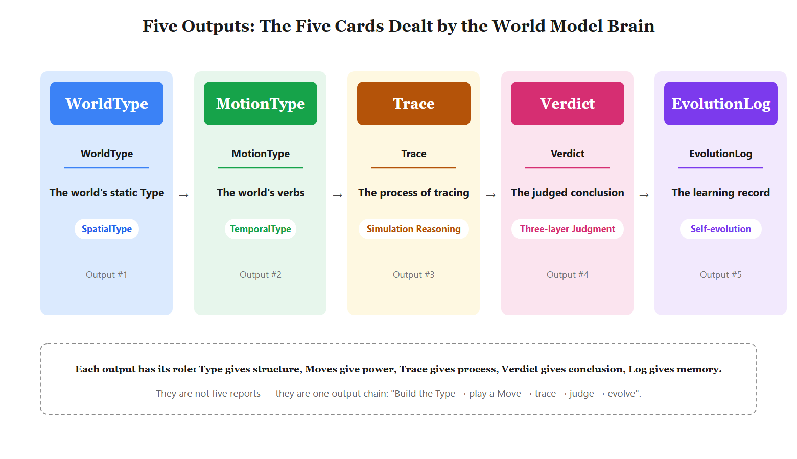 *Figure 2-1 The five deliverables at a glance: Type, Move, Trace, Verdict, Log* |  |  |  |  |
| --- | --- | --- | --- | --- |
| **Deliverable** | **English** | **What it is** | **Theoretical basis** | **In one sentence** |
| WorldType | WorldType | A scene notated as a set of Types | Space Type | Freezes the world's "what it is" |
| MotionType | MotionType | A verb as a function card | Time Type | Makes the world's "how it moves" a move |
| Trace | Trace | The process record of Types and Moves | Simulation reasoning | Unrolls the change for you to see |
| Verdict | Verdict | The conclusion of the three-layer judgment | Three-Layer Judgment | A conclusion with reasons |
| EvolutionLog | EvolutionLog | The passbook of learning and restructuring | Self-evolution | The memory that makes the next round more accurate |

### 2.2 Deliverable 1: WorldType

A WorldType is the deliverable that notates a scene as a set of Types. It inherits the full notation of the unit Type: curly braces hold the separable parts, parentheses hold the insertable contents, square brackets hold the judgeable categories. Take the meal-delivery robot that runs through this book: the office-corridor scene can be notated as:

**Corridor scene ＝ { Robot, Door, Elevator, ( Takeout Meal ), [ Corridor ] }**

> 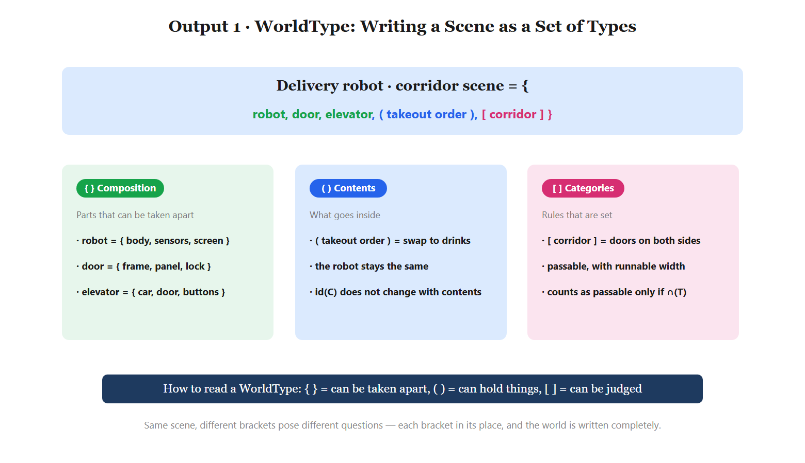  
> *Figure 2-2 WorldType notation: three brackets, each governing one kind of question*  

This line is read the way the three brackets are read. { Robot, Door, Elevator } says: the separable parts of this scene are these three, and the robot itself can be decomposed further into { Chassis, Sensors, Screen } — the BOM drills down layer by layer. ( Takeout Meal ) says: the meal is the contents placed inside; swap it for a drink or an empty car and the scene's identity is unchanged — that is container logic. [ Corridor ] says: this scene belongs to the category "Corridor", and at judgment time it must be verified item by item against the corridor's Intersection Criterion.

| **Field** | **Content** | **Example** |
| --- | --- | --- |
| Name | The scene in one sentence | Office corridor, meal-delivery situation |
| Notation | The full Type-set expression | { Robot, Door, Elevator }, ( Takeout Meal ), [ Corridor ] |
| Three-axis details | Property table, BOM, Container | Property: floor, time of day; BOM: three-level drill-down; Container: id(C) marking |
| Criteria | ∩(T) feature list | [Corridor]: doors on both sides, clear passage, sufficient width |
| Version | The EvolutionLog entry number | W-031 (see Section 2.6) |

The mnemonic for reading a WorldType is three sentences: curly braces can be taken apart, parentheses can hold contents, square brackets can be judged. Understand all three and you know where the boundary of this world description lies; miss any one and you will mistake contents for parts, or a list for rules.

### 2.3 Deliverable 2: MotionType

A MotionType is the deliverable that solidifies a verb into a function card. Time Type says "Time Type ＝ verb ＝ function ＝ method ＝ Move ＝ service ＝ gateway" — the MotionType is that sentence landing on the ground: one card, one name, one set of preconditions, one effect. Every action of the World Model Brain can be traced back to some Motion card; an action without a card is an unregistered black move and is rejected at acceptance.

| 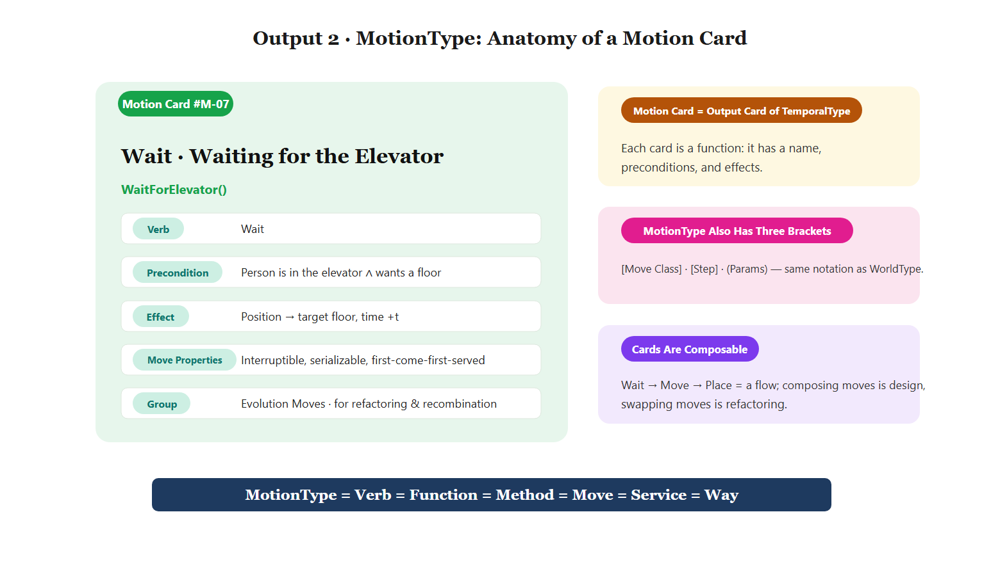 *Figure 2-3 Anatomy of a Motion card: verb, preconditions, effect, move attributes, owning group* |  |  |
| --- | --- | --- |
| **Field** | **Content** | **Why the field exists** |
| Move name | Verb + object | Only when it can be named can it be searched and cited |
| Preconditions | Conditions that must hold before the move is made | Prevents illegal chaining: preconditions unmet, move illegal |
| Effect | How the WorldType changes after the move | Every cell of the Trace must match some move's effect |
| Move attributes | Interruptible? queueable? parallel? | The compatibility basis when composing moves |
| Owning group | Cognitive / Creative / Generative / Evolutionary | Linked to the EvolutionLog: only evolutionary moves change the model |

The MotionType also uses the three-bracket notation: [Move Class] is the category it belongs to (e.g. [Wait Move]), {Steps} is its separable action sequence, (Parameters) are the inputs it can swap (floor, time of day). The same notation as the WorldType — not a coincidence but Ontypology's unity: describing "things" and describing "actions" use the same language of Type.

### 2.4 Deliverable 3: Trace

A Trace is the deliverable that unrolls "how it moved" for you to see. It is woven from two sequences: the WorldType sequence S0, S1, S2… and the Move sequence g1, g2, g3… Every cell records: what Type the world was at this moment, which Move was used, and what Type it became. The Trace can be replayed — its most important property: any stretch of reasoning can be re-unrolled and checked step by step.

> 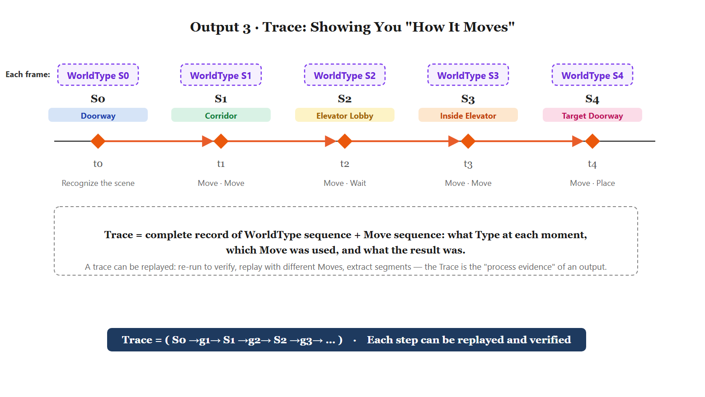  
> *Figure 2-4 The Trace: the complete record of the WorldType sequence and the Move sequence*  

Different reasoning Moves leave different marks on the scroll. Simulation reasoning unrolls the full sequence of "if this, what happens to the world"; causal reasoning marks the causal cross-section on the scroll — which cell is the cause, which the effect; statistical reasoning attaches a distribution and confidence beside each cell; backward reasoning reads the scroll in reverse — from the goal cell back to the current cell. When a Verdict cites a Trace it gives the scroll number and cell number, e.g. Trace T-107 cell 3 — this is the "process evidence" of the Type Evidence Chain in Chapter 3.

### 2.5 Deliverable 4: Verdict

The Verdict is the conclusion deliverable of the Three-Layer Judgment, and the only one of the five deliverables that gets executed directly — which is exactly why its format is the strictest. A Verdict must have four elements: the conclusion (what to do), the reasons (how each criterion was passed), the scope of validity (where it applies and when it expires), and the evidence-chain pointer (the cited Trace numbers). Missing any one element, it counts only as a suggestion, not a verdict.

> 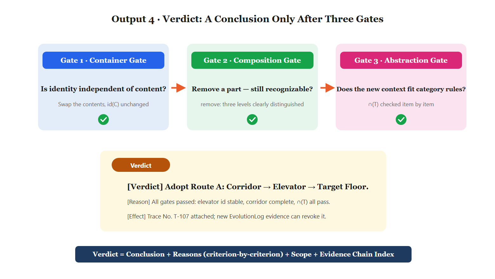  
> *Figure 2-5 The Verdict: a conclusion issued only after all three gates pass*  

The Verdict carries an important humility clause: it can be revoked and re-judged. When the EvolutionLog grows new evidence — for example, the elevator on some route is often full at peak hours — the old verdict's scope of validity automatically narrows, and the World Model Brain must re-run the simulation and re-issue the verdict. A verdict is not an imperial edict; it is "the best conclusion given current evidence". Treating the verdict as an edict is misuse #1 in Chapter 5's comparison table.

### 2.6 Deliverable 5: EvolutionLog

The EvolutionLog is the world model's learning passbook. Time Type lists continuous learning, restructuring and reorganization, and self-evolution as three evolutionary Moves; the EvolutionLog is the form those three Moves take in practice: every entry records an event, a disposition, and a write-back. The event is what the world taught us; the disposition is which column of which card we changed; the write-back is which WorldType or MotionType the change flowed into.

> 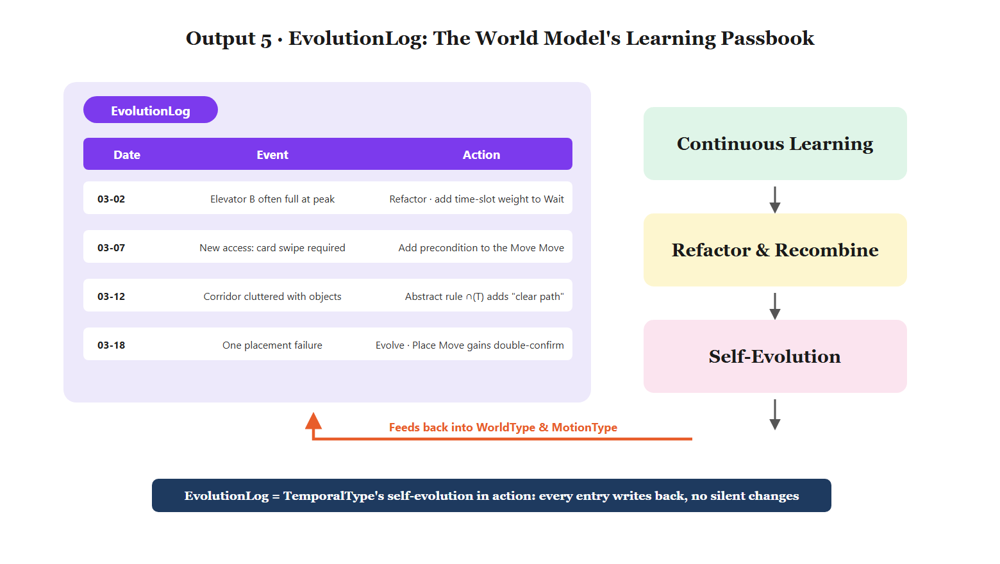  
> *Figure 2-6 The EvolutionLog: every entry writes back to the model; no silent changes*  

The EvolutionLog has only one discipline: no silent changes. Every change to the model must land on the log, so that whoever takes a deliverable can answer "which version of the model produced this deliverable". This is the last insurance of deliverable trustworthiness — a world model without an EvolutionLog will turn, one fine morning, into a black box you no longer recognize.

| **Deliverable** |  | **Space Type's contribution** | **Time Type's contribution** | **Main criterion** |
| --- | --- | --- | --- | --- |
| WorldType |  | Three axes, three brackets, Type-set notation | — | ∩(T), BOM criterion |
| MotionType |  | [MoveClass]{Steps}(Parameters) notation | Verb ＝ function ＝ Move | Precondition check |
| Trace |  | The WorldType of every cell | How every move is made | Replayable step by step |
| Verdict |  | The structure of the three-layer judgment | The reasons of the reasoning moves | Joint three-layer judgment |
| EvolutionLog |  | Writes back WorldType versions | Continuous learning, restructuring, self-evolution | Write-back is traceable |
| **◆ Chapter key points** The five deliverables are one chain: build Type → make Move → simulate → judge → evolve; read along the chain, never pluck a single link. WorldType ＝ Type-set notation; MotionType ＝ function card; both share the three-bracket language. The Trace is replayable and is process evidence; a Verdict counts as a verdict only with all four elements complete, and can be revoked and re-judged. The EvolutionLog has one discipline: no silent changes. |  |  |  |  |

**Chapter 3 Where Accuracy Comes From: Four Layers of Accuracy Guarantees**

### 3.1 What "Using It Accurately" Means

In this book "accuracy" is not a compliment but a testable definition. For a deliverable to be used accurately, three things must hold at once: it matches the world (the described scene really exists, the simulated outcome really happens); it is consistent with its own criteria (every criterion it claims to pass can be re-verified item by item); and it can be re-verified by a third party (another person, given the same deliverable and the same criteria, reaches the same conclusion). Missing any one, "accuracy" degenerates into an adjective.

Landing these three things on Ontypology's tools yields four layers of accuracy guarantees: membership accuracy (the Intersection Criterion), identity accuracy (the Invariance Axiom and the Identity Anchor), structural accuracy (the three remove levels), and traceability accuracy (the Type Evidence Chain). The first three layers come from the three axes of Space Type; the fourth connects the time axis — every simulation and every evolution must leave a traceable trail. The four layers stack bottom-up: if a lower layer falls, the prettier upper layers must be used at a downgraded level.

| 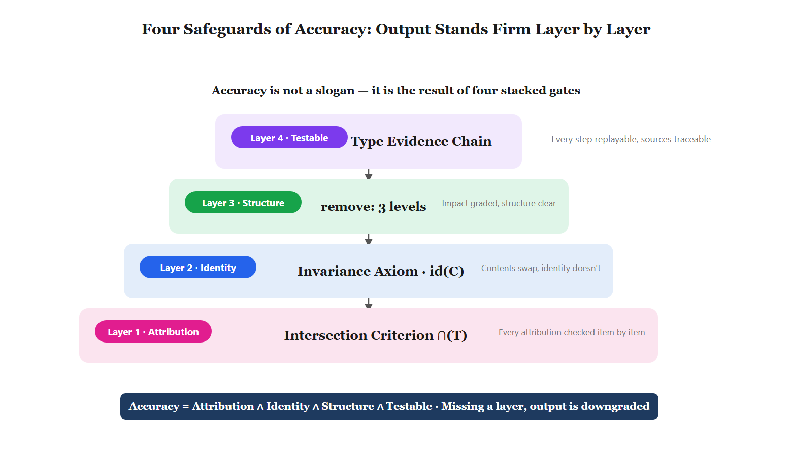 *Figure 3-1 Four layers of accuracy guarantees: a ladder climbed one layer at a time* |  |  |  |
| --- | --- | --- | --- |
| **Layer** | **Criteria** | **What it governs** | **Consequence if it falls** |
| Layer 1, Membership accuracy | ∩(T) Intersection Criterion | Every membership in a deliverable can be checked item by item | Misclassification: counting in what should be out |
| Layer 2, Identity accuracy | id(C), Invariance Axiom | Contents change endlessly; identity does not drift | Identity drift: one thing treated as two |
| Layer 3, Structural accuracy | Three remove levels | Part impacts graded transparently | Structural distortion: unclear which missing part breaks it |
| Layer 4, Traceability accuracy | Type Evidence Chain | Every step replayable and traceable | Black-boxing: conclusions cannot be reproduced |

### 3.2 Layer 1: The Intersection Criterion ∩(T) — Membership Acceptance

Layer 1 governs membership. The deliverables of the World Model Brain are full of membership claims: this traffic condition belongs to [Congested]; this robot belongs to [Meal-Delivery Robot]; this scene belongs to [Corridor]. Every claim must be writable as an Intersection Criterion: the abstract category T is determined by two things, the feature set F(T) and the Intersection Criterion ∩(T); object x belongs to T if and only if every feature of F(T) passes.

> 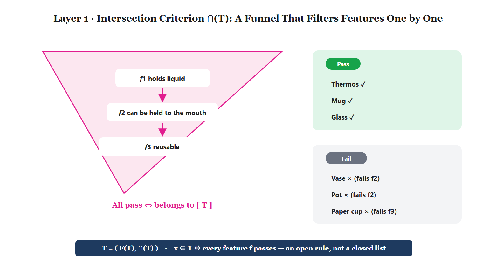  
> *Figure 3-2 The Intersection Criterion funnel: features filtered item by item; membership only when all pass*  

The usage is like a funnel. First write the features ([Corridor] requires: doors on both sides, clear passage, sufficient width), then pour the new situation in item by item; membership holds only when everything passes. Boundary cases of the funnel are used to calibrate the rules: if a "corridor piled with clutter" is judged to be a [Corridor], either the features gain "clear passage" or it should have been excluded all along — boundary cases are the whetstone of ∩(T).

Here we restate a key point of Ontypology: ∩(T) is an open rule, not a closed list. A list can only judge "what I have listed"; a rule can judge "what has never been seen". The world generates new situations every day, and only open rules can catch them — this is the fundamental reason the Intersection Criterion beats a whitelist.

### 3.3 Layer 2: The Invariance Axiom and id(C) — Identity Anchoring

Layer 2 governs identity. World models are full of containers: an elevator car holds passengers, a robot holds meals, a folder holds files. The criterion for containers is a single Invariance Axiom: before and after the contents are replaced, the container's identity anchor id(C) is unchanged. In notation, C ＝ ( id(C), S(C) ): id is identity, S is contents; contents change a thousand times, identity does not drift.

> 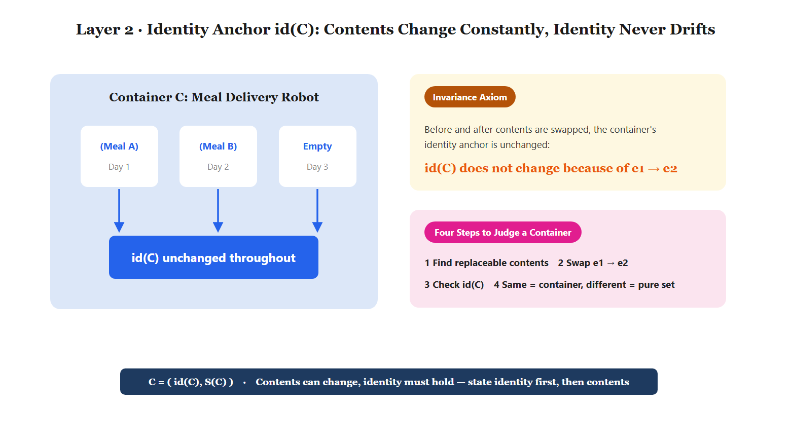  
> *Figure 3-3 The identity anchor id(C): swap the contents, the container is still the same container*  

At acceptance time, Layer 2's operation is the four steps of container judgment: find the replaceable contents, replace them, check id(C), and decide — if identity is unchanged it is a container relation, marked with ( ) and id(C); if identity changed it is a pure set relation, and container logic must not be forced onto it. The deliverable format therefore has one hard requirement: report identity first, then discuss contents. A deliverable that treats "the robot with a different meal" as "a different robot" fails acceptance at this layer outright.

### 3.4 Layer 3: The Three remove Levels — Structural Dependence

Layer 3 governs structure. In a deliverable's BOM, each part affects the whole differently, and the effect must be graded explicitly. The criterion is remove: after taking part p out of the whole M, does M still recognize itself? There are three answers — it does not (remove(p,M) ≢ M): p is an essential part, without it identity is lost; it does but a function is missing: p is a function-degrading part; no difference at all (≡ M): p is a non-essential part.

> 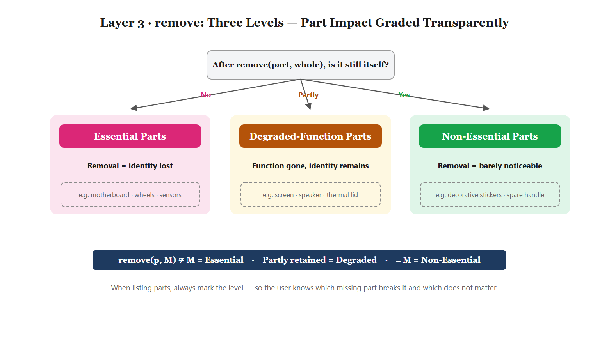  
> *Figure 3-4 The three remove levels: transparent grading of part impacts*  

This grading becomes a format requirement for deliverables directly: part lists must carry grades. The reader should see at a glance — without the sensor the whole vehicle is down (essential part), without the screen only interaction is lost (degrading part), without a decorative sticker nothing happens (non-essential part). Flattening the three grades into one list is lying about structure — the classic shape of structural distortion.

### 3.5 Layer 4: The Type Evidence Chain — Traceability

Layer 4 governs tracing. The first three layers guarantee a deliverable "is right now"; Layer 4 guarantees that "why it is right" can be reproduced. The Type Evidence Chain links every deliverable to its upstream: which WorldType version this conclusion came from, which cell of which Trace, which criteria were checked off, which version of the EvolutionLog wrote back. Four questions — who is the source, where is the process, how many criteria, when does it expire — if any one cannot be answered, this deliverable has not yet grown an evidence chain.

| **Notation** | **How to read it** | **Where it is used** | **In one sentence** |
| --- | --- | --- | --- |
| T ＝ ( F(T), ∩(T) ) | Abstract category T determined by features and criteria | Membership acceptance | An open rule, not a closed list |
| x ∈ T | x passes ∩(T) and belongs to T | Membership conclusion | Holds only when every feature is checked off |
| C ＝ ( id(C), S(C) ) | Container ＝ identity + contents | Identity anchoring | Report identity first, then discuss contents |
| remove(p, M) ≢ M | Remove p and M is no longer M | Structural grading | p is an essential part |
| remove(p, M) ≡ M | Remove p and M is still M | Structural grading | p is a non-essential part |
| S(t+1)＝g( S(t) ) | Move g advances the world one cell | Simulation replay | Every cell can point back to a move |

### 3.6 Cross Acceptance: Space Criteria × Time Criteria

Space criteria govern what a deliverable "is"; Time criteria govern how it "moves". The Time criteria have four questions: do the Move's preconditions hold; is the described effect verifiable; does the Trace match the Motion card; does evolution write back to the log. Crossing these four with the three Space criteria yields a complete acceptance net — a deliverable accurate in space but not in time is like a map with the timeline drawn wrong; accurate in time but not in space is like a play with no set.

| **Acceptance question** |  | **Space aspect** | **Time aspect** |
| --- | --- | --- | --- |
| Is the membership right? |  | ∩(T) checked item by item | Does the situation match the preconditions? |
| Is identity stable? |  | id(C) does not drift with contents | Does the same move still point to the same card across versions? |
| Is the structure transparent? |  | Three remove levels labeled | Is the dependency order of the Move sequence right? |
| Is traceability complete? |  | WorldType versions can be looked up | Can the Trace be replayed and the EvolutionLog traced? |
| **◆ Chapter key points** Definition of accuracy: matches the world, consistent with its criteria, re-verifiable by a third party. Four guarantee layers: membership ∩(T) → identity id(C) → structure remove → traceability Type Evidence Chain. ∩(T) is an open rule; deliverables report identity before contents; part lists must carry grades; every deliverable must answer the evidence chain's four questions. Space and Time criteria cross-accept; missing one side means a downgraded label. |  |  |  |

## Chapter 4 How to Use Deliverables Accurately: Six Steps

### 4.1 The Six Steps at a Glance

Putting the equipment of the first three chapters into one process gives the six steps of accurate use: identify the situation, build Types along the axes, pick the moves, generate deliverables, accept against criteria, archive and evolve. The six steps form a circle — the evolution of step six makes the next round's step one more accurate. The first five steps govern "getting it right this time"; the sixth governs "getting it more right next time". Accuracy is not achieved in one shot — it grows.

| 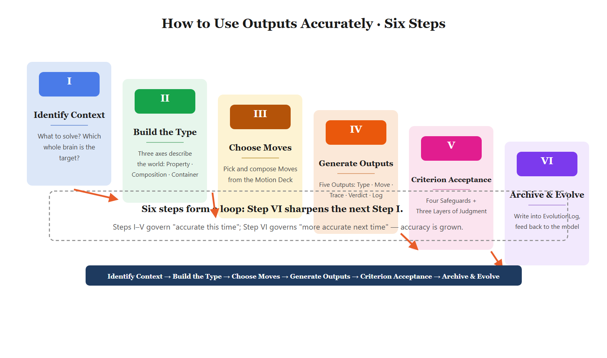 *Figure 4-1 The six steps: a process for using deliverables accurately* |  |  |  |
| --- | --- | --- | --- |
| **Step** | **Operation** | **Deliverable** | **Common tools** |
| 1. Identify the situation | Say clearly what is to be solved and which whole is the object of judgment | The situation in one sentence | — |
| 2. Build Types along the axes | Describe the world with three axes and write it as a Type set | WorldType | Three brackets, Four-Step Framing |
| 3. Pick the moves | Pick and compose moves for the situation | Move sequence | Motion Deck, precondition check |
| 4. Generate deliverables | Simulate, judge, log | Trace, Verdict, EvolutionLog | Simulation reasoning, Three-Layer Judgment |
| 5. Accept against criteria | Four guarantee layers + cross acceptance, cell by cell | Acceptance record | ∩(T), id(C), remove, Evidence Chain |
| 6. Archive and evolve | Event, disposition, write-back | A new EvolutionLog page | Continuous learning, restructuring, self-evolution |

### 4.2 The Running Example: One Judgment by a Meal-Delivery Robot

Use one concrete situation to walk all six steps. A meal-delivery robot in an office building gets a task: deliver a meal from floor 2 to floor 8. Two routes are in front of it — take the main-door elevator, or cut through the stairwell shortcut piled with clutter. The World Model Brain must produce a verdict telling the robot which route to take and how. The situation is just the right size: the three axes have things to describe, the Motion Deck has Moves to pick, the criteria have checks to run.

> 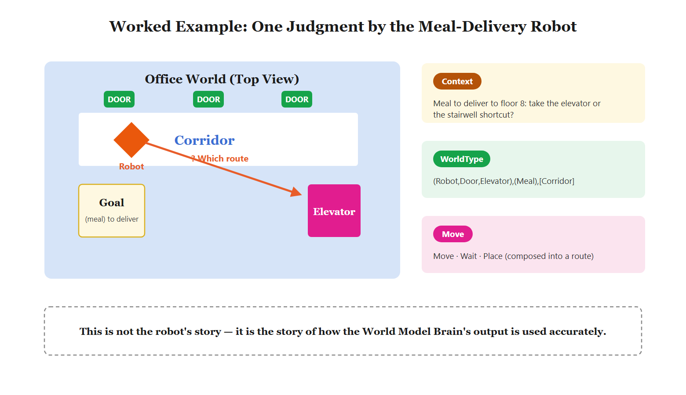  
> *Figure 4-2 The running example scene: an office world and one delivery judgment*  

### 4.3 Walking All Six Steps, Cell by Cell

Step one, identify the situation: the object of judgment is "one meal-delivery task of the robot", not the robot itself and not the whole building — identifying the whole is the starting point of all judgment. Step two, build Types along the axes: Property records the floor and the time of day; the BOM decomposes { Chassis, Sensors, Screen }; the Container marks ( Takeout Meal ) as replaceable while the id stays the same; written as WorldType W-031.

This step also uses the Four-Step Framing. The scene produces a batch of new differences — the building has installed access-control cards — which match neither the existing "traffic" nor "floor" dimensions: comparison fails, abstraction is triggered. Name a new dimension "Access Control", then judge membership: the access requirements of the two candidate routes are hung under this new dimension and re-verified. This is the daily life of the Four-Step Framing inside a world model: the axes of the world are forced to grow by the world's differences.

Step three, pick the moves: from the Motion Deck pick Move, WaitForElevator, and Place, composing a delivery process; check preconditions — the Wait Move requires "person at the elevator lobby ∧ has a floor need", which holds. Step four, generate deliverables: run simulation reasoning to unroll Trace T-107 (five cells: doorway → corridor → elevator lobby → inside elevator → target doorway), issue Verdict V-12 (take the main-door elevator), and record one entry in the EvolutionLog.

| 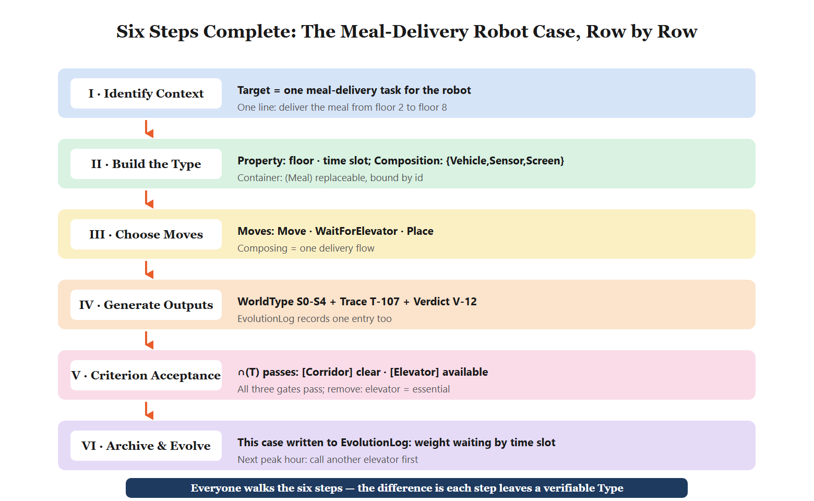 *Figure 4-3 All six steps walked cell by cell: each step leaves a verifiable Type* |  |  |
| --- | --- | --- |
| **Step** | **Operation in this example** | **Deliverable left behind** |
| 1. Identify the situation | Object ＝ one delivery task: floor 2 → floor 8 | The situation in one sentence |
| 2. Build Types along the axes | Three axes describe the corridor scene; a new "Access Control" dimension joins the axes | WorldType W-031 |
| 3. Pick the moves | Move + WaitForElevator + Place; all preconditions hold | Move sequence g1–g3 |
| 4. Generate deliverables | Simulation reasoning unrolls the Trace; Three-Layer Judgment issues the verdict; log the entry | Trace T-107, Verdict V-12, EvolutionLog E-21 |
| 5. Accept against criteria | ∩(T) all pass; remove: elevator ＝ essential part; Trace replayable | Acceptance record (all ten questions passed) |
| 6. Archive and evolve | The Wait move gains a time-of-day weight, written back to the Motion card | A new EvolutionLog page |

### 4.4 Criterion Acceptance: Three-Layer Judgment

The body of step five is the Three-Layer Judgment — the operational version of Chapter 3's four guarantee layers at the judgment scene. Container judgment asks: is identity independent of contents? Composition judgment asks: after removing a part, is the whole still itself? Abstraction judgment asks: does the new situation fit the category rule? Each layer has its own blind spot, so all must pass together — concluding after only one layer is the most common error in using world model deliverables.

| 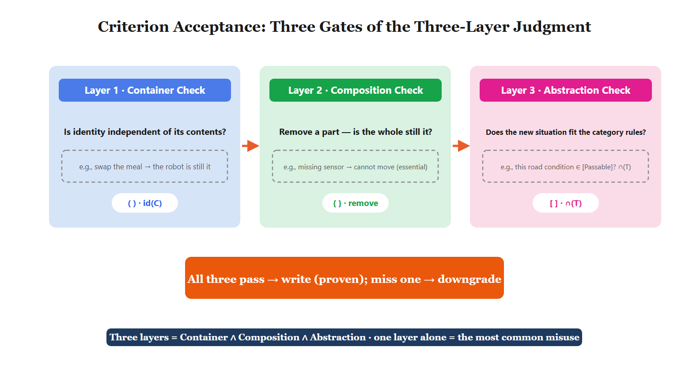 *Figure 4-4 The Three-Layer Judgment: three gates in a row* |  |  |  |
| --- | --- | --- | --- |
| **Layer** | **Question** | **In this example** | **Tool** |
| Container judgment | Is identity independent of contents? | Swap the meal, the robot is still itself — container holds | ( )・id(C) |
| Composition judgment | With a part removed, does it still recognize itself? | No sensor, no movement ＝ essential part; no screen ＝ degrading part | { }・remove |
| Abstraction judgment | Does the new situation fit the category rule? | This traffic ∈ [Passable]: ∩(T) passes item by item | [ ]・∩(T) |

### 4.5 Using Time Type: Picking, Composing, and Swapping Moves

Step three and step six of the six steps are Time Type's home ground. There are three basic actions for using Moves: picking, composing, swapping. Picking is search — Time Type's "Time Function Search" Move finds Moves whose preconditions fit the situation; composing is design — stringing several Moves into a process, with common combinations collected as fixed routines under "Design Patterns" to be applied directly next time; swapping is refactoring — replacing a Move with a better one while the effect stays unchanged, via "Restructuring and Reorganization".

| **Action** | **Corresponding moves** | **In this example** | **Checkpoint** |
| --- | --- | --- | --- |
| Pick | Time Function Search, Analysis | Search out the three cards Move / Wait / Place | Usable only when every precondition holds |
| Compose | Design, Design Patterns, Logic Generation & Application | Three moves strung into a delivery process | Effect chaining: the previous move's postcondition ＝ the next move's precondition |
| Swap | Restructuring & Reorganization, Continuous Learning | Swap in a different elevator strategy at peak hours | A swap requires an equivalent effect; otherwise it is a new design |

Where composing most often goes wrong is the joints: the effect of the previous Move must satisfy the preconditions of the next; if this chain breaks, the whole Move sequence is illegal. Where swapping most often goes wrong is name-reality mismatch: the effect has already changed, yet the old Move's name is still on it — that is not refactoring, it is stealth modification. Both errors are compared again in Chapter 5.

> **◆ Chapter key points**  
> The six steps form a circle: identify situation → build Types along axes → pick moves → generate deliverables → accept against criteria → archive and evolve.  
> When building Types along the axes, the Four-Step Framing lets the world's axes grow with new differences.  
> The three judgment layers pass jointly: container, composition, abstraction; concluding while missing one gate is the most common misuse.  
> Three actions with moves: picking checks preconditions, composing checks the joints, swapping checks equivalence.  

## Chapter 5 Misuse Comparisons and the Checklist

### 5.1 Five Kinds of Misuse

The first four chapters set the rules; this chapter catches bad habits. The five misuses below are the most common ways of crashing when using World Model Brain deliverables. On the surface they are five different errors; underneath is one root: failing to treat the Type, identity, and criteria inside a deliverable as part of the deliverable — taking only the conclusion and throwing away the guardrails.

| 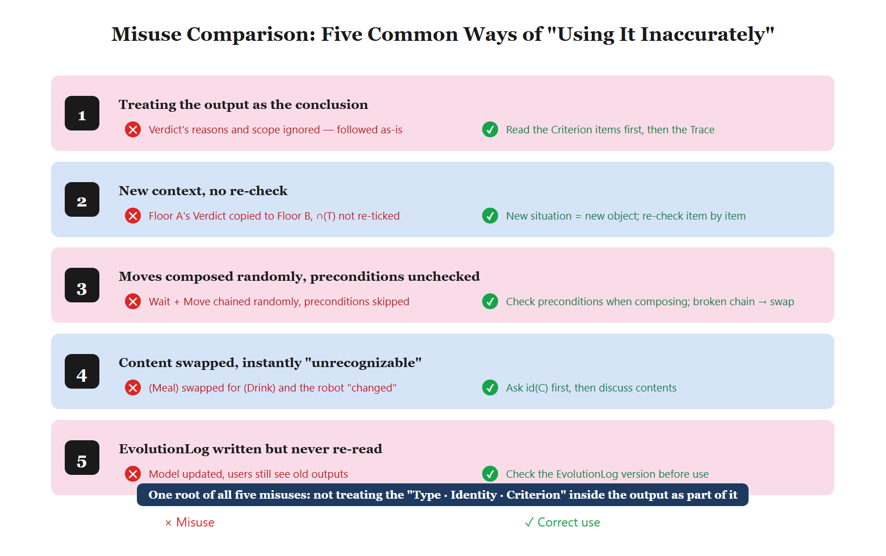 *Figure 5-1 Misuse comparison: on the left the way it crashes, on the right the correct use* |  |  |  |
| --- | --- | --- | --- |
| **#** | **Misuse** | **The problem** | **Correct use** |
| 1 | Using a deliverable as a bare conclusion | Executing the Verdict without reading its reasons and scope of validity | Read the criteria item by item first, then cross-check against the Trace |
| 2 | Changing the situation without re-verifying | A verdict from one floor carried to another, ∩(T) not re-checked | New situation ＝ new object; re-verify membership item by item |
| 3 | Composing moves freely without checking preconditions | Wait and Move chained carelessly, preconditions skipped | Composing checks preconditions first; if the chain breaks, swap the move |
| 4 | Crying "I don't recognize it" the moment contents change | (Meal) swapped for (Drink) and declaring the robot changed | Ask id(C) first, then discuss contents |
| 5 | The EvolutionLog is written but never read back | The model has a new version while users still fetch old deliverables | Check the EvolutionLog version number before taking a deliverable |

The common root of the five misuses is treating a deliverable as "a conclusion without criteria". World Model Brain deliverables are trustworthy precisely because they come with criteria, identity, and an evidence chain attached; cut those away and keep only the conclusion, and it is like tearing the map off a navigator and keeping only the voice — you will still end up in the wrong place.

### 5.2 The Ten-Question Checklist

Turning rules into executable habits takes a checklist. Before taking any World Model Brain deliverable, check each cell; start work only when all ten questions pass; if one fails, fix it first. These ten questions are not ritual — behind each one is a criterion, all asking the same thing: are this deliverable's Type, identity, structure, and evidence complete.

| 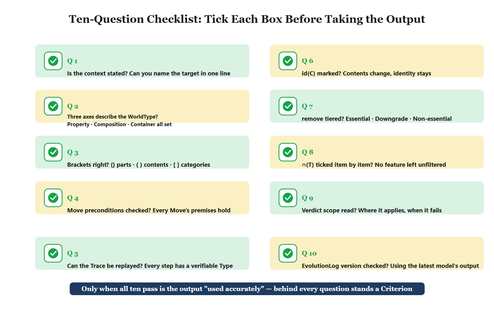 *Figure 5-2 The ten-question checklist: check each cell before taking a deliverable* |  |  |
| --- | --- | --- |
| **Question** | **Check question** | **Pass standard** |
| 1 | Is the situation identified? | "What am I solving, and which whole is the object" can be said in one sentence |
| 2 | Have the three axes described the WorldType? | Property, Composition, Container complete; the Type-set notation complete |
| 3 | Are the brackets used correctly? | { } parts, ( ) contents, [ ] categories, each in its place |
| 4 | Have the moves' preconditions been checked? | Every move's preconditions hold clause by clause |
| 5 | Is the Trace replayable? | Every cell has a WorldType and a Move to match |
| 6 | Is id(C) marked out? | Wherever containers are involved, the identity anchor is explicit and undrifted |
| 7 | Has the remove grading been done? | Essential, degrading, non-essential — each part has its grade |
| 8 | Has ∩(T) been checked item by item? | Feature filtering with no omissions; boundary cases considered |
| 9 | Has the scope of validity been read? | Clear where it applies and what voids it |
| 10 | Has the EvolutionLog version been checked? | Confirm the deliverable comes from the latest model version |

### 5.3 Maturity L1–L4: Four Grades of Deliverables

Finally, a measuring stick. Not all deliverables are born the same grade — by the completeness of their guardrails, deliverables divide into four maturity grades. L1 Usable: the five deliverables are complete and can be followed. L2 Trustworthy: the criteria are complete and every membership can be checked. L3 Traceable: the evidence chain is complete and every step can be replayed. L4 Evolvable: the EvolutionLog writes back and the model is growing. Ask for the grade the scene needs — L1 is fine for demos, production decisions need at least L3, and long-term operations must watch L4.

| **Grade** | **Name** | **Traits** | **When to use** |
| --- | --- | --- | --- |
| L1 | Usable | All five deliverables complete, format correct | Internal demos, proposal discussions |
| L2 | Trustworthy | + Four criteria layers checked item by item | External delivery, initial acceptance |
| L3 | Traceable | + Type Evidence Chain complete and replayable | Production decisions, high-risk scenes |
| L4 | Evolvable | + EvolutionLog write-back, the model keeps improving | Long-term operations, autonomous systems |

Maturity must be labeled honestly. Using an L1 deliverable as L3 is like treating a sketch as an as-built drawing; forcing an L3 deliverable down to L1 wastes the evidence chain. Honest labeling is the only requirement of this stick.

> **◆ Chapter key points**  
> The five misuses share one root: cutting a deliverable into "a conclusion without criteria".  
> The ten-question list is the executable version of the four guarantee layers — check each cell before taking a deliverable.  
> Maturity L1 Usable → L2 Trustworthy → L3 Traceable → L4 Evolvable; label honestly the grade each scene requires.  

## Review: Key Points Recap and Self-Check

> 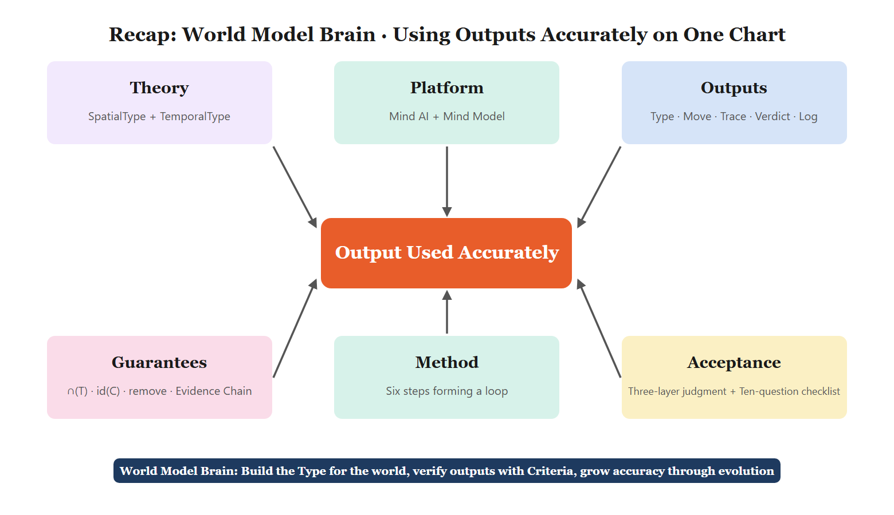  
> *Figure R-1 The whole book in one diagram: six pieces assemble "using it accurately"*  

One sentence closes the book: the World Model Brain builds Types for the world, verifies deliverables with criteria, and grows accuracy through evolution. The three actions of this sentence correspond exactly to the three essentials.

#### R-1 Review in Three Sentences

| **Aspect** | **In one sentence** | **Where it lands** |
| --- | --- | --- |
| Space Type | The world's "what it is" goes to three axes: Property[ ], Composition{ }, Container( ) | Chapter 1, WorldType |
| Time Type | The world's "how it moves" goes to the Motion Deck: verb ＝ function ＝ Move | Chapter 1, MotionType |
| Accuracy | Accuracy is stacked from four criteria layers: ∩(T), id(C), remove, Type Evidence Chain | Chapter 3, Six Steps |

#### R-2 Three Self-Check Questions

Before closing the book, ask yourself three questions. Question one: when I receive a World Model Brain deliverable, what is my first action? — The correct answer is "read along the deliverable chain": first the Type, then the Move, then the Trace, only then trust the Verdict, and finally audit the Log. Question two: when may I use a deliverable without verification? — The correct answer is "there is no such time"; there is only the difference of "verified to which level". Question three: where does accuracy grow from? — The correct answer is "from the EvolutionLog": every archived evolution makes the next deliverable more accurate.

> **◆ The book in one sentence**  
> World Model Brain: build Types for the world, verify deliverables with criteria, and grow accuracy through evolution.  
> For deliverables to be used accurately — let the criteria speak first.  

## Appendix: Quick Reference for Terms and Notation

### Terms Quick Reference

| **Chinese** | **English** | **In one sentence** |
| --- | --- | --- |
| Ontypology | Ontypology | The study of "Type": structure, composition, relations, evolution, essence |
| Type | Type (not Form) | A recognizable thing; the minimal reasoning unit of the world |
| Space Type | Space Type | The static face of Type: what it is |
| Time Type | Time Type | The dynamic face of Type: how it moves |
| WorldType | World Type | A scene notated as a set of Types |
| MotionType | Motion Type | A verb as a function card: preconditions + effect |
| Trace | Trace | The process record of the WorldType sequence × the Move sequence |
| Verdict | Verdict | The three-layer judgment's conclusion + reasons + validity + evidence |
| EvolutionLog | Evolution Log | The learning passbook: events, dispositions, write-backs |
| Intersection Criterion | ∩(T) | The open rule of membership: features checked item by item |
| Identity Anchor | id(C) | The container's identity: contents change endlessly, identity does not drift |
| Type Evidence Chain | Type Evidence Chain | The deliverable's traceable chain: source, process, criteria, expiry |

### Notation Quick Reference

| **Notation** | **How to read it** | **Meaning** |
| --- | --- | --- |
| [ ] | Square brackets | Abstract set: properties, categories, judged by ∩(T) |
| { } | Curly braces | Composition set (BOM): separable parts |
| ( ) | Parentheses | Container set: holdable contents, anchored by id(C) |
| T ＝ ( F(T), ∩(T) ) | Category T | Feature set + Intersection Criterion ＝ open rule |
| x ∈ T | x belongs to T | x passes every feature of T |
| C ＝ ( id(C), S(C) ) | Container C | Identity + contents; the notation of the Invariance Axiom |
| remove(p, M) | Remove p | The structural grading criterion: does it still recognize itself? |
| S(t+1) ＝ g( S(t) ) | Advance one cell | Move g applied to WorldType S |

** **

### Time Type Move Table

| **Group** | **Moves** | **English** | **In one sentence** |
| --- | --- | --- | --- |
| Cognitive moves | Analysis | Analysis | Break the whole into visible parts |
| Cognitive moves | Problem Solving | Problem Analysis | From symptom to solution |
| Cognitive moves | Reasoning | Reasoning | Causal, effect-to-cause, simulation, statistical, backward |
| Cognitive moves | Thinking Methods | Thinking Methods | Forward, backward, lateral, vertical, first principles |
| Creative moves | Design | Design | Create and innovate; produce new solutions |
| Creative moves | Design Patterns | Design Patterns | Common combinations collected as routines |
| Creative moves | Design Search & Extraction | Design Search & Extraction | Find answers in existing designs |
| Creative moves | Logic Generation & Application | Logic Generation & Application | Grow reusable logic |
| Generative moves | Function Generation & Application | Function Generation & Application | Generate new Motion cards |
| Generative moves | Time Function Search | Time Function Search | Search for usable moves by situation |
| Generative moves | R&D and Exploration | R&D and Exploration | Walk into the unknown |
| Evolutionary moves | Continuous Learning | Continuous Learning | Learn while running, without downtime |
| Evolutionary moves | Restructuring & Reorganization | Restructuring & Reorganization | Effect unchanged, structure better |
| Evolutionary moves | Self-evolution | Self-evolution | Write experience back as a new model |

This table is used like the Motion Deck: when a situation appears, first ask "which Move should be made"; after one round, ask "which Move should evolve". The Motion Deck is a static catalog; your World Model Brain is the way it is used — every Move on the deck awaits your accurate hand.

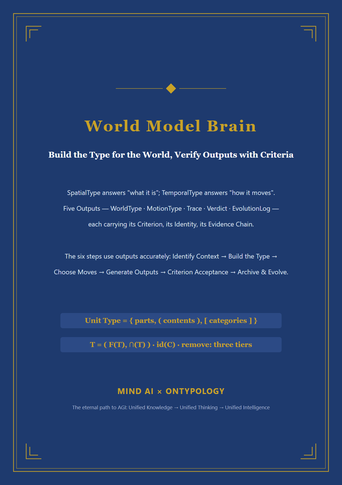
