> Ontypology 本形學
> Brain Consultation
> ClinicMind and the Accurate Method of AI Medical Interview
> The Accurate Method of AI Medical Interview by Ontypology
> 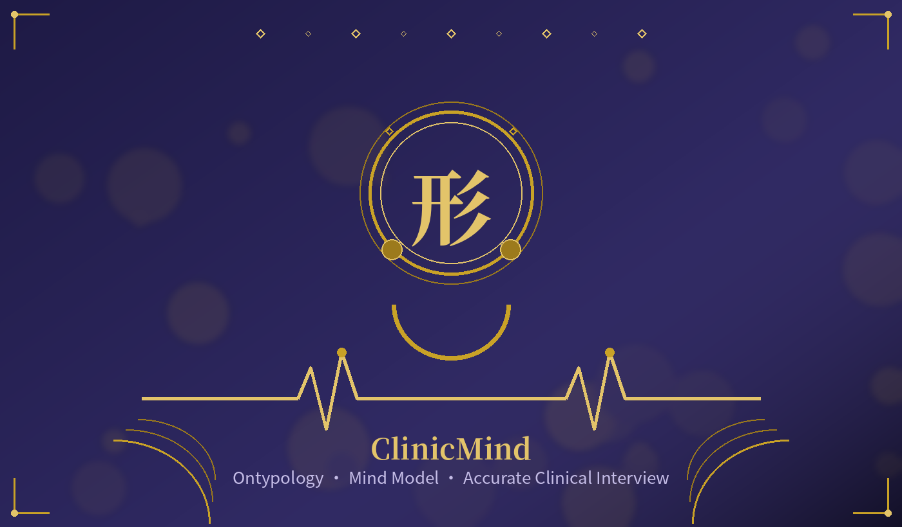

# Abstract

As large language models (LLMs) enter clinical settings, "AI medical interview" appears capable of collecting medical history through fluent dialogue and proposing differential diagnoses, yet it conceals structural risks: hallucination of history details, failure to ask about key red-flag symptoms, mixing of symptom and diagnosis levels, detachment of conclusions from their grounds, fragmentation of the course-of-illness timeline, and evaluation that asks only whether the answer is right but not whether the process is verifiable. Grounded theoretically in "Ontypology" and the "Mind Model," this study systematically lands the Type, container, SOM, Framework, and abstraction of the Spatial Type Theory and the time Type, causal/counter-causal reasoning of the Temporal Type Theory onto modern medical consultation (symptom collection, pattern differentiation, triage), proposing the dual-engine five-layer architecture (LLM + Mind Model) of the "Brain Consultation ClinicMind," together with an engineerable "Accurate Method in Six Steps": Type detection, Type definition, structuring, framing, formalization, and verification-correction.

At the formalization level, this paper presents the patient-container identity axiom and the medical-history verifiability axiom, proves the symptom SOM structural grading theorem, the three-layer judgment sufficiency-and-necessity theorem, and the consultation Type substitution invariance theorem, and establishes, through FDE four-valued logic (t/f/n/b) and evidence pairs (E⁺, E⁻), a judgment semantics capable of accommodating "uncertainty" and "contradiction," so that contradiction is no longer an error but a diagnostic instruction that must be backtracked. At the evaluation level, this paper builds a five-dimensional accuracy scale (semantic completeness, assumption visibility, step verifiability, level consistency, boundary clarity) and conducts a multi-party comparison of six methods: pure LLM, prompt engineering, RAG, rule engine, expert system, and ClinicMind. At the empirical level, this paper uses three synthetic scenarios—acute abdominal pain triage, chronic cough differentiation, and polypharmacy contradiction screening—to fully rehearse the six steps and four-valued judgment, and proposes a clinical governance closed loop of tiered authorization, traceable verifiability, compliance audit, and feedback correction. The research shows that the accuracy of consultation can shift from "the model's talent" to "the process's attribute"—every step verifiable, replayable, and substitution-tested, which is precisely the eternal way for AI consultation toward trustworthy clinical intelligence.

> Keywords
> Ontypology; Mind Model; AI medical interview; pattern differentiation; triage; FDE four-valued logic; Accurate Method; Brain Consultation (ClinicMind)

This series of studies positions itself as an application volume of Spatial Type Theory and Mind AI: The Eternal Way to AGI, co-constructing the same theoretical line with such volumes as The Brain of the World Model, IC Design Brain: SiliconMind, Drug Development Brain: PharmaMind, Wargaming Brain: WarMind, and Applications of Design Patterns, with the terminology system (Type, Split & Merge, BOM/SOM, container, abstraction, Framework, dual engine, 99%→80%→60% work proportion, and the ○○ Brain naming convention) carried through the entire text. The three cases in this paper are all synthetic cases, serving only to demonstrate the method and constituting no medical advice whatsoever.

# Table of Contents

- Abstract

- Chapter 1 Introduction: The Predicament and Opportunity of AI Medical Interview

- 1.1 Clinical Inquiry: The Starting Point of the Clinic and the Examination Hall of AI

- 1.2 Six Major Pain Points: Why LLM Consultation "Looks Accurate, Uses Dangerously"

- 1.3 Redefining "Accuracy": From a Correct Answer to a Verifiable Process

- 1.4 Ontypology and the Mind Model: A Methodological Review

- 1.5 Positioning and Structure of the Paper

- Chapter 2 The Ontypological Ontology Mapping of Consultation

- 2.1 Type Analysis of Consultation Elements

- 2.2 Three-Party Mapping: Consultation Elements, Ontypology, and Information Systems

- 2.3 The Three Carriers: Container, SOM, and Framework

- 2.4 Disease Prototypes: The Intersection Criterion of Abstraction

- 2.5 The Temporal Type: Illness-Course Time Type and Causal/Counter-Causal Reasoning

- Chapter 3 The Accurate Method in Six Steps: From Chief Complaint to Diagnosis

- 3.1 Overview of the Six Steps

- 3.2 Type Detection: Drawing Difference & Similarity Boundaries from the Chief Complaint

- 3.3 Type Definition: Attributes and Attribute Values of the Symptom Type

- 3.4 Structuring: Three-Grade Classification of the Symptom SOM

- 3.5 Framing: Two Unfoldings of the Differential Diagnosis Framework

- 3.6 Formalization: Expression of Judgment

- 3.7 Verification-Correction: Closing the Loop

- Chapter 4 ClinicMind Brain Consultation: The Dual-Engine Five-Layer Architecture

- 4.1 The Dual-Engine Five-Layer Architecture

- 4.2 Evolution of the Work Proportion: From 99% to 60%

- 4.3 The Prediction–Verification–Correction Loop

- 4.4 Memory and the Medical-Record Type Library

- 4.5 Interfacing with Medical Information Systems

- Chapter 5 Formal Foundations: Axioms, Theorems, and Four-Valued Judgment

- 5.1 Definitions

- 5.2 Axioms

- 5.3 Theorems and Proofs

- 5.4 FDE Four-Valuedization and Evidence Pairs

- Chapter 6 Five-Dimensional Accuracy Evaluation and Multi-Party Comparison

- 6.1 The Five-Dimensional Scale

- 6.2 Six-Party Comparison

- 6.3 Five-Dimensional Radar Comparison

- 6.4 Scoring Procedure and Reproducibility

- Chapter 7 Synthetic Case C-01: Triage Consultation for Acute Abdominal Pain

- 7.1 Scenario and Chief Complaint

- 7.2 Rehearsal of the Six Steps

- 7.3 Trial-and-Error Matrix and FDE Coordinates

- Chapter 8 Synthetic Case C-02: Differential Consultation for Chronic Cough

- 8.1 Scenario and Differential Framework

- 8.2 Differential Matrix and Time-Type Analysis

- 8.3 Two Iterations of the Correction Loop

- Chapter 9 Synthetic Case C-03: Contradiction Screening for Polypharmacy

- 9.1 Scenario and Three-Layer Judgment

- 9.2 Contradiction Network and Medication Contradiction List

- 9.3 Joint Operation of Three-Layer Judgment

- Chapter 10 Clinical Safety, Ethics, and Governance

- 10.1 Tiered Authorization: A Four-Level Human-in-the-Loop System

- 10.2 Traceability and Explainability

- 10.3 Compliance and Personal Data

- 10.4 The Clinical Governance Closed Loop

- Chapter 11 Discussion: The Evolutionary Ladder and the Future

- 11.1 Theoretical Connection with the Series Research

- 11.2 The Evolutionary Ladder of Consultation Intelligence

- 11.3 Limitations

- 11.4 Outlook

- Chapter 12 Conclusion

- References

- Appendix A Consultation Type-Formation Quick Reference Table

# Chapter 1 Introduction: The Predicament and Opportunity of AI Medical Interview

## 1.1 Clinical Inquiry: The Starting Point of the Clinic and the Examination Hall of AI

Clinical inquiry (anamnesis/clinical interview) is the starting point of clinical medicine. The literature indicates that the information required for most clinical decisions has its ceiling determined already at the consultation stage: the chief complaint defines the problem space, the history of present illness constructs the timeline, and past history, family history, personal history, and review of systems lay out the complete shape of the patient. When consultation is done well, subsequent examinations are verification; when it is done badly, subsequent examinations are mere remediation. Precisely for this reason, when large language models knock on the door of medicine with fluent dialogue, "AI medical interview" becomes one of the most watched—and most dangerous—application scenarios.

It is watched because LLMs do display astonishing language ability: they can patiently follow up with questions, explain health education in plain language, and produce structured history summaries within seconds; it is dangerous because these very abilities conceal their structural defects—they have no mechanism for "knowing what they know," nor any mechanism for "letting others examine how they know it." In shopping recommendations, the cost of such defects is inaccurate advertising; in consultation, the cost is life.

## 1.2 Six Major Pain Points: Why LLM Consultation "Looks Accurate, Uses Dangerously"

This paper summarizes the structural defects of current LLM consultation into six major pain points (Figure 1-1). The first is hallucination generation: the model completes history details for the sake of fluency, fabricating laboratory values and drug names, and the more fluent the tone, the harder it is to detect. The second is missed questions and loss of focus: key red-flag symptoms may be omitted entirely, the consultation path drifts randomly, and the same patient receives two different histories from two consultations. The third is level confusion: the four levels of symptom, evidence, diagnosis, and plan interweave with one another, so that a single sentence looks both like a statement and like an inference. The fourth is non-traceability: conclusions are detached from their grounds, and the reasoning chain cannot be replayed for inspection. The fifth is contextual fragmentation: the timeline and causal chain are broken, and the evolution of the illness cannot be reconstructed. The sixth is miscalibrated evaluation: benchmarks ask only whether the answer is right, not whether the process is verifiable.

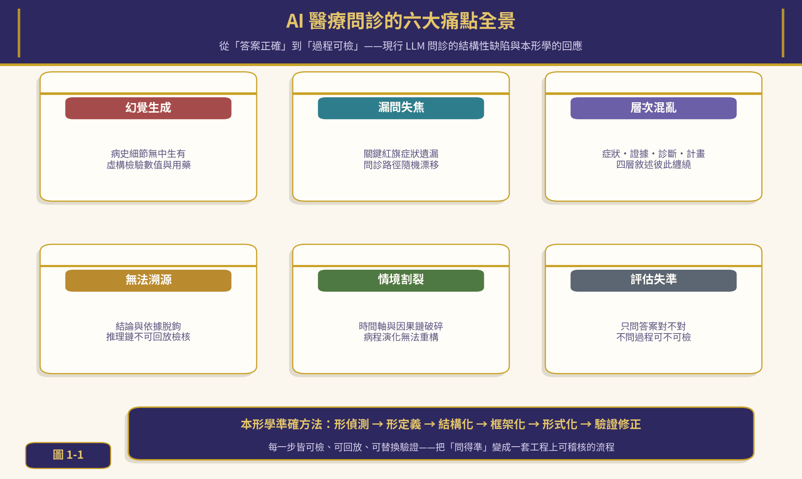

Figure 1-1　A panorama of the six major pain points of AI medical interview

The six pain points are not independent of one another: non-traceability makes hallucination hard to falsify, level confusion makes missed questions hard to localize, and miscalibrated evaluation leaves the first four chronically without quantified pressure. To cure the root, one must begin with "how accuracy is defined."

## 1.3 Redefining "Accuracy": From a Correct Answer to a Verifiable Process

> This paper's stance on accuracy
> The accuracy of consultation is not merely "the diagnostic answer is correct" but "the process is verifiable": semantic completeness (everything that should be asked was asked), assumption visibility (every diagnostic assumption is explicitly listed), step verifiability (the reasoning chain can be replayed), level consistency (symptom・evidence・diagnosis・plan do not cross levels), and boundary clarity (knowing when one does not know). A correct answer is the luck of the outcome; a verifiable process is the attribute that can be guaranteed by engineering.

This stance converts accuracy from a "problem of model capability" into a "problem of process design." A process can be formalized, tested, audited, and substitution-tested—this is precisely the standard posture of engineering in dealing with uncertain systems, and also the entry point of the Ontypology methodology.

## 1.4 Ontypology and the Mind Model: A Methodological Review

Ontypology holds that human intelligence is jointly constituted by "Type" and "number"; mathematics describes quantity, relations, and regularity, while typology describes structure, composition, association, evolution, and essence. The birth of a Type follows a fixed order: first comes the perception of Difference & Similarity, then the act of Split & Merge, and finally boundaries are drawn and a Type is born—and a Type must have a name. At the Unit Type level, Attribute (the question that can be asked) and Attribute Value (the answer to that question in a specific context) constitute a coordinate system: Attribute is the dimension, Attribute Value is the scale; an Attribute emerges at the moment when "this batch of differences matches none of the existing Attributes," and an Attribute Value is added when "the nature of the difference matches some existing Attribute."

Type Logic provides three kinds of value-add: the container (supplying the implicit elements and guaranteeing that identity is independent of contents), SOM (supplying the compositional structure among elements), and abstraction (supplying the rule for generating feature intersections). The three together form three-layer judgment: the container layer judges "who it belongs to," the SOM layer judges "whether it holds," and the abstraction layer judges "which kind it is." The Mind Model is the practical architecture of typology theory, unifying knowledge from language, mathematics, physics, medicine, and engineering into one model and practicing such thinking abilities as logical reasoning, causal reasoning, problem analysis, and pattern extraction; the LLM handles language ability, the Mind Model handles intelligence ability, and their combination forms the dual engine—namely Mind AI's eternal way to AGI: a three-stage evolution of knowledge unification, thinking unification, and intelligence unification.

## 1.5 Positioning and Structure of the Paper

This paper is the application volume in which the Ontypology research line lands on "modern medical consultation": with the Accurate Method in Six Steps as the backbone, ClinicMind Brain Consultation as the system carrier, the axiom–theorem–four-valued judgment as the formal guarantee, the five-dimensional scale and six-party comparison as evaluation tools, three synthetic scenarios as empirical rehearsal, and the clinical governance closed loop as the implementation guardrail. The chapter architecture of the whole paper is shown in Figure 1-2.

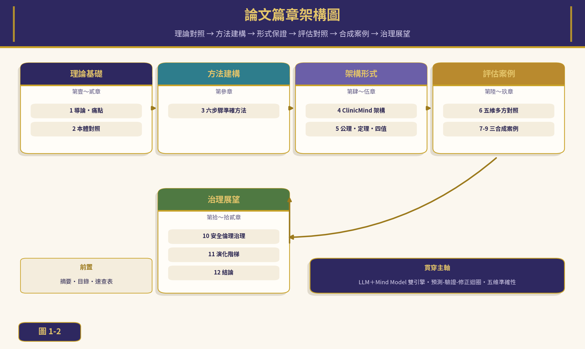

Figure 1-2　Architecture diagram of the paper's chapters

> Chapter Summary
> The six pain points of LLM consultation all point to the same root cause: the process is not verifiable. Redefining accuracy as "process verifiability" turns consultation from a problem of model talent into a problem of process engineering; the Type, container, SOM, Framework, and abstraction of Ontypology, together with the Mind Model dual engine, are precisely the language born for such a process.

> Accuracy is not a talent that is asked out, but an attribute that is checked out.

# Chapter 2 The Ontypological Ontology Mapping of Consultation

## 2.1 Type Analysis of Consultation Elements

The six elements of clinical consultation—chief complaint, history of present illness, past medical history, family history, personal history, and review of systems—are not a pre-printed checklist but a set of natural "Type-forming actions." The chief complaint handles Type detection: drawing boundaries by Difference & Similarity amid the patient's string of statements to circle out "what is to be looked at this time." The history of present illness handles Type definition: unfolding the chief complaint into Attributes and Attribute Values—site, character, intensity, time, precipitating factors, relieving factors. Past medical history, family history, and personal history handle structuring: organizing scattered risk factors into a SOM of symptoms and history. Review of systems handles framing: scanning the whole body with a fixed list of dimensions to guarantee that no axis is missed. And pattern differentiation and the management plan are precisely the objects of formalization and verification-correction (Figure 2-1).

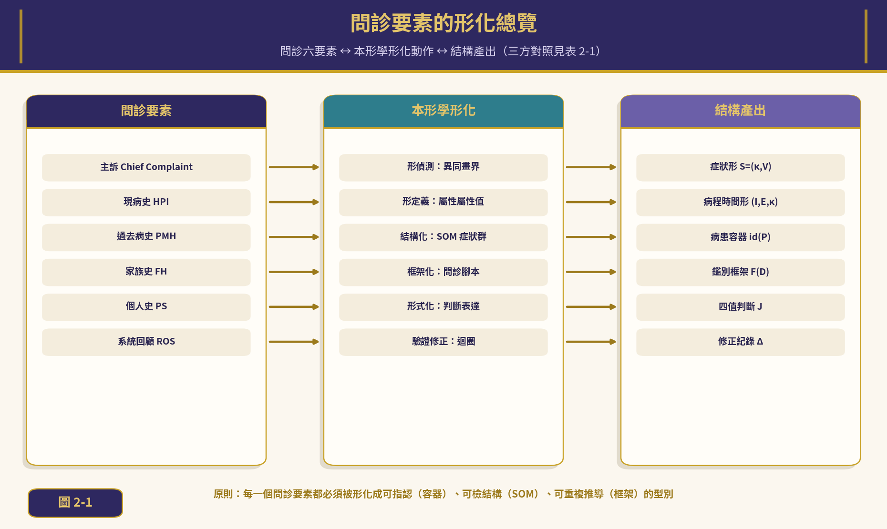

Figure 2-1　Overview of Type formation of consultation elements

In other words, a well-trained physician is already performing Type formation in the Ontypological sense—except that these actions lie scattered in intuition and habit, never written down as verifiable rules. What AI consultation demands is precisely this: to write intuition into rules, and to turn habit into process.

## 2.2 Three-Party Mapping: Consultation Elements, Ontypology, and Information Systems

For Type formation results to be carried by computers and exchanged across institutions, they must align with the data models of medical information systems. Using HL7 FHIR and the Relational Database (RDB) as reference baselines, this paper gives a three-party mapping (Table 2-1). The significance of the mapping is this: Ontypology concepts are not a brand-new database built from scratch, but the "cognitive semantic layer" of existing data models—it explains why the table header is a Type, the data row an entity, and the primary key an identity, and also explains why the fields of a medical-record table cannot change because of one particular row.

Table 2-1　Three-party mapping: consultation elements ↔ Ontypology ↔ FHIR/RDB

| Consultation Element | Ontypological Type Formation | FHIR Resource/Field | RDB Correspondence |
| --- | --- | --- | --- |
| Chief complaint CC | Type detection (Difference & Similarity boundary drawing) | Condition.code (primary diagnosis candidate) | Symptom table: symptom code PK |
| History of present illness HPI | Type definition (Attribute/Attribute Value) | Observation.value, onset, site | Symptom table: columns for site, character, intensity, etc. |
| Past medical history PMH | Structuring (SOM symptom cluster) | Condition (problem list) | History table: primary-foreign keys linked to patient |
| Family history FH | Structuring (risk SOM) | FamilyMemberHistory | Family history table: relative FK |
| Personal history PS | Framing (dimension list) | SocialHistory sections | Personal history table: columns for smoking, alcohol, etc. |
| Review of systems ROS | Framing (consultation script) | Questionnaire/QuestionnaireResponse | ROS table: fixed column group |
| Differential diagnosis | Formalization (four-valued judgment J) | Condition.differential | Differential table: assumption, confidence, grounds |
| Management plan | Verification-correction (record Δ) | CarePlan, ServiceRequest | Plan table: versioned record |

The three-party mapping also reveals a governance point: the FHIR Patient resource and the RDB patient primary key jointly play the role of "container identity"; any cross-institutional exchange, any write-back of AI output, must first pass the container identity check (see Section 5.2, Axiom 5-1).

## 2.3 The Three Carriers: Container, SOM, and Framework

In the consultation domain, the three value-adds of Type Logic each have their clinical avatar (Figure 2-2). The avatar of the container is patient identity: symptoms may enter and leave, be replaced, and be re-described, but id(P) does not change—correct attribution of the medical record is the precondition of all judgment. The avatar of SOM is the symptom-cluster structure: symptoms are not a bag of unordered keywords but a structure with compositional relations, classifiable into three grades: necessary components (key symptoms), functionally degraded components (supporting symptoms), and non-essential components (incidental symptoms). The avatar of the Framework is the consultation script and clinical guidelines: it lists "which mutually independent dimensions there are," and guarantees that the same Framework can be repeatedly derived—change a physician, change a model, and running the same Framework should yield the same dimension list.

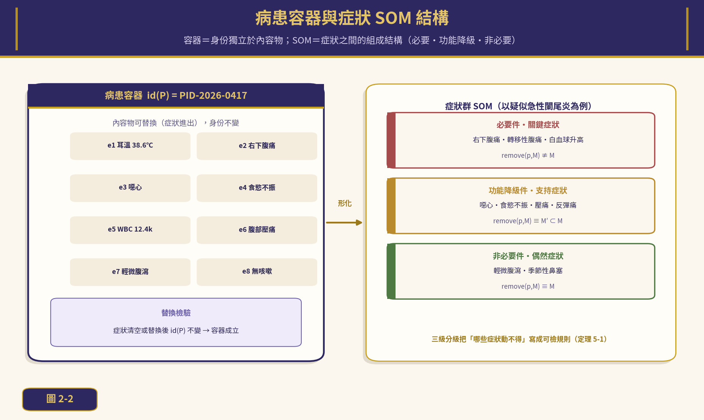

Figure 2-2　Patient container and symptom SOM structure

Table 2-2　Master table of Type Attributes of consultation elements (example of the five axes of the history of present illness)

| Attribute (Dimension) | Type | Typical Attribute Values | Clinical Significance |
| --- | --- | --- | --- |
| Site | Anatomical | Right lower quadrant, epigastrium, retrosternal, lumbar | Localizing the lesion system |
| Character | Descriptive | Colicky, stabbing, dull, burning | Narrowing the pathological category |
| Intensity | Measurement | VAS 1–10, mild/moderate/severe | Tracking evolution, triage basis |
| Time | Temporal | Acute, chronic, nocturnal, postprandial | Input to the illness time Type |
| Precipitating/Relieving | Causal | Exercise, posture, cold air, antacids | Clues for causal reasoning |

The Attribute emergence rule applies fully here: when a new batch of differences (e.g., "intensity") matches none of the existing dimensions, open a new Attribute and go back to fill in values for all past records; when the difference does match (e.g., a new "burning sensation" appears), only add an Attribute Value under the "character" axis. Attributes are few and Attribute Values are many—dimensions are fixed, scales are extendable (Chapter 3, Figure 3-2 gives a timeline rehearsal).

## 2.4 Disease Prototypes: The Intersection Criterion of Abstraction

The abstraction layer answers "which kind it is." A disease prototype is not a list of disease names but a set of necessary features F(D): whether a new case belongs to [D] is verified on the spot by the intersection criterion ∩(D), and only when all pass is it classified. This brings two clinical dividends: first, boundary cases can be explicitly discussed (the "a bowl is not a cup" kind of dispute becomes a dispute over whether F(D) should include a certain feature); second, open categories let new disease types be automatically included—when an emerging infectious disease appears, it need not wait for its name to enter the ICD coding table before it can first be Type-formed and tracked by feature intersection.

## 2.5 The Temporal Type: Illness-Course Time Type and Causal/Counter-Causal Reasoning

Consultation cannot be separated from time. The Temporal Type Theory defines the time Type as the triple (I, E, κ): the interval I carries evolution, the events E anchor evidence, and the correspondence κ binds Type meaning. In consultation, "half a day of stomach pain" is Type-formed as the illness-course container I = [onset, now], within which exacerbation, relief, medical visit, and testing are all events E, and κ binds each event to the Type meaning of the illness stage to which it belongs (Figure 2-3).

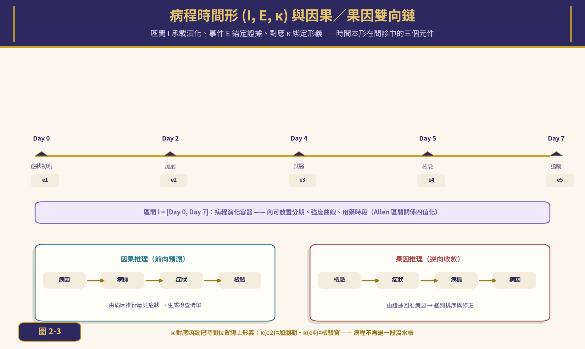

Figure 2-3　Illness-course time Type (I, E, κ) and the bidirectional causal/counter-causal chain

With the time Type, causal reasoning and counter-causal reasoning can run bidirectionally on the same structure: causal reasoning is forward prediction—deriving the symptoms that should be seen from the cause and generating an examination checklist; counter-causal reasoning is reverse convergence—inferring the cause back from the evidence and performing differential ranking and correction. Among the eighteen themes of the Temporal Type Theory (Split & Merge, Framework, design patterns, logic generation, memory management, logic application, marking, continuous learning, abstraction, refactoring, thinking, methods of thinking, problem solving, analysis, design, reasoning, causal reasoning, counter-causal reasoning), the three themes most directly related to consultation—reasoning, causal reasoning, and counter-causal reasoning—will recur repeatedly in the six steps of Chapter 3 and the formalization of Chapter 5.

> Chapter Summary
> The six elements of consultation are naturally isomorphic to the Type-forming actions of Ontypology: chief complaint = Type detection, history of present illness = Type definition, past history = structuring, review of systems = framing, differential = formalization, plan = verification-correction. The three carriers—container (patient), SOM (symptom cluster), and Framework (consultation script)—each have their clinical avatar and can be precisely mapped to FHIR/RDB; the time Type (I, E, κ) turns the illness course from a running account into a reason-able structure.

> A medical record is not a stack of text but a container of Types.

# Chapter 3 The Accurate Method in Six Steps: From Chief Complaint to Diagnosis

## 3.1 Overview of the Six Steps

The "Accurate Method in Six Steps" repeatedly validated by Ontypology across application domains—Type detection, Type definition, structuring, framing, formalization, and verification-correction—has its fully corresponding clinical actions in the consultation scenario (Figure 3-1). The six steps are not a linear checklist but a staircase with backtracking: each step has explicit inputs, outputs, and check criteria, and failure at any step means returning to the previous step for correction; the loop established by the verification-correction step further turns the whole flow into an iteratively convergent reasoning cycle (Table 3-1).

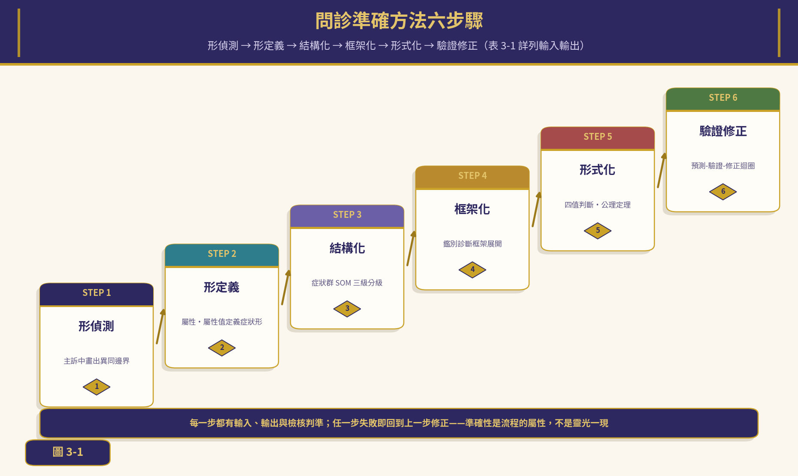

Figure 3-1　The Accurate Method in Six Steps of consultation

Table 3-1　Inputs, outputs, and check criteria of the six steps

| Step | Input | Output | Check Criteria |
| --- | --- | --- | --- |
| Type detection | Chief complaint, free narrative | List of candidate symptom Types | Difference & Similarity boundaries identifiable; no statement discarded |
| Type definition | Candidate symptom Types | Attribute–Attribute Value matrix | Each symptom has all five axes or explicitly marked missing |
| Structuring | Symptom matrix | Symptom SOM three-grade classification | Necessary/degraded/incidental components each in place |
| Framing | Symptom SOM | Differential Framework F(D) and questioning path | Dimensions mutually independent; new axes can be opened, old axes backfilled |
| Formalization | Differential Framework | Four-valued judgment J and evidence pairs | Each assumption has (E⁺, E⁻); no dangling conclusions |
| Verification-correction | Judgment J and new evidence | Correction record Δ, convergence or backtracking | Contradiction must backtrack; convergence must be replayable |

## 3.2 Type Detection: Drawing Difference & Similarity Boundaries from the Chief Complaint

The task of Type detection is to draw boundaries out of a chaotic opening such as the patient's "half a day of stomach pain." Following the cognitive chain of "Difference & Similarity first, then Split & Merge," the starting point of detection is not a disease name but differences: pain versus no pain is a difference, a pain location different from yesterday is a difference, and this patient's pain being the same as the previous patient's pain is a similarity. The parts circled together generate the candidate Type "abdominal pain Type," while the parts cut apart are retained as room for later differentiation. In practice, Type detection must output a list of candidate symptom Types and guarantee that no statement is discarded—the stray words mentioned "by the way" are often where red flags hide.

## 3.3 Type Definition: Attributes and Attribute Values of the Symptom Type

Type definition unfolds the candidate Type into an Attribute–Attribute Value matrix. Taking abdominal pain as an example, the five axis Attributes are site, character, intensity, time, and precipitating/relieving factors; under each axis hang the Attribute Values that have appeared (Table 3-2). The clinical significance of the Attribute emergence rule here is: when the patient says "dull" while the character axis has not yet been established, the system opens a new axis and backfills past records; when the patient says "burning" while the character axis already has burning sensation, it only adds a value and does not touch the Framework (Figure 3-2). The backfilling action guarantees that every patient has an explicit value on every Attribute—a blank field is not "unknown" but a failure of Type formation.

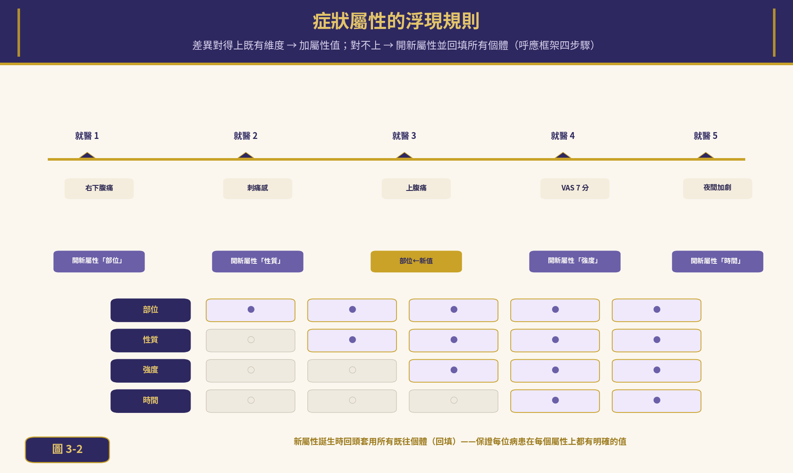

Figure 3-2　The emergence rule and backfilling of symptom Attributes

Table 3-2　Master table of Attributes–Attribute Values of the symptom Type (abdominal pain Type example)

| Attribute | Attribute Values | Timing of Emergence |
| --- | --- | --- |
| Site | Right lower quadrant, epigastrium, periumbilical, diffuse, radiating to back | Localization needed from the first case |
| Character | Colicky, stabbing, dull, burning, distending | When the patient describes by analogy |
| Intensity | VAS 1–10, mild/moderate/severe, affecting sleep | When triage or tracking is needed |
| Time | Acute, chronic, nocturnal, postprandial, periodic | When course narrative appears |
| Precipitating/Relieving | Eating, posture, exercise, menstrual cycle, antacids | When causal clues appear |

## 3.4 Structuring: Three-Grade Classification of the Symptom SOM

Structuring upgrades the symptom list into a SOM with compositional relations. There is only one criterion: after removing this symptom, will the identity of the diagnostic Type change (Figure 3-3)? If it does not change and has no effect at all, it is a non-essential component (incidental symptom); if its absence lowers credibility but the Type remains recognizable, it is a functionally degraded component (supporting symptom); if its absence means the diagnosis cannot be supported, it is a necessary component (key symptom, clinically a red flag). The engineering correspondence of the three grades is very clear: necessary components go into the "must-not-miss checklist," functionally degraded components go into "confidence weighting," and non-essential components go into the "incidental-finding isolation zone" (Table 3-3).

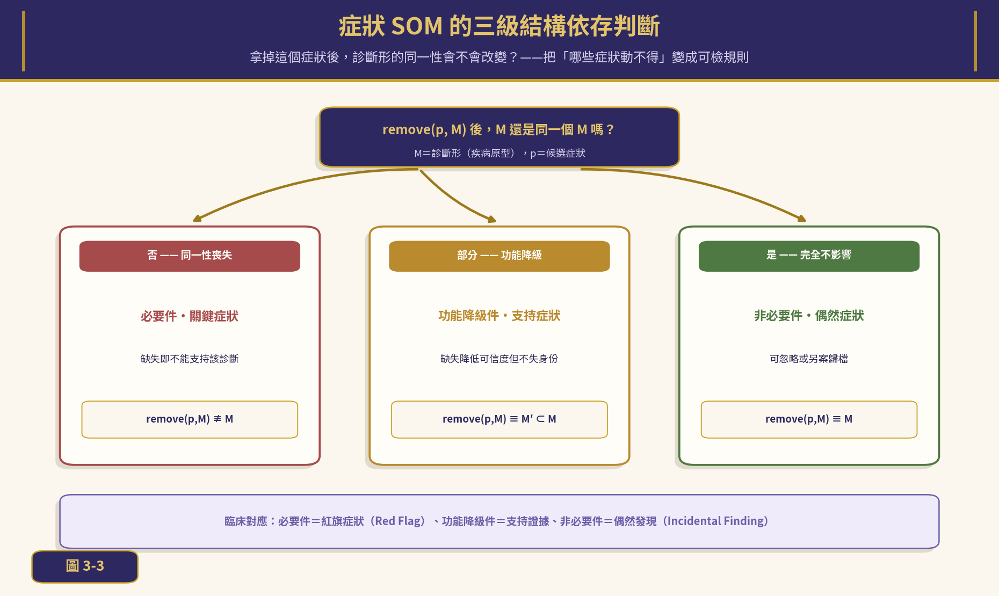

Figure 3-3　The three-grade structural dependency judgment of the symptom SOM

Table 3-3　Three-grade classification of the symptom SOM and its clinical correspondence

| SOM Grade | Criterion | Clinical Correspondence | System Behavior |
| --- | --- | --- | --- |
| Necessary component | remove(p,M) ≢ M | Red-flag symptom | Enters must-not-miss checklist; absence is an alert |
| Functionally degraded component | remove(p,M) ≡ M′ ⊂ M | Supporting evidence | Counted in confidence weighting; absence downgrades but does not exclude |
| Non-essential component | remove(p,M) ≡ M | Incidental finding | Isolated and archived; does not contaminate the primary diagnosis |

## 3.5 Framing: Two Unfoldings of the Differential Diagnosis Framework

Framing answers "which mutually independent dimensions there are" and turns the dimension list into a repeatably derivable differential machine. The same Framework can unfold in parallel—listing independent dimensions such as course, sputum status, fever, imaging, and precipitating factors, guaranteeing no missed axis in consultation; or it can unfold in a nested manner—following the "with sputum/without sputum" branch all the way to specific diagnostic candidates, constituting the order of questioning (Figure 3-4). The parallel type guarantees completeness, the nested type guarantees efficiency; both draw the same master Framework table, differing only in which dimension is placed at the upper level of the tree.

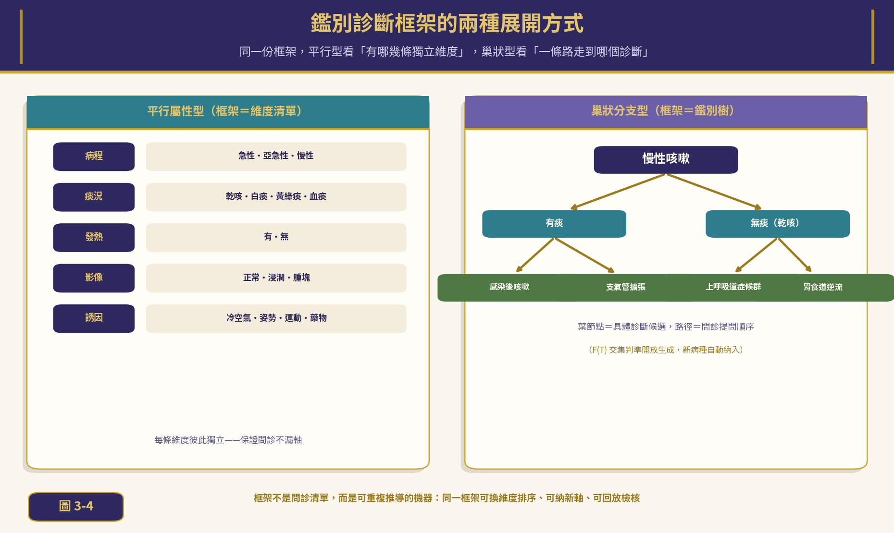

Figure 3-4　Two ways of unfolding the differential diagnosis Framework

The universality of the Framework comes from its openness: the intersection criterion ∩(T) lets new disease types be automatically included, while Framework evolution corresponds to the schema change of an RDB—adding an Attribute is "adding a column," adding a case is "adding a row"; the two are asymmetric and each has its own check (a column change requires backfilling all rows).

## 3.6 Formalization: Expression of Judgment

Formalization writes the differential result into verifiable judgments. Every assumption H must be paired with a pair of evidence (E⁺, E⁻): supporting evidence and opposing evidence explicitly listed, with the judgment's landing point determined by four-valued semantics (see Section 5.4 for details). The discipline of formalization is: no "roughly, possibly, perhaps" dangling conclusions are allowed—any expression of confidence must be decomposable back into evidence pairs; any evidence must point back to a specific data row in the medical-record container.

## 3.7 Verification-Correction: Closing the Loop

Verification-correction operates through the prediction–verification–correction loop: deriving the symptoms that should be seen from the cause (prediction), comparing evidence pairs (verification), and backtracking and reconstructing on contradiction or solidifying the diagnostic Type on convergence (correction). Each iteration writes a correction record Δ, making the consultation process an auditable reasoning trace. Notably, "supplementary questioning" is also a form of correction: the n value (no data) in four-valued judgment directly generates the next round of questioning instructions, handing the order of consultation questions over to be driven by judgment gaps rather than by the model's improvisation.

> Chapter Summary
> The six steps turn consultation from intuition into an engineering process with check criteria: Type detection discards no statement, Type definition guarantees no blank in the matrix, structuring locks red flags with the three SOM grades, framing balances completeness and efficiency, formalization enforces evidence pairs, and verification-correction records convergence with Δ. The output of each step is the verifiable input of the next.

> Every follow-up question in consultation should be a cry for help from a judgment gap.

# Chapter 4 ClinicMind Brain Consultation: The Dual-Engine Five-Layer Architecture

## 4.1 The Dual-Engine Five-Layer Architecture

The system that carries the above method is named in this paper "Brain Consultation ClinicMind." It follows the standard architecture of the Ontypology research line—LLM + Mind Model dual engine, five-layer separation of responsibilities (Figure 4-1): L1 perceptual Type formation handles speech and text parsing, entity extraction, and Difference & Similarity detection; L2 structuring handles history Type formation, symptom SOM, and time Type; L3 reasoning and differentiation handles differential ranking, four-valued judgment, and assumption management; L4 decision planning handles triage and routing, ordering of examinations, and follow-up scheduling; L5 output interaction handles health education explanations, referral advice, and report generation. The LLM language engine runs through all five layers to handle language understanding, generation, and recall; the Mind Model intelligence engine runs through all five layers to handle knowledge unification, reasoning, and memory (Table 4-1).

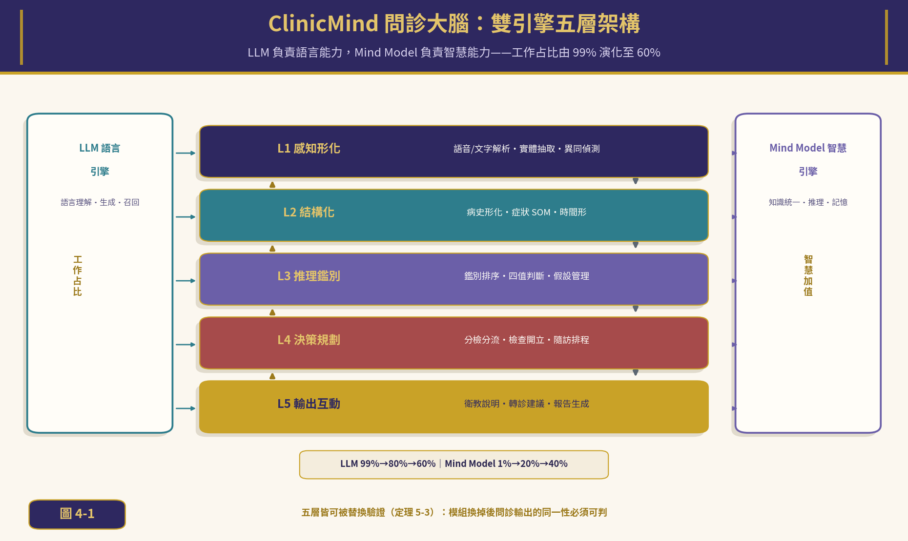

Figure 4-1　ClinicMind Brain Consultation: the dual-engine five-layer architecture

Table 4-1　ClinicMind's five-layer responsibilities and dual-engine division of labor

| Layer | Responsibility | LLM Engine | Mind Model Engine | Verifiable Output |
| --- | --- | --- | --- | --- |
| L1 | Perceptual Type formation: parsing・extraction・Difference & Similarity | Speech transcription, entity recognition | Difference & Similarity boundary drawing, Type detection | List of candidate symptom Types |
| L2 | Structuring: history Type formation・SOM | Narrative normalization | Attribute matrix, SOM grading | Blank-free Type matrix |
| L3 | Reasoning differentiation: ranking・four values | Textual entailment retrieval | Causal/counter-causal, FDE judgment | Judgment J + evidence pairs |
| L4 | Decision planning: triage・examinations | Plan drafting | Rule checking, risk model | Triage level + plan |
| L5 | Output interaction: health education・reports | Language generation | Factual constraints, traceability annotations | Traceable report |

## 4.2 Evolution of the Work Proportion: From 99% to 60%

The dual engine's division of labor is not static. In the initial introduction period, the LLM bears about 99% of the work, with the Mind Model providing 1% of "intelligence value-add" through Type-formation rules and checklists; as the medical-record Type library fills out, judgment rules settle, and correction records Δ accumulate, the Mind Model's share gradually rises to 20% and finally 40%, while the LLM converges to 60%—focusing on the language it is best at (Table 4-2). This direction of evolution is consistent with the claim of "moving from information processing toward intelligence generation": language ability is the entrance, intelligence ability is the destination.

Table 4-2　Evolution of the dual-engine work proportion

| Stage | LLM Share | Mind Model Share | Marker |
| --- | --- | --- | --- |
| Introduction period (knowledge unification) | 99% | 1% | Medical-record Type library established; checklist online |
| Growth period (thinking unification) | 80% | 20% | Four-valued judgment running in full; Δ replayable |
| Maturity period (intelligence unification) | 60% | 40% | Autonomous assumption management; continuous-learning loop |

## 4.3 The Prediction–Verification–Correction Loop

Between L3 and L4 runs ClinicMind's core reasoning loop (Figure 4-2): the prediction end derives the symptoms that should be seen from the cause and generates a verifiable examination checklist; the verification end compares evidence pairs (E⁺, E⁻) to make a four-valued determination for each assumption; the correction end backtracks and reconstructs on contradiction and solidifies the diagnostic Type on convergence. Four-valued semantics shows its value here: b (contradiction) is a diagnostic instruction that must backtrack, and n (no data) is a scheduling instruction for supplementary questioning and testing—every exit of the loop has an explicit action, with no dangling state such as "think about it more."

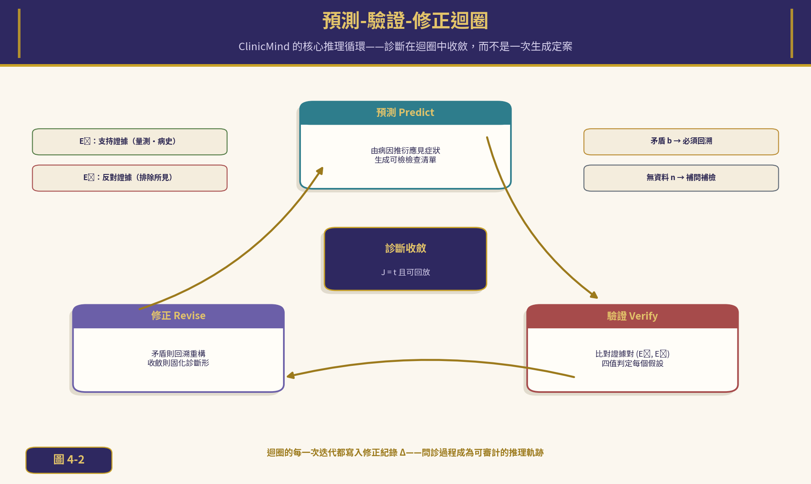

Figure 4-2　The prediction–verification–correction loop

## 4.4 Memory and the Medical-Record Type Library

ClinicMind's memory is divided into three layers: working memory holds the Type matrix and assumption set of the current round of consultation; episodic memory holds the time Type and correction record Δ of each medical visit; semantic memory holds disease prototypes, clinical guidelines, and knowledge after literature Type formation. The medical-record Type library is the persistence carrier of these three layers, and its data model is precisely the RDB implementation of the three-party mapping of Chapter 2: the table header is a Type, the data row an entity, the primary key an identity, and the primary-foreign keys link the patient with its contents. The Type substitution invariance theorem (Theorem 5-3) guarantees that the reconstruction, migration, and de-identification of the memory layer will not change the identity of judgments.

## 4.5 Interfacing with Medical Information Systems

At the implementation level, ClinicMind uses HL7 FHIR as its exchange interface: it reads in Patient, Encounter, Observation, Condition, and QuestionnaireResponse, and outputs Condition (differential), CarePlan (plan), and DocumentReference (traceable report). Every conclusion in the report carries a traceability annotation—pointing to a specific data row and evidence pair in the medical-record Type library, making the traceable verifiability of Section 10.2 possible. The gatekeeping rule of interfacing is container identity: before merging cross-institutional data, the identity check of id(P) must first be passed; otherwise it is better to keep separate databases.

> Chapter Summary
> ClinicMind carries the Accurate Method with a dual-engine five-layer design: each of the five layers has its responsibility and verifiable output, and the dual-engine proportion evolves from 99/1 to 60/40 as the Type library matures; the prediction–verification–correction loop gives every judgment exit an explicit action; three-layer memory is persisted in the medical-record Type library, interfacing with existing systems via FHIR and gatekeeping by container identity.

> Language is the entrance, intelligence is the destination; every evolution of the dual-engine ratio is a step closer to understanding.

# Chapter 5 Formal Foundations: Axioms, Theorems, and Four-Valued Judgment

## 5.1 Definitions

> Definition 5-1 (symptom Type)
> Symptom Type S = (κ, V): κ is the Type name (symptom type), V = {(aᵢ, vᵢ)} is a non-empty set of Attribute–Attribute Values; each Attribute aᵢ must have a value or be explicitly marked "missing," and blanks are not allowed. S₁ ≡ S₂ if and only if κ is the same and V is the same.

> Definition 5-2 (consultation Framework)
> Consultation Framework F = (A, R): A = {a₁, …, aₙ} is a set of mutually independent Attribute dimensions, and R is the unfolding rule (parallel or nested). The completeness of F is guaranteed by dimension independence: the difference of any dimension cannot be explained by the values of other dimensions (otherwise merge the axes).

> Definition 5-3 (illness-course time Type)
> Illness-course time Type T = (I, E, κ): I is the illness-course interval, E = {e₁, …, eₘ} is the set of events within I (symptom exacerbation, relief, medical visit, testing, medication), and κ: E → Type meaning is the correspondence function binding each event to the illness stage to which it belongs. The staging relations within I are four-valued according to Allen's interval algebra.

## 5.2 Axioms

> Axiom 5-1 (patient-container identity invariance)
> Let P be a patient container and id(P) its identity. For any change of P's contents σ (symptoms entering or leaving, history supplementation, medication adjustment), it always holds that id(σ(P)) = id(P).
> Clinical correspondence: no matter how the history evolves, the medical record's attribution does not change; cross-institutional merging, de-identification, and data migration must all preserve this invariance. This is the precondition of all consultation judgments—attribute it to the wrong person, and everything after is void.

> Axiom 5-2 (verifiability of medical history)
> For any conclusion c output by consultation, there exist a finite evidence pair (E⁺, E⁻) and a reasoning chain π such that c can be reproduced and verified from (E⁺, E⁻, π) within a finite number of steps. Any non-verifiable conclusion is uniformly downgraded to an "assumption" and must not serve as a basis for management.

## 5.3 Theorems and Proofs

> Theorem 5-1 (symptom SOM structural grading)
> Let M be a diagnostic Type and SOM(M) its symptom cluster. Then SOM(M) can be uniquely graded into three classes: necessary components N(M), functionally degraded components D(M), and non-essential components I(M), with the grading determined by the remove operation: p ∈ N(M) if and only if remove(p,M) ≢ M; p ∈ D(M) if and only if remove(p,M) ≡ M′ ⊂ M; p ∈ I(M) if and only if remove(p,M) ≡ M.

> Proof (constructive)
> For each p of SOM(M), perform the remove operation and check identity: those losing identity enter N(M), those degrading the whole to a proper sub-Type enter D(M), and those with no effect enter I(M). The three classes are mutually exclusive and exhaustive (the results of remove are only the three kinds ≢, ≡M′⊂M, ≡M), so the grading exists uniquely. ∎

> Theorem 5-2 (sufficiency and necessity of three-layer judgment)
> The necessary and sufficient condition for a consultation judgment J to be accepted is: the container layer holds (medical record correctly attributed) and the SOM layer holds (necessary components complete, structure verifiable) and the abstraction layer holds (intersection criterion passed). That is, J = container ∧ SOM ∧ abstraction (Figure 5-1).

> Proof (sufficiency and necessity)
> Necessity: if any layer fails—wrong attribution, missing red flag, or features failing the intersection criterion—then J cannot be accepted (the counterexample is intuitive). Sufficiency: when all three layers hold, the object of judgment has an explicit identity (container), complete structure (SOM), and correct category attribution (abstraction), and J is semantically complete, verifiable, and traceable, and is therefore accepted. ∎

> Theorem 5-3 (consultation Type substitution invariance)
> Let any layer module Mᵢ (L1–L5) of ClinicMind be replaced by a same-interface module Mᵢ′ that passes the six-step check criteria. Then for the same input, the identity of the diagnostic Type output by consultation is unchanged: J(M) ≡ J(M′).

> Proof (constructive)
> The output of each of the six steps is fully constrained by its check criteria (Table 3-1): as long as the replaced module passes the same criteria, its output Type is identical to the original module's output Type (the identity of Definition 5-1 is determined by κ and V, independent of the producer). By induction, J is unchanged after the five layers are replaced one by one. This theorem is the formal expression of "accuracy is a process attribute": it does not depend on the talent of any single model. ∎

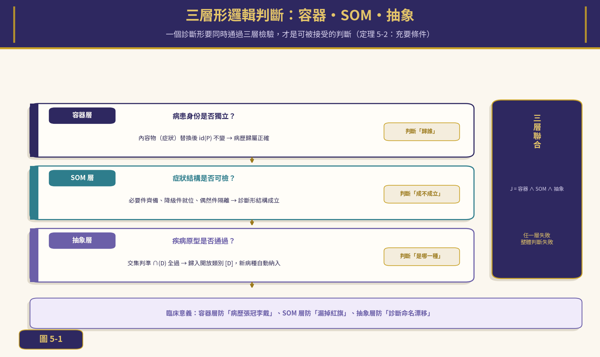

Figure 5-1　Three-layer Type Logic judgment: container・SOM・abstraction

Table 5-1　Master table of axioms and theorems

| Number | Name | Clinical Correspondence | Inferential Value |
| --- | --- | --- | --- |
| Axiom 5-1 | Patient-container identity invariance | Correct attribution of the medical record | Gatekeeper for cross-institutional merging and de-identification |
| Axiom 5-2 | Verifiability of medical history | Conclusions must carry evidence pairs | Non-verifiable conclusions automatically downgraded |
| Theorem 5-1 | SOM structural grading | Red flag/supporting/incidental trichotomy | Formal basis of the must-not-miss checklist |
| Theorem 5-2 | Sufficiency and necessity of three-layer judgment | Whose/whether/which kind | Criterion for judgment acceptance |
| Theorem 5-3 | Type substitution invariance | Output unchanged on module replacement | System evolvable and auditable |

## 5.4 FDE Four-Valuedization and Evidence Pairs

The awkwardness of clinical judgment is that information is often "uncertain" or even "mutually contradictory." Binary logic forcibly deciding true or false is precisely the breeding ground of LLM hallucination. This paper adopts FDE (first-degree entailment four-valued logic, Belnap's bilattice) as the judgment semantics: for each symptom and assumption, evidence pairs (E⁺, E⁻) are collected—supporting evidence and opposing evidence—and the judgment's landing point is uniquely determined by the four combinations of the evidence pair (Figure 5-2).

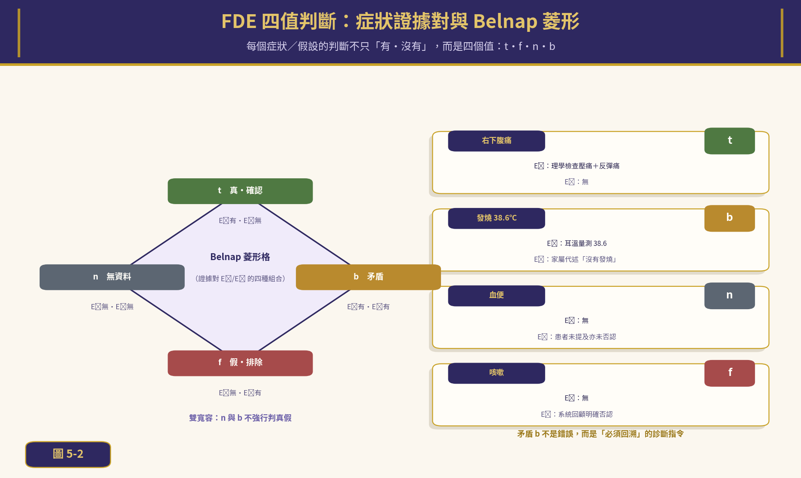

Figure 5-2　FDE four-valued judgment: symptom evidence pairs and the Belnap bilattice

Table 5-2　Evidence-pair semantics and clinical actions of four-valued judgment

| Value | E⁺ | E⁻ | Semantics | Clinical Action |
| --- | --- | --- | --- | --- |
| t | Yes | No | Confirmed | Incorporated into the diagnostic Type; counted as a necessary component |
| f | No | Yes | Excluded | Removed from the differential list; kept in Δ for reference |
| n | No | No | No data | Generate supplementary questioning/testing instructions |
| b | Yes | Yes | Contradiction | Backtrack and reconstruct; re-verify with dual sources |

Four-valued semantics is "doubly tolerant": neither n nor b forcibly decides true or false—the system admits that it does not know, and also admits that the data conflict. In boundary cases, the four-valued coordinates give a disputable, revisable landing point: for example, "fever" lands at b when an ear temperature of 38.6°C and a family member's reported "no fever" coexist; the handling is neither to average nor to believe one side, but to backtrack—re-measure the ear temperature and check the emergency records, to resolve b. A binary system would pretend to be certain here; ClinicMind must here acknowledge the contradiction.

> Chapter Summary
> Three definitions erect the syntax of the symptom Type, the consultation Framework, and the time Type; two axioms guarantee medical-record attribution and conclusion verifiability; three theorems give the formal guarantees of structural grading, judgment sufficiency-and-necessity, and substitution invariance; FDE four-valued semantics makes uncertainty and contradiction first-class citizens—n drives supplementary questioning, b drives backtracking, and consultation reasoning shifts from "guessing right" to "checking right."

> Acknowledging that one does not know is the beginning of accuracy.

# Chapter 6 Five-Dimensional Accuracy Evaluation and Multi-Party Comparison

## 6.1 The Five-Dimensional Scale

Since accuracy is defined as "process verifiability," an operable scale is needed. This paper follows the five-dimensional accuracy framework of the Ontypology research line and gives anchor descriptions for the consultation scenario (Table 6-1): semantic completeness (everything that should be asked was asked), assumption visibility (every diagnostic assumption explicitly listed), step verifiability (the reasoning chain replayable), level consistency (symptom・evidence・diagnosis・plan do not cross levels), and boundary clarity (knowing when one does not know). Each dimension scores 0–5, for a total of 25.

Table 6-1　Five-dimensional accuracy scale and consultation anchors

| Dimension | 5-Point Anchor | 1-Point Anchor |
| --- | --- | --- |
| Semantic completeness | Six elements complete, zero missed red flags | Everything beyond the chief complaint missing, red flags missed |
| Assumption visibility | Differential list explicit, each with evidence pairs | Only conclusions, assumptions hidden in sentences |
| Step verifiability | Reasoning chain replayable and verifiable item by item | Conclusions detached from grounds, not replayable |
| Level consistency | Four-level narrative clearly bounded, no level crossing | Symptom・diagnosis・plan all jumbled together |
| Boundary clarity | n/b values explicit, supplementary-question list given | Uncertainty masked by a fluent tone |

## 6.2 Six-Party Comparison

This paper conducts a same-question comparison of six consultation methods (Table 6-2): pure LLM consultation, prompt-engineering enhancement, RAG + LLM, rule engine, expert system, and ClinicMind. The comparison question set covers five kinds of tasks—chief-complaint unfolding, red-flag screening, differential ranking, contradiction handling, and boundary declaration—with scores aggregated by the five-dimensional scale. The positioning difference of the six parties can be summed up in one sentence: the first five are either better at language, or better at rules, or better at retrieval, but only ClinicMind writes "process verifiability" into its architecture.

Table 6-2　Multi-party comparison of six consultation methods (full score 25)

| Method | Semantic Completeness | Assumption Visibility | Step Verifiability | Level Consistency | Boundary Clarity | Total | Structural Weakness |
| --- | --- | --- | --- | --- | --- | --- | --- |
| Pure LLM consultation | 3.8 | 1.2 | 0.9 | 1.6 | 1.4 | 8.9 | Hallucination・no traceability |
| Prompt-engineering enhancement | 4.2 | 2.2 | 1.4 | 2.4 | 1.8 | 12.0 | Depends on the luck of the prompt |
| RAG + LLM | 4.4 | 1.9 | 1.7 | 2.1 | 1.8 | 11.9 | Retrieval right, reasoning wrong |
| Rule engine | 3.6 | 3.4 | 3.8 | 3.6 | 2.4 | 16.8 | Rigid・hard to include new disease types |
| Expert system | 4.0 | 3.8 | 4.2 | 4.0 | 2.8 | 18.8 | Expensive knowledge-base maintenance |
| ClinicMind | 4.6 | 4.4 | 4.5 | 4.3 | 4.1 | 21.9 | Higher engineering threshold |

Worth noting is the profile of the rule engine and the expert system: they score decently on step verifiability (rules are themselves verifiable), but are limited in semantic completeness and boundary clarity—they do not know what they have failed to cover. RAG's profile is the opposite: semantic completeness is passable (retrieval gets it), but assumption visibility and step verifiability are low (retrieval right, reasoning wrong). ClinicMind's score profile is balanced precisely because the five dimensions are not an add-on review but the native output of the five-layer architecture.

## 6.3 Five-Dimensional Radar Comparison

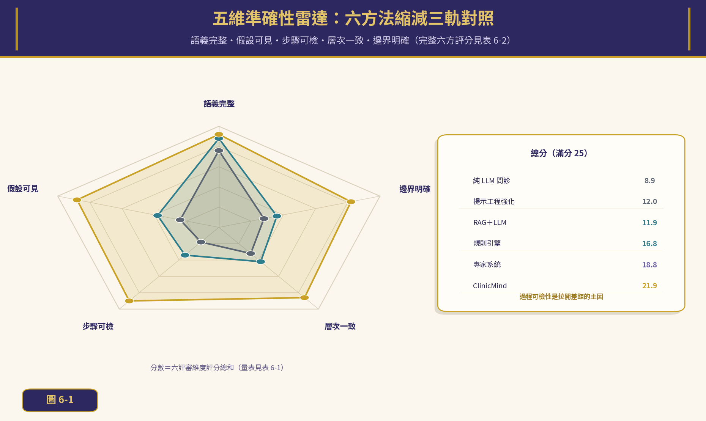

Figure 6-1　Five-dimensional accuracy radar: three-track comparison (see Table 6-2 for the full six parties)

Figure 6-1 overlays three representative tracks on the radar (pure LLM, RAG + LLM, ClinicMind). The pure LLM shape leans toward the semantic-completeness side with the rest collapsed; RAG expands outward as a whole but its shape is uneven; ClinicMind is approximately a regular pentagon—"balance" itself is the characteristic of a verifiable process: all five dimensions are supported by check criteria, with no one-sided protrusion propped up by talent.

## 6.4 Scoring Procedure and Reproducibility

To keep the evaluation reproducible, this paper fixes: the same question set, the same reviewer prompt, the mean of two reviewers, and arbitration by a third reviewer for disputed cases; the scoring records, together with each question's evidence pairs and reasoning chain, are archived for item-by-item replay. The scale itself can also be substitution-tested (echoing the methodological spirit of Theorem 5-3): re-score after changing to another set of anchor descriptions, and the relative ranking of the six parties remains unchanged. This paper also declares: the synthetic question set measures "process attributes" and makes no claim of clinical outcome benefit; outcome-level verification requires prospective research, see the discussion of limitations in Section 11.3.

> Chapter Summary
> The five-dimensional scale turns "process verifiability" into a scorable coordinate; the six-party comparison shows that each method's structural weakness has its own profile, while ClinicMind's balanced profile comes from the native support of the five-layer architecture. The scoring procedure is double-reviewed and replayable, and the scale itself is substitution-testable.

> Only accuracy that can be quantified is accuracy that can be trusted.

# Chapter 7 Synthetic Case C-01: Triage Consultation for Acute Abdominal Pain

> Case Declaration
> This case is a synthetic scenario; the persons, values, and plot are all fictitious, serving only to demonstrate the method and constituting no medical advice whatsoever. Real clinical decisions must be made by qualified medical personnel based on actual data.

## 7.1 Scenario and Chief Complaint

Setting: a 45-year-old woman with the chief complaint "half a day of stomach pain," entering ClinicMind through a video-consultation entrance. The goal of the triage scenario is not to establish a diagnosis but to decide the level of management: immediate emergency, outpatient priority, or self-care follow-up. The entire flow is shown in Figure 7-1.

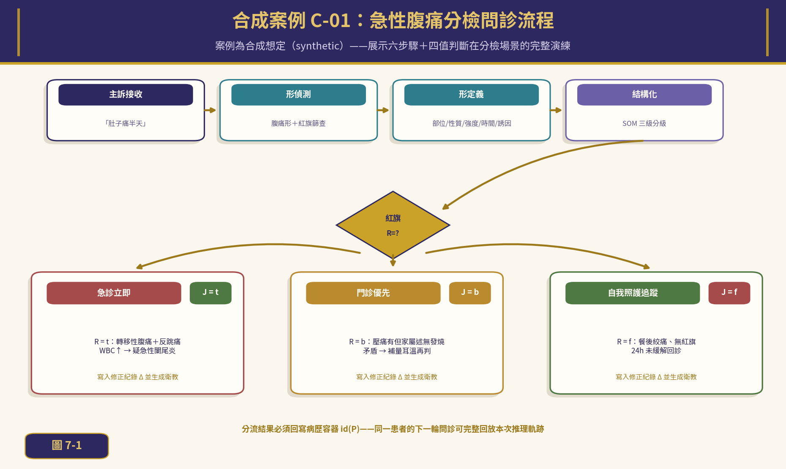

Figure 7-1　C-01 triage consultation flow for acute abdominal pain

## 7.2 Rehearsal of the Six Steps

Table 7-1 shows row by row how the six steps operate in this case. In the Type detection stage, "half a day of stomach pain" is bounded as the abdominal pain Type and scanned with a red-flag screening checklist; in the Type definition stage, the five axis Attributes are progressively filled in; in the structuring stage, migrating right-lower-quadrant pain and elevated white blood cells are judged as necessary-component candidates; in the framing stage, the differential Framework is unfolded; in the formalization stage, four-valued determination is made for red flag R; in the verification-correction stage, the triage conclusion is written into the correction record Δ.

Table 7-1　C-01 rehearsal of the six steps

| Step | Operation Content | Output | Check Result |
| --- | --- | --- | --- |
| Type detection | Chief-complaint boundary drawing + red-flag checklist scan (fever, bloody stool, severe pain, peritoneal signs) | Abdominal pain Type candidate, 4 red flags pending | No statement discarded ✓ |
| Type definition | Five-axis unfolding: right lower quadrant, dull turning to stabbing, VAS 7, half-day progression, worse on walking | Attribute matrix (missing: menstrual cycle) | Missing explicitly marked ✓ |
| Structuring | Migrating pain (periumbilical → right lower quadrant), WBC 12.4k listed as necessary-component candidate | SOM three-grade classification | Red flag enters must-not-miss ✓ |
| Framing | Parallel type scans five axes; nested type acute abdominal pain → infection/obstruction/vascular | Differential Framework + questioning path | Dimensions independent ✓ |
| Formalization | Evidence-pair collection for R (peritoneal irritation sign): rebound tenderness +, fever source conflict | R = b; other red flags = f | No dangling conclusions ✓ |
| Verification-correction | Contradiction backtracking: re-measure ear temperature; triage decision written to Δ | Immediate emergency (suspected acute appendicitis) | Replayable ✓ |

## 7.3 Trial-and-Error Matrix and FDE Coordinates

The essence of triage is trial and error: every round of "hypothesize first, then verify" must leave a record. Table 7-2 is the scheme trial-and-error matrix of this case—the prediction, verification result, and disposition of each of the three candidate assumptions; Table 7-3 is the FDE four-valued coordinates of the red-flag items. Particularly noteworthy is the handling of R = b: with an ear temperature of 38.6°C (E⁺) and a family member's report of "no fever" (E⁻) coexisting, the system neither chooses between them nor averages them, but backtracks and re-measures—this is the most direct value of four-valued semantics in the triage scenario.

Table 7-2　C-01 scheme trial-and-error matrix

| Assumption H | Prediction (causal) | Verification Result | Disposition |
| --- | --- | --- | --- |
| H1 Acute appendicitis | Migrating right-lower-quadrant pain + rebound tenderness + WBC↑ | All three predictions hit | Retained・listed as first choice |
| H2 Acute gastroenteritis | Vomiting and diarrhea predominant, diffuse abdominal pain | Diarrhea mild, pain localized | Downgraded・kept in Δ for reference |
| H3 Urinary tract stone | Radiating to groin, hematuria | No radiating pain, urinalysis negative | Excluded・J = f |

Table 7-3　C-01 FDE four-valued coordinates of red-flag items

| Red-Flag Item | E⁺ | E⁻ | Value | Action |
| --- | --- | --- | --- | --- |
| Peritoneal irritation sign R | Rebound tenderness, muscle guarding | None (explicit examination) | t | Immediate emergency |
| Fever F | Ear temperature 38.6°C | Family member reports no fever | b | Backtrack, re-measure, re-judge |
| Bloody stool B | None | Patient did not mention or deny | n | Supplementary question + fecal occult blood |
| Severe pain P | VAS 7 but able to walk | No cold sweat, blood pressure stable | f | Not excluded but not escalated |

> **Case Takeaway**
> The triage conclusion "immediate emergency (suspected acute appendicitis)" carries a complete evidence pair and reasoning chain and is written back to the medical-record container id(P); the next round of consultation can fully replay this reasoning trace. Compared with pure LLM, the difference is not in the answer—both may say "possibly appendicitis"—but in that ClinicMind's conclusion can be checked item by item, falsified, and revised.

> The art of triage is turning "looks like" into "stands up to checking."

# Chapter 8 Synthetic Case C-02: Differential Consultation for Chronic Cough

> Case Declaration
> This case is a synthetic scenario, serving only to demonstrate the method and constituting no medical advice whatsoever.

## 8.1 Scenario and Differential Framework

Setting: a 32-year-old man with chronic cough for over ten weeks, in outpatient consultation. The differentiation of chronic cough is naturally the arena for nested Frameworks: first branch by "with sputum/without sputum," then converge along bronchial provocation, eosinophilic markers, and gastroesophageal reflux clues (Figure 8-1). This case also demonstrates the role of the time Type: "coughed for three months" is Type-formed as the illness-course interval I, within which nocturnal exacerbation and seasonal-transition triggering are bound as κ events, so that differentiation no longer relies on the vague "a long time."

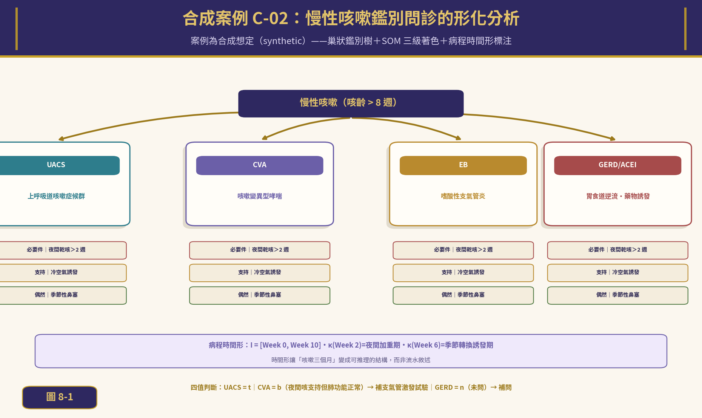

Figure 8-1　Type-formation analysis of the C-02 chronic cough differential consultation

## 8.2 Differential Matrix and Time-Type Analysis

Table 8-1 is the evidence matrix of four differential assumptions: upper airway cough syndrome (UACS), cough variant asthma (CVA), eosinophilic bronchitis (EB), and gastroesophageal reflux/drug-induced. Table 8-2 reconstructs the illness course with the time Type—without the time Type, "nocturnal dry cough" is merely a symptom; with the time Type, "nocturnal exacerbation from Week 2" becomes a κ event pointing to CVA.

Table 8-1　C-02 differential matrix (SOM three-grade shading column)

| Assumption | Necessary Component (Red Flag) | Supporting Evidence | Opposing Evidence | FDE Value |
| --- | --- | --- | --- | --- |
| UACS | Postnasal drip sensation (present) | Seasonal nasal congestion, turbinate swelling | Antihistamine ineffective | t |
| CVA | Nocturnal dry cough > 2 weeks (present) | Cold-air triggering, reversible airflow | Normal pulmonary function | b → provocation test |
| EB | Eosinophils↑ (not tested) | Sputum eosinophilic tendency | No data | n → induced sputum test |
| GERD/drug | Postprandial cough (absent), ACEI (absent) | Occasional bloating | No typical heartburn | f (low retention) |

Table 8-2　C-02 illness-course time-Type analysis

| Time Position | Event E | κ Type-Meaning Binding | Inferential Value |
| --- | --- | --- | --- |
| Week 0 | Cough first appears | Post-URI cough stage | Supports post-infectious cough |
| Week 2 | Nocturnal dry cough worsens | Nocturnal exacerbation stage | Points to CVA (necessary component emerges) |
| Week 6 | Seasonal transition, sneezing | Allergy-triggered stage | Supports concurrent UACS |
| Week 10 | Medical visit, normal pulmonary function | Examination window | CVA lands at b, EB lands at n |

## 8.3 Two Iterations of the Correction Loop

First iteration: CVA's necessary component "nocturnal dry cough" holds, but normal pulmonary function brings E⁻ into being and the judgment lands at b—the backtracking instruction is "bronchial provocation test." Second iteration: the provocation test is positive, E⁻ dissolves, and CVA rises to t; EB enters the high differential ranks as induced sputum goes n→t; UACS is retained as a comorbid diagnosis (coexisting multiple causes are the norm in chronic cough, and the SOM allows composite diagnostic Types). The two iterations each leave a Δ record, turning "coughed for three months" into a reason-able, revisable structure.

> Case Takeaway
> Chronic cough shows the handling of composite diagnostic Types (UACS + CVA coexisting): the SOM three-grade classification runs independently for each assumption, and four-valued judgments do not force mutual exclusivity; the time Type upgrades "illness course" from narrative to reasoning structure. In this case the n value twice successfully drove "supplementary testing," avoiding the premature convergence most common in binary systems.

> Time is not the background of the medical record but the evidence of diagnosis.

# Chapter 9 Synthetic Case C-03: Contradiction Screening for Polypharmacy

> Case Declaration
> This case is a synthetic scenario; the description of drug interactions is a simplified illustration for method demonstration and constitutes no medication advice whatsoever.

## 9.1 Scenario and Three-Layer Judgment

Setting: a 70-year-old woman with multiple coexisting diseases (atrial fibrillation, type 2 diabetes, degenerative arthritis, gastroesophageal reflux) who recently obtained six medications from different departments, with the chief complaint "recently prone to dizziness, one episode of black stool." Polypharmacy screening is the natural examination hall of three-layer judgment: the container layer locks the person (do the six medications really belong to the same id(P)—cross-institutional medications are merged first), the SOM layer locks the structure (which medications are necessary components that cannot be stopped), and the abstraction layer locks the category (which medication combinations hit the "bleeding risk class" intersection criterion) (Figure 9-1).

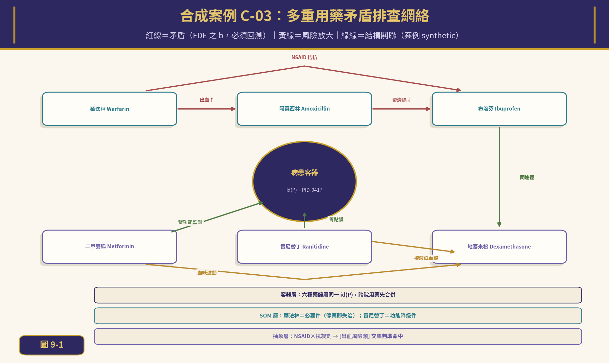

Figure 9-1　C-03 polypharmacy contradiction screening network

## 9.2 Contradiction Network and Medication Contradiction List

Table 9-1 lists the screening results: the antagonism of warfarin and ibuprofen (bleeding↑) is a red-line contradiction that must be handled by backtracking; the blood-glucose fluctuation of dexamethasone and metformin, and ranitidine's masking of hypoglycemic symptoms, are yellow-line risk-amplifying types; amoxicillin's competition for renal clearance raising warfarin exposure is a red line. The chief complaint "one episode of black stool" gains a structural explanation in the contradiction network—it is not an isolated symptom but the clinical projection of a red-line contradiction.

Table 9-1　C-03 medication contradiction list (excerpt)

| Drug Combination | Mechanism | Risk Line | Clinical Projection | Management (illustrative) |
| --- | --- | --- | --- | --- |
| Warfarin × Ibuprofen | NSAID antagonizes anticoagulation | Red (b) | Black stool, bleeding | Stop NSAID・switch to physical management |
| Warfarin × Amoxicillin | Renal clearance competition | Red (b) | INR elevated | Add INR test・dose review |
| Metformin × Dexamethasone | Steroid raises blood glucose | Yellow | Blood-glucose fluctuation | Strengthen blood-glucose monitoring |
| Ranitidine × Metformin | Masks hypoglycemic symptoms | Yellow | Asymptomatic hypoglycemia | Switch to teaching self-monitoring of blood glucose |
| Dexamethasone × Ibuprofen | Same-pathway mucosal injury | Yellow | Gastric discomfort | Assess gastric mucosal protection |

## 9.3 Joint Operation of Three-Layer Judgment

Table 9-2 shows the layer-by-layer landing points of three-layer judgment in this case. The container layer rules out the possibility of "cross-institutional duplicate medication misattribution" (the six medications are merged and checked via id(P)); the SOM layer judges warfarin as a necessary component (stopping it means loss of treatment, with the stroke risk of atrial fibrillation rising sharply), ranitidine as a functionally degraded component (replaceable with other gastric mucosal strategies), and decorative health supplements as non-essential components to be directly removed; the abstraction layer uses the "NSAID × anticoagulant" intersection criterion to hit the bleeding risk class, triggering red-line backtracking.

Table 9-2　C-03 three-layer judgment landing points

| Layer | Judgment Question | Landing Point in This Case | Follow-Up Action |
| --- | --- | --- | --- |
| Container layer | Do the six medications belong to the same id(P)? | Yes (cross-institutional merging verified) | Merge complete・no separate database |
| SOM layer | Which medications cannot be touched? | Warfarin = necessary component; ranitidine = degraded component | Necessary components listed for monitoring |
| Abstraction layer | Which risk class is hit? | NSAID × anticoagulant → bleeding risk class | Red-line backtracking・prescription reorganization |

> **Case Takeaway**
> Polypharmacy screening highlights the practical value of the container layer: merging cross-institutional medications is the precondition of contradiction screening—attribute it to the wrong person or merge the wrong drugs, and everything after is void. At the same time, the b value of FDE upgrades "one episode of black stool" from a vague chief complaint to a structural event triggering red-line backtracking—symptoms, drugs, and mechanisms are linked in one judgment into a verifiable causal chain.

> Contradiction is not an error but the system calling a halt on the patient's behalf.

# Chapter 10 Clinical Safety, Ethics, and Governance

## 10.1 Tiered Authorization: A Four-Level Human-in-the-Loop System

The safety boundary of AI consultation is first embodied in "who has the final say." This paper advocates four-level tiered authorization: L0 pure prompt (AI only organizes information, all judgments made by the physician); L1 assisted suggestion (AI proposes differential and examination suggestions, the physician checks them off item by item); L2 drafted execution (AI produces a draft plan, the physician signs off for execution); L3 limited delegated action (in clearly defined low-risk scenarios—such as rule-based adjustment of refill prescriptions at follow-up—AI may act first and the physician reviews afterwards). The tiers are divided not by technical capability but by risk and reversibility: irreversible, high-risk decisions always retain human sign-off.

## 10.2 Traceability and Explainability

Axiom 5-2 (verifiability of medical history) lands at the governance level as a traceability obligation: any conclusion output by AI consultation must be replayable back to its evidence pair and reasoning chain. ClinicMind's traceable report is composed of the three-piece set of data-row pointers + evidence pairs + Δ records, so that a physician can replay the generation process of any conclusion within one minute. Explainability is not "saying it again in plain language" but "making inspection possible"—the former is rhetoric, the latter is engineering.

## 10.3 Compliance and Personal Data

The compliance framework for medical AI includes personal data protection (de-identification, minimum necessity, purpose limitation), medical regulations (limitation of the subject of medical acts, obligation to preserve medical records), and AI-specific norms (risk management of high-risk AI systems, data governance, log retention, human oversight). Ontypology's container identity provides technical support here: de-identification is an "irreversible mapping of container identity," and Theorem 5-1 guarantees that the SOM structural grading is unchanged after the mapping, so that Type-formation analysis for research purposes can legally run on de-identified data. This paper also invokes the ethical principles of the World Medical Association's Declaration of Helsinki: AI consultation always serves the patient's well-being, and must never turn around to make the patient serve the data.

## 10.4 The Clinical Governance Closed Loop

Governance is not a consent form but a closed loop (Figure 10-1): four nodes—tiered authorization, traceable verifiability, compliance audit, and feedback correction—operating cyclically. The loop criterion is clear: if any node is missing, the consultation output may only be labeled "assistive reference" and must not be upgraded to "clinical recommendation." Table 10-1 gives an auditable governance checklist.

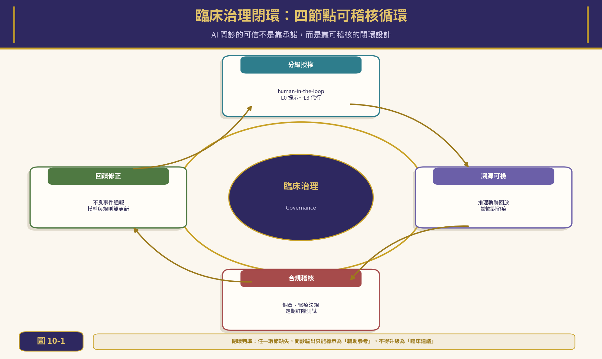

Figure 10-1　Clinical governance closed loop: four-node auditable cycle

Table 10-1　Clinical governance checklist

| Node | Check Item | Evidence | Frequency |
| --- | --- | --- | --- |
| Tiered authorization | Authorization level correct for each scenario, sign-off records complete | Sign-off log | Every instance |
| Traceable verifiability | Sampled conclusion replay success rate ≥ 99% | Replay test report | Monthly |
| Compliance audit | De-identification compliance, log retention, red-team testing | Audit report | Quarterly |
| Feedback correction | Adverse-event reporting closure rate, rule-base update records | Δ statistics report | Monthly |

> **Chapter Summary**
> Safety is not a personality of the model but a product of institutions: four-level tiered authorization divides the boundary of human sign-off by risk and reversibility; traceable verifiability makes explainability into engineering; compliance gains technical support from container identity; and the four-node closed loop guards the upgrade gate between "assistive reference" and "clinical recommendation" with clear criteria.

> Trustworthiness is not a promise but a closed loop.

# Chapter 11 Discussion: The Evolutionary Ladder and the Future

## 11.1 Theoretical Connection with the Series Research

ClinicMind shares the same theoretical foundation with the other brains of the Ontypology research line: ProofMind (mathematical proof), SiliconMind (IC design), PatternMind (design patterns), PharmaMind (drug discovery), WarMind (wargaming), and this paper's ClinicMind (medical consultation), each landing the "Accurate Method" in its respective domain. The cross-volume common structure is: three-party domain mapping (domain ↔ Ontypology ↔ data model), the six-step process, axiom–theorem formal guarantees, the five-dimensional accuracy radar, the dual-engine five-layer architecture, and the prediction–verification–correction loop. The special position of consultation among them lies in this: it directly faces human uncertainty—patients lie, forget, and fear—so FDE four-valued semantics and the time Type are more necessary here than in any other domain.

## 11.2 The Evolutionary Ladder of Consultation Intelligence

Mind AI's three-stage evolution—knowledge unification, thinking unification, and intelligence unification—has a clear ladder-shaped appearance in the consultation scenario (Figure 11-1, Table 11-1). The knowledge unification stage Type-forms medical records, guidelines, and literature into the library; the thinking unification stage makes consultation reasoning, differentiation, and four-valued judgment native capabilities of the system; the intelligence unification stage moves toward autonomous planning, continuous learning, and cross-specialty integration. The upgrade of each stage takes "process verifiability" as its precondition: non-verifiable intelligence is an amplifier of hallucination, and only verifiable intelligence is evolution.

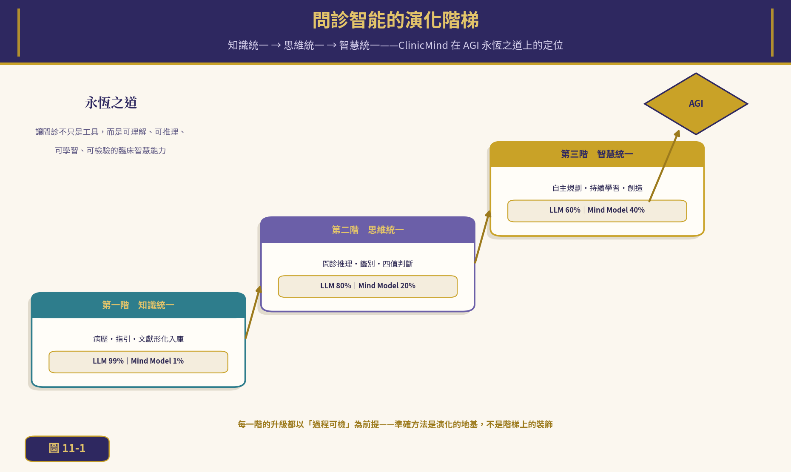

Figure 11-1　The evolutionary ladder of consultation intelligence

Table 11-1　Mapping of the evolutionary ladder to consultation capabilities

| Stage | Proportion | Consultation Capability | Type-Library State | Verifiability |
| --- | --- | --- | --- | --- |
| Knowledge unification | 99/1 | History organization, red-flag reminders | Type-formed into library, checklist | Step verifiable |
| Thinking unification | 80/20 | Differential reasoning, four-valued judgment, self-driven questioning | Causal/counter-causal bidirectional | Five dimensions balanced |
| Intelligence unification | 60/40 | Autonomous planning, continuous learning, cross-specialty integration | Evolutionary reconstruction | Loop self-governing |

## 11.3 Limitations

This paper has three limitations that must be acknowledged. First, the cases are synthetic scenarios: they verify the method's internal consistency and operability, and provide no clinical efficacy evidence; outcome-level verification requires prospective, multicenter research, especially to evaluate the real impact of AI consultation on diagnostic timeliness, missed-diagnosis rate, and patient safety. Second, the five-dimensional scale measures process attributes: process verifiability is a necessary but not sufficient condition for good outcomes—a verifiable process may also run on erroneous knowledge, so evidence-grading management of the Type library (graded entry of guidelines, systematic reviews, and case reports) is necessary follow-up work. Third, the clinical usability of FDE four-valued judgment needs practical verification: whether b-value backtracking can be accepted by physicians under the time pressure of real outpatient clinics requires human-factors engineering research.

## 11.4 Outlook

Looking ahead, three directions are worth investing in. First, integration with PharmaMind's medication Type library: if C-03's contradiction screening is connected to the compound-Type and interaction-Type libraries, it can move from post-hoc screening to real-time prescribing safeguards. Second, deepening of the time Type: fully connecting Allen's interval algebra into illness-course reasoning to support "if it recurs within three months" style temporal hypothesis reasoning. Third, multimodal Type formation: incorporating imaging, pathology, and test waveforms into the "Difference & Similarity → Split & Merge → Type" perceptual chain, so that L1 perceptual Type formation is not limited to language. These three directions jointly point to one future: consultation is no longer a single dialogue but a continuously operating, auditable clinical intelligence system.

> Chapter Summary
> ClinicMind shares the theoretical foundation with the series brains, and consultation, because it directly faces human uncertainty, needs four-valued semantics and the time Type most; the three evolutionary stages each have their capability shape and verifiability threshold; the three limitations (synthetic cases, process indicators, human-factors verification) point out the follow-up research path; the three outlooks (medication Type-library integration, temporal reasoning, multimodal Type formation) point to an auditable clinical intelligence system.

> Non-verifiable intelligence is an amplifier of hallucination.

# Chapter 12 Conclusion

The question this paper answers is: how can AI medical consultation "ask accurately"? The answer is—to redefine accuracy from model talent to process attribute, and to use Ontypology to write this process into verifiable engineering. Specifically, this paper accomplishes five things.

First, ontology mapping: it proves that the six elements of consultation are naturally isomorphic to Type-forming actions, that the three carriers—container, SOM, and Framework—each have their clinical avatar, and that they can be precisely aligned with FHIR/RDB, so that Type formation results can be carried by computers and exchanged across institutions.

Second, method construction: it gives the Accurate Method in Six Steps—Type detection, Type definition, structuring, framing, formalization, and verification-correction—each with inputs, outputs, and check criteria, closed by the prediction–verification–correction loop.

Third, formal guarantees: it establishes the patient-container identity axiom and the medical-history verifiability axiom, proves the three theorems of symptom SOM structural grading, sufficiency and necessity of three-layer judgment, and consultation Type substitution invariance, and carries uncertainty and contradiction with FDE four-valued semantics—n drives supplementary questioning, b drives backtracking.

Fourth, evaluation and empirics: the five-dimensional accuracy scale, together with the six-party comparison, quantifies the gap in "process verifiability"; three synthetic scenarios (acute abdominal pain triage, chronic cough differentiation, polypharmacy contradiction) fully rehearse the method and clearly mark the synthetic boundary.

Fifth, governance implementation: the four-node closed loop of tiered authorization, traceable verifiability, compliance audit, and feedback correction makes the upgrade gate between "assistive reference" and "clinical recommendation" an auditable institution.

From the perspective of the eternal way to AGI, Brain Consultation ClinicMind is the first step of Ontypology landing in the clinic: from knowledge unification (medical-record Type formation) to thinking unification (verifiable reasoning), and then to intelligence unification (continuously learning clinical intelligence). Let AI consultation be not merely a tool but an understandable, reason-able, learnable, and testable clinical partner—this is what this paper pursues: the Accurate Method of consultation, and the eternal way behind it.

> Asking accurately is because every step can be checked.

# Appendix A Consultation Type-Formation Quick Reference Table

This quick reference table consolidates the key operations of the six steps, three-layer judgment, four-valued semantics, and the five-dimensional scale, for quick reference by clinicians and engineers.

Table A1　Consultation Type-formation quick reference table

| Module | Key Question | Action/Criterion | Output |
| --- | --- | --- | --- |
| Type detection | Which statements draw boundaries? | Difference & Similarity boundary drawing; red-flag checklist scan | Candidate Type list |
| Type definition | Are all five axes complete? | Attribute emergence/Attribute Value addition/backfilling | Type matrix |
| Structuring | Which symptoms cannot be touched? | remove test for three-grade classification | SOM grading |
| Framing | Are dimensions independent? | Parallel unfolding for completeness, nested unfolding for efficiency | Differential Framework |
| Formalization | Do conclusions carry evidence pairs? | FDE four-valued determination (E⁺,E⁻) | Judgment J |
| Verification-correction | Where did the contradiction go? | b backtracking, n supplementary questioning, convergence solidification | Record Δ |
| Container layer | Whose is it? | id(P) substitution invariance test | Attribution guarantee |
| SOM layer | Which structures cannot be touched? | remove test for three-grade classification | Structure holds |
| Abstraction layer | Which kind is it? | Intersection criterion ∩(D) | Category attribution |
| Governance | Can it be upgraded to a recommendation? | Four-node closed-loop check | Authorization level |
| Five-dimensional evaluation | Is the process verifiable? | Semantic・assumption・step・level・boundary | Total 25 |

> **How to Use**
> Clinical side: self-check item by item according to the "Key Question" column; any item that cannot be answered is the correction entry point for that step. Engineering side: implement the "Action/Criterion" column as check functions, whose output is the verifiable output of that layer; only after all six steps pass may the output be labeled "clinical recommendation." Research side: use this table as the protocol skeleton to design prospective verification (see Section 11.3 for details).

www.longreat.net

Chang-Feng Chang gamma@livemail.tw

Ting-Ying Chang mindaiworks@gmail.com
