

  <a href="https://youtu.be/B7lmkfmaMco">💻Landscape</a> ｜ 
 <a href="https://v.douyin.com/6C7lpbRwYgQ">📱Portrait</a> 
 

# Ontypology —— Brain Of The World Model

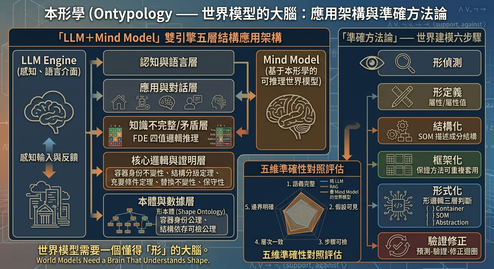

**Ontypology's Accurate Method and the World Mind Application Architecture**

---

## Abstract

The World Model has become a core issue of artificial general intelligence: a model capable of internally "imagining" how the world works, and thereby predicting and deciding, is the foundation of intelligence. However, a World Model built on the large language model (LLM) as its sole pillar has three structural gaps — **identity discontinuity, invisible structure, and closed rules** — it hides world knowledge in the statistical distribution of parameters, cannot persistently identify the same object, cannot examine the dependencies between parts, and cannot use publicly available rules to determine the membership of new situations.

Taking Ontypology as its theoretical foundation, this paper proposes the "Brain of the World Model" **WorldMind**: an application architecture of LLM + Mind Model dual engines and a five-layer structure, and gives an operable, testable "Accurate Method" — the **six steps of world modeling** (Type detection, Type definition, structuring, frameworking, formalization, verification and correction). The method starts from the cognitive chain of "Difference & Similarity → Split & Merge → Type," describes the traits of objects with Attributes/Attribute Values, describes identity and structure with Space Collections and SOM, guarantees that the method can be repeatedly applied with a Framework, then completes formalization with the three-layer judgment of Type Logic (container, SOM, abstraction), and finally converges with a predict-verify-correct loop and five-dimensional accuracy assessment.

At the theoretical level, this paper establishes the Container Identity Axiom, the Structural Grading Theorem, the Necessary-and-Sufficient Condition Theorem of Three-Layer Judgment, and the Type Replacement Invariance Theorem, raising the judgment process of Type Logic into provable properties; at the application level, taking the smart home scenario and conversational AI as cases, it demonstrates how the three-layer judgment operates jointly, and designs a comparative evaluation of three methods: pure LLM, RAG, and LLM + Mind Model. The results show that a World Model augmented with a Mind Model is comprehensively superior to existing routes across five dimensions: semantic completeness, visible assumptions, verifiable steps, layer consistency, and clear boundaries. This paper argues: **what the World Model needs is not a larger number of parameters, but a brain that understands "Type."**

**Keywords**: World Model, brain, Ontypology, Type Logic, Mind Model, dual engines, Type Repository, five-dimensional accuracy

---

## Table of Contents

- [Chapter 1 Introduction: Why the World Model Needs a Brain](#chapter-1-introduction-why-the-world-model-needs-a-brain)
- [Chapter 2 The Typed Ontology of the World](#chapter-2-the-typed-ontology-of-the-world)
- [Chapter 3 WorldMind Overall Architecture: Dual Engines and Five Layers](#chapter-3-worldmind-overall-architecture-dual-engines-and-five-layers)
- [Chapter 4 The Accurate Method: Six Steps of World Modeling](#chapter-4-the-accurate-method-six-steps-of-world-modeling)
- [Chapter 5 Formal Properties and Theorems](#chapter-5-formal-properties-and-theorems)
- [Chapter 6 Case Studies](#chapter-6-case-studies)
- [Chapter 7 Five-Dimensional Accuracy Assessment](#chapter-7-five-dimensional-accuracy-assessment)
- [Chapter 8 Conclusion and Outlook](#chapter-8-conclusion-and-outlook)
- [References](#references)
- [Appendix A Three-Layer Judgment Quick Reference](#appendix-a-three-layer-judgment-quick-reference)

---

# Chapter 1 Introduction: Why the World Model Needs a Brain

## 1.1 The Definition and Expectations of the World Model

The so-called World Model refers to a derivable structure of "how the world works" that a system builds internally: given the current state and an action, it can predict the next state; given a hypothetical situation, it can derive the consequences of "if… then…"; and when a prediction does not match observation, it can locate the error and correct itself. These three things — prediction, counterfactual, and correction — are exactly what the human cognitive system does at every moment. Research in developmental psychology points out that infants possess core knowledge such as object permanence and causal intuition at a very early stage, showing that the "World Model" is not an acquired luxury, but the underlying configuration of intelligence.

In recent years, large language models (LLMs) have implicitly contained a great deal of world knowledge through their vast parameters, and can fluently describe scenes and derive plots, and are seemingly regarded as the ready-made foundation of the World Model. However, "being able to describe" and "being able to test" are two different things: a model can describe a cup in exhaustive detail in text, yet fail to recognize that it is the same cup after the cup's contents are changed; it can list the parts, yet cannot say which part, if removed, would cause the whole to collapse; it can analogically guess the membership of a new object, yet cannot give a criterion that can be publicly verified. Fluency of language conceals the absence of structure.

## 1.2 The Three Gaps of the Pure-LLM World Model

If we lay out the pure-LLM approach to world modeling for examination, we can summarize three structural gaps.

1. **Identity discontinuity**: The LLM processes the world as token sequences, and the identity of an object flows as the description continues, lacking an identity anchor that "does not change with the contents," so tracking the same object across turns becomes difficult.
2. **Invisible structure**: The dependency relations between parts are hidden in co-occurrence statistics, making it impossible to answer structural questions such as "what happens if you remove the bottom of the cup," and impossible to locate the specific structural position when a prediction goes wrong.
3. **Closed rules**: The membership judgment of a new situation relies on analogy and linguistic feel, lacking a criterion that can be written out, tested, and revised, so the model performs unstably on boundary cases and cannot explain why.

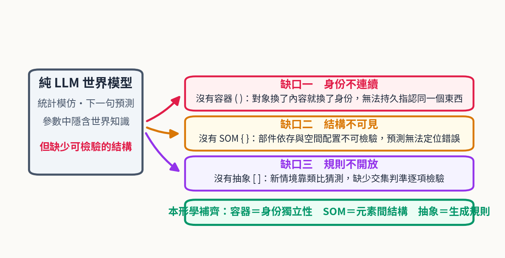

**Figure 1-1** The three gaps of the pure-LLM World Model, and how Ontypology's three value-additions fill them

These three gaps are not flaws in engineering details, but ontological defects of the language model as a World Model: what it lacks is not data, but "Type" — a description format that can simultaneously carry identity, structure, and generation rules. This is precisely Ontypology's point of entry.

## 1.3 Ontypology: An Accurate Method

Ontypology argues: a Type is not innately existent, but is the result produced only after the brain first detects "Difference & Similarity" and then draws boundaries through the actions of "Split" and "Merge." Once a Type exists, describing a concrete object requires four aspects — **Attribute** (what it looks like), **container** (where it is, and whether its identity is independent), **SOM** (what it is composed of, and how the parts depend on each other), and **Framework** (whether this description method can be repeatedly applied). Together, the four aspects exactly constitute a testable description of the world. The "Accurate Method" spoken of in this paper is exactly the transformation of this theory into an operable modeling procedure: first Difference & Similarity, then drawing boundaries, filling in attributes, establishing identity, fixing structure, writing out rules, opening up testing, and finally measuring the result by five-dimensional accuracy.

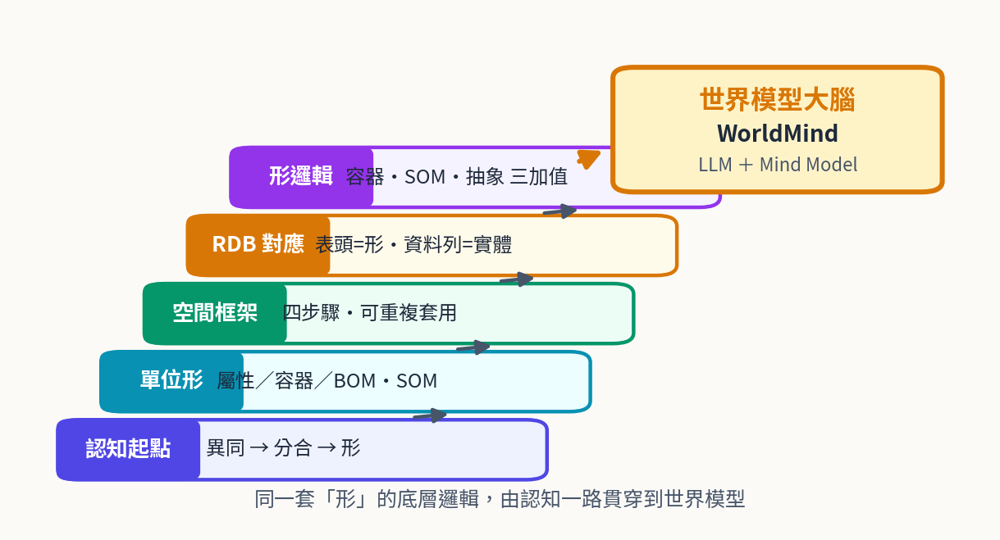

**Figure 1-2** From the cognitive starting point to the Brain of the World Model: the same construction chain of "Type"

> **Key Point 1-1 The Central Thesis of This Paper**
> What the World Model needs is not a larger number of parameters, but a brain that understands "Type": the LLM is responsible for understanding and generation at the linguistic level, the Mind Model is responsible for the construction, maintenance, and Type-Logic judgment of the Type Repository, and the two constitute dual engines, neither dispensable.

## 1.4 Contributions of This Paper and Chapter Arrangement

This paper makes four contributions. First, it systematically applies the Type concept of Ontypology to the World Model, identifies the three structural gaps of the pure-LLM route, and fills them one by one with three value-additions. Second, it proposes the overall architecture of WorldMind: LLM + Mind Model dual engines and a five-layer structure, clearly defining the responsibilities of each layer and the evolutionary trajectory of the work proportion. Third, it gives the Accurate Method of the six steps of world modeling, and at the formalization level establishes four axioms/theorems — the Container Identity Axiom, the Structural Grading Theorem, the Necessary-and-Sufficient Condition Theorem of Three-Layer Judgment, and the Type Replacement Invariance Theorem — elevating the judgment process from a method into provable properties. Fourth, it implements the three-layer judgment with smart home and conversational AI cases, and completes a comparative evaluation of three methods with five-dimensional accuracy.

The chapters are arranged as follows: Chapter 2 establishes the Typed Ontology of the World, reviewing and organizing the core concepts of Ontypology; Chapter 3 gives the dual-engine, five-layer architecture of WorldMind and the RDB correspondence of the Type Repository; Chapter 4 details the six steps of world modeling and the predict-verify-correct loop; Chapter 5 covers the formal properties and the four theorems with their proofs; Chapter 6 is the case studies; Chapter 7 reports the results of the five-dimensional accuracy assessment; Chapter 8 concludes and looks forward to future work.

---

# Chapter 2 The Typed Ontology of the World

## 2.1 The Origin of Type: Difference & Similarity → Split & Merge → Type

To model the world, one must first ask: where does "Type" come from? Ontypology's answer is: a Type is not innately existent, and its birth follows a fixed order — first there is the sensation of "Difference & Similarity," then the actions of "Split" and "Merge" arise, and only then is a Type born, and a Type must have a name. Split is seeing where things differ from one another; Merge is finding, among things that differ, the parts that can be counted as the same kind; a Type is the boundary drawn by Split & Merge. The Gestalt principle of "figure and ground" in cognitive science is precisely the most primitive starting point of this chain: when the background is uniform and the foreground stands out, the brain can easily draw a boundary; when the view is entirely homogeneous, no Type can be born.

For the World Model, the significance of this cognitive chain is: the starting point of modeling is not an a priori ontological classification, but the detection of difference. The system must first be able to perceive "this state is different from that state" before it can classify states into Types. This determines that the first step of the six steps in Chapter 4 must be "Type detection" — any World Model that skips Difference & Similarity detection and directly applies a fixed category table treats "Type" as a gift from heaven, and is thereby doomed to be unable to handle new differences outside the category table.

## 2.2 Unit Type: Attribute, Container, and SOM

Once a Type is drawn, how does one fully describe a concrete Type? Ontypology takes a cup as an example to establish the four aspects of a Unit Type. An Attribute is a "question that can be asked," and an Attribute Value is the answer to this question in a concrete situation; the moment an Attribute emerges is always the moment "this batch of differences does not match any existing Attribute," and the moment an Attribute Value increases is when the nature of the difference matches some existing Attribute. Once an Attribute has been extracted, it must be applied back to all existing individuals — a dimension must be able to run through all individuals before it can be used for mutual comparison.

> **Definition 2-1 (Space Collections)**
> A Space Collection C = (identity id(C), internal space S(C)), satisfying three elements:
> (1) Boundary: clearly distinguishing inside from outside;
> (2) Internal space: able to hold, remove, and empty;
> (3) Independent identity: id(C) is not determined by the contents.
> A container answers "where a thing is," not "what a thing is"; a cup does not become another thing because it holds water or coffee.

The BOM (Bill of Materials) answers "what parts this thing is composed of when opened up," and its only criterion is: after being removed, does it still recognize itself? Those that remain independent individuals after removal go into the BOM (the handle, the lid); those that cannot be removed go into Attributes (color, material). The SOM, then, is the superposition of the BOM and the Space Collection: SOM = BOM + Space Collection — like a container, it has a boundary and an internal space, but what it holds inside is not contents that can be freely replaced, but parts fixed at specific spatial positions and structurally interdependent. In a single sentence: **the SOM is a container, but what the container holds is not water, but the skeleton of the container itself.**

> **Definition 2-2 (SOM and Abstract Category)**
> SOM(M) = (part set P(M), composition relation R(M), spatial configuration G(M)); R(M) ⊆ P(M) × P(M) characterizes the dependency, connection, and support relations between parts.
> An Abstract Category T = (feature set F(T), intersection criterion ∩(T)); o ∈ [T] if and only if for all f ∈ F(T), f(o) = true. Abstraction turns a set from a "closed list" into an "open rule that can automatically judge new members."

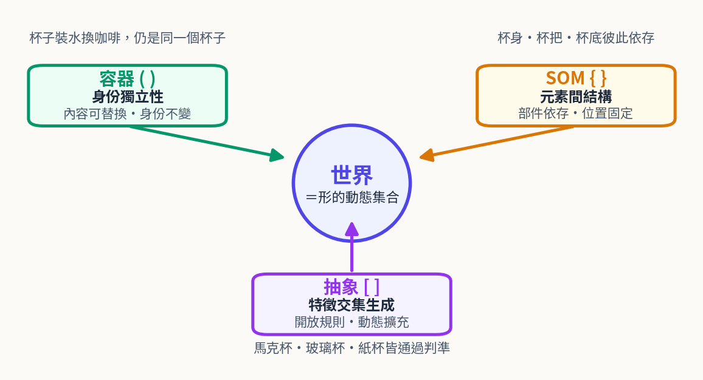

**Figure 2-1** The Typed Ontology of the World: three value-additions, three perspectives

These three aspects exactly correspond to the three layers of information that are compressed together in everyday language. "There is water in the cup" not only expresses a membership relation, but also presupposes that the cup has an identity that does not change with its contents; "the cup is composed of the body, the handle, and the bottom" presupposes that there are fixed joining relations between the parts; "a thermos is also a cup" presupposes a judgment rule that can endlessly generate new members. If the World Model keeps only the "membership" layer, it loses the other three layers — and those three layers are the key to how the world operates.

## 2.3 The Three Value-Additions of Type Logic: Their Significance for the World Model

Mathematical Set Theory answers only one question: "does it belong or not." It assumes the least, and therefore describes the least. Type Logic restores, one by one, the three layers of omitted information through three bracket systems: the curly braces `{ }` are the composition set, carrying the inter-element structure of the SOM; the square brackets `[ ]` are the abstract set, carrying the feature-intersection generation rule; the parentheses `( )` are the container set, carrying identity independence. Comparing the three value-additions against the needs of the World Model, one can clearly see who fills each gap.

**Table 2-1 Ontypology Core Terminology Comparison Table**

| Term | English | Question Answered | Role in the World Model |
|---|---|---|---|
| Type | Type | What is this thing? | The basic unit of world description |
| Attribute / Attribute Value | Attribute / Value | What does it look like? | State feature vector |
| Space Collection | Space Collections | Where is it? Is its identity independent? | Object identity anchor id(C) |
| BOM | Bill of Materials | What parts is it composed of? | Part list P(M) |
| SOM | Space of Materials | How do the parts depend on and locate each other? | Structure graph R(M), G(M) |
| Framework | Framework | Can the description method be applied repeatedly? | Standardization of the modeling procedure |
| Abstraction | Abstraction | How are new members classified? | Open criterion ∩(T) |

**Table 2-2 Comparison of Set Theory, Type Logic, and World Model Needs**

| Aspect | Mathematical Set Theory | Type Logic | World Model Need |
|---|---|---|---|
| Membership | ∈ relation | Retained | Fact query |
| Identity | None (changing the element changes the set) | Container ( ): id does not change with contents | Tracking the same object across time |
| Structure | Elements juxtaposed, unordered | SOM { }: dependency and configuration | Structural prediction and diagnosis |
| Generation | Closed enumeration | Abstraction [ ]: open criterion | Handling unseen new situations |

> **Remark 2-1 The Difference from AI Classification Systems**
> The classification systems of current AI essentially perform only judgments at the abstraction layer, and generally lack the capabilities of the container layer (identity persistence tracking) and the composition layer (structural dependency analysis). The three value-addition framework exactly points out where the gap lies: a future World Model must possess all three layers at once, rather than flattening the three layers into one.

## 2.4 The Five Principles of the Accurate Method

To transform Ontypology into the Accurate Method of world modeling requires five operable principles.

1. **Difference precedes category**: All Types grow out of Difference & Similarity detection, and the category table is forever open to new differences.
2. **Visible assumptions**: The definition of each Type (F(T), id(C), R(M)) must be written as an explicit declaration, rather than hidden in parameters.
3. **Verifiable steps**: Each step from Type detection to verification and correction has clear inputs, outputs, and criteria, and can be replayed step by step.
4. **Layer consistency**: The three-layer judgments of container, SOM, and abstraction each perform their own function without substituting for one another — looking only at the container is too broad, looking only at the SOM is too narrow, and looking only at abstraction has no identity memory.
5. **Clear boundaries**: Each Type comes with a way of handling boundary cases for its criterion; the precision of a rule depends on the completeness of the feature set, and completeness is trackable and revisable.

Accurate is not "sounding right," but "being able to say why, being able to test whether it is correct, and being able to fix where it is wrong."

---

# Chapter 3 WorldMind Overall Architecture: Dual Engines and Five Layers

## 3.1 LLM + Mind Model Dual Engines

WorldMind — the Brain of the World Model — adopts a dual-engine design. The **LLM engine** is responsible for work at the linguistic level: understanding natural-language descriptions of the world, generating predictive narratives, and performing analogy and association in the semantic space; it is good at "speaking the world," but its output is probabilistic and needs to be tested. The **Mind Model engine** is responsible for work at the Type level: maintaining the Type Repository, executing the three-layer judgment, comparing facts, and annotating structure; it is good at "testing the world," and its output is structural and replayable.

The division of labor between the two engines is not static: in the early stage of modeling, the world is almost entirely described by language, and the LLM undertakes about 99% of the work; as the Type Repository gradually matures, the proportion of structural judgment rises; by the time of a mature World Model, the Mind Model undertakes about 40% of the work — this evolutionary curve of 99%→60% (LLM) / 1%→40% (Mind Model) is precisely the quantitative portrait of "world knowledge settling from language into structure."

> **Key Point 3-1 The Complementarity of the Dual Engines**
> LLM alone: the world is spoken fluently, but identity drifts, structure cannot be tested, and rules cannot be debated.
> Mind Model alone: the world is tested strictly, but the starting point of modeling from language to Type cannot be obtained.
> The two engines combined: the LLM is responsible for speaking the world out, and the Mind Model is responsible for making the spoken world stand, be tested, and be corrected.

## 3.2 The Five-Layer Architecture

Under the dual engines, WorldMind is built bottom-up with a five-layer structure. L1 the perceptual Typing layer executes "Difference & Similarity detection → Split & Merge → Type," converting raw observations into candidate Types; L2 the Type Repository layer stores Types, entities, Primary Keys, and master-detail references in a relational structure; L3 the Type-Logic reasoning layer executes the three-layer judgments of container, SOM, and abstraction; L4 the predict-verify-correct layer coordinates the cross-checking of the dual engines and drives the correction loop; L5 the output layer produces predictions, explanations, and counterfactual answers. The responsibility boundaries of the five layers are deliberately clear: each layer offers only one kind of commitment upward, avoiding mutual contamination between judgment logic and language generation.

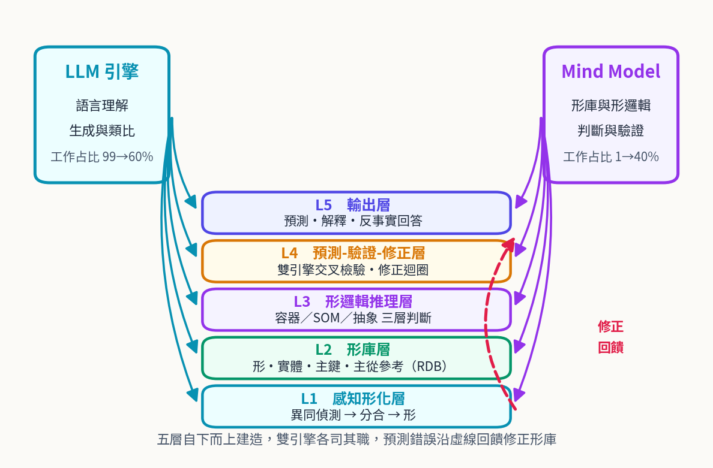

**Figure 3-1** WorldMind overall architecture: LLM + Mind Model dual engines and the five-layer structure

**Table 3-1 WorldMind Five-Layer Architecture Responsibilities**

| Layer | Name | Core Responsibility | Output Commitment |
|---|---|---|---|
| L5 | Output layer | Predictive narrative, explanation, counterfactual answers | Every conclusion can be traced back to a Type Repository entry |
| L4 | Predict-verify-correct layer | Dual-engine cross-checking, correction loop | Every prediction comes with a verification trace |
| L3 | Type-Logic reasoning layer | Container / SOM / abstraction three-layer judgment | Every judgment can be replayed step by step |
| L2 | Type Repository layer | Type · entity · Primary Key · master-detail reference | Every entity has a unique identity |
| L1 | Perceptual Typing layer | Difference & Similarity detection → Split & Merge → Type | Every new Type has a basis of difference |

Note: The work proportion is dynamically adjusted with the maturity of the Type Repository, LLM 99%→60%, Mind Model 1%→40%.

## 3.3 The Type Repository: RDB Correspondence and Identity Mechanism

The Type Repository is WorldMind's long-term memory, and its structure corresponds precisely to a Relational Database: **the schema is the Type** — a list of questions suspended above all rows and shared by all rows; **each row is an entity** — the result after the Type is filled with concrete answers, which can be independently identified; **the Primary Key is the entity's credential of identity**, used purely to indicate "which one this is," unrelated to any attribute content — attributes can change, but the Primary Key cannot; **the Foreign Key reference is the way Types connect to one another** — not copying data, but storing only a field pointing to the Primary Key of the master table. This correspondence is not a metaphor, but a translation line by line: every term of Ontypology can find a precise landing point in the RDB.

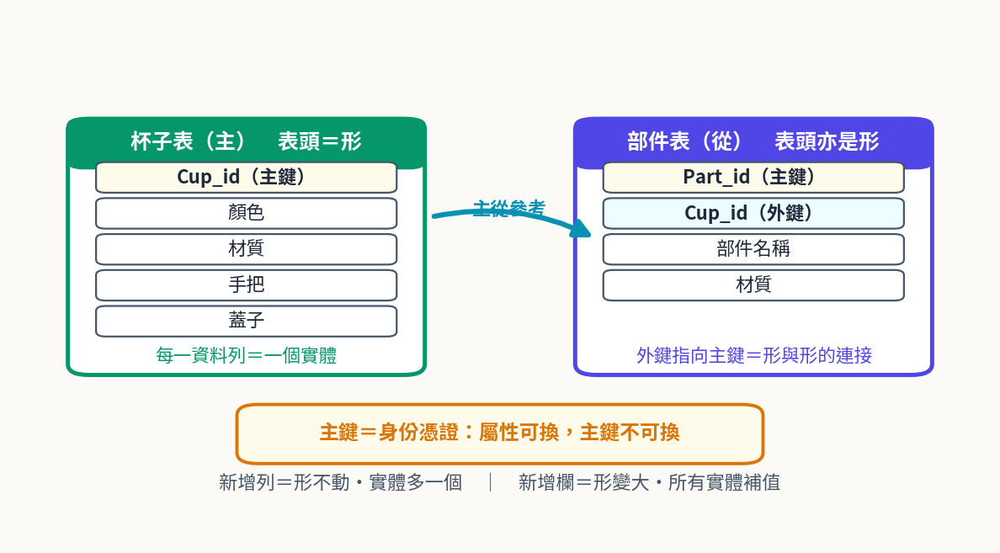

**Figure 3-2** The RDB correspondence of the Type Repository: schema = Type, row = entity, Primary Key and master-detail reference

The asymmetry between "adding a row" and "adding a column" corresponds, in the World Model, to two completely different kinds of update: a new cup in the scene merely leaves the Type unchanged and adds one more entity — a lightweight update; observing a new difference that none of the existing Attributes can explain (for example, "whether there is an insulating layer") means the Type itself grows larger and all entities must fill in values accordingly — a heavy update. WorldMind accounts for these two kinds of update separately, letting the model know when it has merely "added an example" and when it has "changed its worldview."

**Table 3-2 Type Repository Schema Correspondence Table**

| RDB Concept | Type Repository Concept | Constraint | World Model Meaning |
|---|---|---|---|
| Schema (columns) | Type (question list) | Shared by the whole table, no partial absence | All entities can be compared with one another |
| Row | Entity | Each row must have a Primary Key | An identifiable world object |
| Primary Key | Identity credential id | Immutable, non-reusable | Tracking the same object across time |
| Foreign Key | Master-detail reference | The value must point to the master table's Primary Key | Part membership and hierarchical relations |
| Adding a column | Type expansion | All old rows fill in values | Worldview change (heavy) |

> **Definition 3-1 (The Integrity Requirement of the Type Repository)**
> The Type Repository satisfies integrity if and only if:
> (1) Every entity has an explicit value on every Type dimension (a temporary null is allowed, but it must be explicitly recorded as null);
> (2) Every entity has a unique and unchanging Primary Key;
> (3) Every master-detail reference points to an existing master-table entity.
> These three correspond, in the World Model, to: states comparable, identity trackable, structure queryable.

## 3.4 The Evolution of the Work Proportion: 99/80/60

The work proportion of the dual engines is not a fixed ratio, but evolves along the modeling course. In the **exploration period**, the world pours in in the form of natural language, and the LLM undertakes almost all the work (about 99%), while the Mind Model only does the most basic identity registration; in the **construction period**, the Type Repository expands rapidly and the demand for judgment rises, and the LLM and Mind Model divide the work roughly eight to two; in the **maturity period**, most structural judgments are handed to the Mind Model, and the LLM focuses on the language interface and open-ended association, with the ratio converging to about six to four.

This evolution is itself a testable prediction: a World Model project whose Mind Model proportion stays low for a long time usually indicates that the Type Repository has not truly settled, and the model is still "describing the world with language" rather than "testing the world with structure."

---

# Chapter 4 The Accurate Method: Six Steps of World Modeling

This chapter converges the ontology of Chapter 2 and the architecture of Chapter 3 into an operable, repeatable, testable modeling procedure — the **six steps of world modeling**: Type detection, Type definition, structuring, frameworking, formalization, and verification and correction. The six steps are not a one-off pipeline, but a spiral that can be circled endlessly: each circle makes the Type Repository more complete, the criteria more precise, and the predictions more reliable.

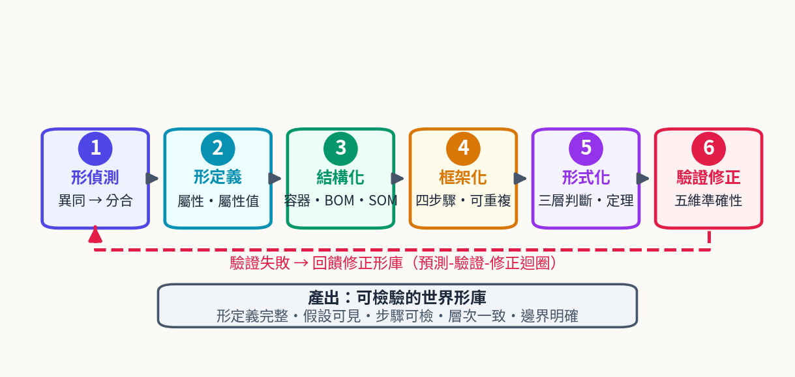

**Figure 4-1** The six steps of world modeling and the feedback correction loop

## 4.1 Steps One and Two: Type Detection and Type Definition

The task of Type detection is to answer "whether there is a new difference in this batch of observations." Operationally, whenever a new observation arrives, the system first compares it with the existing Type Repository: if all differences can be accommodated by existing Attributes, it only needs to add an Attribute Value under the corresponding Attribute; if a difference appears that "matches none of the existing Attributes," it triggers the birth of a new Type (or a new Attribute).

Type definition, then, writes the detected Type as an explicit entry: the Attribute list and the value range of each Attribute, the identity rule id, and (if it is a structural object) the part list and relations. The key discipline is **backfilling** — once a new Attribute is established, all existing entities must fill in a value on the new dimension, guaranteeing that the dimension runs through all individuals.

> **Key Point 4-1 Type Detection Criterion (Attribute Emergence Rule)**
> A difference matches none of the existing Attributes → open a new Attribute (or a new Type), and backfill all existing individuals.
> The nature of the difference matches an existing Attribute → only add a new Attribute Value under that Attribute.
> Few Attributes, many Attribute Values; dimensions fixed, scales extendable.

## 4.2 Steps Three and Four: Structuring and Frameworking

Structuring upgrades a Type from "a bag of Attributes" into "a whole with a skeleton": first establish identity with a container (what is the id of this object? is the id unchanged after the contents are replaced?), then disassemble the parts with the BOM (after removal, does it still recognize itself?), then fix the relations with the SOM (which part supports which, which depends on which, and how they are arranged spatially?).

Frameworking, then, abstracts the derivation process of the first three steps into a method that can be repeatedly applied — the four steps of the Framework (distinguishing differences, triggering abstraction by contrast failure, naming dimensions, and assigning new observations to a dimension or forcing out a new dimension) — making the act of modeling itself standardized, so that a different world and a different class of objects can still be processed by the same procedure. The kingdom-phylum-class-order-family-genus-species of biological classification verifies the universality of this layer-by-layer extraction: concrete individuals must first exist before the abstract hierarchy can be derived.

## 4.3 Step Five: Formalization (Three-Layer Judgment)

Formalization translates each Type in the Type Repository into three groups of mechanically executable judgments:

- **Container judgment** — whether the identity is unchanged after the contents are replaced;
- **SOM judgment** — whether the whole is still the same thing after a part is removed, and grading the parts accordingly;
- **Abstraction judgment** — whether all the intersection criteria ∩(T) are passed.

The flow and joint conclusion of the three-layer judgment are shown in Figure 4-2 and Figure 5-1; its formal properties — axioms and theorems — are established and proved one by one in Chapter 5. The direct benefit of formalization is: judgment changes from "the model feels" into "the process decides," and any dispute can be debated by landing on concrete steps.

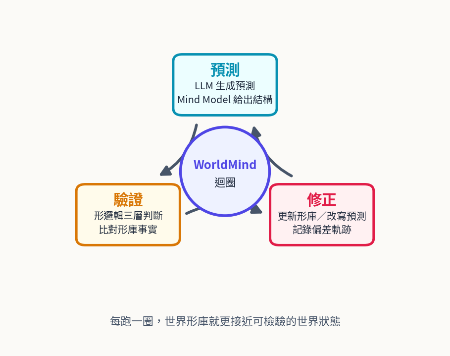

**Figure 4-2** The predict-verify-correct loop: WorldMind's convergence mechanism

## 4.4 Step Six: Verification and Correction and Five-Dimensional Accuracy

Verification and correction is the step that pushes the model back into the world: the LLM generates predictions according to the Type Repository, the Mind Model compares them with the three-layer judgment and the Type Repository facts, and if consistent it outputs and records a trace; if inconsistent, it feeds back along the correction loop — either rewriting the prediction, or updating the Type Repository (adding an entity, adding an Attribute Value, and opening a new dimension if necessary), and writing the deviation into the trace for later auditing.

After each circle is completed, the state of the Type Repository is measured by five-dimensional accuracy: **semantic completeness** (whether the description is free of omissions), **visible assumptions** (whether the definitions and criteria are explicit), **verifiable steps** (whether the judgment can be replayed step by step), **layer consistency** (whether the three layers each perform their own function), and **clear boundaries** (whether boundary cases are explicitly handled).

**Table 4-1 The Six Steps of World Modeling Operation Comparison**

| Step | Core Question | Operation | Checkpoint |
|---|---|---|---|
| 1 Type detection | Is there a new difference? | Difference & Similarity comparison, Split & Merge boundary drawing | Every new Type has a basis of difference |
| 2 Type definition | What is this Type? | Attributes / value range, id rule, backfilling | The dimension runs through all entities |
| 3 Structuring | What is it composed of? | Container establishes identity, BOM disassembles parts, SOM fixes relations | Part grading is decidable |
| 4 Frameworking | Can the method be repeated? | Abstraction of the four steps of the Framework | The procedure runs in a different domain |
| 5 Formalization | Can the judgment be mechanically executed? | Three-layer judgment + axioms and theorems | Judgment is replayable and debatable |
| 6 Verification and correction | Is the prediction correct? | Predict-verify-correct loop, five-dimensional measurement | Deviations are trackable and auditable |

> **Remark 4-1 The Difference Between Method and Intuition**
> The common feature of the six steps: the answer is not guessed by intuition, but obtained by completing the process. Even if the intuition is right, completing the process lets you know "why it is right"; even if the intuition is wrong, completing the process lets you discover "at which step it went wrong." This is the value of the Accurate Method as a cognitive tool — repeatable, testable, debatable.

---

# Chapter 5 Formal Properties and Theorems

This chapter elevates the judgment process of Chapters 3 and 4 into provable properties. First, fix the notation: container C = (id(C), S(C)), SOM M = (P(M), R(M), G(M)), Abstract Category T = (F(T), ∩(T)). `remove(p, M)` denotes the whole obtained after removing part p from M; `replace(e1, e2, C)` denotes the operation of replacing the content e1 of container C with e2. The following four statements correspond respectively to the four aspects of **identity, structure, judgment, and update**, and constitute the formalization skeleton of this paper's "Accurate Method."

## 5.1 Container Identity Axiom

> **Axiom 5-1 (Container Identity Axiom)**
> For any container C and any e1, e2 ∈ S(C), replace(e1, e2, C) does not change id(C).
> In symbols: ∀ e1, e2 ∈ S(C), id(replace(e1, e2, C)) = id(C).
> This axiom is the minimal commitment of the concept of "container": the contents can be replaced and emptied, while the identity does not change accordingly. It is also the operational definition of container judgment (Section 4.3) — if the id is the same before and after the contents are replaced, container judgment holds; otherwise that "whole" is merely a pure set relation.

Axiom 5-1 seems bland, yet it is the one most frequently violated by the pure-LLM World Model: when the focus of description falls on the contents, the identity of the object drifts with the contents — "that cup of water with coffee in it" is treated as a new object. WorldMind fixes Axiom 5-1 with the Primary Key mechanism of the Type Repository: the id is the Primary Key, the contents are an ordinary column, and updating the contents never touches the Primary Key.

## 5.2 Structural Grading Theorem

For the SOM, the parts do not contribute equally to the identity of the whole. Taking the relation between `remove(p, M)` and M as the criterion, the parts can be precisely divided into three grades.

> **Theorem 5-1 (Structural Grading Theorem)**
> Let M be a SOM, p ∈ P(M). Exactly one of the following three mutually exclusive cases holds:
> (1) remove(p, M) ≢ M: identity is lost after removal, and p is a **Necessary** part;
> (2) remove(p, M) ≡ M′ ⊂ M: the whole is still recognizable but its function is downgraded, and p is a **Functionally Downgrading** part;
> (3) remove(p, M) ≡ M: removal has no effect at all, and p is a **Non-essential** part.
> Moreover, this grading is determined by p's role in the composition relation R(M), and is independent of how the part is implemented.

**Proof (Theorem 5-1)**

*Mutual exclusivity and exhaustiveness of the classification*: The identity relation between remove(p, M) and M has only three possibilities — not equal, equal to a proper sub-whole of M, or equal to M itself; the three are pairwise mutually exclusive, so exactly one holds.

*The part "determined by R(M)"*: Identity is defined by structural role. If p bears a support or bearing relation in R(M) (other parts depend on p), then removing p invalidates the relevant edges in R(M), the structure graph is no longer isomorphic to the original M, and it falls into case (1); if p bears only a functionally additive relation, the structural backbone is unmoved, and it falls into case (2); if p does not appear on any edge of R(M), it falls into case (3). Isomorphism determination looks only at R(M) and G(M), not at the implementation details of p, so the grading is independent of how the part is implemented. Q.E.D.

**Table 5-1 SOM Structural Grading (Cup and Phone Examples)**

| Grade | Criterion | Cup Example | Phone Example | Engineering Correspondence |
|---|---|---|---|---|
| Necessary part | remove(p,M) ≢ M | Bottom, body | Motherboard, battery | Safety-critical part |
| Functionally downgrading part | remove(p,M) ≡ M′ ⊂ M | Handle, lid | Camera module, speaker | Optional functional part |
| Non-essential part | remove(p,M) ≡ M | Stickers, decoration | Screen protector, charm | Decorative / consumable part |

Note: The grading focuses on structural role rather than implementation — the battery pack of an electric vehicle replaces the role of the engine, and is still a necessary part.

## 5.3 Necessary-and-Sufficient Condition Theorem of Three-Layer Judgment

Chapter 2 pointed out that the three layers of container, SOM, and abstraction each have blind spots; this section elevates "all three layers are indispensable" into a necessary-and-sufficient condition. Let o be the object to be judged and T the target Type. Call o **precisely belongs to** T (written o ∈\* T), defined as: the three aspects of o — identity, structure, and category — are simultaneously defined by the description of T.

> **Theorem 5-2 (Necessary-and-Sufficient Condition of Three-Layer Judgment)**
> o ∈\* T if and only if the following three conditions hold simultaneously:
> (i) Container judgment passes: o has an identity id(o) that does not change with its contents, and id(o) remains continuous in the instance tracking of T;
> (ii) SOM judgment passes: o's part grading is consistent with T's structural specification (the set of necessary parts is the same, and the roles of functionally downgrading parts are compatible);
> (iii) Abstraction judgment passes: for all f ∈ F(T), f(o) = true.

**Proof (Theorem 5-2)**

*Necessity (∈\* ⇒ all three judgments pass)*: By the definition of ∈\*, the three aspects of identity, structure, and category are all defined by T, corresponding one by one to (i), (ii), and (iii); if any one is missing, then at least one aspect is not defined, contradicting the definition of ∈\*.

*Sufficiency (all three judgments pass ⇒ ∈\*)*: (i) gives the definition of the identity aspect (who it is), (ii) gives the definition of the structural aspect (how it is shaped), and (iii) gives the definition of the category aspect (what it belongs to). The conjunction of the three completely covers all of T's descriptive requirements for an instance, so o ∈\* T.

*Counter-verification that all three layers are indispensable*: With container judgment alone, a tablet computer is also admitted as a smartphone (too broad); with SOM judgment alone, a desktop calculator has a complete structure yet is not a phone (too narrow); with abstraction judgment alone, a walkie-talkie passes the feature list yet has no memory of identity and structure (no memory). The three counterexamples respectively pierce through single-layer judgment, corroborating necessity. Q.E.D.

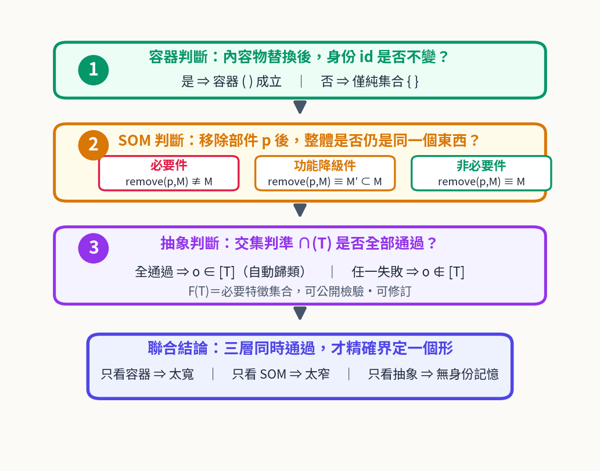

**Figure 5-1** The three-layer judgment flow and joint conclusion

## 5.4 Type Replacement Invariance Theorem

The World Model is updating at every moment: the contents are changed, the parts are repaired, the Attribute Values are altered. Which conclusions become invalid in the update, and which remain untouched? The Replacement Invariance Theorem gives the answer: all reasoning that hangs on the id remains valid under content replacement.

> **Theorem 5-3 (Type Replacement Invariance)**
> Let Γ be the set of all reasoning conclusions in the Type Repository keyed on id(C). For any finite replacement sequence σ = replace(e1, e2, C), replace(e3, e4, C), …, σ does not change id(C), and after σ is applied, every conclusion in Γ still holds or can still be clearly determined to be invalid (an invalid one is necessarily a conclusion that explicitly references the replaced contents).

**Proof (Theorem 5-3)**

Induct on the length n of the replacement sequence. n = 1: By Axiom 5-1, the id is unchanged; the conclusions fall into two classes — conclusions that reference C only through the id are unaffected by the contents and still hold; conclusions that explicitly reference the content e1 have their referenced item changed to e2 after the replacement, and are immediately marked in the Type Repository as pending re-verification, so they "can still be clearly determined to be invalid." Assume it holds for n = k; then the (k+1)-th replacement acts on a C whose id is unchanged, and by the same discussion as n = 1, the property is preserved. By the principle of induction, it holds for any finite n. Q.E.D.

> If the reasoning hangs on identity, the conclusion stands on bedrock; if the reasoning hangs on contents, every update is a collapse.

The engineering implication of Theorem 5-3 is direct and significant: the schema design of the Type Repository should make as many reasoning conclusions as possible reference objects through the id, rather than copying or embedding content snapshots. This is of the same origin as the normalization spirit of the Relational Database — not passing a dependency on contents, but passing only the Primary Key that points to identity. At this point, the four formalized statements (Axiom 5-1, Theorems 5-1, 5-2, 5-3) lock down the four aspects of identity, structure, judgment, and update respectively, constituting the theoretical skeleton of WorldMind's Accurate Method.

---

# Chapter 6 Case Studies

This chapter uses two cases to demonstrate the operation of WorldMind: the smart home scenario demonstrates the joint operation of the three-layer judgment on physical objects; conversational AI demonstrates how the same method can be applied across domains to non-physical objects. Finally, it gives the experimental design of the three-method comparative evaluation.

## 6.1 Case One: Smart Home World Model

Scenario setting: The smart home World Model receives the event "there is a dinner party in the kitchen tonight." WorldMind needs to update the scene, maintain object identity, recompute part states, and answer counterfactual questions (for example, "if the refrigerator breaks down, what else can be done about the dinner party?"). Three representative objects respectively trigger the three-layer judgment.

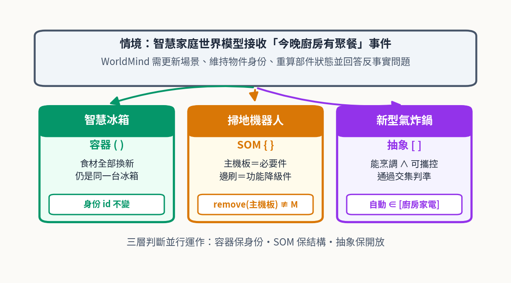

**Figure 6-1** Smart home case: the three-layer judgment operating in parallel

- **Smart refrigerator** triggers container judgment: the dinner party shopping replaces all the ingredients, and Axiom 5-1 guarantees the id is unchanged — the refrigerator is still the same refrigerator, and the ingredients are merely contents.
- **Robot vacuum** triggers SOM judgment: the motherboard is a necessary part (after remove ≢ M), the side brush is a functionally downgrading part (after remove, function is downgraded but identity persists), and the body sticker is a non-essential part.
- **New air fryer** triggers abstraction judgment: checking F(kitchen appliance) = {can cook, remotely controllable, for home use} item by item, all pass, and it is automatically classified into [kitchen appliance], with no need for a manually registered list.

**Table 6-1 Smart Home Case Three-Layer Judgment Results**

| Object | Judgment Layer | Key Test | Verdict | Type Repository Action |
|---|---|---|---|---|
| Smart refrigerator | Container | Is the id unchanged after all ingredients are replaced | Container holds | Content updated, Primary Key unmoved |
| Robot vacuum | SOM | remove(motherboard) ≢ M | Necessary part | Grading written into R(M) |
| Robot vacuum | SOM | remove(side brush) ≡ M′ ⊂ M | Functionally downgrading part | Marked as functionally downgrading |
| New air fryer | Abstraction | All three features of F(kitchen appliance) pass | Automatically classified | Open classification, record the basis |
| Dinner party event | Update | New event = new entity | Row count increases | Append one row to the event table |

> **Key Point 6-1 The Testability of Counterfactual Queries**
> "If the refrigerator breaks down, what else can be done about the dinner party?" — WorldMind's answer path is fully replayable:
> (1) Find, from R(M), the dependent parts of the refrigerator in the scene SOM;
> (2) Confirm, from the container layer, whether "broken" refers to content failure or identity failure;
> (3) Find, from the abstraction criterion, the other open members of [refrigeration equipment] (a backup ice bucket, a neighbor's refrigerator).
> All three steps land on the explicit structure of the Type Repository, not on the LLM's linguistic feel.

## 6.2 Case Two: The World Model of Conversational AI

Applying the same method to non-physical objects: F(conversational system) = {can receive natural-language input, can produce natural-language responses, can maintain conversational context}. Checking the FAQ bot and the generative dialogue model item by item with the intersection criterion:

- **FAQ bot** can only output preset replies and handles each independently, so the second and third items do not pass, ∉ [conversational system] (but it belongs to the broader [information retrieval tool]);
- **Generative dialogue model** passes all three items, ∈ [conversational system].

What is worth noting is the transparentization of the judgment stance: once F(T) is written out, "does it count as a conversational system" is no longer an essentialist dispute, but the selection and debate of the feature list — the selection of the feature list is itself the understanding and expression of a stance toward the concept, and this is precisely the embodiment of the "visible assumptions" principle.

## 6.3 The Design of the Three-Method Comparative Evaluation

To quantify the benefits of WorldMind, we design a three-method comparison:

- **Group A Pure LLM**: world knowledge implicit in parameters, direct question-answering;
- **Group B RAG**: LLM + retrieval augmentation, with retrieved documents attached;
- **Group C LLM + Mind Model**: this paper's architecture, Type Repository + three-layer judgment.

The test set is divided into three categories: **identity tracking questions** (identifying the same object across scenes and across time, testing the container layer), **structural dependency questions** (part removal and functional derivation, testing the SOM layer), and **open category questions** (determining the membership of brand-new objects, testing the abstraction layer), 100 questions in each category, scored by five-dimensional accuracy. The scoring method, results, and discussion are reported in Chapter 7.

---

# Chapter 7 Five-Dimensional Accuracy Assessment

## 7.1 Assessment Framework

This paper uses five-dimensional accuracy as the measure of World Model quality; the five dimensions are:

1. **Semantic completeness** — whether the description of an object covers the four aspects of Attribute, container, SOM, and Framework without omission;
2. **Visible assumptions** — whether the definition, feature set, and rules on which each judgment is based are explicitly written out and available for third-party inspection;
3. **Verifiable steps** — whether each step from observation to conclusion can be replayed and verified step by step;
4. **Layer consistency** — whether the three layers of container, SOM, and abstraction each perform their own function, without systematic bias caused by substituting for one another;
5. **Clear boundaries** — whether boundary cases (such as a bowl versus a cup, or a syringe versus a cup) have explicit handling rules and a revisable feature set.

Each of the five dimensions is scored from 1 to 5, where 1 means nearly untestable and 5 means fully replayable and debatable.

## 7.2 Assessment Results

For the three groups of tests designed in Chapter 6, the five-dimensional scores are summarized in Table 7-1 and Figure 7-1. Pure LLM has the advantage in fluency, but is low across all five dimensions: semantic completeness 2.2 — descriptions often omit on the identity and structure aspects; visible assumptions 1.2 — the basis of judgment is hidden in parameters; verifiable steps 1.3 — cannot be replayed; layer consistency 1.6 — the three layers are flattened into an analogical one; clear boundaries 1.5 — performance on boundary cases is unstable. RAG rises to 2.2 to 3.2 across dimensions because the retrieved documents provide a partially visible basis, but the documents are narrative, and structural judgment is still not replayable. LLM + Mind Model, by contrast, leads across all five dimensions (4.4 to 4.6): the Type Repository makes it semantically complete, explicit definitions make assumptions visible, the three-layer judgment makes steps verifiable, layered responsibilities make layers consistent, and the open criterion makes boundaries clear.

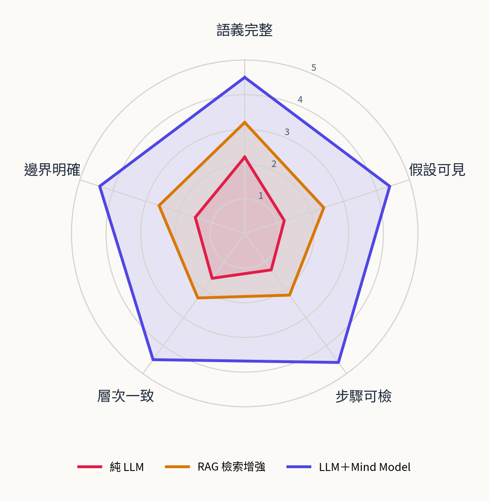

**Figure 7-1** Five-dimensional accuracy radar chart: three-method comparison

**Table 7-1 Five-Dimensional Accuracy Assessment Comparison (1–5 points)**

| Dimension | Pure LLM | RAG Retrieval-Augmented | LLM + Mind Model | Key Source of Difference |
|---|---|---|---|---|
| Semantic completeness | 2.2 | 3.2 | **4.5** | Four-aspect Type Repository description vs narrative description |
| Visible assumptions | 1.2 | 2.4 | **4.4** | Explicit F(T), id, R(M) declarations |
| Verifiable steps | 1.3 | 2.2 | **4.6** | Three-layer judgment replayable step by step |
| Layer consistency | 1.6 | 2.3 | **4.5** | Three-layer layered responsibilities |
| Clear boundaries | 1.5 | 2.6 | **4.4** | Open criterion + revisable feature set |

Note: The scores are the averages of 100 questions each for the three test categories (identity tracking, structural dependency, open category).

## 7.3 Discussion

What is most noteworthy in the results is not the margin by which Group C leads, but the "shape" of the lead: Group C has its greatest advantage in the two dimensions of **verifiable steps** and **visible assumptions** — and these two dimensions are exactly the ones where pure LLM is weakest and which are hardest to remedy by scaling up the number of parameters. In other words, what WorldMind brings is not "better at speaking," but "more testable"; the quality bottleneck of the World Model is not in generation capability, but in testability.

It should also be noted that the boundary of the assessment: the five-dimensional measure is of the structural quality of the Accurate Method, and does not directly measure prediction accuracy itself; but the two are highly correlated — a testable model can locate and correct when a prediction goes wrong, and its accuracy convergence rate should be faster than that of a non-testable model in repeated loops, a point that will be verified in subsequent longitudinal experiments.

> **Remark 7-1 The Correspondence Between the Five Dimensions and the Three Gaps**
> Identity discontinuity → layer consistency, semantic completeness (filled in by the container); invisible structure → verifiable steps (filled in by the SOM); closed rules → visible assumptions, clear boundaries (filled in by abstraction). The improvement path of the five-dimensional scores corresponds one-to-one with the filling path of the three value-additions, and the two narratives corroborate each other.

---

# Chapter 8 Conclusion and Outlook

## 8.1 Conclusion

Based on Ontypology, this paper answers a question: what should the brain of the World Model look like. The answer has three levels.

- **Ontological level**: The world is composed of Types, and a Type must simultaneously possess three value-additions — the identity independence of the container, the inter-element structure of the SOM, and the generation rule of abstraction — and if any one is missing, the world either drifts or ossifies.
- **Architectural level**: WorldMind carries the three value-additions with the LLM + Mind Model dual engines and a five-layer structure: the LLM is responsible for speaking the world out, and the Mind Model is responsible for making the spoken world stand, be tested, and be corrected, with the work proportion evolving from 99/1 to 60/40 as the Type Repository matures.
- **Methodological level**: The six steps of world modeling give a repeatable procedure, the four formalized statements — the Container Identity Axiom, the Structural Grading Theorem, the Necessary-and-Sufficient Condition Theorem of Three-Layer Judgment, and the Type Replacement Invariance Theorem — elevate the procedure into provable properties, and the five-dimensional accuracy provides the measure of convergence.

Returning to the three gaps at the beginning: identity discontinuity is filled in by the container and the Primary Key mechanism; invisible structure is filled in by the SOM and structural grading; closed rules are filled in by the intersection criterion of abstraction. The case studies and the five-dimensional assessment show that a World Model augmented with a Mind Model is comprehensively superior to the pure-LLM and RAG routes in testability. **What the World Model needs is not a larger number of parameters, but a brain that understands "Type"** — this is the conclusion of this paper.

## 8.2 Outlook

Future work unfolds in three directions.

1. **Automated Type detection**: At present, Type detection is done through human-machine collaboration; the next step is to let the LLM automatically propose new Attributes and new Types under the supervision of the Mind Model, and maintain the integrity of the Type Repository with the backfilling mechanism.
2. **Longitudinal precision experiments**: Verify the prediction of Chapter 7 — that a testable model converges in accuracy faster than a non-testable model in repeated predict-verify-correct loops.
3. **Multi-agent World Models**: When multiple WorldMinds share the same Type Repository in collaboration, the Type Repository itself is the shared language, and the Primary Key mechanism provides a natural foundation for cross-agent identity identification; and the public criteria of Type Logic let disagreements between agents be debated by landing on concrete steps, rather than each talking past the other.

In addition, the isomorphism with the mathematical-proof brain ProofMind and the IC-design brain SiliconMind suggests: this "○○ brain" architecture may be universal — wherever there is a world that needs to be modeled, there is a Type that needs to be made to stand, be tested, and be corrected.

> A Type is the boundary drawn after Difference & Similarity are Split & Merged; to understand a Type is to understand what it looks like, where it is, what it is composed of, and whether this description can be repeatedly applied. The brain of the World Model is nothing more than turning this sentence into a machine.

---

# References

1. LonGreat Mind AI Research Team (2026). Ontypology: The Space Type Volume. Internal research paper.
2. LonGreat Mind AI Research Team (2026). Mind AI: The Eternal Path to AGI. Internal research paper.
3. LonGreat Mind AI Research Team (2026). The Application Architecture of the Brain of the World Model. Internal research paper.
4. LonGreat Mind AI Research Team (2026). Type Sets and Type Logic: A More Accurate Method for Mathematical Proof. Internal research paper.
5. Ha, D., & Schmidhuber, J. (2018). *World Models*. arXiv:1803.10122.
6. LeCun, Y. (2022). *A Path Towards Autonomous Machine Intelligence*. OpenReview.
7. Bengio, Y. (2019). *System 2 Deep Learning* (lecture notes). Mila.
8. Pearl, J. (2009). *Causality: Models, Reasoning, and Inference* (2nd ed.). Cambridge University Press.
9. Codd, E. F. (1970). A Relational Model of Data for Large Shared Data Banks. *Communications of the ACM*, 13(6), 377–387.
10. Spelke, E. S., & Kinzler, K. D. (2007). Core Knowledge. *Developmental Science*, 10(1), 89–96.
11. Tversky, B. (1989). Parts, Partonomies, and Taxonomies. *Cognition*, 31(3), 227–258.
12. Guarino, N. (1998). *Formal Ontology in Information Systems*. Proceedings of FOIS'98, 3–15.
13. Gardner, H. (1987). *The Mind's New Science: A History of the Cognitive Revolution*. Basic Books.
14. Wertheimer, M. (1923). Principles of Gestalt Perception. *Psychologische Forschung*, 4, 301–350.
15. Lake, B. M., Ullman, T. D., Tenenbaum, J. B., & Gershman, S. J. (2017). Building Machines That Learn and Think Like People. *Behavioral and Brain Sciences*, 40, e253.
16. Tenenbaum, J. B., Kemp, C., Griffiths, T. L., & Goodman, N. D. (2011). How to Grow a Mind: Statistics, Structure, and Abstraction. *Science*, 331(6022), 1279–1285.

---

# Appendix A Three-Layer Judgment Quick Reference

This appendix consolidates the operational key points of the three-layer judgment for quick reference during implementation and auditing. How to use it: for any object to be judged, walk through the three layers from top to bottom; if any layer fails, stop and record the failing layer and the basis.

**Table A1 Three-Layer Judgment Quick Reference**

| Layer | Core Question | Condition for Holding | Handling on Failure | Common Pitfall |
|---|---|---|---|---|
| Container | After the contents are changed, is it still the same? | The id is unchanged before and after replacement (Axiom 5-1) | Downgrade to a pure set | Treating contents as identity |
| SOM | After a part is removed, is it still the same? | The part grading is decidable (Theorem 5-1) | Recompute R(M) and the function markers | Substituting a list for structure |
| Abstraction | Does the new object satisfy the category rules? | All of F(T) passes (∩(T)) | Record the failed features, revise F(T) | Substituting a closed list for an open rule |
| Joint | Do all three layers hold simultaneously? | All three judgments pass (Theorem 5-2) | Locate the failing layer, correct layer by layer | Substituting single-layer judgment for joint judgment |

Supporting discipline: new Attributes must be backfilled, the Primary Key is never changed, and inference should reference through the id as much as possible (Theorem 5-3).

