# Ontypology

## Chemical Proof

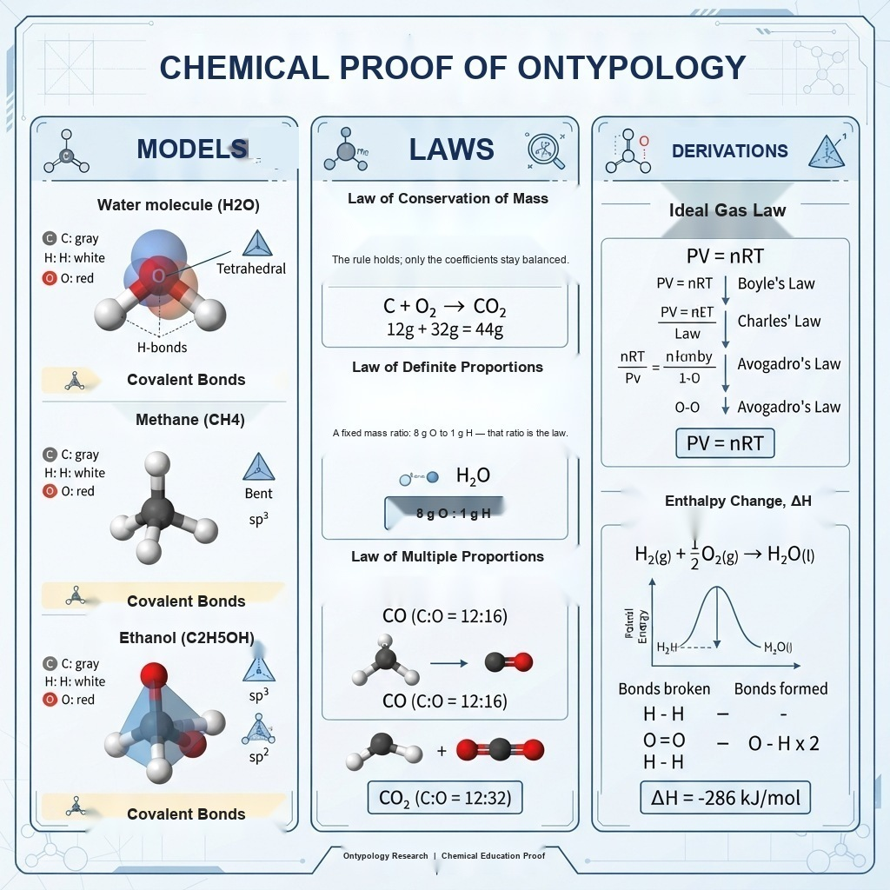

## Contents

- Foreword — The Task of the Chemical Proof Volume3
- Introduction — The Toolbox: Two Languages and Four Tools3
- Chapter 1 What a Chemical Proof Does Inside Equations6
  - 1.1 The Three-Piece Set of a Chemical Proof: Model, Law, Derivation6
  - 1.2 What the Language of Equations Can Do6
  - 1.3 Four Gaps: Rule, Identity, Structure, Process7
- Chapter 2 Types Take the Field: Chemical Systems and Chemical Reactions9
  - 2.1 [ ] Attribute: A Chemical Quantity = Dimension × Scale9
  - 2.2 ( ) Container: The Boundary of a Chemical System = Identity9
  - 2.3 { } Composition: The BOM Criterion and the Three Levels of remove10
  - 2.4 The Temporal Type Takes the Field: Reaction = op: Type → Type11
- Chapter 3 Proof Demonstrations Across the Five Domains of General Chemistry13
  - 3.1 Structure and Bonding: A Criterion for Classifying Ionic Bonds13
  - 3.2 Reactions and Stoichiometry: Bookkeeping for Conservation of Mass14
  - 3.3 Thermochemistry: Hess's Law as an Invariant15
  - 3.4 Equilibrium and Kinetics: K as Invariant and the Arrhenius Card15
  - 3.5 Electrochemistry: Deriving the Nernst Equation16
- Chapter 4 The Complete Framework of Accurate Use18
  - 4.1 The Six Steps of a Chemical Proof18
  - 4.2 Full Example: A Rusting Iron Nail18
  - 4.3 Misuse Comparison: Five Common Errors20
  - 4.4 The Checklist Before Handing In a Proof21
- Review — Key Points and Self-Check22
- Appendix Glossary and Notation at a Glance24

## Foreword — The Task of the Chemical Proof Volume

This small book is the chemistry companion to Unit Type and Set Logic, and a sister volume to Mathematical Proof and Physical Proof. Mathematical Proof answers: when you write a mathematical proof in set theory, how must the tools be used so the result is exact? Physical Proof carries the same method onto the ground of physics. This book answers a third question: when the object becomes chemistry — the classification of bonds, the bookkeeping of reactions, the paths of thermochemistry, the shifts of equilibrium, the potentials of a cell — how should a proof establish its types, carry out its derivations, and pass acceptance?

Concretely, the book does three things. First, it looks clearly at the site of a chemical proof: what makes a chemical derivation stand? Where does the language of equations fall short? Second, it drives the two pillars of Ontypology straight onto chemical ground: the spatial type establishes the type of a chemical system (mole, concentration, system boundary, molecular composition), while the temporal type writes a chemical reaction as a function (type in, type out, conservation, the four-question function card). Third, it gathers everything into a complete framework of accurate use: three supplements, six proof steps, a three-layer check, a misuse comparison and an eight-question checklist — and the five domains of general chemistry each receive a demonstration whose format can be copied directly.

> **Three conventions for reading this book**
>
> ◆ Convention one: the three kinds of brackets each have their own duty. Curly braces { } are the composition set (the bill of materials); square brackets [ ] are the abstract set (attributes); parentheses ( ) are the container set (spatial container).
> ◆ Convention two: the English word for 形 (xíng) is Type — an object that has been completely described. The book simply writes “type” without further annotation.
> ◆ Convention three: this book does not re-teach Ontypology theory — after the introduction gives a quick tour of the toolbox, the tools go straight onto chemical ground, and the pages are left to chemistry.

| Gap in the proof | Supplementing tool | Criterion used | Chapter |
| --- | --- | --- | --- |
| Rule omitted — a category written as a dead list | [ ] abstract set | T = (F(T), ∩(T)) | Chapter 2 |
| Identity omitted — the process scatters as soon as it moves | ( ) container set | C = (id(C), S(C)); the invariance axiom | Chapter 2 |
| Structure omitted — components merely sit side by side | { } composition set | The BOM criterion; the three levels of remove | Chapter 2 |
| Process omitted — the reaction skips steps and jumps to the end | Temporal type | op: Type → Type; the four function questions | Chapter 2 |
| All four converge — packed back into one proof | Six steps + three-layer check | ∩(T) · id(C) · remove, jointly | Chapter 4 |

**Table 0-1 The supplement map: four gaps in a chemical proof and four tools**

**A proof is written accurately because every layer of information is written where it belongs.**

## Introduction — The Toolbox: Two Languages and Four Tools

Chemical proofs are almost always written in the language of equations: chemical formulas, balanced equations, equilibrium constants, electrode potentials. That language is extremely precise, and it omits the most — the boundary of the system, the identity of the species, the dependence among parts of the apparatus, the inputs and outputs of the reaction are all flattened out inside those elegant lines. The language of types supplies exactly these four layers: the spatial type establishes the system, the temporal type establishes the reaction. The two languages do not replace each other; they overlay.

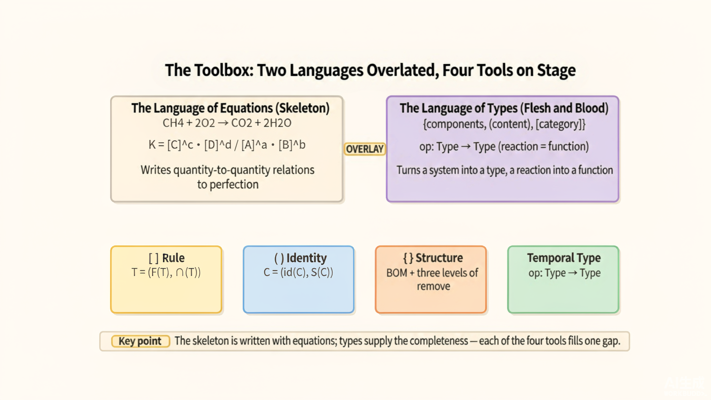

*Figure D-1 The toolbox: two languages overlaid, four tools on stage*

The detailed theory of the tools is not retold here; only the backbone is glanced at. The spatial type uses three axes to describe “what it is” — X attribute [ ] dimension × scale, Y composition { } BOM and the three levels of remove, Z container ( ) id(C) and the invariance axiom, together forming the unit type { components, (content), [category] }. The temporal type describes “how it works” — a reaction is a function op: Type → Type; every law can be written as a four-question function card (name, input type, output type, criterion), and a conservation law is an invariance axiom along the time axis.

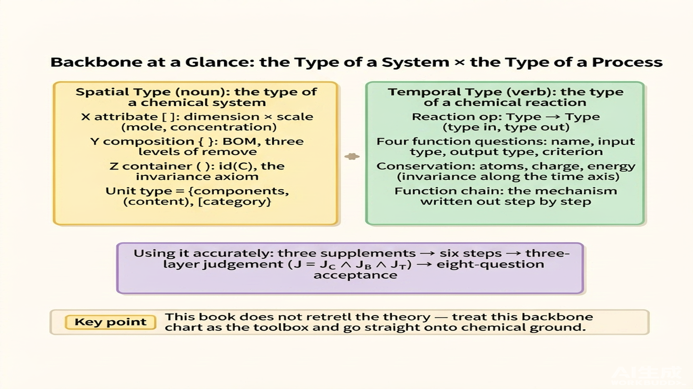

*Figure D-2 Backbone at a glance: the type of a system × the type of a process*

| Tool | Bracket / notation | Duty | Its embodiment in chemistry |
| --- | --- | --- | --- |
| Spatial type (noun) | [ ] attribute | Dimension × scale | Chemical quantities: mole, concentration, electronegativity |
| Spatial type (noun) | { } composition | BOM; the three levels of remove | Molecular composition; parts of a distillation apparatus |
| Spatial type (noun) | ( ) container | id(C); the invariance axiom | A chemical system; an atom (proton number = id) |
| Temporal type (verb) | op: Type → Type | The four function questions; type in, type out | Chemical reactions: synthesis, combustion, electrolysis |

**Table D-1 The four tools at a glance**

> **One sentence, split into four layers**
>
> ◆ “Hydrochloric acid dripped onto calcium carbonate fizzes” must be split into four layers: rule ([acid] judged by ∩(T)), identity (the Ca in CaCO3 is calcium with proton number 20), structure (the dependence of {carbonate, calcium}), reaction (op: turning the reactant type into CaCl2, H2O, CO2).
> ◆ An equation writes down only one corner of the third layer; only when all four layers are filled in is a chemical proof complete.

## Chapter 1 What a Chemical Proof Does Inside Equations

Before writing a chemical proof, first make clear what it stands on. This chapter takes apart the three-piece set of a chemical proof, looks at what the language of equations can do and where it leaves four gaps — wherever a gap is, that is where the supplement goes.

### 1.1 The Three-Piece Set of a Chemical Proof: Model, Law, Derivation

Any chemical proof, opened up, is a combination of three things. Model: establish the type first, say clearly who the system is, where its boundary lies, which idealisations were made — “dilute solution”, “closed vessel”, “standard state” are all the admission rules of the type. Law: give criteria that can be verified item by item — conservation of mass, Le Chatelier, Nernst, each of them a ruler. Derivation: start from the model and the laws and walk step by step to the conclusion — balance, keep accounts, substitute; every step can be checked.

None of the three can be missing. Without a model, a proof has no object; without laws, a proof can only rely on feeling; without derivation, there is only a conclusion and no process. Chemistry differs from mathematics in one further point: after the derivation is established, there is still the gate of experiment — the balance, the potentiometer, the calorimeter must nod before the conclusion counts. That is the full meaning of “checkable accuracy” in chemistry.

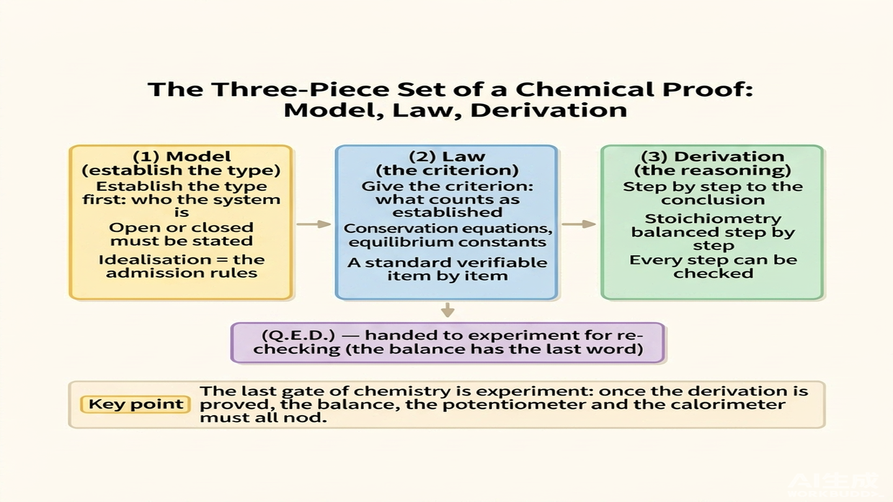

*Figure 1-1 The three-piece set of a chemical proof: model, law, derivation*

### 1.2 What the Language of Equations Can Do

The core of the language of equations is the quantities and relations on the two sides of the equals sign. “CH4 + 2O2 → CO2 + 2H2O” locks species and coefficients into one line; “K = [NH3]²/([N2][H2]³)” locks concentrations into one ratio. It can state balancing, equilibrium and transfer precisely — the backbone of most chemical derivations is built from a handful of such expressions.

| Expression | How to read it | Its use in a proof |
| --- | --- | --- |
| CH4 + 2O2 → CO2 + 2H2O | An equality of species and coefficients | Bookkeeping (the backbone of atomic conservation) |
| K = [C]^c·[D]^d / [A]^a·[B]^b | The constraint on concentrations at equilibrium | Judging the position of equilibrium (the backbone of the rule) |
| k = A·e^(-Ea/RT) | Rate constant and temperature | Deriving kinetics (the backbone of the process) |
| E = E° - (RT/nF)·lnQ | Potential and concentration | Deriving electrochemistry (the backbone of the criterion) |

**Table 1-1 Common chemical expressions and what each can do in a proof**

For a chemical derivation this is already enough — provided you only need to answer “are the quantities equal or not”. As soon as a proof must ask “what is this system made of”, “is it still the same one after the contents change”, “does the new species count as belonging to this category”, “what does the reaction take in and give out”, the equations begin to omit.

### 1.3 Four Gaps: Rule, Identity, Structure, Process

Gap one, rule. { hydrochloric acid, sulfuric acid, nitric acid } is a list written in stone — does the newly appeared hydrofluoric acid count as an “acid”? “What counts as an acid” and “what counts as an oxidising agent” both need an open generating rule, not a few memorised examples.

Gap two, identity. When sodium chloride dissolves in water the solid disappears, yet Na is still sodium with proton number 11 and Cl is still chlorine with proton number 17. The equation writes down the change of concentration but does not answer “is it the same species all the way along” — wherever something must “stay the same while changing”, an identity that does not change with the contents is required.

Gap three, structure. { distillation flask, condenser, thermometer, label } lists four components side by side, and you cannot see which depends on which — removing the condenser and removing the label have completely different consequences. Wherever primary and secondary must be distinguished, the dependence structure of the components is required.

Gap four, process. The equation writes down reactants and products, but “what type this reaction takes in and what type it gives out” is flattened out — a derivation that skips steps is usually a derivation in which the input type and the output type were never written down. Wherever a reaction must be checkable, the temporal type is required.

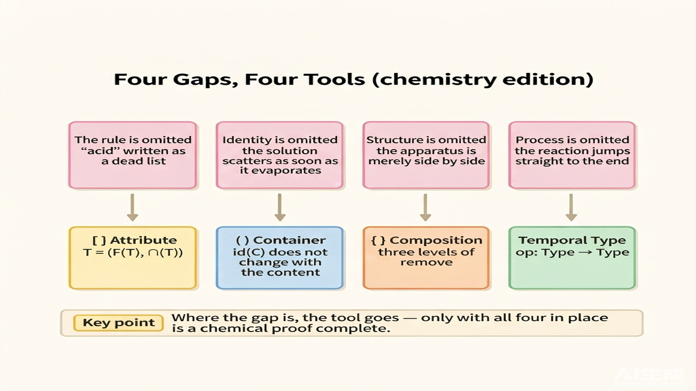

*Figure 1-2 Four gaps, four tools (chemistry edition)*

| Gap | How the equation writes it | How it is written after supplementing | Tool |
| --- | --- | --- | --- |
| Rule | A list of acid examples (closed) | [ x \| x passes ∩(T) ] (an open rule) | [ ] |
| Identity | A concentration curve (the process has scattered) | (Na) → (Na+), proton number unchanged | ( ) |
| Structure | Components side by side (no primary or secondary) | remove(p, M) classified into three levels | { } |
| Process | Jumping straight to the product | op: input Type → output Type, written out step by step | Temporal type |

**Table 1-2 The four gaps and the four tools**

> **Key points of this chapter**
>
> ◆ The three-piece set: model (establish the type), law (the criterion), derivation (the reasoning) — and after the proof, experimental verification still remains.
> ◆ The language of equations answers “are the quantities equal” precisely, and omits all four remaining layers.
> ◆ The four gaps — rule, identity, structure, process — are supplemented by [ ], ( ), { } and the temporal type respectively.

> **Exercises (P1)**
>
> P1-1 Write “hydrochloric acid dripped onto calcium carbonate fizzes” as one sentence, and point out what the four layers of omitted information in that sentence are.
> P1-2 Why is “acid” a rule rather than a list? Give a boundary case (hint: acetic acid, Lewis acid).
> P1-3 In the expression K = [NH3]²/([N2][H2]³), which part answers “identity”? Which part does not?
> Hint: first ask yourself — which system is this sentence talking about?

## Chapter 2 Types Take the Field: Chemical Systems and Chemical Reactions

The toolbox has been seen; now go straight onto the field. This chapter brings the four tools to life one by one with real chemical objects: read chemical quantities with [ ], fix the identity of a system with ( ), sort the primary and secondary parts of an apparatus with { }, and write reactions with the temporal type — each one paired with a chemical example, with no retelling of the theory.

### 2.1 [ ] Attribute: A Chemical Quantity = Dimension × Scale

Every chemical quantity can be split into two halves: the dimension asks “what is being measured” — amount of substance, concentration, electronegativity; the scale asks “which graduation is being read” — the mole (6.02×10^23 entities), mol/L, the Pauling scale. Here we connect the core proposition: a number is a small type inside a type, a sub-comparison. 1 mol is not a lonely number but one reading on the mole scale of the type “amount of substance” — and the mole is always followed by a substance; a mol detached from a substance is meaningless.

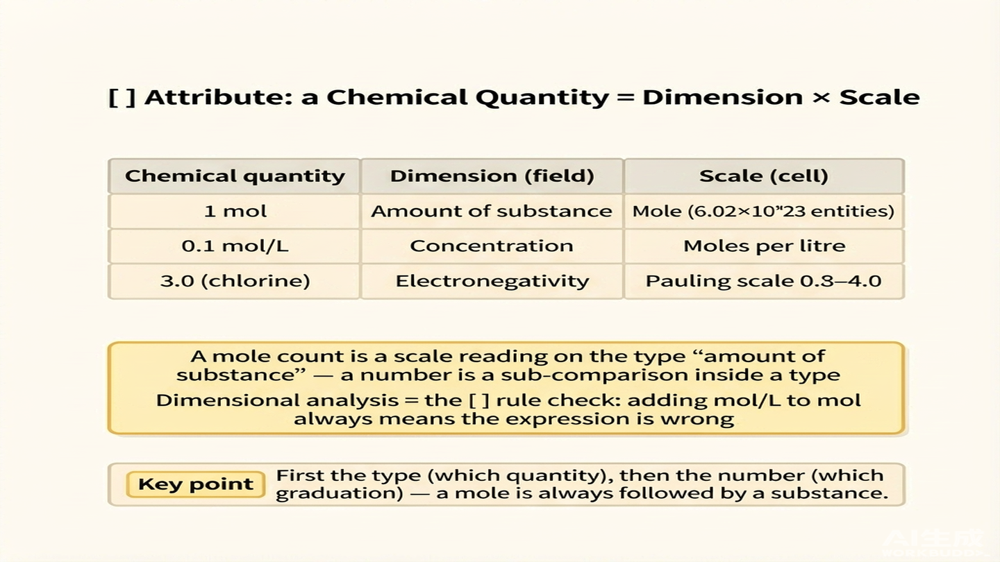

*Figure 2-1 [ ] Attribute: a chemical quantity = dimension × scale*

| Chemical quantity | Dimension (field) | Scale (cell) | Reading in type theory |
| --- | --- | --- | --- |
| 1 mol NaCl | Amount of substance | Mole | A scale reading on the type “amount of substance” |
| 0.1 mol/L | Concentration | Moles per litre | A scale reading on the type “concentration” |
| Electronegativity 3.0 | Electronegativity | Pauling scale | A scale reading on the type “electronegativity” |

**Table 2-1 Dimension and scale of chemical quantities**

In practice the [ ] rule hands you a free health check: dimensional analysis. Adding mol/L to mol, or an equation whose two sides do not balance in atom count, is certainly written wrongly — this is the cheapest and hardest-to-fool proof check there is.

### 2.2 ( ) Container: The Boundary of a Chemical System = Identity

Write the container as an ordered pair: C = ( identity id(C), internal space S(C) ). A chemical system is first of all a question of boundary: what may enter and leave, what must be kept out. An open system states its exchange terms in the admission rules (an iron nail in air, where oxygen and water can get in); a closed system keeps matter out (a sealed reaction flask); an isolated system keeps even energy out. The way of writing is always the same: first write id(C), then write what S(C) can hold.

The atom is the best specimen for practising containers: the id of an atom is simply its proton number — the gain or loss of electrons is a replacement of content. Na loses one electron and becomes Na+, still sodium; Cl gains one electron and becomes Cl-, still chlorine. Ionisation is a change of the content of S(C) while the identity of the element does not change — the invariance axiom embodied at the atomic scale.

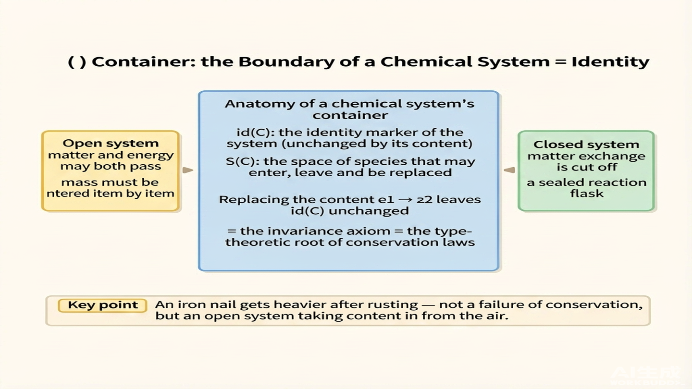

*Figure 2-2 ( ) Container: the boundary of a chemical system = identity*

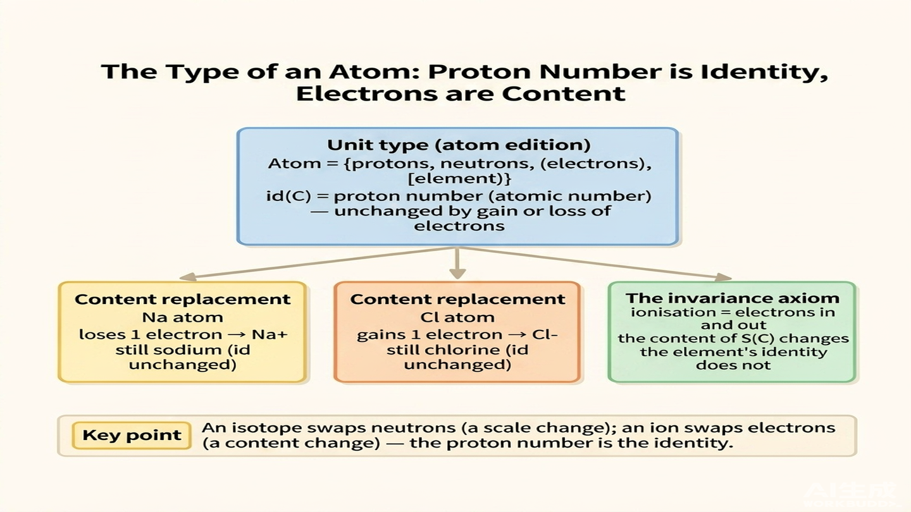

*Figure 2-3 The type of an atom: proton number is identity, electrons are content*

> **Definition (container, chemistry edition)**
>
> ◆ Container C = ( id(C), S(C) ); for an atom, id(C) = proton number
> ◆ Invariance axiom: replacing the content of S(C) does not change id(C) — ionisation, dissolution and dilution do not change identity.
> ◆ Admission rules: open / closed / isolated differ only in the list of items that ( ) allows in and out — an iron nail getting heavier means an open system has taken something into its accounts.

### 2.3 { } Composition: The BOM Criterion and the Three Levels of remove

Anyone can list the components; what a proof needs is dependence. First pass the BOM criterion: does it still recognise itself when taken off? A condenser taken off is still a condenser, so it enters the BOM; “the cooling function” taken off is nothing, so it enters the attributes. Then classify with the remove criterion: remove component p from the whole M and see which level the result falls into.

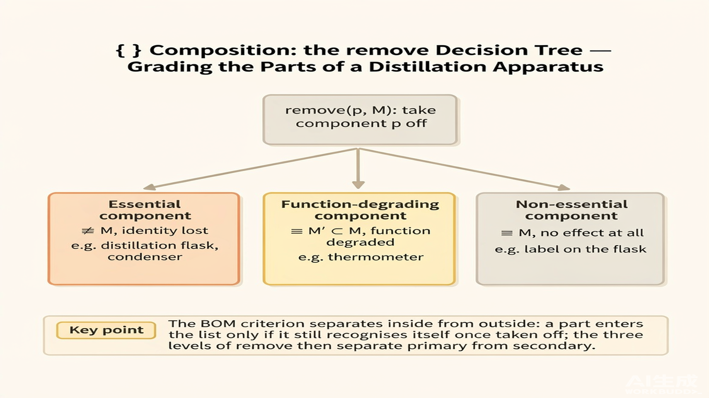

*Figure 2-4 { } Composition: the remove decision tree — grading the components of a distillation apparatus*

| Level | Result of the test | Example from the distillation apparatus | Use in a proof |
| --- | --- | --- | --- |
| Essential component | remove(p,M) ≢ M | Distillation flask, condenser | Proves “without it there is no whole” |
| Function-degrading component | remove(p,M) ≡ M′ ⊂ M | Thermometer | Proves “function missing, identity preserved” |
| Non-essential component | remove(p,M) ≡ M | Label on the flask | Proves “removal changes nothing at all” |

**Table 2-2 The three levels of the remove criterion (chemistry edition)**

### 2.4 The Temporal Type Takes the Field: Reaction = op: Type → Type

A chemical reaction is a standard temporal type: one type goes in (the reactant system) and one type comes out (the product system). Before using it, write the four-question function card: which reaction is the name, what is the input type, what is the output type, what is the criterion — the criterion column states the conditions of validity and the conservation accounts.

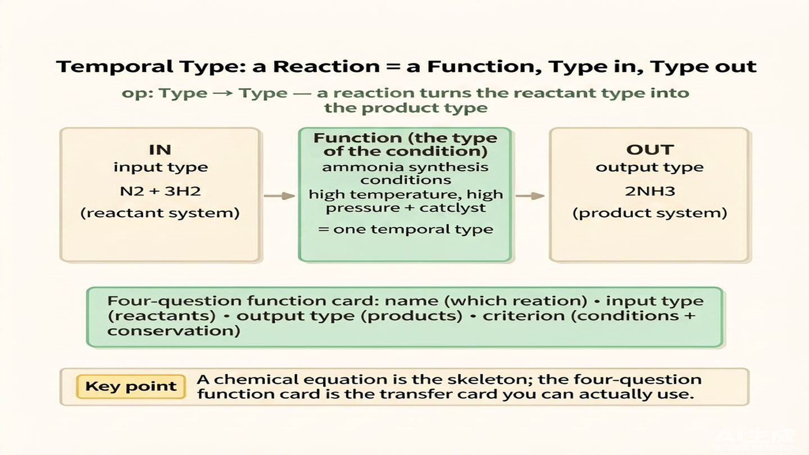

*Figure 2-5 Temporal type: a reaction = a function, type in, type out*

| Reaction (name) | Input type | Output type | Criterion |
| --- | --- | --- | --- |
| Law of mass action | A system of concentrations of the species | A system at an equilibrium position | Compare Q with K |
| Arrhenius equation | A reaction at temperature T | A reaction with rate constant k | k = A·e^(-Ea/RT) |
| Faraday electrolysis | A cell through which charge has passed | A cell from which product has been deposited | m = (Q·M)/(n·F) |

**Table 2-3 Three four-question function cards**

One rule for using cards: when a parameter changes you change the card, the card was not wrong. If the catalyst changes and Ea changes, change to another card — do not force the old card and then blame the world for not obeying.

> **Key points of this chapter**
>
> ◆ [ ] Chemical quantity = dimension × scale — the mole is always followed by a substance, and dimensional analysis is a free health check.
> ◆ ( ) Container — the proton number is the identity of an atom, ionisation is a replacement of content; whether a system is open decides how the accounts are kept.
> ◆ { } Composition — the BOM criterion separates inside from outside, the three levels of remove separate primary from secondary; the reaction op: Type → Type must answer all four questions before it can be checked.

> **Exercises (P2)**
>
> P2-1 Write “a bottle of dilute hydrochloric acid” as a unit type { components, (content), [category] }, and mark id(C) and whether the system is open.
> P2-2 Ask of the distillation apparatus: which level does remove(condenser) fall into, and which level does remove(thermometer) fall into? Give the reason for the judgement.
> P2-3 Fill in a four-question function card for “electrolysis of water”: name, input type, output type, criterion.
> Hint: establish the type first (who the system is), then ask which layer each tool falls on.

## Chapter 3 Proof Demonstrations Across the Five Domains of General Chemistry

The tools are all in place. This chapter carries the same method onto the ground of the five domains of general chemistry — structure and bonding, reactions and stoichiometry, thermochemistry, equilibrium and kinetics, electrochemistry, one each. Every one follows the same format: state the theorem, establish the type, choose the criterion, derive, close with three layers. First look at the route map:

| Domain | Proposition | Main criterion | Where it lands in type theory |
| --- | --- | --- | --- |
| Structure of matter | Classification of bonding | Electronegativity difference · electron transfer · lattice | The ∩(T) classification funnel |
| Reactions and stoichiometry | Conservation of mass | Same number and same kind of atoms on both sides | Invariance axiom + mole bookkeeping |
| Thermochemistry | Hess's law | ΔH independent of path | State function = invariant |
| Equilibrium and kinetics | Shift of equilibrium | Compare Q with K | K unchanged = identity unchanged |
| Electrochemistry | Nernst equation | E = E°-(RT/nF)·lnQ | ( ) cell + function card |

**Table 3-1 Master table of the five demonstrations**

### 3.1 Structure and Bonding: A Criterion for Classifying Ionic Bonds

> **PROOF DEMONSTRATION · STRUCTURE OF MATTER**
>
> 【Theorem】The bonding of sodium chloride (NaCl) is classified as [ionic bond].
> 【Proof】(1) Establish the type: the object to be judged is NaCl; (2) write F(ionic bond) = { electronegativity difference ≥ 1.7, electron transfer, forms a lattice }; (3) test item by item: electronegativity Na 0.9, Cl 3.0, Δ = 2.1 ≥ 1.7, ✓; an electron moves from Na to Cl, ✓; an ionic lattice forms at room temperature, ✓; (4) since ∩(T) passes on every item, NaCl ∈ [ionic bond]; (5) comparison and boundary: HCl Δ = 0.9 fails the first gate and is classified as [covalent bond]; HF Δ = 1.9 passes the first gate yet forms no lattice (fails the third) — boundary cases sharpen F(T), so the list of features must be complete. (Q.E.D.)

Is calcium chloride an ionic bond or a covalent bond? This is a standard classification question — put the ∩(T) funnel onto a compound. First write F(ionic bond) explicitly: { electronegativity difference ≥ 1.7, electrons move from metal to non-metal, an ionic lattice forms at room temperature }.

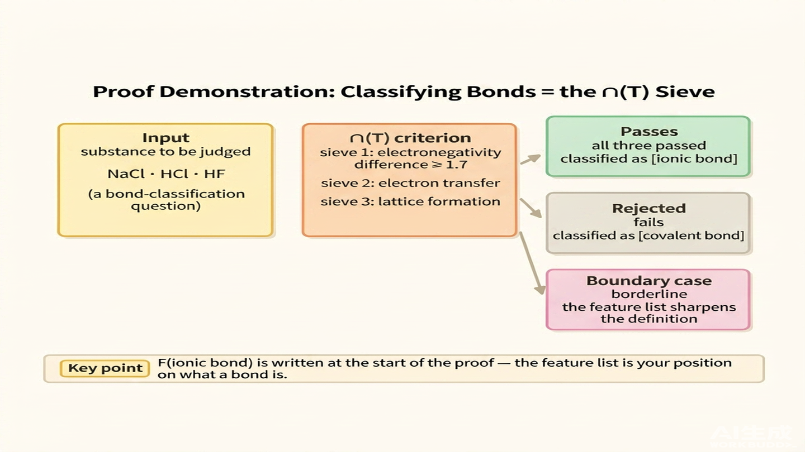

*Figure 3-1 Proof demonstration: classifying bonds = the ∩(T) sieve*

### 3.2 Reactions and Stoichiometry: Bookkeeping for Conservation of Mass

When methane burns in a closed vessel the total mass is unchanged before and after. Conservation rests on the admission rule of ( ): closed — no species enters or leaves the ledger. The bookkeeping uses moles: the stoichiometric coefficients are the entries of the BOM rearrangement.

> **PROOF DEMONSTRATION · REACTIONS AND STOICHIOMETRY**
>
> 【Theorem】For CH4 + 2O2 → CO2 + 2H2O in a closed vessel, total mass is conserved before and after the reaction.
> 【Proof】(1) Establish the type: M = the closed vessel (id(FLASK-001)), S(M) admits only reactants and products; (2) candidate invariant: total number of atoms; (3) bookkeeping item by item: C 1 before, 1 after; H 4 before, 4 after; O 4 before, 4 after — same number and same kind on both sides; (4) the molar mass of each atom is unchanged, so total mass m = Σ(moles × molar mass) is equal before and after; (5) three-layer check: container — the closed admission rule holds; BOM — all four species are on the ledger; abstract — passes the ∩(T) of [combustion reaction]. (Q.E.D.)
> 【Comparison】An iron nail getting heavier after rusting does not violate conservation — that is an open system, and the ledger must also record the oxygen and water taken in from the air (see 4.2).

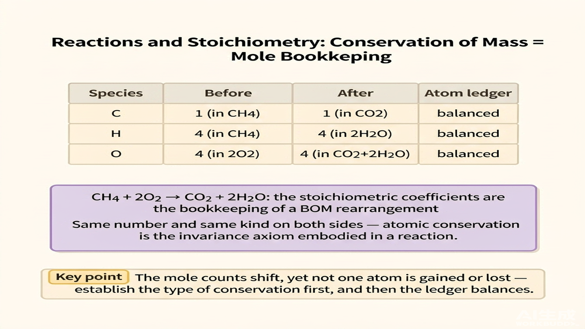

*Figure 3-2 Reactions and stoichiometry: conservation of mass = mole bookkeeping*

### 3.3 Thermochemistry: Hess's Law as an Invariant

Heats of reaction can be added up step by step — because enthalpy H is a state function: it recognises only the start and the end, not the path. This is exactly the invariance axiom embodied in thermochemistry: however the process travels, ΔH does not change.

> **PROOF DEMONSTRATION · THERMOCHEMISTRY**
>
> 【Theorem】Hess's law: the heat of reaction is independent of path, ΔH(A) = ΔH(B) + ΔH(C).
> 【Proof】(1) Establish the type: the start (reactants) and the end (products) are each a state type; (2) candidate invariant: enthalpy H; (3) since H is a state function (an invariant), the ΔH of any path is determined by the two ends alone; (4) therefore the sum of the stepwise path B + C equals the single-step path A: ΔH(A) = ΔH(B) + ΔH(C); (5) three-layer check: container — the calorimeter at constant pressure; BOM — all state species are on the ledger; abstract — passes the ∩(T) of [thermochemistry]. (Q.E.D.)
> 【Comparison】Whichever route you take up a mountain, the height difference between summit and foot is fixed — the difference is a state, the route is a process, and the layers are distinct.

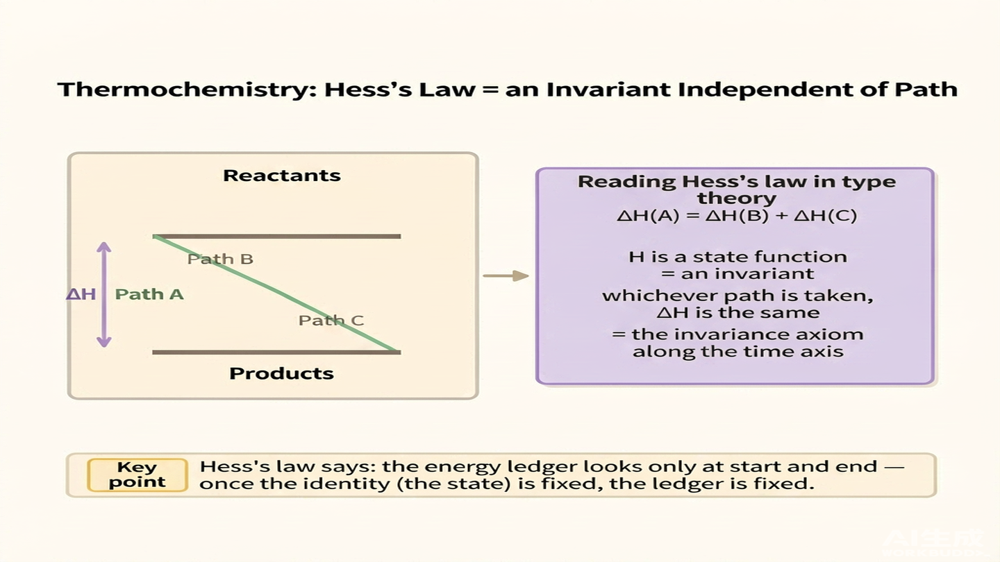

*Figure 3-3 Thermochemistry: Hess's law = an invariant independent of path*

### 3.4 Equilibrium and Kinetics: K as Invariant and the Arrhenius Card

The equilibrium constant K is the identity marker of an equilibrium system: however concentrations change and however pressure is altered, as long as the temperature is unchanged K is unchanged. Le Chatelier's principle says the system will “chase back” the K that was disturbed — the system guarding its own invariant.

> **PROOF DEMONSTRATION · EQUILIBRIUM AND KINETICS**
>
> 【Theorem】For ammonia synthesis N2 + 3H2 ⇌ 2NH3, raising the pressure shifts the equilibrium to the right.
> 【Proof】(1) Establish the type: the equilibrium system M, whose id(M) is defined by temperature and K; (2) criterion: K = [NH3]²/([N2][H2]³); (3) at the instant pressure is raised all concentrations grow by the same factor, the numerator grows as the square and the denominator as the fourth power, so Q = K/(growth factor) < K; (4) by the law of mass action, when Q < K the reaction proceeds to the right until Q = K is restored — K unchanged, identity unchanged; (5) three-layer check: container — constant temperature, closed; BOM — all three species are on the ledger; abstract — passes the ∩(T) of [chemical equilibrium]. (Q.E.D.)
> 【Comparison】Only a change of temperature changes K — that is not the same system being disturbed, it is a different system (a changed card, not a wrong card).

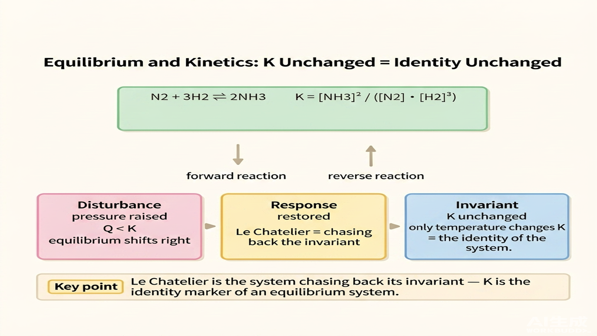

*Figure 3-4 Equilibrium and kinetics: K unchanged = identity unchanged*

On the kinetics side the representative card is the Arrhenius equation: k = A·e^(-Ea/RT). The input type is “a reaction at temperature T”, the output type is “a reaction with rate constant k”, and the criterion column carries the threshold of activation energy Ea. A plot of ln k against 1/T is a straight line whose slope hides Ea — measure at two temperatures and the parameter on the card can be computed.

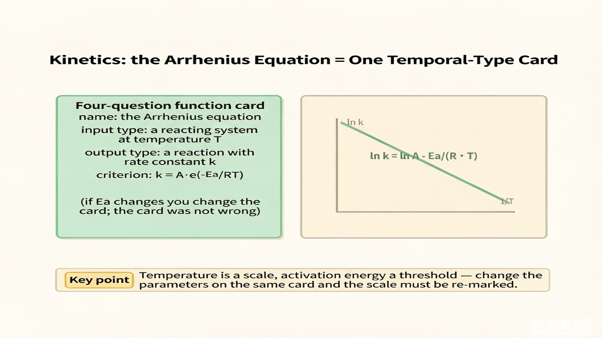

*Figure 3-5 Kinetics: the Arrhenius equation = one temporal-type card*

### 3.5 Electrochemistry: Deriving the Nernst Equation

A cell is a standard container: the two electrode materials are the identity, the electrons are the content, which can flow and be replaced while id(cell) stays the same. Change the concentration and the potential changes with it — the Nernst equation writes this relation as a criterion.

> **PROOF DEMONSTRATION · ELECTROCHEMISTRY**
>
> 【Theorem】A zinc electrode immersed in a solution with [Zn²⁺] = 0.1 M has a potential about 30 mV lower than at 1 M (25°C).
> 【Proof】(1) Establish the type: M = the zinc electrode system (Zn²⁺ + 2e⁻ ⇌ Zn), with S(M) = (Zn²⁺ ions) inside the ( ); (2) criterion: the Nernst equation E = E° - (RT/nF)·ln(1/[Zn²⁺]); (3) substitute n = 2, T = 298 K, [Zn²⁺] from 1 → 0.1 M: ΔE = (0.0592/2)·log(0.1) = -0.0296 V ≈ -30 mV; (4) the four function questions: name = Nernst, input type = an electrode with concentration 0.1 M, output type = an electrode with lowered potential, criterion = the expression above; (5) three-layer check: container — ions enter and leave while the id is unchanged; BOM — the electrode is an essential component; abstract — passes the ∩(T) of [electrochemistry]. (Q.E.D.)

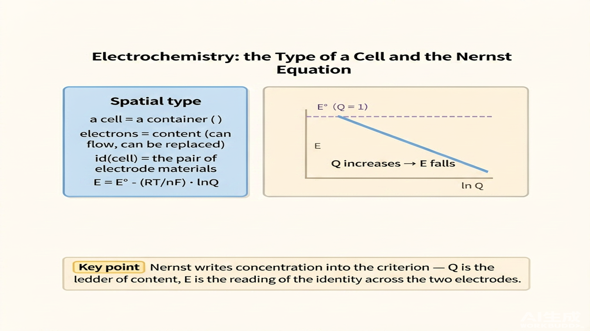

*Figure 3-6 Electrochemistry: the type of a cell and the Nernst equation*

> **Key points of this chapter**
>
> ◆ Use the ∩(T) funnel for classification questions — write F(T) completely, and let boundary cases sharpen the definition.
> ◆ Use the invariance axiom for conservation questions — a closed admission rule plus mole bookkeeping, and only then does the ledger balance.
> ◆ In equilibrium questions treat K as the identity, in kinetics questions use the function card — a disturbance is content, K is identity.

> **Exercises (P3)**
>
> P3-1 Use ∩(T) to judge the bonding of magnesium oxide (MgO) (electronegativity Mg 1.2, O 3.5), and state which sieves it passed.
> P3-2 Derive with Hess's law: the heat of combustion of C → CO can be obtained by adding and subtracting C → CO2 and CO → CO2 (writing the path equations is enough).
> P3-3 Ammonia synthesis is exothermic: how does the equilibrium shift when the temperature is raised? Explain in the language of “K is identity” (establish the type first, then choose the criterion).

## Chapter 4 The Complete Framework of Accurate Use

The four tools and the demonstrations across five domains are all in place. The last chapter packs them back into a single workflow: the six steps of a chemical proof, one example carried all the way through, a comparison of five misuses, and the eight-question checklist before handing in a proof — this is what the title of the book calls the complete framework of accurate use.

### 4.1 The Six Steps of a Chemical Proof

When facing a chemical proposition that must be written as a proof, always take six steps. Step one, identify the whole — first ask “which system am I proving something about”. Step two, describe the axes — write X attribute, Y composition and Z container once each. Step three, write the type set — using the notation { components, (content), [category] }. Step four, choose the proposition — classification, conservation, grading, or reaction? Step five, reason with the criterion — walk the corresponding criterion step by step. Step six, three-layer check — after the container, composition and abstract layers are verified jointly, close the conclusion.

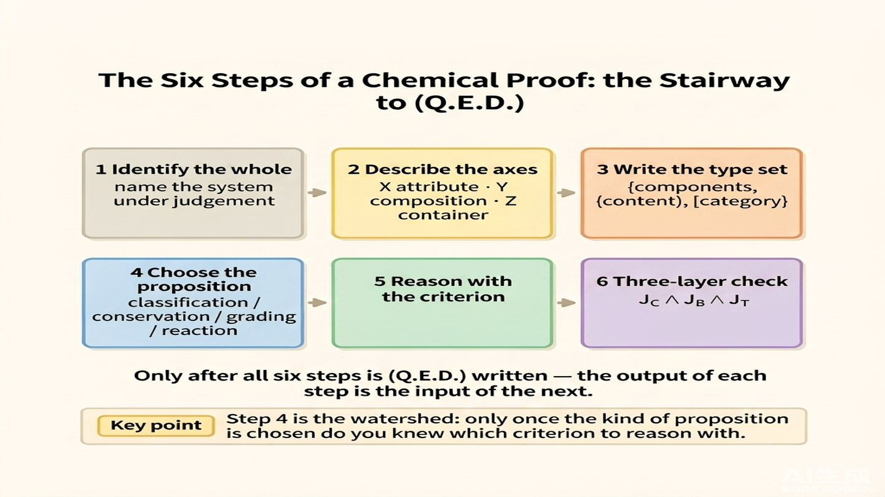

*Figure 4-1 The six steps of a chemical proof: the stairway to (Q.E.D.)*

| Step | Operation | Output | Tools commonly used |
| --- | --- | --- | --- |
| 1 Identify the whole | Name the system under judgement | One sentence: what M is | —— |
| 2 Describe the axes | Describe each of the three axes once | Attribute table, BOM, container | The three brackets |
| 3 Write the type set | A complete notation | { components, (content), [category] } | Type set |
| 4 Choose the proposition | Classification / conservation / grading / reaction | One-sentence theorem | —— |
| 5 Reason with the criterion | Reason step by step with the right criterion | The body of the derivation | ∩(T) · id(C) · remove · op |
| 6 Three-layer check | Joint check of three layers | Conclusion (Q.E.D.) | The three-layer judgement |

**Table 4-1 Operating table for the six proof steps**

### 4.2 Full Example: A Rusting Iron Nail

Use the classic experiment that makes “getting heavier” clear, and walk the six steps all the way through.

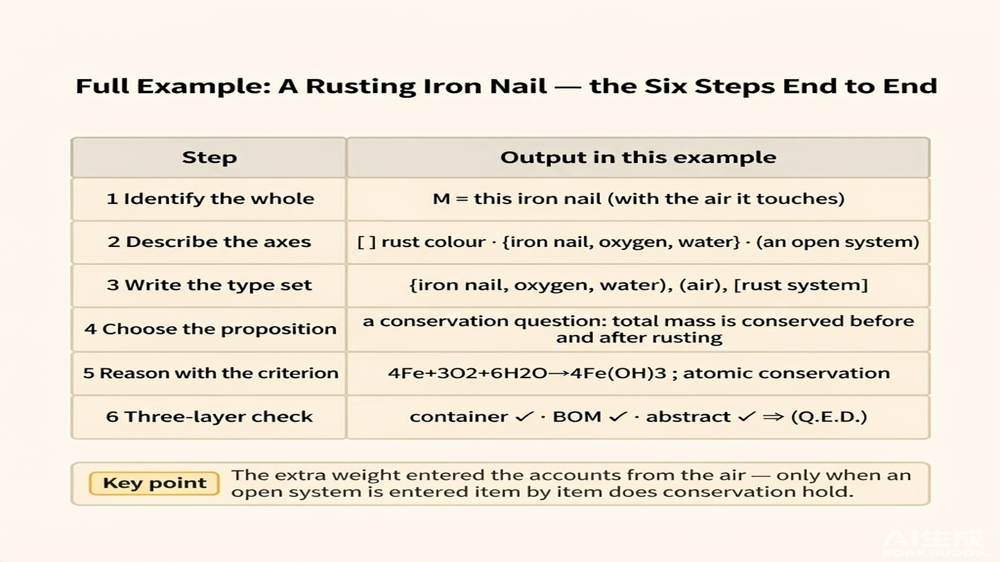

> **PROOF DEMONSTRATION · END TO END**
>
> 【Theorem】An iron nail gets heavier after rusting, yet once the air is entered into the accounts the total mass is conserved.
> 【Proof】
> (1) Identify the whole: M = this iron nail (FE-001) plus the air and water it touches — declare first that it is an open system.
> (2) Describe the axes: [ ] rust = hydrated iron oxide (dimension = composition, scale = degree of oxidation); { } BOM = { iron nail, oxygen, water }; ( ) an open system, with admission rules = oxygen and water may enter and leave.
> (3) Write the type set: M = { { iron nail, oxygen, water }, (air), [rust system] }.
> (4) Choose the proposition: a conservation question — the total mass of the “whole ledger” is conserved before and after rusting.
> (5) Reason with the criterion: 4Fe + 3O2 + 6H2O → 4Fe(OH)3; bookkeeping item by item gives the same number and same kind of atoms on both sides; the mass gained by the nail equals the mass of oxygen and water taken into the accounts; the content of ( ) is replaced while the number of iron atoms in id(FE-001) stays unchanged (proton number 26 throughout).
> (6) Three-layer check: container — with an open system entered item by item into the accounts, conservation holds, ✓; BOM — remove(oxygen) stops the rusting (essential component), remove(water) stops it too (essential component), ✓; abstract — passes the ∩(T) of [oxidation reaction], ✓. All three layers pass. (Q.E.D.)
> 【Lesson】Saying “heavier means not conserved” after weighing only the nail is to keep the accounts of an open system as if it were closed — the misuse is not in the data but in the layer.

*Figure 4-2 Full example: a rusting iron nail — the six steps end to end*

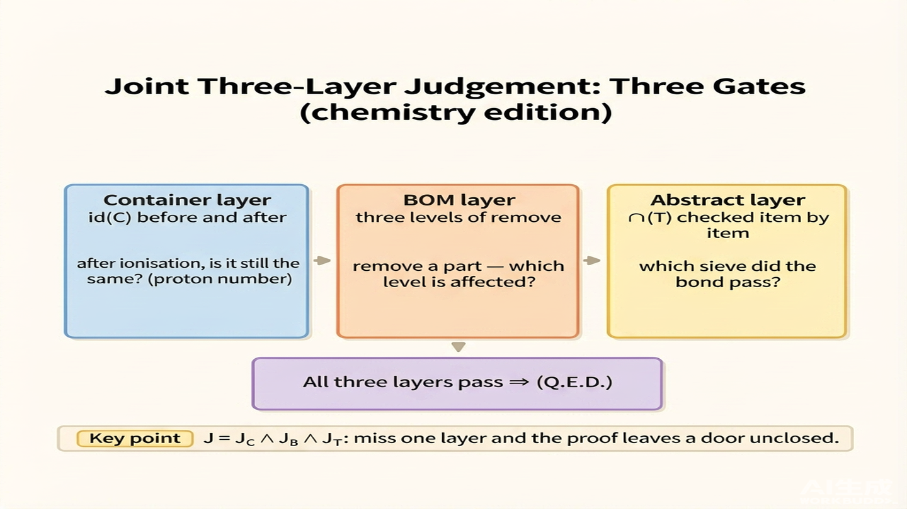

*Figure 4-3 Joint three-layer judgement: three gates (chemistry edition)*

### 4.3 Misuse Comparison: Five Common Errors

| # | Misuse | Where the problem lies | Correct way to write it |
| --- | --- | --- | --- |
| 1 | Treating ( ) as an ordinary set | (Na+) is written as {Na+} and the identity vanishes | Write ions with ( ), labelled with the proton number |
| 2 | Writing [ ] as a closed list | New species cannot be classified | Use the open rule T = (F(T), ∩(T)) |
| 3 | Values without a dimension | A mol with no substance, and the ledger is wrong | Write the dimension first (which quantity), then the scale |
| 4 | A reaction that skips steps | Input type and output type are not stated | Write op: Type → Type step by step along the function chain |
| 5 | Concluding after only one layer of judgement | Each layer has its own blind spot | Joint three-layer judgement J = J_C ∧ J_B ∧ J_T |

**Table 4-2 Five common misuses and the correct way to write them**

The common root of all five misuses is that the “layer” is not made clear: the layer of the brackets, the layer of system versus content, the layer of number versus type, the layer of the reaction. When writing a proof, ask yourself at every moment — which layer does this piece of information belong to?

### 4.4 The Checklist Before Handing In a Proof

| # | Check question | Passing standard |
| --- | --- | --- |
| 1 | Is the system identified? | The sentence “which system I am proving something about” can be said |
| 2 | Are the admission rules stated? | Open / closed / isolated and the exchange terms are listed clearly |
| 3 | Are the brackets used correctly? | { } components, ( ) content, [ ] category, each in its place |
| 4 | Is the identity marked? | Proton number or id(C) is explicit and does not scatter along the way |
| 5 | Has the remove grading been done? | When discussing the influence of components, each falls into one of the three levels |
| 6 | Are all four function questions answered? | Every reaction has a name, an input type, an output type and a criterion |
| 7 | Is every step checkable? | The reader can tick sentence by sentence and reproduce the reasoning |
| 8 | Has the joint three-layer check been made? | Only when the container, composition and abstract layers all pass may (Q.E.D.) be written |

**Table 4-3 Checklist: the eight questions before handing in a proof**

**Only when all eight questions pass does the proof count as “written accurately” — this is the acceptance standard of the four tools.**

> **Key points of this chapter**
>
> ◆ Six steps: identify the whole → describe the axes → write the type set → choose the proposition → reason with the criterion → three-layer check.
> ◆ The lesson of the rust: only when an open system is entered item by item into the accounts can conservation stand — the misuse is not in the data but in the layer.
> ◆ The eight-question checklist is the acceptance standard of accurate use.

> **Exercises (P4)**
>
> P4-1 Prove with the six steps: “copper forms verdigris in moist air, and the total mass of the whole ledger is conserved before and after”.
> P4-2 Against Table 4-2, check whether your proof in P4-1 commits any of the misuses, answering item by item.
> P4-3 Apply the eight questions of Table 4-3 to any worked example in your chemistry textbook, and point out which layers it lacks.
> Hint: in step 4 choose the kind of proposition first and the criterion second — reversing the order produces skipped steps.

## Review — Key Points and Self-Check

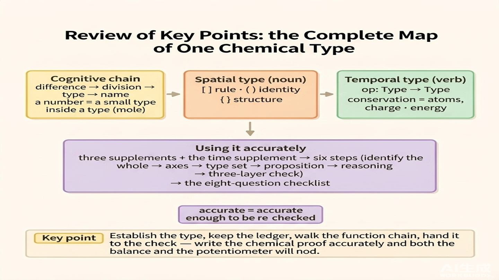

*Figure R-1 Review of key points: the complete map of one chemical type*

#### R-1 Four supplements, four gaps

[ ] replaces a list written in stone with an open rule — T = (F(T), ∩(T)); ( ) gathers scattered content under an unchanging identity — proton number, id(C) and the invariance axiom; { } arranges components that merely sit side by side into a structure of dependence — the three levels of remove; the temporal type unfolds a flattened reaction into a chain of functions — op: Type → Type. Wherever the gap is, that is where the tool goes.

#### R-2 Three-piece set, two languages, one main axis

Model first, law in the middle, derivation last; the equation is the skeleton, the supplement of types is the flesh and blood. The spatial type establishes the system, the temporal type carries the reaction through — only with the two languages overlaid is a chemical proof complete.

#### R-3 Accurate means checkably accurate

Judgement relies not on intuition but on procedure: verify ∩(T) item by item, compare the proton number before and after, grade with the three levels of remove, walk the function chain step by step; only after the joint three-layer check is the conclusion drawn. The reader can tick sentence by sentence and reproduce your derivation, the balance and the potentiometer can re-measure according to your conclusion — that is what the word “accurate” means in chemistry.

| Self-check question | What you should be able to answer |
| --- | --- |
| How is a system given its type? | Write { components, (content), [category] }, and declare open or closed first |
| How is a chemical quantity read? | Dimension × scale — the mole is always followed by a substance |
| How is a reaction written? | The four-question function card: name, input type, output type, criterion |
| How is conservation used? | Three ledgers — atoms, charge, energy — and the five steps of an invariant |
| How does a proof get started? | Walk the six steps once: from identifying the whole to (Q.E.D.) |
| How are misuses avoided? | Check yourself against the five misuses one by one, and make the layers clear |

**Table R-1 Self-check list**

**A proof is written accurately because every layer of information is written where it belongs.**

## Appendix Glossary and Notation at a Glance

| Term | English / notation | One-sentence definition |
| --- | --- | --- |
| Type | Type | An object that has been completely described |
| Unit Type | Unit Type | The union of the three sets: { components, (content), [category] } |
| Type Set | Type Set | The complete notation of a unit type |
| Attribute · dimension · scale | [ ] | A chemical quantity = dimension (field) × scale (cell) |
| Abstract category | T = (F(T), ∩(T)) | An open category determined by features and criteria |
| Intersection criterion | ∩(T) | Membership only if every feature passes |
| Container | C = (id(C), S(C)) | The boundary of a chemical system plus an unchanging identity |
| Identity marker | id(C) | For an atom = proton number; for a system = a custom label |
| Invariance axiom | ∀ e1, e2 ∈ S(C) | Replacing the content does not change id(C) |
| BOM · remove criterion | remove(p,M) | Three levels: essential ≢M / degrading ≡M′⊂M / non-essential ≡M |
| Temporal type | Time Type | The type of a verb = a function: op: Type → Type |
| Four-question function card | name / input type / output type / criterion | Writing one reaction as one usable card |
| Conservation | conservation | Three ledgers — atoms, charge, energy = invariants along the time axis |
| Three-layer judgement | J = J_C ∧ J_B ∧ J_T | Joint check of the container layer, the BOM layer and the abstract layer |
| Six steps of a proof | six steps | Identify the whole → axes → type set → proposition → reasoning → three-layer check |

**Table A-1 Glossary and notation at a glance**

#### Reference Answers to the Exercises

| Item | Key points of the answer |
| --- | --- |
| P1-1 | Rule (what counts as “hydrochloric acid”, “calcium carbonate”); identity (the proton number 20 of Ca is unchanged throughout); structure (the dependence of {carbonate, calcium}); reaction (op: reactant type → CaCl2 + H2O + CO2 type). All four layers are omitted in that sentence. |
| P1-2 | Because “acid” is determined by F(T) = { can donate H+, can neutralise a base … } together with ∩(T); acetic acid is a weak acid yet still in the category, a Lewis acid contains no H+ yet accepts an electron pair — change the definition and the boundary moves, and a list cannot answer such cases. |
| P1-3 | The expression answers the relation among the concentrations at equilibrium, and does not answer “which system this is, which set of species” — identity must be supplied by the proton number and id(C). |
| P2-1 | M = { { water, hydrogen chloride }, (dilute hydrochloric acid), [acid solution] }, with id(C) customised as, say, SOL-003; an open system (volatile HCl can escape) — the accounts must record it. |
| P2-2 | Condenser — remove ≢ M (distillation fails, essential component); thermometer — ≡ M′ ⊂ M (distillation still possible but temperature measurement is lost, function-degrading component). |
| P2-3 | Name = electrolysis of water; input type = water under current (2H2O); output type = hydrogen–oxygen mixture (2H2 + O2); criterion = 2H2O → 2H2↑ + O2↑ (the charge is booked as m = QM/nF). |
| P3-1 | Mg 1.2, O 3.5, Δ = 2.3 ≥ 1.7 ✓; electrons move from Mg to O ✓; an ionic lattice forms at room temperature ✓ — all three pass, MgO ∈ [ionic bond]. |
| P3-2 | Path equation: ΔH of C → CO = (ΔH of C → CO2) − (ΔH of CO → CO2); a state function recognises only the two ends, hence the addition and subtraction are valid. |
| P3-3 | Raising the temperature means a different system (K changes = a new card); for an exothermic reaction the new K is smaller, Q > K, and the equilibrium shifts left — what the system chases back is “the K of the new system”, not the old K. |
| P4-1 | Follow the format of 4.2: (1) declare the open system; (2) [ ] composition of verdigris, {Cu, O2, H2O, CO2}, (air); (3) type set; (4) a conservation question; (5) bookkeeping for 2Cu+O2+H2O+CO2→Cu2(OH)2CO3; (6) all three layers pass — the weight gain equals the oxygen, water and carbon dioxide entered into the accounts. |
| P4-2 | Check the five misuses one by one: are ions written as { }? Is the category written in stone? Does the mol carry a substance? Does the derivation skip steps? Was only one layer checked? |
| P4-3 | A textbook worked example usually gives only the derivation of step 5 — it lacks the type establishment of steps 1–3 and the three-layer check of step 6; ticking the eight questions one by one shows it. |

**Table A-2 Reference answers to the exercises**

> **The End**
>
> ◆ The spatial type shapes a chemical system into a type, the temporal type writes a reaction as a function, and accurate use hands the proof over to the check.
> ◆ See the type clearly and put every layer of information where it belongs — and a chemical proof is written accurately.
