# Ontypology

## Dependent Type Theory and Formal Verification with Lean

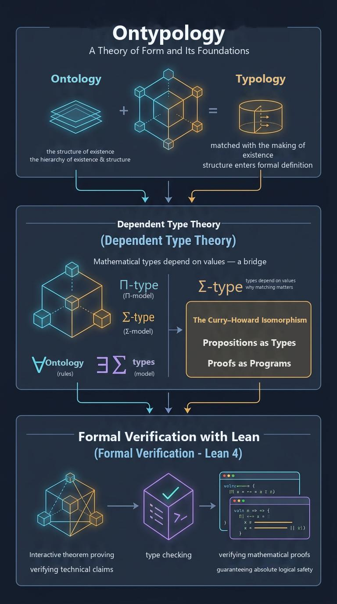

## Contents

- **Preface** 4
- **Introduction** 5
- Int-1 Two Languages, Read Superimposed 5
- Int-2 How to Read This Book 6
- Int-3 The Toolbox List 6
- **Part I — Positioning: Why Ontypology and Lean Share a Table** 7
- 1-1 Five Pain Points: What It Looks Like When the Type Is Not Established 7
- 1-2 Root, Trunk, Fruit: Three-Layer Positioning 8
- 1-3 One-Sentence Main Line: Form = Type 8
- 1-4 The Four Pillars: Relation, Method, Architecture, Plan 8
- **Part II — The Backbone at a Glance: Three Languages, One Table** 10
- 2-1 The Ontypology Toolbox: One Diagram Establishes the Backbone 10
- 2-2 The Dependent Type Theory Toolbox: Types Depend on Values 11
- 2-3 What Lean Is: A Brief History and the Present 12
- 2-4 Master Table of the Ten Reading Propositions 13
- **Part III — Spatial Types × Dependent Type Theory: A Static Reading** 15
- 3-1 Three Axes Against Three Constructions 15
- 3-2 [ ] Attributes ↔ Π Types and Indices: Scales Written into the Type 15
- 3-3 { } BOM ↔ Σ Types and Fields: The Disassembly Criterion Enters the Type 16
- 3-4 ( ) Containers ↔ Context and Universes: Identity Written into the Environment 17
- 3-5 Unit Types ↔ Inductive Types: A Coffee Cup Written as a structure 18
- 3-6 Three-Layer Judgment ↔ The kernel's Intake Funnel 19
- 3-7 Three Kinds of Sameness ↔ defeq, Eq, iso: From Strict to Loose 20
- 3-8 Five Operations × Type Construction: Move One Layer at a Time 21
- 3-9 Exercises for This Part 25
- **Part IV — Temporal Types × Lean: A Dynamic Reading** 26
- 4-1 Temporal Type = Function ↔ def, theorem 26
- 4-2 op: Type → Type ↔ Type Constructors 26
- 4-3 The Four-Question Card ↔ Signature + Contract 27
- 4-4 Six Function Groups ↔ Mathlib and the tactic Ecosystem 28
- 4-5 The tactic Board and Routing 29
- 4-6 Types and Functions Grow Each Other: The Mathlib Loop 30
- 4-7 Exercises for This Part 31
- **Part V — Using It Accurately: Reviewable Accuracy** 32
- 5-1 Body–Use–Accuracy × Lean 32
- 5-2 Three Supplements: Fill the Gaps Until It Is Clear 32
- 5-3 The Six Proof Steps × the Lean Workflow 33
- 5-4 Full Demonstration: The Number of a Merged Type 34
- 5-5 Eight Questions × the Acceptance List 36
- 5-6 Misuse Contrasts and the Routing Decision Tree 37
- 5-7 Exercises for This Part 39
- **Part VI — Overall Architecture: Two Libraries, One Hub, One Loop × the Lean Ecosystem** 40
- 6-1 Architecture Overview 40
- 6-2 The Type Library ↔ Mathlib: Four Stages of Library Building 40
- 6-3 AI × Lean: AI Makes the Moves, the kernel Accepts 41
- 6-4 The Milestone Gallery and Industry Adoption 42
- 6-5 Exercises for This Part 44
- **Part VII — The Complete Content Plan: Learn, Practice, Use, Teach, Build** 45
- 7-1 The Five-Step Cycle: Learn, Practice, Use, Teach, Build 45
- 7-2 The Eight-Week Route 45
- 7-3 Four Kinds of Readers, Four Routes 46
- 7-4 The Stuck-Point Table and FAQ 47
- 7-5 Teaching Outreach and the Mind AI Vision 47
- 7-6 Exercises for This Part 48
- **Part VIII — Conclusion: Five Fields Side by Side and Three Successive Goals** 49
- 8-1 Five Fields Side by Side: The Question of the Type Does Not Change 49
- 8-2 Three Successive Goals 49
- **Appendix A — Glossary** 51
- **Appendix B — Quick-Reference Cards** 52
- B-1 The Four-Question Function Card (Lean Edition) 52
- B-2 The Eight-Question Acceptance List 52
- B-3 Photocopiable Blank Templates 53
- **Appendix C — Answers to the Exercises** 54
- **Appendix D — Index of Figures** 56
- **Appendix E — Sources and Further Reading** 58

## Preface

This booklet does one thing only: it places Ontypology, Lean formal verification, and dependent type theory at the same table and makes three things clear — what their relation is, how to use them accurately, and how to build the architecture — and finally gives a complete content plan.

Ontypology establishes "form" as the smallest unit of cognition: spatial types answer "what a form is"; temporal types answer "how a form operates." Dependent type theory establishes "form" as the smallest unit of mathematics and computation: a type depends on values, and a proof is a program. Lean turns this theory into a machine: every proof must pass the kernel's item-by-item check. There is only one place where the three meet — reviewable accuracy.

> **Three conventions**  
> Convention 1: The English word for form is Type; it is used directly throughout the text, with no further annotation.  
> Convention 2: This book takes Ontypology as its theoretical foundation but does not restate the existing theory — it establishes the backbone with architecture diagrams and illustrated summaries, leaving the space to Lean and dependent type theory.  
> Convention 3: This book contains no system implementation; the Lean code in it serves only as an introductory demonstration and a reading aid, not as an executable project.  

Table 0-1 uses one table to lay out the four pillars of this book. Every reader can find an entrance along one of them.

| **Pillar** | **Question it answers** | **Parts where it falls** |
| --- | --- | --- |
| Relation | How Ontypology relates to dependent type theory and Lean | Parts I to IV |
| Method | How the Accurate-Use Method lands in the Lean workflow | Part V |
| Architecture | How two libraries, one hub, one loop connect to the Lean ecosystem | Part VI |
| Plan | How to learn, practice, build a library, and accept results | Parts VII and VIII |

## Introduction

### Int-1 Two Languages, Read Superimposed

Ontypology and dependent type theory are two languages describing the same cognitive road. When the human brain walks this road, it is called the "cognition chain": first feel similarity and difference, then split and merge, draw the form, and finally give it a name. When a machine walks it, it is called the "verification chain": first write a statement, then construct it, hand it to the kernel for checking, and finally obtain the proof.

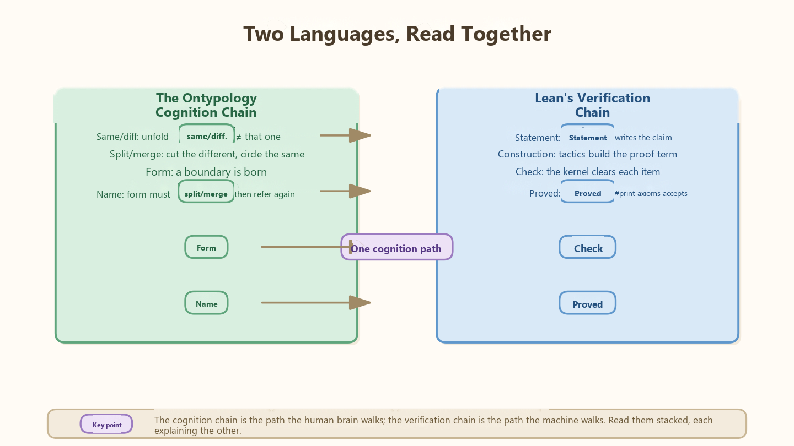

Figure Int-1 Cognition chain and verification chain: two ways of walking the same road

Reading them superimposed means: whenever you meet a Lean concept, first ask which link of the cognition chain it belongs to; whenever you meet an Ontypology idea, ask which mechanism in Lean accepts it. When the two sides explain each other, understanding no longer depends on metaphor.

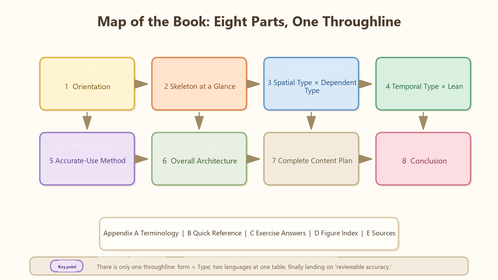

Figure Int-2 Map of the book: eight parts, one main line

### Int-2 How to Read This Book

**For those who want to understand the relation first: read Parts I, II, and III, and go straight to the ten reading propositions.**

**For those who want to start using it immediately: read the six steps and eight questions in Part V, and open Lean to implement small theorems as you read.**

**For those who want to plan their learning or teaching: read the eight-week route and the situational routes in Part VII, and schedule your course directly.**

### Int-3 The Toolbox List

Six tools recur throughout the book: three axes and three brackets, three-layer judgment, five operations, the four-question function card, three supplements, and eight questions. They are surveyed once in Part II and then appear in every part.

| **Tool** | **In one sentence** | **Part where it appears** |
| --- | --- | --- |
| Three axes and three brackets | The structure of a Type: [ ] attributes · { } composition · ( ) container | Part III |
| Three-layer judgment | The acceptance of a Type: J = J_C ∧ J_B ∧ J_T | Part III |
| Five operations | The dynamics of a Type: op: Type → Type | Part III |
| Four-question function card | The specification of a function: name, input Type, output Type, criterion | Part IV |
| Three supplements | Fill whatever is unclear: [ ] rules · ( ) identity · { } structure | Part V |
| Eight questions | The acceptance list: four questions before duty + four after duty | Part V |

## Part I — Positioning: Why Ontypology and Lean Share a Table

### 1-1 Five Pain Points: What It Looks Like When the Type Is Not Established

Formal verification is not a new topic, yet for the past twenty years it has stayed inside a small circle. The reason is not that machines are too weak, but that the "form" has not been established: proofs are written in prose, specifications and programs do not match, tests pass while boundary cases still fail, AI-generated reasoning is not trusted enough to accept, and knowledge is scattered everywhere without growing reusable forms.

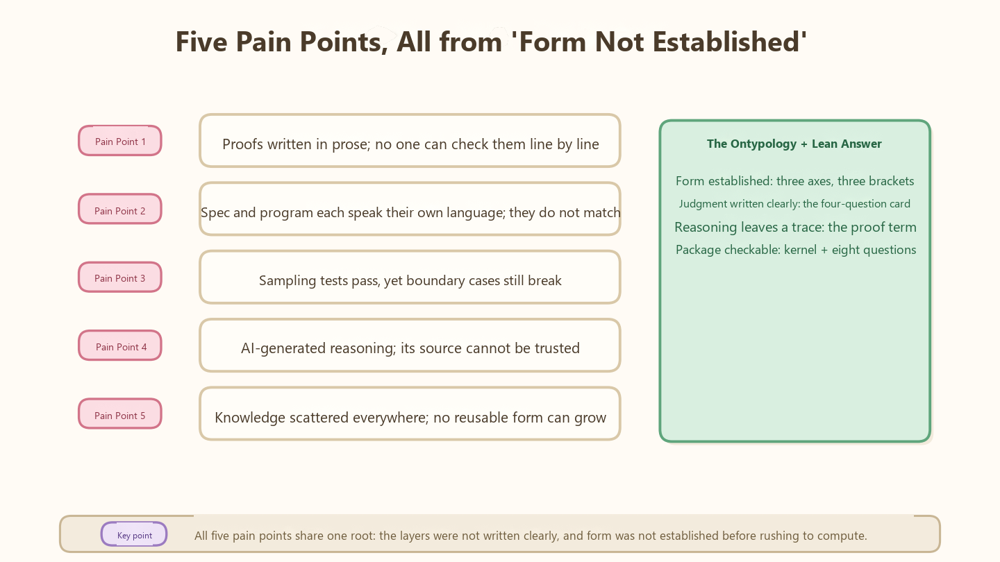

Figure 1-1 Five pain points, with one common root: the Type was not established

Ontypology's answer to these pain points is to establish the form first: three axes and three brackets make "what it is" clear; the four function questions make "how it is done" clear; three-layer judgment makes "whether it counts" clear. Lean's answer is to mechanize acceptance: the kernel checks every proof term item by item — pass is pass, fail is fail. Only together do the two sides supply the last piece: "reviewable."

| **Pain point** | **How Ontypology supplements it** | **How Lean supplements it** |
| --- | --- | --- |
| Proofs written in prose | Six proof steps: every step written as a form | theorem + tactic: every step machine-checkable |
| Specification and program do not match | Four function questions: input Type, output Type | The signature is the specification: type checking |
| Sampling tests fail at the boundary | Three-layer judgment in universal form | Universal coverage by the kernel |
| AI reasoning cannot be trusted | Criterion + review trail | kernel acceptance; false proofs rejected |
| Knowledge does not grow forms | Type Library + four stages of library building | Mathlib as a shared function library |

### 1-2 Root, Trunk, Fruit: Three-Layer Positioning

Ontology asks "what is there," and is the root; Ontypology asks "what a Type is, how it is judged, how it operates," and is the trunk; Lean formal verification hands "reviewable accuracy" to the kernel for execution, and is the fruit. Each layer keeps its place: the root keeps the inventory of existence, the trunk keeps the operation of Types, and the fruit keeps the landing of acceptance.

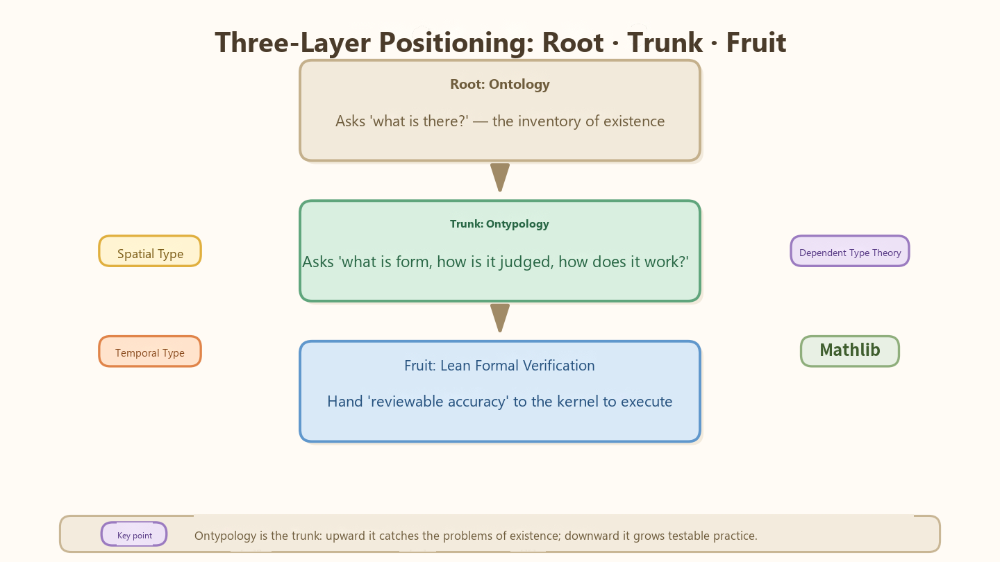

Figure 1-2 Root · trunk · fruit: three-layer positioning

### 1-3 One-Sentence Main Line: Form = Type

The whole book has only one main line: form = Type. Ontypology says "unit Type = Type set = { parts, (content), [category] }"; dependent type theory says "a type is composed of constructors, fields, and indices." The two sentences name the same cognitive act: write down an identifiable boundary. Once Lean enters, this main line upgrades from "written down" to "verified."

### 1-4 The Four Pillars: Relation, Method, Architecture, Plan

The relation part answers "what the two readings look like side by side"; the method part answers "how to use them accurately"; the architecture part answers "how to assemble the whole system"; the plan part answers "how people learn it and how organizations land it." The order of the four pillars never changes: understand first, then use accurately, then build steadily, and finally spread it.

> **Professional Column C1 — Lean: A Brief History and Version Genealogy**  
> In July 2013 Leonardo de Moura committed the first version of Lean; in June 2014 the official Lean 0.1 was released. Lean 3.0 arrived in January 2017 and was the first moderately stable release. Development of Lean 4 began in April 2018; in 2021 de Moura and Ullrich published the Lean 4 paper at CADE-28 (doi:10.1007/978-3-030-79876-5_37), a complete rewrite that compiles to C code and introduces hygienic macros; Lean 4.0 was officially released in September 2023.  
> In July 2023 the Lean FRO (Focused Research Organization) was founded under the nonprofit Convergent Research, with the mission of improving scalability, usability, documentation, and proof automation; its co-founders are de Moura and Sebastian Ullrich. In July 2025 Alex Gerko donated 10 million USD (5 million to the newly founded Mathlib Initiative and 5 million to the FRO); in July 2026 Amazon announced the largest single donation in the FRO's history. In 2025 Lean received the Skolem Award and the ACM SIGPLAN Programming Languages Software Award; in 2026 Mathlib received the Demailly Open Science Prize. The latest stable release is 4.35.0 (released 2026-10-12).  
> (Sources checked: lean-fro.org/about, the English Wikipedia entry for Lean, as of 2026-11-08; full sources in Appendix E.)  

## Part II — The Backbone at a Glance: Three Languages, One Table

This page is the panorama for impatient readers: the Ontypology toolbox on the left, the dependent type theory toolbox in the middle, and the state of Lean on the right. It does not retell the theory chapter by chapter — it only establishes the backbone.

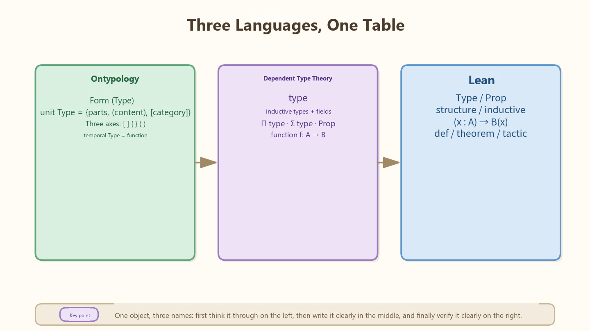

Figure 2-1 Three languages, one table

### 2-1 The Ontypology Toolbox: One Diagram Establishes the Backbone

The Ontypology backbone has six pieces: the cognition chain establishes "first the form, then the number"; three axes and three brackets establish the structure of a Type ([ ] attributes, { } composition, ( ) container); three-layer judgment establishes acceptance (J = J_C ∧ J_B ∧ J_T); the five operations establish the dynamics of a Type (⊕, remove, σ, ∩(T)/α, ι); the temporal Type function library establishes the operation of a Type (six function groups + the four-question function card); and the Accurate-Use Method establishes the rules of use (three supplements, six proof steps, eight questions).

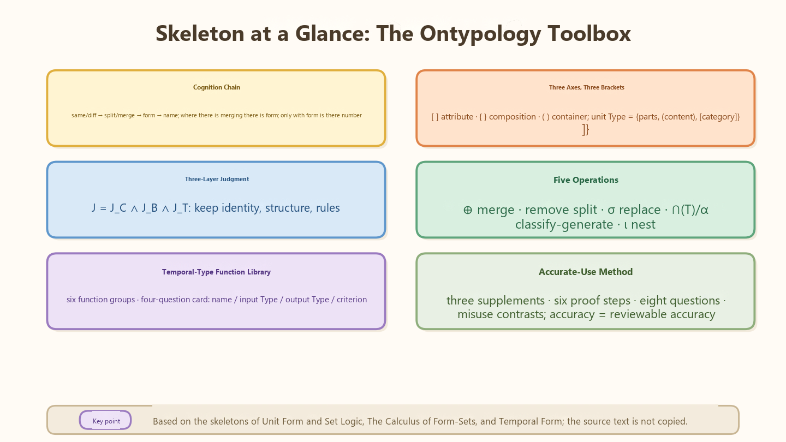

Figure 2-2 The Ontypology toolbox at a glance (the backbone, not a restatement)

| **Tool** | **In one sentence** | **Notation** |
| --- | --- | --- |
| Cognition chain | similarity and difference → split and merge → form → name; wherever there is a merge there is a form, and first the form, then the number | number = a sub-Type inside a Type, compared again |
| Three axes and three brackets | Three kinds of added value: attributes, composition, container | { parts, (content), [category] } |
| Three-layer judgment | Guard identity, structure, rules | J = J_C ∧ J_B ∧ J_T |
| Five operations | Take in a Type, return a Type | op: Type → Type |
| Four-question function card | Name, input Type, output Type, criterion | the criterion is the heart |
| Accurate-Use Method | Reviewable accuracy | three supplements + six steps + eight questions |

### 2-2 The Dependent Type Theory Toolbox: Types Depend on Values

The core of dependent type theory is one sentence: a type can depend on a value. The ordinary function type A → B has a fixed return type; the dependent function type Π(x:A) B(x) has a return type that follows the value of the parameter — the vector type Vec(A, n), whose length is n, is the classic example: n is not a type but a value, yet it determines the type.

Paired with the Π type is the Σ type: Σ(x:A) B(x) binds "a value of A" and "a value of B that depends on it" into a pair, corresponding to the existential quantifier ∃ in logic. The inductive type gives the growth rules of a form: every constructor is a way of combining parts, and every type automatically comes with a recursor. These three — Π, Σ, and inductive types — are the three great constructions of a form.

| **Logic side** | **Type side** | **Ontypology reading** |
| --- | --- | --- |
| Proposition | Type | Form |
| Proof | Term | Evidence for the criterion |
| Implication → | Function type A → B | Temporal Type: input a Type, output a Type |
| Conjunction ∧ | Product type A × B | ⊕ merged Type |
| Disjunction ∨ | Sum type A + B | Branch construction |
| Universal ∀ | Π type | [ ] attributes over all scales |
| Existential ∃ | Σ type | { } the pair of parts and content |

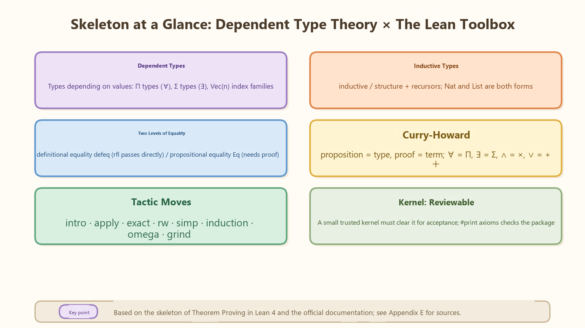

Figure 2-3 Dependent type theory × Lean toolbox at a glance

### 2-3 What Lean Is: A Brief History and the Present

Lean is a proof assistant and also a functional programming language, designed by Leonardo de Moura on the theoretical basis of the calculus of constructions plus inductive types. Its ten-year history is drawn below: 2013 first release, Lean 3.0 in 2017, the Lean 4 paper in 2021, version 4.0 and the FRO in 2023, the explosion of AI and large formalization projects in 2024–2025, and the move into industry verification in 2026.

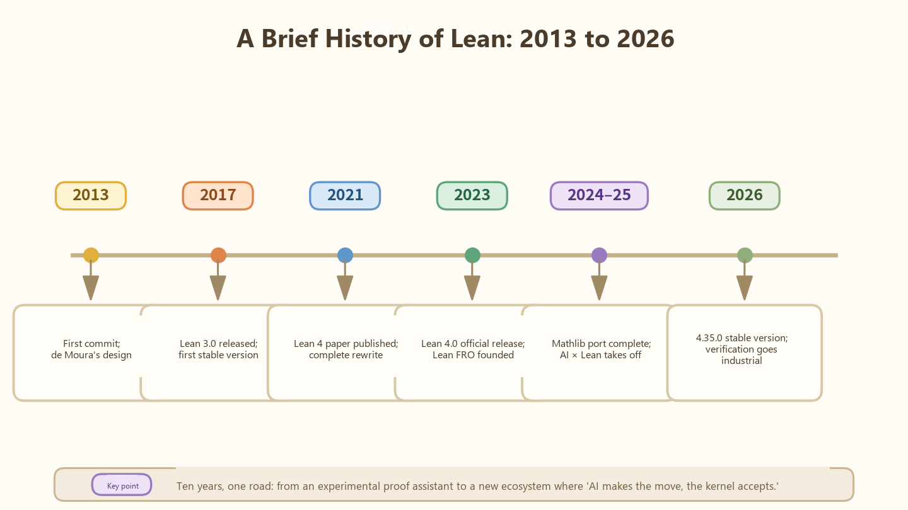

Figure 2-4 A brief history of Lean: 2013 to 2026

Some hard numbers for the present (verified 2026-11-08): the Mathlib mathematics library has 139,864 definitions, 293,257 theorems, and 772 contributors; the Mathlib Initiative was formally founded in September 2025; by May 2025 more than 50 university courses were teaching with Lean. These numbers have only one meaning: reviewable forms are accumulating at the scale of a library.

### 2-4 Master Table of the Ten Reading Propositions

Compressing the relation into ten propositions gives this booklet its foundation. The next two parts unpack them one by one; here is the panorama first.

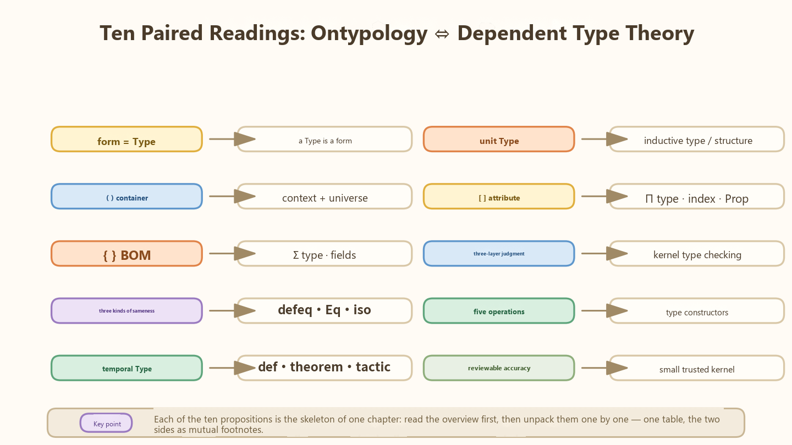

Figure 2-5 The ten reading propositions: Ontypology ⇔ dependent type theory

| **Proposition** | **Ontypology side** | **Dependent type theory / Lean side** |
| --- | --- | --- |
| I | form = Type | A type is a form; once written down it can be verified |
| II | unit Type = { parts, (content), [category] } | structure / inductive: the three roles of a field |
| III | ( ) container C = (id(C), S(C)) | context Γ + universe Type u |
| IV | [ ] attributes: dimension × scale | Π types and indices: the scale is written into the type |
| V | { } BOM + three remove levels | Σ types and field grading |
| VI | three-layer judgment J = J_C ∧ J_B ∧ J_T | kernel type checking |
| VII | three kinds of sameness ≡ / ⊂ | three levels of equality: defeq, Eq, iso |
| VIII | five operations op: Type → Type | type constructors and substitution |
| IX | temporal Type = function | def, theorem, tactic |
| X | accuracy = reviewable accuracy | the kernel as a small trusted core |

## Part III — Spatial Types × Dependent Type Theory: A Static Reading

The spatial Type is the "body" of a form: three axes, three brackets, three-layer judgment. Dependent type theory is the "grammar" of a form: three constructions, two levels of equality, one kernel. This chapter matches the two sides piece by piece — first the overview, then the details.

### 3-1 Three Axes Against Three Constructions

The [ ] attributes on the X axis ask "what this Type looks like," and match Π types and indices: a dimension is an index parameter, a scale is an index value. The { } composition on the Y axis asks "what this Type is made of," and matches Σ types and fields: parts are fields, and the three remove levels grade the fields. The ( ) container on the Z axis asks "where this Type is," and matches context and universes: id(C) is the type name, S(C) is the content.

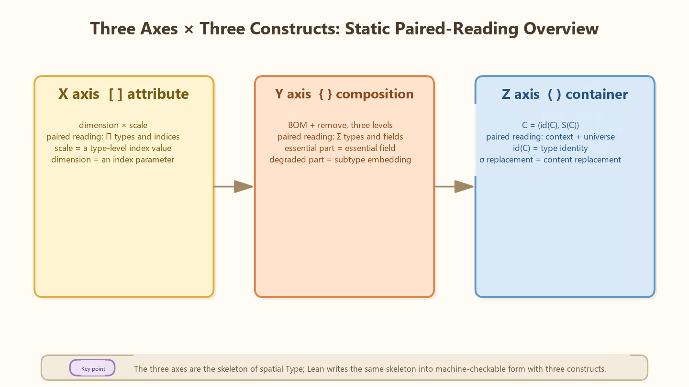

Figure 3-1 Three axes × three constructions: overview of the static reading

| **Axis** | **Brackets** | **Ontypology question** | **Dependent type theory counterpart** |
| --- | --- | --- | --- |
| X attribute axis | [ ] | Appearance: dimension × scale | Π types, index families, Prop |
| Y composition axis | { } | Parts: BOM + remove | Σ types, structure fields |
| Z container axis | ( ) | Identity: id(C) unchanged | context, universes, module |

### 3-2 [ ] Attributes ↔ Π Types and Indices: Scales Written into the Type

Ontypology says: an attribute is "a question that can be asked," and an attribute value is the actual answer to that question in a given situation — a dimension is the attribute, a scale is the attribute value. Dependent type theory writes this relation as an index family: a type B depends on an index a, written B(a); Vec(A, n) reads "the Type of A-vectors whose length scale is n."

The crucial upgrade is that a scale error is caught at the moment of writing. Feed a value of Vec(A, 3) to something expecting Vec(A, 2) and type checking simply fails — no longer "fill in the form wrongly and explode at run time," but "the forms do not match, so it cannot even be written down." Π(n:Nat) Vec(A, n) writes "for every scale" as a single form, which is exactly the universal reading of the [ ] attributes.

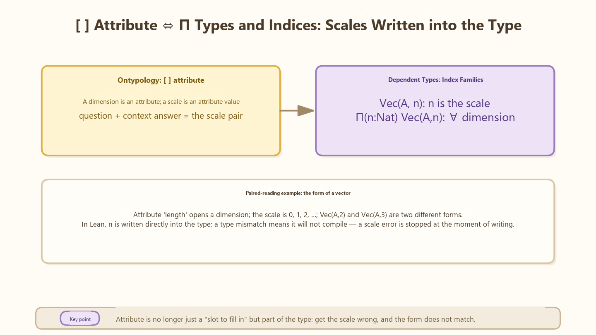

Figure 3-2 [ ] attributes ↔ Π types and indices

> def firstTwo (v : Vec Nat 2) : Nat := v[0] + v[1]  
> -- the length scale is part of the type: Vec Nat 2 ≠ Vec Nat 3  
> -- a wrong scale cannot even be written down  

The four steps of the spatial framework — distinguish similarity and difference, trigger abstraction, name the dimension, judge membership — here acquire a mechanical version: a comparison failure (type mismatch) forces abstraction (open an index parameter), names the dimension (write the index name), and judges membership (hang the value inside the Type at the corresponding scale).

### 3-3 { } BOM ↔ Σ Types and Fields: The Disassembly Criterion Enters the Type

Ontypology's BOM criterion is one question: "After it is taken apart, does it still recognize itself?" If yes, it belongs in the BOM; if not, it belongs in the attributes. The three remove levels split the answer three ways: essential part (identity is lost after removal, written remove(p,M) ≢ M), function-degraded part (the function is missing but identity remains, written ≡ M′ ⊂ M), and non-essential part (removal is imperceptible, written ≡ M).

The dependent type theory counterpart is very direct. Remove a required field of a structure and no value can be constructed — this is exactly the mechanical version of an "essential part": the type's constructor is identity itself. A degraded part corresponds to a subtype or an Option field: the value remains, the Type steps down one level. Σ(x:A) B(x) binds "a part" and "content that depends on the part" into a pair, which is precisely the typed writing of { parts, (content) }.

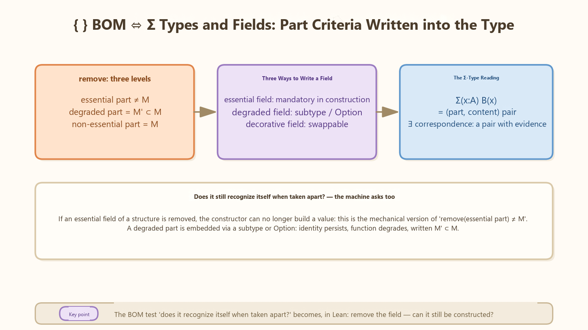

Figure 3-3 { } BOM ↔ Σ types and fields

| **Three remove levels** | **Ontypology notation** | **Lean counterpart** | **Reading of the criterion** |
| --- | --- | --- | --- |
| Essential part | remove(p,M) ≢ M | required constructor field | remove it and no value can be built |
| Function-degraded part | ≡ M′ ⊂ M | subtype / Option | identity survives, function degrades |
| Non-essential part | ≡ M | replaceable field | removal is imperceptible |

### 3-4 ( ) Containers ↔ Context and Universes: Identity Written into the Environment

A container is defined as "a set plus an identity that does not change as its elements change": C = (id(C), S(C)). The invariance axiom says: for all e1, e2 ∈ S(C), replacing e1 with e2 leaves id(C) unchanged — a cup holding water or coffee is still a cup.

Lean's context Γ is the living textbook of containers. (x : A) (h : P x) are the container's admission rules: only a value of the right type and a proof of the right proposition can enter this context. The universe Type u is the container's level: small forms live in Type, forms of forms live in Type 1, and the nesting of cups into bags and bags into boxes has a place in the universe hierarchy. module and namespace are naming containers: the name does not change with the content — the everyday face of id(C).

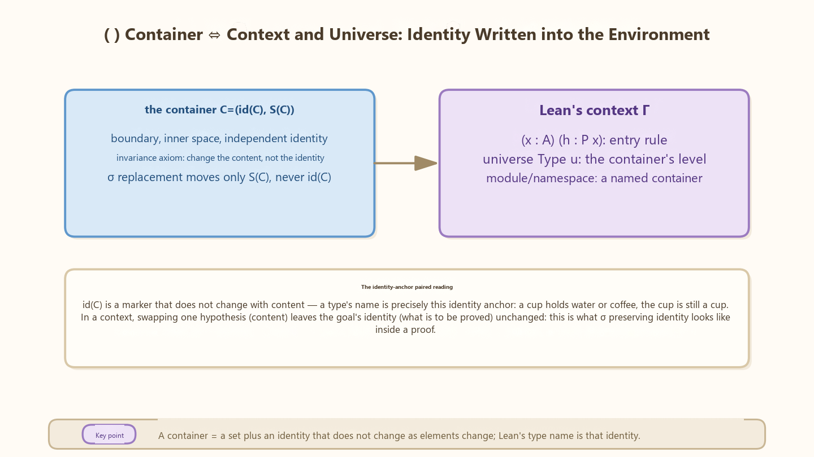

Figure 3-4 ( ) containers ↔ context and universes

The rule of σ-substitution appears here for the first time: σ touches only the content S(C), never id(C). Replacing assumption h1 with h2 inside a context leaves the goal unchanged — this is what "change the content, not the identity" looks like inside a proof. The next chapter shows its full reading against the substitution lemma.

### 3-5 Unit Types ↔ Inductive Types: A Coffee Cup Written as a structure

unit Type = Type set = { parts, (content), [category] }. Write the coffee cup as a Lean structure and the three brackets each take their place: the handle, base, lid, and body are part fields; the coffee is a content field; the colour is a category field. Three brackets, three kinds of added value — the difference between brackets is exactly the difference between layers.

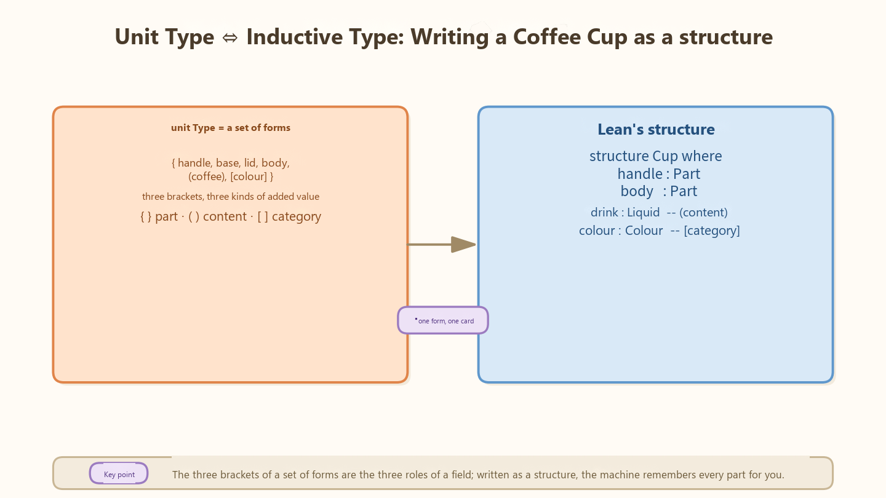

Figure 3-5 Unit Types ↔ inductive types

> structure Cup where  
> handle : Part -- { } component  
> body : Part -- { } component  
> drink : Liquid -- ( ) content, replaceable  
> colour : Colour -- [ ] category  
> inductive Liquid where  
> \| water \| coffee -- two scales of the content dimension  

The constructor of an inductive type corresponds to the "growth rules" of a form: each constructor gives one way of combining parts. The recursor corresponds to the "operation rules" of a form: to compute something out of the form, follow the recursor. This is precisely the typed version of "the number depends on the form" — only after the form List exists does the number length exist.

### 3-6 Three-Layer Judgment ↔ The kernel's Intake Funnel

The three-layer judgment of form logic asks three things: the container judgment asks "is identity independent of content?"; the BOM judgment asks "after disassembly, is it still the same?"; the abstraction judgment asks "does it pass the ∩(T) rules?" The three are conjoined: J(M) = J_C(M) ∧ J_B(M) ∧ J_T(M), and only when all three are true is "proved" written — look only at the container layer and a tablet is a phone; look only at the composition layer and a calculator is a phone; look only at the abstraction layer and a walkie-talkie is a phone.

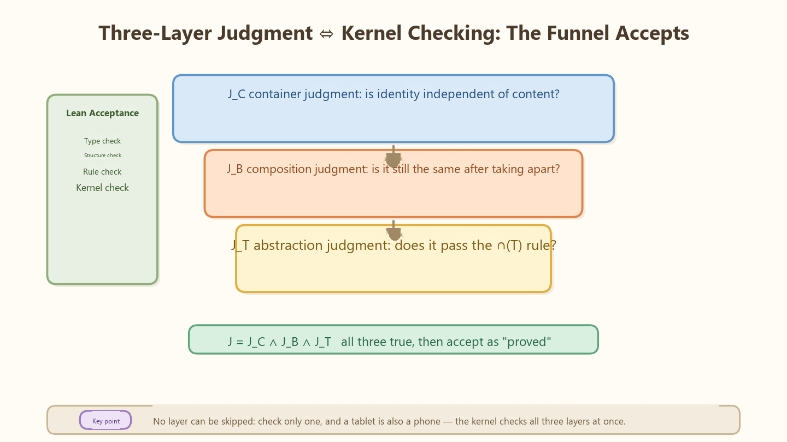

Figure 3-6 Three-layer judgment ↔ the kernel's intake funnel

Lean's kernel is the mechanical embodiment of this funnel: is the type right (the J_T rule check), is the structure complete (the J_B field check), is the identity right (the J_C type-identity check) — all in one pass. tactics may be flashy and AI may guess wildly, but the kernel never lets water through — this is the machine version of "not one of the three layers may be missing."

> **Key point: the Lean version of J = J_C ∧ J_B ∧ J_T**  
> J_C guards identity: the type name (id(C)) is unchanged — α-equivalence holds, universe levels match.  
> J_B guards structure: the constructor's fields are complete — every field must be given a value of the right type.  
> J_T guards rules: all of ∩(T) passes — type class resolution, Decidable decisions, contract proofs.  
> Only when all three are true does the kernel output "proved"; if one is missing, the submission is rejected.  

### 3-7 Three Kinds of Sameness ↔ defeq, Eq, iso: From Strict to Loose

Comparison of forms has three kinds of sameness, from strict to loose: id sameness (container layer, id(C) the same before and after σ), form sameness (composition layer, the BOM and dependency structure the same), and class sameness (abstraction layer, all ∩(T) criteria passed). The notations ≡, ≢, and ⊂ each keep their place and are never mixed.

Dependent type theory happens to have three levels of equality as well. Judgmental equality (defeq) is the strictest: after reduction the type checker treats the two as identical — (fun x => f x) a is the same as f a, 2+3 is the same as 5, and rfl passes directly. Propositional equality (Eq) is one level looser: (a+b)+c and a+(b+c) are not judgmentally identical, and a proof must be supplied to make them equal. Isomorphism (iso) is the loosest: two forms whose structures match and which can be moved into each other — this is class sameness.

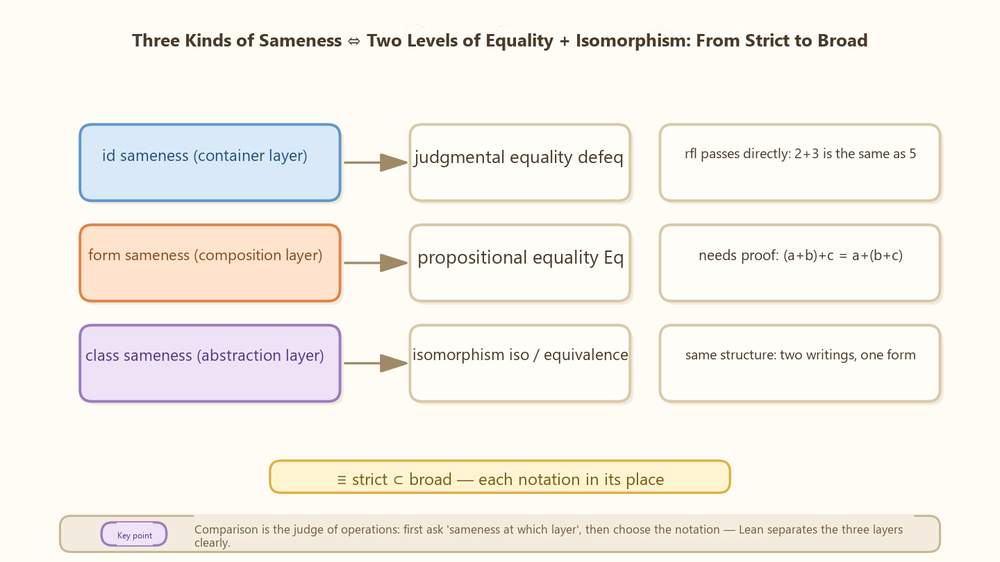

Figure 3-7 Three kinds of sameness ↔ two levels of equality + isomorphism

| **Ontypology** | **Notation** | **Lean counterpart** | **How it is verified** |
| --- | --- | --- | --- |
| id sameness (container layer) | ≡ (strict) | judgmental equality, defeq | rfl passes directly |
| form sameness (composition layer) | ≡ (composition) | propositional equality, Eq | supply a proof: induction / calc |
| class sameness (abstraction layer) | ⊂ (loose) | isomorphism, iso / equivalence | supply a bijection |

The principle that "comparison is the judge of operations" grows a new use here: before writing "equal," ask yourself which layer of sameness this is — ask the layer correctly and the notation will not be mixed, and Lean's error messages will suddenly become readable.

### 3-8 Five Operations × Type Construction: Move One Layer at a Time

The syntactic rule of the five operations is: ⊕ and remove touch only the parts inside { }; σ touches only the content inside ( ); ∩(T) asks only about the categories inside [ ] — "move one layer at a time" is the sole key to compound derivations. Type constructors obey the same discipline: product types move structure, substitution moves content, type classes move categories.

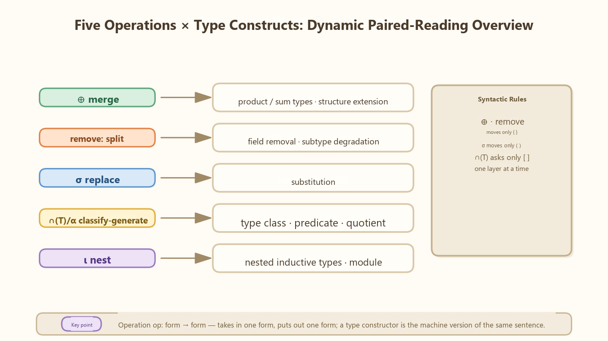

Figure 3-8 Five operations × type construction: overview

#### σ-Substitution ↔ substitution: the identity-preserving theorem

σ's identity-preserving theorem states id(σ(C)) = id(C): change the content, not the identity. The substitution lemma of dependent type theory is the typed version of the same theorem: substitute a term for a term, the type follows and the structure keeps its shape; the capture-avoiding rule guarantees that "variables are not caught by mistake" — this is the other face of "σ cannot be exchanged across layers": changing a container's name is not the same as changing its content.

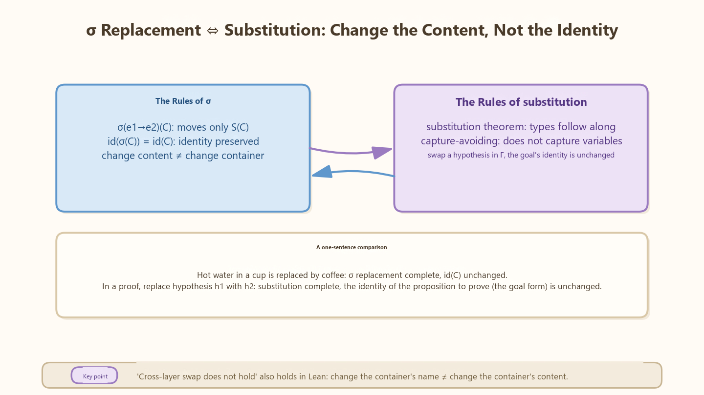

Figure 3-9 σ-substitution ↔ substitution

#### ⊕ Merged Type ↔ structure extension: both sides prove associativity

The associativity of ⊕, (A⊕B)⊕C ≡ A⊕(B⊕C) (which holds when the dependency structures are the same), has a familiar face in Lean: add_assoc. Associativity of addition on Nat is not an axiom but a theorem — proved step by step from the inductive type and its recursor. "Wherever there is a merge there is a form" has a counterpart too: a ++ b creates a new List form, and "number = a sub-Type inside a Type, compared again" appears in the theorem length_append: the number of a merged Type is the sum of the counts of the sub-Types on its two sides.

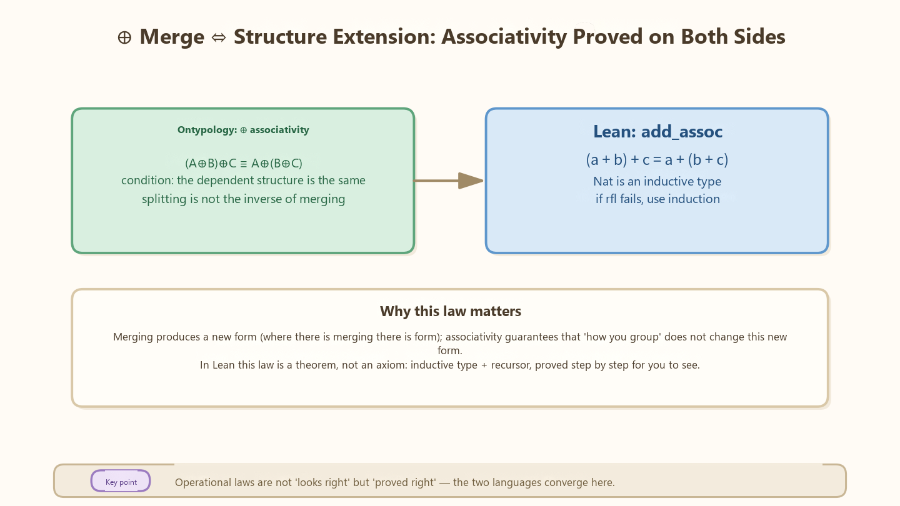

Figure 3-10 ⊕ merged Type ↔ structure extension

#### ∩(T) and α ↔ type class: the filter grows categories

An abstract category T = (F(T), ∩(T)) is "a feature set plus an intersection criterion"; α-abstraction extracts common features from a group of concrete forms. Lean's type class is the same act: class DecidableEq(A) is a category card, and an instance is evidence that "the criterion is executable"; instance resolution sends the object through the ∩(T) filter — f1, f2, fn must all pass before it is admitted into [T].

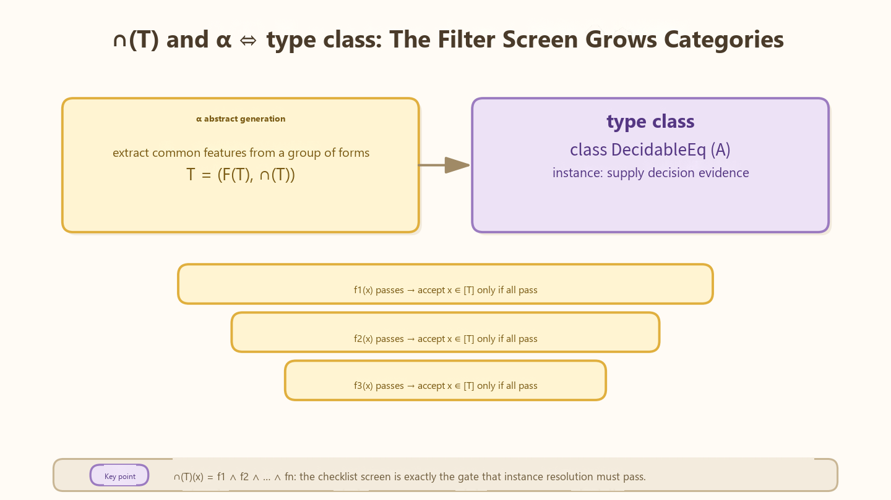

Figure 3-11 ∩(T) and α ↔ type class

> **Professional Column C3 — The Deep Water of Judgmental and Propositional Equality**  
> Judgmental equality is decided by the type checker through reduction (β, δ, ι): beta reduction, definition unfolding, recursor computation — if the two terms reduce as far as they can go and are still the same, they are judgmentally equal. That is why 2 + 3 = 5 passes with rfl: both sides reduce to 5. In Lean a def is semireducible: it is not unfolded by default, only when necessary, so proofs do not blow up at every step.  
> Propositional equality is the inductive family Eq in Prop: rfl is the constructor Eq.refl, substitution goes through Eq.subst and ▸, and chained reasoning goes through calc. The division of labour is: judgmental equality handles "how the machine recognizes," propositional equality handles "how a person proves." The conv mode (conversion tactic) lets you walk between subterms on the two sides of an equation, rewriting one step at a time.  
> Three extensionality axioms bring the two levels closer: propositional extensionality propext ((a ↔ b) → a = b), function extensionality (derived from the quotient construction), and the axiom of choice Classical.choice. Theorems proved with them are honestly listed by #print axioms — visible at acceptance time.  

> **Professional Column C4 — The Three Axioms and "Honest" Acceptance**  
> The Lean standard library carries three axioms: propext (propositional extensionality), Quot.sound (soundness of quotient types), and Classical.choice (the axiom of choice). Together they derive the law of excluded middle — this is the ticket into classical mathematics, and also the price of honesty: if you use them, list them.  
> The community acceptance list guards four things: the code is in a properly formatted repository, lake build passes completely, the main theorem is actually compiled, and #print axioms shows only the three axioms or a subset. Seeing sorryAx (an unfinished proof) or a custom axiom means rejection. Two events in 2026 supplied the final lesson: AI specifically hunted for Lean bugs and fixed several; a claimed disproof of the Collatz conjecture was later shown to depend on a Lean bug, and after the fix the proof was invalid — the kernel is the last line of defence, and the line itself must be maintained. In September 2026 the Lean FRO released con-leche: an external checker that proves Lean's own consistency in Lean.  
> (Sources checked: Theorem Proving in Lean 4, chapter 12; leanprover-community.github.io/did_you_prove_it.html; English Wikipedia; as of 2026-11-08.)  

### 3-9 Exercises for This Part

> **Exercises E01–E05 (answers in Appendix C)**  
>
> E01 Using the idea of "scales written into the type," explain why "feeding a value of Vec Nat 3 to Vec Nat 2" cannot be written at all in Lean. Which rule of the [ ] attributes does this correspond to?  
>
> E02 Write "the cup's lid is a function-degraded part" as a Lean field choice: should it be a required field, an Option, or a subtype? Explain your remove criterion.  
>
> E03 Decide which level of sameness each pair belongs to (id sameness / form sameness / class sameness): (a) 2+3 and 5; (b) (a+b)+c and a+(b+c); (c) a coffee cup before and after changing the lid colour.  
>
> E04 Why is add_assoc the Lean version of "⊕ associativity"? What is the "same dependency structure" condition on each side?  
>
> E05 What does seeing sorryAx in #print axioms mean? According to the acceptance list, can such a proof enter the library?  

## Part IV — Temporal Types × Lean: A Dynamic Reading

The spatial Type is the body; the temporal Type is the use. Temporal Type = verb = function = method = move = service = approach — eight names for the same thing: take in a Type, return a Type. In the world of Lean, this sentence is embodied by def, theorem, and tactic.

### 4-1 Temporal Type = Function ↔ def, theorem

The temporal Type depends on the spatial Type: a function does not operate in a vacuum; it takes in a Type and produces a Type. The Ontypology writing of selling a ticket is "input the Type of a request → output the Type of a ticket"; the Lean writing is def sell (r : Request) : Ticket. Both worlds share the same syntactic intuition: first the form (parameter type and return type), then motion.

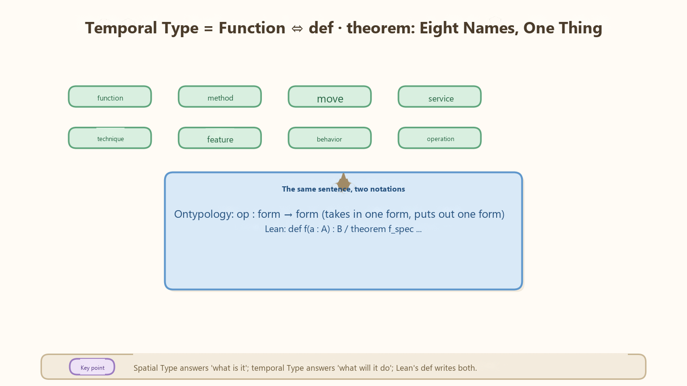

Figure 4-1 Temporal Type = function ↔ def, theorem

A theorem is a special species of function: the output Type is "evidence for a criterion." More precisely, a theorem's type is a proposition and its term is a proof — Curry–Howard writes "what it does" and "whether it is right" into one syntax. That is why Ontypology insists that "the criterion is the heart of the four questions": a function without a criterion is only a description; a function with a criterion can be accepted.

### 4-2 op: Type → Type ↔ Type Constructors

Every expression is a mapping from Type to Type: op: Type → Type. This sentence has two readings. The first is a function on values: f : A → B. The second is a function on Types: type constructors such as List, Option, and Vec take in a Type and return a new Type — the everyday face of Type → Type.

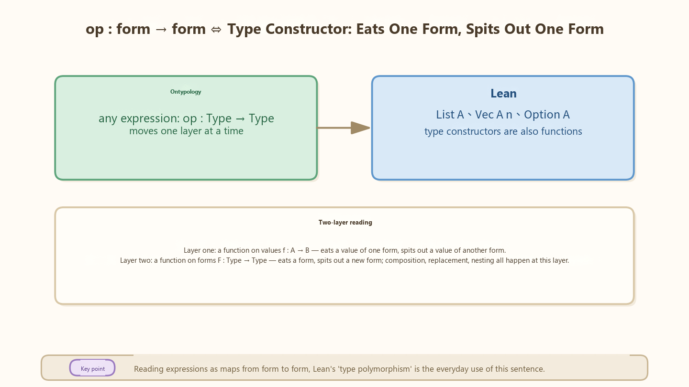

Figure 4-2 op: Type → Type ↔ type constructors

The division between the two readings is another way of saying "move one layer at a time": a function on values works at the content layer (σ level), a function on Types works at the structure layer (⊕, ι level). Flatten the layers and op loses its meaning — this warning from the original work shows up every day in Lean's type-error messages.

### 4-3 The Four-Question Card ↔ Signature + Contract

The four-question function card asks four things: name (what is this function called), input Type (which Type does it act on), output Type (what Type does it produce), and criterion (how is success counted). A complete Lean function is exactly two writings of the same card: the name is the name of the def, the input Type is the parameter type, the output Type is the return type, and the criterion is the theorem attached beside the function — the contract (spec).

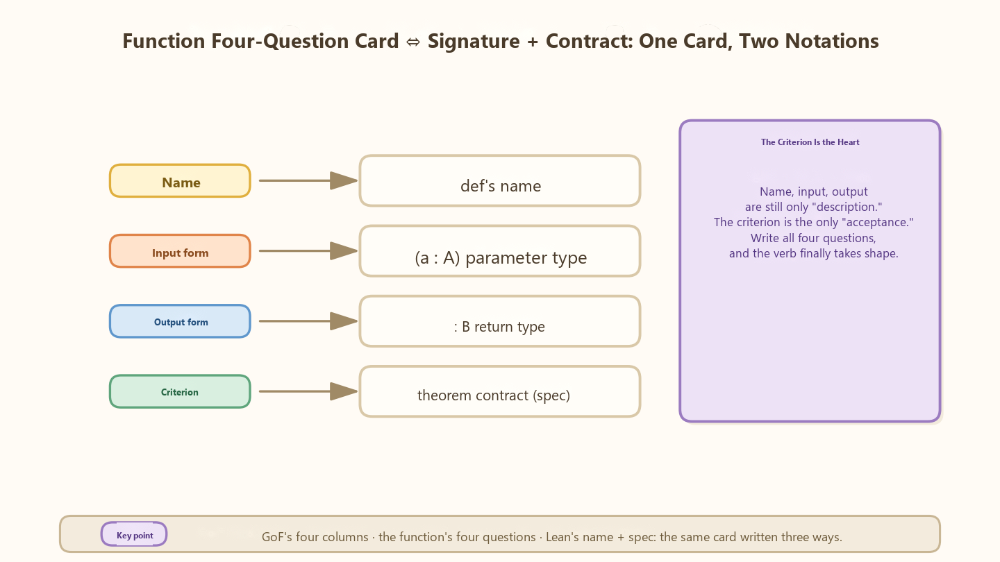

Figure 4-3 The four-question card ↔ signature + contract

| **Four questions** | **How to write the card** | **How to write it in Lean** | **Checkpoint** |
| --- | --- | --- | --- |
| Name | What is this function called | the name of the def | everyone recognizes the name |
| Input Type | Which Type does it act on | (a : A) | recognizable and handover-able |
| Output Type | What Type does it produce | : B | identifiable and acceptable |
| Criterion | How is success counted | a theorem contract | can be ticked sentence by sentence |

"Only when the four questions are complete does a verb formally take shape" — in Lean this sentence is literal: with the four questions incomplete the function can still compile (when the criterion is absent), but it is only a description, not an acceptable form.

### 4-4 Six Function Groups ↔ Mathlib and the tactic Ecosystem

The temporal Type function library gathers fourteen functions into six groups: cognition and extraction, generation and application, problem solving and creation, reasoning and thinking, growth and maintenance, and exploration. Match these six groups to the Lean ecosystem and you find that Mathlib has grown almost exactly along the same map.

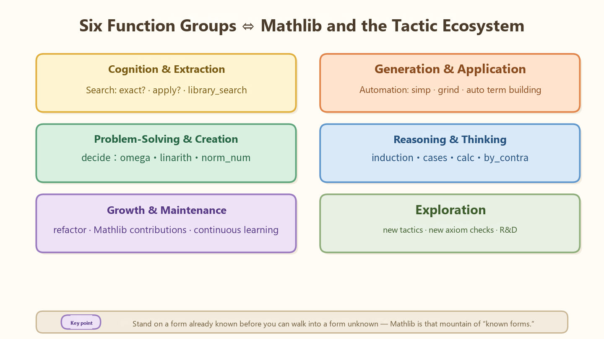

Figure 4-4 Six function groups ↔ Mathlib and the tactic ecosystem

| **Function group** | **Ontypology reading** | **Lean ecosystem counterpart** |
| --- | --- | --- |
| Cognition and extraction | function search, design search and extraction, design patterns | exact? / apply? / library_search searching theorems |
| Generation and application | logic generation, function generation and application | simp rule sets, grind automatic reasoning, macro generation |
| Problem solving and creation | problem solving, analysis, design | omega / linarith / norm_num decision procedures |
| Reasoning and thinking | five reasoning families, thinking methods | induction / cases / calc / by_contra |
| Growth and maintenance | continuous learning, refactoring and recombination, self-evolution | refactor, Mathlib contributions, version migration |
| Exploration | R&D and exploration | new tactic development, new axiom checking |

"Stand on a known Type before walking into an unknown one" — the reason for ordering the function library this way is exactly the reason Mathlib exists: 290,000 theorems are 290,000 "known Types"; search, align, apply, and then shelve the new proof again.

### 4-5 The tactic Board and Routing

A tactic is a "move" of the temporal Type: every move has an input Type (the current goal), an output Type (the simplified goal or a proof), and a criterion (does the kernel pass it). Eight basic moves cover ninety percent of introductory situations: intro welcomes the premises in; exact and apply give the proof directly or align with a theorem; rw rewrites by an equality; simp simplifies to convergence; induction and cases perform induction and case splits; omega, linarith, and norm_num hand over to arithmetic decision procedures; grind is the new generation of SMT-style automatic reasoning.

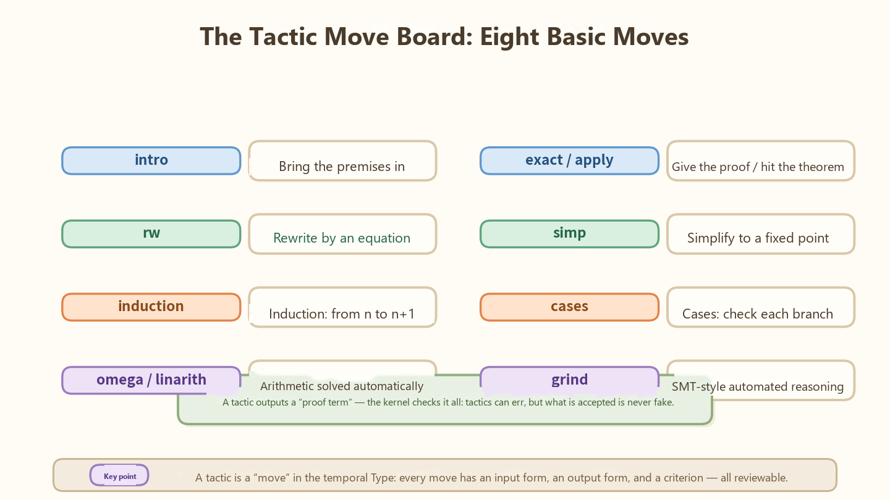

Figure 4-5 The tactic board: the eight basic moves

The discipline for using the board is "ask the layer before asking the move": first ask which layer of sameness you need to prove, then choose the move. If judgmental equality already passes, rfl finishes; if there is structure to split, induction or cases; the rest goes to automation. Reverse the order and even a familiar tactic takes the long way round. The complete routing decision tree is in Part V.

### 4-6 Types and Functions Grow Each Other: The Mathlib Loop

The deep proposition of the temporal Type is that "Types and functions grow each other": new Types grow new functions, and new functions produce new Types. Mathlib is the largest live scene of this cycle — search Types and theorems, align the input Type, apply, shelf the produced Type again: four steps per cycle.

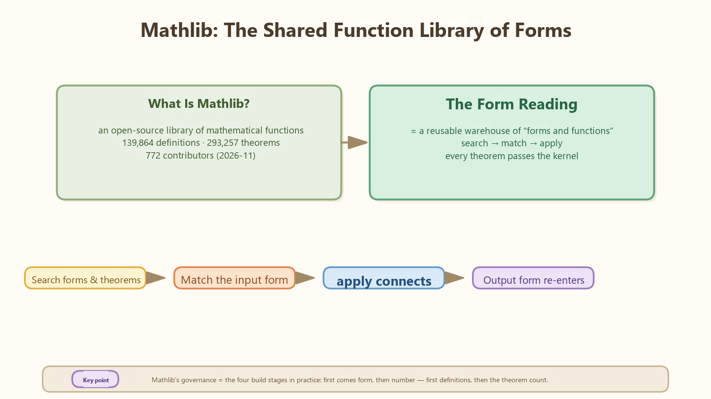

Figure 4-6 Mathlib: a shared library of Types

> **Professional Column C5 — The Mathlib Ecosystem and Governance**  
> Mathlib began as mathlib3 in July 2017; the mathlib4 repository was created in May 2021, and the port from Lean 3 to 4 was completed in July 2023. The official statistics page on 2026-11-08 gives 139,864 definitions, 293,257 theorems, and 772 contributors. The Mathlib Initiative was founded in September 2025 to promote the sustainable operation of the library as an independent undertaking.  
> Governance focuses not on "collecting a lot" but on "collecting accurately": the statements of famous theorems (including versions of Fermat's Last Theorem and the Riemann Hypothesis) must be reviewed by maintainers as correct translations — guarding against the "statement ≠ proof" gap: naming something TheRiemannHypothesis while it denotes a different proposition is not hard, and the machine is not responsible for meaning; people are. This is one link of Ontypology's "name": a form must have a name, and the name must match reality.  
> (Sources checked: mathlib.org/mathlib_stats.html, leanprover-community.github.io, as of 2026-11-08.)  

### 4-7 Exercises for This Part

> **Exercises E06–E08 (answers in Appendix C)**  
>
> E06 Write "a taxi carrying a passenger: input the Type of a passenger, output the Type of a receipt" as a four-question function card, and give its Lean signature and contract (criterion), one line each.  
>
> E07 Why are List, Option, and Vec "Type versions" of the temporal Type? What is the layer difference between them and f : A → B?  
>
> E08 Given the goal (a + b) + c = a + (b + c), use the discipline "ask the layer before asking the move" to order your moves and explain your reasoning.  

## Part V — Using It Accurately: Reviewable Accuracy

Accuracy has only one definition: reviewable accuracy — the reader can tick off your reasoning sentence by sentence and reproduce it. Lean upgrades this definition from a virtue to a mechanism: the kernel is that automatic tick-off pen. This chapter installs Ontypology's Accurate-Use Method completely into the Lean workflow.

### 5-1 Body–Use–Accuracy × Lean

The three layers Body–Use–Accuracy are the overall architecture of the Accurate-Use Method: Body is the form (established by structure / inductive), Use is the function (written by def / tactic), and Accuracy is the criterion (verified to the end by theorem + kernel). Each layer has its own way of failing: if the Body is not established, the Use goes crooked; if the Use is not written clearly, Accuracy falls empty; if Accuracy is not executed, everything before it was wasted.

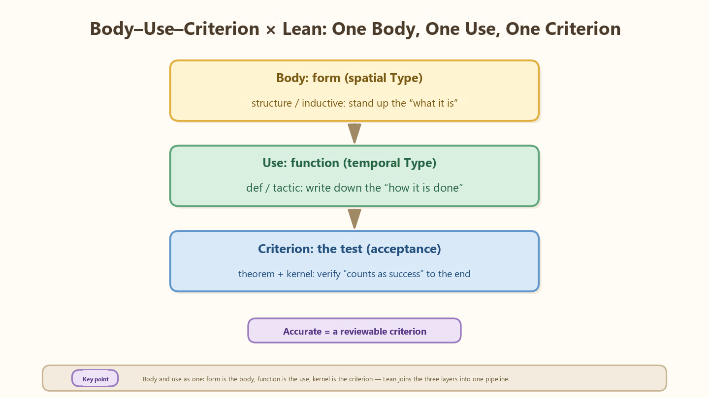

Figure 5-1 Body–Use–Accuracy × Lean

### 5-2 Three Supplements: Fill the Gaps Until It Is Clear

If the criterion is unclear, supplement with [ ]; if the input Type cannot be identified, supplement with ( ); if the parts of the output Type are unclear, supplement with { }. Lean's supplements are very concrete: [ ] adds rules, using type classes and Decidable to make the criterion executable; ( ) adds identity, using named types and context binding to pin down "what this is"; { } adds structure, using structure and a field list to enumerate every part.

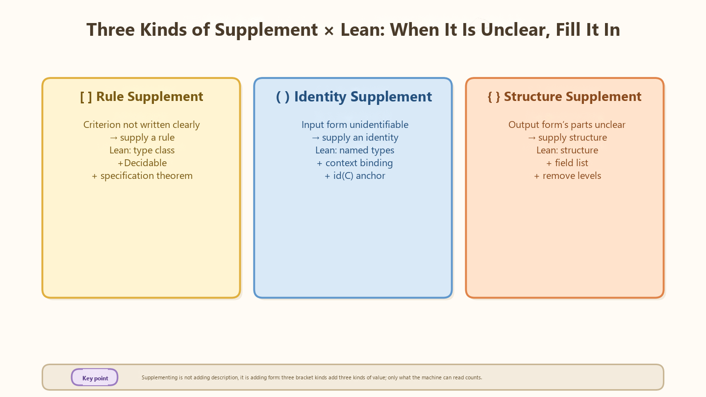

Figure 5-2 Three supplements × Lean

| **Supplement** | **When to supplement** | **How Lean supplements it** | **Check after supplementing** |
| --- | --- | --- | --- |
| [ ] rules | the criterion is unclear | type class + Decidable + contract theorem | the criterion is executable and tick-able |
| ( ) identity | the input Type cannot be identified | named type + context binding | id(C) anchored, name matches reality |
| { } structure | the parts of the output Type are unclear | structure + field list | BOM fully listed, remove graded |

### 5-3 The Six Proof Steps × the Lean Workflow

The six proof steps — identify the whole, describe the axes, write the Type set, choose the proposition, reason by criteria, three-layer check — correspond one-to-one with the Lean workflow. Step ⑤ may fail a hundred times; step ⑥ never lets water through: the kernel is the last line of defence and the only judge.

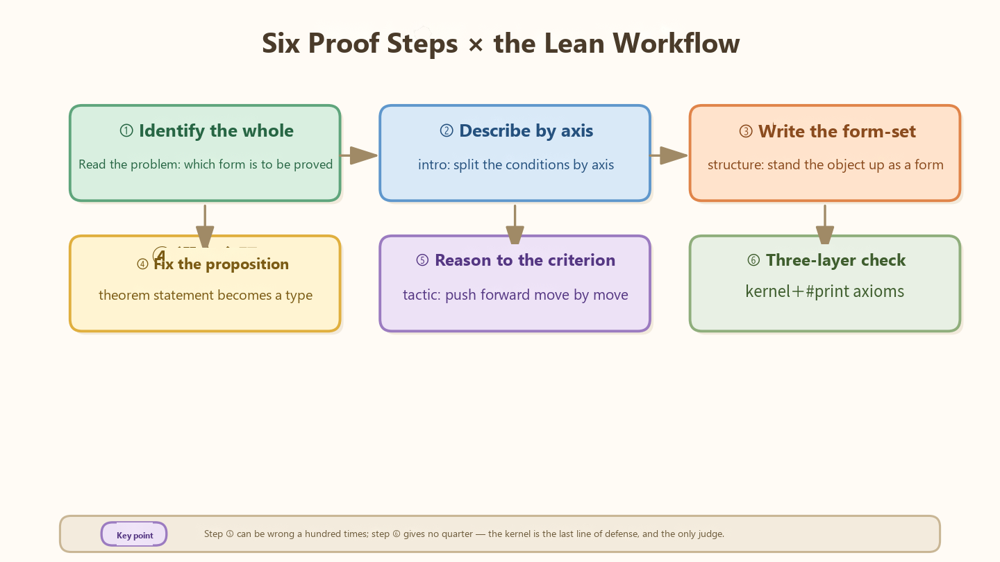

Figure 5-3 The six proof steps × the Lean workflow

| **Step** | **Ontypology action** | **Lean action** | **Deliverable** |
| --- | --- | --- | --- |
| ① Identify the whole | identify the form to be proved | read the goal: which layer of which form is being proved | target form |
| ② Describe the axes | split the conditions by axis | intro: welcome the hypotheses into the context | list of conditions |
| ③ Write the Type set | establish the object as a form | structure / inductive definition | form card |
| ④ Choose the proposition | write down the proposition | the theorem statement becomes a type | form to be proved |
| ⑤ Reason by criteria | reason criterion by criterion | reason move by move with tactics (may use sorry as a placeholder) | proof term |
| ⑥ Three-layer check | J_C ∧ J_B ∧ J_T | kernel + #print axioms | proved |

### 5-4 Full Demonstration: The Number of a Merged Type

The demonstration proposition is the one that best represents Ontypology: length (a ++ b) = length a + length b. "Wherever there is a merge there is a form" — a++b creates a new form; "number = a sub-Type inside a Type, compared again" — length is the count of sub-Types; the number of the merged Type equals the sum of the counts on its two sides, which is the reviewable version of "compared again."

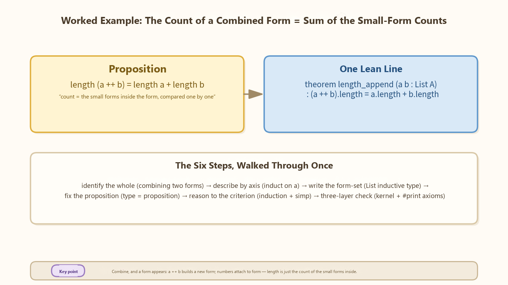

Figure 5-4 Demonstration: the number of a merged Type = the sum of sub-Type counts

Walk the six steps once. ① Identify the whole: what is to be proved is the counting rule after two forms are merged — a proposition at the composition layer. ② Describe the axes: induct on a, with b a fixed parameter. ③ Write the Type set: List is an inductive type with two constructors, nil and cons — the form is established first. ④ Choose the proposition: the statement of the theorem is itself a type. ⑤ Reason by criteria: the nil case passes directly by rfl; the cons case takes one induction step and simp finishes. ⑥ Three-layer check: the kernel passes and #print axioms is clean.

> theorem length_append (a b : List A) :  
> (a ++ b).length = a.length + b.length := by  
> induction a with  
> \| nil => rfl -- judgmental equality closes it  
> \| cons hd tl ih =>  
> simp [List.length, ih] -- rewrite with the induction hypothesis  
> -- #print axioms length_append ==> [propext, Quot.sound, ...]  

The acceptance mechanism deserves a diagram of its own: the theorem and tactics you write may be long and flashy, but the tactic's product is a proof term — the complete reasoning ledger; the kernel checks the proof term item by item, and only when all three acceptance checks pass is the result proved.

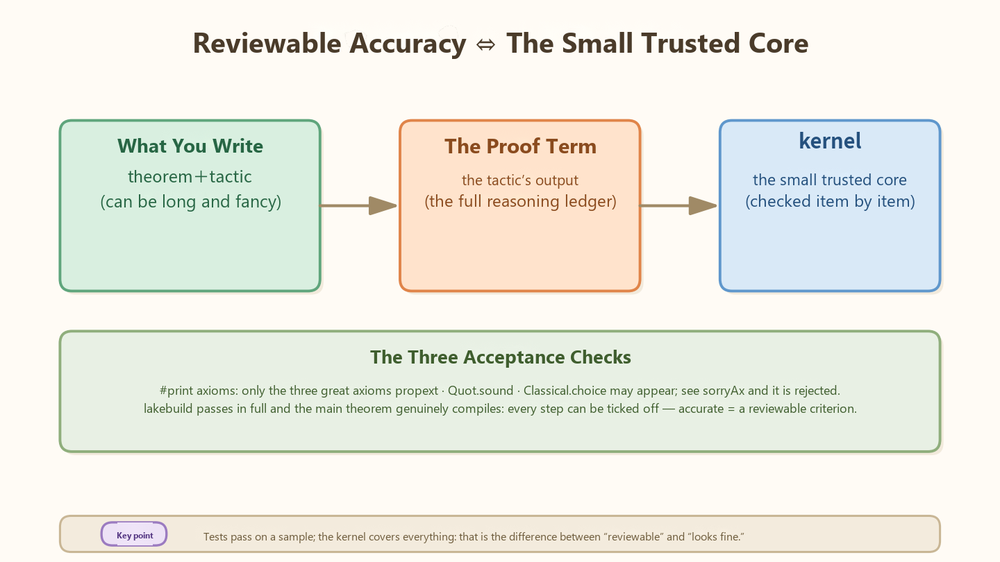

Figure 5-5 Reviewable accuracy ↔ a small trusted core

> **Three feedback points from the demonstration**  
> 1. induction is "when the large form is unclear, split it into small forms; the small form is isomorphic to the large one" — the mechanical version of the fractal pattern.  
> 2. rfl passes directly in the nil case: both sides are 0 — the sweetness of judgmental equality.  
> 3. #print axioms is the acceptance check: the process can be ticked sentence by sentence; the reader does not have to trust you, only run it once.  

### 5-5 Eight Questions × the Acceptance List

The eight questions compress the discipline of use into eight questions. The first four, before duty, handle description — is the name right, is the input Type recognizable, is the output Type deliverable, is the criterion tick-able? The last four, after duty, handle acceptance — is the chosen move right, has the three-layer check passed, is the process reviewable, has the output become a new form?

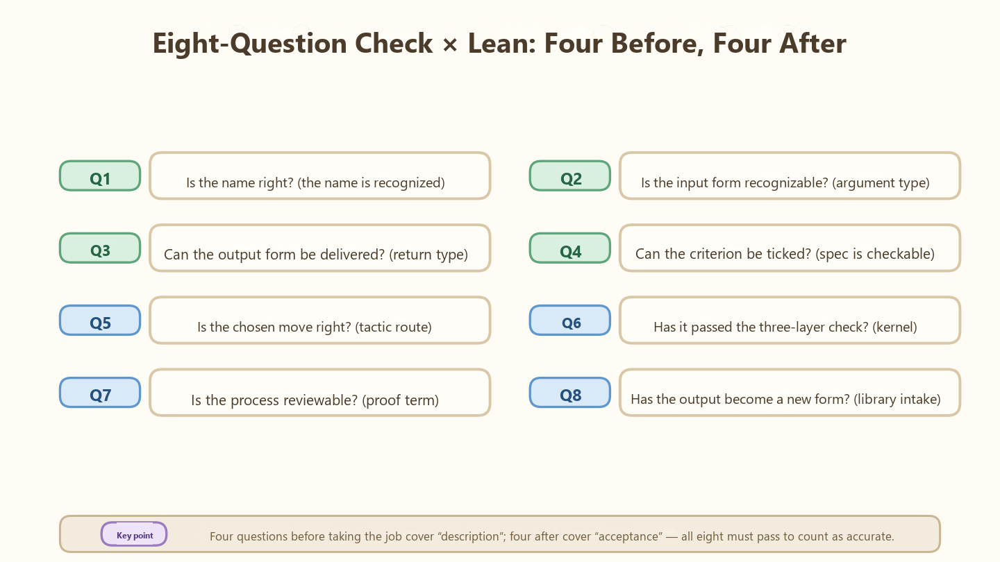

Figure 5-6 Eight questions × Lean

| **Eight questions** | **Corresponding Lean action** | **What to do if it fails** |
| --- | --- | --- |
| Is the name right? | the name matches the context | go back to the three supplements: ( ) identity |
| Is the input Type recognizable? | parameter types are explicit | ( ) supplement: named-type binding |
| Is the output Type deliverable? | the return type is acceptable | { } supplement: field list |
| Is the criterion tick-able? | the contract theorem is provable | [ ] supplement: write the criterion as a rule |
| Is the chosen move right? | walk the routing decision tree | change the move: ask the layer first |
| Has the three-layer check passed? | the kernel passes everything | reject and redo |
| Is the process reviewable? | the proof term is complete | fill the sorry gaps |
| Has the output become a new form? | the new theorem enters the library | write a form card, then shelve it |

### 5-6 Misuse Contrasts and the Routing Decision Tree

The sixteen misuse contrasts share a single root: the layers were not written clearly. The six most common misuses in the Lean world are drawn below: mixing up attributes and categories (treating a scale as a rule), treating content as a container (σ mistaken for ι), an unverifiable criterion (description without contract), doing only one of the three layers (concluding from a single layer), treating moves as a fixed checklist (memorizing tactics without asking about the input Type), and output that skips the three-layer check (compiled means proved).

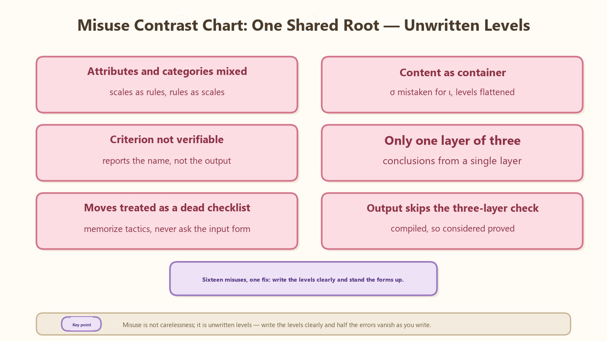

Figure 5-7 Contrasts of misuse

The routing decision tree draws "ask the layer before asking the move" as a diagram: given a proposition, first ask the layer, then ask whether judgmental equality can finish, then whether the structure can be split, and only then hand it to automation — every road leads to the kernel.

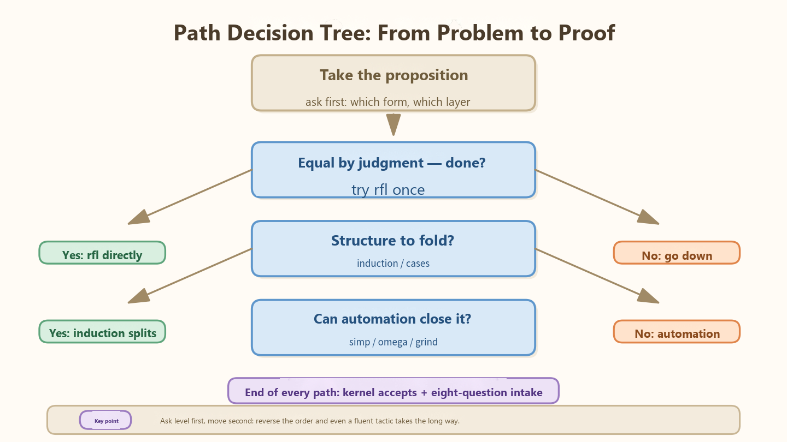

Figure 5-8 The routing decision tree: from problem to proof

> **Professional Column C6 — Evidence for AI × Lean Milestones**  
> In July 2024 Google DeepMind's AlphaProof reached silver-medal-level problem solving at the IMO using Lean + Mathlib. In July 2025 Harmonic's Aristotle won IMO gold with Lean, and ByteDance's Seed Prover took silver. The Equational Theories project, completed in December 2025 (initiated by Terence Tao, launched in September 2024), decided all 22,028,942 implication relations among 4,694 magma equational laws, combining human and automatic proofs, all verified in Lean (arXiv:2512.07087).  
> The Fermat's Last Theorem effort runs on two tracks: the Imperial project, launched in December 2023 and led by Kevin Buzzard, was still ongoing as of November 2026; in September 2026 Anthropic announced that its model agents completed a fully machine-checked Lean 4 formalization in 11 days — about 13 million lines of Lean code and about 30,000 intermediate theorems, following the Darmon–Diamond–Taylor 1995 formulation of Wiles's proof and using only the three standard axioms. Buzzard's compilation review confirmed its validity, while judging that it "adds nothing" mathematically and that the code cannot be merged into Mathlib — exactly Ontypology's view of criteria: machine-checked proof and mathematical value are two independent acceptance lines.  
> (Sources checked: teorth.github.io/equational_theories, arXiv:2512.07087, imperialcollegelondon.github.io/FLT, Anthropic's research announcement and Nature reporting, English Wikipedia, as of 2026-11-08.)  

### 5-7 Exercises for This Part

> **Exercises E09–E12 (answers in Appendix C)**  
>
> E09 A proof of some theorem compiles after a sorry placeholder is used. According to the "three acceptance checks," can such a proof enter the library? Which question blocks it?  
>
> E10 Give one example for each of the three supplements: an unclear criterion, an unidentifiable input Type, and unclear parts of the output Type — what should be supplemented in each case, and what is Lean's supplement?  
>
> E11 Explain "first the form, then the number" using the six steps of length_append: which step establishes the form, and which step produces the number?  
>
> E12 Why is "compiled means proved" a misuse? Which of the eight questions does it violate?  

## Part VI — Overall Architecture: Two Libraries, One Hub, One Loop × the Lean Ecosystem

The readings so far gather into one architecture: two libraries (the Type Library and the function library), one hub (three-layer judgment), and one loop (produced Types return to the library). This architecture is almost a mirror of the Lean ecosystem: structure lists match the Type Library, Mathlib and tactics match the function library, the kernel matches the hub, and the contribution cycle matches the loop.

### 6-1 Architecture Overview

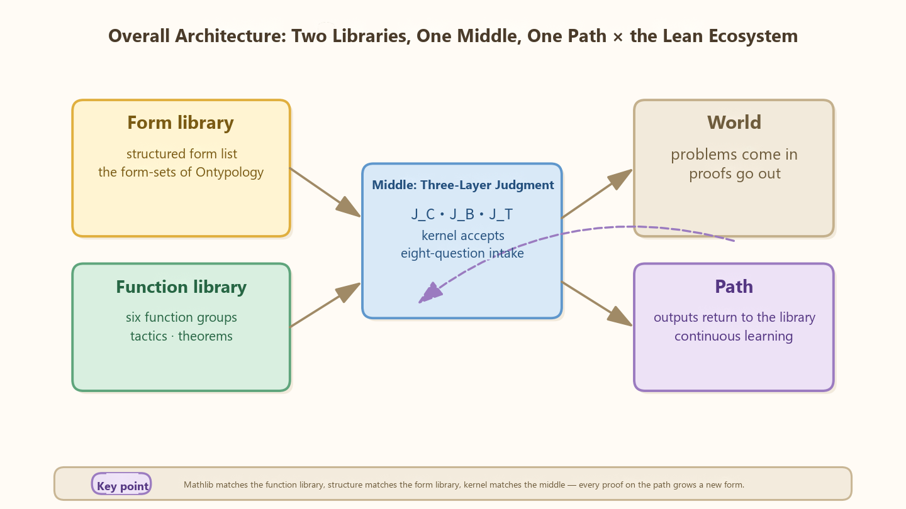

Figure 6-1 Two libraries, one hub, one loop × the Lean ecosystem

| **Component** | **Ontypology side** | **Lean side** | **Criterion it guards** |
| --- | --- | --- | --- |
| Type Library | Type sets, form cards, unit Type lists | structure / inductive definition files | J_C + J_B: identity and structure |
| Function library | six function groups, four-question cards | def / theorem / tactic / Mathlib | J_T: contracts are provable |
| Hub | three-layer judgment J = J_C ∧ J_B ∧ J_T | kernel + #print axioms | accepted only if everything passes |
| Loop | produced Types return to the library, continuous learning | contributions, refactor, re-shelving | the output becomes a new form |

### 6-2 The Type Library ↔ Mathlib: Four Stages of Library Building

The four stages of library building — collect specimens, establish forms, extract functions, share — are exactly the growth path of Mathlib from zero to 290,000 theorems, and the path for any team building its own Type Library. Collecting specimens means gathering concrete forms; establishing forms means writing structures and inductive types; extracting functions means packaging methods as four-question cards and tactics; sharing means writing documentation, passing acceptance, and contributing to the library.

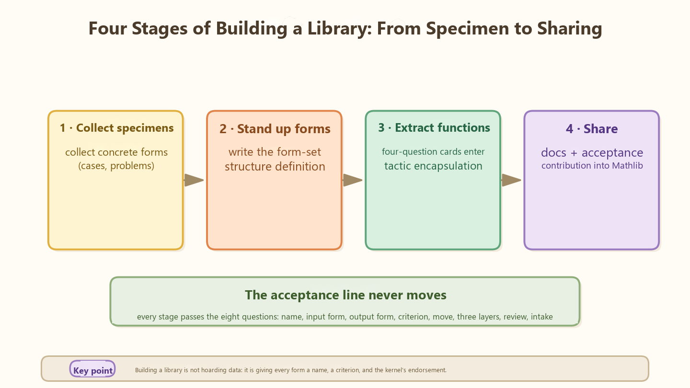

Figure 6-2 Four stages of library building: from specimen to sharing

The acceptance line of every stage is unchanged: only when all eight questions pass is it complete. The library-building version of "first the form, then the number" is: first the defined form, then the count of theorems — the reason Mathlib's statistics page always lists definitions and theorems side by side.

### 6-3 AI × Lean: AI Makes the Moves, the kernel Accepts

AI is a new generation of the temporal Type: it generates tactics and proof terms, searches, guesses, and tries and errs. But its output is always only a "candidate proof term" — whether it passes is up to the kernel. False proofs are rejected, true proofs enter the library; this loop keeps the authority to define "accuracy" with the criterion and the kernel, not with a generation probability.

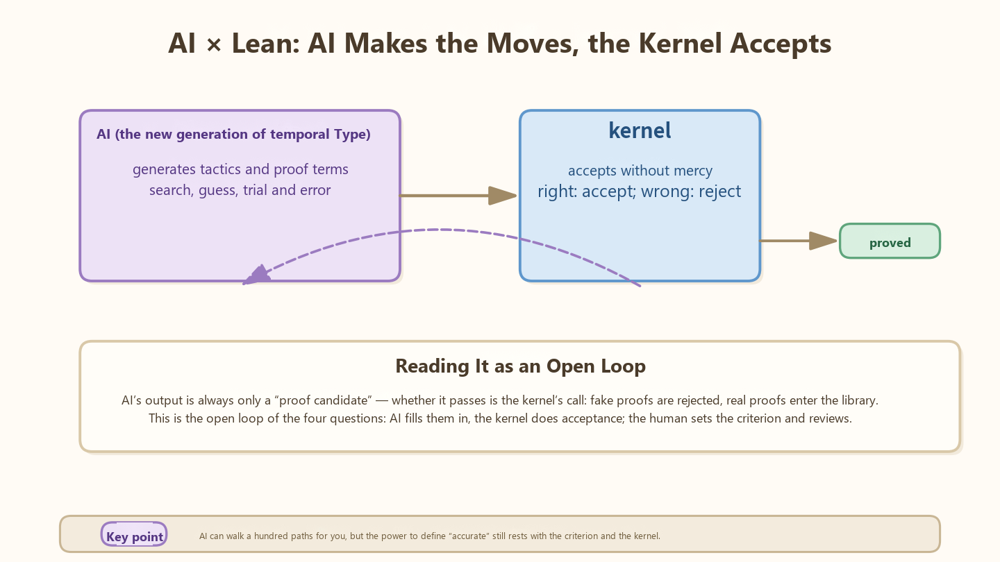

Figure 6-3 AI × Lean: AI makes the moves, the kernel accepts

This is exactly the acceptance view of the Mind AI vision: AI makes the moves of thought, forms and functions record the trace of thought, and three-layer judgment handles acceptance. People do not surrender the authority to define criteria; they hand only the labour of "ticking sentence by sentence" to the machine — accuracy is from then on not a virtue but a process.

### 6-4 The Milestone Gallery and Industry Adoption

The 2021 Liquid Tensor Experiment verified the main theorems of Scholze's condensed mathematics; in 2023 the proof of the PFR conjecture was formalized in three weeks by a large collaboration; 2024–2025 saw the AI × Lean explosion; in 2025 the Equational Theories project gathered 22.03 million implications; in 2026 came the machine-checked formalization of Fermat's Last Theorem and the landing of industry verification. The milestones have one thing in common: every proof passed kernel acceptance.

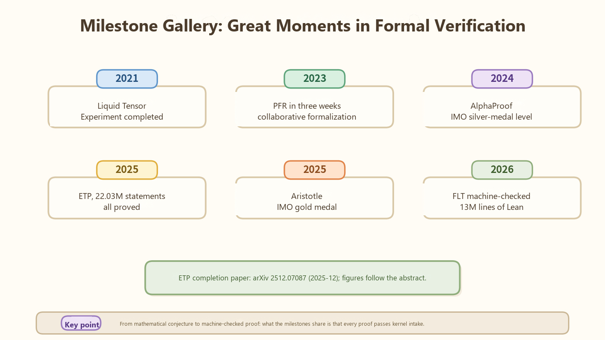

Figure 6-4 The milestone gallery

| **Case** | **Year** | **What was verified** | **Verified with** |
| --- | --- | --- | --- |
| Liquid Tensor Experiment | 2020–21 | main theorems of Scholze's condensed mathematics | Lean + Mathlib |
| PFR formalization | 2023 | the polynomial Freiman–Ruzsa conjecture | Lean, three-week collaboration |
| Equational Theories | 2024–25 | all 22,028,942 implications | Lean + automation |
| AWS Cedar | 2024 | specification and implementation of a permissions policy language | Lean verification |
| SampCert | 2025 | a library of differential-privacy primitives | Lean (PLDI 2025) |
| Microsoft SymCrypt | 2026 | production-grade cryptographic algorithms | Aeneas + Lean |

> **Professional Column C7 — Industry Coordinates of Formal Verification**  
> Lean is not the only proof assistant, but it is the fastest line by which "reviewable" reaches industry. The coordinate system has four reference points: seL4 — an L4 microkernel verified end to end in Isabelle/HOL, the founding case of microkernel verification; CompCert — an optimizing C compiler verified in Coq (renamed Rocq in 2024), the benchmark of compiler verification; AWS Cedar — specification and implementation verification of a permissions policy language (April 2024), bringing verification into cloud governance; Microsoft SymCrypt — production-grade cryptographic algorithms verified in Lean through the Aeneas toolchain (July 2026), bringing verification into cryptographic infrastructure.  
> Startups and research are equally busy: the bit-vector decision procedure bv_decide pushes Lean toward chip and hardware verification (the ACM award citation explicitly lists hardware verification); the NASA Formal Methods Symposium 2026 took Lean as its theme; verification startups &Truth (70 million USD seed round) and Pramaana Labs (27 million USD) were founded in succession. In one sentence: the cost of verification is falling, and "reviewable" is becoming the default requirement.  
> (Sources checked: sel4.systems, compcert.org, the AWS Open Source blog, lean-fro.org/about, as of 2026-11-08.)  

### 6-5 Exercises for This Part

> **Exercises E13 (answers in Appendix C)**  
>
> E13 Match each of the four components of "two libraries, one hub, one loop" in one sentence to a concrete mechanism in the Lean ecosystem, and explain why the kernel can only be the hub and cannot be the function library.  

## Part VII — The Complete Content Plan: Learn, Practice, Use, Teach, Build

The Plan part answers the last group of questions: how a person learns, practices to fluency, uses accurately, teaches others, and builds a library. The five steps form a cycle, not a staircase — every "build" lets the next "learn" stand on a higher form.

### 7-1 The Five-Step Cycle: Learn, Practice, Use, Teach, Build

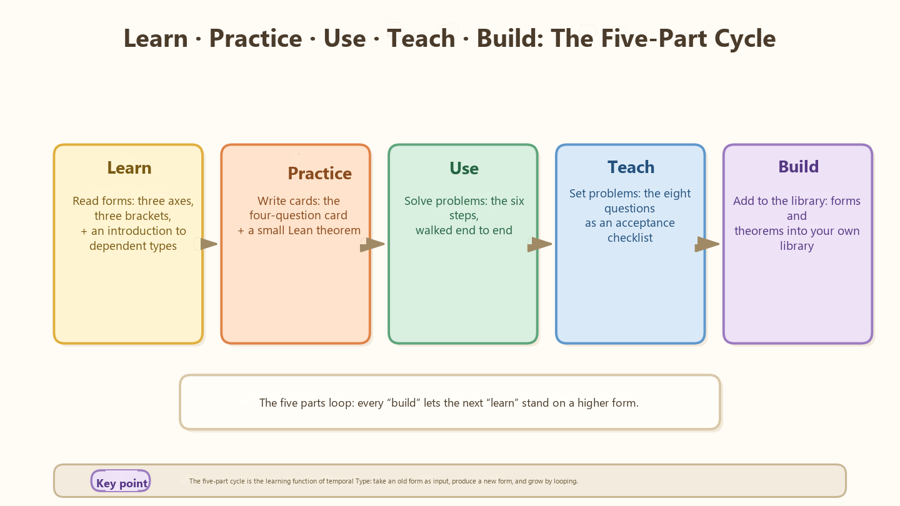

Figure 7-1 Learn, Practice, Use, Teach, Build: The Five-Step Cycle

| **Step** | **What it does** | **Deliverable** | **Acceptance** |
| --- | --- | --- | --- |
| Learn | read forms: three axes and three brackets + a primer on dependent types | form-card notes | the first four of the eight questions |
| Practice | write cards: the four-question card + small Lean theorems | theorem file | the kernel passes |
| Use | solve problems: walk the six steps end to end | problem-solving record | all eight questions pass |
| Teach | set problems: the eight questions as an acceptance checklist | problems and solutions | tick-able sentence by sentence |
| Build | shelve: forms and theorems enter the Type Library | library entries | the output becomes a new form |

### 7-2 The Eight-Week Route

The eight-week route turns the five steps into a syllabus: the first two weeks establish forms, weeks three and four fill in theory, week five practices the moves, week six walks the whole workflow, week seven accepts work, and week eight delivers a small project. Every weekly deliverable is a "reviewable" output — a four-question card, a theorem file, or a one-page six-step record.

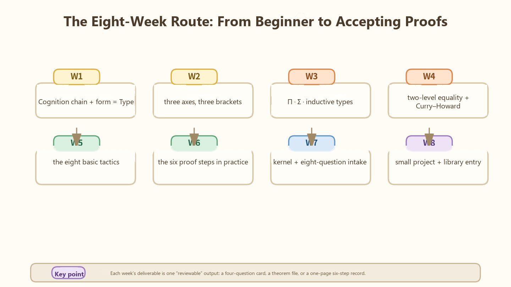

Figure 7-2 The Eight-Week Route: From Beginner to Acceptance

| **Week** | **Theme** | **Deliverable** | **Part** |
| --- | --- | --- | --- |
| W1 | cognition chain and form = Type | cognition-chain notes | Part I |
| W2 | three axes and three brackets | three form cards | Part III |
| W3 | Π, Σ, inductive types | three small Lean theorems | Part III |
| W4 | two-layer equality + Curry–Howard | three-layer equality comparison table | Part III |
| W5 | the eight tactic moves | move-board practice file | Part IV |
| W6 | hands-on six-step proof | full six-step record | Part V |
| W7 | kernel + eight-question acceptance | acceptance report | Part V |
| W8 | small project + shelving | five library entries | Part VI |

### 7-3 Four Kinds of Readers, Four Routes

| **Reader** | **Entry point** | **Priority** | **Focus of the eight weeks** |
| --- | --- | --- | --- |
| Beginner | reading guide + Part I | relation first | W1–W4, take it slowly |
| Mathematics background | Part II + Part III | theory first | W3–W4 in depth, a math project in W8 |
| Engineering background | Part IV + Part V | method first | W5–W7 heavier, a specification-verification project in W8 |
| Teacher | Part VII + Appendix B | plan first | design problems in parallel throughout |

### 7-4 The Stuck-Point Table and FAQ

| **Stuck point** | **Symptom** | **Which question locates it** | **Fix** |
| --- | --- | --- | --- |
| 1 | cannot read the goal | Q2 input form | back to 3-2: scales written into the type |
| 2 | tactics tried at random | Q5 the move chosen | back to 4-5: ask the layer before the move |
| 3 | proved it but unsure it is right | Q6 three-layer check | #print axioms acceptance |
| 4 | proof too long to read | Q7 reviewability | split into small forms: fractal pattern |
| 5 | want to use AI but dare not trust it | Q8 output enters the library | kernel acceptance + an audit trail |

**· FAQ 1: Do I need to know how to program? — Not in advance; the first four of the six steps are form work, and only the fifth touches the moves.**

**· FAQ 2: Mathlib is too large — where do I start? — Start with exact? and apply? search: treat Mathlib as a library to look things up in, not as a book to read.**

**· FAQ 3: Is it safe to use AI-generated proofs? — Yes, but they must pass the three acceptance checks: the kernel passes, the axioms are clean, and the statement has been reviewed by a person.**

### 7-5 Teaching Outreach and the Mind AI Vision

The order of teaching outreach is "form first, motion second": first use the cognition chain so that learners experience what a "form" is, then introduce dependent type syntax, and only then open Lean. The eight questions serve not only as an acceptance list but also as a template for setting problems — every problem must stand up to the eight questions, and the problem itself is a form card.

On the long horizon, all of this points to the Mind AI vision: let machines grow reviewable thinking on top of the Type Library. Lean carries out its hardest stretch — reviewable accuracy; Ontypology supplies its broadest stretch — the cognitive framework of form; joined together, they are the first step toward the three-in-one of "knowledge → thought → wisdom."

> **Professional Column C8 — The Periphery of Type Theory: HoTT and ZFC**  
> Dependent type theory is not the only foundation for mathematics. Homotopy type theory (HoTT) centers on the univalence axiom, reading types as spaces and proofs as paths; the 2013 HoTT Book opened a research program of alternative foundations; early versions of Lean supported HoTT foundations, later removed in favour of a practical constructive route.  
> The comparison with ZFC set theory deserves one sentence: ZFC is classical first-order set theory, with extensional equality native and no built-in computational content; dependent type theory's equality has judgmental and propositional layers, and its core carries normalization as computational meaning. A concrete comparison case is "set": Lean's standard library defines a set as a predicate Set A := A → Prop, with extensionality derived from function extensionality and propositional extensionality — in type theory a set is an embedded construction, not a native foundation. Ontypology reads it this way: ZFC asks "what is there" (the root); type theory asks "how is a form constructed and verified" (the trunk) — isomorphic to the division of labour between Ontology and Ontypology.  
> On the programming side, a side branch is Idris and Type-Driven Development (Edwin Brady, 2017): applying dependent types to "writing correct programs" rather than "proving theorems," a counterpart to Lean's proof-assistant route.  
> (Sources checked: homotopytypetheory.org, Theorem Proving in Lean 4 chapter 12, idris-lang.org, as of 2026-11-08.)  

### 7-6 Exercises for This Part

> **Exercises E14, S01–S03 (answers in Appendix C)**  
>
> E14 A learner gets stuck in week six: "the proof is too long to read." Use the stuck-point table to locate it: which of the eight questions is it stuck on? Which move principle should handle it?  
>
> S01 Adapt the eight-week route for a "reader with a mathematics background": list the three weeks you would adjust and why.  
>
> S02 Design a 90-minute introductory class on "form = Type": list three teaching segments and the deliverable of each.  
>
> S03 Plan a small project topic: have learners complete a small Lean theorem in six steps; write the statement, the expected stuck points, and the acceptance criteria.  

## Part VIII — Conclusion: Five Fields Side by Side and Three Successive Goals

### 8-1 Five Fields Side by Side: The Question of the Type Does Not Change

Philosophy asks "what is sameness," biology asks "how are species divided," language asks "how is reference swapped," programming asks "how is a specification verified," and organization asks "how are duties defined." The five fields ask the same set of form questions: what is it, what is it made of, where is it, how is it judged, how does it operate.

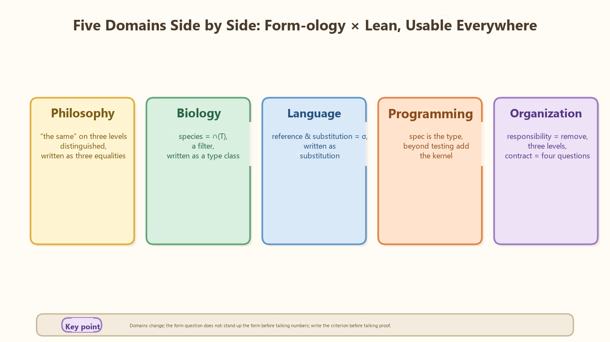

Figure 8-1 Five Fields Side by Side

| **Field** | **The question of form** | **Ontypology's form** | **Lean's form** |
| --- | --- | --- | --- |
| Philosophy | what is sameness | three kinds of sameness: ≡ / ⊂ | defeq / Eq / iso |
| Biology | how are species divided | ∩(T) filter + α abstraction | type class + predicate |
| Language | how is reference swapped | σ substitution preserves identity | substitution |
| Programming | how is a specification verified | four-question function card + three-layer judgment | contract theorem + kernel |
| Organization | how are duties defined | three remove levels + ( ) identity | field grading + contract |

### 8-2 Three Successive Goals

The first goal is personal: turn "accuracy" from a virtue into a process — accept with the eight questions, with the kernel as endorser. The second goal is organizational: build the Type Library — collect specimens, establish forms, extract functions, share — so that knowledge grows reusable forms. The third goal is long-term: let Mind AI grow reviewable thinking on top of the Type Library — AI makes the moves, the kernel accepts, people guard the criteria.

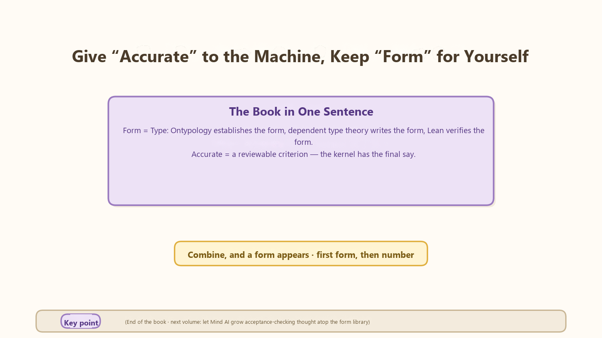

Figure 8-2 Hand "Accuracy" to the Machine, Keep "Form" for Yourself

Back to the main line: form = Type. Ontypology establishes the form, dependent type theory writes the form, and Lean verifies the form. Wherever there is a merge there is a form; first the form, then the number — now this sentence has a mechanized version: first the type, then the proof; and only a proof that passes the kernel counts.

## Appendix A — Glossary

Three columns side by side: Ontypology on the left, dependent type theory in the middle, and Lean's concrete mechanisms on the right. How to read the table — the left column defines the concept, the middle column gives the syntactic position, and the right column gives the acceptable landing point.

| **Ontypology** | **Dependent type theory** | **Lean mechanism** |
| --- | --- | --- |
| Form (Type) | type | Type / Prop |
| Unit Type, Type set | inductive type, structure type | inductive / structure |
| Parts | fields, constructor parameters | structure field |
| Content | value, term | term |
| Category | predicate, class | Prop / type class |
| [ ] attributes (dimension × scale) | index families, Π types | Vec A n, (x : A) → B x |
| { } bill of materials BOM | Σ types, field list | Σ(x : A) × B x |
| ( ) container C = (id(C), S(C)) | context, universe | Γ, Type u, module |
| Invariance axiom | substitution preserves identity | id(C) unchanged, record identity |
| Three-layer judgment J = J_C ∧ J_B ∧ J_T | type checking | kernel |
| ⊕ merging forms | product / sum types, structure extension | A × B, A + B, extend |
| remove disassembly (three levels) | field grading, subtypes | Option, subtype |
| σ substitution | substitution | substitution lemmas, rw |
| ∩(T) classification | predicate, class membership | Decidable, type class |
| α abstract generation | abstraction, quotient | class, Quotient |
| ι nesting | nested inductive types | nested inductive |
| op: form → form | type constructor | List, Option, Vec |
| Temporal Type (function) | function, proof | def, theorem |
| Four-question function card | signature + contract | signature + spec |
| Three kinds of sameness | defeq / Eq / iso | rfl, Eq, Equiv |
| Criterion | proposition, specification | Prop, contract theorem |
| Six proof steps | proof construction | intro → induction → kernel |
| Reviewable accuracy | kernel checking | #print axioms, lake build |
| Type Library | type library | Mathlib, project files |
| Function library (six groups) | theorem and tactic libraries | tactic, Mathlib |
| Output form returns to the library | proof enters the library | merge, reuse |

## Appendix B — Quick-Reference Cards

### B-1 The Four-Question Function Card (Lean Edition)

| **Four questions** | **What you write** | **One Lean line** | **Tick** |
| --- | --- | --- | --- |
| Name | what is this function called | def myFunc … | the name is recognizable and the context is not confused |
| Input form | which form does it act on | (a : A) | recognizable and deliverable |
| Output form | what form is produced | : B | identifiable and acceptable |
| Criterion | how is success counted | theorem myFunc_spec … | tick-able sentence by sentence |

### B-2 The Eight-Question Acceptance List

| **#** | **Question** | **What to supplement when it fails** |
| --- | --- | --- |
| 1 | Is the name right? | ( ) identity |
| 2 | Is the input form recognizable? | ( ) identity |
| 3 | Is the output form deliverable? | { } structure |
| 4 | Is the criterion tick-able? | [ ] rules |
| 5 | Is the chosen move right? | back to the routing decision tree |
| 6 | Has the three-layer check passed? | rerun the kernel |
| 7 | Is the process reviewable? | complete the proof term |
| 8 | Has the output become a new form? | shelve the form card |

### B-3 Photocopiable Blank Templates

(This page can be photocopied whole: a blank four-question card + form card + eight-question checklist, for classroom and workshop use.)

| **Four-question function card (blank)** |  |
| --- | --- |
| Name |  |
| Input form |  |
| Output form |  |
| Criterion |  |
| Form card: { parts, (content), [category] } |  |
| Eight-question checklist | Q1 Q2 Q3 Q4 Q5 Q6 Q7 Q8 |

## Appendix C — Answers to the Exercises

The answers are demonstrative: they give the criteria and the key points of reasoning, emphasizing "tick-able sentence by sentence," not a unique formulation.

| **Problem** | **Sample answer** |
| --- | --- |
| E01 | Vec Nat 2 and Vec Nat 3 are two different forms: the scale n is written into the type, and when the types do not match the term simply cannot be constructed. This matches the [ ] rule "the attribute value is a scale on a dimension" — a wrong scale means a wrong form, caught at the door. |
| E02 | The lid is a function-degraded part (after remove ≡ M′ ⊂ M): use an Option field or a subtype. The body is an essential field (remove ≢ M): a required constructor field. The criterion is "after it is taken apart, does it still recognize itself?" |
| E03 | (a) id-sameness / judgmental equality: 2+3 reduces to 5 at once. (b) form-sameness / propositional equality: requires an induction proof. (c) id-sameness: content and decoration swapped, id(C) unchanged (assuming the colour attribute is not an essential part). |
| E04 | add_assoc says (a+b)+c = a+(b+c): the composition-layer version of ⊕ associativity. Both sides have the same "dependency structure" — Nat addition is the same operation grouped two ways; if the join position or the dependency differs (handle⊕body vs body⊕handle), it does not hold. |
| E05 | sorryAx indicates an unfinished proof placeholder. Per the acceptance list: seeing sorryAx means rejection — the process is not reviewable, and Q7 of the eight questions fails. |
| E06 | Four-question card: name sell / input form Request / output form Ticket / criterion "there is a ticket and the amount is correct." Signature def sell (r : Request) : Ticket; contract theorem sell_spec (r : Request) : Valid (sell r). |
| E07 | List, Option, Vec are functions of forms (Type → Type): they take in a form and emit a new form, the second-layer reading of op; f : A → B is a function of values, moving at the content layer. The layer difference is "is it a form, or a value of a form, that moves." |
| E08 | Ask the layer first: this is a propositional equality at the composition layer (not defeq), so rfl will not accept it. If there is structure to split: induct on a; rfl in the nil case, simp [ih] in the cons case. After automation closes it, the kernel accepts. |
| E09 | It cannot enter the library. The second of the three acceptance checks, "#print axioms is clean," fails: sorryAx will be listed. It is stuck on Q7 of the eight questions (is the process reviewable?). |
| E10 | Criterion unclear → [ ] supplement: type class + contract theorem; input form unrecognizable → ( ) supplement: named types + context binding; output-form parts unclear → { } supplement: structure + field list. |
| E11 | Step ③ "write the Type set" establishes the form: the List inductive type is established first; step ⑤ produces the number: length is the count of small forms inside the form, and the length_append theorem links "number" to "merging forms" — first the form, then the number. |
| E12 | Compilation passing only proves the part that type checking covers; it does not mean the contract is proved. It violates Q6 (three-layer check) and Q7 (is the process reviewable) — neither J_T's rule layer nor acceptance has been completed. |
| E13 | Type Library = structure / inductive definition files (guarding J_C + J_B); function library = def / theorem / tactic / Mathlib (guarding J_T); hub = kernel + #print axioms (accepted only if everything passes); loop = contributions and re-shelving. The kernel only decides "pass or fail" and produces no content — it is a referee, not a player, so it cannot be the function library. |
| E14 | Stuck on Q7 (is the process reviewable). Handle it with the fractal pattern: when the large form is unclear, split it into small forms — break the long proof into a chain of lemmas, one form card per lemma, the small form isomorphic to the large one. |
| S01 | Sample adjustment: deepen the mathematical reading of Π/Σ in W3 (families of index sets); change W4 to an isomorphism and category-theoretic view; change the W8 project to "formalizing a mathematical theorem" (e.g., the diagonal argument for infinite sets). Reason: mathematicians are strong in reasoning and weak in engineering syntax. |
| S02 | Sample three segments: (1) cognition-chain warm-up — from similarity and difference to naming (deliverable: one form card); (2) form = Type parallel reading — the scale of Vec (deliverable: one Lean line); (3) a small theorem demonstration — length_append in six steps (deliverable: a one-page six-step note). |
| S03 | Sample problem: prove reverse (reverse l) = l (reversing a list twice returns the original form). Expected stuck point: after induction a lemma is needed (the behaviour of append) — exactly a rehearsal of "split into small forms." Acceptance criteria: the kernel passes + #print axioms clean + all eight questions pass. |

## Appendix D — Index of Figures

| **Figure** | **Part** | **Title** |
| --- | --- | --- |
| Figure 01 | Cover | Lean formal verification and dependent type theory × Ontypology |
| Figure 02 | Introduction | The cognition chain and the verification chain |
| Figure 03 | Introduction | Map of the book |
| Figure 04 | 1-1 | Five pain points |
| Figure 05 | 1-2 | Root, trunk, fruit: three-layer positioning |
| Figure 06 | 2-3 | Timeline of Lean's history |
| Figure 07 | Part II | Three languages, one table |
| Figure 08 | 2-1 | The Ontypology toolbox |
| Figure 09 | 2-2 | Dependent type theory × Lean toolbox |
| Figure 10 | 2-4 | The ten reading propositions |
| Figure 11 | 3-1 | Three axes × three constructions |
| Figure 12 | 3-2 | [ ] attributes ↔ Π types |
| Figure 13 | 3-3 | { } BOM ↔ Σ types |
| Figure 14 | 3-4 | ( ) containers ↔ context |
| Figure 15 | 3-5 | Unit types ↔ inductive types |
| Figure 16 | 3-6 | Three-layer judgment ↔ kernel |
| Figure 17 | 3-7 | Three kinds of sameness ↔ two-layer equality |
| Figure 18 | 3-8 | Five operations × type construction |
| Figure 19 | 3-8 | σ substitution ↔ substitution |
| Figure 20 | 3-8 | ⊕ merging forms ↔ add_assoc |
| Figure 21 | 3-8 | ∩(T) ↔ type class |
| Figure 22 | 4-1 | Temporal Type ↔ def / theorem |
| Figure 23 | 4-2 | op ↔ type constructors |
| Figure 24 | 4-3 | Four-question card ↔ signature and contract |
| Figure 25 | 4-4 | Six function groups ↔ Mathlib |
| Figure 26 | 4-5 | The tactic board |
| Figure 27 | 4-6 | Mathlib: a shared library of forms |
| Figure 28 | 5-1 | Body–Use–Accuracy × Lean |
| Figure 29 | 5-2 | Three supplements × Lean |
| Figure 30 | 5-3 | Six proof steps × workflow |
| Figure 31 | 5-4 | Demonstration: the number of a merged form |
| Figure 32 | 5-5 | Eight questions × Lean |
| Figure 33 | 5-6 | Misuse contrasts |
| Figure 34 | 5-6 | The routing decision tree |
| Figure 35 | 5-4 | Reviewable accuracy ↔ small trusted core |
| Figure 36 | 6-1 | Two libraries, one hub, one loop |
| Figure 37 | 6-3 | AI × Lean loop |
| Figure 38 | 6-4 | The milestone gallery |
| Figure 39 | 7-1 | Learn, practice, use, teach, build: the five-step cycle |
| Figure 40 | 7-2 | The eight-week route |
| Figure 41 | 6-2 | Four stages of library building |
| Figure 42 | 8-1 | Five fields side by side |
| Figure 43 | 8-2 | The closing card |

List of tables: Table 0-1 Four-pillar map, Table 1-1 Pain-point comparison, Table 2-1 The Ontypology toolbox, Table 2-2 Logic–Type comparison, Table 2-3 The ten propositions, Table 3-1 Three-axis parallel reading, Table 3-2 The three remove levels, Table 3-3 Three kinds of sameness, Table 4-1 Four-question card comparison, Table 4-2 Six function groups, Table 5-1 Six steps, Table 5-2 Three supplements, Table 5-3 Eight questions, Table 6-1 Architecture components, Table 6-2 Industry cases, Table 7-1 Five-step cycle, Table 7-2 Eight-week schedule, Table 7-3 Routing, Table 7-4 Stuck-point table, Table 8-1 Five fields, Table A-1 Glossary, Table B-1 Four-question card, Table B-2 Eight questions, Table B-3 Blank template, Table C-1 Answers.

## Appendix E — Sources and Further Reading

All source-checking dates are 2026-11-08. Official pages and papers are first-hand sources; Wikipedia entries serve only for cross-checking.

| **#** | **Source** | **Content** |
| --- | --- | --- |
| 1 | lean-lang.org/theorem_proving_in_lean4/ | Theorem Proving in Lean 4 (Avigad, de Moura, Kong, Ullrich): dependent type theory, tactics, axioms and computation |
| 2 | lean-fro.org/about/ | Lean FRO official milestones: versions, funding, awards, milestones |
| 3 | mathlib.org/mathlib_stats.html | Mathlib live statistics: definitions, theorems, contributors |
| 4 | leanprover-community.github.io/did_you_prove_it.html | Community acceptance list: lake build, #print axioms |
| 5 | arxiv.org/abs/2512.07087 | Equational Theories completion paper: 22,028,942 implications |
| 6 | teorth.github.io/equational_theories/ | ETP project home (Terence Tao) |
| 7 | teorth.github.io/pfr/ | PFR formalization project |
| 8 | imperialcollegelondon.github.io/FLT/ | Fermat's Last Theorem formalization (Imperial, Kevin Buzzard) |
| 9 | Anthropic research announcement + Nature reporting | 2026-09 machine-checked formalization of Fermat's Last Theorem |
| 10 | en.wikipedia.org/wiki/Lean_(proof_assistant) | Lean entry: brief history, architecture, events cross-checked |
| 11 | en.wikipedia.org/wiki/Dependent_type | Dependent type entry: Π/Σ, index families |
| 12 | en.wikipedia.org/wiki/Curry–Howard_correspondence | Curry–Howard correspondence entry: correspondence table and historical sources |
| 13 | sel4.systems / compcert.org / AWS blog | Industry formal-verification cases: seL4, CompCert, Cedar |
| 14 | homotopytypetheory.org/book/ | HoTT Book (2013): the homotopy type theory research program |
| 15 | Ontypology archive: unit form and set logic · notation of form sets · Ontypology_temporal form · spatial framework · form and number · introduction · Ontology and Ontypology | The original basis for Ontypology terminology and notation (establish the backbone, do not reproduce) |

> **The End**  
> Form = Type: Ontypology establishes the form, dependent type theory writes the form, Lean verifies the form.  
> Accuracy = reviewable accuracy — the kernel has the final say.  
> Wherever there is a merge there must be a form; first the form, then the number.
