

  <a href="https://youtu.be/9zd38zjlrTo">💻Landscape</a> ｜ 
 <a href="https://v.douyin.com/-Vc7lvhkEUY">📱Portrait</a> 
 

**◆ 　 Ontypology ◆**

# T H E   D R U G   D E V E L O P M E N T   B R A I N

**PharmaMind and the Accurate Method of Drug Discovery**

*PharmaMind: An Accurate Method of Ontypology for Pharmaceutical R&D*

—— ◆ —— ◆ —— ◆ ——

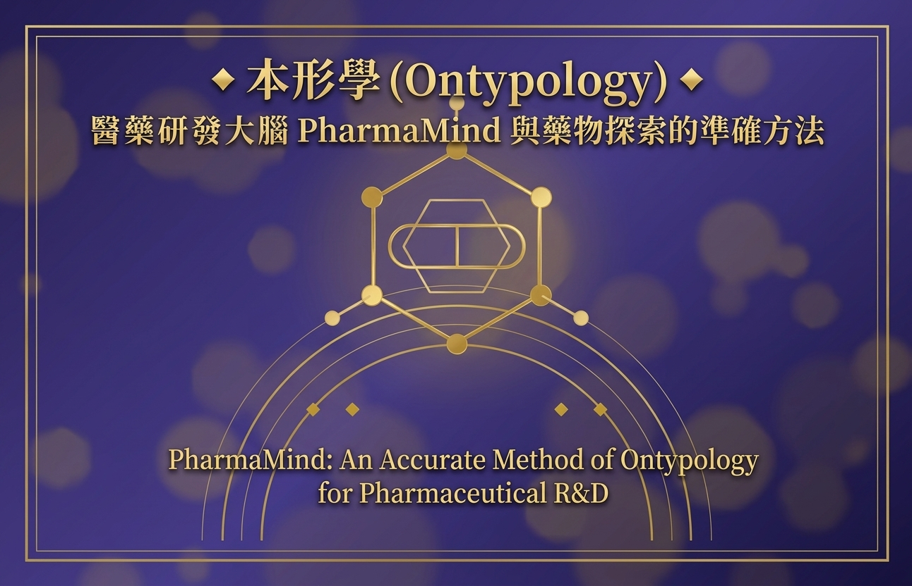

## Abstract

Pharmaceutical R&D has long been trapped by the "double-ten law": a new drug takes on average more than ten years and more than one billion US dollars, yet the clinical success rate remains below one in ten. The underlying cause is not insufficient experimental technology, but rather the lack of an accurate method—semantically complete, assumption-visible, and step-checkable—for the judgments made throughout the R&D process: targets are vaguely defined, structure–activity relationships are fragmented, and optimization decisions rely on experience, so that vast resources are consumed on the uncertainty of the "Type." This paper applies Ontypology to drug exploration and discovery, and proposes the accurate method of the drug development brain, PharmaMind. First, using the cognitive chain of "Difference & Similarity → Split & Merge → Type," it reconstructs targets, compounds, and activity data into precise correspondences among Types, containers, attributes, and frameworks. Second, it gives the formal definitions of the drug Type and the compound container, along with four axiomatic foundations: container identity invariance, SOM structural grading, the sufficiency and necessity of the three-layer judgment, and Type-replacement invariance. Third, it proposes a dual-engine, five-layer architecture of LLM and Mind Model together with a "predict–verify–revise" closed loop, so that each round of lead optimization becomes a checkable, revisable, and accumulable Type judgment. Finally, using two cases—lead compound optimization and drug repositioning—it demonstrates the application of the three-layer Type judgment in identifying activity cliffs and in repositioning retrieval, and compares it with pure LLM and the traditional RDB + rules approach using a five-dimensional accuracy assessment (semantic completeness, assumption visibility, step checkability, layer consistency, and boundary clarity). The results show that Type-based reconstruction makes R&D assumptions explicit and judgment steps traceable, providing drug discovery with an accurate path that is both theoretically rigorous and practically implementable.

**Keywords:** Ontypology, drug discovery, PharmaMind, Mind Model, structure–activity relationship, Type Logic, Accurate Method

> **Claim of this paper**
> The essence of drug R&D failure is that the definition, structure, or judgment of the "Type" is inaccurate. Reconstructing the conceptual system of drug discovery with Ontypology makes assumptions visible, steps checkable, and replacement invariant—this is the core of the PharmaMind Accurate Method.

## Table of Contents

- Abstract
- Chapter 1　Introduction: The Predicament of Drug R&D and the Ontypology Entry Point
  - 1.1　The Predicament of Drug R&D: The Double-Ten Law and Misjudgment
  - 1.2　Ontypology and the Accurate Method
  - 1.3　Research Questions and Contributions
- Chapter 2　Essentials of Ontypology and the Mind Model
  - 2.1　The Origin of Type: Difference & Similarity, Split & Merge, and Type
  - 2.2　Three Great Value-Adds: Container, SOM, and Abstraction
  - 2.3　The Four Steps of the Framework and the RDB Correspondence
  - 2.4　Temporal Type and the Eighteen Themes
- Chapter 3　Ontypology Modeling of Drug Discovery
  - 3.1　Type Detection and Type Definition
  - 3.2　Three-Way Precise Correspondence
  - 3.3　The Attribute Matrix of Structure–Activity Relationships
  - 3.4　Lead Optimization as Framework Evolution
- Chapter 4　The PharmaMind Dual-Engine Five-Layer Architecture
  - 4.1　Division of Labor Between the Two Engines
  - 4.2　The Five-Layer Architecture
  - 4.3　The Predict–Verify–Revise Loop
- Chapter 5　Formalization and Accuracy Assessment
  - 5.1　Axioms and Theorems
  - 5.2　Five-Dimensional Accuracy Assessment
- Chapter 6　Case Studies
  - 6.1　Case One: Lead Compound Optimization
  - 6.2　Case Two: Type Retrieval for Drug Repositioning
- Chapter 7　Conclusion and Outlook
  - 7.1　Review of Results
  - 7.2　Limitations and Outlook
- References
## Chapter 1　Introduction: The Predicament of Drug R&D and the Ontypology Entry Point

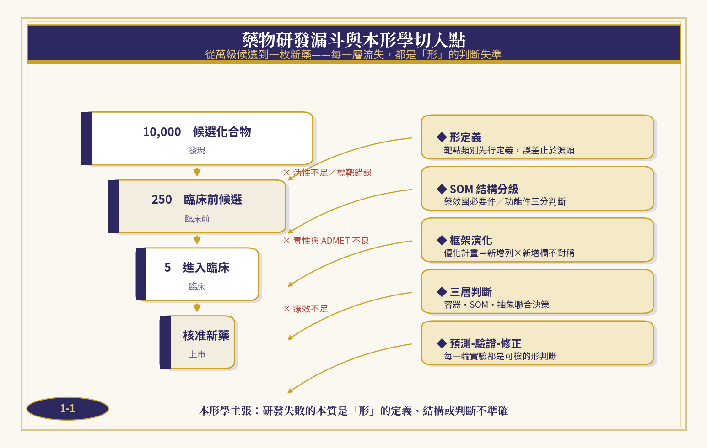

*Figure 1-1　The drug R&D funnel and the Ontypology entry point*

### 1.1　The Predicament of Drug R&D: The Double-Ten Law and Misjudgment

Drug R&D is one of the most expensive, longest, and highest-failure-rate systems engineering endeavors of our time. The industry often summarizes its profile with the "double-ten law": an average development cycle of more than ten years and an investment of more than one billion US dollars, while the drug candidates that ultimately complete discovery, preclinical, and three phases of clinical trials and gain marketing approval are often one in ten thousand. Figure 1-1 depicts this funnel: tens of thousands of candidate compounds are reduced to only a few hundred after activity screening, ninety percent of the remainder are lost upon entering preclinical evaluation, and a large number are terminated during the clinical stage due to insufficient efficacy, toxicity, and pharmacokinetic problems, until finally only one new drug passes through.

It is worth asking: where exactly does the loss occur? Looking across the failure causes at each stage—wrong target selection, insufficient activity, poor toxicity and ADMET (absorption, distribution, metabolism, excretion, toxicity), and inadequate clinical efficacy—almost all of them can be attributed to the same class of problem: the "judgments" made throughout R&D are not accurate enough. The definitional boundary of the target is vague, so the lead compound aims at the wrong Type from the very beginning; the records of the structure–activity relationship (SAR) are scattered, so optimization experience cannot settle into reproducible knowledge; and the basis for decisions is scattered across the literature, experimental records, and expert intuition, with assumptions implicit and steps hard to check. When the semantics of a judgment are incomplete and its boundaries unclear, even the most precise experimental platform merely amplifies the error.

In recent years, the progress of large language models (LLMs) has injected new capabilities for literature mining and hypothesis generation into R&D, but linguistic fluency in an LLM does not equal accurate judgment: it excels at recall and generation, yet it struggles to guarantee semantic completeness, assumption visibility, and step checkability, and its hallucinations and non-traceability make it unable to bear R&D decisions alone. This is precisely the position at which Ontypology enters.

### 1.2　Ontypology and the Accurate Method

Ontypology holds that human intelligence is constituted jointly by "Type" and "number"—mathematics describes quantity, relations, and laws, while Typology describes structure, composition, association, evolution, and essence. Everything in the world can be expressed and understood through Types: the brain first detects "Difference & Similarity," then draws boundaries through "Split" and "Merge," and only upon those boundaries does the "Type" come into being. From this starting point, Ontypology has established a theory constructed layer by layer from the cognitive starting point: attributes and attribute values describe the dimensions of a Type, Space Collections guarantee the independence of identity, SOM (Space Object Model) supplies the compositional structure among elements, abstraction opens up the generation of new members by an intersection criterion, and the Framework abstracts the entire derivation into a repeatable and applicable method.

The "Accurate Method" referred to in this paper denotes five operational dimensions: semantic completeness (the Type definition of the judged object is complete), assumption visibility (the premise of each step is explicitly listed), step checkability (the judgment process can be traced back and verified), layer consistency (the three layers of container, structure, and abstraction do not contradict one another), and boundary clarity (the conditions for a category's establishment and exclusion are clear). These five dimensions are both the design criteria of the method and the measuring scale of Chapter 5.

### 1.3　Research Questions and Contributions

This study revolves around three questions: How can the concepts of drug discovery be precisely mapped onto the Types, containers, structures, and frameworks of Ontypology? How can the Accurate Method, centered on Type judgment, improve the checkability of R&D decisions? How can the dual-engine architecture of LLM and Mind Model be implemented in the drug discovery scenario? Table 1-1 consolidates the correspondence between the research questions and the contributions of this paper.

**Table 1-1　Correspondence between Research Questions and Contributions**

| **Research Question** | **Content** | **Corresponding Chapter** | **Contribution of This Paper** |
| --- | --- | --- | --- |
| RQ1 | Type-based mapping of drug discovery concepts | Chapter 3 | Three-way precise correspondence table of drug discovery ↔ Ontypology ↔ database |
| RQ2 | Type judgment improves decision accuracy | Chapter 5 | Four axiomatic foundations + five-dimensional accuracy assessment scale |
| RQ3 | Dual-engine architecture implemented in drug discovery | Chapters 4 and 6 | PharmaMind five-layer architecture + two demonstration cases |

The structure of the paper is as follows: Chapter 2 reviews the core theory of Ontypology and the Mind Model; Chapter 3 completes the Type-based modeling of drug discovery; Chapter 4 proposes the PharmaMind dual-engine five-layer architecture and the predict–verify–revise loop; Chapter 5 gives the formalization foundations of the axioms and theorems, and assesses accuracy with the five-dimensional scale; Chapter 6 demonstrates the application of the method through two cases; and Chapter 7 summarizes and looks ahead to future directions.

## Chapter 2　Essentials of Ontypology and the Mind Model

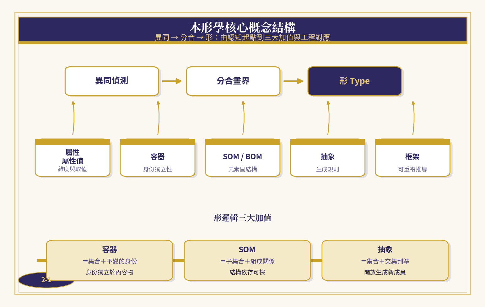

*Figure 2-1　The core conceptual structure of Ontypology*

### 2.1　The Origin of Type: Difference & Similarity, Split & Merge, and Type

A Type does not exist innately. The first step of cognition is to detect "Difference & Similarity": the brain notices that "this is not that"; then, through the actions of "Split" and "Merge," it draws a boundary—gathering the similar together and separating the different apart; at the very moment the boundary is established, the "Type" comes into being. Nouns are labels attached only later; the boundary comes first, the name second. This cognitive chain determines the overall direction of Ontypology: the knowledge reconstruction of any domain must return to the discernment of Difference & Similarity and the boundary-drawing of Split & Merge, rather than starting from an existing table of nouns.

> **Definition 2-1 (Type)**
> A Type is a category produced by the brain after detecting Difference & Similarity among a group of objects and drawing boundaries through Split & Merge; it is fully described by a set of attribute dimensions and their value ranges. An object x belongs to Type T, written x ∈ T, and its criterion is given by the intersection criterion of T.

### 2.2　Three Great Value-Adds: Container, SOM, and Abstraction

Mathematical sets are powerful and concise, yet they lack three things: identity, structure, and generation rules. Ontypology supplements them with three great value-adds. The first is the Space Collection—a whole that has a boundary, an internal space, and an identity independent of its contents; a cup that is refilled with coffee is still the same cup, and this property of "identity not changing with the contents" is the cognitive root of the primary key and entity identity in the data world. The second is the SOM—which, on top of the Bill of Materials (BOM), supplies the compositional structure among elements; remove the bottom of the cup and it is no longer a cup, but remove the sticker and it is unharmed, so the contribution of a part to the identity of the whole can be precisely graded. The third is abstraction—which, by a feature intersection criterion, turns a closed list into an open rule, so that the membership of new members is dynamically generated by the criterion rather than manually enumerated.

> **Definition 2-2 (Container), 2-3 (SOM), 2-4 (Abstraction)**
> Container　C = (id(C), S(C)): id(C) is an identity that does not change with the elements of the internal space S(C); the contents of S(C) can be replaced and can be emptied.
> SOM　M = (P(M), R(M), G(M)): the set of parts P(M), the composition relation R(M) ⊆ P(M) × P(M), and the configuration G(M); identity depends on the role of the parts in R(M).
> Abstraction　T = (F(T), ∩(T)): the feature set F(T) and the intersection criterion ∩(T); x ∈ T if and only if f(x) holds for all f ∈ F(T), and members are openly generated by the criterion.

**Table 2-1　Core Ontypology Terms and Their Drug Discovery Correspondences**

| **Term** | **Essence of the Definition** | **Drug Discovery Correspondence** |
| --- | --- | --- |
| Type | A category obtained by Difference & Similarity → Split & Merge → boundary drawing | Target category, drug series |
| Attribute / Attribute Value | The dimensions and values of a Type | Molecular descriptors, activity values |
| Container | Identity independent of contents | API, salt form, crystal form, formulation |
| BOM / SOM | Composition list / structure among elements | Functional group list / pharmacophore structure |
| Abstraction | Open generation by intersection criterion | Drug-likeness rules, screening criteria |
| Framework | A repeatable and applicable derivation method | SAR framework, optimization plan |

### 2.3　The Four Steps of the Framework and the RDB Correspondence

The Framework abstracts the very act of "describing an object," and its operation has four steps: first, distinguish "this is not that"; when a second batch of differences with a different nature appears and the contrast fails, the need for abstraction is triggered; then, name each batch of differences by dimension; and when a new object is added, first judge which dimension it matches. The power of the Framework lies in "listing how many mutually independent dimensions there are"; as for how the dimensions are arranged, that is an entry angle the user may freely choose—a parallel-attribute form and a nested-branch form are both acceptable, while the underlying dimensions and value ranges are entirely the same.

This set of terms can be translated almost item by item into a relational database (RDB): the table header is the Type, the data rows are entities, the primary key is the identity by which each row is independently identified, and the foreign key reference is the master–subordinate connection between Types; "adding a row" expands the entity list of the same Type, while "adding a column" is the evolution of the Framework itself—introducing a new judgment dimension. This asymmetry corresponds in drug optimization to two essentially different operations: synthesizing more analogs (adding rows) and introducing new evaluation dimensions such as selectivity and hERG toxicity (adding columns).

### 2.4　Temporal Type and the Eighteen Themes

The Space Type answers "what it looks like, where it is, and what it is composed of," while the Temporal Type answers "how it is generated and how it evolves." The temporal Type is described by the triple (I, E, κ)—Interval, Event, and causal linkage (κ)—and gathers the eighteen themes of methodology into four modules. Drug R&D is precisely a temporal engineering endeavor: trials have a sequence, optimization has rounds, and causal and reverse-causal reasoning intertwine between mechanism and reverse explanation. Table 2-2 lists the four-module structure of the eighteen themes and their significance for drug discovery.

**Table 2-2　The Eighteen Themes of the Temporal Type Gathered into Four Modules**

| **Module** | **Eighteen Themes** | **Significance for Drug Discovery** |
| --- | --- | --- |
| Structure module | Split & Merge, abstraction, framework, reconstruction | Type definition, SAR reconstruction, and series design |
| Generation module | Design patterns, logical generation, marking, thinking, thinking methods | Molecular design patterns and synthetic route planning |
| Application module | Logical application, problem solving, analysis, design, reasoning, causal reasoning, reverse-causal reasoning | Mechanistic interpretation, data interpretation, and reverse explanation |
| Evolution module | Memory management, continual learning | Type library accumulation and closed-loop self-correction |

## Chapter 3　Ontypology Modeling of Drug Discovery

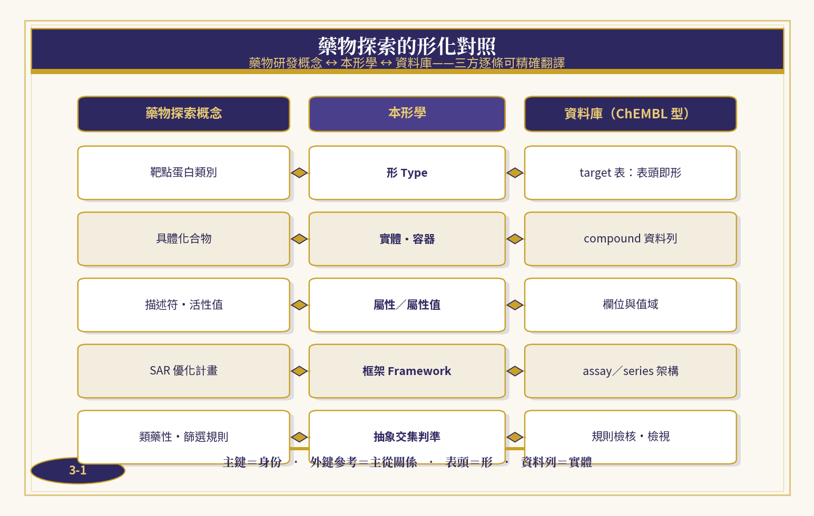

*Figure 3-1　The Type-based correspondence of drug discovery*

### 3.1　Type Detection and Type Definition

The first action of drug discovery is Type detection: discerning "this is not that" from a batch of compound and target data—which molecules belong to the same activity series, and which targets belong to the same protein family. Type detection does not rely on prior naming, but returns to the discernment of Difference & Similarity: first there is the felt difference of activity profiles, then the Split & Merge boundary drawing of the series, and only at the end is this series named as a certain drug Type.

On the basis of Type detection, Type definition writes the boundary of the category into an explicit criterion. This paper carries this reconstruction with two formal definitions: the drug Type and the compound container.

> **Definition 3-1 (Drug Type)**
> Drug Type DT = (τ, F, ∩(DT)): τ is the target category (the superordinate belonging of the Type), F is the set of dimensions of descriptors and activity attributes, and ∩(DT) is the inclusion intersection criterion (such as an IC50 threshold, a selectivity threshold, and drug-likeness rules). A compound x belongs to DT if and only if x passes all feature tests of ∩(DT).

> **Definition 3-2 (Compound Container)**
> Compound Container CC = (id(CC), S(CC)): id(CC) is the identity determined by the core scaffold (registry number, structure-normalized identifier); S(CC) is the set of replaceable contents—salt form, crystal form, solvate, and formulation composition. Replacement of the contents does not change id(CC).

These two definitions translate the everyday statements of drug discovery into the language of Types: "the same drug with a different salt form" = replacement of contents while container identity remains unchanged; "this compound does not belong to this series" = failure to pass the intersection criterion; "activity cliff" = a tiny variation in the SOM structure triggering a jump in judgment. Once a statement is Type-ified, it changes from an experiential description into a testable judgment.

### 3.2　Three-Way Precise Correspondence

The value of Ontypology lies in the precision of cross-domain translation. Table 3-1 compares drug discovery concepts, Ontypology terms, and database structures item by item: the target protein category is the Type, corresponding to the table header of the target table; a specific compound is an entity, corresponding to a data row of the compound table; descriptors and activities are attributes and attribute values, corresponding to fields and value ranges; the SAR optimization plan is the Framework, corresponding to the architecture of assay and series; and drug-likeness and screening rules are the intersection criteria of abstraction, corresponding to rule checks and views. The primary key is identity, and the foreign key reference is the master–subordinate relation—data engineering and cognitive theory converge here.

**Table 3-1　Three-Way Precise Correspondence of Drug Discovery ↔ Ontypology ↔ Database**

| **Drug Discovery Concept** | **Ontypology** | **Database (ChEMBL-style)** |
| --- | --- | --- |
| Target protein category | Type | target table: the header is the Type |
| Specific compound | Entity / Container | compound data row |
| Descriptor / activity value | Attribute / Attribute Value | fields and value ranges |
| SAR optimization plan | Framework | assay / series architecture |
| Drug-likeness / screening rules | Abstraction intersection criterion | rule checks / views |

### 3.3　The Attribute Matrix of Structure–Activity Relationships

What the structure–activity relationship (SAR) records is "how each dimension of the structure affects activity," and its Ontypology form is precisely the attribute value matrix: the rows are compound entities, the columns are structural dimensions and measured attributes, and the cells are filled with attribute values. Table 3-2 gives an illustrative series; Figure 3-2 places the matrix alongside the activity trend, highlighting the phenomenon this method cares about most—the activity cliff.

**Table 3-2　SAR Attribute Value Matrix (including an activity cliff pair)**

| **Compound** | **R¹** | **R²** | **logP** | **IC50 (nM)** |
| --- | --- | --- | --- | --- |
| A-01 | H | Me | 2.1 | 480 |
| A-02 | F | Me | 2.3 | 120 |
| A-03 | F | Et | 2.8 | 38 |
| A-04 | F | n-Pr | 3.4 | 1,210 |
| A-05 | Cl | Et | 3.1 | 52 |

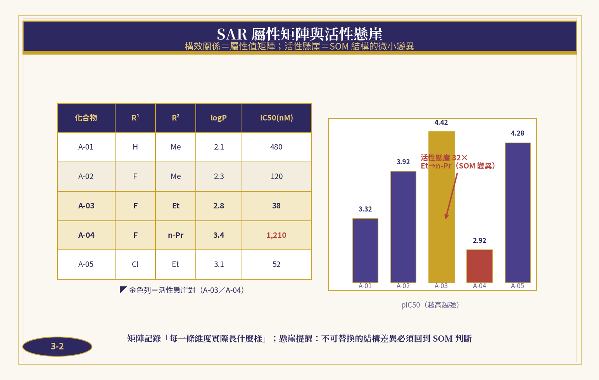

*Figure 3-2　SAR attribute matrix and activity cliff*

A-03 and A-04 differ only by one carbon in the R² side chain (Et→n-Pr), yet the activity jumps 32-fold—this is not measurement noise, but a signal at the SOM structural layer: the side chain length has crossed the boundary of the binding pocket, and the composition relation of the pharmacophore has been disrupted. A numerical method sees only the gap between the two numbers 38 and 1,210, whereas a Type judgment can point out "which structural dimension's variation triggered the jump" and settle this judgment into a new dimension of the Framework.

### 3.4　Lead Optimization as Framework Evolution

Each round of lead optimization is one evolution of the Framework. Synthesizing a new analog is "adding a row"—an expansion of the entity list of the same Type, reversible and gradual; introducing a new evaluation dimension (selectivity, hERG, metabolic stability) is "adding a column"—a change to the Framework itself, which alters the whole picture of judgment. A mature method must manage the two separately: adding rows determines "how broadly we see," and adding columns determines "how deeply we see."

Multi-framework unfolding then corresponds to the multi-perspective needs of R&D: from the same overall attribute table, unfolding from the entry angle of efficacy priority yields an indication-oriented optimization tree; unfolding from the angle of developability priority yields an ADMET-oriented optimization tree; and unfolding from the angle of synthetic accessibility yields a route-oriented optimization tree. The underlying dimensions and value ranges are entirely the same, while the manner of unfolding differs—this is precisely the direct application of the Framework's property of "separating the factual dimensions from the freedom of arrangement." The Temporal Type introduces here the trial sequence and round structure (I, E, κ), making "what was done in which round and why" a traceable temporal Type record.

## Chapter 4　The PharmaMind Dual-Engine Five-Layer Architecture

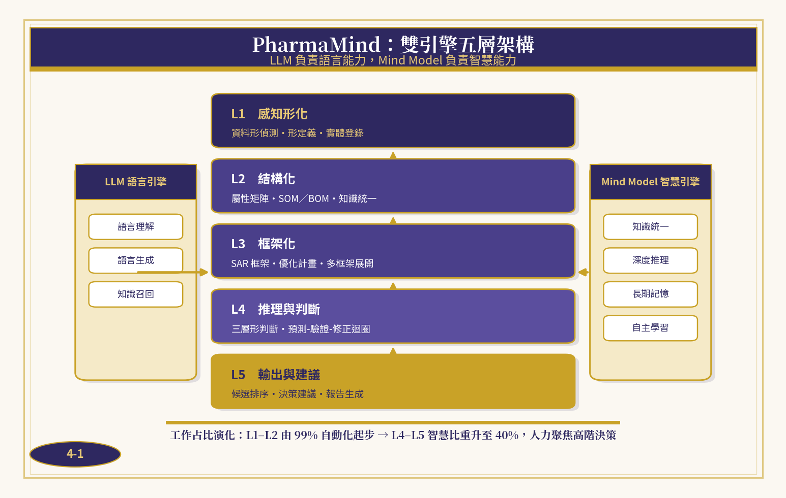

*Figure 4-1　PharmaMind: the dual-engine five-layer architecture*

### 4.1　Division of Labor Between the Two Engines

PharmaMind is the practical architecture of Ontypology in pharmaceutical R&D, designed with the dual engines of LLM and Mind Model. The LLM language engine is responsible for linguistic capabilities: literature comprehension, report generation, and knowledge recall; the Mind Model intelligence engine is responsible for intelligence capabilities: knowledge unification, deep reasoning, long-term memory, and autonomous learning. The criterion for the division of labor between the two is the Ontypology view of judgment: language may be fuzzy, but judgment must be precise—any work involving Type definition, structural belonging, and three-layer judgment is undertaken uniformly by the Mind Model, leaving a checkable judgment trail, while the LLM provides only polishing and recall support at the linguistic layer.

### 4.2　The Five-Layer Architecture

The architecture is divided into five layers from bottom to top. L1, the perception and Type-ification layer, performs Type detection and Type definition, registering the raw data in the literature, databases, and experimental records as Types and entities; L2, the structurization layer, establishes the attribute matrix and BOM/SOM and completes knowledge unification; L3, the frameworkization layer, produces the SAR framework, the optimization plan, and multi-framework unfolding; L4, the reasoning and judgment layer, performs the three-layer Type judgment and the predict–verify–revise loop; and L5, the output and recommendation layer, generates candidate rankings, decision recommendations, and reports. Figure 4-1 shows the full picture.

**Table 4-1　Duties of the Five-Layer Architecture and the Evolution of Work Share**

| **Layer** | **Duty** | **Input** | **Output** | **Initial Share** | **Mature Share** |
| --- | --- | --- | --- | --- | --- |
| L1 Perception & Type-ification | Type detection, Type definition, entity registration | Literature / databases / experimental records | Type definition file | 45% | 10% |
| L2 Structurization | Attribute matrix, SOM/BOM, knowledge unification | Type definition file | Structured knowledge | 30% | 15% |
| L3 Frameworkization | SAR framework, optimization plan, multi-framework unfolding | Structured knowledge | Framework and plan | 15% | 15% |
| L4 Reasoning & Judgment | Three-layer Type judgment, predict-verify-revise | Framework and plan | Judgment and recommendations | 8% | 35% |
| L5 Output & Recommendation | Candidate ranking, decision recommendations, report generation | Judgment and recommendations | Decision report | 2% | 25% |

The evolution of the work share is a dynamic feature of the architecture: in the early stage of a project, more than ninety percent of the work falls on the perceptual and structurization labor of L1–L2; as the Type library and the Framework mature, the share of intelligent judgment in L4–L5 rises to more than forty percent, allowing human effort to focus on high-level decisions. In other words, automation does not replace scientists, but rather frees them from the organizing work of Types and returns them to the creation and judgment of Types.

### 4.3　The Predict–Verify–Revise Loop

The operational core of PharmaMind is the "predict–verify–revise" closed loop (Figure 4-2): in the design stage, the Mind Model gives a checkable prediction according to the Framework; in the synthesis and testing stage, experimental evidence is obtained; in the verification stage, the gap between the prediction and the evidence is compared; and in the revision stage, the gap is written back as an update of the Type definition and the Framework. The corresponding six-step method is—Type detection, Type definition, structurization, frameworkization, formalization, and verification-revision—where the output of each step is the input of the next, and a judgment trail is retained throughout.

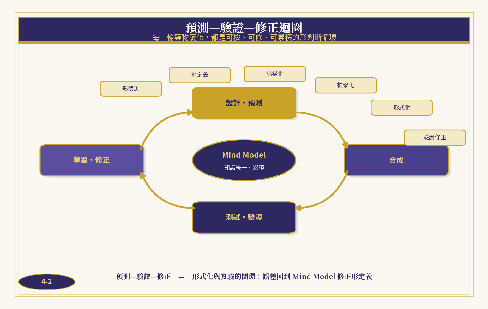

*Figure 4-2　The predict–verify–revise loop*

> **The Six-Step Accurate Method**
> Type detection (discern Difference & Similarity) → Type definition (explicit criterion) → structurization (attribute matrix and SOM) → frameworkization (dimensions and plan) → formalization (carried by axioms and theorems) → verification-revision (evidence write-back). Each round of the loop makes the Type library more complete and the judgment more accurate.

## Chapter 5　Formalization and Accuracy Assessment

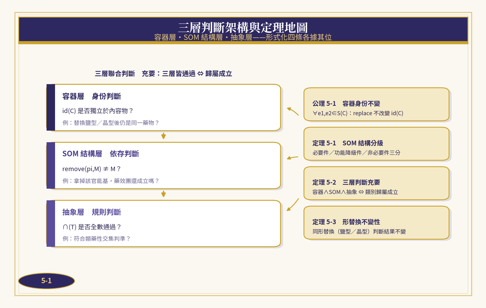

*Figure 5-1　The three-layer judgment architecture and the theorem map*

### 5.1　Axioms and Theorems

An accurate method must be capable of being formally stated and tested. This section gives four axiomatic foundations, which respectively serve the different levels of the three-layer judgment (Figure 5-1, Table 5-1).

> **Axiom 5-1 (Container Identity Invariance)**
> For any compound container C and its contents e1, e2 ∈ S(C): replace(C, e1, e2) does not change id(C). Replacement of the salt form, crystal form, or formulation does not shake the identity of the drug.

> **Theorem 5-1 (SOM Structural Grading)**
> For any part p of the pharmacophore M: p is an essential part if and only if remove(p, M) ≢ M. According to the loss of identity after removal, parts are precisely divided into three grades: essential parts (safety-critical), functionality-degrading parts (optional functions), and non-essential parts (modification consumption).

> **Proof (constructive)**
> By Definition 2-3, identity depends on the role of the parts in the composition relation R(M). Perform a removal test on each p ∈ P(M): if remove(p, M) ≢ M, then p supports a key connection of R(M) and is judged an essential part; if the whole survives after removal but its function is impaired, p is a functionality-degrading part; if all judgments remain unchanged after removal, p is a non-essential part. The trichotomy is mutually exclusive and exhaustive, and the judgment terminates in a finite number of steps. Q.E.D.

> **Theorem 5-2 (Sufficiency and Necessity of the Three-Layer Judgment)**
> An object x belongs to the drug Type DT if and only if the three-layer judgment holds simultaneously: the container layer—the identity of x is independent and its registration is consistent; the SOM structural layer—the essential parts of the pharmacophore of x are complete; and the abstraction layer—x passes all feature tests of ∩(DT).

> **Proof (sufficiency and necessity)**
> Necessity: if x ∈ DT, then by Definition 3-1 it passes ∩(DT); by Axiom 5-1 its identity judgment is consistent; and by Theorem 5-1 its essential parts are complete, for otherwise removing an essential part would make x lose the identity of the Type, contradicting x ∈ DT. Sufficiency: when all three layers hold, identity guarantees that the judged object is correct, the essential parts guarantee structural integrity, and the intersection criterion guarantees that belonging holds; therefore x ∈ DT. If any one of the three layers is missing, the judgment is incomplete. Q.E.D.

> **Theorem 5-3 (Type-Replacement Invariance)**
> Suppose x and x′ are of the same Type (x′ is a salt-form/crystal-form replacement of x and x′ passes ∩(DT)); then for any three-layer judgment J: J(x) = J(x′). Same-Type replacement does not change the judgment result.

> **Proof**
> By Axiom 5-1, replace does not change id, so the container-layer judgment is the same; the replacement occurs in the contents S(CC) and does not touch the pharmacophore P(M) or the relation R(M), so the SOM-layer judgment is the same; and x′ passes ∩(DT), so the abstraction-layer judgment is the same. All three layers are the same, hence J(x) = J(x′). Q.E.D.

**Table 5-1　Overview of Axioms and Theorems**

| **Number** | **Name** | **Essence of the Statement** | **Served Layer** |
| --- | --- | --- | --- |
| Axiom 5-1 | Container identity invariance | Replacement of contents does not change id(C) | Container layer |
| Theorem 5-1 | SOM structural grading | Trichotomy of essential/functional/non-essential parts | SOM layer |
| Theorem 5-2 | Sufficiency and necessity of the three-layer judgment | All three layers hold ⇔ belonging holds | Joint judgment |
| Theorem 5-3 | Type-replacement invariance | Same-Type replacement does not change the judgment result | Container layer → global |

### 5.2　Five-Dimensional Accuracy Assessment

To quantify "accuracy," this paper uses the five-dimensional scale: semantic completeness, assumption visibility, step checkability, layer consistency, and boundary clarity, each scored from 1 to 5. Table 5-2 and Figure 5-2 compare three methods: pure LLM generation, the traditional RDB + rules, and PharmaMind Type judgment.

**Table 5-2　Five-Dimensional Accuracy Score Comparison**

| **Dimension** | **Definition** | **Pure LLM** | **RDB + Rules** | **PharmaMind** |
| --- | --- | --- | --- | --- |
| Semantic completeness | The Type definition of the judged object is complete | 2.5 | 3.5 | 4.5 |
| Assumption visibility | Premises and assumptions are explicitly listed | 1.5 | 3.5 | 4.5 |
| Step checkability | The judgment process can be traced back and verified | 1.5 | 4.0 | 4.5 |
| Layer consistency | The container, SOM, and abstraction layers do not contradict | 2.0 | 3.0 | 4.5 |
| Boundary clarity | The conditions for establishment and exclusion are clear | 1.5 | 3.0 | 4.0 |
| Total score | Full marks 25 | 9.0 | 17.0 | 22.0 |

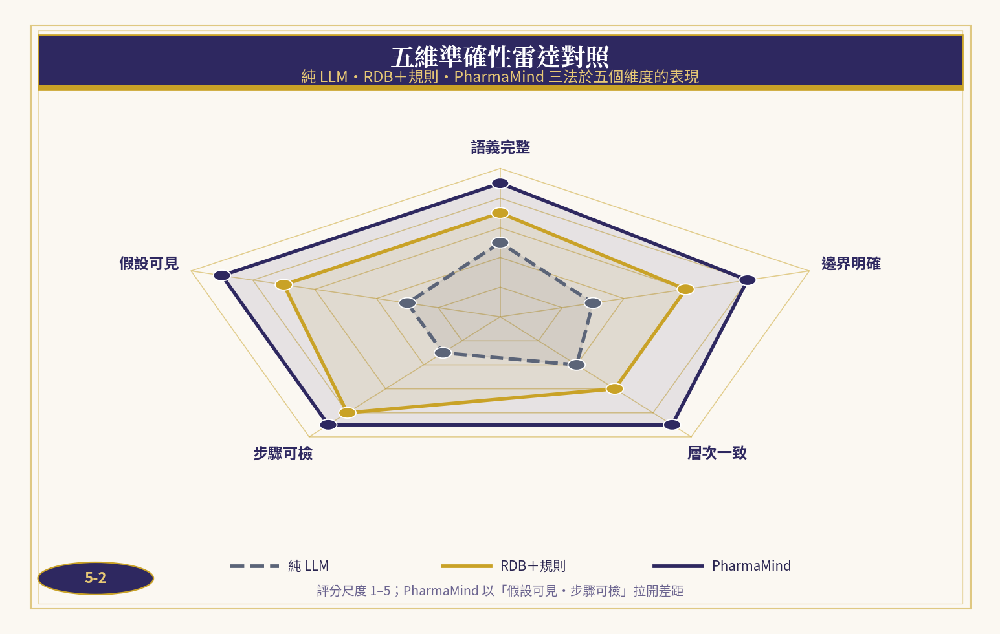

*Figure 5-2　Five-dimensional accuracy radar comparison*

The pure LLM performs well on semantic fluency, but its assumptions are implicit and its steps are non-traceable, giving it the lowest total score; the RDB + rules is reliable on step checkability, yet lacks the ability of joint judgment with layer consistency; PharmaMind carries judgment with formalized axioms and leads across all five dimensions, while its weak point "boundary clarity" (4.0) stems from the fact that the feature completeness of the intersection criterion still depends on iteration by domain experts—this is an honest self-disclosure of the method, and also the direction for the next step.

## Chapter 6　Case Studies

This chapter demonstrates the application of the Accurate Method through two illustrative cases. The case data are constructed for demonstrating the method (synthetic), with the emphasis on the checkability of the judgment process rather than on specific values; in a real project, the same judgment chain can be applied directly to experimental data.

### 6.1　Case One: Lead Compound Optimization

Task: for a certain kinase target, optimize the activity of the lead compound A-01 from 480 nM to within 50 nM, while controlling hERG toxicity risk. Table 6-1 records four rounds of optimization, and Figure 6-1 shows the framework evolution path.

**Table 6-1　Case One Optimization Round Records**

| **Round** | **Operation** | **Framework Significance** | **IC50 (nM)** | **hERG Inhibition** |
| --- | --- | --- | --- | --- |
| R1 | Starting point A-01, confirm the core scaffold | Type definition / register container | 480 | — |
| R2 | F-substituted analog scan | Add rows: same-Type expansion | 120 | — |
| R3 | Introduce the hERG dimension | Add columns: framework evolution | 38 | 62% |
| R4 | Side-chain fine-tuning converges to A-07 | All intersection criteria passed | 22 | 18% |

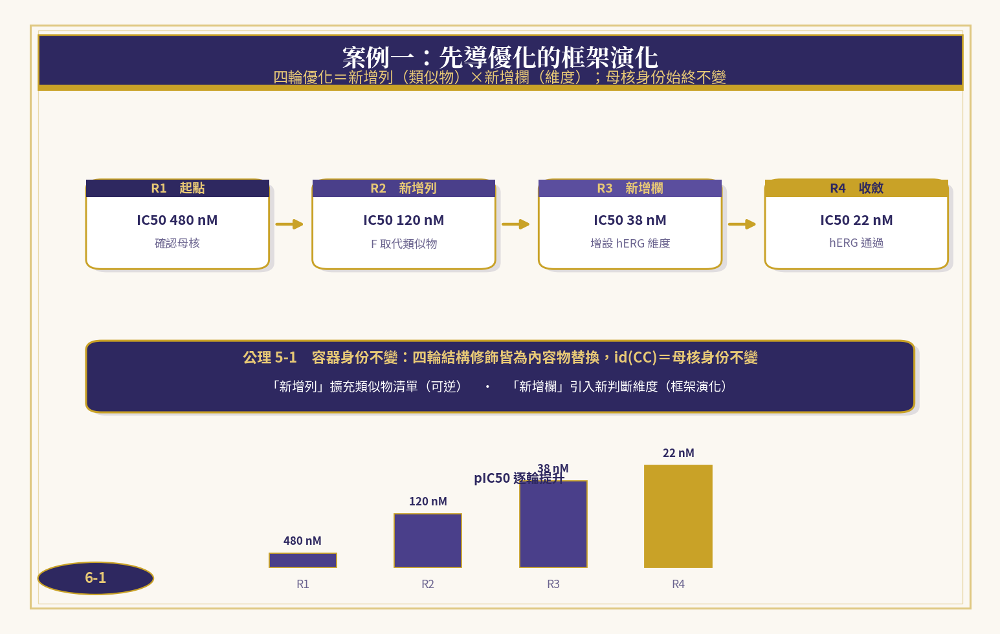

*Figure 6-1　Case One: framework evolution in lead optimization*

The operation of the judgment chain is as follows. Container layer: all compounds of R1–R4 are registered under the same core scaffold identity id(CC); by Axiom 5-1, the side-chain modifications are all replacements of contents, and the judged object across the four rounds is always "the same" series. SOM layer: applying the grading of Theorem 5-1 to the hits before R3 confirms that the pharmacophore's hydrogen bond donor is an essential part and that the hydrophobic pocket-occupying group is a functionality-degrading part—the hERG risk comes precisely from the excessive extension of the functionality-degrading part, so R4 shortens the side chain to recover selectivity. Abstraction layer: the R4 product passes the fourfold intersection criterion of IC50, selectivity, hERG, and drug-likeness, so belonging holds. Throughout, assumptions are explicit (the modified dimensions are listed in each round), steps are checkable (a matrix row is retained in each round), and replacement is invariant (salt-form screening requires no re-judgment by Theorem 5-3).

### 6.2　Case Two: Type Retrieval for Drug Repositioning

Task: for the same kinase target, find repositionable candidates in an existing drug library. The traditional approach retrieves by structural similarity and easily falls into the activity cliff of "similar but not the same"; PharmaMind instead retrieves by "Type"—constructing an intersection criterion from attribute signatures (target category, activity, selectivity, drug-likeness) and performing belonging judgments against the Type index of the drug library (Figure 6-2).

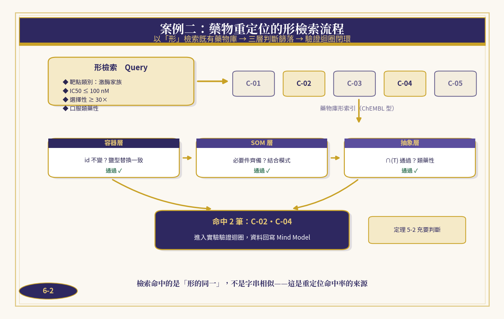

*Figure 6-2　Case Two: the Type retrieval process for drug repositioning*

**Table 6-2　Case Two Candidate Scoring and Three-Layer Judgment**

| **Candidate** | **IC50 (nM)** | **Selectivity** | **Drug-Likeness** | **Three-Layer Judgment Landing Point** | **Conclusion** |
| --- | --- | --- | --- | --- | --- |
| C-01 | 8 | 12× | Pass | SOM layer failed: essential part missing | Eliminated |
| C-02 | 22 | 45× | Pass | All three layers passed | Hit |
| C-03 | 65 | 8× | Fail | Abstraction layer failed | Eliminated |
| C-04 | 34 | 60× | Pass | All three layers passed | Hit |
| C-05 | 15 | 25× | Pass | Container layer failed: unstable salt form | Eliminated |

Among the five candidates, C-01 has the strongest activity yet falls at the SOM layer—its structure lacks an essential part, and its activity is a "similar but not the same" false hit; C-03 is excluded at the abstraction layer by the drug-likeness criterion; and C-05 fails the container layer because of an unstable salt form and discontinuous container identity. Ultimately C-02 and C-04 are hits, and both enter the experimental verification loop. It is worth noting that the "landing point" of the judgment is speakable: every elimination points precisely to a certain step among the three layers, rather than to a vague score—this is precisely the engineering value of the sufficiency and necessity of Theorem 5-2.

## Chapter 7　Conclusion and Outlook

### 7.1　Review of Results

This paper has completed one foundational piece of work: reconstructing the judgments of drug exploration and discovery from experiential statements into checkable Type judgments. There are four specific results: first, it completes the three-way precise correspondence of drug discovery ↔ Ontypology ↔ database, making cross-domain translation verifiable item by item; second, it gives the formal definitions of the drug Type and the compound container, along with the four axiomatic foundations of container identity invariance, SOM structural grading, sufficiency and necessity of the three-layer judgment, and Type-replacement invariance; third, it proposes the PharmaMind dual-engine five-layer architecture and the predict–verify–revise closed loop, making the six-step method an implementable engineering process; and fourth, it demonstrates the application of the three-layer Type judgment through two cases, and shows with the five-dimensional scale the comprehensive advantages of the Type-based method in accuracy.

### 7.2　Limitations and Outlook

The limitations of this study are equally clear: the cases are constructed to demonstrate the method and still await prospective validation with real R&D data; the feature completeness of the intersection criterion depends on iteration by domain experts, and the "boundary clarity" dimension still has room for improvement; and the method currently focuses on drug exploration and discovery, while the Type-ification of the preclinical, clinical, and regulatory stages has yet to be developed.

There are three outlooks. First, introduce the Temporal Type into experimental design and clinical sequencing, recording causal and reverse-causal reasoning with (I, E, κ), so that "why a certain round failed" is likewise checkable; second, along the three stages of the Eternal Way of AGI—knowledge unification, thought unification, and intelligence unification—evolve the PharmaMind Type library into a cross-institutional unified model of pharmaceutical knowledge; and third, push the Accurate Method toward formulation, clinical, and real-world evidence, so that "the judgment of the Type" runs through the entire life of a new drug. When judgment is accurate enough, the loss at each layer of the funnel truly becomes a learnable signal, rather than an unknowable cost.

> **Closing Remarks**
> Mathematics describes quantity and laws, while Typology describes structure and essence. The next breakthrough in drug R&D lies not only in stronger screening platforms, but even more in a more accurate method of judgment—this is the conviction of PharmaMind, and also the answer that Ontypology delivers to pharmaceutical R&D.

## References

[1]　Paul SM, Mytelka DS, Dunwiddie CT, et al. How to improve R&D productivity: the pharmaceutical industry's grand challenge. Nat Rev Drug Discov. 2010;9(3):203–214.

[2]　Scannell JW, Blanckley A, Boldon H, Warrington B. Diagnosing the decline in pharmaceutical R&D efficiency. Nat Rev Drug Discov. 2012;11(3):191–200.

[3]　Wong CH, Siah KW, Lo AW. Estimation of clinical trial success rates and related parameters. Biostatistics. 2019;20(2):273–286.

[4]　Gaulton A, Hersey A, Nowotka M, et al. The ChEMBL database in 2017. Nucleic Acids Res. 2017;45(D1):D945–D954.

[5]　Kim S, Chen J, Cheng T, et al. PubChem 2019 update: improved access to chemical data. Nucleic Acids Res. 2019;47(D1):D1102–D1109.

[6]　Lipinski CA, Lombardo F, Dominy BW, Feeney PJ. Experimental and computational approaches to estimate solubility and permeability in drug discovery. Adv Drug Deliv Rev. 1997;23(1–3):3–25.

[7]　Schneider G. Automating drug discovery. Nat Rev Drug Discov. 2018;17(2):97–113.

[8]　Vamathevan J, Clark D, Czodrowski P, et al. Applications of machine learning in drug discovery and development. Nat Rev Drug Discov. 2019;18(6):463–477.

[9]　Stokes JM, Yang K, Swanson K, et al. A deep learning approach to antibiotic discovery. Cell. 2020;180(4):688–702.

[10]　Jumper J, Evans R, Pritzel A, et al. Highly accurate protein structure prediction with AlphaFold. Nature. 2021;596(7873):583–589.

[11]　Allen JF. Maintaining knowledge about temporal intervals. Commun ACM. 1983;26(11):832–843.

[12]　Maggiora GM. On outliers and activity cliffs—why QSAR often disappoints. J Chem Inf Model. 2006;46(4):1549.

[13]　Reker D, Schneider G. Active-learning strategies in computer-assisted drug discovery. Drug Discov Today. 2015;20(4):458–465.

[www.longreat.net](https://www.longreat.net)

Chang-Feng Chang [gamma@livemail.tw](mailto:gamma@livemail.tw)

Ting-Ying Chang [mindaiworks@gmail.com](mailto:mindaiworks@gmail.com)

