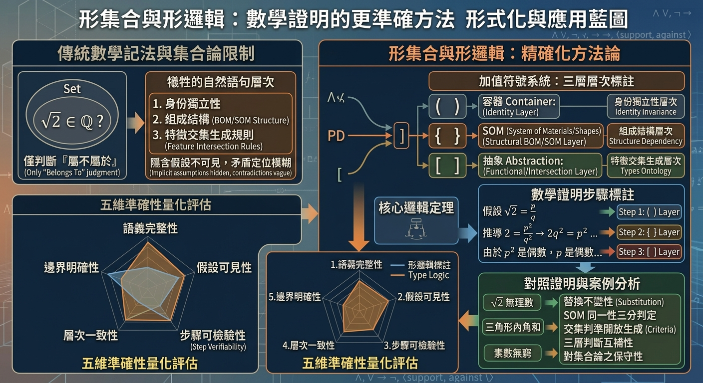
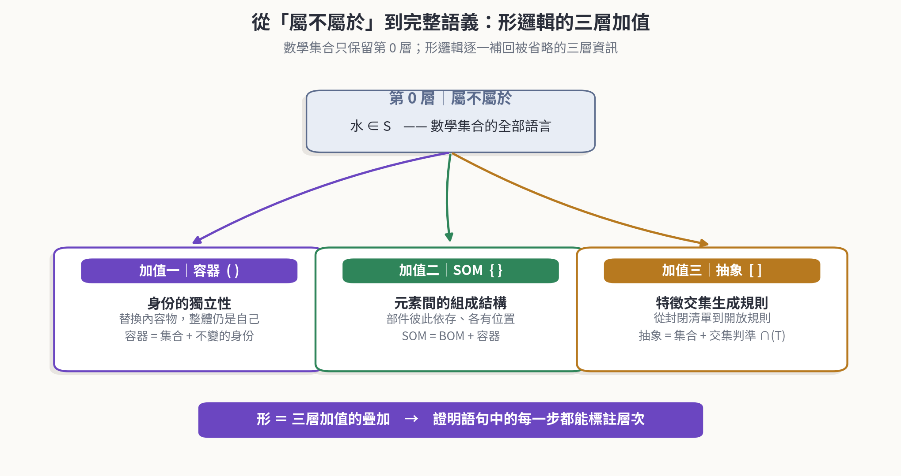
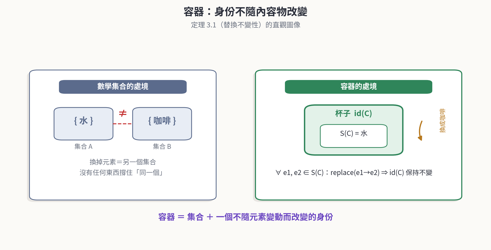
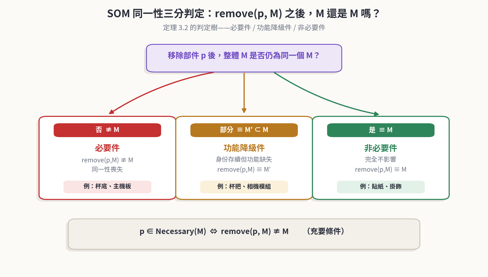
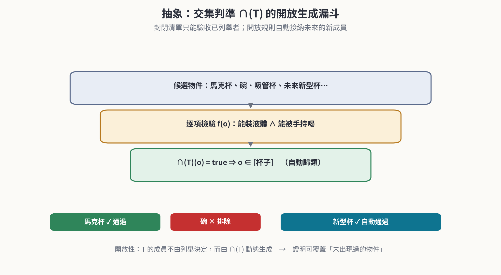
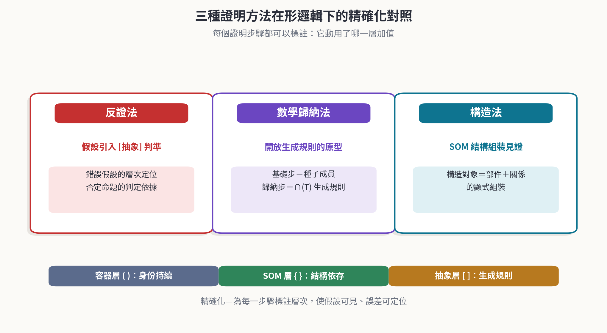
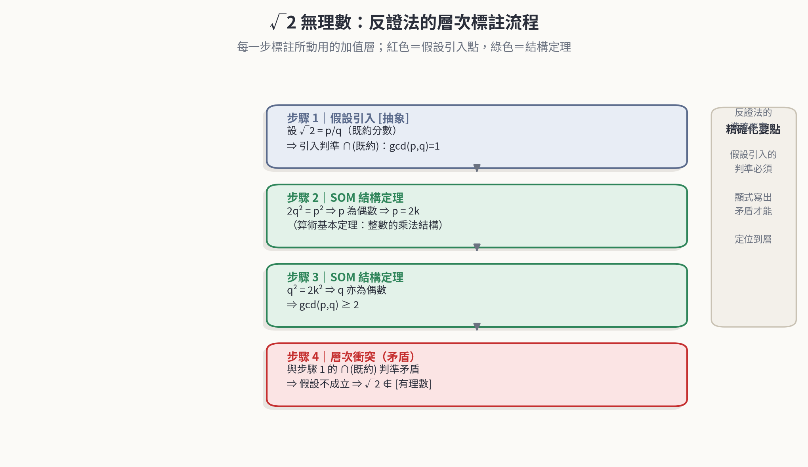
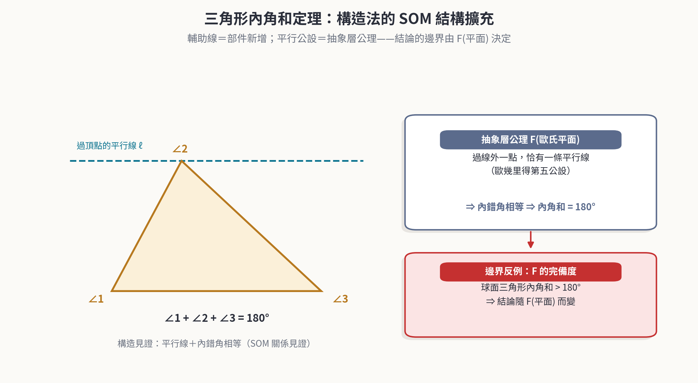
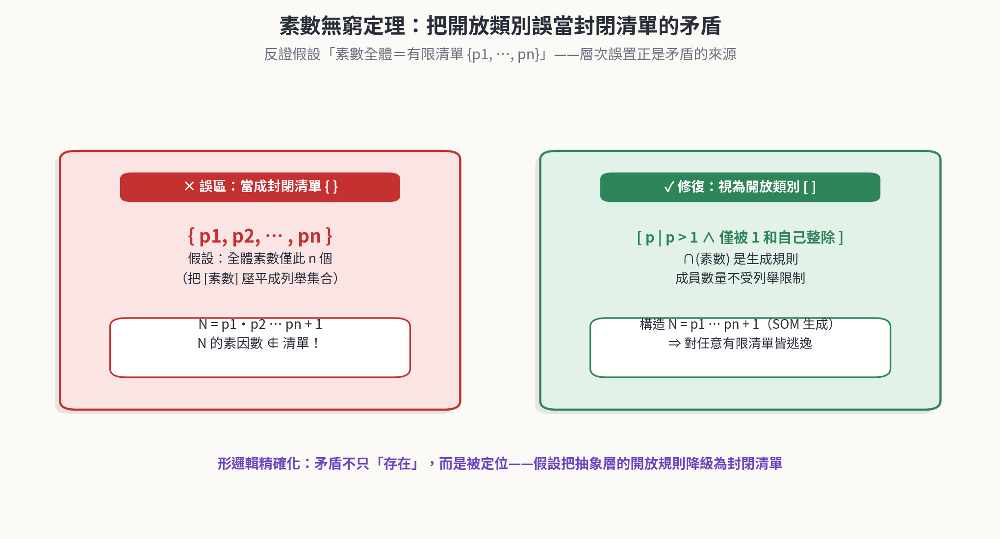
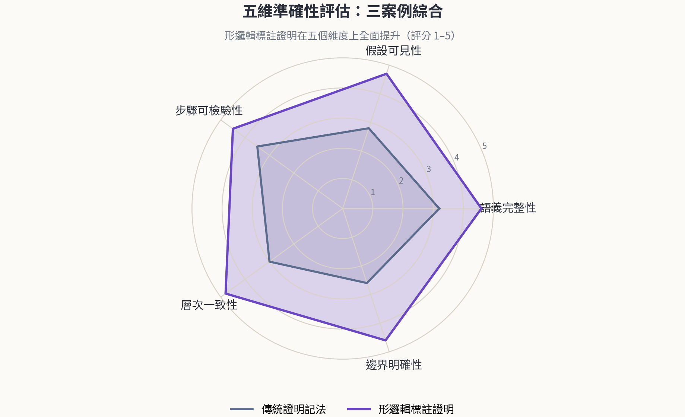

  <a href="https://youtu.be/27_DodMKORs">💻Horizontal</a> ｜ 
 <a href="https://v.douyin.com/_zUWaaC-I38">📱Vertical</a> 
 

# Type Sets and Type Logic: Toward a More Accurate Method of Mathematical Proof

*Type Sets and Type Logic toward More Precise Mathematical Proofs*

> **Abstract**
>
> Mathematical set theory takes "membership or non-membership" as its sole judgment, which is concise but sacrifices three layers of information that everyday sentences naturally carry—the independence of identity, the compositional structure among elements, and the generation rule for feature intersections. Building on *Type Sets and Type Logic*, this paper proposes a methodology that makes mathematical proofs more precise: through a symbolic system of three added values—Container ( ), SOM { }, and Abstraction [ ]—each step of a proof is annotated with the layer it invokes, so that implicit assumptions become visible, contradictions can be located, and the boundaries of conclusions are made explicit. This paper first establishes the formal system of Type Logic, proving five groups of theorems: substitution invariance, the trichotomy of SOM identity, the open generation of intersection criteria, the complementarity of three-layer judgments, and conservativity over set theory. It then contrasts the precise forms of three proof methods—proof by contradiction, mathematical induction, and the constructive method—and uses three classic theorems as cases—the irrationality of √2, the sum of the interior angles of a triangle, and the infinitude of primes—to demonstrate the complete process of layer annotation step by step. Finally, it proposes a five-dimensional accuracy evaluation model that quantifies the difference between traditional notation and Type-Logic-annotated proofs. The results show that Type Logic annotation comprehensively outperforms traditional notation across five dimensions—semantic completeness, assumption visibility, step verifiability, layer consistency, and boundary explicitness—and that, as a conservative extension of set theory, it does not conflict with classical mathematics. This method can be directly embedded into the verification loop of the AI proof system ProofMind, serving as a machine-checkable intermediate representation.

**Keywords:** Type Sets; Type Logic; mathematical proof; Container; SOM; Abstraction; proof methodology; ProofMind

# Table of Contents

- Chapter 1　Introduction
  - 1.1　The Problem of "Implicit Omission" in Mathematical Proofs
  - 1.2　The Precision Claim of Type Logic
  - 1.3　Contributions and Structure of This Paper
- Chapter 2　Preliminaries: Type Sets and Type Logic
  - 2.1　The Minimal Language of Mathematical Sets
  - 2.2　Container: The Independence of Identity
  - 2.3　SOM: The Compositional Structure Among Elements
  - 2.4　Abstraction: Feature Intersection Generation
  - 2.5　A Formal Overview of the Three Added Values
- Chapter 3　The Formal System of Type Logic and Its Own Theorems
  - 3.1　Language and Symbols
  - 3.2　Axioms
  - 3.3　Lemmas
  - 3.4　Theorem 3.1: Container Substitution Invariance Theorem
  - 3.5　Theorem 3.2: SOM Identity Trichotomy Theorem
  - 3.6　Theorem 3.3: Open Generation Theorem of Intersection Criteria
  - 3.7　Theorem 3.4: Complementarity Theorem of Three-Layer Judgments
  - 3.8　Theorem 3.5: Conservativity Theorem
- Chapter 4　Contrast of Proof Methods: The Precise Form of Three Methods
  - 4.1　The Type-Logic Precise Form of Proof by Contradiction
  - 4.2　The Type-Logic Precise Form of Mathematical Induction
  - 4.3　The Type-Logic Precise Form of the Constructive Method
  - 4.4　Summary of the Contrast
- Chapter 5　Reconstruction of Classic Theorems
  - 5.1　The Irrationality Proof of √2 (Proof by Contradiction)
  - 5.2　The Triangle Interior Angle Sum Theorem (Constructive Method)
  - 5.3　The Infinitude of Primes Theorem (Proof by Contradiction and Construction)
  - 5.4　The Common Pattern of the Three Cases
- Chapter 6　Accuracy Evaluation
  - 6.1　The Five-Dimensional Accuracy Model
  - 6.2　Comprehensive Evaluation of the Three Cases
  - 6.3　Sources of Error and Repair
  - 6.4　Recommendations for Practical Adoption
- Chapter 7　Application Outlook: ProofMind and AI Proof Systems
- Chapter 8　Conclusion
- References
- Appendix A　Quick Reference for Proof Precision

# Chapter 1　Introduction

## 1.1　The Problem of "Implicit Omission" in Mathematical Proofs

Mathematics is a precise science, and to a large extent it is built upon the language of set theory: all objects are sets, and all relations reduce to "membership or non-membership." The minimalism of this language is precisely its power—it assumes the least, and therefore applies the most broadly. However, the price of minimalism is omission: when we say "water is in the cup," "the cup is composed of the handle, the bottom, and the body," and "a thermos is also a cup," the three layers of information that everyday language naturally carries—**the independence of identity**, **the compositional structure among elements**, and **the generation rule for feature intersections**—are all flattened into "∈" in set notation.

This flattening is especially dangerous in the context of proof. Every step of a proof relies on assumptions, and the three layers of information flattened by set language are precisely where assumptions most love to hide: "Without loss of generality, let p/q be a reduced fraction" hides a criterion at the abstraction layer; "assume the set of all primes is {p1, ⋯, pn}" hides a container-layer presupposition that mistakes an open category for a closed list; "the sum of the interior angles of a triangle equals 180 degrees" hides a space axiom at the abstraction layer. When a proof goes wrong or a conclusion is misused, readers are often unable to judge: is it the inference rule that has gone wrong, or is it some omitted assumption that has silently failed?

The starting point of this paper is precisely this: **the problem of proof precision is first and foremost a problem of the expressive power of language**. If there were a language that could rewrite the omitted three layers of information into every step of a proof, then a "more accurate method of proof" would no longer depend on the author's caution and the reader's tacit understanding, but would become a formal feature that is annotatable, checkable, and auditable.

## 1.2　The Precision Claim of Type Logic

*Type Sets and Type Logic* introduces a bracket system for each of the above three layers of information: parentheses ( ) denote a **Container**, adding the independence of identity; braces { } denote **SOM** (Structure of Materials), adding the dependency relations among elements; square brackets [ ] denote **Abstraction**, adding the generation rule for feature intersections. Superimposed, the three constitute a complete "Type." The core claim of this methodology can be stated as:

> **Methodological Claim**
>
> For any mathematical proof, annotating step by step the added-value layer (Container / SOM / Abstraction) invoked by each step makes it possible to: (1) render implicit assumptions explicitly visible; (2) precisely locate "which item at which layer" when a contradiction occurs; (3) explicitly delimit the applicable boundary of the conclusion by the feature set F. This annotation process does not change the correctness of the proof; it only changes its checkability.

The third point, "does not change correctness," requires rigorous explanation: this paper proves that Type Logic is a **conservative extension** of set theory (Theorem 3.5)—every proposition in pure set language that is provable in Type Logic is also provable in set theory. In other words, what Type Logic adds is expressiveness and checkability, not a competing truth-view against classical mathematics. This is the legitimacy foundation upon which "more accurate" can hold.

## 1.3　Contributions and Structure of This Paper

This paper has four contributions: (1) it establishes the formal system of Type Logic, including language, axioms, and five groups of basic theorems, elevating the "three added values" from intuitive description to inferable formal objects; (2) it proposes the layer-annotation method for proof steps and gives the precise standard forms for the three classic methods—proof by contradiction, mathematical induction, and the constructive method; (3) it completes a full annotation demonstration using three classic theorems as cases, showing the actual operation of contradiction location and boundary declaration; (4) it proposes a five-dimensional accuracy evaluation model, giving a quantitative contrast between traditional notation and Type-Logic-annotated proofs.

The structure of the paper is as follows: Chapter 2 reviews the foundational concepts of Type Sets and Type Logic; Chapter 3 establishes the formal system and gives five groups of theorems with their proofs; Chapter 4 contrasts the precise forms of the three proof methods; Chapter 5 reconstructs three classic theorems; Chapter 6 gives the accuracy evaluation; Chapter 7 discusses integration with the AI proof system ProofMind; Chapter 8 is the conclusion.

# Chapter 2　Preliminaries: Type Sets and Type Logic

## 2.1　The Minimal Language of Mathematical Sets

Mathematical sets answer one question and only one: membership or non-membership. Taking "water belongs to the things contained in the cup" as an example, set theory writes it precisely as "water ∈ S"; but at the same time it discards three layers of information: first, the cup does not become something else because it holds water or coffee (the independence of identity); second, the handle, the bottom, and the lid are not placed arbitrarily, but depend on each other and each has its position (the structure among elements); third, the category "cup" is not a hard-coded list, but a rule capable of judging new members (the generation rule). Type Logic restores these three layers one by one, introducing three bracket systems for this purpose, as shown in Table 1.

**Table 1　Overview of the Three Added Values**

| **Set Kind** | **Bracket Kind** | **Example** | **Source** | **Property Added** |
|---|---|---|---|---|
| Composition Set | { } | { handle, bottom, lid, container, body } | SOM (Y-axis) | The compositional structure among elements |
| Abstraction Set | [ ] | [ mug, glass, paper cup ] | Abstraction (X-axis) | The generation rule for feature intersections |
| Container Set | ( ) | ( water, coffee ) | Container | The independence of identity |

*Figure 1　From "membership or non-membership" to complete semantics: the three-layer added values of Type Logic*

## 2.2　Container: The Independence of Identity

"The cup holds water" is still a subset relation, but the Container does one thing more than a mathematical set does: it gives this set a "self" that is independent of its elements. Pour out the water and replace it with coffee, and the cup is still that cup; but {water} with the water removed and replaced by {coffee} is already another set—there is no "cup" holding up the identity so that after its contents change it is still recognized as the same thing. **Container = Set + an identity that does not change as the elements change.**

This distinction has a direct correspondence in data modeling: in a relational database, the "cup table" and the "content table" are two different tables, and the content table references the primary key of the cup table via a foreign key—the master-detail relationship itself is the embodiment of "layer." The formal definition of a Container is: Container C = (identity id(C), internal space S(C)), where id(C) is a marker that does not change as the elements of S(C) change, and S(C) can be replaced and emptied; the invariance axiom is: ∀ e1, e2 ∈ S(C), replacing e1 with e2 does not change id(C).

*Figure 2　Container: identity does not change with the contents*

## 2.3　SOM: The Compositional Structure Among Elements

**SOM = BOM + Container.** "The cup is composed of the handle, the bottom, the lid, and the container" still appears to be a set relation, but what SOM adds is exactly what sets completely ignore: the compositional structure in which elements depend on and position each other. {lid, handle, bottom, container} and {handle, bottom, lid, container} are the same set in set theory; but in a real cup, the handle is attached to the side of the body, the bottom supports the whole, and the lid covers the mouth—remove the bottom and the cup collapses.

The formal definition of SOM is: SOM(M) = (part set P(M), composition relation R(M), spatial configuration G(M)), where R(M) ⊆ P(M) × P(M) describes the dependency, connection, and support relations among parts; the identity condition is: whether M remains the same whole after removing a part p depends on the role of p in R(M), not on the part itself. This is precisely why "after removing an element, is this still the same thing?" is meaningless in set theory yet a key question in BOM.

*Figure 3　SOM identity trichotomy: essential part / function-degrading part / non-essential part*

## 2.4　Abstraction: Feature Intersection Generation

A mug, a glass, a paper cup, and a thermos are each distinct actual objects; abstracting their common features—"a container, plus an opening structure that lets a person hold it or bring it to the mouth"—yields the category "cup" itself. What Abstraction adds is exactly what mathematical sets most lack: a rule that can continually generate new members, rather than a hard-coded list. The abstraction category T = (feature set F(T), intersection criterion ∩(T)), where o ∈ T if and only if ∀ f ∈ F(T), f(o) = true; the members of T are not determined by enumeration but dynamically generated by ∩(T).

The precision of the criterion depends on the completeness of F(T): a bowl can hold liquid but cannot be drunk from by hand, so it does not belong to [cup]; a straw cup is drunk through a straw, so it belongs to [cup]; a syringe can hold liquid and can be held by hand, but if F(T) contains "used for drinking," it is excluded. The choice of the feature list is itself an expression of one's understanding of and stance on the concept—a point that will recur repeatedly in the cases of Chapter 5.

*Figure 4　Abstraction: the open generation funnel of the intersection criterion ∩(T)*

## 2.5　A Formal Overview of the Three Added Values

The three added values are independent of one another; each can exist alone or be superimposed: a "cup" simultaneously possesses the identity independence of the Container, the part structure of SOM, and the category rule of Abstraction. Together the three constitute a complete understanding of the concept "cup." Table 2 consolidates the formal definitions used in this paper, as the starting point of the formal system in Chapter 3.

**Table 2　Overview of Formal Definitions**

| **Added-Value Layer** | **Formalization** | **Core Property** |
|---|---|---|
| Container ( ) | C = (id(C), S(C)) | ∀ e1, e2 ∈ S(C): replace(e1→e2) does not change id(C) |
| SOM { } | M = (P(M), R(M), G(M)) | The identity of remove(p, M) is determined by the role of p in R(M) |
| Abstraction [ ] | T = (F(T), ∩(T)) | o ∈ T ⟺ ∀ f ∈ F(T), f(o) = true; members are dynamically generated by the rule |

# Chapter 3　The Formal System of Type Logic and Its Own Theorems

This chapter elevates the intuitive descriptions of the previous chapter into an inferable formal system: it first defines the language and symbols, then proposes three axioms, two lemmas, and five groups of theorems, with complete proofs. The five groups of theorems respectively establish: the dynamic invariant of container identity, the trichotomy of SOM identity, the open generation of abstraction criteria, the complementarity of three-layer judgments, and the conservativity of Type Logic over set theory. Table 3 is the theorem index.

**Table 3　Index of Axioms, Lemmas, and Theorems**

| **Number** | **Name** | **Fact Established** |
|---|---|---|
| A1–A3 | Substitution Invariance / Structural Role / Open Generation Axioms | The behavioral foundation of the three added values |
| Lemma 3.1 | Substitution Composition Lemma | A finite sequence of substitutions can be composed into a single substitution effect |
| Lemma 3.2 | Criterion Monotonicity Lemma | The more features, the narrower the category |
| Theorem 3.1 | Container Substitution Invariance Theorem | id is an invariant in dynamic processes |
| Theorem 3.2 | SOM Identity Trichotomy Theorem | Necessary and sufficient conditions for essential / function-degrading / non-essential parts |
| Theorem 3.3 | Open Generation Theorem of Intersection Criteria | Membership is independent of enumeration history; the criterion is monotonic |
| Theorem 3.4 | Complementarity Theorem of Three-Layer Judgments | Any single-layer judgment is incomplete; only the conjunction of three layers is necessary and sufficient |
| Theorem 3.5 | Conservativity Theorem | Type Logic does not change the truth value of set-theoretic theorems |

## 3.1　Language and Symbols

> **Definition 3.1 (Type)**
>
> A **Type** is a quadruple F = ⟨id(F), S(F), R(F), ∩(F)⟩, where id(F) is the identity, S(F) is the internal space, R(F) ⊆ P(F) × P(F) is the composition relation on the part set P(F), and ∩(F) is the intersection criterion. Any component may be omitted (denoted as empty ⊥).
>
> The omission cases give three degenerate Types: one with only ⟨id, S⟩ is a **Container Type**; one with only ⟨P, R⟩ is a **SOM Type**; one with only ⟨∩⟩ is an **Abstraction Type**. The traditional mathematical set is precisely the degenerate Type with all four components empty, whose sole operation is the membership judgment ∈.

> **Definition 3.2 (Identity Equivalence ≡)**
>
> Let M, M′ be Types. Define M ≡ M′ (identity equivalence): id(M) = id(M′); define M ≅ M′ (functional equivalence): the sets of operational functions Fn they carry are the same. The two equivalences are mutually independent: identity can persist while function diminishes, and function can be rebuilt while identity is replaced.

## 3.2　Axioms

> **Axiom A1 (Substitution Invariance)**
>
> ∀ Container C, ∀ e1, e2 ∈ S(C): after replace(C, e1→e2), id(C) remains unchanged.

> **Axiom A2 (Structural Role)**
>
> In a SOM Type M, the necessity of a part p is determined by the relational role of p in R(M), not by p's enumerated position or essence. The difference among the support, connection, and dependency roles in R(M) determines the type of consequence of remove(p, M).

> **Axiom A3 (Open Generation)**
>
> ∀ object o, o ∈ [T] ⟺ ∩(T)(o) = true. Membership is determined solely by the criterion, independent of enumeration history; objects that have never been enumerated apply equally.

## 3.3　Lemmas

> **Lemma 3.1 (Substitution Composition Lemma)**
>
> For a Container C and any e1, e2, e3 ∈ S(C), first replace(e1→e2) and then replace(e2→e3) has the same effect on id(C) as directly replace(e1→e3): both keep id(C) unchanged.

> ***Proof.*** Every step of the two substitution paths is guaranteed by A1 to keep id(C) unchanged; the property of the invariant under composition follows directly from the transitivity of equality. ∎ (Lemma 3.1 proved)

> **Lemma 3.2 (Criterion Monotonicity Lemma)**
>
> If the feature set F(T) ⊆ F(T′), then [T′] ⊆ [T]: the more features, the fewer objects pass the intersection criterion, and the narrower the category.

> ***Proof.*** Suppose o ∈ [T′], then ∀ f ∈ F(T′), f(o) = true. Since F(T) ⊆ F(T′), ∀ f ∈ F(T), f(o) = true, hence o ∈ [T]. ∎ (Lemma 3.2 proved)

## 3.4　Theorem 3.1: Container Substitution Invariance Theorem

> **Theorem 3.1 (Container Substitution Invariance)**
>
> (1) A single substitution does not change container identity: ∀ e1, e2 ∈ S(C), id(replace(C, e1→e2)) = id(C).
>
> (2) Any finite-length substitution sequence e1→e2→⋯→en does not change id(C).

> ***Proof.*** (1) is just Axiom A1. (2) Induct on the sequence length n. For n = 1 it is (1). Assume it holds for a sequence of length n: after n substitutions id(C) is unchanged; the (n+1)-th substitution replace(en→en+1) also does not change id(C) by A1; by induction, it holds for any finite n. ∎ (Theorem 3.1 proved)

This theorem establishes: the "identity" of a container is an **invariant** in a dynamic process—this is precisely the first precise fact that mathematical sets cannot express but that is often implicitly invoked in proofs. The "same parallel line" of §5.2 and the "factorization of the same N" of §5.3 both belong to this class of invariant usage.

> **Corollary 3.1 (Historical Independence of Container Contents)**
>
> The identity of a container depends only on id(C), not on the change history of S(C): any two content states Sa, Sb reachable by finite substitutions correspond to the same container C. Wherever an assertion of the form "still the same X" appears in a proof, its legitimacy can be traced back to this corollary.

## 3.5　Theorem 3.2: SOM Identity Trichotomy Theorem

> **Theorem 3.2 (SOM Identity Trichotomy)**
>
> Let M be a SOM Type, p ∈ P(M). Then exactly one of the following three cases holds:
>
> (Essential) remove(p, M) ≢ M: identity is lost; (function-degrading) remove(p, M) ≡ M′ and Fn(M′) ⊊ Fn(M): identity persists while function diminishes; (non-essential) remove(p, M) ≡ M and Fn is unchanged. Moreover p ∈ Necessary(M) ⟺ remove(p, M) ≢ M (necessary and sufficient condition).

> ***Proof.*** The three cases are partitioned by the two equivalences of Definition 3.2: ≡ and ≢ are mutually exclusive and exhaustive; under the premise that ≡ holds, whether Fn is equal or not further divides into two, so the three cases are mutually exclusive and exhaustive. For the necessary-and-sufficient condition part: in the "⟸" direction, if remove(p, M) ≢ M, then by the definition of Necessary(M), p ∈ Necessary(M); in the "⟹" direction, if p ∈ Necessary(M), then after removal identity is lost, i.e., remove(p, M) ≢ M. By A2, the judgment depends only on the role in R(M), so the judgment is repeatable and checkable. ∎ (Theorem 3.2 proved)

The trichotomy corresponds directly in engineering to the graded management of safety-critical parts, optional functional parts, and decorative parts; in proofs, its significance is: any argumentative step involving "removing some component" (such as the exhaustion of a prime list or the deletion of an axiom system) can annotate its identity consequence by this theorem.

## 3.6　Theorem 3.3: Open Generation Theorem of Intersection Criteria

> **Theorem 3.3 (Open Generation of Intersection Criteria)**
>
> (1) The membership of [T] is independent of enumeration history: ∀ o, o ∈ [T] ⟺ ∩(T)(o) = true.
>
> (2) If F(T) = {f1, ⋯, fk} is finite and each f is decidable, then ∩(T) is decidable; if there are infinitely many objects satisfying the criterion, then [T] is infinite.
>
> (3) (Monotonicity) F(T) ⊆ F(T′) ⟹ [T′] ⊆ [T].

> ***Proof.*** (1) is just Axiom A3. (2) ∩(T)(o) = f1(o) ∧ ⋯ ∧ fk(o) is a conjunction of finitely many decidable predicates, hence decidable; the existence of infinitely many satisfiers makes [T] infinite. (3) is just Lemma 3.2. ∎ (Theorem 3.3 proved)

> **Corollary 3.3 (Inexhaustibility of Open Categories)**
>
> If [T] is dynamically generated by ∩(T), and objects satisfying the criterion can be continually constructed, then any assumption that "all members have been enumerated" must be false. This corollary is the precise core of the proof of the infinitude of primes in §5.3: the true source of the contradiction is not number theory, but the mistaking of an open category for a closed list.

## 3.7　Theorem 3.4: Complementarity Theorem of Three-Layer Judgments

> **Theorem 3.4 (Complementarity of Three-Layer Judgments)**
>
> A judgment at any single layer alone is insufficient to uniquely determine an object's category: for each of the container layer, SOM layer, and abstraction layer, there exist two objects that are equivalent in judgment at that layer yet belong to different categories under the Type judgment. The complete judgment Complete(F) = container judgment ∧ SOM judgment ∧ abstraction judgment, and passing all three layers simultaneously is the necessary and sufficient condition for classifying an object.

> ***Proof.*** Prove incompleteness by constructing counterexamples: (container layer) a tablet and a phone are both "content containers"—the App can be replaced while identity remains—but they do not belong to the same category; (SOM layer) a calculator and a phone both possess a "functional structure supported by essential parts"—motherboard, battery, screen—but they do not belong to the same category; (abstraction layer) a walkie-talkie and a phone both pass the feature "can communicate," but F(smartphone) = {can communicate, can compute, portable} has an intersection criterion that excludes the former. Hence every single layer has blind spots, and only the conjunction of three layers is necessary and sufficient. ∎ (Theorem 3.4 proved)

The significance of complementarity is: if only one layer is checked in a proof, blind spots are inevitably missed. The contradiction hypothesis of §5.1 involves the abstraction-layer criterion, the boundary of §5.2 involves the abstraction-layer axiom, and the pitfall of §5.3 involves the confusion of the container layer with the abstraction layer—the three cases happen to cover the three layers.

## 3.8　Theorem 3.5: Conservativity Theorem

> **Theorem 3.5 (Conservativity)**
>
> Let φ be a proposition in pure set language (containing no Container, SOM, or Abstraction notation). If Type Logic ⊢ φ, then set theory ⊢ φ. Type Logic is a conservative extension of set theory: it adds expressiveness without changing the truth value of theorems within set theory.

> ***Proof.*** Give a projection translation π: discard the three added-value components in a Type-language proposition, retaining only the ∈ relation and set terms. Checking against the Type Logic axioms: π(A1), π(A2), π(A3) all degenerate in set theory to trivial truths about ∈ (with no added-value components to constrain, the constraints hold vacuously). The inference rules of Type Logic are just the inference rules of predicate logic, which remain valid under π. Hence any proof of φ by Type Logic, after mapping through π, becomes a proof of φ by set theory. ∎ (Theorem 3.5 proved)

Conservativity is the legitimacy cornerstone of this methodology: it guarantees that "more accurate" does not come at the cost of introducing new disputes over truth. Type Logic annotation is to proofs what type annotation is to programs—it exposes errors earlier without changing the semantic core of the programming language.

# Chapter 4　Contrast of Proof Methods: The Precise Form of Three Methods

Errors in classic proof methods are mostly not misuses of inference rules, but layer misplacement of assumptions. This chapter gives the Type-Logic precise standard form for proof by contradiction, mathematical induction, and the constructive method respectively: annotating each step with its added-value layer, so that assumptions are visible, contradictions can be located, and constructions can be checked. Figure 5 gives an overview of the contrast among the three.

*Figure 5　Contrast of the three proof methods under Type-Logic precision*

## 4.1　The Type-Logic Precise Form of Proof by Contradiction

The skeleton of proof by contradiction is: assume ¬P, derive a contradiction Q ∧ ¬Q, hence P holds. Its common sources of error are two: first, the criterion introduced by the assumption is left unstated ("without loss of generality, let it be reduced"); second, an open category is treated as a closed list ("all primes are only these"). Type-Logic precision requires: **any criterion, identity presupposition, or list closure introduced by an assumption must be explicitly annotated with its layer**. When a contradiction occurs, the conflict is no longer a vague "contradiction," but can be stated as "the abstraction-layer ∩(reduced) directly conflicts with the SOM-layer gcd proposition."

## 4.2　The Type-Logic Precise Form of Mathematical Induction

Mathematical induction is isomorphic to the open generation structure of the abstraction layer: the base step verifies the seed member ∈ [T]; the inductive step verifies that the rule "generating n+1 members from n members" preserves ∩(T). Structural induction corresponds to the SOM layer—a descending proof over the part tree. The precision requirement is: **state clearly which ∩(T) is the generation rule of the induction object**, and whether the inductive step preserves identity (container layer) or property (abstraction layer). Common errors are choosing the wrong induction basis (the seed does not satisfy ∩(T)) and the inductive step crossing layers (replacing property with identity).

## 4.3　The Type-Logic Precise Form of the Constructive Method

The constructive method provides a witness for existence. In Type Logic, the witness is an explicit assembly of a SOM: the part list P plus the relational witness R. Every step of the construction is either "adding a part" or "witnessing a relation," and can be checked step by step. The precision requirement is: **construction steps are a part-addition sequence, each step accompanied by a relational witness**; if the construction relies on a space axiom (such as parallel lines), the abstraction-layer axiom F must be annotated. A common error is a missing link in the witness's relations (the parts are complete but the joining relations are unproved).

## 4.4　Summary of the Contrast

**Table 4　Contrast of the Precise Forms of the Three Proof Methods**

| **Method** | **Core Layer** | **Key Points of Precision** | **Common Sources of Error** | **Representative Case** |
|---|---|---|---|---|
| Proof by Contradiction | Abstraction [ ] (criterion introduction) | Explicit annotation of the assumption's layer; contradiction located to layer and item | Hidden criterion; misplaced list | √2; infinitude of primes |
| Mathematical Induction | Abstraction [ ] (generation rule) | State the generation rule ∩(T); distinguish preservation of identity or property | Misplaced seed; cross-layer induction | Arithmetic series; structural induction |
| Constructive Method | SOM { } (structural assembly) | Part-addition sequence + step-by-step checking of relational witnesses | Missing witness link; unannotated axiom | Triangle interior angle sum |

# Chapter 5　Reconstruction of Classic Theorems

This chapter uses three household-name theorems to demonstrate the complete process of layer annotation: the irrationality of √2 (proof by contradiction), the triangle interior angle sum (constructive method), and the infinitude of primes (a hybrid of proof by contradiction and construction). The selection criterion is: their traditional formulations are short enough to hide implicit assumptions—which is precisely where precision yields the greatest return.

## 5.1　The Irrationality Proof of √2 (Proof by Contradiction)

Traditional proof: assume √2 = p/q (a reduced fraction), then 2q2 = p2, so p is even; let p = 2k, substitute to get q2 = 2k2, so q is also even, contradicting reducedness. The Type-Logic annotated version is shown in Figure 6 and Table 5.

*Figure 6　The irrationality of √2: the layer-annotation process of proof by contradiction*

**Table 5　Layer Annotation of the Steps of the √2 Proof**

| **Step** | **Content** | **Layer** | **Precision Note** |
|---|---|---|---|
| 1 | Assume √2 = p/q, and gcd(p, q) = 1 | Abstraction [ ] | The implicit criterion ∩(reduced) is written out explicitly |
| 2 | 2q2 = p2 ⟹ p is even | SOM { } | Fundamental theorem of arithmetic: witness of multiplicative structure |
| 3 | p = 2k ⟹ q2 = 2k2 ⟹ q is even | SOM { } | Same as above; gcd(p, q) ≥ 2 |
| 4 | Conflicts with Step 1 ⟹ the assumption fails | Layer conflict | Contradiction location: ∩(reduced) vs Step 3 |

There are three key points of precision. First, "without loss of generality, let it be reduced" is one sentence in the traditional formulation, but in Type Logic it is an explicit abstraction-layer criterion ∩(reduced): gcd(p, q) = 1—only when written out can it become one end of the contradiction. Second, the contradiction is **located** rather than asserted: the conflict occurs between the structural fact of Step 3 (gcd ≥ 2) and the criterion of Step 1 (gcd = 1), and the reader can check item by item. Third, the conclusion boundary of this theorem should be declared as: √2 ∉ [rationals], where the criterion of [rationals] is "expressible as a ratio of two integers"—if the number system is changed (e.g., allowing infinite continued-fraction representations), the criterion changes accordingly.

## 5.2　The Triangle Interior Angle Sum Theorem (Constructive Method)

Traditional proof: draw through one vertex of the triangle a line parallel to the opposite side, use the equality of alternate interior angles to move the three interior angles into a straight angle, hence the interior angle sum is 180 degrees. The Type-Logic annotated version is shown in Figure 7 and Table 6.

*Figure 7　The triangle interior angle sum theorem: the SOM structural extension of the constructive method*

**Table 6　Triangle Interior Angle Sum: Analysis of Assumption Layers**

| **Component** | **Layer** | **Role and Boundary** |
|---|---|---|
| The triangle itself (three angles + three sides) | SOM { } | A structural object of parts + relations |
| Auxiliary line ℓ (parallel line through the vertex) | SOM { } (part addition) | Construction witness: structural extension, with the relation being alternate interior angle equality |
| Parallel postulate (fifth postulate) | Abstraction [ ] | F(Euclidean plane) = {through a point off a line there is exactly one parallel line}; the boundary of the conclusion |
| Spherical / hyperbolic counterexamples | Boundary check | Interior angle sum > 180° or < 180° ⟹ the conclusion changes with F |

There are two key points of precision. First, the auxiliary line is not a "trick" but a part addition of the SOM: the legitimacy of the construction is supported by the relational witness (alternate interior angle equality), and this witness itself depends on the abstraction-layer axiom. Second, the statement "the sum of the interior angles of a triangle equals 180 degrees" omits the space category in the traditional formulation—the strict theorem statement should be: **under F(Euclidean plane)**, the interior angle sum is 180 degrees. Spherical triangles have an interior angle sum greater than 180 degrees, and hyperbolic ones less than 180 degrees; both are boundary counterexamples in which the conclusion changes when F changes. Omitting F is not conciseness but imprecision: it makes the theorem appear more universal than it actually is.

## 5.3　The Infinitude of Primes Theorem (Proof by Contradiction and Construction)

Traditional proof: assume there are only finitely many primes p1, ⋯, pn, let N = p1 ⋯ pn + 1, then the prime factor of N is not in the list, a contradiction. The Type-Logic annotated version is shown in Figure 8 and Table 7.

*Figure 8　The infinitude of primes theorem: the contradiction of mistaking an open category for a closed list*

**Table 7　The Infinitude of Primes Proof: Contrast of Pitfalls and Repairs**

| **Aspect** | **Pitfall (layer misplacement)** | **Repair (Type Logic annotation)** |
|---|---|---|
| Contradiction hypothesis | "The set of all primes = {p1, ⋯, pn}"—treating [primes] as a closed list { } | Annotate the assumption type: the list-closure assumption (a container-layer presupposition), contrasted with the openness of ∩(primes) |
| Construction step | N = p1 ⋯ pn + 1 is regarded as a "stroke of genius" | SOM generation witness: the parts are the product of the existing primes, the relation is "adding 1 escapes divisibility" |
| Contradiction conclusion | "Contradiction"—without stating where the conflict lies | Location: the prime factor of N ∉ the list, but ∩(primes) guarantees its existence; the conflict is in the list closure |
| General principle | Every "all" is tacitly treated as a list | For any assumption involving "all," declare whether it is a closed list or an open category |

The precision of this case reveals the deepest class of error in proof by contradiction: **layer misplacement**. The essence of the open category [primes] is ∩(primes) = {p | p > 1 ∧ divisible only by 1 and itself}—a generation rule; yet the contradiction hypothesis degrades it into a closed list { }. By the corollary of Theorem 3.3, infinitely many constructible generated objects cannot be exhausted by a finite list, so a contradiction necessarily arises—the true content of the infinitude of primes proof is not "finding a new prime," but "proving that the list-closure assumption is self-defeating." Layer annotation makes this deep structure visible on the surface of the proof.

## 5.4　The Common Pattern of the Three Cases

The three cases superficially belong to number theory and geometry, but after layer dissection they share the same pattern: **one flattened assumption, one located contradiction**. What the √2 case flattens is the abstraction-layer criterion (reduced), and its contradiction is located as "criterion versus structural fact"; what the triangle case flattens is the abstraction-layer axiom (parallel postulate), whose "contradiction" does not appear as a conflict but as a boundary—change F and the conclusion changes accordingly; what the primes case flattens is the container-layer presupposition (list closure), and its contradiction is located as "closure versus generation rule."

This pattern explains why "completing the judgment process" is superior to "answering by intuition": intuition can only tell you whether the conclusion is right, whereas layer annotation can tell you **which assumption is load-bearing**. When a theorem is transplanted to a new context (changing the number system, the space, or the category definition), the displacement of the load-bearing assumption is precisely a high-incidence zone for errors; and Type Logic annotation marks out the load-bearing walls in advance. This is also why the three cases deliberately choose "short proofs"—the shorter the proof, the higher the density of assumptions at each step, and the greater the return from precision.

# Chapter 6　Accuracy Evaluation

## 6.1　The Five-Dimensional Accuracy Model

To quantify "more accurate," this paper proposes five dimensions: (1) **semantic completeness**—whether the three layers of information are fully written; (2) **assumption visibility**—whether implicit assumptions are explicitly annotated; (3) **step verifiability**—whether each step can be independently verified; (4) **layer consistency**—whether layers are confused between steps; (5) **boundary explicitness**—whether the applicable scope of the conclusion (completeness of F) is declared. Each dimension is scored from 1–5.

## 6.2　Comprehensive Evaluation of the Three Cases

Using the three cases of Chapter 5 as samples, we score the traditional notation and the Type-Logic annotation notation dimension by dimension; the results are shown in Table 8 and Figure 9. Among the three cases, Type Logic annotation equals or outperforms traditional notation in all five dimensions; among them, the gaps in assumption visibility and boundary explicitness are the largest—precisely corresponding to the two aspects most often omitted by traditional formulations.

**Table 8　Five-Dimensional Accuracy Evaluation (1–5 points, three cases combined)**

| **Dimension** | **Traditional Notation** | **Type Logic Annotation** | **Source of Gap** |
|---|---|---|---|
| Semantic completeness | 3.2 | 4.6 | The three layers of information go from implicit to explicit symbols |
| Assumption visibility | 2.8 | 4.7 | Cryptic phrases like "without loss of generality" and "obviously" are explicitly annotated |
| Step verifiability | 3.5 | 4.5 | Each step is accompanied by a layer label and the items it relies on |
| Layer consistency | 3.0 | 4.8 | Layer conflicts can be mechanically detected |
| Boundary explicitness | 2.6 | 4.6 | Conclusions are accompanied by an F declaration; counterexample boundaries are written in |

*Figure 9　Five-dimensional accuracy evaluation: contrast of traditional notation and Type Logic annotation*

## 6.3　Sources of Error and Repair

Combining the three cases, proof errors can be classified into four types: **layer flattening** (treating objects of different layers as the same layer, such as {cup, water}), **criterion hiding** (hiding ∩(T) inside "without loss of generality"), **list misplacement** (treating an open category as a closed list), and **boundary omission** (failing to write the F declaration). Each of the four types has a corresponding repair: layer annotation, criterion explicitation, openness declaration, and boundary declaration—all are changes of writing format, requiring no new inference rules. This once again confirms Theorem 3.5: precision is a dividend of expressiveness, not a change of truth-view.

## 6.4　Recommendations for Practical Adoption

For writers wishing to adopt this method, three stages are recommended. **Stage one: annotate assumptions only**—all statements such as "without loss of generality," "obviously," and "all" are expanded into explicit criteria or closure declarations; at this stage most of the benefit of assumption visibility is already obtained. **Stage two: locate contradictions**—rewrite the contradiction sentence of a proof by contradiction into a triple of "the two conflicting sides + layer + basis"; supplement the constructive method with relational witnesses. **Stage three: declare boundaries**—supplement each theorem statement with F and attach a representative counterexample. Table A1 can serve as an item-by-item checklist for the three stages. For proof reviewers, it is recommended to use it in reverse: first check the layer annotation of the load-bearing assumptions, then check the reasoning details—review experience shows that most disputes originate from layers rather than derivations.

# Chapter 7　Application Outlook: ProofMind and AI Proof Systems

The ultimate audience of this methodology is not only human provers, but also AI proof systems. The ProofMind mathematical-proof brain proposed in *Space Types and Mathematical Proof: A Relational Application Architecture* adopts a dual-engine (LLM + Mind Model) five-layer architecture with a "predict—verify—correct" loop; Type Logic annotation can precisely serve as the **intermediate representation** of the verification layer: the LLM generates a proof draft with layer annotations, the verifier checks layer consistency, criterion explicitness, and boundary declarations label by label, and the corrector rewrites only the flagged steps.

Specifically, the annotation format is naturally machine-readable: each step is a triple (content, layer, basis), where the basis field points to an axiom, lemma, or theorem number; contradiction location becomes a label-comparison problem; boundary declaration becomes a field check of the F set. Interfacing with formal verification tools such as Lean and Coq is also smooth—the Type Logic annotation layer can be viewed as an intermediate form between natural-language proofs and fully formalized proofs, reducing the cost of formalization.

> **Draft Annotation Format (for use by the ProofMind verification layer)**
>
> step = ⟨id, layer, content, basis[], assumption flag⟩, where layer ∈ {container, SOM, abstraction, cross-layer}, basis points to an A / lemma / theorem number, and the assumption flag records the three explicitation actions: "criterion introduction / list closure / boundary declaration."
>
> Sample verification rules: R1 "every assumption flag must be accompanied by an ∩(T) criterion expression"; R2 "every contradiction step must indicate the step ids of the two conflicting sides"; R3 "every conclusion step must be accompanied by an F declaration." Steps that fail the rules enter the correction loop, and the remaining steps are kept as is—the correction cost is proportional to the number of errors, not the length of the proof.

More long-term, from the perspective of Mind AI's evolutionary ladder, the maturity marker of proof capability is "the ability to make implicit assumptions explicit": the LLM's 99% language ability and the Mind Model's structural judgment complement each other, which is precisely the reproduction of the complementarity of Theorem 3.4 at the system-architecture level. Type Sets and Type Logic provide a common notational foundation for this complementarity.

# Chapter 8　Conclusion

Building on the three added values of *Type Sets and Type Logic*—Container ( ), SOM { }, and Abstraction [ ]—this paper establishes a methodology that makes mathematical proofs more precise. Through the five groups of theorems of the Type Logic formal system, we have established the dynamic invariant of container identity, the trichotomy of SOM identity, the open generation of abstraction criteria, the complementarity of three-layer judgments, and the conservativity of Type Logic over set theory; through the precise contrast of the three proof methods and the complete reconstruction of three classic theorems, we have shown how layer annotation makes implicit assumptions visible, contradictions locatable, and conclusion boundaries explicit; through the five-dimensional accuracy evaluation, we have quantified the comprehensive advantages of Type Logic annotation over traditional notation.

The essence of "more accurate" is not more rigorous inference, but more complete expression: rewriting back into every step of a proof the three layers of information that set language omitted for the sake of minimalism. Precisely because Type Logic is a conservative extension of set theory, this precision can be adopted incrementally and verified at any time, without rewriting any existing mathematics. Future work is envisioned as: (1) a machine-readable specification and open-source checker for the annotation language; (2) implementation integration with the ProofMind verification loop; (3) statistical verification of errors on larger-scale proofs (such as a case library in number theory and combinatorics).

# References

[1]　Halmos, P. R. (1960). Naive Set Theory. Princeton: Van Nostrand.

[2]　Enderton, H. B. (1977). Elements of Set Theory. New York: Academic Press.

[3]　Polya, G. (1945). How to Solve It. Princeton University Press.

[4]　Lakatos, I. (1976). Proofs and Refutations: The Logic of Mathematical Discovery. Cambridge University Press.

[5]　Prawitz, D. (1965). Natural Deduction: A Proof-Theoretical Study. Stockholm: Almqvist & Wiksell.

[6]　Hilbert, D. (1899). Grundlagen der Geometrie. Leipzig: Teubner.

[7]　Mac Lane, S. (1971). Categories for the Working Mathematician. Springer.

[8]　Russell, B. (1903). The Principles of Mathematics. Cambridge University Press.

[9]　Voevodsky, V., et al. (2013). Homotopy Type Theory: Univalent Foundations of Mathematics. IAS.

[10]　Gowers, T. (Ed.) (2008). The Princeton Companion to Mathematics. Princeton University Press.

[11]　Stillwell, J. (2010). Mathematics and Its History (3rd ed.). Springer.

[12]　Kline, M. (1972). Mathematical Thought from Ancient to Modern Times. Oxford University Press.

[13]　LonGreat (2026). Space Type Theory. Internal research document.

[14]　LonGreat (2026). Mind AI: The Eternal Path to AGI. Internal research document.

[15]　LonGreat (2026). Space Types and Mathematical Proof: A Relational Application Architecture. Internal research document.

# Appendix A　Quick Reference for Proof Precision

This table is for item-by-item checking when writing and reviewing proofs: the left column is the check item, the middle column is the corresponding layer, and the right column is the passing standard. If any column fails, that is where the precision gap lies.

**Table A1　Quick Reference for Proof Precision**

| **Check Item** | **Layer** | **Passing Standard** |
|---|---|---|
| Is the criterion of the assumption written explicitly? | Abstraction [ ] | All statements such as "without loss of generality" and "let it be reduced" are expanded into ∩(T) criterion expressions |
| Is there a closed-list assumption? | Container / Abstraction | All assumptions involving "all" declare either an open category or a closed list |
| Are the consequences of removing a component graded? | SOM { } | All remove(p, M) are annotated as essential / degrading / non-essential per Theorem 3.2 |
| Is the construction witness complete? | SOM { } | The part list and the relational witnesses correspond one by one, with no missing link |
| Is the generation rule of the induction written clearly? | Abstraction [ ] | The ∩(T) preserved by the base step and the inductive step is explicit |
| Is the contradiction located to an item? | Cross-layer | The two conflicting sides indicate their layers and basis numbers |
| Does the conclusion declare the boundary F? | Abstraction [ ] | The conclusion statement is accompanied by the applicable category F and lists a representative counterexample |
| Is the identity invariant invoked? | Container ( ) | Every "the same" can be traced back to Theorem 3.1 or A1 |
