# Ontypology

## Mathematical Modeling

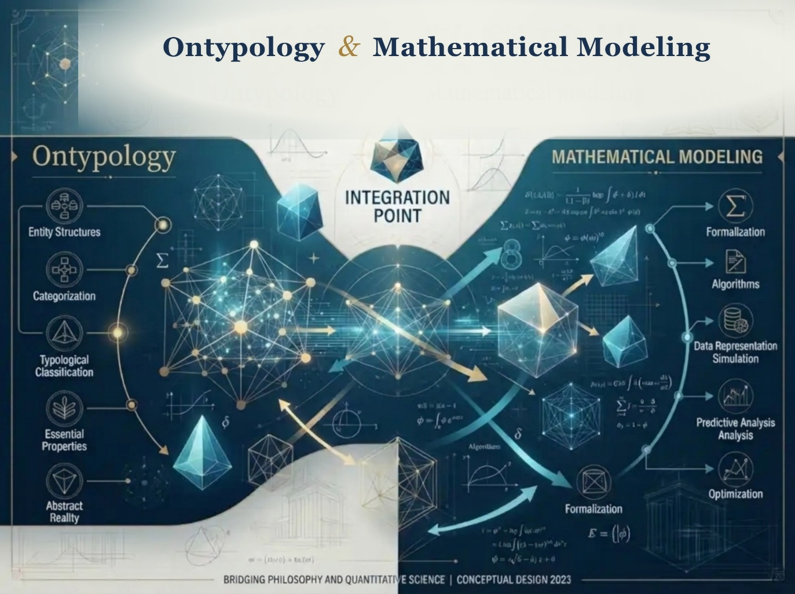

## Contents

- Preface4
- Introduction: The Toolbox and How to Read4
  - 1. This Book Does Only One Thing6
  - 2. Cognition Chain and Modeling Chain7
  - 3. The Book's Toolbox at a Glance8
- Part I — Positioning: Why Mathematical Modeling Needs Ontypology9
  - 1-1 Five Pain Points, One Root9
  - 1-2 Three-Layer Positioning: Root, Trunk, Fruit10
  - 1-3 Part Summary11
- Part II — The Backbone at a Glance: The Ontypology Toolbox13
  - 2-1 Three Axes, Three Brackets: The Full Notation of a Unit Type13
  - 2-2 Three-Layer Judgment: Container, Composition, Abstraction14
  - 2-3 Four Steps of the Spatial Framework: Dimensions Are Forced Out14
  - 2-4 The Five Operations and Their Comparison15
  - 2-5 The Temporal-Type Function Library16
  - 2-6 Modeling ↔ Ontypology: Master Mapping Table17
  - 2-7 The Accurate-Use Method: Overview18
  - 2-8 Part Summary19
- Part III — Spatial Types: Establishing the Modeling Object as a Type21
  - 3-1 Identify the Whole: Who Is the Model's M?21
  - 3-2 Variables and Scales: Numbers Depend on the Type22
  - 3-3 Assumptions: The Container's Admission Rules22
  - 3-4 Model Structure: The BOM and the Three Levels of Remove23
  - 3-5 Three-Layer Judgment × Model Classification24
  - 3-6 Part Summary25
- Part IV — Temporal Types: The Modeling Flow Is a Function Chain27
  - 4-1 The Six Stations: Problem → Assumption → Construction → Solution → Validation → Feedback27
  - 4-2 Six Function Cards with Four Questions28
  - 4-3 Equations = Transfer Rules of a Type: op: Type → Type28
  - 4-4 Five Families of Reasoning: Where Formulas Grow From29
  - 4-5 Choosing a Thinking Method: Which Path When Stuck30
  - 4-6 Type In, Type Out: The Modeling Loop31
  - 4-7 Part Summary32
- Part V — Type-ifying Model Families: Reading the Six Families Together34
  - 5-1 Overview of the Six Families34
  - 5-2 Optimization: The Objective Is the Criterion, Constraints Are Admission Rules35
  - 5-3 Differential Equations: State Is Content, Conservation Is Identity35
  - 5-4 Statistical-Probabilistic Models: Data Are Sub-Types Within a Type; Tests Are Three-Layer Judgments36
  - 5-5 Graph and Network Models: Nodes Establish Types, Edges Carry Relations37
  - 5-6 Queueing Systems: Container, Service, Degradation38
  - 5-7 Simulation: Rules, Randomness, Repetition39
  - 5-8 Family-Selection Tree and the Six-Family Comparison Table40
  - 5-9 Part Summary41
- Part VI — The Full Architecture of the Accurate-Use Method43
  - 6-1 Body–Use–Accuracy43
  - 6-2 Three Supplements, Modeling Edition44
  - 6-3 The Six Modeling Steps44
  - 6-4 End-to-End Demonstration: The SIR Epidemic Model in Six Steps45
  - 6-5 Eight Questions, Modeling Edition47
  - 6-6 Sixteen Misuses in Four Contrasting Groups48
  - 6-7 Reviewable Accuracy49
  - 6-8 Part Summary50
- Part VII — Overall Architecture: Two Libraries, One Hub, One Loop52
  - 7-1 Modeling's Two Libraries, One Hub, One Loop52
  - 7-2 The Four Acceptance Lines53
  - 7-3 Modeling Tools ↔ Ontypology: A Reading54
  - 7-4 Toward Mind AI: Unified Knowledge → Unified Thinking → Unified Intelligence55
  - 7-5 Part Summary55
- Part VIII — The Complete Content Plan: Learn, Practice, Use, Teach, Build57
  - 8-1 Learn–Practice–Use–Teach–Build + an Eight-Week Route57
  - 8-2 Four Reader Routes + Four Stages of Library Building58
  - 8-3 Five Fields Side by Side58
  - 8-4 Conclusion: Establish the Type, Establish the Formula, Make Validation Real59
- Appendix A — Glossary and Notation62
- Appendix B — Quick-Reference Cards64
- Appendix C — Answers to the Exercises66
- Appendix D — Index of Figures and Tables69

## Preface

Ontypology is the theoretical foundation. It turns every move in mathematical modeling — defining variables, writing assumptions, setting up equations, performing validation — into a Type operation that can be written down and checked back.

| Part | Question it answers | Main output |
| --- | --- | --- |
| Introduction | How should this book be read? | Two languages, the cognition chain, the toolbox list |
| Part I — Positioning | Why does mathematical modeling need Ontypology? | Five pain points, three-layer positioning |
| Part II — Backbone at a Glance | What is in the Ontypology toolbox? | Three axes, three-layer judgment, operations, function library, master mapping |
| Part III — Spatial Types | How is a modeling object established as a Type? | Three acts: variables, assumptions, structure |
| Part IV — Temporal Types | How does the modeling flow run reliably? | Six-station function chain, five reasoning families, thinking-method routing |
| Part V — Model Families | Which family does the formula grow from? | Six-family reading, family-selection tree |
| Part VI — The Accurate-Use Method | How do we write and validate a model accurately? | Three supplements, six steps, eight questions, 16 misuses |
| Part VII — Overall Architecture | How does modeling capability grow and last? | Two libraries, one hub, one loop; four acceptance lines |
| Part VIII — The Complete Content Plan | How to learn, how to teach, how to build a library? | Learn–Practice–Use–Teach–Build, eight-week route, four stages of library building |
| Appendices A–D | What to look up, print, and check answers against? | Glossary, quick-reference cards, exercise answers, index of figures |

> **Key line of this part**
>
> Accuracy is reviewable accuracy. Only when every step of a model can be written down and checked back does the question "does it compute accurately?" even arise.

## Introduction: The Toolbox and How to Read

### 1. This Book Does Only One Thing

There are many textbooks on mathematical modeling: they teach differential equations, optimization, statistics, simulation — all of them teach "how to solve the formula." In practice, however, when models fail, nine times out of ten the failure is not in the solving but in the establishing: assumptions are written unclearly, the meaning of variables drifts, the model does not match reality. This book does one thing only: fill in "establish" and "validate," using Ontypology's Type language to write the modeling object, the process, and the criteria in a reviewable form. How to solve a formula is left to existing textbooks; how to establish a Type and how to validate accuracy are this book's home ground.

> **Suggested reading routes**
>
> First pass: follow the introduction and the eight parts, and grasp the main line: establish the Type → establish the formula → establish the criterion.
> Second pass: read the Part II toolbox and the Part VI method selectively, keeping a real modeling problem at hand for comparison.
> Third pass: do the exercises in each part (E01–E14, S01–S03), then check the worked answers in Appendix C.

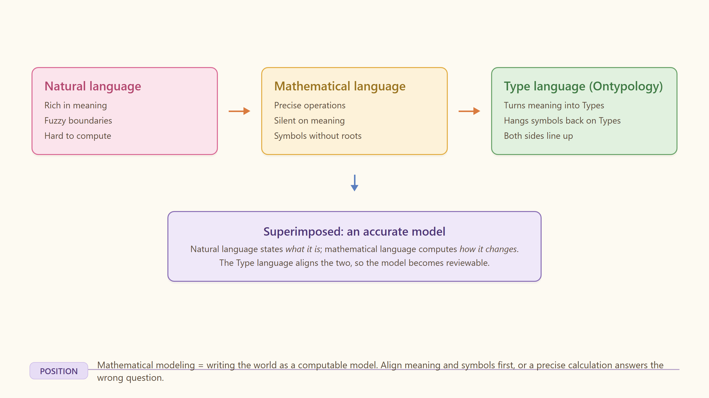

*Figure 0-1 Two languages superimposed: natural language states "what it is"; mathematical language computes "how it changes"*

**Example — One assumption, written two ways**

> **Example · Assumption**
>
> Natural language: "Air resistance is very small and can be ignored." How small is "very small"? Who decides?
> Type language: "Assumption H3: remove air resistance from the BOM and record it at the essential-part check of the three remove levels — after removal the model is still [free fall], and the criterion ∩(T) passes on every item." Pointable, relaxable, and recoverable for validation.

### 2. Cognition Chain and Modeling Chain

The cognition chain of Ontypology is: similarity and difference → split and merge → Type → name. First comes the felt sense that "this is not that"; from it grow the acts of splitting and merging; at the end a Type is established, and every Type has a name. Mathematical modeling runs the same machine: first distinguish similarities and differences in the phenomenon, separate the object from its background (establish the Type), then name each dimension (variables). This is what "first the Type, then the number" means on the modeling floor: a variable always depends on a Type that has already been identified.

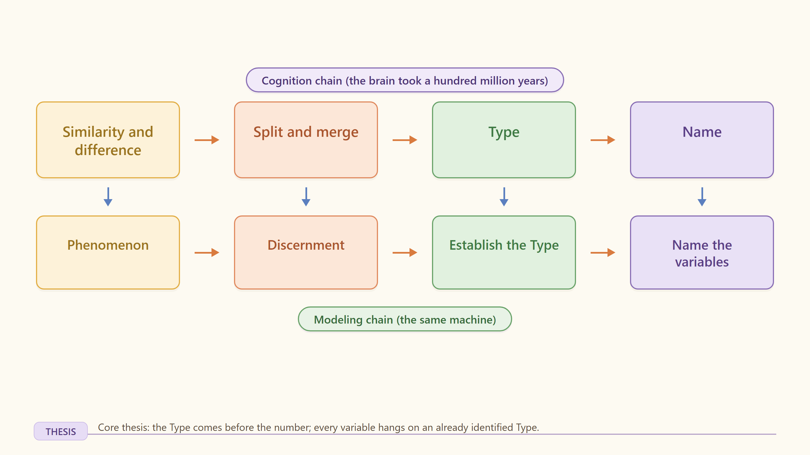

*Figure 0-2 Cognition chain × modeling chain: two sites of the same machine*

**Example — First the Type, then the number**

> **Example · Observation**
>
> "37.2" is a number; it must be able to say which Type (a patient's body temperature), which dimension (Celsius temperature), and which scale (°C).
> If the Type is not established before modeling begins, 37.2 drifts through the data table — body temperature today, air temperature tomorrow — and no matter how fast the model computes, it computes the wrong thing.

### 3. The Book's Toolbox at a Glance

Every Ontypology tool used in this book is established once, here in Part II, "The Backbone at a Glance." After that, each part only has to use them. Here is the list, so the reader can navigate by it:

| Tool | In one sentence | Used in |
| --- | --- | --- |
| Three axes, three brackets | X attributes [ ], Y bill of materials { }, Z container ( ) | Part III |
| Three-layer judgment | Container, composition, abstraction — all three layers are needed together | Parts III, VI |
| Four steps of the spatial framework | Distinguish similarity and difference → trigger abstraction → name dimensions → judge membership | Part III |
| Five operations | ⊕ · remove · σ · ∩(T)/α · ι, op: Type → Type | Parts IV, V |
| Temporal-Type function library | Function = method = move; input a Type, output a Type | Part IV |
| Accurate-Use Method | Three supplements + six steps + eight questions | Part VI |
| Two libraries, one hub, one loop | Type library · function library · criterion hub · modeling loop | Part VII |

## Part I — Positioning: Why Mathematical Modeling Needs Ontypology

Mathematical modeling is the discipline of writing the world as a computable model. It does not lack formulas; it lacks the "account of meaning": who the model's object is, what the variables are, what the assumptions shut outside the door, and what validation actually validated. This part first examines five common pain points, then gives the three-layer positioning of Ontypology on the modeling floor.

### 1-1 Five Pain Points, One Root

Anyone who has modeled has met these five things: assumptions written unclearly — afterwards nobody can say what the model ignored; variable meanings drifting — the same symbol refers to different quantities in different chapters; the model not matching reality — a beautiful fit that collapses when the setting changes; parameters that cannot be explained — the optimizer returns a number and nobody knows what it corresponds to in reality; validation that stays on the surface — using the same data to validate the same data.

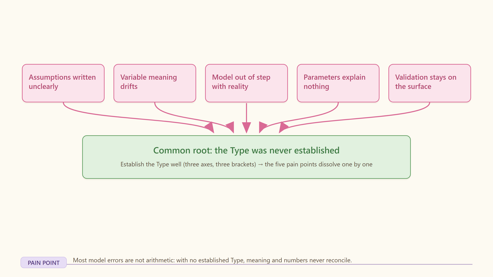

*Figure 1-1 The common root of the five pain points: the Type was not established*

**Example — The cost of variable drift**

> **Example · Quality**
>
> A production-line model used "yield" as its objective function. After deployment it turned out that "yield" in the report meant sampling yield, while "yield" in the model meant batch yield — two different dimensions wearing the same name.
> Ontypology keeps the account: yield ∈ [quality metric]. State the dimension (sampling or batch), the scale (percentage), and the container (which production line) first, and drift has nowhere to hide.

### 1-2 Three-Layer Positioning: Root, Trunk, Fruit

Ontology asks "what is there in the world" — that is the root. Ontypology asks "what is a Type, how is it judged, how does it operate" — that is the trunk. Mathematical modeling uses Types and functions to write the world as a computable model — that is the fruit. Each layer minds its own business: ontology guarantees that nothing "there" is missed; Ontypology guarantees that "what it is" does not become confused; mathematical modeling guarantees that "how it computes" is not wrong.

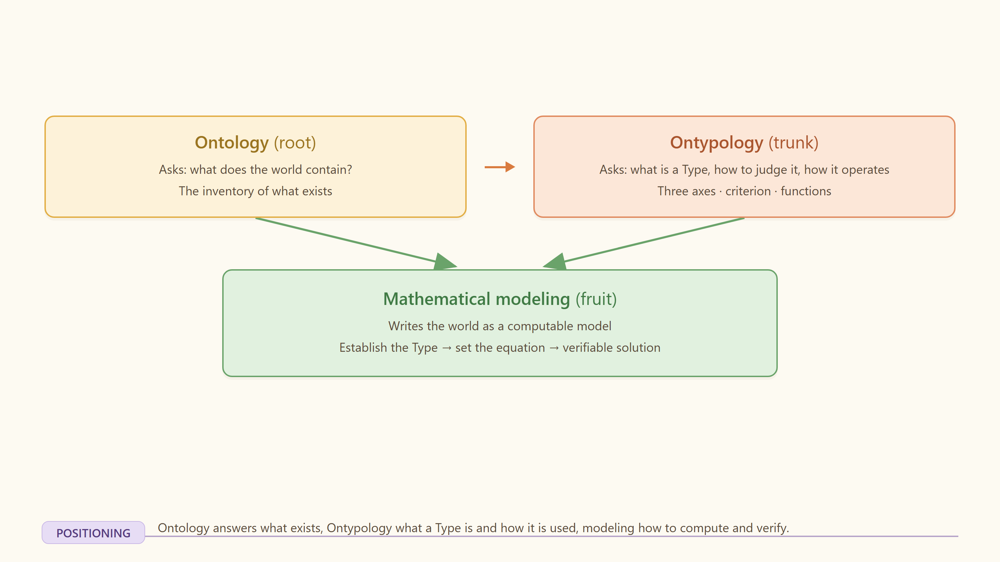

*Figure 1-2 Three-layer positioning: root (ontology) → trunk (Ontypology) → fruit (mathematical modeling)*

**Example — Each layer answers one question**

> **Example · City water supply**
>
> Ontology asks: what is there in a city? — Water sources, pipe network, users, meters.
> Ontypology asks: what does the water-supply system look like as a Type? — { source, pump station, pipe segment, (pressure data), [service area] }.
> Mathematical modeling asks: how is pressure computed, how is pipe diameter chosen? — Network-flow equations plus optimization; the solution Type is deliverable.

### 1-3 Part Summary

> **Key points of Part I**
>
> ◆ The five pain points share one root: the Type was not established. If the account of meaning is not kept, the account of numbers will fail sooner or later.
> ◆ Three-layer positioning: ontology is the root, Ontypology the trunk, mathematical modeling the fruit.
> ◆ The first modeling question is not "how do I write the equation" but "which whole is the thing I am modeling?"

> **E01 Exercise (Part I · Identifying pain points)**
>
> (a) Recall a model you have built (or read): how many of the five pain points did it hit? Describe each symptom in one sentence.
> (b) Rewrite one of those pain points as "the Type was not established": which bracket's account is missing?
> Hint: the five pain points correspond to rules of [ ], the identity of ( ), and the structure of { } not being fully established. Answers in Appendix C.

> **E02 Exercise (Part I · Three-layer positioning)**
>
> (a) On the topic "campus electric-scooter charging queue," write one ontology question, one Ontypology question, and one mathematical-modeling question.
> (b) Of the three sentences, which must be answered first? Why? (Answer with "first the Type, then the number.")
> Hint: an Ontypology question is only on target when it asks what the Type looks like. Answers in Appendix C.

> **[Professional Column C1] A Short History of Mathematical Modeling and Its Competitions**
>
> Mathematical modeling became a teachable, competitive discipline in the second half of the twentieth century. In 1985 COMAP held the first Mathematical Contest in Modeling (MCM) in the United States; the interdisciplinary ICM followed, and today thousands of teams compete worldwide, with problems ranging from epidemics to urban design. The core scoring criteria are "reasonableness of assumptions, model construction, validation and sensitivity" — almost item for item, this book's three supplements and eight questions.
> The earlier sources are the three giants of classical modeling: Newton wrote planetary motion as differential equations (mechanistic modeling), Gauss recovered Ceres in 1801 by least squares (parameter estimation), and Markov established his chains in 1906 (stochastic modeling). From them grew today's three great families — differential equations, statistics, and stochastic processes — each of which Part V will Type-ify in turn.
> Reading across: a competition rubric is in fact an eight-question list — are the assumptions clear (the ( ) identity statement), is the model reasonable (the { } structure statement), is validation real (three-layer judgment). In Ontypology's terms, the judges are looking for reviewable accuracy.

## Part II — The Backbone at a Glance: The Ontypology Toolbox

This part does not restate the theory. It does one thing: establish the backbone of the Ontypology tools this book uses, with architecture diagrams and illustrated summaries. Each tool will appear again on the modeling floor; here we only learn its name and recognize its face.

### 2-1 Three Axes, Three Brackets: The Full Notation of a Unit Type

A unit Type = a Type set = { parts, (content), [category] }. The three brackets correspond to three axes: X attributes [ ] (dimension × scale — what it looks like), Y bill of materials { } (what it is made of — do the parts still recognize themselves when taken apart?), Z container ( ) (where the thing is placed — id(C) and the invariance axiom). A mathematical set answers only "member or not"; a Type set adds three kinds of value on top of a pure set: { } adds structure, [ ] adds rules, ( ) adds identity.

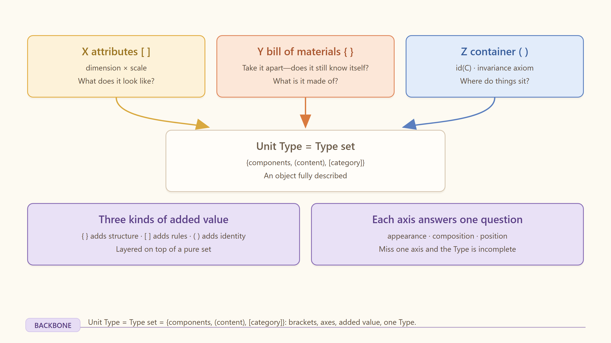

*Figure 2-1 Three axes, three brackets: unit Type = Type set*

**Example — The full notation of a coffee cup**

> **Example · Cup**
>
> M = { handle, base, lid, body, (coffee), [white] }.
> Replace (coffee) with (tea): the content changes, yet the cup is still the same cup — id(C) is unchanged. This is the invariance axiom.

### 2-2 Three-Layer Judgment: Container, Composition, Abstraction

Type logic judges at three layers. The container layer checks whether id(C) stays consistent before and after. The composition layer decomposes by BOM and assigns the three remove levels: essential part (removal destroys identity, ≢M), function-degraded part (the Type loses a function, ≡M′⊂M), non-essential part (removal leaves the Type unchanged, ≡M). The abstraction layer uses T = (F(T), ∩(T)) to check the feature intersection item by item. Each layer has blind spots; only the joint judgment is sufficient.

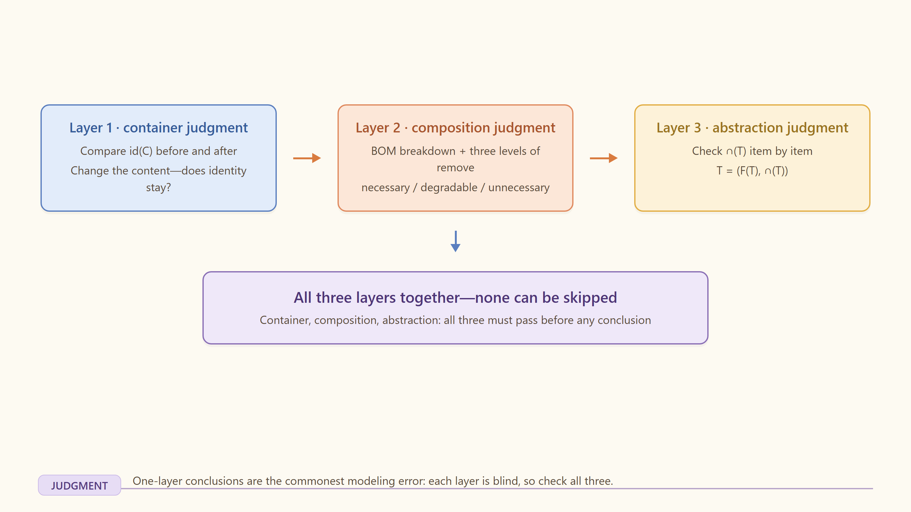

*Figure 2-2 Three-layer judgment: three gates in one chain*

**Example — Is an electric car a car?**

> **Example · Classification**
>
> Container layer ✓: swapping the battery does not swap the car; the id is unchanged. Composition layer ✓: the motor is essential; removing the fuel tank is recorded as a degraded form (≡M′⊂M). Abstraction layer ✓: F(car) = { can carry people, can drive autonomously on roads } passes item by item.
> All three layers pass — an electric car ∈ [car]. (Proved.)

### 2-3 Four Steps of the Spatial Framework: Dimensions Are Forced Out

The spatial framework answers "which dimensions are there." Four steps: distinguish similarity and difference → trigger abstraction (a batch of differences does not match any existing dimension — comparison fails) → name the dimension (give each a name and a label) → judge membership (if it matches, hang it inside; if not, open a new dimension). Abstraction is not a gift of gazing at all things; it is a response forced by "comparison failure" — and that is exactly the procedure a modeler should follow when opening a new variable.

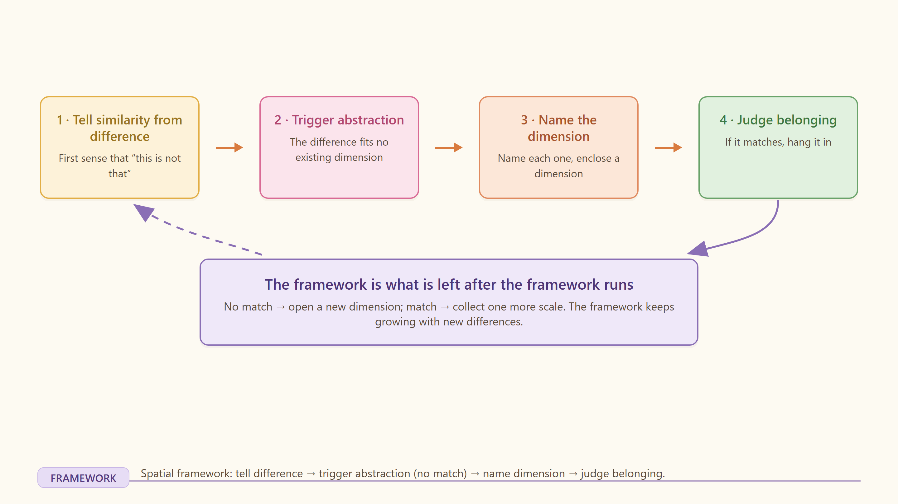

*Figure 2-3 Four steps of the spatial framework: the framework keeps growing with new differences*

**Example — A model grows a new dimension**

> **Example · Size**
>
> Two models with identical prediction error, one fast and one slow — the batch of differences called "speed" does not match the dimension "accuracy" (comparison failure), so a new dimension, "computational cost," is opened.
> The framework for model evaluation grows from one axis to two: accuracy × computational cost — the framework is what remains after the framework has operated.

### 2-4 The Five Operations and Their Comparison

Each of the five operations of a Type set guards one bracket: ⊕ merge and remove split touch only the parts inside { }; σ-substitution touches only the content inside ( ) (preserving identity); ∩(T) classification and α-abstraction generation ask only about the categories inside [ ]; ι nesting puts a Type into a container, each layer keeping its own identity. The comparison operations ≡ / ≢ / ⊂ ask "at which layer is the sameness?" All operations share one law: op: Type → Type — take in a Type, return a Type.

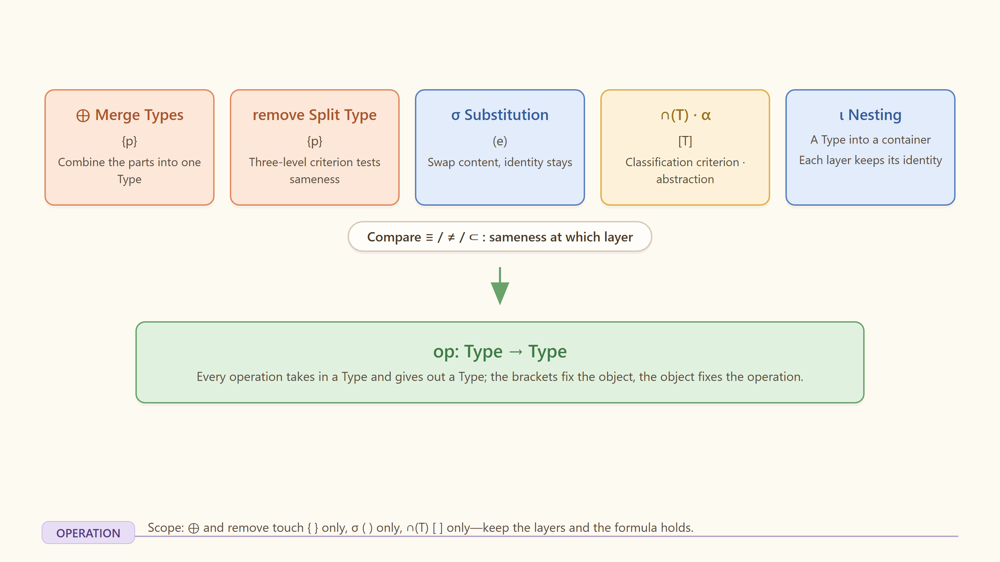

*Figure 2-4 The five operations: brackets determine the object, the object determines the operation*

**Example — σ's name in modeling**

> **Example · Idealization**
>
> "Replace the irregular missile with a point mass" = σ-substitution: swap the content (shape), keep the identity (same missile, same trajectory problem).
> "Change the model's friction coefficient from 0.3 to 0.25" is also σ: content changes, model identity does not. If the identity had to change, it would not be σ — it would be establishing a new Type.

### 2-5 The Temporal-Type Function Library

The temporal Type is the verb side: function = method = move = service = approach, attached to a spatial Type — input one Type, output one Type. The original library covers: function search; design search and extraction; design patterns; logic generation and application; continuous learning; refactoring and recombination; problem solving; analysis; design; reasoning (cause-to-effect, effect-to-cause, simulation, statistics, reverse); thinking methods (forward, reverse, horizontal, vertical, first principles); R&D and exploration; and self-evolution. Every station of the modeling flow is a function in this library.

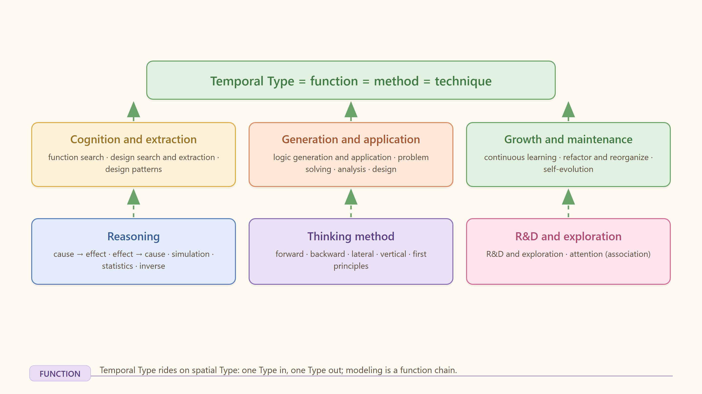

*Figure 2-5 The temporal-Type function library: the six groups modeling uses*

**Example — A four-question function card**

> **Example · Least-squares fit**
>
> Name: least-squares fit. Input Type: a batch of observations {(x, y)}. Output Type: a fitted curve (with its parameter Type). Criterion: the sum of squared residuals is minimal.
> Fill in all four fields and the function can be taken over, replaced, and reviewed — that is what the four questions are for.

### 2-6 Modeling ↔ Ontypology: Master Mapping Table

Mapping every act of modeling onto a Type operation is this book's main axis. The mapping is not rhetoric but an operating manual: every modeling act has its bracket, its operation, and its criterion.

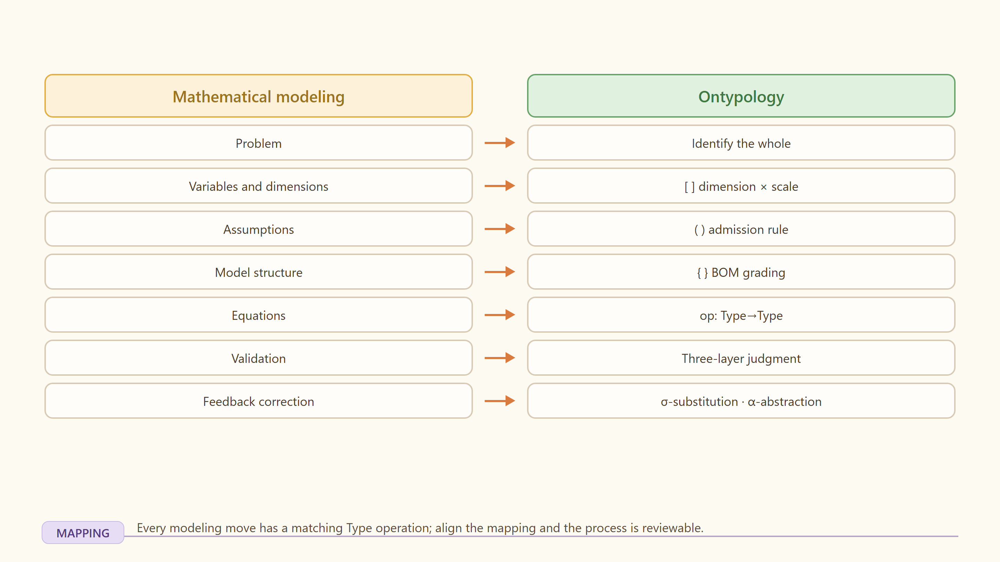

*Figure 2-6 Modeling ↔ Ontypology: master mapping table*

| Modeling act | Ontypology counterpart | Output on paper |
| --- | --- | --- |
| Define the problem | Identify the whole | One sentence: what is M |
| Define variables | [ ] dimension × scale | Variable definition table (rule book) |
| Write assumptions | ( ) admission rules · σ idealization | Assumption list (identity book) |
| Trade off and simplify | { } BOM · three remove levels | Structural grading table (structure book) |
| Set up equations | op: Type → Type | Equation system + dimensional check |
| Solve | Operation chain (⊕ σ ∩(T) ι) | Solution Type + solution log |
| Validate | Three-layer judgment | Validation report (pass / fail) |
| Feedback and revision | σ preserves identity · α creates a new abstraction | Revision log (model Type v2) |

### 2-7 The Accurate-Use Method: Overview

The Accurate-Use Method is this book's converger: three supplements keep the account ([ ] adds rules, ( ) adds identity, { } adds structure), six steps run the flow (identify the whole → describe the axes → write the Type set → choose the proposition → reason with criteria → three-layer check), and eight questions accept the result. Part VI will install all of it on the modeling floor; here is the panorama.

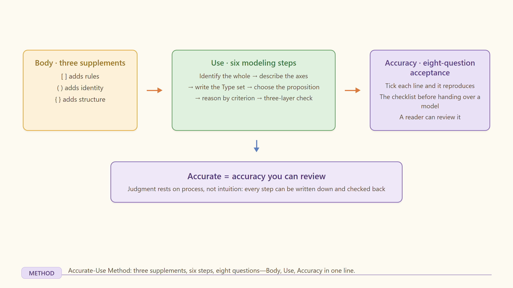

*Figure 2-7 The Accurate-Use Method: Body, Use, Accuracy*

**Example — What accuracy looks like**

> **Example · Reviewable**
>
> "This parameter works best at 0.14" — not reviewable: how good is good? Compared with what? Where did 0.14 come from?
> "Parameter θ's scale is accepted on the [0.1, 0.2] grid by three-layer judgment: residuals pass, robustness passes, boundary cases pass; therefore θ = 0.14" — every step can be written down and checked back.

### 2-8 Part Summary

> **Key points of Part II**
>
> ◆ Three axes and three brackets establish the Type; three-layer judgment establishes accuracy; four steps establish dimensions; five operations establish the formula; the function library establishes the flow.
> ◆ The master mapping table is an operating manual: every modeling act has its bracket, operation, and criterion.
> ◆ The Accurate-Use Method = three supplements + six steps + eight questions — this book's converger.

> **E03 Exercise (Part II · Putting brackets in place)**
>
> (a) Assign a bracket to each modeling element: initial value, objective function, decision variable, observation error, feasible region, model version number.
> (b) Use { parts, (content), [category] } to notate "an investment portfolio," and identify its id(C).
> Hint: first ask "is it a part, content, or a category rule?" Answers in Appendix C.

> **E04 Exercise (Part II · Recognizing operations)**
>
> (a) Name the operation for each act: remove "friction" from the model; change the population from 8 million to 8.2 million; decide that a new sample belongs to [normal distribution]; embed the queueing model inside the city-system model.
> (b) Which of the three remove levels would record the act "remove friction"? Answer case by case.
> Hint: ⊕ merges, remove splits, σ substitutes, ∩(T) classifies, ι nests — each guards one bracket. Answers in Appendix C.

> **[Professional Column C2] Dimensional Analysis and the Buckingham π Theorem**
>
> Dimensional analysis is modeling's earliest "scale check": in 1914 Buckingham established the π theorem — if a physical relation involves n quantities and k fundamental dimensions, it can be reduced to a relation among n−k dimensionless groups. This is structurally identical to [ ]'s "dimension × scale": a dimension is the Ontypology name for a physical dimension, and a scale is an attribute value with a unit.
> Practical value: dimensional consistency is the first acceptance test of an equation system (corresponding to the eight questions' "are the brackets right?"). Dimensionless groups such as the Froude and Reynolds numbers are in fact α-abstractions that "compress several dimensions into one new dimension" — new dimensions forced out by comparison failure (flow regime cannot be explained by velocity alone).
> Modeling lesson: the dimensional check always comes before solving — an equation with inconsistent scales is wrong no matter how beautifully it solves. This is the cheapest and most effective application of "first establish the Type, then discuss numbers."

## Part III — Spatial Types: Establishing the Modeling Object as a Type

The spatial Type is the noun-side craft: establishing an object as a complete Type that can be pointed to and judged. In modeling terms this means three acts of establishment — identify the whole (3-1), establish variables (3-2), establish assumptions (3-3), establish structure (3-4) — and finally a three-layer judgment to accept the model's classification (3-5).

### 3-1 Identify the Whole: Who Is the Model's M?

The first of the six steps is to identify the whole: ask first "which whole is the object I am modeling?" The same scene can yield many Types — a city can yield a water-supply network, a traffic network, an epidemic dynamic, and each Type has different boundaries, variables, and criteria. Choose the wrong whole and the remaining five steps are wasted.

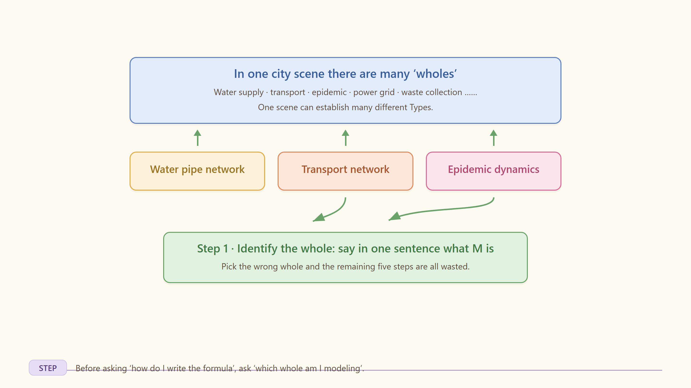

*Figure 3-1 Identify the whole: one scene, several candidate Types*

**Example — One intersection, two wholes**

> **Example · Intersection**
>
> To "reduce average waiting time," M = the traffic flow at one intersection ({ lanes, signals, (traffic flow), [time of day] }).
> To "reduce the accident rate," M = the safety system at one intersection ({ lanes, markings, sight distance, (accident records), [road condition] }) — change the problem and the whole changes.

### 3-2 Variables and Scales: Numbers Depend on the Type

The X axis [ ] consists of dimensions and scales: a dimension is an attribute (temperature), a scale is an attribute value (20°C). Every modeling variable is a scale on some dimension of some Type — this is the modeling reading of "a number = a sub-Type inside a Type, compared again": an observation counts "how many times a sub-Type of some Type appeared, and how far it measured." The variable definition table is therefore the first account of modeling: three columns per variable — which Type it belongs to, which dimension, and the scale and unit.

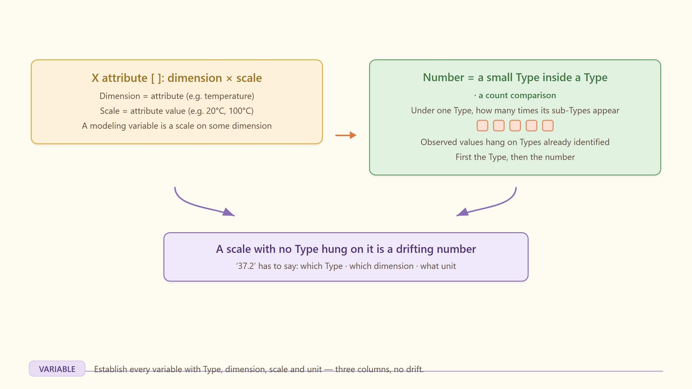

*Figure 3-2 Variable = dimension × scale; numbers depend on the Type*

**Example — The three columns of a variable definition table**

| Variable | Type and dimension it belongs to | Scale and unit |
| --- | --- | --- |
| P | Population system · population | Millions, continuous scale |
| β | Epidemic · contact rate | Contacts per person-day, [0, 1] |
| t | Time axis | Days, counted from the first observation day |

### 3-3 Assumptions: The Container's Admission Rules

The Z axis ( ) is the container: C = (id(C), S(C)), identity plus internal space; the content can be replaced while the identity stays fixed (the invariance axiom). Assumptions are the container's admission rules — they write down what is let into the model and what is kept outside. Idealization is essentially σ-substitution: replace "a falling body with air resistance" by "a falling body in vacuum"; the content changes, the identity of the model problem does not. Idealization is not shameful; forgetting is what is dangerous. Assumptions must be written as numbered, recoverable rules.

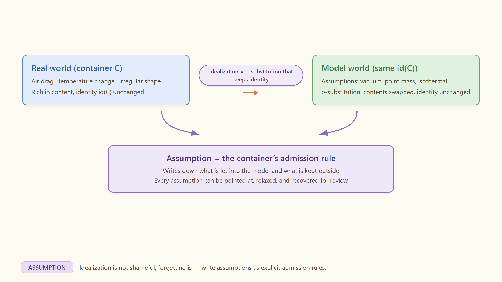

*Figure 3-3 Assumption = admission rule; idealization = σ-substitution preserving identity*

**Example — A recoverable assumption**

> **Example · Assumption numbers**
>
> H1 (closure): no in- or out-migration during the observation period; the population system's id(C) is unchanged.
> H2 (well mixed): any infected person has the same probability of contacting any susceptible person.
> H3 (relaxable): if a clustered outbreak appears, H2 is lifted first — the number makes clear which clause to remove at feedback time.

### 3-4 Model Structure: The BOM and the Three Levels of Remove

The Y axis { } is the bill of materials: parts are not merely listed side by side; they have dependency structure. The criterion asks one question — when taken apart, do they still recognize themselves? The correct way to simplify a model is the three remove levels: essential part (remove it and the model no longer holds), function-degraded part (remove it and function worsens while the Type remains, recorded as ≡M′⊂M), non-essential part (removal changes nothing). Simplification is not random deletion; every cut is recorded at one of the three levels, so the boundary of deletion can be written down.

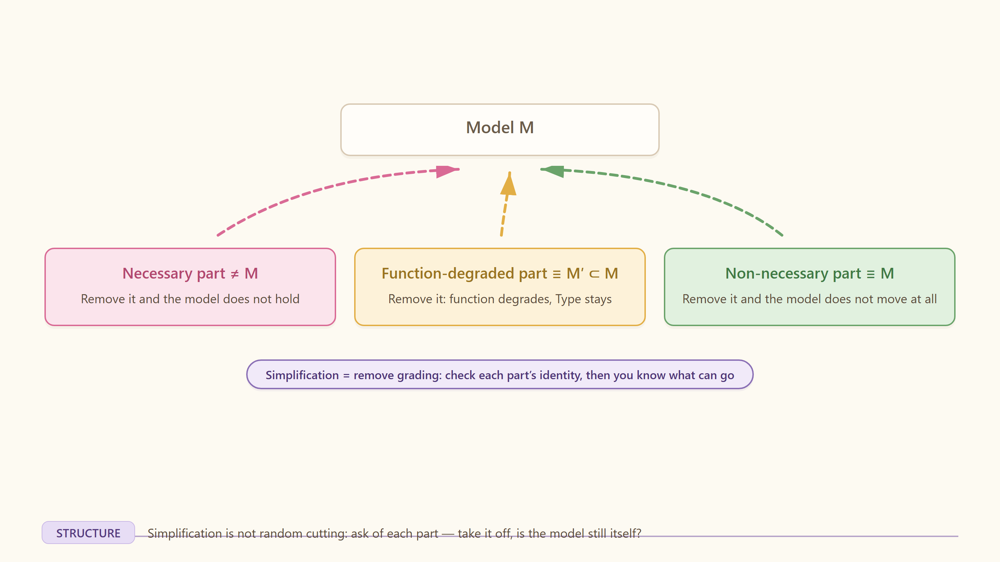

*Figure 3-4 The three remove levels: a map of simplification*

**Example — Grading a missile-trajectory model**

| Part | Remove level | Notation |
| --- | --- | --- |
| Thrust | Essential — remove it and it is no longer a trajectory model | ≢M |
| Air resistance | Degraded — the trajectory still solves, with lower accuracy | ≡M′⊂M |
| Body paint | Non-essential — removal leaves the model untouched | ≡M |

### 3-5 Three-Layer Judgment × Model Classification

When a model is finished it must be classified: which family does it belong to? This is an abstraction-layer judgment — T = (F(T), ∩(T)): write the category definition as a feature list F(T), then check the intersection item by item. But classification cannot rely on the abstraction layer alone: the container layer checks identity (what is the model's id(C)?), the composition layer checks structure (are the BOM and the grading right?), and only the three layers together yield a conclusion. The six-family classification in Part V is judged exactly this way.

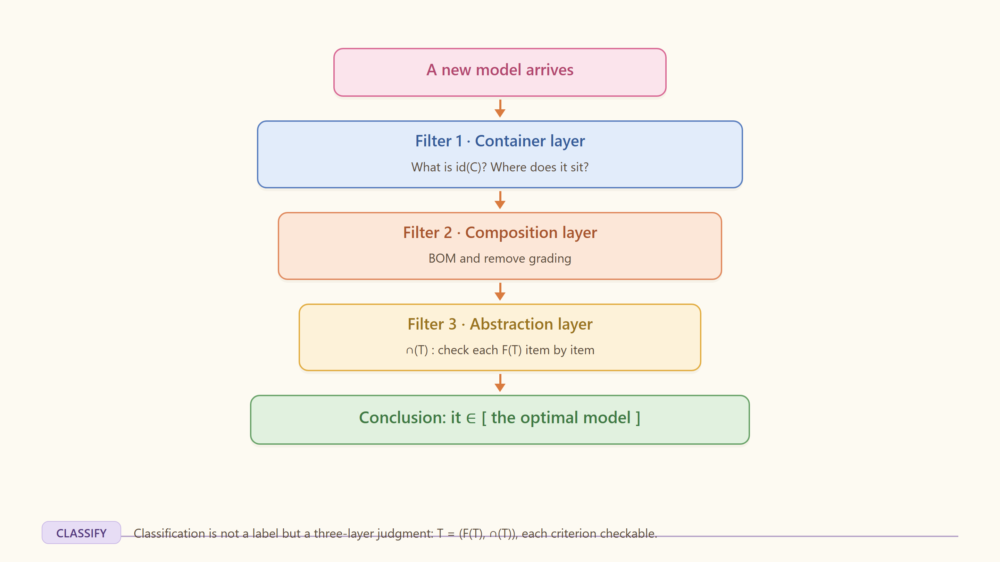

*Figure 3-5 ∩(T): three filters — a model's classification is proved, not labeled*

**Example — Deciding the family of an "inventory replenishment model"**

> **Example · Classification**
>
> F(optimization model) = { has an objective function, has constraints, seeks an optimal solution }.
> The replenishment model has an objective (minimize total cost) ✓, has constraints (warehouse capacity, demand) ✓, seeks an optimal solution (reorder point and lot size) ✓ — ∩(T) passes on every item; it ∈ [optimization model]. (Proved.)

### 3-6 Part Summary

> **Key points of Part III**
>
> ◆ Four steps of establishing a Type: identify the whole (who is M), establish variables ([ ] scale), establish assumptions (( ) admission), establish structure ({ } grading).
> ◆ Idealization = σ-substitution preserving identity; assumptions must be written as recoverable numbered clauses.
> ◆ Model classification is proved by three-layer judgment, not stuck on as a label.

> **E05 Exercise (Part III · Establishing the Type)**
>
> (a) On "bike-sharing tidal rebalancing": write a one-sentence definition of M, its Type-set notation, and the three-column definitions of three key variables.
> (b) Write three assumptions for this model (H1–H3), each stating what is kept outside and which one can be relaxed first.
> Hint: identify the whole before writing the Type set; assumption numbers must be recoverable one by one. Answers in Appendix C.

> **E06 Exercise (Part III · Grading and classification)**
>
> (a) Grade the parts of the "tidal rebalancing model" (bikes, dispatch trucks, weather, ride demand, app interface) at the three remove levels, with notation for each.
> (b) Write the category definition of a "dispatch model" with F(T), then judge by ∩(T): does a model that only forecasts and does not schedule belong to [dispatch model]? What about a boundary case?
> Hint: grading asks only "when taken apart, do they still recognize themselves?"; classification writes F(T) first, then checks item by item. Answers in Appendix C.

> **[Professional Column C3] Parameter Estimation and Identifiability**
>
> Parameter estimation is the craft of "calibrating scales to data." In 1801 Gauss recovered Ceres by least squares, setting the prototype of estimation; in the 1920s Fisher established maximum likelihood and the identifiability problem: can a model's parameters be uniquely recognized from the data?
> Ontypology reading: parameters are scales of [ ]; estimation is the calibration function of scales; identifiability is "do scales and Types correspond one-to-one?" If two parameter sets produce the same curve, those two scale sets actually point to the same Type — the model's Type has not been established finely enough.
> Practical lesson: when estimation yields no unique solution, go back and revise the Type first (merge parameters, re-establish dimensions), then discuss algorithms — this is the classic site of "learning numbers before establishing the Type."

## Part IV — Temporal Types: The Modeling Flow Is a Function Chain

The temporal Type is the verb-side craft: every station of the modeling flow is a function — input a Type, output a Type. This part establishes the six stations as a function chain (4-1, 4-2), reads equations as transfer rules of a Type (4-3), provides routing for the five reasoning families and the thinking methods (4-4, 4-5), and closes with the Type-in, Type-out modeling loop (4-6).

### 4-1 The Six Stations: Problem → Assumption → Construction → Solution → Validation → Feedback

The textbook modeling flow usually has five steps: problem, assumption, construction, solution, validation. The Ontypology version adds a feedback station and requires every station to name its input Type and output Type — what is handed between stations is not "text" but a Type that can be written down. The six stations form a function chain, and the whole chain is one large function: op: world → model.

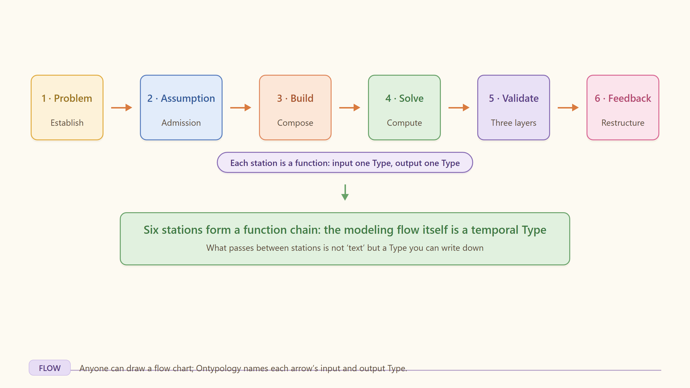

*Figure 4-1 The six stations of the modeling flow: every station is a function*

**Example — Hand over Types, not slogans**

> **Example · Handover**
>
> Bad handover: "This problem matters; build a model and see." — No Type, so the next station has nothing to receive.
> Good handover: "M is identified (urban epidemic), the Type set is written, assumptions H1–H3 are listed — construction station, please take over." — Every station's output is a Type that can be pointed to.

### 4-2 Six Function Cards with Four Questions

The four function questions — name, input Type, output Type, criterion — are the temporal Type's standard card. Write each of the six stations as a four-question card and the whole flow becomes a list of functions that can be taken over, replaced, and reviewed. The criterion field is especially critical: it states "under what condition this station counts as done."

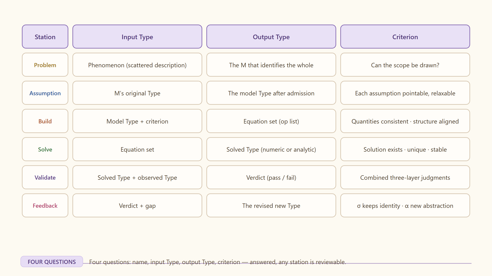

*Figure 4-2 Function four-question cards for the six stations: input Type, output Type, criterion*

**Example — The validation station's four-question card**

> **Example · Validation function**
>
> Name: model validation. Input Type: solution Type + observation Type. Output Type: verdict (pass / fail) + discrepancy report.
> Criterion: joint three-layer judgment — container (data sources share one id), composition (all key variables present), abstraction (residuals within the allowed scale).

### 4-3 Equations = Transfer Rules of a Type: op: Type → Type

Read an equation as an operation on Types: the left side is the present Type, the right side the next-moment Type, and the equals sign is the guarantee of identity. One update step in a discrete system is σ-substitution — the state container swaps content, id(C) unchanged. A differential equation in a continuous system is the continuous version of a σ chain — the state flows along time, and every instant is a Type. A quantity that stays unchanged through evolution (a conservation law) is the time-axis version of the invariance axiom: it guarantees that the model's identity is the same from beginning to end.

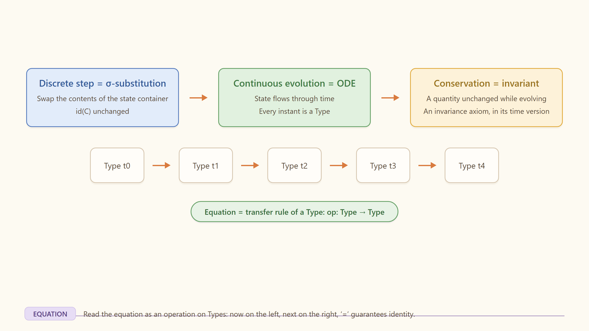

*Figure 4-3 Equations = transfer rules of a Type*

**Example — An Ontypology reading of the population equation**

> **Example · dP/dt = rP**
>
> P(t) is the content Type of the population system; rP is the Type's transfer rule (op); r is a scale on the [growth rate] dimension.
> Solve: P(t) = P0·exp(rt) — a family of solution Types. Add a "resource ceiling" and the solution Type changes family (logistic) — a model upgrade is a new α-abstraction, not σ.

### 4-4 Five Families of Reasoning: Where Formulas Grow From

The original reasoning functions fall into five families: causal reasoning (build formulas from mechanism), effect-to-cause reasoning (infer causes from results), simulation reasoning (run scenarios from a model), statistical reasoning (infer a population from a sample), and reverse reasoning (work back from the answer to the structure). The same problem routed through different families grows completely different model Types — choosing a reasoning family is choosing where the formula grows from.

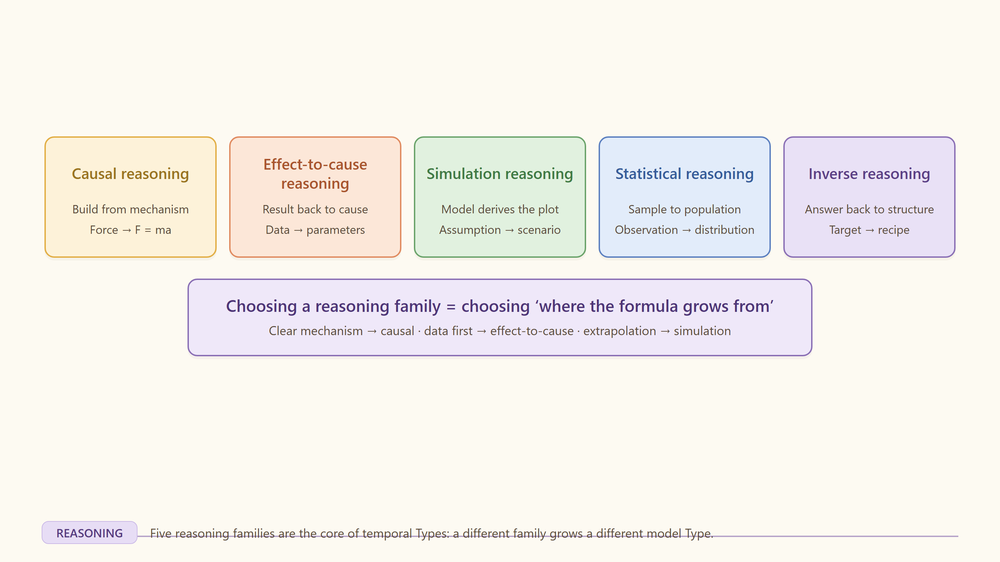

*Figure 4-4 Five reasoning families × modeling*

**Example — One epidemic, three families, three models**

| Reasoning family | Model Type | Criterion |
| --- | --- | --- |
| Causal (mechanism) | SIR differential equations | Mechanistic assumptions hold; conservation unbroken |
| Statistical (data) | Time-series model of the transmission rate | White-noise residuals; predictive-interval coverage |
| Simulation (scenario) | Individual-based stochastic simulation | Repeated convergence; scenario coverage |

### 4-5 Choosing a Thinking Method: Which Path When Stuck

The five thinking methods in the original work — forward, reverse, horizontal, vertical, first principles — are the modeler's router. When stuck, first ask which question you are stuck on: if there is an axiom to follow, use first principles; if conditions are clear, reason forward; if the goal is clear, reason backward; if you need to borrow across domains, go horizontal; if you need to dig one level deeper, go vertical. Routing depends on questions, not inspiration.

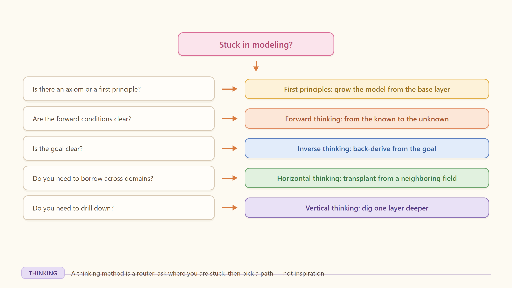

*Figure 4-5 Thinking-method routing tree*

**Example — A model grown from first principles**

> **Example · From the bottom layer**
>
> Question: how should this conveyor's takt time be set? No need to copy parameters from a similar line — grow the model from the first principle "output = 1 / bottleneck takt." The bottleneck station is the Type's essential part (≢M).
> When a formula grows from a principle, its parameters mean something; when a formula grows from copying, its parameters can never be explained.

### 4-6 Type In, Type Out: The Modeling Loop

Modeling is not a one-shot transaction. Every round of feedback does two things: change the Type (σ revises content, α proposes a new abstraction) and change the function (refactor and recombine the solving and validation methods). As the model Type grows, the function grows with it; as the function strengthens, it produces better Types — Type and function grow each other. This is what the original work calls learning and self-evolution, seen on the modeling floor.

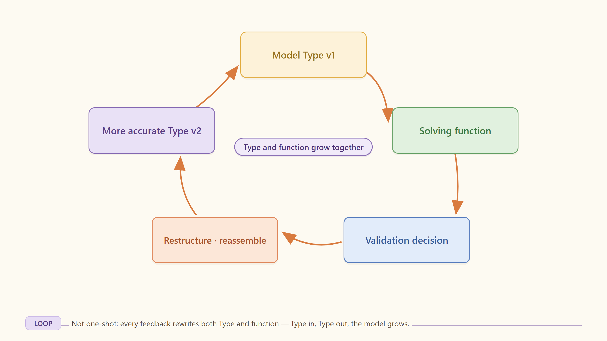

*Figure 4-6 The Type-in, Type-out loop: Type and function grow each other*

**Example — The account from v1 to v2**

> **Example · Revision log**
>
> v1: SIR with homogeneous mixing; predicted peak arrives 5 days early (validation fails).
> Feedback: remove H2 (homogeneous mixing) → introduce a grouped contact matrix (α new abstraction: contact-structure dimension) → v2 peak error shrinks to 1 day.
> Keep the account: which assumption changed, which operation was applied, and that the identity (the same urban epidemic problem) is unchanged.

### 4-7 Part Summary

> **Key points of Part IV**
>
> ◆ The six-station flow = a function chain; one four-question card per station; hand over Types, not slogans.
> ◆ Equations are transfer rules of a Type; conserved quantities are the time version of the invariance axiom.
> ◆ The five reasoning families choose where formulas come from; thinking methods choose a way out when stuck; feedback lets Type and function grow each other.

> **E07 Exercise (Part IV · Function chain)**
>
> (a) Write one four-question function card for each of the six stations of the "bike-sharing tidal rebalancing" flow (name, input Type, output Type, criterion).
> (b) Which station's criterion is hardest to write? Why? (Use "three-layer judgment" to explain which layers it needs.)
> Hint: the criterion field states "under what condition this is done," not the work content. Answers in Appendix C.

> **E08 Exercise (Part IV · Operations and reasoning)**
>
> (a) Is "change the model's granularity from daily to hourly" σ, α, or a new Type? Answer case by case.
> (b) Given the question "was this batch of returns damaged in shipping or defective in production": which reasoning family should you use? Write your model Type and criterion.
> Hint: if the granularity change only replaces content with identity unchanged, it is σ; if it forces out a new dimension, it is α. Answers in Appendix C.

> **[Professional Column C4] Sensitivity Analysis and Robustness**
>
> Sensitivity analysis answers "if a parameter moves, how much does the result move?" It is the continuous version of the three remove levels: run a thought experiment on each parameter — remove it or perturb it; does the model collapse (essential), degrade (degraded), or stay unchanged (non-essential)?
> Methods come in two layers: local sensitivity (gradient methods that move one parameter at a time) corresponds to item-by-item remove checks; global sensitivity (such as Sobol indices and Monte Carlo sweeps) corresponds to a joint physical of the whole BOM. Sobol indices decompose output variance into each parameter and its interactions — in essence "sub-Types inside a Type, compared again": counting how many shares of variance each parameter contributes.
> Modeling lesson: robustness is not mysticism but the numerical edition of the grading table — add redundancy to essential parts, keep fallback plans for degraded parts, and cut non-essential parts without worry. "Simplification has a boundary" from Part VI finds its validation tool here.

## Part V — Type-ifying Model Families: Reading the Six Families Together

A model family is a family of Types: each family has its own input Type, core equation, criterion, and output Type. This part Type-ifies the six classic families one by one — optimization, differential equations, statistical-probabilistic, graph and network, queueing systems, simulation — with one concept, one figure, one example, and one exercise each. It closes with a family-selection tree and a comparison table.

### 5-1 Overview of the Six Families

The six families are not islands: real models are often a merged Type ⊕ of several families. An epidemic model is the merged Type of differential equations (evolution) + statistics (parameter estimation) + simulation (scenario). A dispatch model is the merged Type of optimization (scheduling) + graph and network (routing) + queueing (waiting). Only by recognizing each family's Type can you assemble a merged Type.

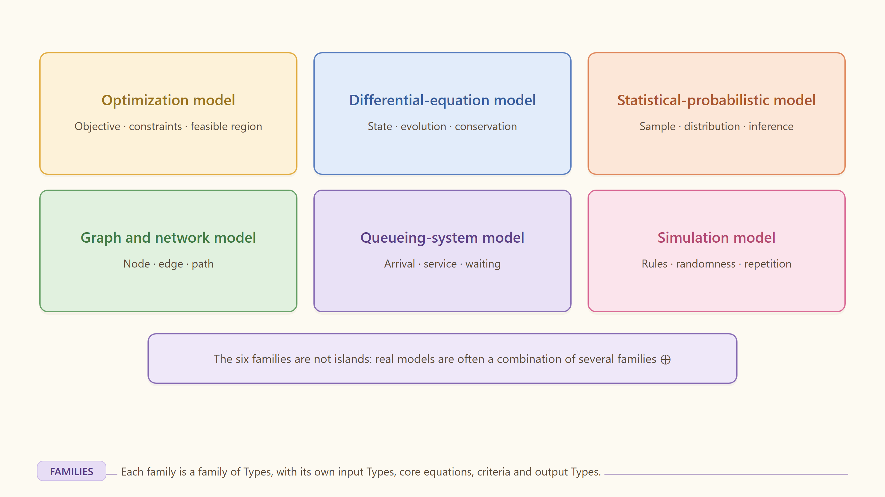

*Figure 5-1 Overview of the six model families*

**Example — One model, three merged families**

> **Example · E-commerce delivery**
>
> Route planning (graph and network) ⊕ fleet scheduling (optimization) ⊕ station waiting (queueing) = one delivery model.
> When merging, establish each family's Type first, then assemble with ⊕: write the parts' dependency structure clearly, so the remove grading can operate afterwards.

### 5-2 Optimization: The Objective Is the Criterion, Constraints Are Admission Rules

Optimization has a three-piece set: objective function (criterion [ ] — what you want and on what scale), constraints (the container's admission rules ( ) — the feasible region is the container's internal space), and solution (output Type). Ontypology's reminder: the objective function is a criterion, not a mathematical game — a crooked objective will faithfully solve its way to a wrong answer.

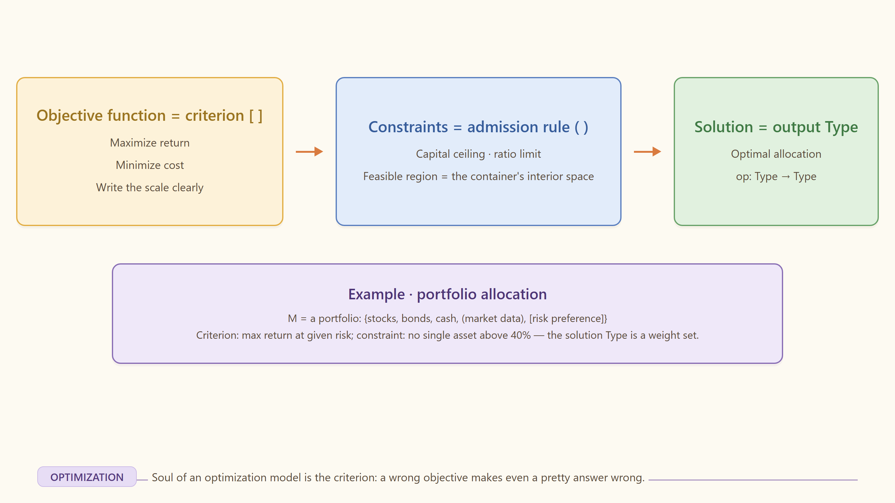

*Figure 5-2 Type-ifying optimization: objective, constraints, solution*

**Example — Portfolio allocation**

> **Example · Allocation**
>
> M = { stocks, bonds, cash, (market data), [risk preference] }; criterion: maximize return for a given risk; constraint: no single asset above 40%.
> Acceptance: the solved weights lie inside the feasible region (container layer), are insensitive to risk scales (composition-layer remove check), and match the risk-preference F(T) (abstraction layer) — all three pass, and only then is the solution Type delivered.

### 5-3 Differential Equations: State Is Content, Conservation Is Identity

A differential equation is the continuous evolution of a Type: the state vector is the container's content Type (e), dx/dt = F(x) is the transfer rule, and conserved quantities are the time-axis version of the invariance axiom. The "initial value" of an initial-value problem is the content's initial Type; the stability of a solution corresponds to "identity not carried away by numerical noise."

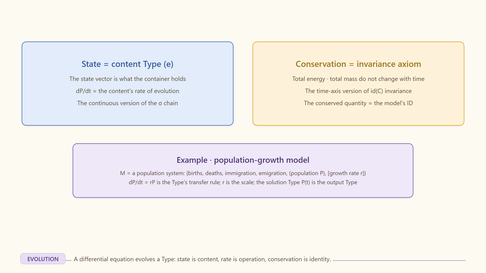

*Figure 5-3 Type-ifying differential equations: state, evolution, conservation*

**Example — A population growth model**

> **Example · Population**
>
> M = { births, deaths, immigration, emigration, (population P), [growth rate r] }; dP/dt = rP.
> Solution Type P(t) = P0·exp(rt). Conservation check: under the closure assumption, the total population account "births − deaths = increase" must balance — if it does not, an assumption is missing (the admission rules have a hole).

### 5-4 Statistical-Probabilistic Models: Data Are Sub-Types Within a Type; Tests Are Three-Layer Judgments

Statistical modeling has the densest Ontypology reading: data = sub-Types inside a Type, compared again (a sample is the repeated appearance of a sub-Type); parameter estimation = scale calibration; hypothesis testing = ∩(T) classification judgment (H0 is a category card, the p-value is a scale on the criterion, the rejection region is the boundary of F(T)); confidence intervals = uncertainty marks on the scale. Identify the Type first, then discuss numbers — what statisticians call "define the random variable first" is exactly this sentence.

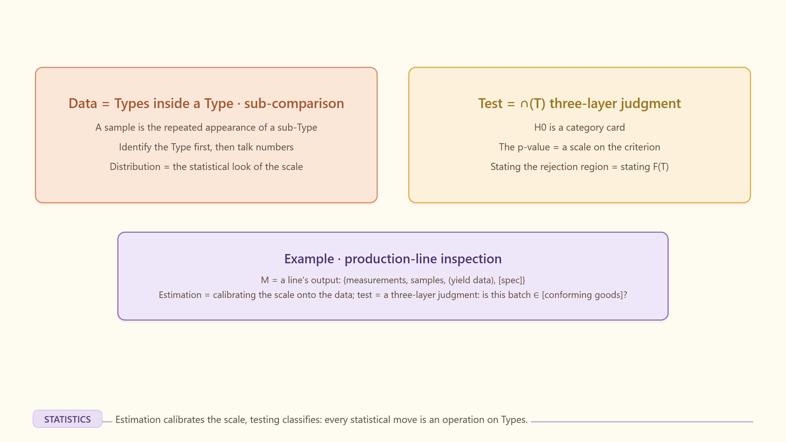

*Figure 5-4 Type-ifying statistical-probabilistic models: estimation, test, judgment*

**Example — Production-line quality inspection**

> **Example · Quality**
>
> M = { measurements, samples, (yield data), [specification] }; H0: this batch of products ∈ [qualified goods].
> Testing = three-layer judgment: container (sample sources share one id) → composition (all measurement items present) → abstraction (specification F(T) checked item by item); p < scale (e.g. 0.05) is only one scale on the third layer, not the truth.

### 5-5 Graph and Network Models: Nodes Establish Types, Edges Carry Relations

Graphs make "relations" first-class citizens: nodes are Types, edges are Type relations, paths are Type chains. The ι nesting operation corresponds to hierarchical networks (a subnetwork nested in a larger network, each layer keeping its identity); shortest path and maximum flow are both "finding a Type chain in a graph container that is optimal under a criterion."

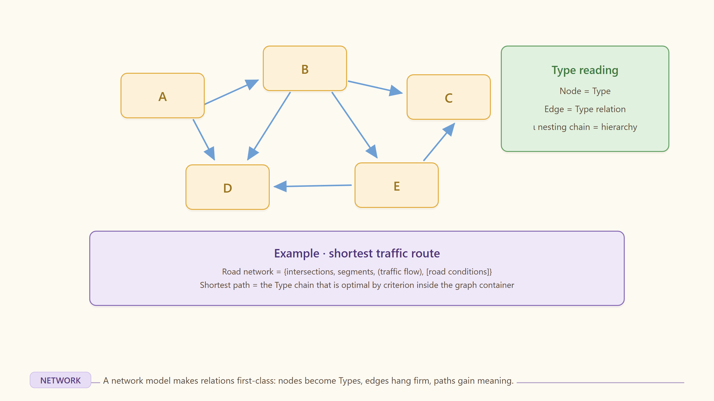

*Figure 5-5 Type-ifying graphs and networks: nodes, edges, Type chains*

**Example — Shortest path in traffic**

> **Example · Road network**
>
> Road network = { intersections, segments, (traffic flow), [road condition] }; find the shortest path from A to F.
> The ι chain cannot be flattened: when nesting a "city road network" inside a "national road network," the two layers each have their own id(C) — flattening the levels wipes out the criteria for tolls and speed limits along with them.

### 5-6 Queueing Systems: Container, Service, Degradation

A queueing model is a container model: ( ) is the queue space and service desk, the admission rule decides who gets in, the service function is a temporal Type (input the awaiting-service Type, output the served Type), and waiting time is a measure inside the container. The three remove levels become a failure-degradation map here: is losing one service desk an essential part (queue explodes) or a degraded part (slower)?

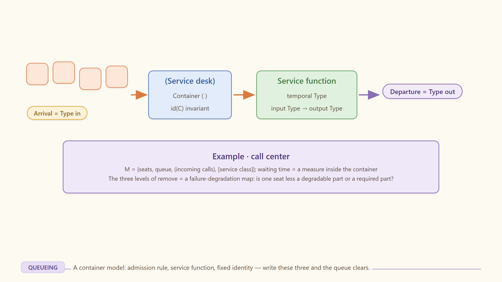

*Figure 5-6 Type-ifying queueing systems: arrival, service, departure*

**Example — Call-center capacity**

> **Example · Customer service**
>
> M = { seats, queue, (incoming calls), [service level] }; the service level SLA is the criterion [ ]: 80% of calls answered within 20 seconds.
> Degradation drill: remove 1 seat (remove) → average wait +12 seconds → SLA still passes, recorded as ≡M′⊂M; remove one more → SLA breaks, so that seat is recorded as ≢M. The grading table is the capacity contingency plan.

### 5-7 Simulation: Rules, Randomness, Repetition

When an analytic solution cannot be derived and the system is full of randomness and interaction, use simulation reasoning: write the micro rules (each individual's Type and function), inject randomness, repeat at scale, and statistically describe the macro appearance. A simulation's criterion is not "a beautiful number came out" but "repeated convergence" (the result distribution is stable) and "scenario coverage" (boundary cases have all been run). The term Monte Carlo names exactly this family, which trades repetition for precision.

**Example — Simulation instead of solution**

> **Example · Simulation**
>
> Question: the power-grid outage risk during a typhoon. The analytic solution cannot be written — simulate ten thousand typhoons with a component-failure stochastic model plus network-connectivity rules.
> Output Type: the distribution of households without power (the distribution shape of sub-Types compared again), not a single number — an output distribution is more honest than an output mean.

### 5-8 Family-Selection Tree and the Six-Family Comparison Table

Choosing a family is choosing a criterion: the shape of the answer determines the model's family. For "what is the best way to do it," use optimization; for "how will it change," use differential equations or simulation; for "what can be inferred from data," use statistics; for "relations and paths," use graphs; for "waiting and capacity," use queueing. Choose the right family first, then discuss formulas.

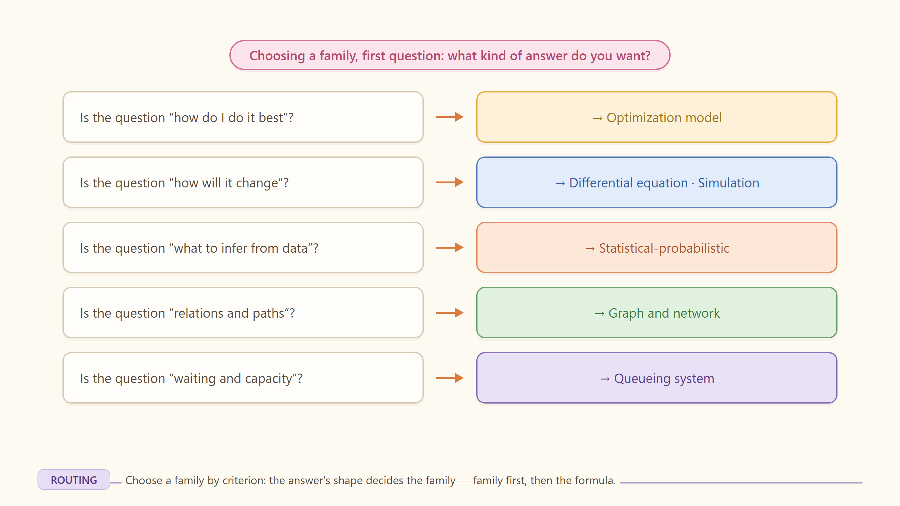

*Figure 5-7 Model-family routing tree*

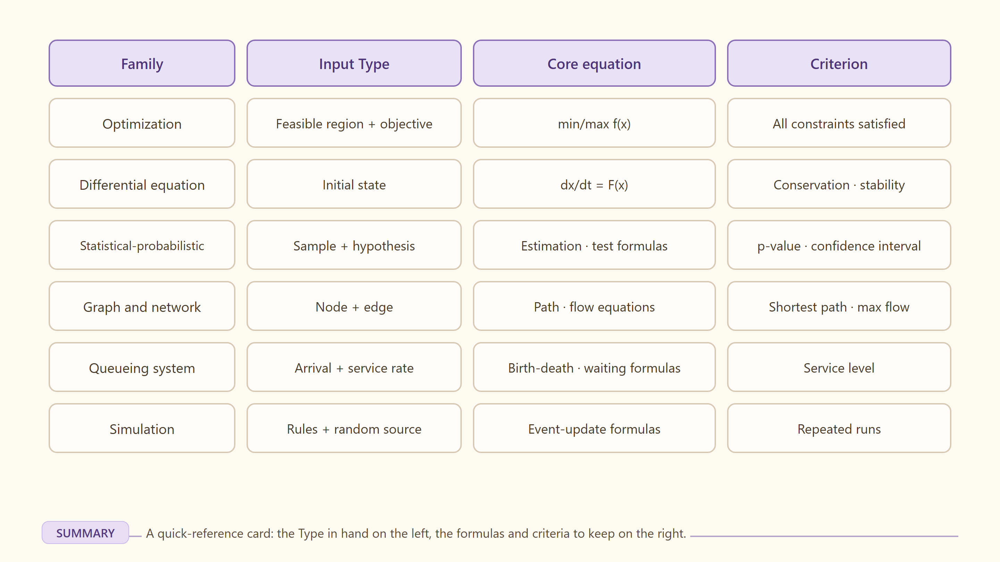

*Figure 5-8 Six-family comparison table: input Type, core equation, criterion*

**Example — Three questions for choosing a family**

> **Example · Choosing a family**
>
> "How many people should handle this batch of complaints?" — First question: the answer is "what is the best way to do it" → optimization (staffing) + queueing (waiting).
> Choosing a family is not a single-choice question: use the tree to identify the main family, then decide whether to ⊕ a secondary family into a merged Type.

### 5-9 Part Summary

> **Key points of Part V**
>
> ◆ Six families, six Types: optimization (objective, constraints), differential equations (state, conservation), statistics (estimation, test), graphs (nodes, edges), queueing (container, service), simulation (rules, repetition).
> ◆ Real models are often merged Types ⊕: establish each family's Type first, then assemble.
> ◆ Choosing a family is choosing a criterion: the shape of the answer determines the model's family.

> **E09 Exercise (Part V · Family classification)**
>
> (a) Assign a main family (a secondary family is allowed) to each question: ① how much stock should each of three warehouses hold; ② when will this epidemic peak; ③ how effective is the new vaccine; ④ where is the bottleneck in the logistics network; ⑤ how many doctors does the clinic need.
> (b) Choose one question and write its Type-set notation and criterion.
> Hint: use the five questions of the routing tree in 5-8. Answers in Appendix C.

> **E10 Exercise (Part V · Merged Types)**
>
> (a) "Campus scooter charging queues and dispatch" must optimize both the number of charging piles and the schedule: write which families ⊕ into its merged Type, and what each family contributes.
> (b) After merging, grade "number of charging piles" with the three remove levels: is it essential, degraded, or non-essential? Answer by scenario.
> Hint: merging establishes each family's Type first, then ⊕; grading asks only "when taken apart, do they still recognize themselves?" Answers in Appendix C.

> **[Professional Column C5] Model Selection: AIC, BIC, Cross-Validation**
>
> Model selection answers "given several candidate models, which one to choose." Akaike established AIC in 1974; Schwarz established BIC in 1978 — both are criterion scales of "goodness of fit + complexity penalty." Cross-validation (Stone 1974, Geisser 1975) uses "predictive power on held-out data" as its criterion.
> Ontypology reading: model selection is an abstraction-layer ∩(T) judgment — candidate models line up before the category card and are checked item by item; the complexity penalty is a tax on "number of parts" (the BOM size of { }), preventing over-merging.
> Practical warning: AIC and BIC can select different models (their penalties differ), so which to use depends on the criterion itself — use AIC-like criteria for prediction, BIC-like for explanation. Criterion first, indicator second: this is "the objective function is a criterion, not a mathematical game" replayed on the model-selection floor.

## Part VI — The Full Architecture of the Accurate-Use Method

With Types and formulas established, this part establishes accuracy. The Accurate-Use Method is Ontypology's converger — three supplements (Body), six steps (Use), eight questions (Accuracy) — and this part installs all of it on the modeling floor, with a full demonstration, a misuse comparison, and acceptance standards.

### 6-1 Body–Use–Accuracy

Body is the three axes and three brackets: establish the object as a Type, keep the account clear. Use is the six-step flow: push the Type into a model, make the formulas move. Accuracy is the eight-question acceptance: validate the model back, so others can review it. The three form a cycle, not a one-way street: when validation fails, you usually return to establishing the Type — Body, Use, Accuracy, then back to repair the Body.

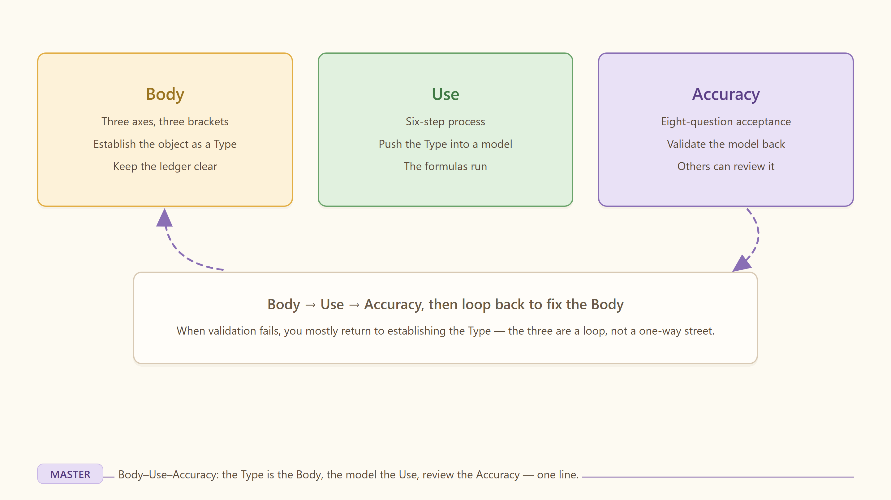

*Figure 6-1 Body–Use–Accuracy: one line, one cycle*

**Example — What the cycle looks like**

> **Example · Going back to repair the Body**
>
> Validation finds the error especially large at "peak hours" — not something parameter tuning can fix: the [time of day] dimension is too coarse (only two scale values, peak and off-peak).
> Repair the Body: refine the [time of day] scale into six values → rerun the flow → validation passes. The path to accuracy is a cycle: when Use will not move, return to Body.

### 6-2 Three Supplements, Modeling Edition

Three supplements answer three gaps: [ ] adds rules (variable definition table — dimension, scale, unit, admission rule); ( ) adds identity (assumption list and id — what content was replaced, and on what grounds identity is unchanged); { } adds structure (BOM grading table — where the boundary of simplification lies). Together the three books are the model's dossier: wherever there is a gap, a bracket fills it.

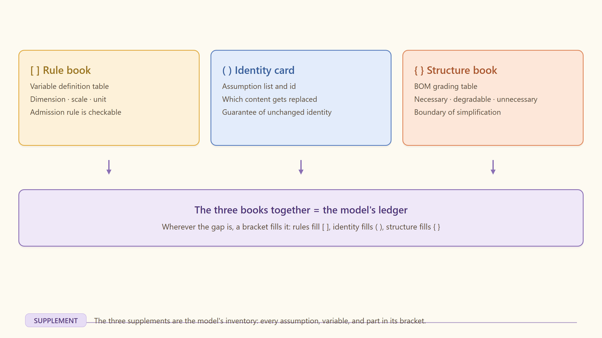

*Figure 6-2 Three supplements, modeling edition: three books*

**Example — What the three books look like**

| Book | Content | Acceptance sentence |
| --- | --- | --- |
| [ ] rule book | Variable definition table: Type, dimension, scale, unit | Does every variable have all three columns? |
| ( ) identity book | Assumption list H1…Hn: what is shut out, whether it can be relaxed | Is every assumption pointable and recoverable? |
| { } structure book | BOM grading table: essential, degraded, non-essential | Does every deletion have a level notation? |

### 6-3 The Six Modeling Steps

The six steps run the three-piece set (definition first, criterion in the middle, reasoning after) on one object in order: ① identify the whole — say in one sentence what M is; ② describe the axes — write X attributes, Y composition, Z container once each; ③ write the Type set — the full { parts, (content), [category] } notation; ④ choose the proposition — whether to prove membership, invariance, or grading; ⑤ reason with criteria — walk the corresponding criterion (∩(T), id(C), remove) step by step; ⑥ three-layer check — validate container, composition, and abstraction jointly, then conclude.

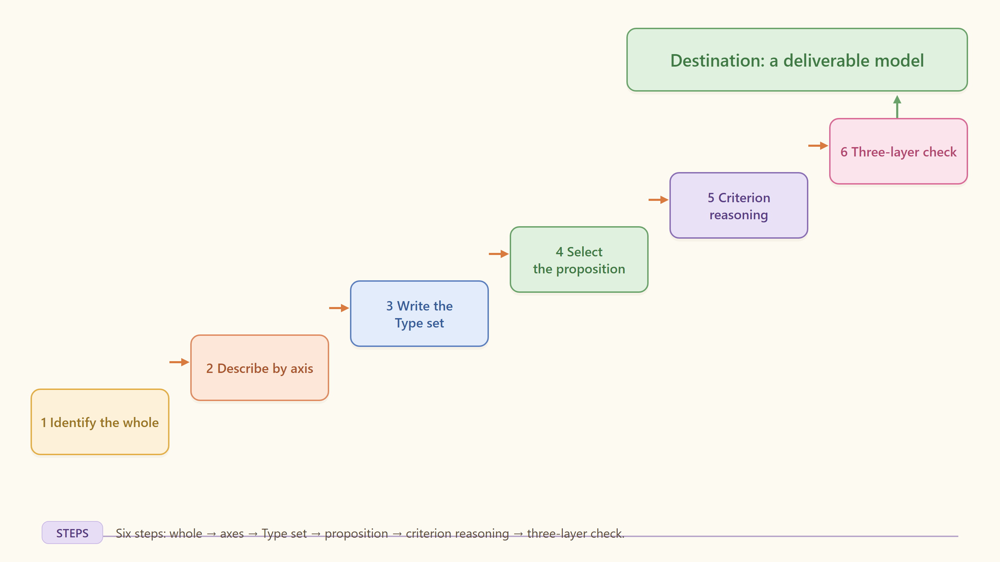

*Figure 6-3 The six modeling steps: toward a deliverable model*

**Example — The outputs of the six steps**

| Step | Operation | Output | Common tools |
| --- | --- | --- | --- |
| 1 Identify the whole | Point to the object of judgment | One sentence: what is M | — |
| 2 Describe the axes | Write each of the three axes once | Attribute table, BOM, container | Three brackets |
| 3 Write the Type set | Full notation | { parts, (content), [category] } | Type set |
| 4 Choose the proposition | Membership / invariance / grading | One-sentence proposition | — |
| 5 Reason with criteria | Step through the corresponding criterion | Reasoning text | ∩(T) · id(C) · remove |
| 6 Three-layer check | Joint three-layer check | Conclusion (proved) | Three-layer judgment |

### 6-4 End-to-End Demonstration: The SIR Epidemic Model in Six Steps

Run all six steps on a complete case. Problem: build an SIR model of an influenza outbreak in a city, and estimate the peak and the total number infected. The case demonstrates how the spatial Type (the three acts of establishment) and the temporal Type (the process function chain) converge on one problem.

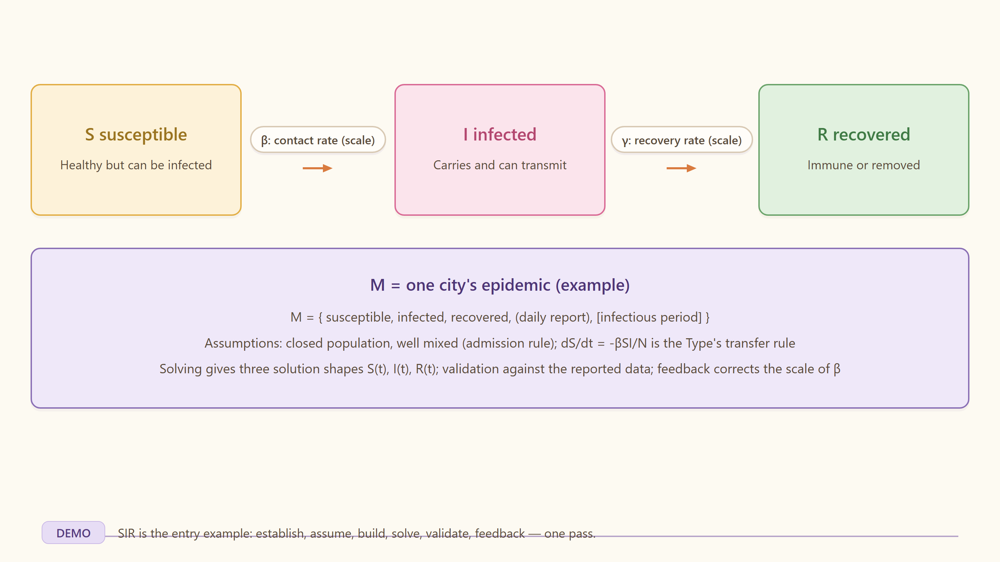

*Figure 6-4 SIR end-to-end demonstration: six stations complete one model*

> **The six steps end to end**
>
> (1) Identify the whole: M = the influenza outbreak in one city (90-day observation period).
> (2) Describe the axes: X = [ infectious period, contact rate β, recovery rate γ ]; Y = { susceptible, infected, recovered, (daily reports), [flu season] }; Z = the city (closure assumption H1).
> (3) Write the Type set: M = { S, I, R, (reporting data), [SIR epidemic model] }.
> (4) Choose the proposition: prove "membership" — is SIR ∈ [epidemic model]? — and estimate the peak of I(t).
> (5) Reason with criteria: dS/dt = −βSI/N, dI/dt = βSI/N − γI, dR/dt = γI are the transfer rules; β and γ are calibrated to reporting data (effect-to-cause reasoning); solve S(t), I(t), R(t).
> (6) Three-layer check: container ✓ (swapping the reporting source does not swap the city id); composition ✓ (β is essential, vaccine is degraded, report format is non-essential); abstraction ✓ (contagious, has an infectious period, can recover — each passes) — SIR ∈ [epidemic model]. (Proved.)

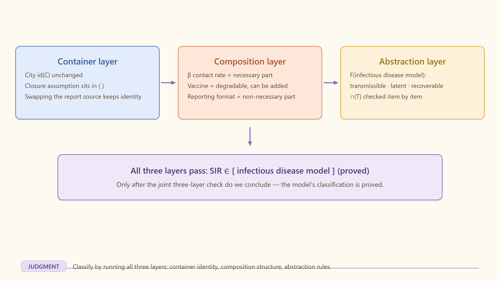

*Figure 6-5 SIR three-layer judgment: a model's classification is proved*

### 6-5 Eight Questions, Modeling Edition

The eight questions are the acceptance standard of the three supplements: only when all eight pass does the model count as "written accurately." It is not a formatting checklist but a set of gates that keeps every misuse outside the door.

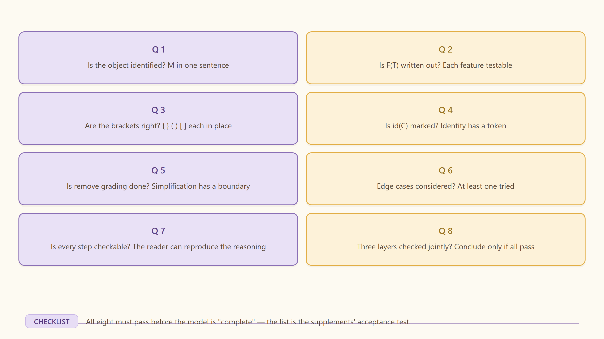

*Figure 6-6 Eight questions, modeling edition: the check before handing over a model*

**Example — The eight-question card in action**

> **Example · Self-check**
>
> Question 5, "has remove grading been done?", is often skipped — things deleted casually during simplification must be given a level before they pass.
> Question 6, "have boundary cases been considered?", is the cheapest and most effective: push β to 0 (no transmission) and to 1 (everyone in contact) and see whether the model behaves reasonably.

### 6-6 Sixteen Misuses in Four Contrasting Groups

Misuses fall into four groups: layer misuse (the layers of brackets and operations are not written clearly), identity misuse (container and content are confused), criterion misuse (F(T) is not written out; conclusions drawn from a single layer), and process misuse (skipping the identification of the whole; assumptions that cannot be recovered). The common root is only two things left undone: writing the layers clearly and marking the identity.

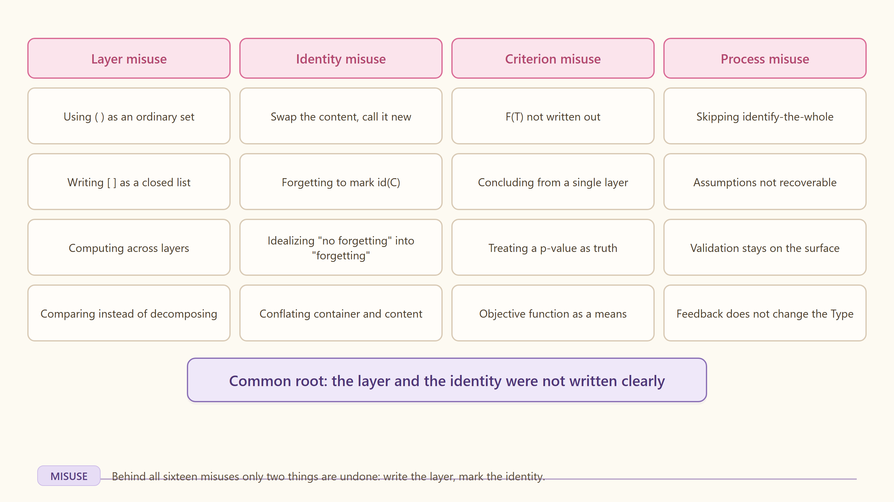

*Figure 6-7 Sixteen misuses: four groups, one root*

**Example — Two typical misuses**

> **Example · Misuse comparison**
>
> "Model A's R² is higher than B's, so A is right" — criterion misuse: R² is only one scale on the third layer; the container layer (are the data from the same source?) and the composition layer (are all variables present?) have not been checked.
> "Tuning this parameter to 0.8 works best, so set it to 0.8" — process misuse: which Type, which dimension, and what unit does 0.8 correspond to? With no account, the next person can only guess again.

### 6-7 Reviewable Accuracy

Accuracy has only one definition: reviewable accuracy. Judgment relies not on intuition but on process — check ∩(T) item by item, compare id(C) before and after, grade with the three remove levels; conclude only after the joint three-layer check. That the reader can tick off your reasoning sentence by sentence is what "accuracy" means.

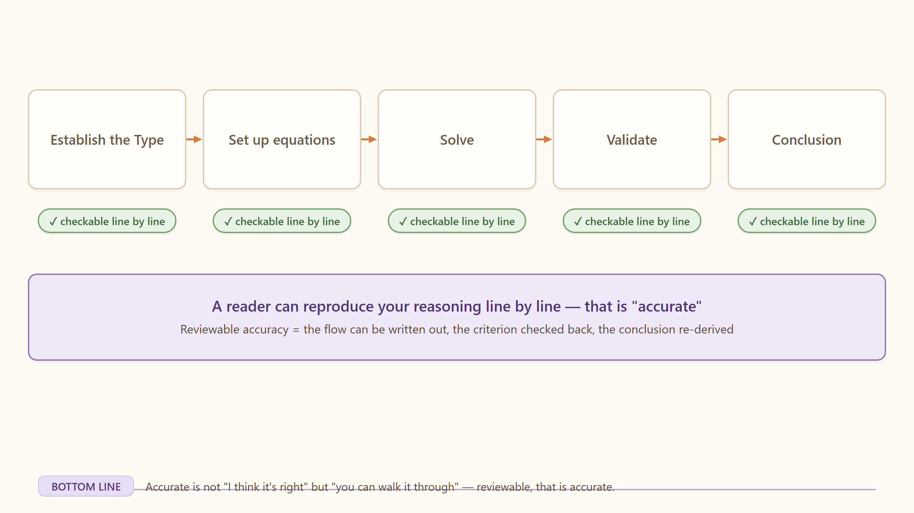

*Figure 6-8 Reviewable accuracy: a reasoning chain you can tick off line by line*

**Example — One conclusion, two ways of writing it**

> **Example · Review**
>
> Version A: "After sufficient validation, the model is usable." — Who judged "sufficient"? It cannot be reviewed.
> Version B: "The three-layer check passes item by item (Table 6-x); two boundary cases pass; residuals are within the allowed scale — the model is deliverable." — Every sentence can be ticked off.

### 6-8 Part Summary

> **Key points of Part VI**
>
> ◆ Body–Use–Accuracy is one line: establish the Type, establish the formula, establish the criterion; when validation fails, go back and repair the Body.
> ◆ The three supplements are three books: rule book, identity book, structure book; six steps are one flow; eight questions are one acceptance test.
> ◆ The common root of the sixteen misuses: layers and identity are not written clearly. Accuracy = reviewable accuracy.

> **E11 Exercise (Part VI · Three books)**
>
> (a) For "bike-sharing tidal rebalancing," write one paragraph for each of the three books: [ ] rule book (three-column definitions of three variables), ( ) identity book (three assumptions), { } structure book (one example at each of the three part levels).
> (b) Which of the three books is most easily omitted? What goes wrong first when it is omitted?
> Hint: wherever there is a gap, a bracket fills it. Answers in Appendix C.

> **E12 Exercise (Part VI · Six-step practice)**
>
> (a) On "dormitory washing-machine queue," walk through the six steps: write M, the Type set, the proposition, the outline of criterion-based reasoning, and the result of the three-layer check.
> (b) In step (5), which reasoning family did you use? Why not another?
> Hint: the proposition can be "membership" — judge whether it ∈ [queueing-system model]. Answers in Appendix C.

> **E13 Exercise (Part VI · Identifying misuses)**
>
> (a) Name the group of misuse in each case: ① "assume no friction" is written in an appendix and never mentioned in the body again; ② the model switches among three datasets, and the symbol t is defined differently in each; ③ the model is declared best on R² alone.
> (b) Rewrite ① as recoverable numbered assumptions.
> Hint: compare the four groups in 6-6 — layer, identity, criterion, process. Answers in Appendix C.

> **[Professional Column C6] Verification and Validation (V&V)**
>
> V&V in the systems-simulation world splits into two questions: Verification — "was the model built right?" (are the formulas solved correctly?) — and Validation — "is it the right model?" (does the model match reality?). Sargent's 2013 survey groups assessment into three: conceptual-model validation, computerized-model verification, and operational validation.
> Ontypology reading: Verification corresponds to the solution station's criterion (the solution exists, is unique, is stable); Validation corresponds to three-layer judgment — especially the abstraction layer's ∩(T): does the model's F(T) match reality's F(T)? NASA's credibility assessment adds a layer of data quality and uncertainty — that is, it books the scale's error into the account as well.
> Reading conclusion: the whole V&V process is the professional edition of the eight questions. The eight questions compress it into eight items that can be ticked off on one page — concise, but not incomplete.

## Part VII — Overall Architecture: Two Libraries, One Hub, One Loop

For a method to last, it needs architecture. This part gathers modeling capability into the overall architecture of "two libraries, one hub, one loop," gives the four acceptance lines, reads common modeling tools against Type operations, and finally points out the road to Mind AI's three unifications.

### 7-1 Modeling's Two Libraries, One Hub, One Loop

The Type libraries hold assets: the model library (models with established Types) and the knowledge library (domain knowledge with established Types). The function library holds methods: the six modeling stations, the five reasoning families, and the five thinking methods all live there. The criterion hub guards quality: three-layer judgment and the eight questions operate here. The modeling loop lets everything grow: every modeling run deposits new Types and new functions — Type in, Type out.

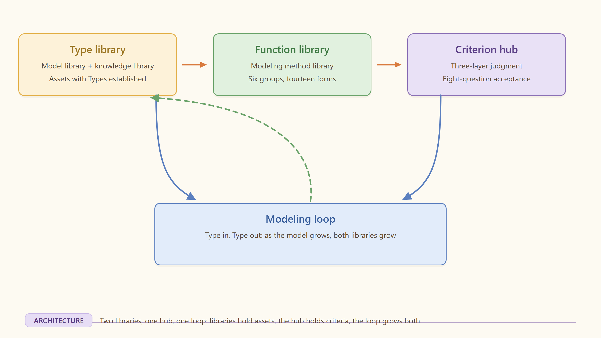

*Figure 7-1 Two libraries, one hub, one loop × modeling*

**Example — What one modeling run deposits**

> **Example · Deposit**
>
> After finishing SIR: the Type library gains an [SIR epidemic model] template (with its Type set and three-layer judgment record); the function library gains a four-question card for "effect-to-cause parameter estimation."
> Next time, for dengue, you do not start from zero — search the Type library for a template, swap the scales, rerun the loop. Modeling capability compounds through this loop.

### 7-2 The Four Acceptance Lines

Before delivery, a model must cross four lines: reviewable (every step can be written down and checked back), reproducible (the same data run twice gives the same result), transferable (change the scene and the Type still holds), and growable (new data can make the model grow). Only when all four pass may the model be delivered — this extends "accuracy" into an organization-level language of quality.

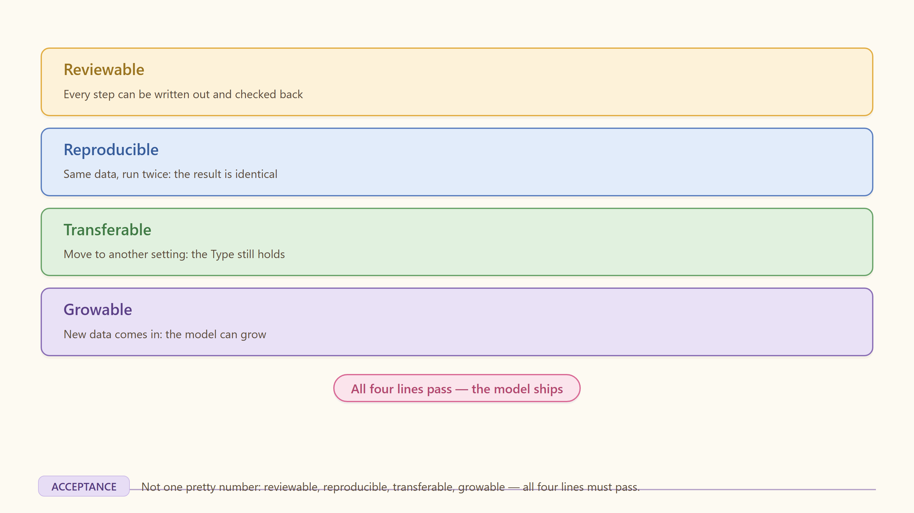

*Figure 7-2 The four acceptance lines*

**Example — Testing transferability**

> **Example · Transfer**
>
> Move a campus dispatch model to a technology park: do not change the formula first; walk through 3-1 again — who is M in the new scene? Only when the Type holds can the model move.
> Transfer failure is mostly Type failure: the old scene's "peak" dimension does not match the new scene (comparison failure) — open a new dimension rather than forcing the old formula.

### 7-3 Modeling Tools ↔ Ontypology: A Reading

Every tool in the modeling toolbox can find its Type operation in Ontypology. The reading is not for renaming but for making tools share one account: dimensional analysis manages scales, parameter estimation calibrates scales, sensitivity analysis performs remove, model selection runs ∩(T), assumption management guards ( ), and validation runs three-layer judgment.

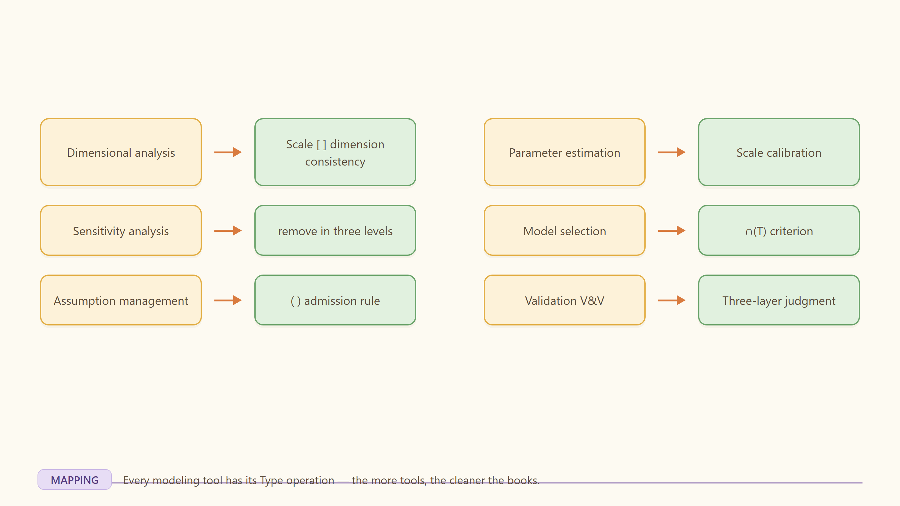

*Figure 7-3 Tools ↔ Type operations: the full reading map*

**Example — Tools share one account**

> **Example · One shared account**
>
> Sensitivity analysis says "θ2 is insensitive" = remove says "θ2 is a non-essential part" — the same fact in two languages.
> Only one account is kept: the grading column of the structure book cites the indices from the sensitivity report directly, so at acceptance the two sides agree instead of telling different stories.

### 7-4 Toward Mind AI: Unified Knowledge → Unified Thinking → Unified Intelligence

Ontypology's vision is to see Types clearly, turn them into an established science, and practice them as Mind AI. In mathematical modeling this lands as: unified knowledge — models in every domain keep their accounts in the same Type language; unified thinking — the five reasoning families and the thinking methods become a callable function library; unified intelligence — the modeling loop grows autonomously while people guard the criterion hub. Mathematical modeling is the first proving ground on this road: it demands "established clearly, computable in motion, validated accurately" all at once, which puts the three unifications on stage together.

**Example — The stages of the three unifications**

| Stage | What it looks like on the modeling floor | Acceptance |
| --- | --- | --- |
| Unified knowledge | The model library is notated entirely in Type sets and is searchable across domains | Findable, readable |
| Unified thinking | Reasoning families and thinking methods become routers | Routing has criteria and is reviewable |
| Unified intelligence | The loop deposits templates and drafts automatically | People guard only the criterion hub |

### 7-5 Part Summary

> **Key points of Part VII**
>
> ◆ Two libraries, one hub, one loop: the Type library holds assets, the function library holds methods, the hub guards criteria, the loop grows.
> ◆ Four acceptance lines: reviewable, reproducible, transferable, growable.
> ◆ Tools share one account; the three unifications begin landing on the modeling floor.

> **E14 Exercise (Part VII · Architecture)**
>
> (a) Turn three models you (or your team) have built into three entries in a Type library (Type set + criterion + version).
> (b) Among the three models, is there a "growable" loop in operation? If not, what is missing — the two libraries, the hub, or the loop?
> Hint: an entry is a Type: it has an id, a structure, and a category. Answers in Appendix C.

> **[Professional Column C7] Uncertainty Quantification (UQ)**
>
> Uncertainty quantification answers "how wide is the credible range of the result?" The Monte Carlo method (established by Ulam and von Neumann in the 1940s for nuclear calculations) measures uncertainty cell by cell through random sampling; later propagation analysis, confidence intervals, and Bayesian updating are the same family of craft: writing "not knowing" as a distribution on a scale.
> Ontypology reading: UQ is the distribution shape of "sub-Types inside a Type, compared again" — a single estimate is only one cell of the scale; the distribution is the scale's complete Type. Observation ≠ state (content ≠ identity): noise in the data is a perturbation of content, and the Type's identity does not dance with it.
> Modeling lesson: deliver a distribution, not a point. In UQ language, "reproducible" among the four acceptance lines means: the confidence band of the distribution must cover the rerun results.

> **[Professional Column C8] From Mathematical Modeling to Mind AI: World Models**
>
> A "world model" in AI means the internal model an agent learns about the dynamics of its environment — Craik set down the concept in 1945, Schmidhuber in 1990 and Ha and Schmidhuber in 2018 progressively built trainable versions, and recent years have rebuilt a "simulatable world" with neural networks.
> Ontypology reading: a world model is "the world's Type library + transfer-rule library" — state is the content Type, dynamics is op: Type → Type, simulation is simulation reasoning. What AI lacks is not compute but a reviewable Type account: an LLM's world knowledge is broad but its boundaries are fuzzy, exactly "natural language in surplus, Type language in deficit."
> This book's modeling loop is the reviewable version of a world model: first establish the world clearly in the Type language, then discuss autonomous simulation. It is the same road as "unified knowledge → unified thinking → unified intelligence" on the AI floor.

## Part VIII — The Complete Content Plan: Learn, Practice, Use, Teach, Build

The last part condenses the whole book into an executable plan: how to learn (an eight-week route), how to use (four reader routes), how to teach (the five steps of Learn–Practice–Use–Teach–Build), and how to build a library (four stages + pilot, expansion, mass production), closing with five fields side by side.

### 8-1 Learn–Practice–Use–Teach–Build + an Eight-Week Route

The learning cycle has five steps: Learn (read the backbone), Practice (do the exercises), Use (build a real model), Teach (explain it to someone), Build (extend the Type library). The eight-week route puts the five steps on a timeline: the first four weeks lay the foundation (establishing Types, three axes, operations, function chain), and the last four weeks go to the field (family selection, six-step practice, eight-question acceptance, library delivery).

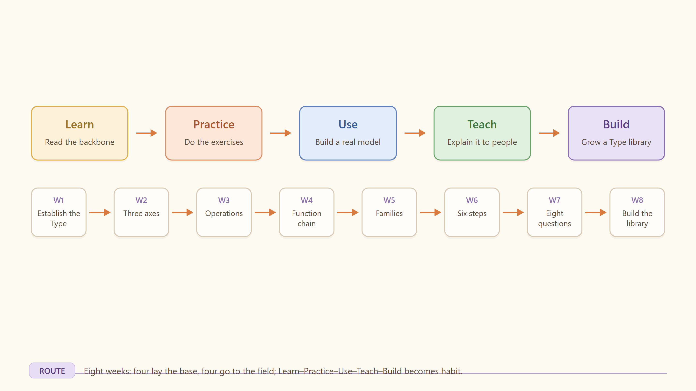

*Figure 8-1 Learn–Practice–Use–Teach–Build + the eight-week route*

**Example — The rhythm of one week**

> **Example · W6**
>
> W6 (six-steps week): read 6-3 and 6-4 → do E12 → take a real problem at hand through the six steps → explain the steps to a colleague → store the template in the Type library.
> Five actions in one week, exactly one lap around Learn–Practice–Use–Teach–Build.

### 8-2 Four Reader Routes + Four Stages of Library Building

Different readers take different routes: students follow the main text plus exercises; teachers add the teaching demonstrations; engineers add the professional columns and cases; decision-makers read the positioning, the overall architecture, and the plan. Library building has four stages: inventory (which Types do we have), establish (write the three axes clearly), grade (the three remove levels), shelve (put into a searchable Type library), advanced as "pilot → expansion → mass production."

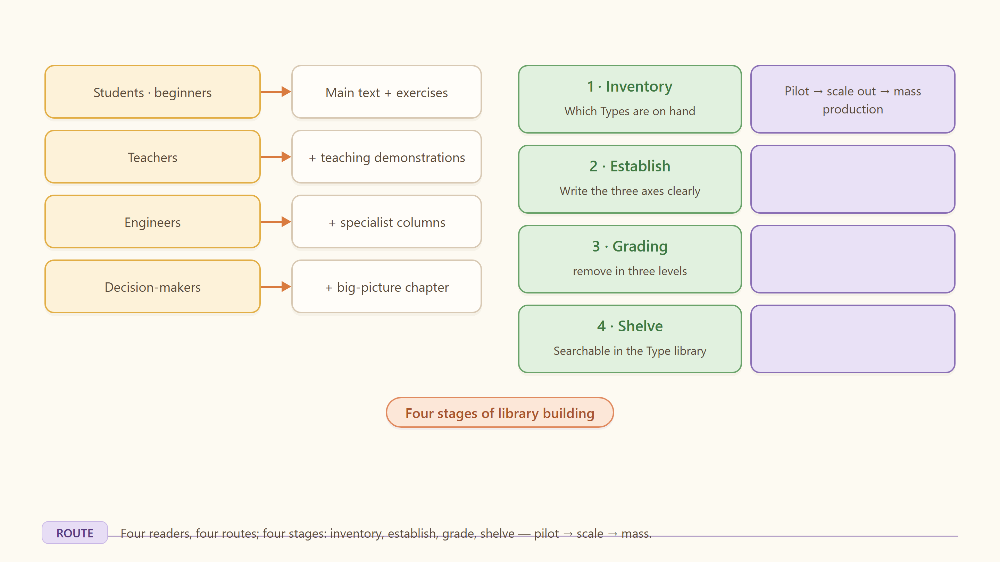

*Figure 8-2 Four reader routes + four stages of library building*

**Example — How to choose a pilot**

> **Example · Pilot**
>
> A pilot should be a "small but complete" problem: small scope (fast to establish the Type), a full loop (the six steps can be completed), and a real pain point (someone cares about the acceptance).
> When one pilot is complete, the Type library holds its first set of templates — expansion is just swapping Types and rerunning, and mass production is copying the process.

### 8-3 Five Fields Side by Side

The Accurate-Use Method does not divide arts from sciences: wherever a Type can be established on site, it can enter. Philosophy's quarrel over universals is a quarrel over the criteria of category Types; biology's population models are merged Types of differential equations and statistics; language's semantic drift is a scale that was never hung back on its Type; a program's type is a Type — Type-driven modeling; an organization's process optimization is queueing and scheduling under constraints. The field changes; the Type operations do not — that is the method's generality.

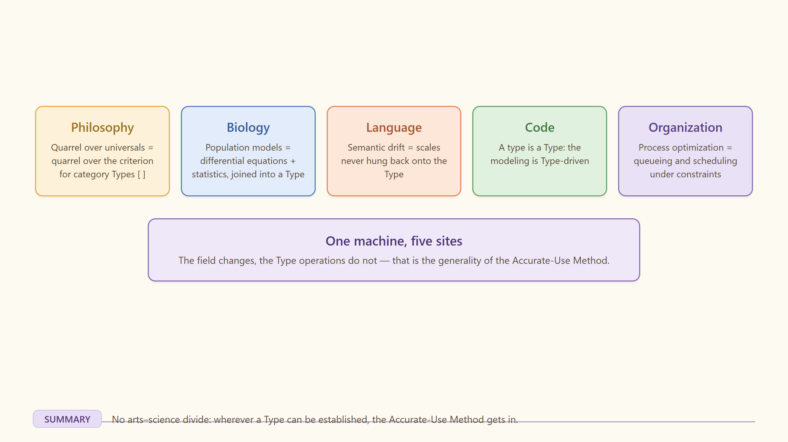

*Figure 8-3 Five fields side by side: one machine, five sites*

**Example — One sentence per field**

| Field | In one sentence | Where Ontypology lands |
| --- | --- | --- |
| Philosophy | The quarrel over universals = a quarrel over the criteria of category Types | [ ] · ∩(T) |
| Biology | Population models = a merged Type of evolution and inference | op · ⊕ |
| Language | Semantic drift = a scale never hung back on its Type | [ ] scale |
| Programming | The type is the Type: type-driven design | Unit Type · contract |
| Organization | Process optimization = queueing and scheduling under constraints | ( ) · remove |

### 8-4 Conclusion: Establish the Type, Establish the Formula, Make Validation Real

One main line runs through the book: first the Type, then the number. Establish the Type well — three axes and three brackets, the three books of variables, assumptions, and structure. Establish the formula well — the function chain, the reasoning families, the six family Types. Make validation real — three-layer judgment, eight questions, four acceptance lines. A model's accuracy is reviewable accuracy. This little book begins with "establish" and closes with "accurate" — what remains is to return to your own site and establish the first Type.

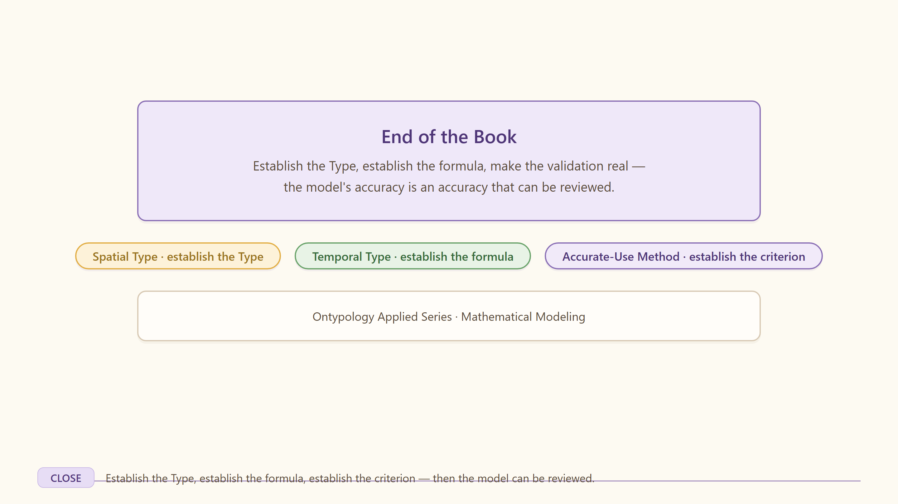

*Figure 8-4 The book's close: establish the Type, establish the formula, establish the criterion*

> **S01 Exercise (Part VIII · Designing a plan)**
>
> (a) Lay out an eight-week route for your team: which real problem does each week's "Use" land on?
> (b) Write the reasons your first pilot was selected (one sentence for each of the three "small but complete" conditions).
> Hint: a plan must land on weeks and problems. Answers in Appendix C.

> **S02 Exercise (Part VIII · Building a library)**
>
> (a) Using the four stages "inventory → establish → grade → shelve," write a four-line work list for a model you have.
> (b) What fields must a shelved entry have so that you, three months later, can find it and understand it?
> Hint: an entry is a Type: id, structure, category, criterion, version. Answers in Appendix C.

> **S03 Exercise (Part VIII · Five fields)**
>
> (a) Choose a field you are unfamiliar with, find one of its modeling problems, and walk the first four of the six steps (up to choosing the proposition).
> (b) Which step is hardest across domains? Does it need domain knowledge or Type operations? (Answer with "comparison failure.")
> Hint: cross-domain sticking points are usually "identifying the whole" and "naming dimensions." Answers in Appendix C.

## Appendix A — Glossary and Notation

| Term | English / notation | One-sentence definition |
| --- | --- | --- |
| 形 | Type | A fully described object |
| 單位形 | Unit Type | The union of three sets: { parts, (content), [category] } |
| 形集合 | Type Set | The full notation of a unit Type |
| 空間本形 | Spatial Type | The noun side of a Type: three axes, static structure |
| 時間本形 | Temporal Type | The verb side of a Type: functions, dynamic operation |
| 類別形 | T = (F(T), ∩(T)) | An open rule: feature list plus intersection criterion |
| 容器 | C = (id(C), S(C)) | Identity plus internal space; content can change, identity does not |
| 不變性公理 | id(C) unchanged | Replace content e1 → e2; the container's identity is unchanged |
| remove 三級 | ≢M / ≡M′⊂M / ≡M | Essential / function-degraded / non-essential part |
| 合形 | ⊕ | Merge parts into one Type, preserving levels |
| 拆形 | remove(p, M) | Remove a part and see whether identity survives |
| 替換 | σ | Change the content, keep the identity |
| 歸類・抽象 | ∩(T) · α | Criterion intersection · abstraction generation |
| 嵌套 | ι | Nest a Type in a container; each level keeps its identity |
| 比較 | ≡ / ≢ / ⊂ | At which layer is the sameness; degradation is written ⊂ |
| 運算總律 | op: Type → Type | Take in a Type, return a Type |
| 函式四問 | Name · input Type · output Type · criterion | The standard card of a temporal Type |
| 三層判斷 | Container · composition · abstraction | Three layers together; none can be omitted |
| 三種補足 | [ ] rules · ( ) identity · { } structure | Wherever there is a gap, the bracket fills it |
| 六步驟 | Identify the whole → … → three-layer check | The flow shared by modeling and proof |
| 八問 | An eight-item checklist | The acceptance standard of the three supplements |
| 數＝形裡小形 | compared again | A number depends on a Type that has already been identified |

(The English word for 形 is Type; this usage is consistent throughout the book.)

## Appendix B — Quick-Reference Cards

**B-1 Six Modeling Steps at a Glance**

| Step | In one sentence | Output |
| --- | --- | --- |
| 1 Identify the whole | Which whole is M? | One sentence for M |
| 2 Describe the axes | Write each of the three axes once | Attribute table, BOM, container |
| 3 Write the Type set | Full notation | { parts, (content), [category] } |
| 4 Choose the proposition | Membership, invariance, or grading? | One-sentence proposition |
| 5 Reason with criteria | Walk the corresponding criterion step by step | Reasoning text |
| 6 Three-layer check | Conclude after the three layers agree | (Proved.) |

**B-2 The Eight Questions at a Glance**

| # | Check question | Pass standard |
| --- | --- | --- |
| 1 | Is the object identified? | M can be stated in one sentence |
| 2 | Is F(T) written out? | Each feature can be verified item by item |
| 3 | Are the brackets used correctly? | { } ( ) [ ] each in its place |
| 4 | Is id(C) marked? | The identity mark is explicit |
| 5 | Has remove grading been done? | Every part has a level |
| 6 | Have boundary cases been considered? | At least one case is judged correctly |
| 7 | Can every step be checked? | The reader can tick it off and reproduce it sentence by sentence |
| 8 | Has the joint three-layer check been done? | Conclude only when all three layers pass |

**B-3 Photocopiable: blank modeling card (fill in this page directly)**

| Field | What to fill in |
| --- | --- |
| M (identify the whole) |  |
| X attributes [ ] (dimension × scale) |  |
| Y BOM { } (remove grading) |  |
| Z container ( ) (id(C), assumptions) |  |
| Type-set notation | { , ( ), [ ] } |
| Proposition (membership / invariance / grading) |  |
| Outline of criterion-based reasoning |  |
| Three-layer check (container / composition / abstraction) | □ pass □ pass □ pass |
| Eight-question tick list | □1 □2 □3 □4 □5 □6 □7 □8 |
| Version and notes | v / |

## Appendix C — Answers to the Exercises

The worked answers are for reference only: there is no single correct way to write an exercise. What matters is whether the line of thought "identify the Type first, then discuss numbers" holds steady.

| Exercise | Worked answer |
| --- | --- |
| E01 | (a) Example: it hit "variable drift" and "validation stays on the surface" — one symbol with two meanings, and training data used to validate itself. (b) Variable drift = the rule account of [ ] was never established: dimensions and scales were not written out. |
| E02 | (a) Ontology: what is charging on campus? Ontypology: what does the charging system look like as a Type ({ charging piles, queue, (ride demand), [time of day] })? Modeling: how is queue length computed, how many piles are needed? (b) The Ontypology question comes first — first the Type, then the number. |
| E03 | (a) Initial value ( ), objective function [ ], decision variable [ ] (or part { }, depending on the model — just state the reason), observation error ( ), feasible region ( ), model version id. (b) { stocks, bonds, cash, (market data), [risk preference] }; id(C) = the portfolio's strategic identity (e.g. "conservative portfolio A"). |
| E04 | (a) remove (split); σ (substitution, if population is content); ∩(T) (classification); ι (nesting). (b) If the trajectory still solves after removing friction (the Type keeps its function but degrades), record ≡M′⊂M; if friction is the core mechanism of the problem (removal makes it invalid), record ≢M; if the problem has nothing to do with friction, record ≡M. |
| E05 | (a) M = tidal rebalancing of a city's shared bikes; M = { bikes, dispatch trucks, (ride demand), [tidal time slots] }; example variables: demand (demand Type · demand dimension · bikes/hour), tidal scale (time-slot Type · time-slot dimension · peak/off-peak), bike age (fleet Type · age dimension · months). (b) H1 closure (total fleet unchanged during the observation period), H2 demand known (historical demand is admitted), H3 relaxable first (weather folded into demand — remove H3 first at feedback). |
| E06 | (a) Bikes ≢M (no bikes, no rebalancing); dispatch truck ≡M′⊂M (degradable to manual dispatch); weather ≡M′⊂M or ≡M (depending on whether it enters demand); ride demand ≢M; app interface ≡M (removal leaves the Type untouched). (b) F(dispatch model) = { resource assignment, spatiotemporal constraints, schedule output }; a model that only forecasts and does not schedule fails ∩(T) — it does not belong. Boundary case: "next-day volume forecast only" → lacks the "schedule output" feature, ∉, and can be recorded as [forecast model]. |
| E07 | (a) Example — construction station: name: dispatch-model construction; input Type: M's raw Type + assumptions; output Type: equation system (allocation + routing); criterion: dimensional consistency, complete constraints. (b) Validation station: its criterion must pass container (same data source), composition (complete indicators), and abstraction (service level met) at once — the hardest to write, which is why three-layer judgment is needed rather than a single indicator. |
| E08 | (a) If only the time resolution of the same quantity is refined (identity unchanged) = σ; if it forces out a new "time-slot structure" dimension (comparison failure) = α; if the problem itself changes (from daily dispatch to real-time dispatch) = establishing a new Type. (b) Effect-to-cause reasoning: infer the cause from the damage Type of the returned item; model Type = { packaging, product, (damage records), [return category] }; criterion: the ∩(T) of damage features and causal mechanisms passes on every item. |
| E09 | (a) ① optimization (+ queueing) ② differential equations (+ simulation) ③ statistics ④ graph and network ⑤ queueing (+ optimization). (b) Example ③: M = { subjects, control group, (trial data), [population] }; criterion: confidence intervals converge, residuals pass the test. |
| E10 | (a) Optimization (objective and constraints of pile count and scheduling) + queueing (waiting and capacity), as a merged Type ⊕; optimization contributes { decision variables, constraints }, queueing contributes { queue, service desk }. (b) Peak scenario: pile count ≢M (remove it and the queue explodes); off-peak scenario: ≡M′⊂M (service still completes, waiting grows) — grading must be labeled by scenario. |
| E11 | (a) [ ]: demand (demand Type · time-slot dimension · bikes/hour), tidal scale, dispatch cost (cost Type · money dimension · yuan); ( ): H1 fleet closure, H2 demand known, H3 weather folded into demand; { }: bikes ≢M, dispatch truck ≡M′⊂M, app ≡M. (b) The structure book is the easiest to omit — and the first thing to go wrong is "simplification without boundaries": nobody knows what was deleted, and validation failure cannot be traced. |
| E12 | (a) M = the laundry queue in one dormitory; { washing machines, queue, (laundry volume), [time of day] }; proposition: judge ∈ [queueing-system model]; criterion: arrival (laundry) → service (wash cycle) → departure, all three present; three layers: container (dormitory id unchanged) ✓, composition (washing machine ≢M) ✓, abstraction (queueing features pass ∩(T)) ✓. (b) Statistical reasoning (estimate arrival rate from laundry records) + simulation (run the peak); not causal — laundry arrivals have no mechanistic equation. |
| E13 | (a) ① process misuse (assumptions not recoverable) ② identity misuse (definition of t drifts) ③ criterion misuse (conclusion from a single-layer indicator). (b) "H3 (no friction): remove friction from the BOM, recorded as ≡M′⊂M; if validation residuals exceed the scale, lift H3 first." |
| E14 | (a) Example: entry 1 = { S, I, R, (reports), [SIR] } v1.0, criterion = three layers pass + residuals within scale; entries 2–3 follow the same pattern. (b) What is most often missing is the loop — the model is archived when finished, with no template deposit (Type library) and no revision log (loop). |
| S01 | (a) Example: W1 inventory three old models, W2 fill in the three books, W3 operations and comparison, W4 function chain, W5 family reading, W6 six-step practice, W7 eight questions + four-line acceptance, W8 shelve and deliver. (b) Small but complete: small scope (finishable in two weeks), full loop (the six steps reach validation), real pain point (the manager's monthly report can use it). |
| S02 | (a) Inventory: list the draft Type sets of three old models; establish: complete each of the three axes; grade: the three-level part table; shelve: entries into the library + search tags. (b) Fields: id (name + version), Type set, criterion, case source, last validation date, keywords. |
| S03 | (a) Example: choose "drug metabolism model" from biology — M = the fate of a drug in one human body ({ absorption, distribution, metabolism, excretion, (plasma concentration), [dosing regimen] }), proposition: judge ∈ [differential-equation model]. (b) The hardest are "identify the whole" and "name dimensions" — what they need is not formulas but the "comparison failure" craft that turns domain differences into dimensions: if it does not match, open a new dimension; if it does, hang a scale on it. |

## Appendix D — Index of Figures and Tables

| File | Location | Figure name |
| --- | --- | --- |
| f00_cover | Cover | Ontypology Application Series · positioning frame |
| f01_langs | Introduction | Two languages superimposed |
| f02_chain | Introduction | Cognition chain × modeling chain |
| f03_pain | 1-1 | Five pain points · the Type was not established |
| f04_layers | 1-2 | Three-layer positioning: root, trunk, fruit |
| f05_axes | 2-1 | Three axes, three brackets |
| f06_judge | 2-2 | Three-layer judgment |
| f07_frame4 | 2-3 | Four steps of the spatial framework |
| f08_ops | 2-4 | Five operations |
| f09_fnlib | 2-5 | Temporal-Type function library |
| f10_map | 2-6 | Modeling ↔ Ontypology mapping |
| f11_method | 2-7 | Accurate-Use Method overview |
| f12_whole | 3-1 | Identify the whole |
| f13_var | 3-2 | Variable = dimension × scale |
| f14_hypo | 3-3 | Assumption = admission rule |
| f15_bom | 3-4 | Three remove levels |
| f16_classify | 3-5 | ∩(T) model classification |
| f17_flow6 | 4-1 | Six stations of the modeling flow |
| f18_cards4q | 4-2 | Six-station four-question function cards |
| f19_op | 4-3 | Equation = transfer rule |
| f20_reason | 4-4 | Five reasoning families |
| f21_think | 4-5 | Thinking-method routing |
| f22_loop | 4-6 | Type-in, Type-out loop |
| f23_families | 5-1 | Six model families |
| f24_opt | 5-2 | Type-ifying optimization |
| f25_ode | 5-3 | Type-ifying differential equations |
| f26_stat | 5-4 | Type-ifying statistical-probabilistic models |
| f27_graph | 5-5 | Type-ifying graphs and networks |
| f28_queue | 5-6 | Type-ifying queueing systems |
| f29_route | 5-8 | Family-selection tree |
| f30_table6 | 5-8 | Six-family comparison table |
| f31_tiyun | 6-1 | Body–Use–Accuracy |
| f32_supply | 6-2 | Three supplements, modeling edition |
| f33_steps6 | 6-3 | The six modeling steps |
| f34_sir | 6-4 | SIR end-to-end demonstration |
| f35_sir3L | 6-4 | SIR three-layer judgment |
| f36_eight8 | 6-5 | Eight questions, modeling edition |
| f37_miss16 | 6-6 | Sixteen misuses |
| f38_recheck | 6-7 | Reviewable accuracy |
| f39_mind | 7-1 | Two libraries, one hub, one loop |
| f40_lines4 | 7-2 | Four acceptance lines |
| f41_tools | 7-3 | Tools ↔ Ontypology reading |
| f42_plan8 | 8-1 | Learn–Practice–Use–Teach–Build + eight weeks |
| f43_readers | 8-2 | Reader routes + library building |
| f44_five | 8-3 | Five fields side by side |
| f45_end | 8-4 | The book's close |

> **The End**
>
> Establish the Type, establish the formula, make validation real — a model's accuracy is reviewable accuracy.
