

  <a href="https://youtu.be/cCGDbikHbYQ">💻Landscape</a> ｜ 
 <a href="https://v.douyin.com/XicukGs_pII">📱Portrait</a> 
 

# Applications in Mechanical Design and PLM

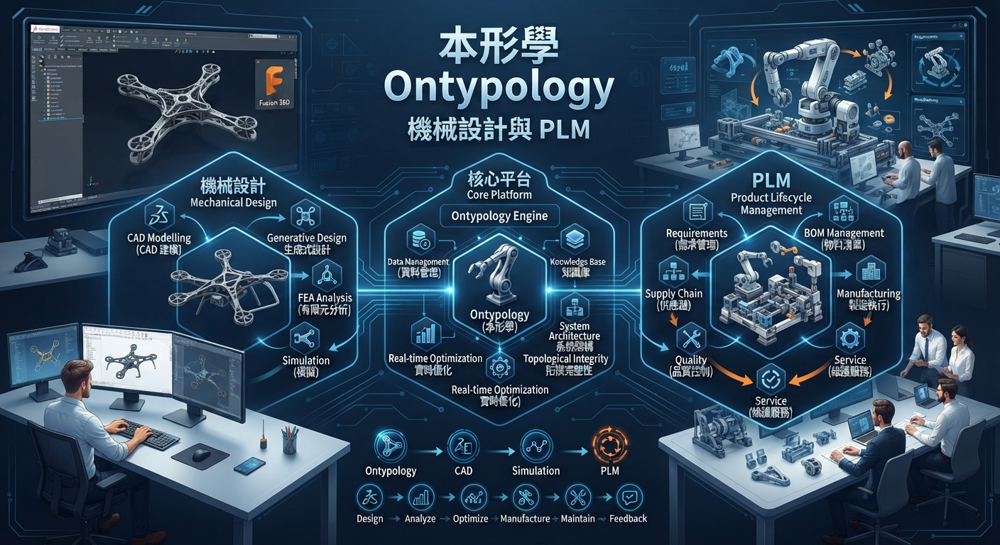

**Keywords:** Mechanical Design ・ Product Lifecycle Management (PLM) ・ Ontypology ・ Mind Model ・ Bill of Materials (BOM) ・ Change Management ・ Knowledge Management ・ Artificial Intelligence

# Abstract

This study uses "Ontypology" and the Mind Model (a unified model of knowledge) as its theoretical foundation to reinterpret the knowledge structure and operating mechanisms of Mechanical Design and Product Lifecycle Management (PLM). The study first points out that the product structure (BOM), parameter tables, and part classification systems in Mechanical Design actually share the same underlying "Type" logic as the "schema—row—Primary Key" structure of a Relational Database—the schema is the Type, the row is the entity, the Primary Key holds up identity, and the master-detail reference connects Type to Type. On this basis, this paper proposes an overall PLM architecture that fuses Space Type and Time Type: treating EBOM/MBOM/SBOM as multiple Framework unfoldings of the same Type, mapping change management to two asymmetric Type changes—"adding a row" and "adding a column"—and incorporating version evolution into the bidirectional tracks of causal reasoning and consequence-to-cause reasoning.

Furthermore, this paper constructs a Mind AI × PLM intelligent platform architecture, in which a large language model (LLM) takes on language capability, the Mind Model takes on intelligence capability, and three-layer Type Logic judgment (the container layer, the SOM layer, and the abstraction layer) serves as the cognitive filter for engineering decisions, supporting applications such as an intelligent design assistant, change impact analysis, and failure diagnostic reasoning. Finally, using the development of a single-stage speed reducer as a case study, it fully derives the end-to-end process from requirement definition, Framework construction, Y-axis decomposition, SOM grading, and ECO changes to version-up learning. The study shows that using "Type" to uniformly describe Mechanical Design and PLM can provide a consistent cognitive foundation for engineering knowledge management, solve the problems of information silos and knowledge loss, and lay a feasible path toward engineering AGI.

> **Core Thesis**
>
> Mechanical Design and PLM share the same underlying "Type" logic: a Type is the boundary drawn after Difference & Similarity have been split and merged; to understand a Type is to understand "what it looks like" (Attribute), "where it is" (container), "what it is composed of" (SOM), and "whether this descriptive method can be repeatedly applied" (Framework).

# Table of Contents

- Abstract
- Chapter 1 Introduction
  - 1.1 Research Background and Motivation
  - 1.2 Problem Awareness
  - 1.3 Research Objectives and Contributions
  - 1.4 Thesis Structure
- Chapter 2 Literature Review and Background
  - 2.1 Mechanical Design Process and Methodology
  - 2.2 The Development and Core Functions of PLM
  - 2.3 BOM and Configuration Management
  - 2.4 Engineering Knowledge Management and AI Applications
  - 2.5 Limitations of Traditional Methods
- Chapter 3 Theoretical Foundation: Ontypology and the Mind Model
  - 3.1 The Origin of Type: Difference & Similarity → Split & Merge → Type
  - 3.2 The X-Axis and Y-Axis: Classification and Decomposition
  - 3.3 Unit Type: Attribute, Container, BOM, and SOM
  - 3.4 Spatial Framework: A Repeatable Descriptive Method
  - 3.5 RDB Correspondence: The schema is the Type, the row is the entity
  - 3.6 Type Logic: Three Kinds of Value-Added
  - 3.7 Time Type: Evolution and Reasoning
  - 3.8 Mind Model and Mind AI
- Chapter 4 An Ontypological Interpretation of Mechanical Design
  - 4.1 The Ontypological Correspondence of the Design Process
  - 4.2 Y-Axis Decomposition and Product Structure
  - 4.3 The Emergence Mechanism of Design Parameters
  - 4.4 Design Patterns and Framework Reuse
  - 4.5 SOM Dependency and Component Necessity Grading
- Chapter 5 The Ontypological Architecture of PLM
  - 5.1 Overall Architecture: Space Type × Time Type
  - 5.2 Product Master: The schema is the Type
  - 5.3 EBOM/MBOM/SBOM: Multiple Framework Unfoldings
  - 5.4 Change Management: Adding a Row and Adding a Column
  - 5.5 Time Type and Version Evolution
  - 5.6 Configuration Management as Space Collections
- Chapter 6 Mind AI × PLM: An Intelligent Application System
  - 6.1 Platform Architecture
  - 6.2 Three-Layer Type Logic Judgment: The Cognitive Filter for Engineering Decisions
  - 6.3 Change Impact Analysis
  - 6.4 Failure Diagnosis and Bidirectional Reasoning
  - 6.5 Knowledge Recommendation and Design Assistant
  - 6.6 Differences from Traditional Knowledge Graphs
- Chapter 7 Case Study: Development of a Single-Stage Speed Reducer
  - 7.1 Case Background
  - 7.2 End-to-End Process Derivation
  - 7.3 Product Structure and SOM Grading
  - 7.4 Change Case: Material Upgrade of the Large Gear
  - 7.5 Case Summary
- Chapter 8 Benefit Evaluation and Discussion
  - 8.1 Benefit Evaluation
  - 8.2 Implementation Path
  - 8.3 Limitations and Challenges
  - 8.4 Discussion
- Chapter 9 Conclusion and Outlook
  - 9.1 Conclusion
  - 9.2 Outlook: Three Stages Toward Engineering AGI
- References

# Chapter 1　Introduction

## 1.1　Research Background and Motivation

Mechanical Design is the source of the manufacturing industry. From requirement definition, conceptual design, parametric design, and structural analysis to mass-production prototyping, a product accumulates vast engineering knowledge: drawings, BOMs, parameter tables, design specifications, failure cases, and change records. To manage this knowledge, Product Lifecycle Management (PLM) systems have gradually become the information backbone of enterprises since the 1990s, connecting CAD/CAE/CAM/ERP/MES and bearing the mission of the "Single Source of Truth." However, most PLM implementations still remain at the level of "data management": data is properly stored but not truly understood; data formats differ across systems, design rationale is lost as personnel change, and change impact relies on the intuition of senior engineers—information silos have not disappeared because of PLM's existence, but have merely taken a different form.

Meanwhile, artificial intelligence technology is developing rapidly. Large language models (LLMs) possess excellent language understanding and generation capabilities, knowledge graphs provide a structured representation of knowledge, and methods such as Graph RAG attempt to combine the two. However, the classification and reasoning of current AI mostly remain at the "abstraction layer" of judgment, lacking the ability to track identity continuity and to analyze structural dependency; although traditional knowledge graphs can describe entities and relations, they have limitations such as limited relational expression capability, lack of deep reasoning, difficulty representing abstract concepts, lack of a thought structure, difficulty unifying cross-domain knowledge, and difficulty supporting continuous evolutionary learning. What the engineering field needs is not merely a larger parameter scale, but an intelligent architecture capable of unifying knowledge, understanding the world, performing reasoning, learning continuously, and thinking autonomously.

## 1.2　Problem Awareness

The problem awareness of this study stems from an observation: four tools that mechanical designers use every day—the product structure tree, parameter tables, part classification, and the database master file—appear to belong to different domains but actually share the same deep logic. When we create a "part master" in PLM, we are in fact defining a "Type"; when we decompose a BOM, we are performing Y-axis composition analysis; when we build part families, we are performing X-axis abstract classification; when we execute an ECO change, we are confronting precisely the fundamental question of "whether the Type should change." If this shared underlying logic can be revealed and formalized through a cognitive theory, PLM can be upgraded from a "data management tool" to a "knowledge understanding system."

## 1.3　Research Objectives and Contributions

- Theoretical contribution: To interpret Mechanical Design and PLM through Ontypology (Space Type + Time Type), establishing a complete system of correspondence between the two and the concept of "Type," and proving that they share the same underlying logic.
- Architectural contribution: To propose an overall PLM architecture fusing Space Type and Time Type, as well as a Mind AI × PLM intelligent platform, clearly defining the division of responsibilities among the data layer, knowledge layer, and application layer.
- Practical contribution: To conduct an end-to-end derivation using the development of a single-stage speed reducer as a case study, verifying the benefits of this method in design reuse, change efficiency, error prevention, and knowledge retention, and proposing a feasible implementation path.

## 1.4　Thesis Structure

This thesis is divided into nine chapters. Chapter 2 reviews the relevant literature on Mechanical Design, PLM, and engineering knowledge management; Chapter 3 expounds the theoretical foundation of Ontypology and the Mind Model; Chapter 4 interprets Mechanical Design through Ontypology; Chapter 5 constructs the Ontypological architecture of PLM; Chapter 6 proposes the Mind AI × PLM intelligent application system; Chapter 7 conducts a case analysis using a single-stage speed reducer; Chapter 8 evaluates the benefits and discusses the limitations; and Chapter 9 presents the conclusion and outlook.

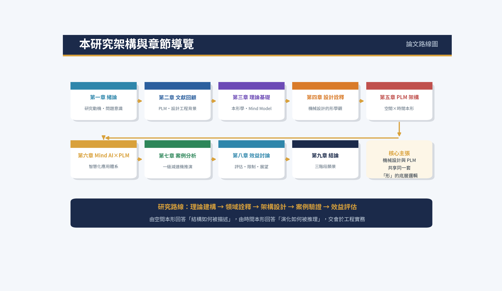

# Chapter 2　Literature Review and Background

## 2.1　Mechanical Design Process and Methodology

The classic system of Mechanical Design methodology is represented by Pahl and Beitz's *Engineering Design*, which divides the design process into four stages—clarifying the task, conceptual design, embodiment design, and detail design—emphasizing "function decomposition" and the mapping "from requirements to structure"; Ullman, on the other hand, uses a design process model to describe the iterative cycle of problem definition, concept generation, product generation, and product delivery. Research on the Functional Basis further standardizes the vocabulary of function and flow, enabling "functional structures" to be compared and reused across products. These methodologies collectively reveal that the essence of design is the process of progressively drawing boundaries, dividing levels, and defining parameters from vague requirements—precisely the operation of "Split & Merge" and "Framework."

## 2.2　The Development and Core Functions of PLM

PLM manages the information and processes of a product across its entire lifecycle from requirements to recycling. Sudarsan et al. proposed a product information modeling framework, emphasizing the unified representation of product data; Stark defined PLM as "the paradigm for product realization in the 21st century," covering document management, BOM management, change management, configuration management, process collaboration, and system integration. The international standard STEP (ISO 10303) defines a neutral format for product data exchange. The core promise of PLM is the "Single Source of Truth"—all departments collaborate on the same product facts. However, the unification of "facts" does not equal the unification of "understanding": the data model determines how data is stored, but it does not answer how knowledge is reasoned, reused, and evolved.

## 2.3　BOM and Configuration Management

The BOM (Bill of Materials) is the most central knowledge carrier of Mechanical Design. Depending on the angle of entry, the same product can be unfolded into an EBOM (design view), MBOM (manufacturing view), and SBOM (service view); configuration management is responsible for maintaining the consistency of the product structure under scenarios of option selection, series development, and customer customization. The parent-child relationships, level structures, and version associations of the BOM constitute a vast "web of structure"—precisely what Space Type calls the SOM (Space Object Model): components are not merely enumerated but occupy fixed positions and are structurally interdependent.

## 2.4　Engineering Knowledge Management and AI Applications

Engineering knowledge management aims to organize design experience, failure cases, and decision rationale into reusable assets. In recent years, knowledge graph technology has been widely applied to engineering knowledge representation, and the Graph RAG method further combines graph-structure retrieval with large language models to improve question-answering quality. However, the review by Hogan et al. points out that knowledge graphs still have bottlenecks in abstract concept representation and evolutionary learning; Mind AI research further points out that traditional knowledge graphs lack a thought structure and find it difficult to carry "how to think" rather than merely "what it is." To enable AI to truly understand engineering knowledge, three properties must be added: identity independence, inter-element structure, and generation rules.

## 2.5　Limitations of Traditional Methods

Synthesizing the above literature, current informationization solutions for Mechanical Design and PLM have five structural limitations, summarized in Table 2-1.

| Aspect | Traditional Solution | Structural Limitation |
| --- | --- | --- |
| Knowledge representation | Data tables, BOMs, documents | Stores only conclusions, not "why"; design rationale is lost |
| Classification system | Part families, product family lists | Closed-list management; new parts require manual classification |
| Change management | ECR/ECO process | Impact analysis relies on experience, lacking a systematic judgment framework |
| Cross-system integration | ERP/MES/CAD interfacing | Inconsistent formats, semantic gaps, proliferating information silos |
| AI applications | Knowledge graphs, LLM applications | Lacking identity tracking and structural dependency analysis; hallucination is hard to prevent |

**Table 2-1　Structural Limitations of Traditional Mechanical Design and PLM Solutions**

The common root of these limitations lies in the lack of a unified cognitive theory to describe "Type"—what an object looks like, where it is, what it is composed of, and how it evolves. The next chapter uses Ontypology to supply this missing piece of the puzzle.

# Chapter 3　Theoretical Foundation: Ontypology and the Mind Model

## 3.1　The Origin of Type: Difference & Similarity → Split & Merge → Type

Ontypology asserts that "Type" does not exist innately; rather, it is the result produced only after the brain first detects "Difference & Similarity" and then draws a boundary through the actions of "splitting" and "merging." In plain terms, the brain must first sense that "this is different from that" before it circles the similar parts together (merging) and cuts apart the different parts (splitting); the boundary drawn by "circling/cutting" is the "Type," and a Type must have a name. This cognitive chain—Difference & Similarity, Split & Merge, Type, naming, category—echoes the "figure and ground" principle of Gestalt psychology: a prominent foreground on a uniform background lets the brain easily draw boundaries; when everything before the eyes is homogeneous, "Type" cannot be born.

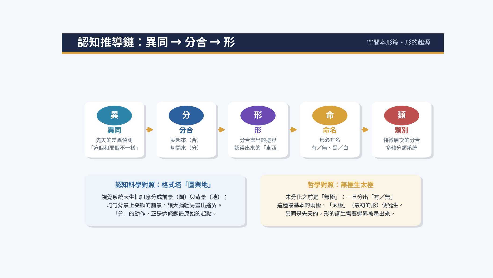

"Splitting" is seeing where things differ from one another; "merging" is finding, among things that differ, the parts that "can actually be counted as the same category." When a third thing appears and forces out two independent classification axes of "color" and "shape," humans begin to describe the world with multiple axes. Brain thinking = Type + Number: mathematics describes quantity, relations, and regularities; Ontypology describes structure, composition, association, evolution, and essence.

## 3.2　The X-Axis and Y-Axis: Classification and Decomposition

Grouping a bunch of things by common points, where the same bunch of things can be divided simultaneously by several kinds of common points, is called the X-axis—it answers "what kind of thing is this." Staring at a thing to see whether it can be cut into several pieces, each of which is still a complete and independent thing, is called the Y-axis—it answers "what pieces is this thing composed of." The two axes operate independently, yet they can connect through components: a decomposed component can run through X-axis classification again; and new properties discovered during decomposition will force the vocabulary of the X-axis to expand.

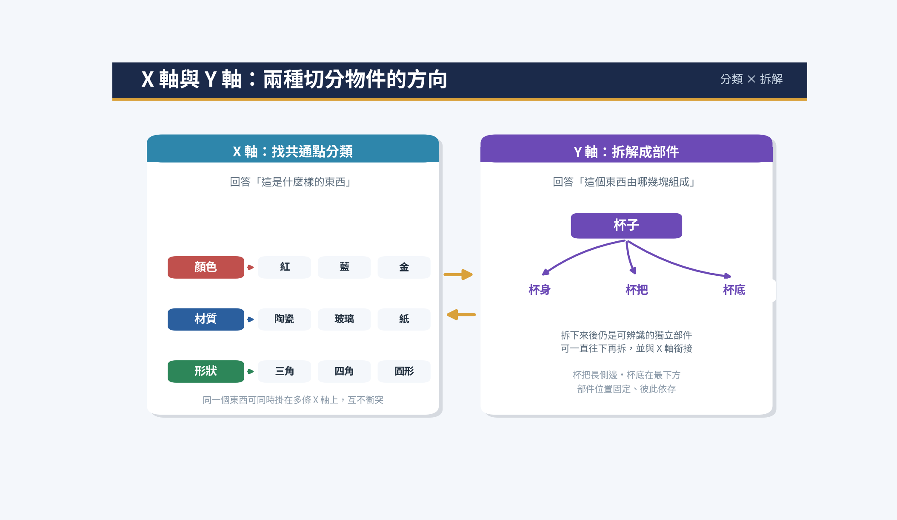

## 3.3　Unit Type: Attribute, Container, BOM, and SOM

A complete description of a concrete object requires four aspects: Attribute and Attribute Value answer "what it looks like"; Space Collections answer "where the thing is"; the BOM answers "what it is composed of"; and the SOM answers "how the components are interdependent." An Attribute is "a question that can be asked" (a dimension), and an Attribute Value is the concrete answer (a scale); the moment an Attribute emerges is always the moment when "this batch of differences fails to match all existing Attributes"—a new dimension is opened and values are backfilled for all individuals; when it does match, a new scale is merely added under that dimension. Space Collections possess three elements—a boundary, an interior space, and an independent identity: a cup does not become something else because it holds water or coffee.

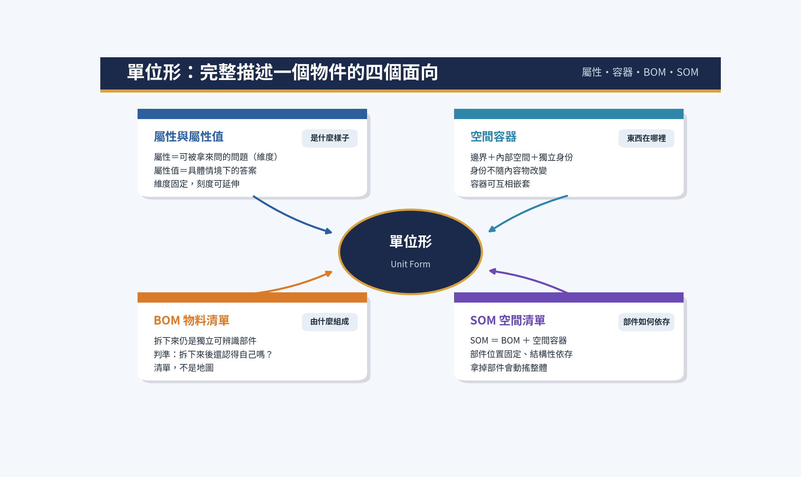

| Attribute (Dimension) | Attribute Value (Scale) |
| --- | --- |
| Material | Stainless steel, ceramic, paper, glass |
| Color | Transparent, blue, gold, silver, beige, khaki, white |
| Handle | Y/N |
| Lid | Y/N |

**Table 3-1　Attribute—Attribute Value Master Table (Cup Example): Dimensions are fixed, scales can be extended**

The BOM has only one criterion: "After being taken off, does it still recognize itself?" Those that can be taken off and are still independent individuals after removal (the lid, the ear) go into the BOM; those that cannot be taken off and can only be described by appearance (color, material) go into Attributes. SOM = BOM + Space Collections: what is contained in the container is not freely replaceable contents, but skeleton components fixed at specific spatial positions, structurally interdependent with one another, and jointly constituting the whole.

## 3.4　Spatial Framework: A Repeatable Descriptive Method

The Framework abstracts "describing an object" itself into a repeatable method, operating in four steps: first, upon receiving a group of things, one can first distinguish "this is not that"; second, when a second batch of differences of a different nature appears and the comparison fails, the need for abstraction is triggered; third, the two batches of differences are each given names and divided into different dimensions; fourth, when a new thing is added, one judges which dimension it matches—if it matches, it is hung onto an existing axis, and if not, a new dimension is opened and backfilled. The universality of this method can be verified by biological classification: the hierarchy of kingdom, phylum, class, order, family, genus, and species is precisely a manifestation of "concrete individuals exist first, and abstract hierarchies can only be derived afterward."

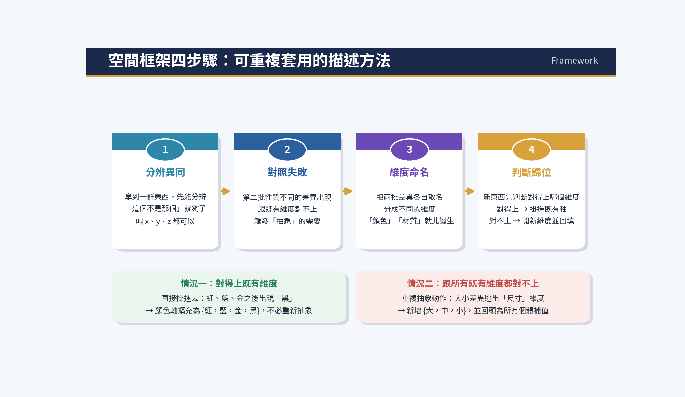

## 3.5　RDB Correspondence: The schema is the Type, the row is the entity

This theory has a precise correspondence in the Relational Database: the schema (field names) is the Type—the list of questions shared by all rows; a row is an entity—an identifiable object after the Type has been filled with concrete answers; the Primary Key is the credential of identity—unrelated to content, it supports the existence of "the same Type"; and Foreign Keys and master-detail references allow Type and Type to be connected by key values rather than bound by content. Adding a row is "the Type does not move, one more entity," which is light; adding a column is "the Type itself grows larger, and all entities must be backfilled accordingly," which is heavy—this asymmetry is precisely the theoretical basis for change management having to treat "Type changes" with caution.

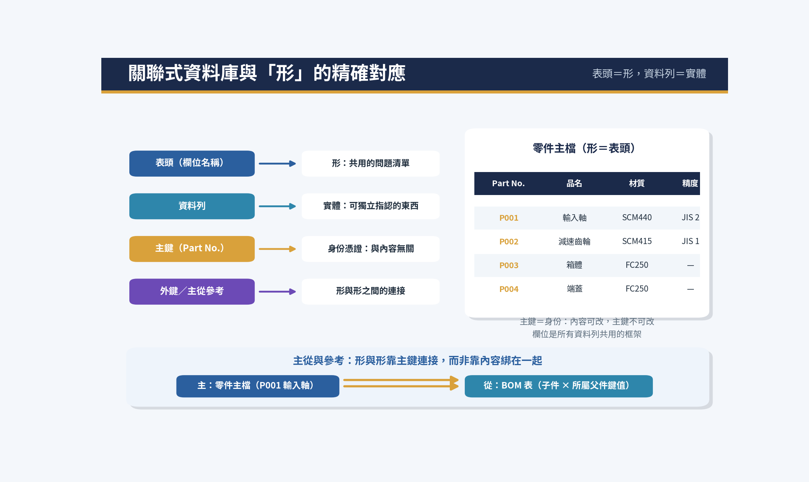

## 3.6　Type Logic: Three Kinds of Value-Added

A mathematical set answers only one question: "does it belong." It assumes the least, and therefore also describes the least—the independence of identity, the structure between elements, and the generation rule are all three layers of information omitted. Type Logic restores these three layers one by one with three kinds of bracket systems: the container set (parentheses) adds identity independence; the composition set (curly braces) adds inter-element structure; and the abstract set (square brackets) adds the feature-intersection generation rule, turning the set from a "closed list" into an "open rule that can automatically judge new members."

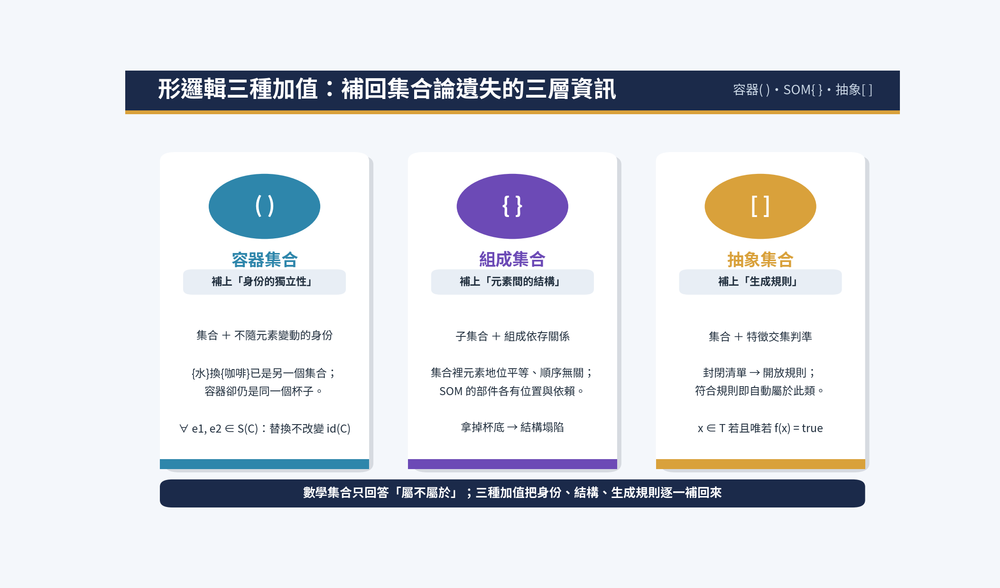

| Value-Added Type | Bracket | Property Added | Engineering Correspondence |
| --- | --- | --- | --- |
| Container | ( ) | Independence of identity | Option part management, configuration change, replaceable parts |
| SOM | { } | Structure between elements | Product structure, necessary-part grading, FMEA |
| Abstraction | [ ] | Generation rule | Part families/product families, module reuse |

**Table 3-2　Comparison Table of the Three Kinds of Value-Added**

## 3.7　Time Type: Evolution and Reasoning

Space Type answers "how structure is described," while Time Type answers "how evolution is reasoned." Time Type covers the domains of Split & Merge, Framework, design patterns, logic generation, memory management, logic application, labeling, continuous learning, abstraction, refactoring, thinking, thinking methods, problem solving, analysis, design, reasoning, causal reasoning, and consequence-to-cause reasoning. Among these, the three groups of concepts most closely related to engineering practice are: design patterns—distilling successful solutions into repeatable patterns; memory management—allowing every decision, along with its rationale, to be labeled, retained, and retrieved; and causal and consequence-to-cause bidirectional reasoning—causal reasoning traces "cause" from "effect" (a failure event traces back to the cause), while consequence-to-cause reasoning infers "effect" from "cause" (a design solution predicts the consequence), and together they constitute the complete cycle of engineering judgment.

## 3.8　Mind Model and Mind AI

The Mind Model is the practical architecture of Ontypological theory; its goal is not to build a traditional knowledge graph, but to build a unified knowledge model capable of simulating the way humans cognize: a single model simultaneously accommodates language, mathematics, physics, engineering, business, experience, and tacit knowledge, and practices unified thinking capabilities such as logical reasoning, induction and deduction, analogical and causal reasoning, problem analysis, pattern extraction, decision analysis, memory management, and continuous learning. Mind AI, on the other hand, is the practical platform of Ontypology and the Mind Model—combining Ontypological theory, the Mind Model, an LLM, a reasoning engine, a memory system, a learning system, and a planning system; the LLM is responsible for language capability, and the Mind Model is responsible for intelligence capability, together forming a complete AGI system.

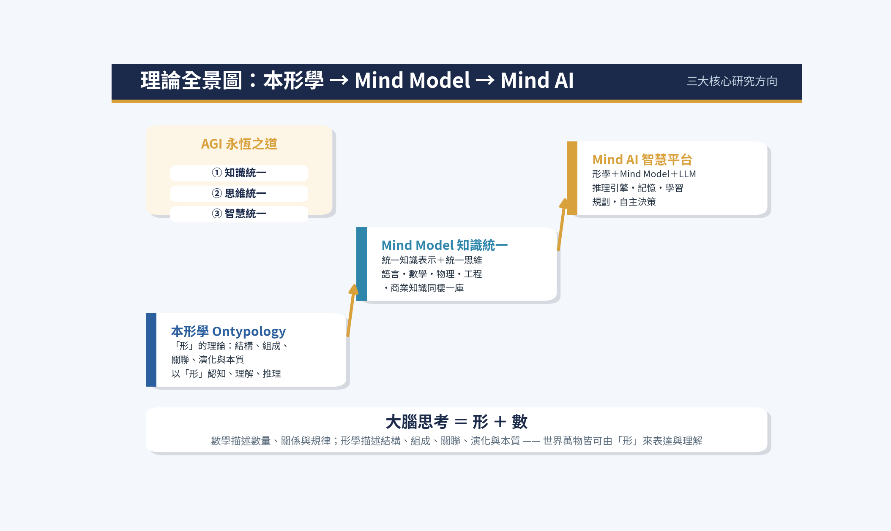

# Chapter 4　An Ontypological Interpretation of Mechanical Design

## 4.1　The Ontypological Correspondence of the Design Process

Every activity of Mechanical Design can find a corresponding operation in Ontypology: requirement analysis is Difference & Similarity detection; function decomposition is Y-axis decomposition; conceptual design is abstraction and analogy; parametric design is the definition and backfilling of Attribute—Attribute Value; structural layout is SOM dependency analysis; and detail design finalizes the Framework into drawings and part masters—the schema is the Type, and a part is an entity. Design is the unfolding of "Type": concrete requirements and prototypes come first, and only then can abstract hierarchies and parameter frameworks be derived—it is never the case that abstract hierarchies come first and give birth to concrete products.

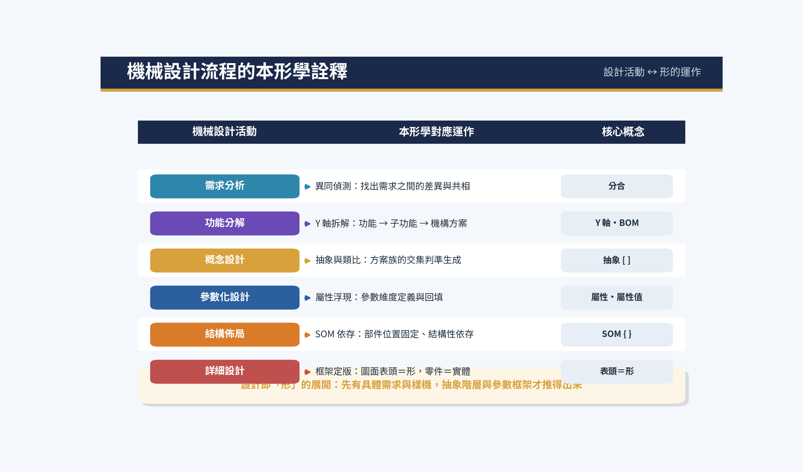

| Design Stage | Ontypological Operation | Key Output |
| --- | --- | --- |
| Requirement analysis | Difference & Similarity detection and Split & Merge | List of requirement dimensions |
| Function decomposition | Y-axis decomposition (BOM generation) | Functional structure tree |
| Conceptual design | Abstraction and analogical reasoning | Solution family and intersection criterion |
| Parametric design | Attribute emergence and backfilling | Parameter table (schema = Type) |
| Structural layout | SOM structural dependency analysis | Component configuration and dependency relations |
| Detail design | Framework finalization | Drawings, part master, EBOM |

**Table 4-1　Correspondence Table Between Mechanical Design Activities and Ontypological Operations**

## 4.2　Y-Axis Decomposition and Product Structure

Taking a single-stage speed reducer as an example, Y-axis decomposition breaks the whole machine down into four major modules—the input shaft system, the gear system, the housing system, and the sealing and lubrication system—and each module is further subdivided into components such as the input shaft, key, deep-groove ball bearing, reduction large gear, upper housing, lower housing, and oil seal. The criterion for decomposition is always "after being taken off, does it still recognize itself"—an oil seal, once removed, is still an oil seal and is a BOM item; "load-bearing capacity," however, cannot be taken off and is an Attribute. The BOM determines how many branches the tree structure splits into downward, and the Attributes determine the appearance of each branch and each node; only together can the two describe an individual completely and without omission.

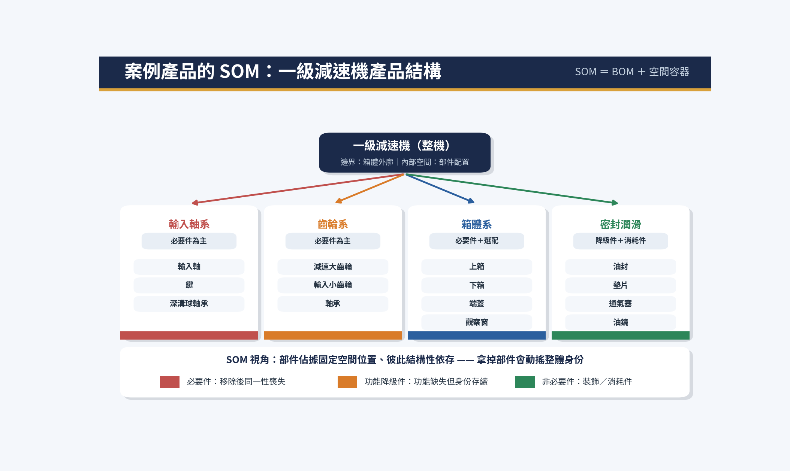

## 4.3　The Emergence Mechanism of Design Parameters

The growth of design parameters fully follows the "Attribute emergence rule": at the conceptual design stage, there are only two dimensions—module and number of teeth; the differences in material and heat treatment introduced by strength verification fail to match the existing dimensions, forcing out new Attributes and backfilling values for all gears; precision design then forces out the dimensions of precision grade and backlash; and the differences in surface treatment and coating at the mass-production preparation stage do match the dimensions related to "surface," requiring only new Attribute Values. Dimensions are fixed, scales can be extended—the number of Attributes is far smaller than the number of Attribute Values, just as the number of coordinate axes is fixed, but the scales on each axis can be extended infinitely.

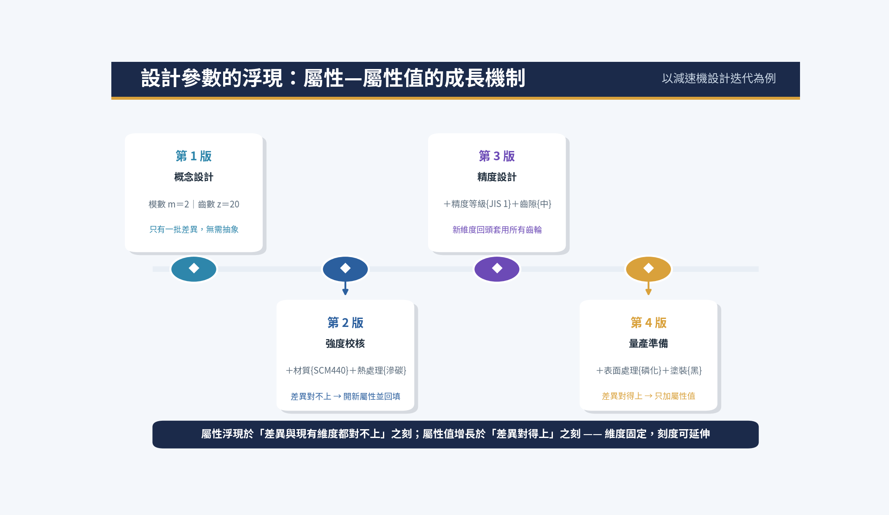

## 4.4　Design Patterns and Framework Reuse

The power of a Framework lies in its repeatability: once the same "descriptive method" is abstracted, whether the product is a speed reducer, a motor, or a pump, the same four steps can be run to establish parameter dimensions. Successful solutions are then distilled into design patterns—such as the "modular housing" pattern and the "sealing redundancy" pattern—and stored in memory management for new projects to apply through analogical reasoning. Design patterns are the gift that Time Type gives to Space Type: past evolutionary experience is transformed into the rules for future structure generation.

## 4.5　SOM Dependency and Component Necessity Grading

The core question of the SOM is "after removing a component, is this still the original thing?" On this basis, components can be divided into three grades: necessary parts (identity is lost after removal, such as the housing and the main shaft), function-degrading parts (function is missing but identity persists, such as the oil seal and the observation window), and non-essential parts (decorative and consumable parts). This grading has a direct engineering correspondence: necessary parts correspond to safety-critical parts and FMEA severity grading, function-degrading parts correspond to optional functional parts, and non-essential parts correspond to decorative and consumable parts—Ontypological judgment and quality tools converge here.

| Component | Grade | Impact After Removal | Engineering Grading |
| --- | --- | --- | --- |
| Upper housing / lower housing | Necessary part | Structure collapses; the machine is no longer a machine | Safety-critical part |
| Reduction large gear | Necessary part | Cannot reduce speed; the essence of the function is lost | Safety-critical part |
| Input shaft | Necessary part | Power cannot be input | Safety-critical part |
| Oil seal | Function-degrading part | Oil leaks but short-term operation is possible | Optional functional part / consumable |
| Observation window | Function-degrading part | Oil level cannot be observed; operation is unaffected | Optional functional part |
| Nameplate | Non-essential part | Completely does not affect function | Decorative part |

**Table 4-2　Component Necessity Grading Table for a Single-Stage Speed Reducer**

# Chapter 5　The Ontypological Architecture of PLM

## 5.1　Overall Architecture: Space Type × Time Type

The essence of PLM is managing "Type" on the time axis. Space Type answers "what the product is, where it is, and what it is composed of," constituting the product master, product structure, configuration management, component dependency, and part families; Time Type answers "how the product evolves and how it is reasoned about and decided upon," constituting version evolution, change management, causal/consequence-to-cause reasoning, design pattern extraction, and memory management. The two intersect at the central PLM core—the product data master—and use the Mind Model as the knowledge foundation, forming a complete "Space × Time" descriptive capability.

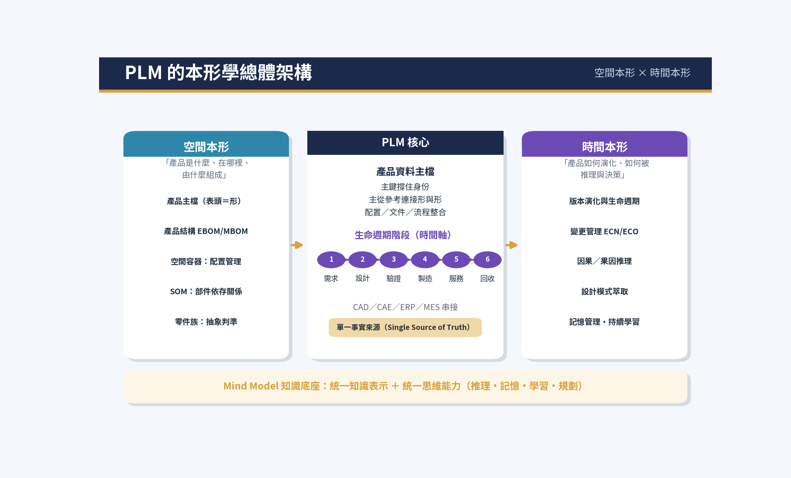

## 5.2　Product Master: The schema is the Type

The part master in PLM is the data incarnation of "Type": the field definitions (Part No., name, material, precision) are the list of questions shared by all parts; each part record is an independently identifiable entity; and the Part Number is a content-independent credential of identity—a part can change material or precision, but the Primary Key cannot move, otherwise the entire relational network breaks accordingly. This explains why PLM practice insists on the iron rule that "part numbers cannot be reused and cannot be modified": the Primary Key is the most fundamental credential of an entity's identity.

## 5.3　EBOM/MBOM/SBOM: Multiple Framework Unfoldings

The same product structure fact can be unfolded into three kinds of lists depending on the angle of entry: the EBOM unfolds by "functional structure" and is the baseline for design changes; the MBOM unfolds by "process route" and includes blanks, standard parts, and consumables; and the SBOM unfolds by "repair and replacement" and is the list of spare parts and consumables. This is precisely "multiple ways of unfolding a Framework": the Framework provides the fact itself of "what dimensions there are," and the arrangement is chosen by the user according to purpose. The three BOMs are not three independent sets of data, but three projections of the same Type—unifying them into the same product master is the true meaning of the "Single Source of Truth."

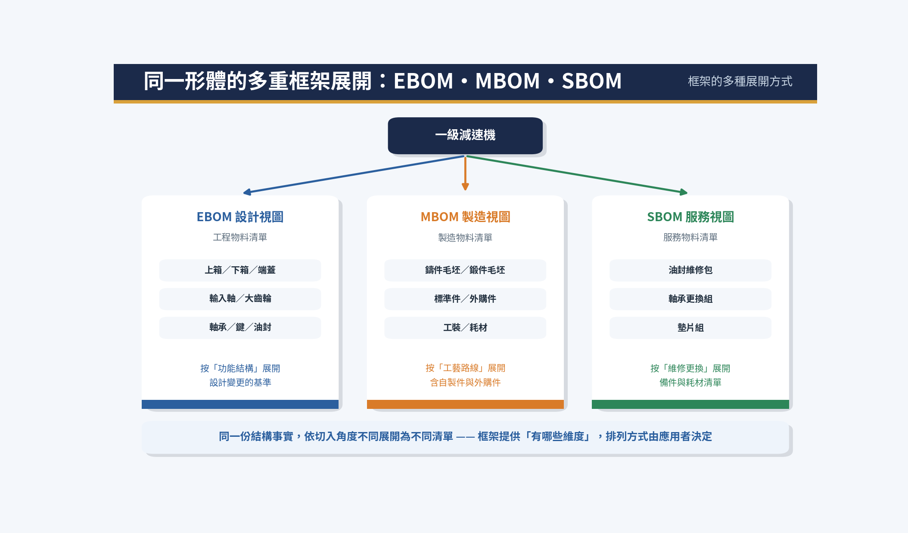

| Aspect | EBOM Design View | MBOM Manufacturing View | SBOM Service View |
| --- | --- | --- | --- |
| Basis of unfolding | Functional structure | Process route | Repair and replacement |
| Main users | R&D engineers | Production engineering / manufacturing | Service / spare parts |
| Typical content | Design parts, standard parts | Blanks, tooling, consumables | Repair kits, replacement groups |
| Change baseline | Design change ECO | Process change | Spare parts policy |
| Ontypological correspondence | Y-axis decomposition baseline | Manufacturing Framework unfolding | Service Framework unfolding |

**Table 5-1　Comparison Table of the Three Views of EBOM/MBOM/SBOM**

## 5.4　Change Management: Adding a Row and Adding a Column

Change management is the process in PLM that best embodies the "asymmetric change of Type." The ECR proposes the difference and the motivation, impact analysis judges the level of change, the ECO is countersigned across departments, the change is executed, the version is upgraded, and the rationale is written into memory management. The key lies in distinguishing two kinds of changes: adding a row—the Type does not move, one more entity (adding a model of the same type, a new supplier part number), which is light; adding a column—the Type grows larger, all entities are backfilled (a difference that existing fields cannot explain, such as "whether there is a thermal insulation layer"), which touches the Framework itself, is costly, affects the entire plant, and requires meticulous review.

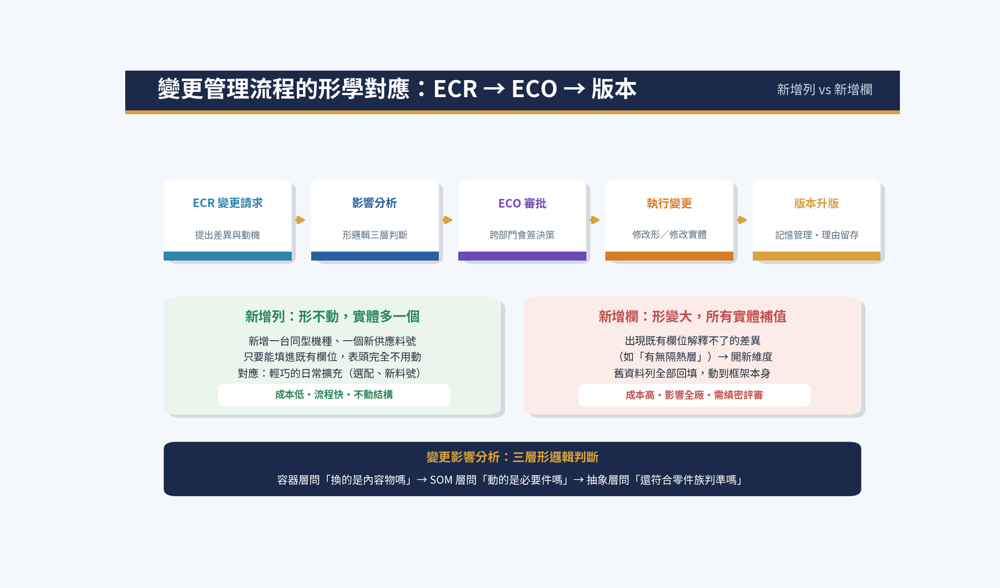

| Change Type | State of the Type | Scope of Impact | Operating Cost | Management Countermeasure |
| --- | --- | --- | --- | --- |
| Adding a row (new entity) | Unchanged | A single record | Low | Standard application process suffices |
| Adding a column (new dimension) | Expanded | Backfilling of all entities | High | Meticulous review + plant-wide communication |
| Modifying an Attribute Value | Unchanged | A single record | Low | Version record retention |
| Modifying a field definition | Mutated | All entities | Highest | Treated as a revision of the Type; requires a Framework upgrade |

**Table 5-2　Types of Type Changes and Management Countermeasures**

## 5.5　Time Type and Version Evolution

Each version node is a freeze-frame of "Type" on the time axis. Taking the speed reducer as an example: v1.0 initial mass production, v1.1 improvement of tooth-breakage failure, v2.0 structural remodeling, v2.2 cost optimization—the evolution chain itself becomes knowledge that can be reasoned about and learned from. Causal reasoning traces "cause" from "effect": the failure event of tooth breakage in v1.1 is traced back to insufficient material heat treatment, and the change rationale is written into memory management; consequence-to-cause reasoning infers "effect" from "cause": the design solution of bearing downgrading in v2.2 first undergoes a life prediction verification, and only after passing is the version upgrade permitted. The version repository is therefore not merely a filing cabinet, but a case library for engineering reasoning.

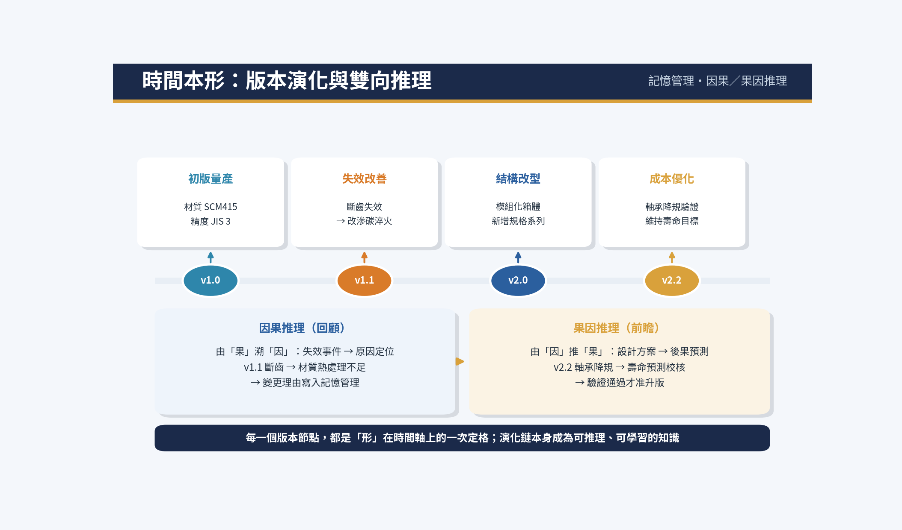

## 5.6　Configuration Management as Space Collections

The theoretical prototype of configuration management is precisely the three elements of Space Collections: the boundary (model scope), the interior space (the option items that can be accommodated), and the independent identity (regardless of which options are installed, the same model is still the same model). The contents are replaceable—changing the oil, changing the bearing supplier—and the machine is still the same machine; this forms a sharp contrast with "removing the housing means it is no longer the same machine": the former is the replacement of contents at the container layer, while the latter is the removal of a structural component at the SOM layer. Distinguishing these two layers is the prerequisite for correctly routing configuration management and change management.

# Chapter 6　Mind AI × PLM: An Intelligent Application System

## 6.1　Platform Architecture

The Mind AI × PLM platform is divided into four layers: the data source layer aggregates the PLM master, CAD/CAE models, ERP/MES shop-floor data, IoT/digital twins, and document-based experiential knowledge; the Mind Model unified knowledge layer uses a Type Library to uniformly represent knowledge, a reasoning engine to carry causal/consequence-to-cause and analogical reasoning, a memory system to retain design rationale and failure cases, and a learning system to extract design patterns; the intelligent application layer provides an intelligent design assistant, change impact analysis, failure diagnostic reasoning, knowledge recommendation and retrieval, and automated design exploration. The LLM is responsible for language understanding, generation, and knowledge recall, and the Mind Model is responsible for knowledge unification, deep reasoning, long-term memory, and autonomous learning—language capability plus intelligence capability, neither is dispensable.

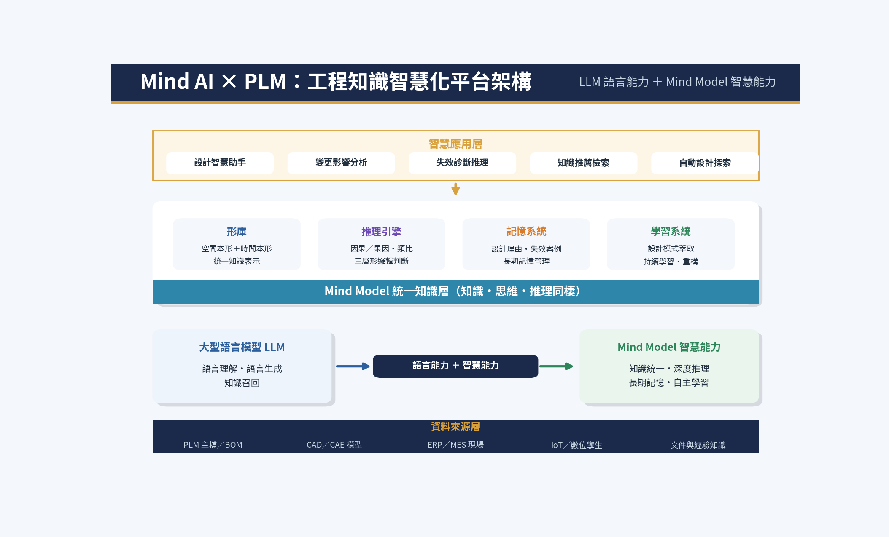

## 6.2　Three-Layer Type Logic Judgment: The Cognitive Filter for Engineering Decisions

Every judgment in engineering decision-making can be examined through the filter of the three-layer Type Logic. The container layer asks "after the contents change, does the identity remain unchanged," corresponding to the management of option parts and replaceable parts; the SOM layer asks "after removing a component, is the whole still the same thing," corresponding to necessary-part grading and safety-critical part determination; and the abstraction layer asks "does the new object pass the intersection criterion F(T)," corresponding to part family classification and module reuse. Each of the three layers has blind spots: looking only at the container layer, even option parts become critical parts; looking only at the SOM layer, a model change makes it a new product; looking only at the abstraction layer, identity cannot be tracked—only used in combination can they precisely define a product.

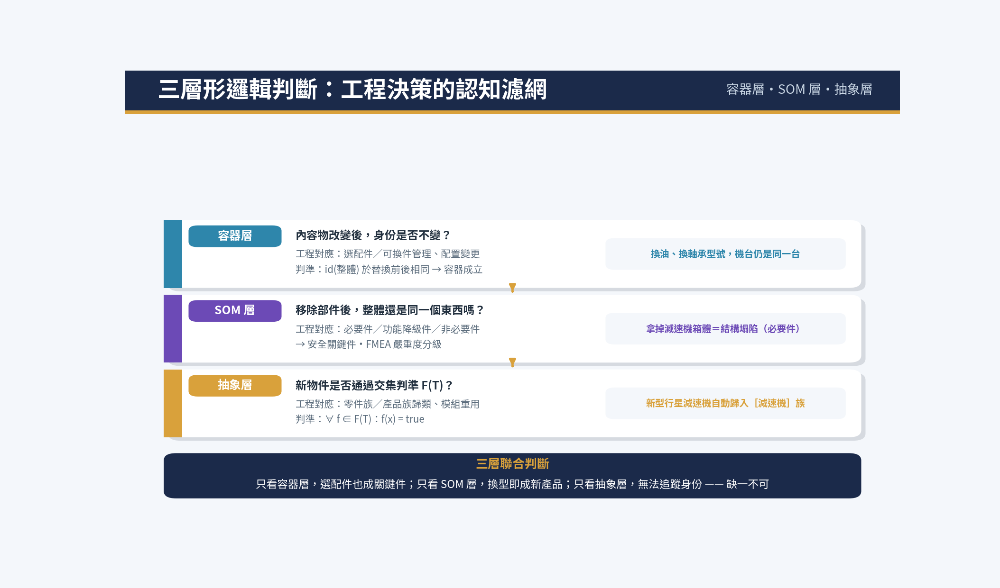

| Judgment Layer | Core Question | Engineering Correspondence | Criterion |
| --- | --- | --- | --- |
| Container layer | Is the identity unchanged after replacing the contents? | Option parts, replaceable parts, configuration change | id(whole) is the same before and after replacement |
| SOM layer | Is it still the same object after removing a component? | Necessary-part grading, FMEA severity | Whether remove(p, M) equals M |
| Abstraction layer | Does the new object pass the intersection criterion? | Part family classification, module reuse | ∀f ∈ F(T): f(x) = true |

**Table 6-1　The Engineering Correspondence of Three-Layer Type Logic Judgment**

## 6.3　Change Impact Analysis

The impact analysis of a traditional ECO relies on the intuition of senior engineers; the three-layer judgment makes it systematic: the container layer first judges "is what is being changed this time the contents"—if it is merely an option replacement, the impact is limited to the configuration; the SOM layer then judges "is what is being changed a necessary part"—if the housing or the main shaft is touched, a whole-machine re-verification is triggered; and the abstraction layer finally judges "does it still meet the part family criterion after the change"—if the material upgrade departs from the original part family, the procurement and inventory strategies must be updated in sync. After the three layers of filtering, the scope and level of the change impact are clear at a glance.

## 6.4　Failure Diagnosis and Bidirectional Reasoning

Failure diagnosis is a typical scenario of causal reasoning: tooth breakage (effect) is traced back to insufficient heat treatment (cause); design review is a scenario of consequence-to-cause reasoning: a downgrading solution (cause) predicts a shortened life (effect). The Mind Model's reasoning engine links bidirectional reasoning with the version evolution chain—each failure becomes a case memory, and each design decision comes with a verification record of "consequence-to-cause prediction," forming a memory management system in which individual engineers and the organization grow together.

## 6.5　Knowledge Recommendation and Design Assistant

The intelligent design assistant is based on Graph RAG-style retrieval augmentation, but goes further: what is retrieved is not merely similar documents, but the associations of "Type"—when an engineer creates a new gear, the system recommends existing designs of the same part family (abstraction layer), related failure cases (memory management), and applicable design patterns (Time Type), and automatically determines the new part's affiliation using the intersection criterion. Knowledge is no longer passively stored, but actively participates in design reasoning.

## 6.6　Differences from Traditional Knowledge Graphs

The fundamental difference between the Mind Model and traditional knowledge graphs lies in three kinds of value-added: knowledge graphs record entities and relations, while the Mind Model additionally maintains identity independence (container), inter-element structure (SOM), and generation rules (abstraction), and carries a thought structure and evolutionary learning capability.

| Capability Aspect | Traditional Knowledge Graph | LLM Applied Alone | Mind Model |
| --- | --- | --- | --- |
| Relational expression | Structured but limited | Implicit in parameters | Type + three kinds of value-added, complete |
| Deep reasoning | Limited rule extrapolation | Prone to hallucination | Causal/consequence-to-cause + three-layer judgment |
| Abstract concepts | Difficult to represent | Generatable but unstable | Formalized intersection criterion |
| Thought structure | Lacking | Lacking | Thinking methods ・ design patterns built in |
| Continuous evolution | Mostly static | No memory | Memory management + continuous learning |
| Cross-domain unification | Inconsistent schemas | Semantic drift | A single Type language |

**Table 6-2　Capability Comparison of Traditional Knowledge Graphs, LLMs, and the Mind Model**

# Chapter 7　Case Study: Development of a Single-Stage Speed Reducer

## 7.1　Case Background

This chapter takes the development of a single-stage speed reducer as a case study, fully deriving the operation of the Ontypological method in real Mechanical Design and PLM work. The product requirements are: reduction ratio i＝10, output torque T＝500 Nm, continuous operation life of 20,000 hours, and three specifications in a series. The development task spans conceptual design, detail design, mass-production preparation, and one design change, making it suitable as a target for end-to-end verification.

## 7.2　End-to-End Process Derivation

The process is divided into six steps: requirement definition establishes the boundaries of reduction ratio and torque; Framework construction establishes parameter dimensions (module, number of teeth, material, precision) through the four steps; Y-axis decomposition generates the product structure; SOM grading determines necessary parts and degrading parts; the ECO change executes the material upgrade of the large gear and analyzes the impact through the three-layer judgment; and version-up learning extracts the pattern into the memory repository. The entire process can be repeatedly applied to any model—this is the "Framework": abstracting the description process into a reusable method.

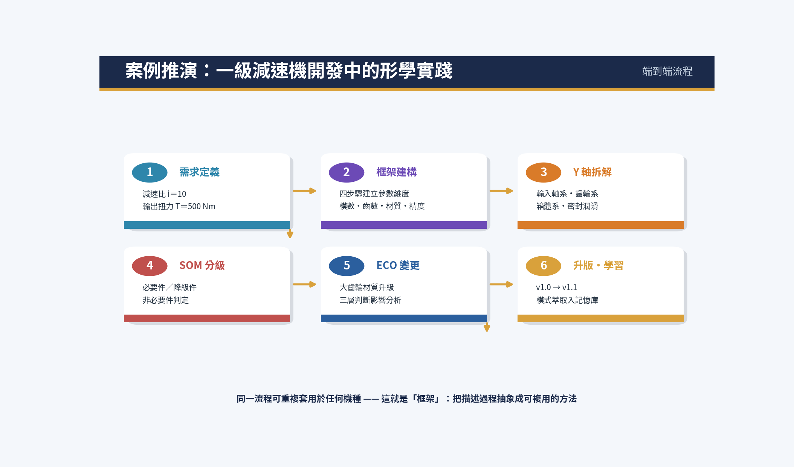

## 7.3　Product Structure and SOM Grading

The decomposition results are shown in Table 7-1: the whole machine possesses a clear boundary (the housing outline) and interior space (component configuration), and the components of the four major modules occupy fixed spatial positions and are structurally interdependent—the housing is a necessary part, and removing it collapses the structure; the oil seal is a function-degrading part, and it can still operate for a short term despite oil leakage; the nameplate is a non-essential part. This grading directly exports the preliminary FMEA severity judgment and the resource allocation of the test plan.

| Module | Component | SOM Grading | Spatial Position | Design Parameters (Excerpt) |
| --- | --- | --- | --- | --- |
| Input shaft system | Input shaft/key/deep-groove ball bearing | Mainly necessary parts | Left-side bearing seat of the housing | Shaft diameter 35mm, SCM440 |
| Gear system | Reduction large gear/input pinion | Necessary part | Central meshing zone of the housing | Module 2, number of teeth 20/100 |
| Housing system | Upper housing/lower housing/end cover | Necessary part + optional | Whole-machine outline | FC250 cast iron |
| Sealing and lubrication | Oil seal/gasket/breather plug/oil sight glass | Degrading part + consumable | Shaft extension end/joint surface | Fluororubber oil seal, paper gasket |

**Table 7-1　Product Structure (SOM) Table of a Single-Stage Speed Reducer**

## 7.4　Change Case: Material Upgrade of the Large Gear

On the eve of mass production, shop-floor feedback reported early pitting on the v1.0 large gear (SCM415, JIS grade 3). ECR-001 proposed a material upgrade and heat treatment strengthening. The impact analysis of the three-layer judgment is as follows: container layer—what is being replaced is the component itself rather than the contents, the configuration is unchanged, and the model identity is unchanged; SOM layer—the large gear is a necessary part, and touching a necessary part triggers whole-machine fatigue re-verification; abstraction layer—after the material upgrade it still passes the [reduction gear] family criterion (can transmit torque, can mesh and drive), the part family affiliation is unchanged, but supplier certification needs to be updated. Resolution executed: material upgraded to SCM440 + carburizing and quenching, precision raised to JIS 1, version upgraded to v1.1, and the change rationale along with the pitting case written into memory management.

| Item | v1.0 | v1.1 | Ontypological Judgment |
| --- | --- | --- | --- |
| Large gear material | SCM415 | SCM440 + carburizing and quenching | Attribute Value change (Type unchanged) |
| Precision grade | JIS 3 | JIS 1 | Attribute Value change |
| Part family | [Reduction gear] | [Reduction gear] | Intersection criterion still passes |
| Verification requirement | — | Whole-machine fatigue re-verification | Triggered by necessary-part change |
| Version | v1.0 | v1.1 | Time Type freeze-frame |

**Table 7-2　ECR-001 Change Record and Ontypological Judgment**

## 7.5　Case Summary

The case shows that the three-layer judgment turns impact analysis from "intuition" into a process that is "repeatable, verifiable, and debatable"; the necessary-part grading directly interfaces with FMEA; and the retention of change rationale enables the modular remodeling of v2.0 to apply the lessons of v1.1 by analogy. Throughout the entire process, what the PLM system preserves is not merely the result, but the complete evolutionary history of "Type."

# Chapter 8　Benefit Evaluation and Discussion

## 8.1　Benefit Evaluation

Six aspects are used to evaluate the difference between Ontypology-empowered PLM and traditional PLM (indicative scores, out of 10). The design reuse rate improves because of the open rules of part families and design patterns; the change cycle efficiency improves because the three-layer judgment systematizes impact analysis; the knowledge retention degree retains design rationale through memory management; cross-departmental collaboration reduces semantic gaps through a single Type language; error prevention is strengthened by necessary-part grading and consequence-to-cause pre-verification; and decision transparency is raised because the judgment process is repeatable and verifiable.

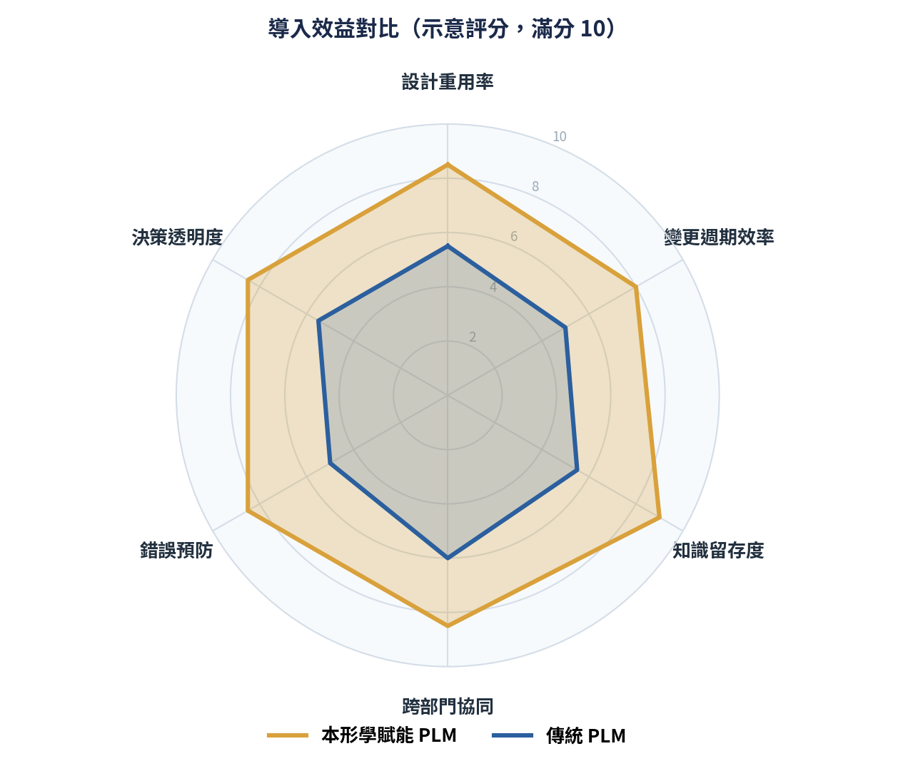

| Benefit Aspect | Traditional PLM | Ontypology-Empowered PLM | Improvement Mechanism |
| --- | --- | --- | --- |
| Design reuse rate | 5.5 | 8.5 | Open part family criterion + design pattern library |
| Change cycle efficiency | 5.0 | 8.0 | Three-layer judgment systematizes impact analysis |
| Knowledge retention degree | 5.5 | 9.0 | Memory management retains decision rationale |
| Cross-departmental collaboration | 6.0 | 8.5 | A single Type language reduces semantic gaps |
| Error prevention | 5.0 | 8.5 | Necessary-part grading + consequence-to-cause pre-verification |
| Decision transparency | 5.5 | 8.5 | A repeatable, verifiable judgment process |

**Table 8-1　Benefit Comparison Table (Indicative Scores, out of 10)**

## 8.2　Implementation Path

- Phase 1 (knowledge unification, 3–6 months): Reorganize the part master and EBOM using "schema = Type," connect EBOM/MBOM/SBOM, and establish a Single Source of Truth.
- Phase 2 (thinking unification, 6–12 months): Introduce three-layer Type Logic judgment into ECO impact analysis and FMEA grading, and establish a change and failure case library for causal/consequence-to-cause reasoning.
- Phase 3 (intelligence unification, 12–24 months): Launch the Mind AI × PLM intelligent applications—design assistant, change impact analysis, failure diagnosis—and use a continuous learning mechanism to let the system grow with the project.

## 8.3　Limitations and Challenges

The limitations of this study are: the benefit scores are indicative values derived from case derivation and await empirical validation across multiple industries; the translation correspondence between the Ontypological terminology system and existing PLM industry terminology still needs standardization; the deployment of the Mind AI platform depends on the quality of the enterprise's existing data—if the boundary of "Type" is not drawn well, intelligence has nowhere to begin; in addition, organizational change management (especially the discipline of writing design rationale) is a precondition for the success of memory management.

## 8.4　Discussion

It is worth emphasizing that Ontypology does not aim to replace existing PLM systems, but to provide them with a missing cognitive foundation. The data models of mainstream PLM software already possess the skeleton of schema, Primary Key, and master-detail reference—they merely lack a language to explain "why modeling it this way is correct," and a reasoning mechanism to turn data into knowledge. In this sense, this study is a "rediscovery" of existing engineering practice: the intuition of mechanical designers (decomposing, classifying, grading, retaining rationale) was originally the operation of Type; Ontypology merely writes this intuition into a theory, so that machines can learn it too.

# Chapter 9　Conclusion and Outlook

## 9.1　Conclusion

Using Ontypology and the Mind Model as its theoretical foundation, this study has completed the Ontypological correspondence of Mechanical Design and PLM, the architectural design, the intelligent applications, and the case verification. There are three main conclusions: first, the product structure (BOM), parameter tables, part classification, and database master of Mechanical Design share the same underlying "Type" logic—the schema is the Type, the row is the entity, the Primary Key holds up identity, and the master-detail reference connects Type to Type; this correspondence is precise and operable; second, the PLM architecture fusing Space Type and Time Type can unify EBOM/MBOM/SBOM as multiple unfoldings of the same Type, clearly distinguish change management into two asymmetric changes—adding a row and adding a column—and transform version evolution into a knowledge asset for causal/consequence-to-cause bidirectional reasoning; third, Mind AI × PLM uses the LLM to take on language capability and the Mind Model to take on intelligence capability, and the three-layer Type Logic judgment provides a repeatable, verifiable, and debatable cognitive filter for engineering decisions; the case derivation verifies its benefits in design reuse, change efficiency, and knowledge retention.

## 9.2　Outlook: Three Stages Toward Engineering AGI

Looking to the future, the intelligence of PLM will evolve through three stages, echoing the eternal way of AGI: the first stage, "knowledge unification"—connecting EBOM/MBOM/SBOM, establishing a unified product master, and solving information silos; the second stage, "thinking unification"—integrating design, change, and failure reasoning into the same reasoning architecture, possessing true understanding capability; the third stage, "intelligence unification"—knowledge, thinking, memory, learning, and creation forming a complete system, achieving an autonomous design assistant and the generation of innovative solutions.

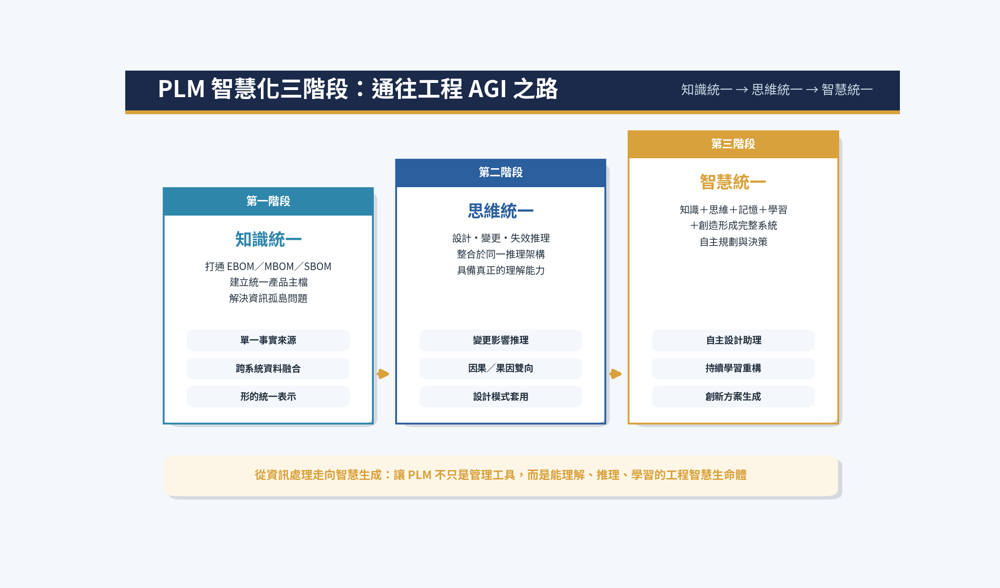

By then, PLM will no longer be merely a management tool, but an engineering intelligence life form capable of understanding, reasoning, and learning—moving from information processing toward intelligence generation. This is precisely the vision of Ontypology: to let artificial intelligence truly possess the ability to understand the essence of the world, and to let the wisdom of "Type" blossom and bear fruit in the soil of Mechanical Design and the manufacturing industry.

# References

[1]　Stark, J. (2015). Product Lifecycle Management (Volume 1): 21st Century Paradigm for Product Realisation (3rd ed.). Springer.

[2]　Sudarsan, R., Fenves, S. J., Sriram, R. D., & Wang, F. (2005). A product information modeling framework for product lifecycle management. Computer-Aided Design, 37(13), 1399–1411.

[3]　Ameri, F., & Dutta, D. (2005). Product lifecycle management: closing the knowledge loops. Computer-Aided Design and Applications, 2(5), 577–590.

[4]　Pahl, G., Beitz, W., Feldhusen, J., & Grote, K.-H. (2007). Engineering Design: A Systematic Approach (3rd ed.). Springer.

[5]　Ullman, D. G. (2010). The Mechanical Design Process (4th ed.). McGraw-Hill.

[6]　Hirtz, J., Stone, R., McAdams, D., Szykman, S., & Wood, K. (2002). A functional basis for engineering design: revising the literature. Design Studies, 23(2), 137–159.

[7]　Wertheimer, M. (1923). Untersuchungen zur Lehre von der Gestalt II. Psychologische Forschung, 4, 301–350.

[8]　Newell, A., & Simon, H. A. (1972). Human Problem Solving. Prentice-Hall.

[9]　Hogan, A., Blomqvist, E., Cochez, M., et al. (2021). Knowledge Graphs. ACM Computing Surveys, 54(4), 1–37.

[10]　Edge, D., Trinh, H., Cheng, N., et al. (2024). From Local to Global: A Graph RAG Approach to Query-Focused Summarization. arXiv:2404.16130.

[11]　ISO 10303-1:2023. Industrial automation systems and integration — Product data representation and exchange (STEP). International Organization for Standardization.

[12]　CIMdata. (2023). PLM Market Analysis Report. CIMdata Inc.

[13]　LonGeat Research Team. (2025). Ontypology: Space Type Volume / Time Type Volume; Introduction to Mind AI (internal theoretical manuscript).
