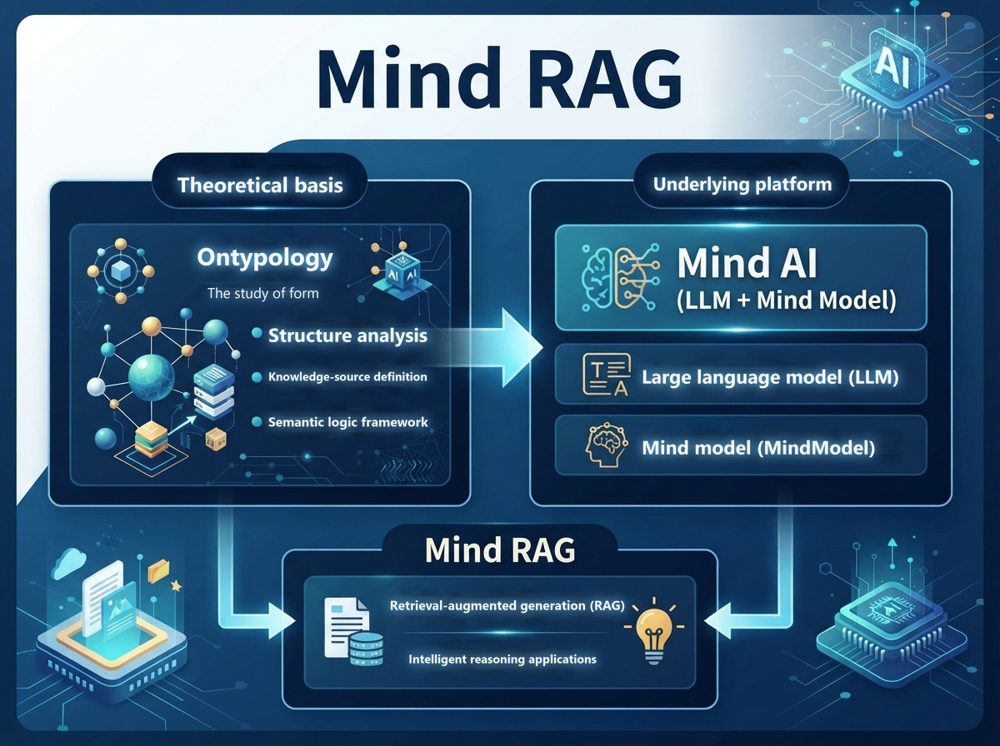

## Contents

- Preface5
  - Mission map: seven deficits, seven gap-fills7
- Introduction: where the two roads meet9
  - Two roads, each with its strengths9
  - Three new names in this volume9
  - How this volume runs10
- Part 1 · Positioning: why Mind RAG was born11
  - 1-1 RAG in one sentence: answer by carrying the data11
  - 1-2 Five pain points, all from a form not yet set up11
  - 1-3 Three-layer positioning: root, trunk, fruit13
  - 1-4 The main thesis: seven deficits → seven gap-fills13
- Part 2 · Backbone at a glance: six tools named, not taught15
  - 2-1 Cognitive chain × retrieval chain15
  - 2-2 Three axes, three brackets: three relations, three criteria16
  - 2-3 Three-layer judgement: a funnel, not a lookup table16
  - 2-4 Time form: the four questions of a function17
  - 2-5 Five operations: op: Type → Type17
  - 2-6 The Mind AI platform: two libraries, one hub, one loop18
  - 2-7 Mapping table: RAG × Ontypology19
- Part 3 · Space form: the forms of the retrieval world21
  - 3-1 Five retrieval forms21
  - 3-2 Reading the three axes: vector, graph, store22
  - 3-3 The three remove levels: a trade-off map for retrieval23
  - 3-4 Three-layer judgement = the intake defence line24
  - 3-5 The four space deficits, on the retrieval floor25
- Part 4 · Time form: the functions of retrieval and generation27
  - 4-1 Six stations of the retrieval chain: form in, form out27
  - 4-2 Six four-question function cards28
  - 4-3 Five families of reasoning: answers must open new roads29
  - 4-4 Choosing a way of thinking: how you think decides how you retrieve30
  - 4-5 The three time deficits, on the generation floor30
  - 4-6 LLM and Mind Model: each keeps its post31
- Part 5 · Seven deficits → seven gap-fills: the core thesis33
  - 5-1 Gap-fills at a glance33
  - 5-2 The seven gap-fill cards34
  - 5-3 Seven gap-fills × six retrieval families41
  - 5-4 Combining the gap-fill cards42
- Part 6 · How to use it accurately: body—use—accuracy45
  - 6-1 Body—use—accuracy45
  - 6-2 Three kinds of gap-fill: rule, identity, structure46
  - 6-3 The six proof steps: one Q&A end to end46
  - 6-4 Four levels of accuracy and the six log fields48
  - 6-5 Eight questions: ask them before you set out49
  - 6-6 Sixteen misuses: four sets of inoculations50
  - 6-7 The route-choice decision tree51
  - 6-8 A complete worked record: what the log looks like51
- Part 7 · Overall architecture: Q&A grown on the platform55
  - 7-1 Two libraries, one hub, one loop × Mind RAG55
  - 7-2 GraphRAG → Mind RAG: three shared, five different56
  - 7-3 Two formulas: the other side of keeping posts57
  - 7-4 The seven gap-fills in panorama57
  - 7-5 Four acceptance lines and the three stages of AGI58
  - 7-6 Reading four common approaches side by side59
- Part 8 · The complete programme: learn, practise, use, teach, build62
  - 8-1 Learn, practise, use, teach, build62
  - 8-2 An eight-week route63
  - 8-3 Four stages of building the library64
  - 8-4 Choosing a route by situation: four kinds of reader64
  - 8-5 PoC acceptance across three scenarios65
  - 8-6 Five domains side by side: the form stays, the library changes66
  - 8-7 Maturity: L1 → L466
  - 8-8 Frequently asked questions67
  - 8-9 Acceptance checklist and common sticking points68
- Conclusion Seven gap-fills, one road70
- Appendix A Terms and notation72
- Appendix B Quick-reference cards74
  - B-1 Seven gap-fill cards at a glance74
  - B-2 The eight-question checklist74
  - B-3 Photocopiable blank template (full page)75
  - B-4 Photocopiable reasoning and log template (full page)76
- Appendix C Answers to the exercises77
- Appendix D List of figures and tables79
- Appendix E Sources and further reading82
- Appendix F Worked Q&A in five domains83

## Preface

This volume does one thing only: it sets out, point by point and figure by figure, the accurate way to use — and the architecture of — Ontypological Retrieval-Augmented Generation, Mind RAG. It does not re-copy the theoretical source of Ontypology (space form and time form), and it does not re-copy the Mind AI platform introduction. It stands on both and answers a new question: how does retrieval-augmented generation (RAG) set the form up, so that it answers accurately, can be re-checked, and grows?

> **Convention one · form = Type**
>
> In English, the character for "form" is always Type and never any other word. Space form = Space Type, time form = Time Type, unit form = Unit Type. Wherever this volume says "form", that convention applies.
> Convention two · theory and platform, named not taughtThis volume assumes you have already read the space form and the time form of Ontypology, and know what Mind AI is.Brackets, criteria, axioms, the four questions of a function, two libraries one hub one loop — all are referenced by name and not taught again.Their role here is foundation: the foundation is underfoot, not on the podium.Auto-import Mind RAG DatabaseSee — Knowledge Graph Construction Based on Bill of Materials and Multi-Source Data Integration Method

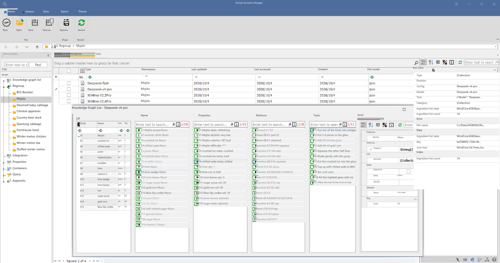

### Mission map: seven deficits, seven gap-fills

The main thread of this volume comes from the conclusion of a sister volume. "Knowledge Graphs for the Deficits of Ontypology" took the places where knowledge graphs (KG) cannot explain, cannot store, cannot judge and cannot keep up, and split them into seven deficits: flattened brackets, identity drift, a graph that cannot judge, generation amnesia, vanished verbs, absent reasoning, absent evolution. That book only diagnosed. This volume is its second half: seven deficits, put back one by one.

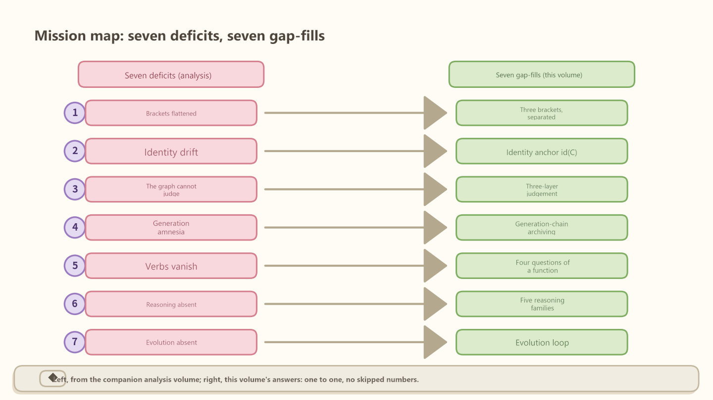

*Figure 0-1 Mission map: seven deficits on the left (analysis), seven gap-fills on the right (this volume)*

| Layer | Deficit (companion volume) | Gap-fill (this volume) | Where it lands |
| --- | --- | --- | --- |
| Space | Brackets flattened · three relations, one edge | Three brackets, separated | Part 5 · gap-fill card 1 |
| Space | Identity drift · no identity anchor in the graph | Identity anchor id(C) | Part 5 · gap-fill card 2 |
| Space | The graph cannot judge · lookup is not judgement | Three-layer judgement | Part 5 · gap-fill card 3 |
| Space | Generation amnesia · only results are stored | Generation-chain archiving | Part 5 · gap-fill card 4 |
| Time | Verbs vanish · moves become labels | The four questions of a function | Part 5 · gap-fill card 5 |
| Time | Reasoning absent · the graph walks old roads | The five reasoning families | Part 5 · gap-fill card 6 |
| Time | Evolution absent · the graph does not grow | The evolution loop | Part 5 · gap-fill card 7 |

**Table 0-1 Mission map: which chapter answers which deficit**

> **The whole volume in one sentence**
>
> Set the form up and retrieval is accurate; make accuracy verifiable and knowledge grows.

## Introduction Where the two roads meet

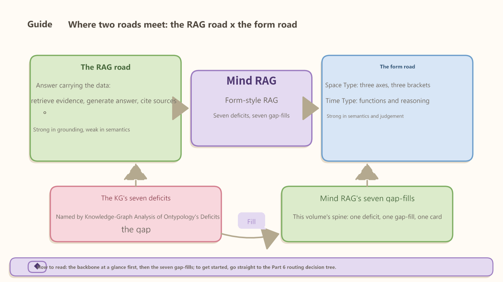

*Figure D-1 The road of RAG and the road of form meet in Mind RAG*

### Two roads, each with its strengths

The road of RAG is "answer by carrying the data". The user asks, the system retrieves evidence, the model generates an answer, and the answer carries its citations. Its strength is grounding: the answer does not lean on what the model happens to remember, it stands on real documents. Its weakness is semantics: what the retrieved passage is, what it counts as, what it is made of, what it sits inside — RAG cannot say.

The road of form is the road Ontypology walked. Space form uses three brackets to name three relations — [ ] says "is a category", { } says "is a part", ( ) says "is contained in" — and each hangs its own criterion. Time form uses functions to say "how": give it a form, it returns a form. The strength of this road is precisely semantics and criteria, and Mind RAG stands where the two roads cross: it feeds the semantics and criteria of form into every link of RAG.

### Three new names in this volume

This volume builds no new system. It adds three names to the existing backbone and uses them throughout. The first is the five retrieval forms — document form, knowledge form, query form, evidence form, answer form: the five faces that enter and leave the retrieval chain. The second is the seven gap-fills — three separate brackets, the identity anchor, three-layer judgement, the archived generation chain, the four questions of a function, five families of reasoning, the evolution loop: seven cards, one for each deficit. The third is the six log fields — query form, retrieval expression, evidence form set, criterion record, reasoning chain, answer form: the carrier of accuracy that can be re-checked. Hold these three names and you hold the map of the whole book.

### How this volume runs

Part 1 fixes the position: why Mind RAG is needed. Part 2 names the backbone once — named, not taught. Part 3 walks space: the forms of the retrieval world. Part 4 walks time: the functions of retrieval and generation. Part 5 is the core thesis, seven deficits → seven gap-fills, one card per gap. Part 6 gives the accurate method: body—use—accuracy, the six proof steps, the eight questions, the misuse table, the decision tree. Part 7 closes the architecture, and Part 8 gives the complete programme: learn, practise, use, teach, build; the eight-week route; the four stages of building a library; all the way to acceptance.

> **How to read it**
>
> For speed: the guide, then the seven gap-fill cards, then the routing decision tree — three hours and you are running.
> For solidity: go in chapter order and do the exercises. For use: jump straight to Part 8 and start work, keeping the rest as a handbook.

## Part 1 Positioning: why Mind RAG was born

### 1-1 RAG in one sentence: answer by carrying the data

The definition of retrieval-augmented generation (RAG) compresses into one sentence: retrieve first, generate second, and let the answer carry its sources. Compared with asking a large language model bare, it adds two things: the answer is propped up by evidence, and the evidence can be traced and updated. Medicine, law and enterprise knowledge Q&A embraced RAG for exactly these two things.

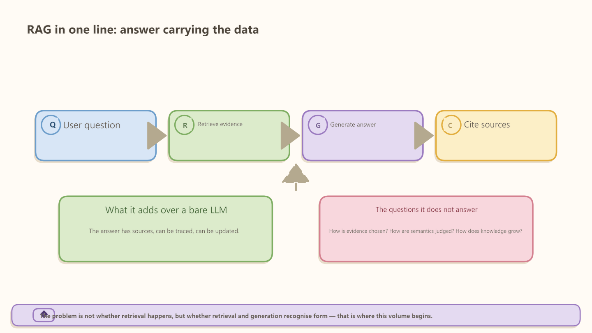

*Figure 1-1 RAG in one sentence: ask → retrieve → generate → cite*

But RAG leaves two questions unanswered, and they are also two things: how evidence is chosen, and how meaning is judged. Of the passages that come back, which count and which do not? Within one piece of text there are three relations — is a category, is a part, is contained in — and once they are flattened into one pot, how do you tell them apart? And once the answer is generated, on what grounds do you call it accurate? These are precisely the home ground of form.

### 1-2 Five pain points, all from a form not yet set up

Lay out the five pain points most often met with RAG in practice and they turn out to share one root: the form was never set up.

| Pain point | What it looks like on the ground | The form diagnosis |
| --- | --- | --- |
| Hallucination | The answer contains things the evidence does not | No evidence form: nothing for generation to hold on to, so it drifts |
| Citations unclear | Answer and source do not match; citing it is as good as not citing it | No identity anchor: the quote cannot hold its own identity |
| Retrieval fragments | What comes back is in pieces and will not assemble into a form | No form set: nothing to merge forms on |
| Not verifiable | Right and wrong cannot be stated, only felt | No criteria: no ruler to measure with |
| Knowledge does not grow | Discarded after use; the system stays where it started | No evolution loop: no account to audit |

**Table 1-1 Five pain points × the missing form**

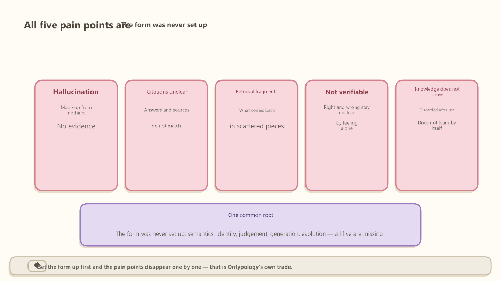

*Figure 1-2 Five pain points: five things apart, one thing together*

The five pain points are not five separate bugs. Turn the negative over and look: hallucination is missing semantics, unclear citation is missing identity, fragmented retrieval is missing structure, unverifiability is missing criteria, and knowledge that does not grow is missing evolution. They have to be fixed as a set — which is why this volume offers seven gap-fills and not seven tricks.

### 1-3 Three-layer positioning: root, trunk, fruit

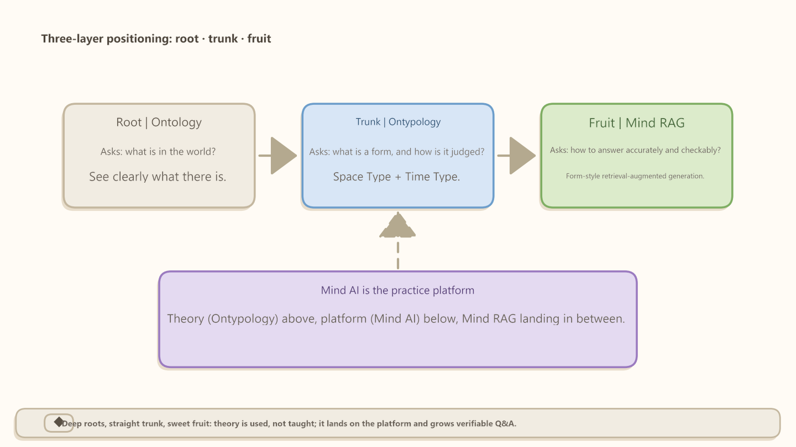

*Figure 1-3 Root, trunk, fruit: ontology is the root, Ontypology the trunk, Mind RAG the fruit*

Put Mind RAG back into the big picture and it is the fruit. Ontology asks "what is there in the world" and is the root; Ontypology asks "what a form is, how it is judged, how it works" and is the trunk; Mind RAG asks "how to answer accurately and verifiably" and hangs on the branch. The soil underneath is Mind AI, the platform that practises two libraries, one hub and one loop. Theory is only named, the platform is only pointed at, and only then does the fruit set.

### 1-4 The main thesis: seven deficits → seven gap-fills

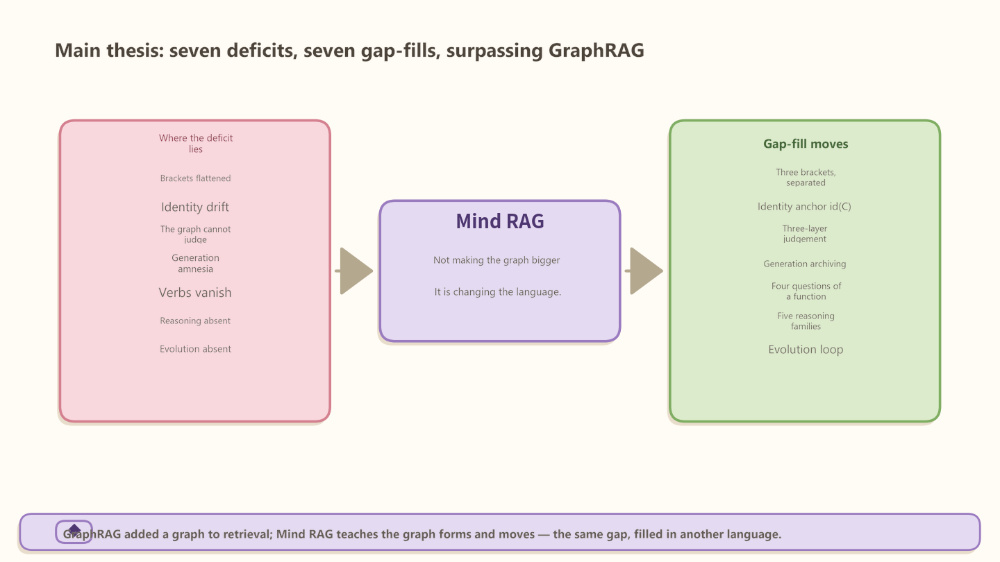

*Figure 1-4 The main thesis: do not make the graph bigger, change its language*

The sister volume's conclusion compresses into one sentence: the language of knowledge graphs is statements, the language of Ontypology is forms and moves. A statement is the result once it has been said; a form wants the process of being drawn; a move wants the method of being run. GraphRAG moved retrieval onto a graph but still speaks the language of statements — the seven deficits survive untouched. Mind RAG holds that you should not make the graph bigger, you should change its language. Seven deficits, put back one to one; the moves that put them back are opened card by card in Part 5.

> **[Special column C1] A short history of RAG: from one paper to an industry line**
>
> RAG takes its name from the 2020 paper by Lewis et al. (Retrieval-Augmented Generation for Knowledge-Intensive NLP Tasks): it joins a parametric generative model to a non-parametric retrieval index so that generation stands on documents. Before that, the question-answering lineage ran in two branches — extractive QA (read a passage, pick a sentence) and knowledge-base QA (query triples and answer) — and RAG welded "retrieve a passage" and "generate a passage" into a single pipeline.
> After 2023 the line forked fast: RA-DIT fine-tunes the retriever and the generator together; Self-RAG teaches the model when it should look something up and whether what comes back counts; GraphRAG (Microsoft, 2024) lifts the retrieval unit from fragments to "community summaries plus subgraphs" and answers global questions that span documents. Further on, the KG-Search line pushes entity and relation retrieval to its limit and gradually merges with GraphRAG.
> The only point to take from this short history is this: the evolution of RAG is a history of remedial lessons in "retrieval semantics are not enough" — when fragment semantics fall short, bring in graphs; when graph semantics still fall short, it is the turn of form. This volume stands at the next stop on that remedial line.
> One more thread is worth noting: every milestone on this line widened the definition of "retrieval" by one turn — from finding fragments, to finding structure, to finding summaries, to finding "the form that can answer the question". Mind RAG's definition is the last of these: the destination of retrieval is not a document, it is a form with criteria attached.

> **Exercise E01 Positioning**
>
> E01-1 Explain to a colleague in one sentence what RAG adds over asking a bare LLM, then in one more sentence say what it still lacks.
> E01-2 Pick one pain point you have met from Table 1-1, and use the form-diagnosis column to explain why it is not a single-point problem.

## Part 2 Backbone at a glance: six tools named, not taught

Before the main text, name the backbone once. The six tools below all come from work already done in Ontypology and Mind AI — by agreement two, they are named and not taught. They are the foundation of this volume: if you have read the sources, this is revision; if you have not, treat this part as a quick map.

### 2-1 Cognitive chain × retrieval chain

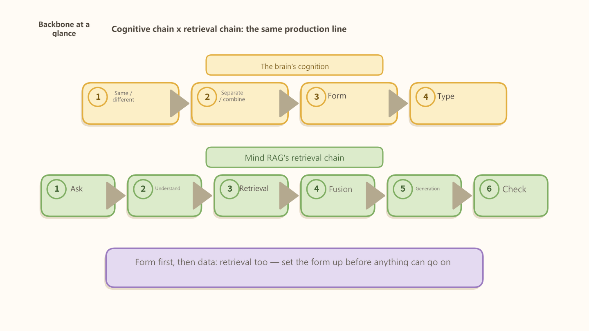

*Figure 2-1 One production line: the brain's cognitive chain and the Mind RAG retrieval chain*

The cognitive chain of Ontypology is "same and different → divide and unite → form → name": you first see a difference, and only then can you draw a boundary; the boundary fixes the form, and only then does the form have a name. The Mind RAG retrieval chain — ask → understand → retrieve → fuse → generate → re-check — is its engineering projection: understand what is the same and what is different in the question before you can tell what to look for; divide and fuse what comes back, generate an answer, and finally re-check and name it. The more exactly the two chains line up, the more accurate the retrieval.

### 2-2 Three axes, three brackets: three relations, three criteria

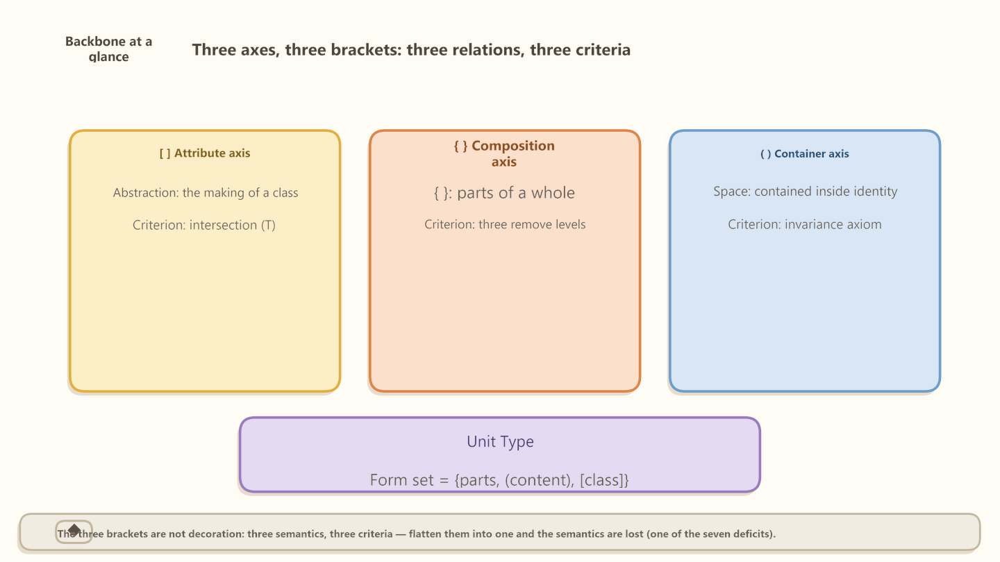

*Figure 2-2 Three axes, three brackets: semantics and criteria each in place*

Space form has three axes: attribute [ ] (dimension × scale), bill of materials { } (parts and the three remove levels), container ( ) (id(C) and the invariance axiom). Unit form = form set = {parts, (contents), [category]}. These three brackets are three completely different relations — flatten them into one during retrieval and the semantics are lost.

### 2-3 Three-layer judgement: a funnel, not a lookup table

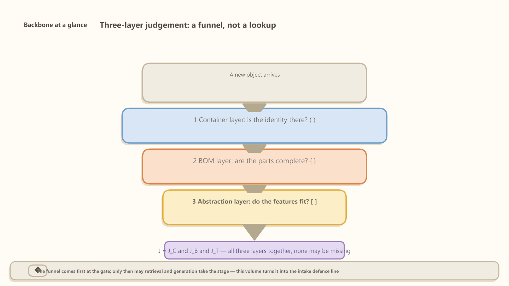

*Figure 2-3 The three-layer judgement funnel: J = J_C ∧ J_B ∧ J_T*

Judgement in form logic is a funnel: the container layer asks "is the identity there", the BOM layer asks "are the parts complete", the abstraction layer asks "do the features fit" — three layers joined, none dispensable. What separates it from a lookup table is openness: what a list can find, a list is good for; what a list cannot find — something new it has never seen — the rule speaks to.

### 2-4 Time form: the four questions of a function

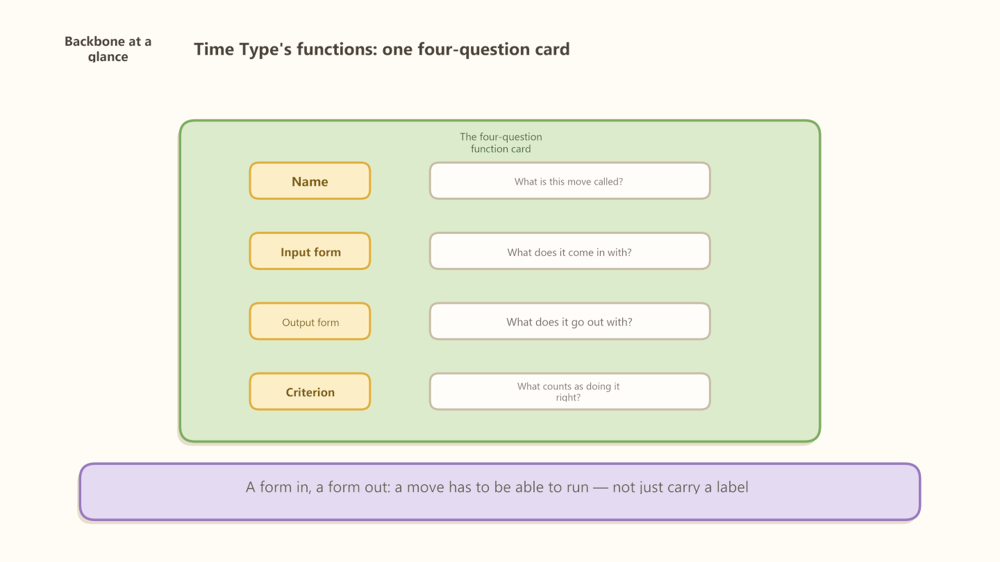

*Figure 2-4 The four-question card: name, input form, output form, criterion*

Time form = verb = function = move. One four-question card says everything about a move: name, input form, output form, criterion. Time form hangs on space form: give it a form and it returns a form. Every station on the retrieval chain is a four-question card — Part 4 opens them one by one.

### 2-5 Five operations: op: Type → Type

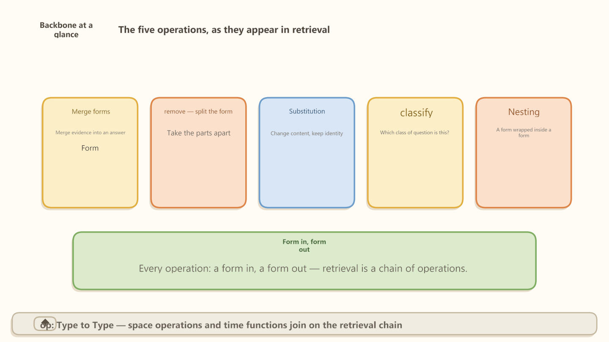

*Figure 2-5 What the five operations look like inside retrieval*

The five operations on form sets — ⊕ join, remove split, σ substitute, ∩(T) classify, ι nest — are the arithmetic of form. Every step of retrieval runs them: fusing evidence into an answer is join, taking evidence apart to check it is split, replacing contents while holding identity is substitute, deciding the category of a question is classify, and a form inside a form is nest. The operations of space and the functions of time join up along the retrieval chain.

### 2-6 The Mind AI platform: two libraries, one hub, one loop

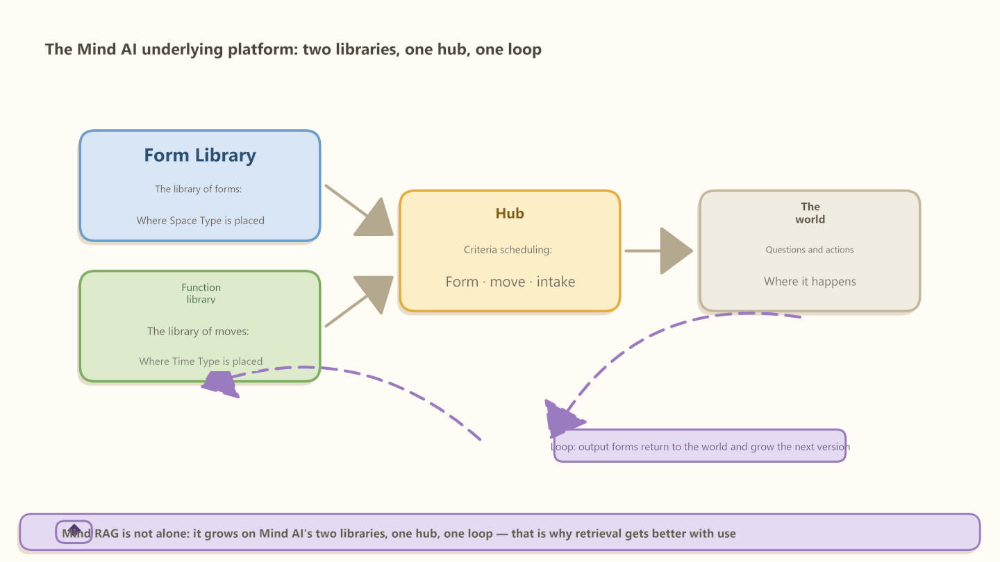

*Figure 2-6 Mind AI: two libraries, one hub, one loop*

Mind AI is the platform that practises Ontypology and the Mind Model: the form library holds space forms, the function library holds time forms, the hub schedules the criteria for choosing a form, choosing a move and accepting the result, and the loop sends the produced form back into the world and grows the next version. Mind RAG is not a lone fighter — it grows on these four parts, and that is why its retrieval gets more accurate the more it is used.

### 2-7 Mapping table: RAG × Ontypology

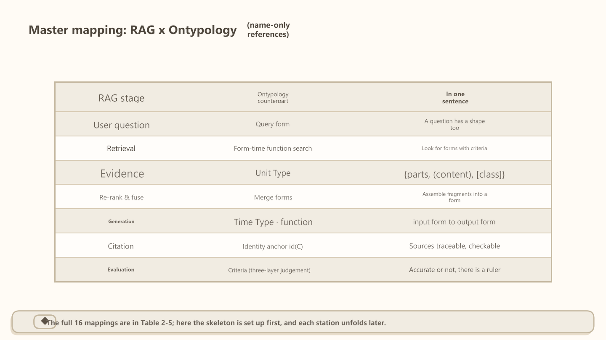

*Figure 2-7 Mapping table: the skeleton that matches RAG links to ontological semantics*

| RAG stage | Ontypology counterpart | In one sentence | Discussed in |
| --- | --- | --- | --- |
| User question | Query form | A question has a shape too | 3-1 |
| Query rewriting | σ substitution | Change the wording, not the intent | 4-2 |
| Retrieval | Form-time function search | Look for forms with the criteria in hand | 4-2 |
| Evidence | Unit form | {parts, (content), [class]} | 3-1 |
| Re-ranking | ∩(T) classification | Does it count? Checked on the spot | 3-4 |
| Fusion | ⊕ form merging | Assemble fragments into a form | 4-1 |
| Generation | Time form · function | input form → output form | 4-2 |
| Citation | Identity anchor id(C) | Source traceable, checkable | 5-2 (2) |
| Evaluation | Criteria · three-layer judgement | Accurate or not, there is a ruler | 6-4 |
| Memory | Form library · evolution loop | Written back after use; the more it is used, the more accurate it gets | 5-2 (7) |

**Table 2-1 RAG × Ontypology mapping table (full version; each column is expanded at the right)**

> **[Special column C6] The seven limits of the knowledge graph, and the Mind Model's answer**
>
> Mind AI: An Introduction, when it introduced the Mind Model, listed seven limitations of the traditional knowledge graph: limited expressive power for form, limited expressive power for relations, no deep reasoning, difficulty representing abstract concepts, no structure for thinking, difficulty unifying cross-domain knowledge, difficulty supporting continuous evolutionary learning. These seven echo the companion volume's seven deficits across the gap — one is a capability list from the platform's point of view, the other a semantic breakdown from the theory's point of view, and both point at the same shortfall.
> The Mind Model's answer is to change language: not a traditional knowledge graph but "a unified knowledge model that simulates the way human cognition works" — an Ontypology database holding language, mathematics, physics, chemistry, biology, programming, philosophy, business, engineering, society, experience, tacit knowledge and any new domain still to come; and a unified thinking capability that gathers logic, induction, deduction, analogy, causal reasoning and planning decisions into one architecture.
> Keep this background in mind and Parts 3 and 4 — four space deficits against the retrieval scene, three time deficits against the generation scene — will read with more resonance: those crash cases are the seven limitations showing themselves at the Q&A scene.
> Conversely, the seven limitations are also a ruler for acceptance: whenever the system says something unclear, cannot store it, cannot judge it or cannot keep up, do not rush to fix a feature — come back to the seven limitations, and you will usually find a gap at the language layer that calls for a gap-fill card.

> **Exercise E02 The backbone**
>
> E02-1 Without opening the book, sketch the three axes and three brackets and label the three criteria.
> E02-2 Retell your last search for information using the six stations of the retrieval chain: what were you actually doing at each station?

## Part 3 Space form: the forms of the retrieval world

Space form answers "what it is, what it has, where it is". Five kinds of form swim in the retrieval world — document form, knowledge form, query form, evidence form, answer form — and only when each is in its place does retrieval have aim. This part first stands the five forms up, then shows how the three axes line up with the three great schools of retrieval, and finally uses the three remove levels and three-layer judgement to turn "what to keep" and "what to let in" into standing rules.

### 3-1 Five retrieval forms

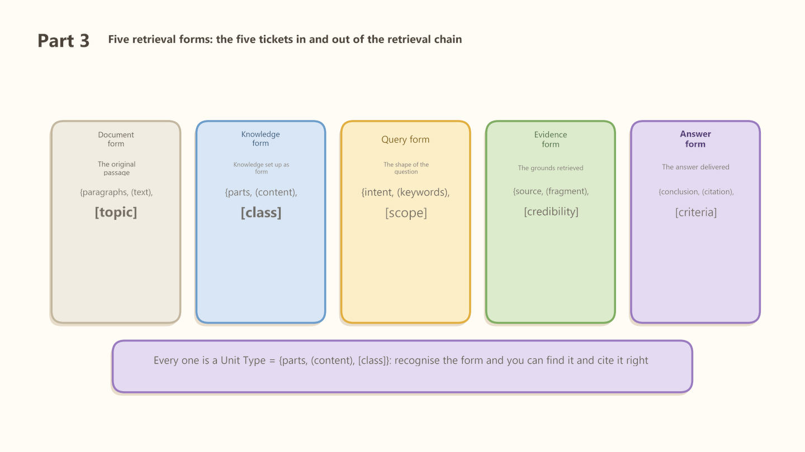

*Figure 3-1 Five retrieval forms: the five faces that enter and leave the chain*

Every retrieval form is a unit form = {parts, (contents), [category]}. Document form is the raw chapter: parts are paragraphs, contents are text, category is topic. Knowledge form is knowledge after forming, carrying criteria and a generation chain. Query form is the shape of the question — intent, keywords, scope. Evidence form is what comes back, carrying its source and credibility. Answer form is the final delivery, carrying the conclusion, the citations and the criterion record.

| Retrieval form | {parts} | (content) | [class] | What setting up the form requires |
| --- | --- | --- | --- | --- |
| Document form | paragraph · section | the source text | topic domain | split granularity = part boundary |
| Knowledge form | concept · proposition | form-style statement | form class | carries criteria and a generation chain |
| Query form | intent · keywords | the question as asked | question type | Set the form up first, then retrieve |
| Evidence form | fragment · data point | the quoted text | a credibility scale | source identity is mandatory |
| Answer form | conclusion · citation | the generated text | answer type | every sentence points back at evidence |

**Table 3-1 The form-set structure of the five retrieval forms**

Converting between the five forms is what the retrieval chain is: a query form goes in, an evidence form comes out; evidence forms are joined with ⊕ into an answer form, and the answer form points back at the evidence forms with its citations. Only if you can recognise each face will you stop using "the passages that came back" as "the answer".

### 3-2 Reading the three axes: vector, graph, store

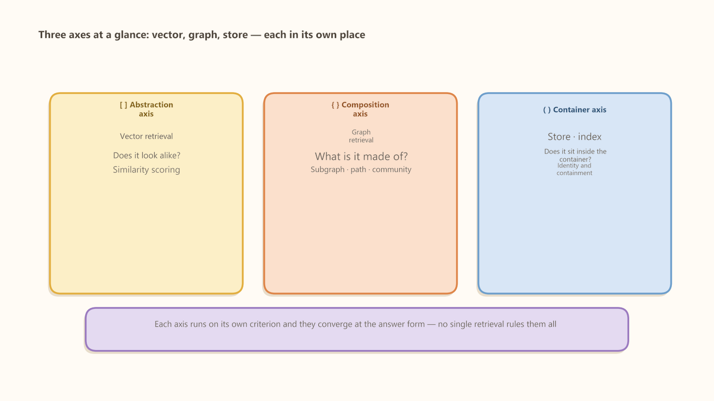

*Figure 3-2 Reading the three axes: vector takes abstraction, graph takes composition, store keeps the container*

The three great schools of retrieval line up exactly with the three axes of space form. Vector retrieval walks the abstraction axis [ ]: it presses text into coordinates and asks "is it alike" — a language of similarity, good for "find me the same kind". Graph retrieval walks the composition axis { }: subgraphs, paths, communities, asking "what is it made of, what is it connected through" — a language of structure, good for "find the relation". The store and its indexes keep the container axis ( ): scope, identity, belonging, asking "what does it sit inside" — a language of identity, good for "find the source".

Each axis walks by its own criterion, and they must merge on the answer form. The mistake is to take one kind of retrieval and try to win everywhere: vector alone exposes itself the moment someone asks "what is A made of"; graph alone stalls on "is there a similar way of putting it"; store alone gives an answer that is always a list of sources, never a reply.

### 3-3 The three remove levels: a trade-off map for retrieval

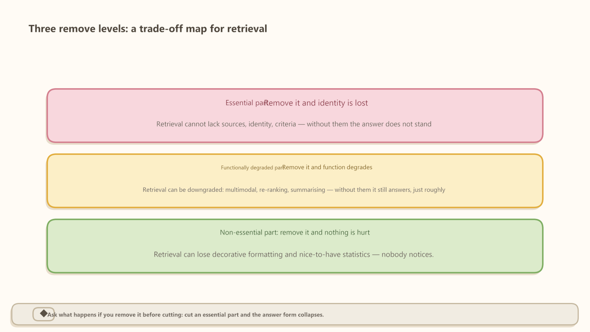

*Figure 3-3 The three remove levels: first ask what happens if you take it away, then cut*

The remove criterion on the composition axis asks a counterfactual: take the part away and what happens? An essential part: identity is lost. A function-degrading part: function is missing but identity survives. A non-essential part: nothing happens at all. Turn this blade on a retrieval system and it becomes a trade-off map: sources, identity and criteria are essential — cut them and the answer no longer holds; re-ranking, summarising and multimodality are function-degrading — cut them and you can still answer, only coarsely; decorative formatting and cosmetic statistics are non-essential — cut them and nobody notices.

The map is practical: when resources are short, cut in the order of the three levels — drop the non-essential first, then degrade the function-degrading, and do not touch a single essential part.

### 3-4 Three-layer judgement = the intake defence line

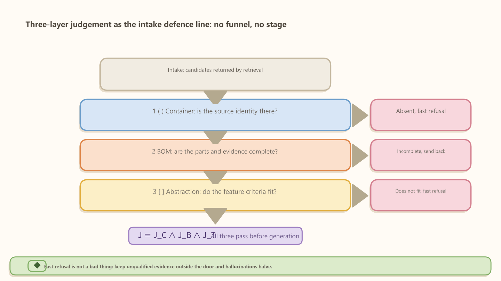

*Figure 3-4 The intake defence line: all three gates passed before generation*

Before the candidates retrieved can enter generation they must pass the three-layer intake defence: the container layer checks whether the source identity is there (if not, fast reject); the BOM layer checks whether the part evidence is complete (if not, send back); the abstraction layer checks whether the features meet the criterion (if not, fast reject). A fast reject is not a failure — keep unfit evidence outside the door and half the hallucination disappears.

Here is the watershed between a lookup table and judgement. A lookup table answers "has this ever been registered"; judgement answers "does this count as one of these". The defence line wants the latter: a new style that is not on any list gets tested on the spot by the same rule.

### 3-5 The four space deficits, on the retrieval floor

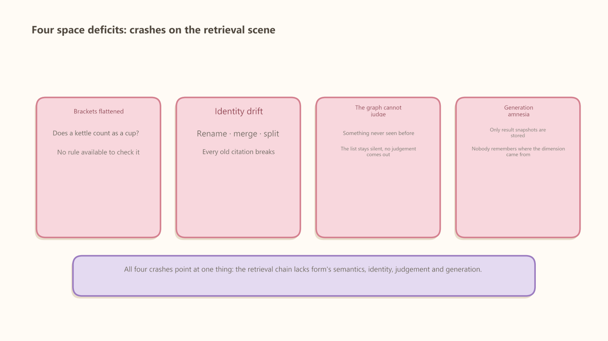

*Figure 3-5 How the four space deficits fail on the retrieval floor*

The four space deficits marked by the sister volume — flattened brackets, identity drift, a graph that cannot judge, generation amnesia — each has its own way of failing on the retrieval floor. Ask "does a kettle count as a cup" and a flattened edge has no rule to test; rename and merge a document and every old citation goes dead; a straw cup that was never registered leaves the list silent; and where the dimension "lid" came from has no birth certificate in the graph. Four failures, four doorways to gap-fills — cards 1 to 4 in Part 5 were prepared for exactly these four scenes.

> **One sentence for this part**
>
> The forms of the retrieval world are now standing: five forms, three axes, one knife, one defence line.
> The next part switches to time — how a form runs, how it reasons, how it grows.

> **[Special column C3] The six retrieval families: six different bridges**
>
> Lay the mainstream retrieval methods out and they fall roughly into six families: vector (similarity nearest neighbour), structured (fields and query languages), subgraph (neighbourhood expansion and communities), path (multi-hop walking), community (clustering and summarising), iterative (multi-round refinement). They are not rivals but six different bridges — the shape of the question decides which one you take.
> Against this part's three axes: the vector family holds the abstraction axis, the subgraph and path families walk the composition axis, the structured and community families lean on the container axis, and the iterative family is a guest of the time form — it turns retrieval into a multi-round loop that gets more accurate as it goes. Mixed retrieval (fusing several families) works precisely because the three axes were always meant to run on their own criteria.
> How to choose, on one page: first ask the shape of the question — looking for similars, go vector; looking for relations, go subgraph and path; looking for a range, go structured; looking for the whole picture, go community; if the question is complex, go iterative. The routing decision tree in Part 6 expands this into a workable procedure.
> One more note is due on the special standing of the iterative family: it makes retrieval a multi-round loop — search, rewrite, search again — which is exactly the "form in, form out" rhythm of the time form. Of the six families it is the only one born with time in it; use it well and you have installed the time form inside retrieval.

> **Exercise E03 Space**
>
> E03-1 Write the evidence form as a form set: what goes in {parts}, (content) and [class]? Why must the source go in the content slot?
> E03-2 Use the three remove levels to assess a retrieval system in your team: which components are essential, degraded, non-essential?
> E03-3 Give an example of something a lookup cannot find but a judgement can (not necessarily computing; daily life counts).

## Part 4 Time form: the functions of retrieval and generation

Space form answers "what it is"; time form answers "how it is done". The retrieval chain has six stations and every station is a function; six four-question cards write each station as a move that can be run. Five families of reasoning open new roads, ways of thinking choose the direction, and the LLM and the Mind Model each keep their post. This part issues the full kit for making it run.

### 4-1 Six stations of the retrieval chain: form in, form out

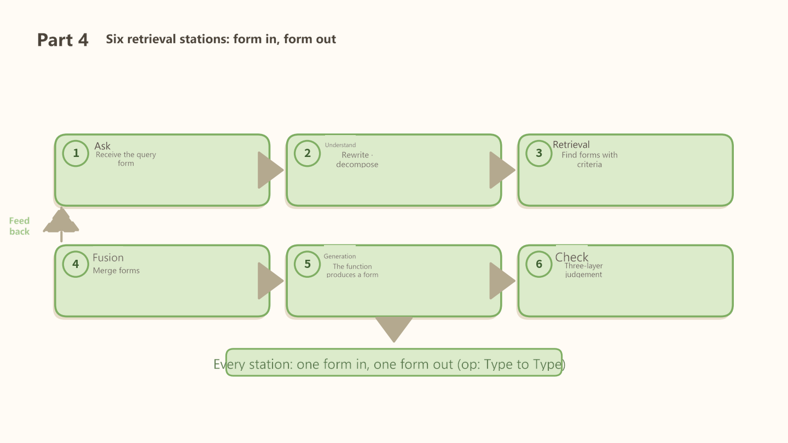

*Figure 4-1 Six stations of the retrieval chain: every station is op: Type → Type*

Ask → understand → retrieve → fuse → generate → re-check: six stations, and a query form grows into an answer form. The six share exactly one contract: form in, form out. Each station takes a form and returns a form; if the output does not pass, it goes back to the previous station instead of being pushed grimly downstream.

One station deserves a pause: understand. You do not retrieve the moment you are handed a question. First stand up the query form — intent, keywords, scope. If the wording is muddy, do a σ substitution (change the wording, not the intent); if the question is too big, split it (a large form into small forms) and then retrieve. The output of the understand station is a precise query form, and only then do the other four stations have a target.

### 4-2 Six four-question function cards

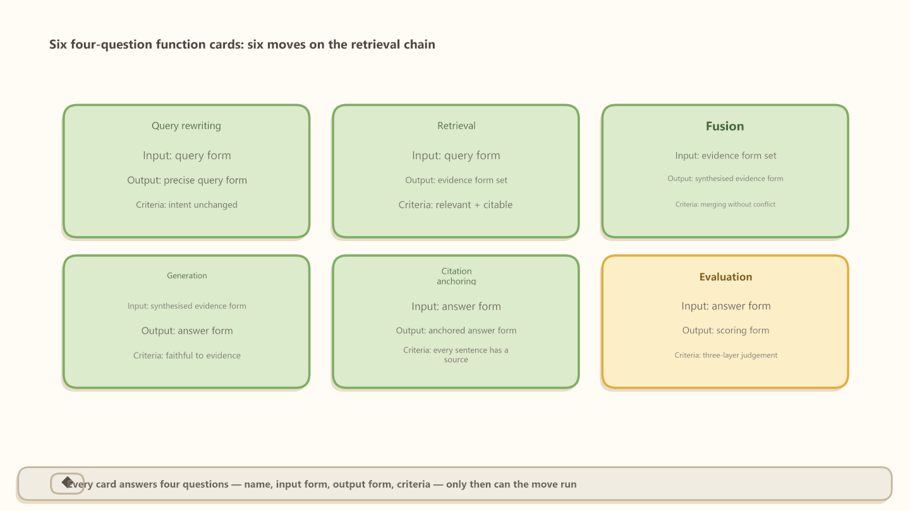

*Figure 4-2 Six four-question cards: the six moves on the retrieval chain*

| Move | Input form | Output form | Criteria |
| --- | --- | --- | --- |
| Query rewriting | Query form | Precise query form | intent unchanged (σ preserves identity) |
| Retrieval | Precise query form | Evidence form set | relevant and citable |
| Fusion | Evidence form set | Synthesised evidence form | ⊕ merging without conflict |
| Generation | Synthesised evidence form | Answer form | faithful to the evidence, no overreach |
| Citation anchoring | Answer form | Anchored answer form | every sentence has a source to point back at |
| Evaluation | Anchored answer form | Scoring form | three-layer judgement + four levels of accuracy |

**Table 4-1 Six stations, six cards: name, input form, output form, criterion**

The value of the six cards is that they run: write the input, the output and the criterion clearly and any team member can pick up a card and run it, and check the run afterwards. That is the difference between a move and a label.

### 4-3 Five families of reasoning: answers must open new roads

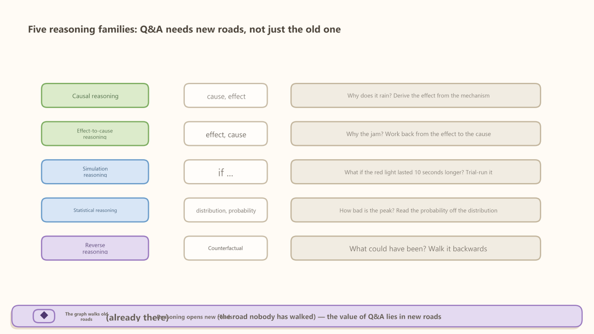

*Figure 4-3 Five families of reasoning: opening new roads with direction and mechanism*

Reasoning is the heart of time form. Causal reasoning goes from cause to effect; abductive reasoning works back from effect to cause; simulation reasoning runs it once inside the head; statistical reasoning reads probability from a distribution; counterfactual reasoning walks the other branch. Five families in relay, and the human repertoire for "thinking something through" is complete. Their difference from graph query is one sentence: a graph walks old roads (along edges that already exist), reasoning opens new ones (where nobody has walked yet).

The most classic failure on the retrieval floor is taking "related" for "therefore": the graph joins "the rooster crows" and "dawn breaks" — that is correlation; causality asks which one makes the other happen — the earth turning makes the dawn, and the rooster merely crows at the same time. If the answer form is to say "therefore", the five families must come on stage; a single undirected edge cannot underwrite it.

### 4-4 Choosing a way of thinking: how you think decides how you retrieve

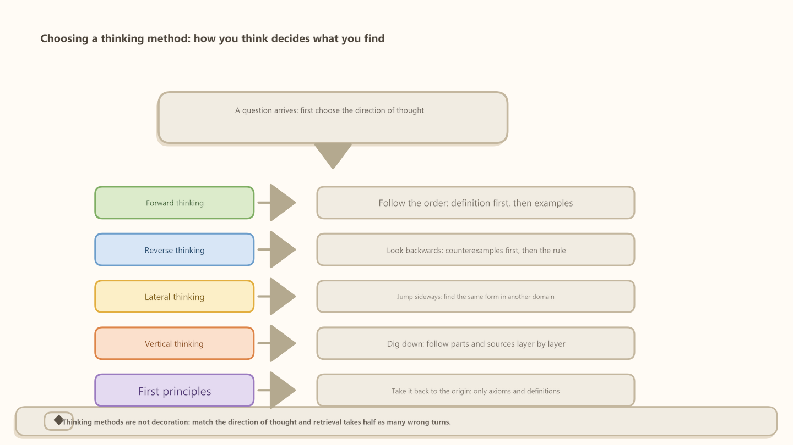

*Figure 4-4 Choosing a way of thinking: forward, reverse, lateral, vertical, first principles*

The family of ways of thinking governs the direction of thought: forward follows the order, reverse checks backwards, lateral jumps across domains to find an isomorphic form, vertical chases parts and sources layer by layer, and first principles strips back to axioms and definitions. Choose the direction well and retrieval saves half its detours; choose it badly and no amount of retrieval does more than circle.

### 4-5 The three time deficits, on the generation floor

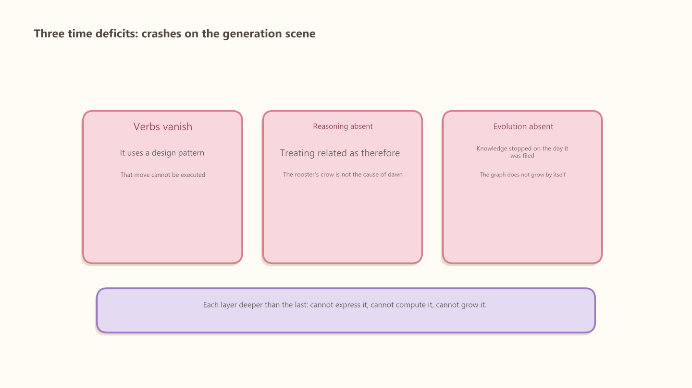

*Figure 4-5 How the three time deficits fail on the generation floor*

Vanished verbs, absent reasoning, absent evolution — the three time deficits of the sister volume line up on the generation floor: knowing that "a design pattern was used" but being unable to make that move is a vanished verb; taking "related" for "therefore" is absent reasoning; knowledge frozen on the day it was filed, a graph that cannot grow itself, is absent evolution. Each layer is deeper than the last: cannot express, cannot compute, cannot grow.

### 4-6 LLM and Mind Model: each keeps its post

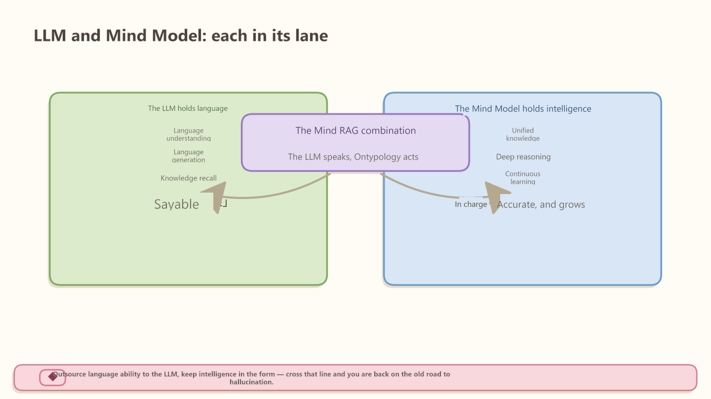

*Figure 4-6 Each keeps its post: the LLM speaks, Ontypology acts*

The division of labour in Mind AI is blunt: the LLM handles language ability — language understanding, language generation, knowledge recall; the Mind Model handles intelligence — unified knowledge, deep reasoning, long-term memory, self-directed learning, thought management. Inside Mind RAG: the wording of the answer goes to the LLM, while the choice of evidence, the execution of criteria, the direction of reasoning and the writing back of knowledge stay in the form and its criteria. Overstep, and you are back on the old road to hallucination.

> **[Special column C2] GraphRAG examined: communities, subgraphs and global questions**
>
> GraphRAG (Microsoft Research, 2024) answers the blind spot of vector RAG — global questions that span documents ("what is the thematic consensus across this corpus?") — with two retrieval modes: Global Search answers map-style from the level of community summaries, Local Search answers detail-style from entity neighbourhoods. At indexing time it first extracts documents into an entity-and-relation graph, then runs community detection and hierarchical summarisation.
> Its contribution is to lift the retrieval unit from "text fragment" to "structure plus summary", giving global questions an answer for the first time; its boundary lies in the same place: what is extracted is still statement-style nodes and edges — three brackets flattened into one relation, identity anchored by name, judgement by retrieval rules, reasoning by walking the graph. The seven deficits still hold inside community summaries, only hidden deeper.
> So this volume's attitude to GraphRAG is inheritance and surpassing at once: the three same (starting point, method, output) are taken whole, and the five different (compressed content, relation types, mode of reasoning, learning and updating, verifiability) are each filled with form. Part 7 lays the three same and five different out as a table.

> **Exercise E04 Time**
>
> E04-1 Pick any station of the retrieval chain and write its four-question card (name, input form, output form, criteria), with at least one checkable condition in the criteria.
> E04-2 Build one worked Q&A for each of the five reasoning families: same topic, five different roads.
> E04-3 'The rooster crowed, therefore dawn broke' is a crash site. Using the difference between cause and correlation, rewrite it as a sentence that does not crash.

## Part 5 Seven deficits → seven gap-fills: the core thesis

This part is the heart of the book. The sister volume marked seven deficits; this volume prescribes for each: one deficit, one gap-fill, one card. Every card follows a fixed shape — the deficit reviewed, the move that fills it, a demonstration on the floor — and each looks at two sides of the same gap: on the left, where the graph cannot speak; on the right, where form catches it.

### 5-1 Gap-fills at a glance

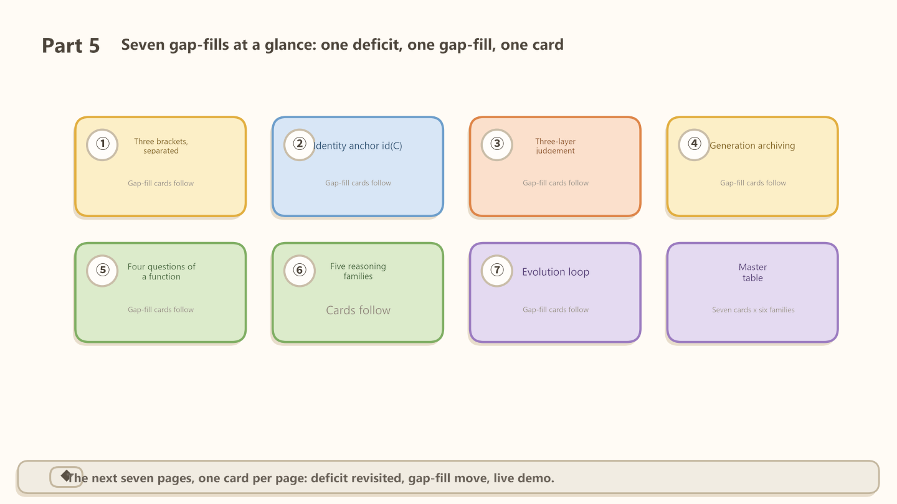

*Figure 5-1 Seven gap-fills at a glance: one deficit, one gap-fill, one card*

The seven gap-fills are not seven inventions — every one of them puts semantics that Ontypology already had back on duty: the three brackets were always separate, the identity anchor was always in the axiom, three-layer judgement was always a funnel, the generation chain always had four steps, a function always needed four questions, reasoning always had five families, evolution was always meant to be a loop. The deficits are exactly where they were absent; filling the gap means calling them back and giving each its post.

### 5-2 The seven gap-fill cards

#### Gap-fill card 1 Flattened brackets → three separate brackets

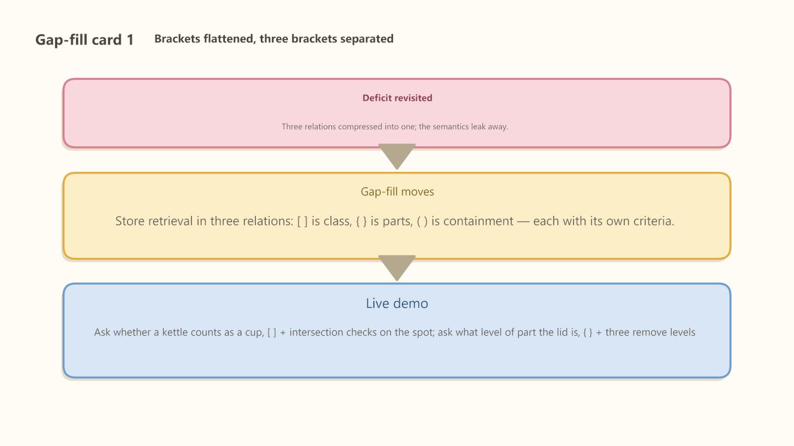

*Figure 5-2 Card 1: three relations, living apart*

The deficit reviewed: once the three relations are flattened into one kind of edge, a query cannot tell which kind of question it is and judgement does not know which rule to apply — the semantics were not simplified, they were thrown away.

The move: retrieval, modelling and storage always keep the three relations apart. [ ] is category (the intersection criterion ∩(T) tested on the spot), { } is part (the three remove levels), ( ) is containment (the invariance axiom holds identity). The edge is no longer one kind but three; each relation has its own field and its own criterion.

On the floor: ask "does a kettle count as a cup" and you walk [ ] + ∩(T): can it hold liquid? can it be held and drunk from? only then does it classify. Ask "which remove level is the lid" and you walk { } + the three levels: take the lid off and the cup is still a cup, only degraded in function — it is a function-degrading part. Two questions, two roads, no longer squeezed onto one edge.

#### Gap-fill card 2 Identity drift → the identity anchor id(C)

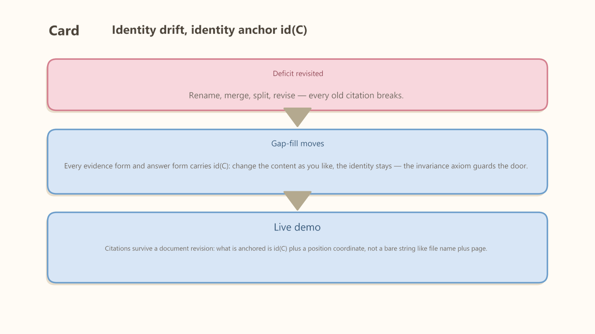

*Figure 5-3 Card 2: contents may change, identity does not*

The deficit reviewed: without an identity anchor, renaming, merging, splitting and version updates are all disasters. Change the label and the relations under the old name break into islands; equal URIs only mean "the pointer did not move", not "the identity did not change".

The move: every evidence form and answer form carries an identity anchor id(C). A container C = ( id(C), S(C) ); the contents S(C) may be swapped freely while the identity id(C) does not move — the invariance axiom written into the data contract. A citation anchors to id(C) plus a position coordinate, not to the bare string "filename + page number".

On the floor: what happens when the document is revised? Substitute the contents (σ) and keep the identity: the old citation follows id(C) into the new version and the chain of sources does not break. That is the whole engineering meaning of "the nameplate can be re-hung, the identity anchor does not drift".

#### Gap-fill card 3 A graph that cannot judge → three-layer judgement

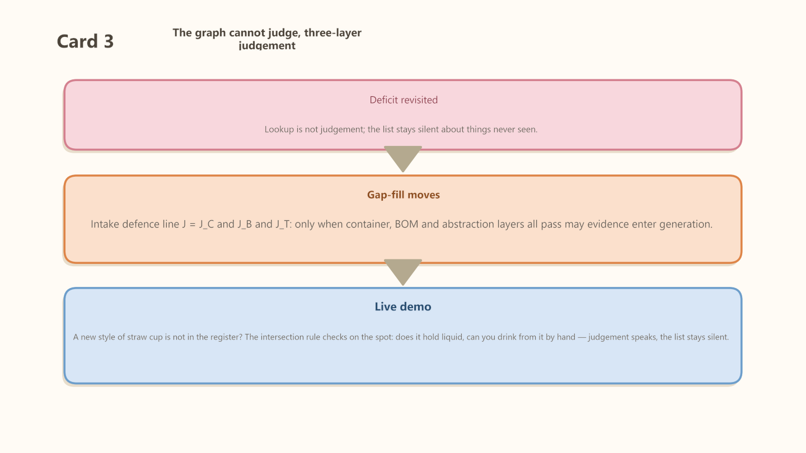

*Figure 5-4 Card 3: judgement is a funnel, not a lookup table*

The deficit reviewed: a lookup table answers "has this ever been registered", judgement answers "does this count as one of these". A list stays silent about the new thing it cannot find — and the retrieval floor takes in new things every day.

The move: build three-layer judgement into the intake defence, J = J_C ∧ J_B ∧ J_T — the container layer checks identity, the BOM layer checks parts, the abstraction layer checks features, and all three gates must pass. An open rule replaces a closed list: a new member that is on no list is tested on the spot by the same rule.

On the floor: an unseen straw cup arrives; the list stays silent and ∩(T) speaks — can it hold liquid? can it be held and drunk from? It is classified once tested, and the criterion record is written down. The output of this step is not only "let through" but "why it was let through" — verifiable accuracy starts here.

#### Gap-fill card 4 Generation amnesia → archive the generation chain

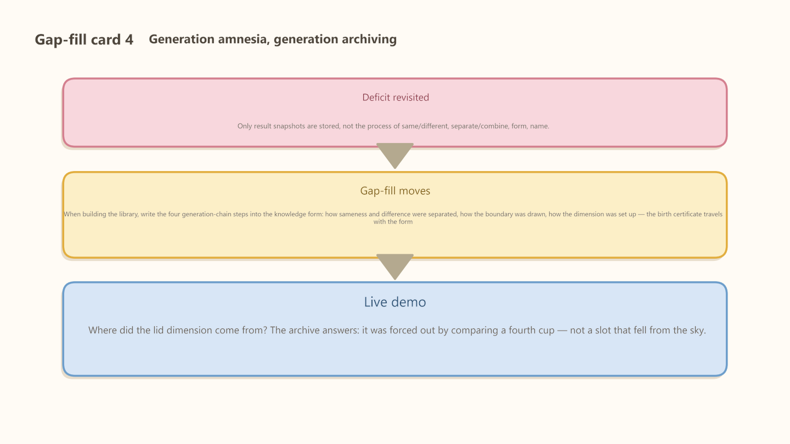

*Figure 5-5 Card 4: the birth certificate travels with the form*

The deficit reviewed: a graph is a snapshot of the result, and the whole process — the same and different, the dividing and uniting, the failed comparisons — is lost. The dimension was inherited, not explained; if the form was drawn wrongly there is no way back.

The move: when building the library, write the four steps of the generation chain into the archive fields of the knowledge form — how same and different were split, how the boundary was drawn, how the form was fixed, how the name was taken — and store the birth certificate of each dimension (the scene of the failed comparison) with it. The form is no longer a lonely result but a product that carries its birth certificate.

On the floor: someone asks "where did the dimension lid come from" and the archive answers directly: the fourth cup brought a difference that the first three could not match to any axis, the comparison failed, and cognition was forced to set up a new axis — the dimension was forced into being, it did not fall out of the sky as a field.

#### Gap-fill card 5 Vanished verbs → the four questions of a function

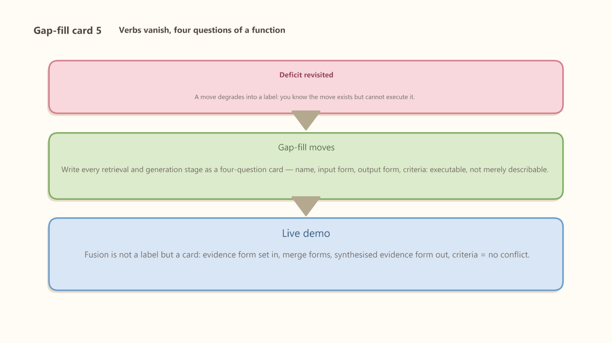

*Figure 5-6 Card 5: a move has to be able to run*

The deficit reviewed: the move was stored as one edge, "X — is — a design pattern": input and output do not line up, nobody remembers the steps, and runnability is zero. The verb was filed in the library of nouns and asked to be a catalogue card.

The move: every link of retrieval and generation is written as a four-question function card — name, input form, output form, criterion — executable and acceptable, not merely describable. The move library (function library) files cards, not labels: one card is one action that runs.

On the floor: "fuse" is not a label, it is a card — input an evidence form set → ⊕ join → a combined evidence form, criterion = no conflict, no duplication, traceable back. A newcomer can pick up the card and run it, and check the run against the criterion. That is the whole difference between a move and a label.

#### Gap-fill card 6 Absent reasoning → five families of reasoning

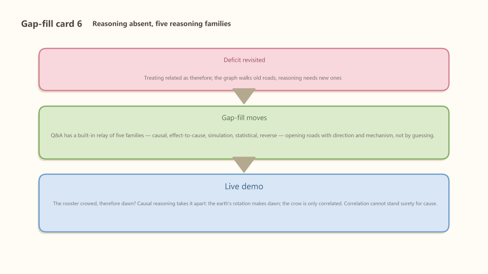

*Figure 5-7 Card 6: open a new road, do not walk the old one*

The deficit reviewed: a query walks edges that already exist, reasoning walks a road nobody has walked. Treat a query as reasoning and you take "related" for "therefore" — the graph itself has no field to warn you that this edge carries no causal direction.

The move: build the five families into Q&A as a relay — causal (cause → effect), abductive (effect → cause), simulation (if… then…), statistical (distribution → probability), counterfactual (the other branch). The reasoning field of the answer form must state which family was used, and with what direction and mechanism: reasoning is no longer a black box.

On the floor: "the rooster crows, therefore dawn breaks?" The causal family takes it apart: the earth turning makes the dawn, and the rooster merely correlates. The answer is written "the crowing correlates with dawn, but the cause is the earth turning" — correlation does not carry the blame for causation, and that sentence is the proof that the five families are on duty.

#### Gap-fill card 7 Absent evolution → the evolution loop

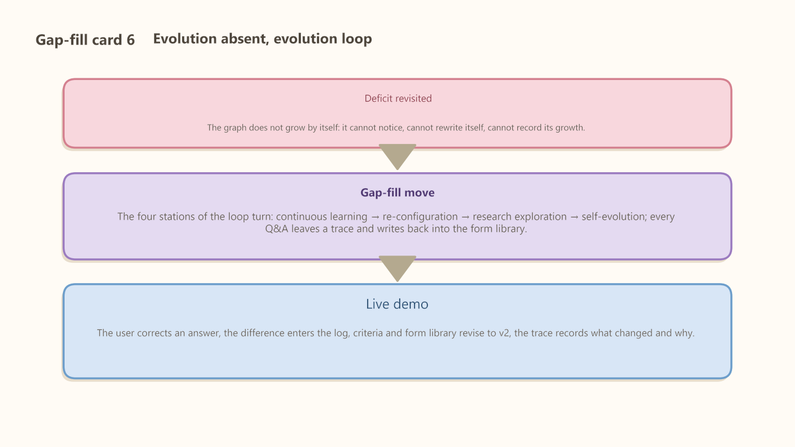

*Figure 5-8 Card 7: knowledge is a river that flows*

The deficit reviewed: vanished verbs mean it cannot express, absent reasoning means it cannot compute, absent evolution means it cannot grow — it cannot find that it is wrong, cannot rewrite itself, cannot record its own growth. A book that cannot revise itself cannot hold a river that flows.

The move: set the four loop stations turning — continuous learning (new experience comes in) → restructuring (old knowledge re-seated) → research and exploration (push into the unknown) → self-evolution (the next version of itself). Every Q&A leaves a trace and writes back to the form library; every correction keeps an account: what was changed and why.

On the floor: a user corrects an answer; the error goes into the log → criteria and form library are revised to v2 → the trace stays. Next time the same kind of question comes, the system stands on v2's shoulders — this is not "editing the data by hand", it is knowledge flowing with time.

### 5-3 Seven gap-fills × six retrieval families

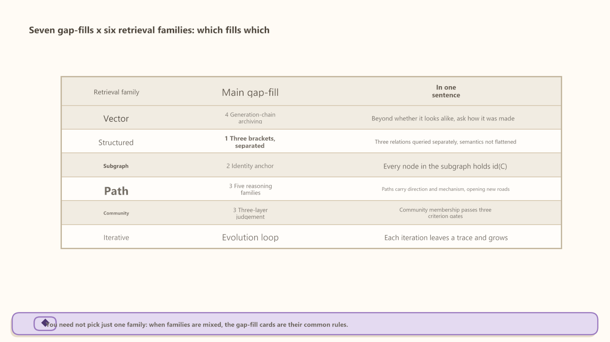

*Figure 5-9 Seven gap-fills × six families: who fills what*

| Retrieval family | Main gap-fill | Supporting gap-fill | In one sentence |
| --- | --- | --- | --- |
| Vector | 4 Generation-chain archiving | 3 Three-layer judgement | beyond whether it looks alike, ask how it was made |
| Structured | 1 Three brackets, separated | 2 Identity anchor | Three relations queried separately; semantics not flattened |
| Subgraph | 2 Identity anchor | 1 Three brackets, separated | Every node in the subgraph holds id(C) |
| Path | 6 The five reasoning families | 5 The four questions of a function | Paths carry direction and mechanism, opening new roads |
| Community | 3 Three-layer judgement | 4 Generation-chain archiving | Community membership passes three criteria gates |
| Iterative | 7 The evolution loop | 6 The five reasoning families | Each iteration leaves a trace and grows |

**Table 5-1 Seven gap-fills × six families**

Choosing a family does not mean choosing one of six. When families are mixed, the gap-fill cards are the shared rules of every team: whichever bridge you came over, the three brackets stay separate, identity stays anchored, judgement passes three gates, the process is archived, a move answers four questions, reasoning names its family, and the trace is kept. Seven rules, valid everywhere.

### 5-4 Combining the gap-fill cards

The seven cards do not only fight alone. In practice the strongest play is a combination: two or three cards stacked against one concrete scene. The six below are openings that have been tried and work.

| Combination | Scenario | How they stack |
| --- | --- | --- |
| 1 + 3 | Question intake | Three separated brackets admit the item, three-layer judgement guards the gate — the semantics and judgement sluices open together |
| 2 + 4 | Version governance | The identity anchor keeps continuity, generation-chain archiving keeps traceability — no broken links and no erased accounts across revisions |
| 5 + 6 | Reasoning Q&A | The four-question card writes the move, the five reasoning families open the road — how to do and how to think both present |
| 6 + 7 | Research exploration | Reasoning opens new roads, evolution leaves traces — every road walked becomes the next version's foundation |
| 1 + 2 | Multi-source fusion | Separated brackets prevent flattening, the identity anchor prevents drift — however many sources, the form stays orderly |
| 3 + 7 | Self-correction | Judgement notices the error, the loop writes back a revision — the system finds it and grows by itself |

**Table 5-2 Combinations of the gap-fill cards**

Choosing a combination is simple: first ask what this scene fears most — flattening, play 1; drift, play 2; misjudgement, play 3; amnesia, play 4; empty talk, play 5; wild inference, play 6; stagnation, play 7. Two fears, stack two cards.

> **[Special column C7] Two formulas: the two roads of extraction and compression**
>
> The LLM road: language structure → Transformer (extraction and compression) → relations between tokens and other tokens (weights). The Mind Model road: language structure → Ontypology (extraction and compression) → relations between a token and the "spacetime structure" of other tokens (weights). The two formulas look very much alike; the difference sits in the middle stretch: compressed into weights, or set up as form.
> Compressed into weights, knowledge dissolves into parameters — sayable, but not pointable at. Set up as form, knowledge stands on structure — sayable and pointable at. RAG's "cite your sources" is chasing exactly that pointability, but it only manages it at the fragment level; Ontypology wants pointing at the semantic level: point at a bracket, at a criterion, at a generation chain.
> This pairing is also the master design of Mind RAG: whatever must be pointable at — evidence, criteria, reasoning, trace — is set up as form; whatever must be sayable — wording, fluency, tone — is handed to the LLM. Each road makes up what the other lacks and together they make a complete Q&A.
> One step deeper: compression and extraction are not themselves the problem; the problem is what got compressed away. The Transformer compressed away reference and process; Ontypology compresses reference into an identity anchor and process into a generation chain — compressed reversibly, compressed auditably. The difference between the two compressions is the difference between "cannot be recovered from weights" and "can be looked up in structure".

> **Exercise E05 Seven gap-fills (first half)**
>
> E05-1 In your own words, recount gap-fill cards 1 and 2, and give one real case for each where the absence of the gap-fill caused a crash.
> E05-2 Why does generation-chain archiving cure knowledge that does not grow? Say one sentence from the birth-certificate angle and one from the traceability angle.

> **Exercise E06 Seven gap-fills (second half)**
>
> E06-1 Write fusion as a four-question card, with at least two checkable conditions in the criteria column.
> E06-2 Of the four stations of the evolution loop, which is most often mistaken for manually editing data? Explain where the line between them falls.

## Part 6 How to use it accurately: body—use—accuracy

The form is standing and the gap-fills are in place; this part hands over the method. Body—use—accuracy is the outline: body is the form and its functions, use is the six stations of the retrieval chain, accuracy is accuracy that can be re-checked. Below it splits into three kinds of gap-fill, the six proof steps, four levels of accuracy, the eight questions, the misuse table and the route-choice tree — six pieces, after which any Q&A can answer "on what grounds do you call this accurate".

### 6-1 Body—use—accuracy

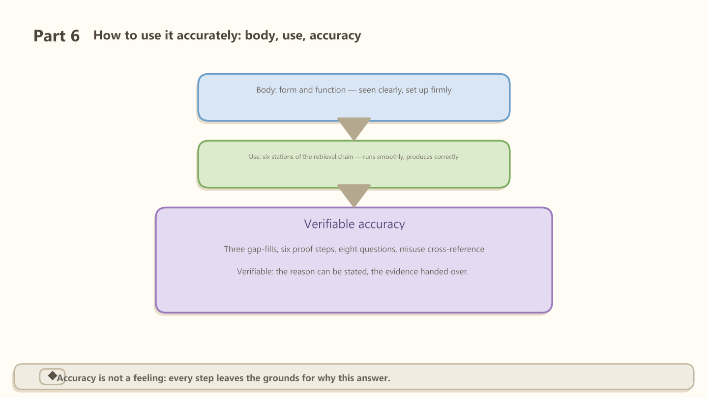

*Figure 6-1 Body—use—accuracy: recognise it, run it, state it*

If the body is not standing, the use will lean; if the use is incomplete, the accuracy is hollow. The three layers stack: first recognise the form and its functions (body), then make the six stations run smoothly (use), and finally let every answer hand over its grounds (accuracy). These are not three stages but three views opened at once — every Q&A passes all three gates at the same time.

### 6-2 Three kinds of gap-fill: rule, identity, structure

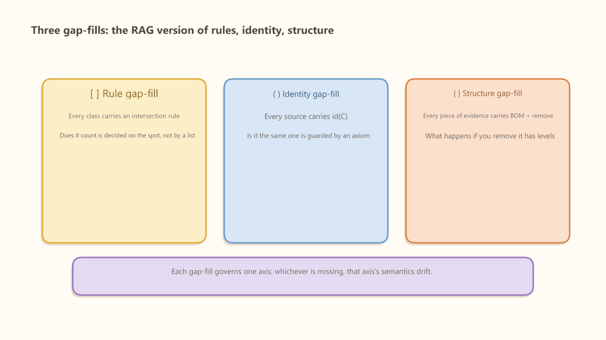

*Figure 6-2 Three kinds of gap-fill: [ ] rule, ( ) identity, { } structure*

The three kinds compress the cards into three sayings. [ ] rule gap-fill: every category carries an ∩(T) rule, and "does it count" is tested on the spot. ( ) identity gap-fill: every source carries id(C), and "is it the same one" is guarded by an axiom. { } structure gap-fill: every piece of evidence carries a BOM and the three remove levels, and "what happens if you take it away" has levels to sort by. Three sayings cover cards 1 to 3 and 5 to 7.

### 6-3 The six proof steps: one Q&A end to end

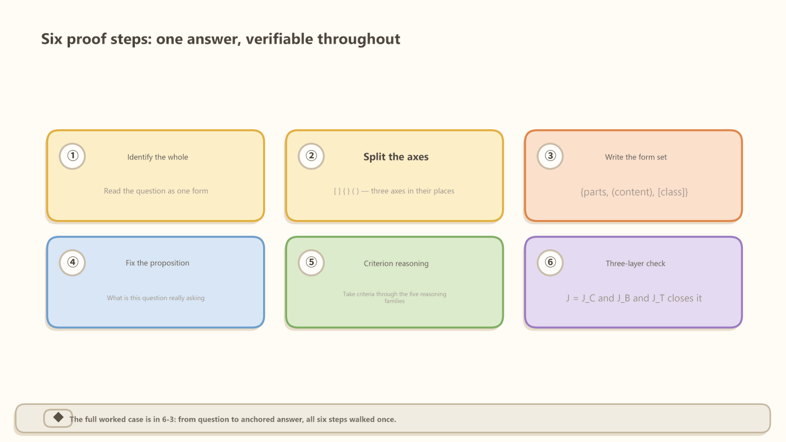

*Figure 6-3 The six proof steps: identify the whole → three-layer check*

The core flow of accurate use is the six proof steps. Below they are walked end to end on one running example — the question: "should we add the lid to the standard configuration of the new product?" (the cup seen from the supply chain; the running case returns).

> **The six proof steps, worked end to end**
>
> 1. Identify the whole: this question is about where the lid sits among the parts of the cup and about the decision that follows — treat it as a question about a form, not about a sentence.
> 2. Split the axes: [ ] lid class (features: opens and closes, seals, fits the rim); { } the cup's parts list (body, base, lid, handle...); ( ) inside the cup container (id(C) = this model's identity).
> 3. Write the form set: lid = {rim, (seal ring), [lid class]}; cup = {body, base, (content), [cupware]}.
> 4. Fix the proposition: "the lid is a functionally degraded part for this cup" — what must be checked is the remove level and the market criterion.
> 5. Criterion reasoning: remove(lid, M) = M′ ⊂ M (functional downgrade: no longer sealed but still holds liquid) → the five reasoning families arrive: causal (why sealing is needed), simulation (trial-run the lidless use case), statistical (the share of leakage complaints).
> 6. Three-layer check: container layer — the cup's identity does not change with the lid's presence (pass); BOM layer — the parts list agrees with the remove level (pass); abstraction layer — the lid meets the [lid class] criterion (pass). Conclusion: a functionally degraded part, to be listed as optional rather than mandatory — every step recorded and verifiable.

Walk it once and you see that the six steps are not a ritual: they lay "on what grounds" out in the sun. Every step has an output and every output points back — that is what verifiable accuracy looks like.

#### Another sketch: traffic lights in a city

The question: "should the timing of the lights at this junction be reset?" Six steps in brief — 1. Identify the whole: the timing decision for this junction's signal system. 2. Split the axes: [ ] traffic-period class (peak / off-peak), { } signal parts (cycle, phase, offset), ( ) the junction container (the identity of this junction). 3. Form set: timing plan = {phases, (cycle seconds), [period class]}. 4. Proposition: "the current timing is insufficient at peak". 5. Criterion reasoning: the statistical family reads the traffic distribution, the simulation family test-runs the new timing, the causal family looks for the bottleneck. 6. Three-layer check: junction identity unchanged, parts complete, period class meets the criterion — conclusion and recommendation recorded throughout. The domain changes; the six steps do not.

### 6-4 Four levels of accuracy and the six log fields

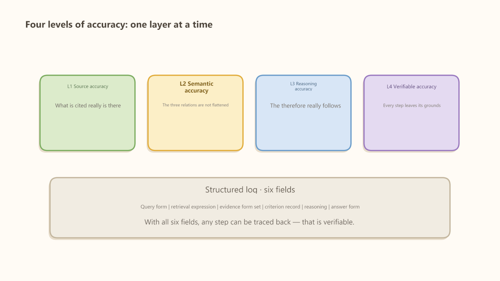

*Figure 6-4 Four levels of accuracy: accurate one layer at a time*

Accuracy has four levels: L1 source accuracy (what is cited really is there), L2 semantic accuracy (the three relations are not flattened), L3 reasoning accuracy (the "therefore" really follows), L4 verifiable accuracy (every step hands over its grounds). The four stack — the ceiling of L4 is built from the floors of L1 to L3.

| Log field | What to record | Which layer it guards |
| --- | --- | --- |
| Query form | intent · keywords · scope of the question | L2 semantic accuracy |
| Retrieval expression | The retrieval command and parameters actually issued | L1 source accuracy |
| Evidence form set | id(C) and fragments of the retrieved evidence | L1 source accuracy |
| Criterion record | Pass and fail at each of the three judgement gates | L2 semantic accuracy |
| Reasoning chain | Which family was used, its direction and mechanism | L3 reasoning accuracy |
| Answer form | Final answer and citation anchors | L4 verifiable accuracy |

**Table 6-1 The structured log, six fields: the carrier of verifiable accuracy**

### 6-5 Eight questions: ask them before you set out

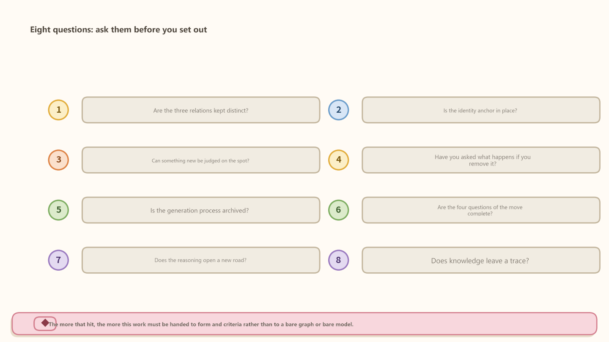

*Figure 6-5 Eight questions: the more that hit, the more to hand to form and criteria*

| # | Question | The gap-fill behind it |
| --- | --- | --- |
| 1 | Are the three relations kept distinct? | 1 Three brackets, separated |
| 2 | Is the identity anchor in place? | 2 Identity anchor id(C) |
| 3 | Can something new be judged on the spot? | 3 Three-layer judgement |
| 4 | Have you asked what happens if you remove it? | 3 The three remove levels |
| 5 | Is the generation process archived? | 4 Generation-chain archiving |
| 6 | Are the four questions of the move complete? | 5 The four questions of a function |
| 7 | Does the reasoning open a new road? | 6 The five reasoning families |
| 8 | Does knowledge leave a trace? | 7 The evolution loop |

**Table 6-2 The eight questions × gap-fills**

The eight questions are the portable version of the seven cards. Run through them before any new task starts — the more that hit, the more this work must be handed to form and criteria rather than to a bare graph or a bare model.

### 6-6 Sixteen misuses: four groups of vaccines

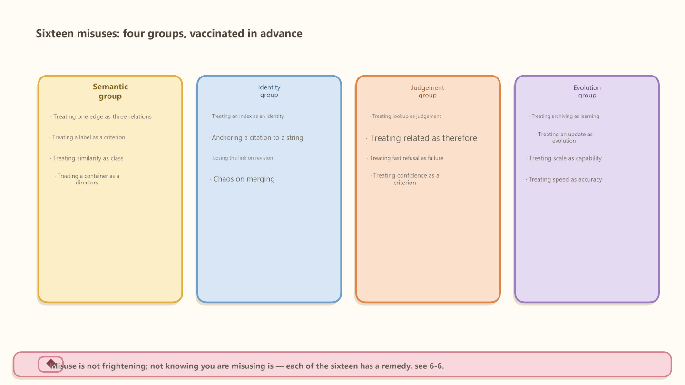

*Figure 6-6 Sixteen misuses: four groups, vaccinated in advance*

| Group | # | Misuse | Remedy |
| --- | --- | --- | --- |
| Semantic group | M1 | Treating one kind of edge as three kinds of relation | Three separated brackets, each with its own criteria |
|  | M2 | Treating a label as a criterion | Criteria must be checkable; a label only names |
|  | M3 | Treating similarity as class | Similarity goes vector, class goes ∩(T) |
|  | M4 | Treating a container as a directory | A container holds id(C); a directory only lists names |
| Identity group | M5 | Treating an index as an identity | id(C) goes into the data contract |
|  | M6 | Anchoring a citation to a string | Anchor to id(C) plus a position coordinate |
|  | M7 | Losing the link on revision | σ substitution preserves identity; citations follow |
|  | M8 | Chaos on merging | Merge by operations on forms; do not delete old accounts |
| Judgement group | M9 | Treating lookup as judgement | Check open rules on the spot |
|  | M10 | Treating 'related' as 'therefore' | The five reasoning families name direction and mechanism |
|  | M11 | Treating a fast refusal as a failure | Fast refusal is a defence line; log it |
|  | M12 | Treating confidence as a criterion | Confidence is a score; a criterion is a rule |
| Evolution group | M13 | Treating archiving as learning | Archives must be written back and checked |
|  | M14 | Treating an update as evolution | Evolution leaves traces and reasons |
|  | M15 | Treating scale as capability | Capability is judged by the four levels of accuracy |
|  | M16 | Treating speed as accuracy | Accuracy is judged by verifiability, not by quick hands |

**Table 6-3 The sixteen misuses x their remedies**

The sixteen misuses fall into four groups — semantic, identity, judgement, evolution — and they line up exactly along the four space gap-fills and the three time gap-fills. Misuse is not the frightening part; not knowing you are misusing is. The way to use this table is as a clinic visit: when the system does something strange, come here first and find the matching row.

### 6-7 The routing decision tree

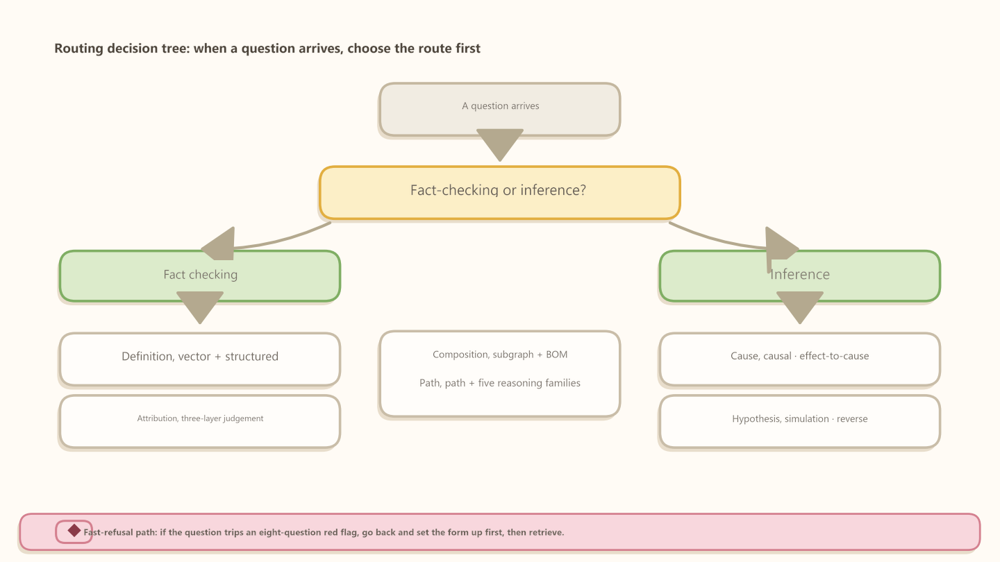

*Figure 6-7 The routing decision tree: when a question arrives, choose the route first*

Finally, fold every method into one decision tree. When a question arrives, first ask "is this fact-checking or inference?" Checking splits into definition, attribution and composition; inference splits into path, cause and hypothesis — and every route names the retrieval family and gap-fill it leans on. Anything that trips the eight-question red flags takes the fast-refusal path: go back and set up the form first, then retrieve.

### 6-8 A complete worked log: what the record actually looks like

Verifiable accuracy is not a slogan, it is a table filled all the way in. Below is the six-field log for the cup-lid worked case (6-3), written out in full — any team that keeps records this way lets a third party re-run the reasoning.

| Field | Record contents (worked cup-lid case) |
| --- | --- |
| Query form | intent = parts decision; keywords = lid / standard configuration; scope = this cup model (id(C) = CUP-A2) |
| Retrieval expression | BOM retrieval (CUP-A2 parts list) + structured query (remove-level field) + vector (configuration conventions of similar models) |
| Evidence form set | E1 parts table #12 (id(C) = DOC-BOM-01), E2 Q3 complaint statistics (DOC-CS-07), E3 competitor configuration table (DOC-MKT-15) |
| Criterion record | Container layer passed (CUP-A2 identity confirmed); BOM layer passed (lid listed in the parts table); abstraction layer passed (lid meets the [lid class] criterion) |
| Reasoning chain | remove level 3 (M′ ⊂ M, functional downgrade) + causal (why sealing is needed) + simulation (trial-run without the lid) + statistical (leakage complaints 23%) |
| Answer form | "The lid is a functionally degraded part; recommend listing it as optional"; citation anchors = each sentence points back to E1/E2/E3; criteria version = v2 (2026-11) |

**Table 6-4 The six-field log, written out**

One thing to notice in this table: the six fields interlock. The query form fixes the retrieval expression; the retrieval expression pulls out the evidence form set; the criterion record governs the reasoning chain; the reasoning chain props up the answer form; and the answer form's citation anchors point back at the evidence form set. Drop any one field and a re-run breaks at exactly that link.

> **Three sentences of routing sense**
>
> Looking for similars, go vector; looking for relations, go subgraph and path; looking for a range, go structured.
> If you need a "therefore", bring in the five reasoning families — never let a single edge stand surety.
> When the shape of the question is unclear, spend three minutes setting up the query form: set the target first, then fire.

> **[Special column C4] The engineering of fusion and re-ranking: RRF, HyDE and query decomposition**
>
> Around the "understand" and "fusion" stations of the retrieval chain, engineering practice has accumulated a set of good moves. On query rewriting: HyDE first has the model write a hypothetical answer, then retrieves with that answer — generation guiding retrieval often beats retrieving with the raw question; query decomposition cuts a big question into small ones, retrieves each and merges the results, which is the Ontypology counterpart of "split a big form into small forms".
> On fusion: RRF (reciprocal rank fusion) orders evidence by the sum of reciprocal ranks — so simple it needs no training, yet it is the most stable baseline for hybrid retrieval; cross-encoder re-ranking scores "question + evidence" pairs, more precise but costlier — in practice a two-stage setup: RRF for coarse ordering, cross-encoder for fine.
> Against Ontypology: every one of these moves can be written as a four-question card — input form, output form, criteria, each in its place. An engineering move and an Ontypology card are two ways of writing the same card; put the moves into the function library and the retrieval chain upgrades from "a string of pipeline" to "a stack of reusable moves".
> One common trap is worth flagging: over-decomposing a query loses the intent — split a big form into small forms, then remember to merge them back (⊕ form merging). The criterion is simple: once every sub-question is answered, can the answer to the original question grow out naturally? If it cannot, the split was wrong.

> **[Special column C5] Evaluating RAG: what to measure, and how**
>
> RAG evaluation has converged on three faces: the retrieval end measures "does it find the right thing" (recall@k, hit rate), the generation end measures "can the answer be trusted" (faithfulness: does the answer stay loyal to the evidence), the citation end measures "is the citation right" (citation precision: does the citation really support that sentence). Frameworks such as RAGAS turn the three into an automated pipeline.
> Against this part's four levels of accuracy: L1 source accuracy maps onto citation metrics; L2 semantic accuracy and L3 reasoning accuracy are where RAGAS coverage is thin — they need form semantics and a record of the reasoning chain before they can be measured; L4 verifiable accuracy is a step higher again: not only must it be measurable, a third party must be able to re-run it.
> Practical advice: build the evaluation set backwards from the sixteen misuses — make two or three trap cases for each misuse. How the system behaves on the traps says more about accuracy than any average score.
> One more piece of evaluation philosophy belongs on the team wall: evaluation is not a final exam, it is a health check. After every check, go back to the gap-fill cards — whichever layer the score is low on (L1 to L4), that is the card to fill. Tune parameters without filling in the form and next month the score will still be the same.

> **Exercise E07 How to use it accurately (first half)**
>
> E07-1 Use the six proof steps on a real problem from your work (any domain), writing one line of output per step.
> E07-2 How do the three gap-fills (rules, identity, structure) map onto cards 1, 2 and 3? Explain why, without any one of them, the corresponding axis drifts.

> **Exercise E08 How to use it accurately (second half)**
>
> E08-1 Pick three of the sixteen misuses that you have seen (not necessarily in computing) and write a 50-word remedy for each.
> E08-2 Use the routing decision tree to choose a route for three questions: 'what does this contract say', 'what is the difference between plan A and plan B', 'what if we delay by one month'.

## Part 7 The overall architecture: Q&A grown on a platform

With the methods put away, this part pulls back to the architecture. Mind RAG grows on the two libraries, one hub, one loop of Mind AI; against GraphRAG it is three same, five different; against the LLM and the Mind Model it has a clear division of labour in which each stays in its lane; its seven gap-fills have definite positions on the space-and-time coordinate system; and its acceptance runs on four lines, reaching out toward the three stages of AGI.

### 7-1 Two libraries, one hub, one loop x Mind RAG

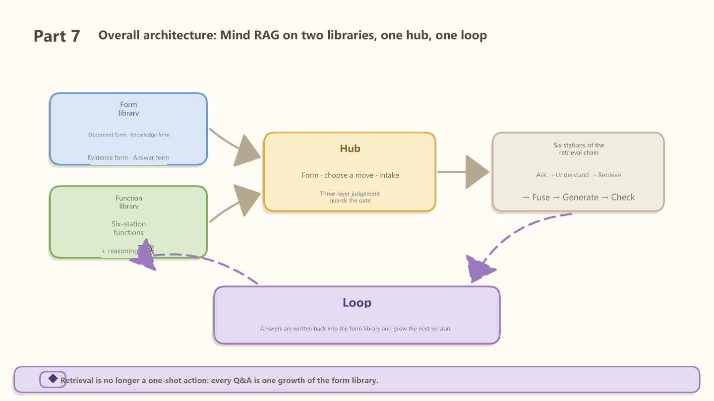

*Figure 7-1 How Mind RAG runs on two libraries, one hub, one loop*

The form library holds the five retrieval forms and the chains that generate them; the function library holds the six-station moves, the five reasoning families and the thinking methods; the hub schedules the criteria for choosing a form, choosing a move and accepting the result — and the intake defence line stands right at the hub's door; the loop writes answer forms and corrections back into the form library and grows the next version. The six-station retrieval chain runs on this skeleton: it is not a one-shot pipeline, it is one growth per question answered.

### 7-2 GraphRAG to Mind RAG: three same, five different

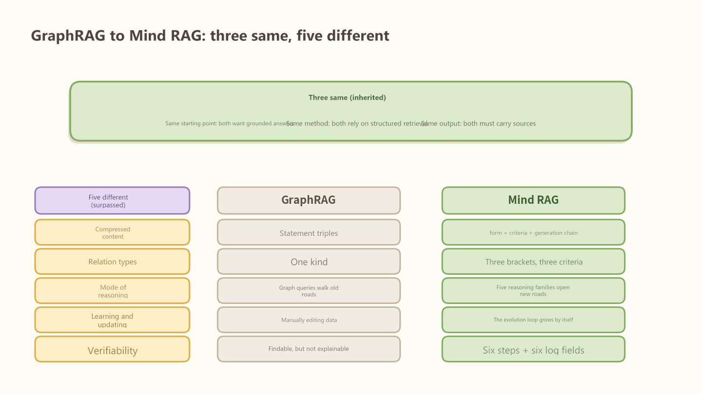

*Figure 7-2 Three same, five different: what is inherited and what is surpassed*

| Dimension | GraphRAG | Mind RAG | What differs |
| --- | --- | --- | --- |
| Starting point | Both want grounded answers | Same | One of the three same |
| Method | Both rely on structured retrieval | Same | Two of the three same |
| Output | Both must carry sources | Same | Three of the three same |
| Compressed content | Statement triples | form + criteria + generation chain | Process enters the library |
| Relation types | One kind of edge | Three brackets, three criteria | Semantic separation |
| Mode of reasoning | Graph queries walk old roads | Five reasoning families open new roads | Direction and mechanism |
| Learning and updating | Manually editing data | The evolution loop grows by itself | Traces entered in the account |
| Verifiability | Findable, but not explainable | Six steps + six log fields | Verifiable accuracy |

**Table 7-1 Three same, five different, side by side**

The three same are inheritance: GraphRAG moved retrieval from fragments up to structure, and that road was the right one. The five different are the surpassing: swap "the language of statements" for "the language of forms and moves", and the seven deficits finally have somewhere to be filled.

### 7-3 Two formulas: the other face of staying in your lane

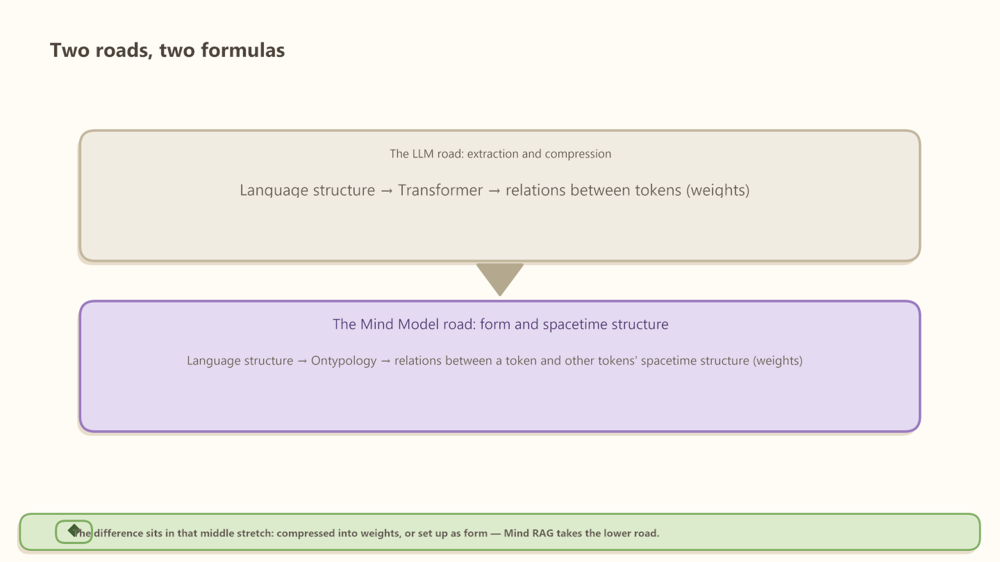

*Figure 7-3 Two roads, two formulas*

Write the division of labour between the LLM and the Mind Model as formulas and "staying in your lane" becomes obvious at a glance: whatever must be "pointable at" is set up as a form — evidence, criteria, reasoning, trace; whatever must be "sayable" is handed to the LLM — wording, fluency, tone. The generation station looks as if the LLM is doing the talking, but every sentence is being escorted by a form.

### 7-4 The seven gap-fills in panorama

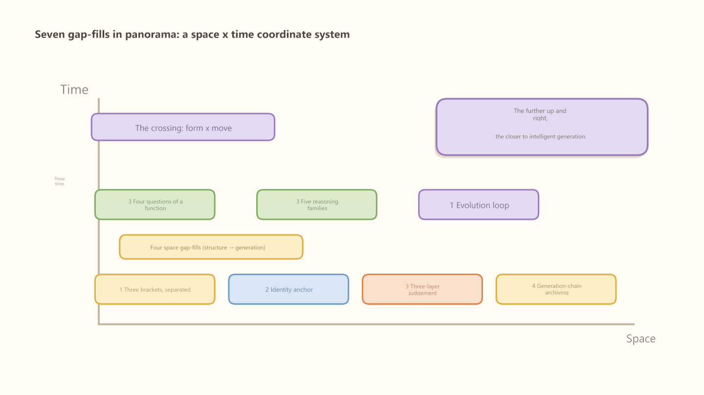

*Figure 7-4 The seven gap-fills in panorama: a space x time coordinate system*

Put the seven gap-fills back on the space-and-time coordinate system: the horizontal axis carries the four space gap-fills, running deeper along structure, identity, judgement and generation; the vertical axis carries the three time gap-fills, running higher along expression, reasoning and evolution. Where the two axes cross — where forms and moves interweave — is exactly the deepest gap the companion volume named, and it is now where Mind RAG harvests the most.

### 7-5 Four acceptance lines and the three stages of AGI

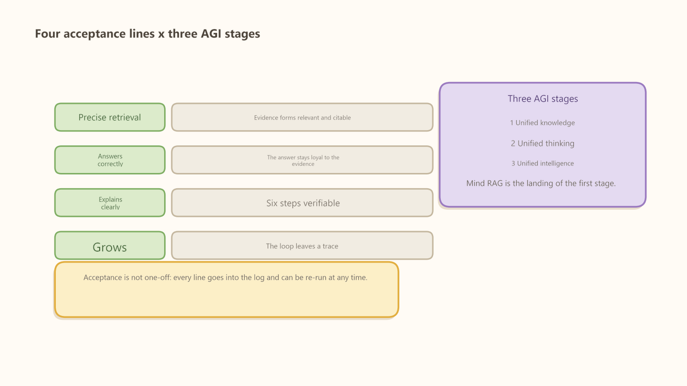

*Figure 7-5 Four acceptance lines x three stages of AGI*

| Acceptance line | What it checks | How it checks |
| --- | --- | --- |
| Retrieves accurately | Evidence forms are relevant and citable | recall@k + spot-check of sources |
| Answers correctly | The answer stays loyal to the evidence | faithfulness checked against the evidence form set |
| Explains clearly | The six steps are verifiable | Completeness check of the six log fields |
| Grows | The loop leaves traces | Version account: what changed, and why |

**Table 7-2 The four acceptance lines**

The four lines are not a one-off exam: each one is written into the log and can be re-verified at any time. Further out, Mind RAG aligns with the three stages of AGI — unified knowledge (the form library sets knowledge up as form), unified thinking (the function library and the five reasoning families set thinking up as moves), unified intelligence (the loop lets the system grow itself). It is the landing of the first stage and the foundation of the other two.

### 7-6 Reading four common approaches against it

Put Mind RAG back on the market and the question most often asked is "how is it different from what I already use". Four common approaches, read against it in one table.

| Approach | Strength | Weakness | Where Mind RAG sits |
| --- | --- | --- | --- |
| Bare LLM | Fast, can talk about anything | Hallucination, no sources, no updating | Keep the language, swap the intelligence over to form |
| Vector RAG | Grounded, cites sources | Semantics flattened, fragmentation | Keep it, fill in 1, 3 and 4 |
| GraphRAG | Structure, global questions | The seven deficits hide inside the graph | Inherit the three same, fill the five different with form |
| Knowledge-base QA | Controllable, auditable | Lookup does not judge, does not evolve | Open rules and the loop come on duty |

**Table 7-3 Four common approaches read against Mind RAG**

The conclusion is not "tear everything down and start over" but "each stays in its lane, then fill in the form": the bare LLM's language ability, vector RAG's grounding, GraphRAG's structure and the knowledge base's controllability all stay — and the seven missing pieces get filled in one card at a time.

> **[Special column C8] Convergence and surpassing: from KG-Search to Mind RAG**
>
> There is a quiet thread in retrieval work over the last few years that is easy to miss: the GraphRAG camp (community summaries, global questions) and the KG-Search camp (entity linking, subgraph retrieval, multi-hop QA) have moved from opposition toward convergence. The reason for converging is practical — global questions need summaries, detail questions need subgraphs, and neither camp can do both alone; hybrid retrieval and a unified evidence model let the two outputs fuse.
> This volume goes one step further: convergence solves the assembly problem of "how to retrieve", while the seven deficits are a problem of "what the knowledge language can express". However beautifully assembled, the language is still statement — brackets still flattened, identity still drifting. The point where Mind RAG surpasses lies in the language layer: set forms and moves up as first-class citizens, and the convergence of retrieval methods follows naturally, because the three axes of form were always mapped onto different retrieval families.
> Put another way: the convergence of GraphRAG and KG-Search is a convergence of technique; what Mind RAG is after is a convergence of principle. Technique queues up inside the routing decision tree; principle sets the rules inside the seven gap-fill cards. Advance both and Q&A can stand.
> The most practical advice for anyone adopting this: treat convergence as a transitional form — keep the hybrid retrieval you already run, and at the same time begin forming high-value knowledge. Once the seven gap-fills are all in place, you will find that "which bridge to take" has become a secondary question, because every bridge now carries the same set of forms.

> **Exercise E09 The overall architecture**
>
> E09-1 Explain the three same and five different to a colleague who has not read the series — the three-minute version.
> E09-2 Of the four acceptance lines, which is most often skipped? Why is that very one the key to growing?

> **Exercise E10 Architecture addendum**
>
> E10-1 Read your current approach against Table 7-3: which cell does it sit in, and which card should be filled first?
> E10-2 Translate 'the LLM speaks, Ontypology acts' into your team's division-of-labour language: which jobs go to the model, and which must stay with form and criteria?

## Part 8 A complete content plan: learn, practise, apply, teach, build

The last part hands over the plan. The complete content plan answers three questions: how people learn (learn, practise, apply, teach, build, plus eight weeks), how the library gets built (four stages), and how the work gets verified (three PoC scenarios plus maturity). Four kinds of reader, four roads; five domains, and the form does not change — only what sits inside the form library does.

### 8-1 Learn, practise, apply, teach, build

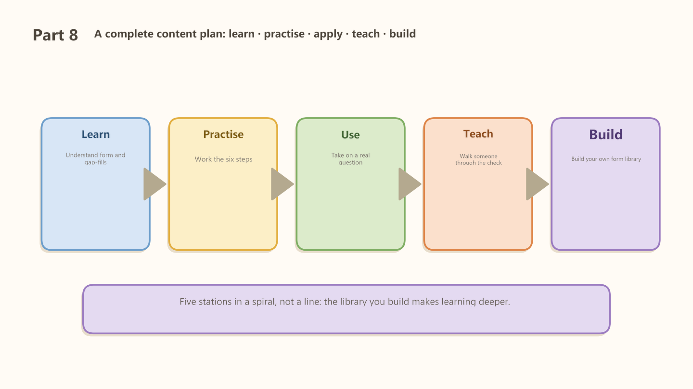

*Figure 8-1 Learn, practise, apply, teach, build: five stations in a spiral, not a line*

Learn — read the forms and the seven gap-fills until they are clear. Practise — work the six steps on set problems. Apply — take on a real question. Teach — walk someone else through the check. Build — build your own form library. The five stations are a spiral, not a line: the library you build makes the learning deeper, and the checks you teach make the applying steadier.

### 8-2 The eight-week route

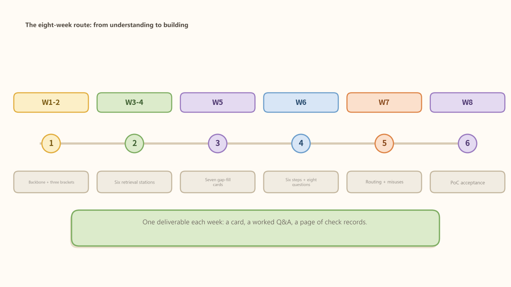

*Figure 8-2 The eight-week route: one deliverable every week*

| Week | Topic | Deliverable |
| --- | --- | --- |
| W1-2 | Backbone + three brackets | Notes on separating the three brackets + one worked example of gap-fill card 1 |
| W3-4 | Six stations of the retrieval chain | Six four-question cards (your own domain's version) |
| W5 | Seven gap-fill cards | A personal case library for the seven cards |
| W6 | Six steps + eight questions | One fully verifiable worked Q&A |
| W7 | Routing + misuses | Routing decision tree field record + misuse clinic sheet |
| W8 | PoC acceptance | Three-scenario PoC report (including results on the four acceptance lines) |

**Table 8-1 The eight-week route**

### 8-3 Four stages of building a library

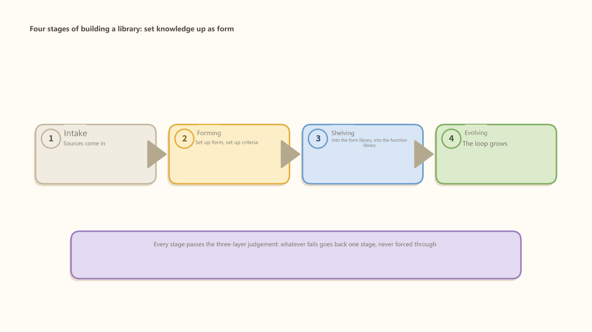

*Figure 8-3 Four stages of building a library: intake, forming, shelving, evolving*

Intake — sources come in and first pass the three-layer intake defence line. Forming — set up the form, set up the criteria, write the generation chain and file it. Shelving — into the form library and the function library, with the retrieval index built alongside. Evolving — the loop turns, every Q&A leaves a trace, and revisions are written back. Every stage has an exit condition; anything that fails goes back one stage rather than being forced through.

### 8-4 Choosing a route by situation: four kinds of reader

*Figure 8-4 Four kinds of reader, four roads*

Students and beginners take W1-4 to get started: understand the form first, then retrieval. Engineers go straight to the six stations and the four-question card — practice first. Researchers and analysts lean on the six steps and the five reasoning families; verifiability is their lifeline. Decision-makers and managers read the eight questions and the acceptance lines — the conclusion, and the grounds under it. All four roads end at the same place: verifiable accuracy.

### 8-5 Three PoC scenarios for acceptance

*Figure 8-5 Three PoC scenarios: a small win first, then widen*

| Scenario | Worked question | Accuracy mainly checked | Pass threshold |
| --- | --- | --- | --- |
| 1 · Fact checking | "What does this document say?" | Source accuracy + semantic accuracy | 100% of citations point back |
| 2 · Comparative judgement | "What is the difference between A and B?" | Three separated brackets + three-layer judgement | Comparison aligned axis by axis |
| 3 · Reasoning advice | "What if ... ?" | Reasoning accuracy + verifiable accuracy | The reasoning chain can be re-run |

**Table 8-2 The three PoC scenarios**

Only when all three scenarios pass is it worth talking about widening and production; if one fails, go back and repair the form library. The point of a PoC is not a demo, it is establishing trust.

### 8-6 Five domains side by side: the form stays, the library changes

*Figure 8-6 Five domains side by side: philosophy, biology, language, programming, organisation*

The advantage of form-style Q&A is that it crosses domains. Philosophy asks "what is justice" and goes [ ] + cap(T) to set criteria. Biology asks "does this count as an organ" and goes { } + remove to grade it. Language asks "synonym or same referent" and goes ( ) + id(C) to hold identity. Programming asks "whose type is this" and goes three-layer judgement plus the four-question card. Organisation asks "who owns what" and goes { } + BOM plus the five reasoning families. The domain changes; the forms and gap-fills do not — only what sits inside the form library does.

### 8-7 Maturity: L1 to L4

*Figure 8-7 Four levels of maturity: visible, judged well, answered clearly, grown large*

| Level | Name | What it looks like | Matching acceptance line |
| --- | --- | --- | --- |
| L1 | Visible | Data comes in, sources can be found | Retrieves accurately (in part) |
| L2 | Judged well | Three-layer judgement guards the gate, fast refusal works | Retrieves accurately + answers correctly |
| L3 | Answered clearly | The six steps are verifiable, every sentence has an anchor | Explains clearly |
| L4 | Grows | The loop turns, the form library grows by itself | Grows |

**Table 8-3 The four levels of maturity**

Maturity is not a label you stick on: every step up has to hand over the evidence for the next acceptance line. The distance from L1 to L4 is the distance a "retrieval system" travels to become "intelligent Q&A".

### 8-8 Frequently asked questions

| Question | Answer |
| --- | --- |
| Does Mind RAG mean giving up vector retrieval? | No. Vector holds the abstraction axis and is one of the six families; the seven gap-fills only make it ask one more question — how was this made — they do not tear it down. |
| Do all seven gap-fills have to go in at once? | No. Put 1, 2 and 3 in first (semantics, identity, judgement) to lay the foundation, then 4 to 7. The eight questions work as a go-live checklist. |
| Can Mind RAG be used without an LLM? | Yes, but it is hard work. The LLM holds language, Ontypology holds intelligence — with no LLM the generation station becomes a template and the other six stations still run. |
| Which of the four library-building stages is hardest? | Forming. Turning statements into forms and criteria is a craft; start with knowledge that is high-value and high-demand for verification. |
| Will fast refusal reject too much? | Fast refusal must be logged and must come back to the clinic. Wrongly refused cases are exactly the fuel for revising criteria — that is what the evolution loop is for. |
| Does it conflict with existing GraphRAG investment? | No. The three same are inheritance: keep the community summaries and subgraph retrieval you have built, and fill the five different in, one card at a time. |
| Who decides what counts as accurate? | Verifiability decides: a third party takes the six log fields and re-runs the six steps; if the conclusion matches, it is accurate — not by authority, but by evidence. |
| How long before PoC results show? | On the eight-week route, the week-8 deliverable is the three-scenario report. If the library starts from zero, pilot a small library first, then widen the domain. |

**Table 8-4 Frequently asked questions**

### 8-9 The acceptance checklist and the usual blockers

Before the plan lands, one last handover: an acceptance checklist and a blocker cross-reference — tick the list, repair against the blockers.

| Acceptance item | Criterion to tick | Common blocker | How to fix it |
| --- | --- | --- | --- |
| No flattening across three brackets | Spot-check 20 relations; the three semantics sit in separate columns | Modelling feels like a chore, so flatten now and sort it later | Form the high-value knowledge first, then fill the rest in |
| Identity-anchor coverage | 100% of evidence forms carry id(C) | The old system has file names only | Run both anchors in parallel during transition, then replace gradually |
| Intake defence line operating | Fast-refusal log is searchable and can be revisited | Fast refusal is treated as failure, so nobody dares turn it on | List the fast-refusal rate as a health metric |
| Generation-chain archiving | Spot-check a dimension and produce its birth certificate | Old knowledge has no process record | Mark old knowledge 'archive pending'; make the field mandatory for new knowledge |
| Four-question cards complete | One card per station, six in all, with checkable criteria | Criteria written as adjectives | Criteria must be checkable conditional statements |
| Reasoning family labelled | The answer's reasoning column names family and direction | Habit of letting the model improvise | Force the reasoning column to be filled in the generation template |
| Traces entered in the account | Version account answers "what changed" | Only the latest version is kept | Every revision records the reason; old versions are never deleted |

**Table 8-5 Acceptance checklist against the usual blockers**

Blockers are not frightening — every blocker maps to one gap-fill card: the blocker is the signal, the card is the response.

> **Exercise E11 The plan (first half)**
>
> E11-1 Draw up a personal version of the eight-week route for your team: one line for each week's topic and deliverable.
> E11-2 Which three exit conditions would you set for the forming stage of the four library-building stages?

> **Exercises S01-S03 The plan (second half)**
>
> S01 Pick a real domain and write the worked questions and pass thresholds for the three PoC scenarios (following Table 8-2).
> S02 Self-assess your current knowledge system against the four maturity levels: which level is it at, and what is missing for the next one?
> S03 Synthesis: compress the whole book into a one-page briefing for a director — one sentence each on the seven gap-fills, the six steps and the four acceptance lines.

> **Exercise E12 The plan (addendum)**
>
> E12-1 Tick your system off against the Table 8-5 checklist: for three items that fail, which gap-fill card does each map to?
> E12-2 Write a 300-word blocker clinic record: symptom → matched against the sixteen misuses → gap-fill plan.

## Closing Seven gap-fills, one road

Look back over the road this volume has travelled. First the positioning — all five pain points come from a form that was never set up. Then the backbone — three axes and three brackets, three-layer judgement, the four questions of a function, two libraries, one hub, one loop. Then the space and time parts set up the forms and moves of the retrieval world. Part 5 opens the seven gap-fill cards and fills the companion volume's seven deficits back in, one place at a time. Part 6 gives the methods — body, use, accuracy; the six steps; the eight questions; the misuse cross-reference; the routing decision tree. Part 7 gathers the architecture, and Part 8 hands over the plan.

The seven gap-fills really come down to one road: set the form up. Semantic separation, identity anchoring, an opening for judgement, process archiving, runnable moves, new roads for reasoning, knowledge that grows — every one of these is a meaning Ontypology wrote down long ago, and in the retrieval world they were all, at once, missing. What Mind RAG does is plain: it invites them back, and gives each one its place.

*Figure 8-8 The whole book in one line: set the form up and retrieval is accurate; make accuracy verifiable and knowledge grows*

The end of this road is not a system but an attitude — an attitude toward accuracy: give the reason, hand over the evidence, keep the trace. Set out with that attitude and retrieval grows into Q&A, Q&A grows into knowledge, and knowledge grows into wisdom. Seven gap-fills, one road — and the road is already underfoot.

*Figure 9-1 The whole book on one page*

> **End of the volume**
>
> Set the form up and retrieval is accurate; make accuracy verifiable and knowledge grows.

## Appendix A Terms and notation

| Term | English | In one sentence |
| --- | --- | --- |
| form | Type | A boundary drawn by separating and combining; something recognisable and nameable |
| Space form | Space Type | The static face of form: three axes, three brackets |
| Time form | Time Type | The moving face of form: functions and moves |
| Unit form | Unit Type | form set = {parts, (content), [class]} |
| attribute form | AttributeType [ ] | Abstraction: the class at the intersection of features |
| BOM form | BOMType { } | Composition: parts and the three remove levels |
| space container form | ContainerType ( ) | Container: id(C) and the invariance axiom |
| Intersection criterion | ∩(T) | The on-the-spot rule for whether something counts as this class |
| remove criterion | remove(p, M) | Three counterfactual levels of what happens if you take it away |
| Identity anchor | id(C) | An anchor whose content can change while its identity does not |
| Invariance axiom | Invariance | Replacing content does not change identity |
| Generation chain | Generation Chain | same/different → separate/combine → form → name |
| The four questions of a function | Function Card | Name, input form, output form, criteria |
| form in, form out | op: Type → Type | Every operation takes a form in and puts a form out |
| Query form | Query Type | The shape of a question: intent · keywords · scope |
| Evidence form | Evidence Type | What comes back as grounds: {source, (fragment), [credibility]} |
| Answer form | Answer Type | The answer delivered: {conclusion, (citation), [criteria]} |
| Seven deficits | Seven Gaps | Brackets flattened · identity drift · the graph cannot judge · generation amnesia · verbs vanish · reasoning absent · evolution absent |
| Seven gap-fills | Seven Fixes | Three brackets separated · identity anchor · three-layer judgement · generation-chain archiving · four questions of a function · five reasoning families · evolution loop |
| Verifiable accuracy | Auditable Accuracy | Give the reason, hand over the evidence, keep the trace |

**Table A-1 Glossary (the English for xing is Type)**

| Notation | Read as | Used where |
| --- | --- | --- |
| [ ] | attribute bracket | abstraction · class · intersection criterion |
| { } | composition bracket | parts · BOM · three remove levels |
| ( ) | container bracket | containment · identity · invariance axiom |
| ≡ ≢ ⊂ | comparing forms | form-identical · not identical · downgraded |
| ⊕ | form merging | the operation at the fusion station |
| σ | substitution | query rewriting · content updates (identity preserved) |
| ∩(T) | Intersection criterion | judgement at the abstraction layer |
| J_C ∧ J_B ∧ J_T | three-layer conjunction | the master criterion of the intake defence line |
| id(C) | Identity anchor | citation anchoring · version continuity |

**Table A-2 Notation**

## Appendix B Quick-reference cards

### B-1 The seven gap-fill cards at a glance

| # | Deficit | Gap-fill | A one-line motto |
| --- | --- | --- | --- |
| 1 | Brackets flattened | Three brackets, separated | Three relations, three criteria, each in its own house |
| 2 | Identity drift | Identity anchor id(C) | Content may change, identity may not |
| 3 | The graph cannot judge | Three-layer judgement | Judgement is a funnel, not a lookup |
| 4 | Generation amnesia | Generation-chain archiving | The birth certificate travels with the form |
| 5 | Verbs vanish | The four questions of a function | A move has to be able to run |
| 6 | Reasoning absent | The five reasoning families | Open a new road, do not walk the old one |
| 7 | Evolution absent | The evolution loop | Knowledge is a river that moves |

### B-2 The eight questions as a checklist

> **Tick before you start**
>
> □ 1 Are the three relations kept distinct? □ 2 Is the identity anchor in place?
> □ 3 Can something new be judged on the spot? □ 4 Have you asked what happens if you remove it?
> □ 5 Is the generation process archived? □ 6 Are the four questions of the move complete?
> □ 7 Does the reasoning open a new road? □ 8 Does knowledge leave a trace?
> The more you tick, the more this work must be handed to form and criteria.

### B-3 Photocopy-ready blank templates (full page)

The templates below can be photocopied whole: one four-question function card, one form-set card, one eight-question checklist.

| Four-question function card (blank) |  |
| --- | --- |
| Name | ________________________________ |
| Input form | ________________________________ |
| Output form | ________________________________ |
| Criteria | ________________________________ |
| Notes | ________________________________ |

| Form-set card (blank) |  |
| --- | --- |
| Name of the form | ________________________________ |
| {parts} | ________________________________ |
| (content) | ________________________________ |
| [class] | ________________________________ |
| remove level | □ essential part □ functionally degraded part □ non-essential part |

| Eight-question checklist (blank) |  |
| --- | --- |
| Task name | ________________________________ |
| Tick | □1 three brackets □2 identity anchor □3 judge on the spot □4 remove |
|  | □5 generation chain □6 four questions □7 reasoning □8 trace |
| Reviewer / date | ________________________________ |

### B-4 Photocopy-ready: reasoning and log templates (full page)

| Five-reasoning-family checklist (blank) |  |
| --- | --- |
| Question | ________________________________ |
| □ Causal (cause → effect) | Mechanism: ________________________ |
| □ Effect-to-cause (effect → cause) | Abduction: ________________________ |
| □ Simulation (if ... then ...) | Assumption and trial run: ______________________ |
| □ Statistical (distribution → probability) | Data source: ________________________ |
| □ Reverse (counterfactual) | The other world: ______________________ |

| Six log fields (blank) |  |
| --- | --- |
| Query form | ________________________________ |
| Retrieval expression | ________________________________ |
| Evidence form set | ________________________________ |
| Criterion record | ________________________________ |
| Reasoning chain | ________________________________ |
| Answer form (with citation anchors) | ________________________________ |

## Appendix C Answers to the exercises

What follows are model answers, not the standard answers — if it holds together and can be checked, it is a good answer.

| Question no. | Model answer |
| --- | --- |
| E01-1 | Two more things: the answer is propped up by evidence, and the evidence can be traced and updated. What is still missing is how the evidence is chosen and how the semantics are judged — in other words, the form was never set up. |
| E01-2 | Example: unclear citations. At first glance this is a citation feature done badly; the form diagnosis says there is no identity anchor — the quote cannot hold its own identity, so of course it does not match the source. Fix the citation for the symptom, set up id(C) for the cause. |
| E02-1 | Three axes: [ ] attribute (∩(T) intersection criterion), { } composition (three remove levels), ( ) container (invariance axiom). Each has its own criterion; drop one and everything flattens. |
| E02-2 | Example: finding a travel guide — ask (where do I want to go), understand (split into flights + lodging + sights), retrieve (look each up), fuse (assemble an itinerary), generate (write the plan), check (compare against budget and time). The six stations are instinctive; they simply had no names before. |
| E03-1 | Evidence form = {source, (fragment), [credibility]}: the source sits in the content slot because that is where the identity anchor lives — change the fragment (content) and the source identity stays put, so the citation does not break. |
| E03-2 | Example: essential parts = the source document store and its index; functionally degraded parts = automatic summaries and the re-ranking model; non-essential parts = decorative charts on the dashboard. Drop the decoration first, then downgrade the summaries, and leave the index untouched. |
| E03-3 | Example: an interviewer judging whether someone works well in a team — no list can tell you (people who have never worked together), but a rule can be checked: joint deliveries, how conflicts were handled. Lookup stays silent; judgement speaks. |
| E04-1 | Example "retrieval" card: input = precise query form; output = evidence form set; criteria = relevant and citable, every item carries id(C), credibility above threshold. |
| E04-2 | Example topic, peak-hour congestion: causal (signal design created the bottleneck), effect-to-cause (work backwards from congestion to an accident or roadworks), simulation (trial-run ten extra seconds of red), statistical (peak distribution), reverse (what if working hours were staggered). |
| E04-3 | "The rooster crowing and dawn are strongly correlated, but the cause of dawn is the rotation of the earth; the crowing merely happens at the same time." — name the difference between correlation and cause and the answer does not crash. |
| E05-1 | Omitted (follow the format of cards 1 and 2, one example each). The point: each case must show both the flattening/drift on the ground and the walk-through after the gap-fill. |
| E05-2 | A birth certificate makes a dimension explainable (the reason can be stated); traceability makes a form correctable (you can go back) — together they give knowledge a mechanism for growing. |
| E06-1 | Example "fusion" card criteria: evidence does not conflict (conflicts must be marked), does not repeat (de-duplicate), and after merging every sentence points back to at least one item of evidence. |
| E06-2 | "Restructuring" is the station most often misunderstood. The line: manually editing data only changes the current state; restructuring keeps an account — what changed, why, and where the old structure went. Missing any of the three and it is not evolution. |
| E07-1 | Omitted (one line per step: whole, three axes, form set, proposition, criterion reasoning, three-layer check). See the cup-lid case in 6-3 for a worked example. |
| E07-2 | Rules map to 1, identity to 2, structure to 3. Without rules the class drifts, without identity the citation breaks, without structure there is no ground for trade-offs — one axis short of its gap-fill and that axis drifts. |
| E08-1 | Omitted (one misuse and one remedy each; the remedy must point back to one of the seven gap-fills). |
| E08-2 | Contract → structured + three-layer judgement (attribution route); difference between A and B → subgraph + three brackets (composition route); delay → simulation and reverse (hypothesis route). |
| E09-1 | Omitted (three same: starting point, method, output; five different: compressed content, relation types, mode of reasoning, learning and updating, verifiability — first half for the same, second half for the different). |
| E09-2 | "Grows" is the line most often skipped, because acceptance gets treated as a one-off exam. It is the key one: whether the evolution loop turns and whether traces are kept decides whether the system is an asset or a consumable. |
| E10-1 | Omitted (find your cell against Table 7-3; the card recommendation must name one of the seven gap-fills — for example vector RAG fills 1, 3 and 4 first). |
| E10-2 | Example: wording, summarising and tone go to the LLM; evidence selection, criteria execution, reasoning direction and version write-back must stay with form and criteria — the former can be compromised, the latter cannot be overruled. |
| E11-1 | Omitted (a personal eight-week version, one line per week for topic and deliverable). |
| E11-2 | Three example conditions: every form carries checkable criteria, every form carries a filed generation chain, and zero flattening across three brackets (spot-check passes). |
| S01 | Omitted (follow Table 8-2: scenario, worked question, accuracy mainly checked, pass threshold). |
| S02 | Omitted (self-assessment plus a gap list; the gaps must name concrete features of L1-L4). |
| S03 | Three example sentences: the seven gap-fills fill seven semantic holes back in, one at a time; the six steps lay out on what grounds for every Q&A; the four acceptance lines are retrieves accurately, answers correctly, explains clearly, grows. |
| E12-1 | Omitted (tick each item and name the matching card — for example "identity-anchor coverage" fails → fill 2, "reasoning family labelled" fails → fill 6). |
| E12-2 | Example skeleton: symptom (citations keep breaking) → match (M6, anchoring a citation to a string) → gap-fill (dual anchor of id(C) plus position coordinate, with old citations backfilled gradually). |

## Appendix D Index of figures and tables

| No. | Figure | Part |
| --- | --- | --- |
| Figure D-1 | Where the two roads meet | Guide |
| Figure 0-1 | Mission map: seven deficits → seven gap-fills | Before we begin |
| Figure 1-1 | RAG in one sentence | Part 1 |
| Figure 1-2 | Five pain points | Part 1 |
| Figure 1-3 | Root, trunk, fruit: three-layer positioning | Part 1 |
| Figure 1-4 | The main thesis | Part 1 |
| Figure 2-1 | Cognitive chain × retrieval chain | Part 2 |
| Figure 2-2 | Three axes, three brackets | Part 2 |
| Figure 2-3 | Three-layer judgement funnel | Part 2 |
| Figure 2-4 | The four-question function card | Part 2 |
| Figure 2-5 | Five operations × retrieval | Part 2 |
| Figure 2-6 | Two libraries, one hub, one loop | Part 2 |
| Figure 2-7 | Master mapping diagram | Part 2 |
| Figure 3-1 | Five retrieval forms | Part 3 |
| Figure 3-2 | Reading the three axes | Part 3 |
| Figure 3-3 | Trade-off map of the three remove levels | Part 3 |
| Figure 3-4 | Three-layer judgement as the intake defence line | Part 3 |
| Figure 3-5 | Four space deficits: crash sites | Part 3 |
| Figure 4-1 | Six stations of the retrieval chain | Part 4 |
| Figure 4-2 | Six four-question function cards | Part 4 |
| Figure 4-3 | The five reasoning families | Part 4 |
| Figure 4-4 | Choosing a road among thinking methods | Part 4 |
| Figure 4-5 | Three time deficits: crash sites | Part 4 |
| Figure 4-6 | LLM × Mind Model, each in its lane | Part 4 |
| Figure 5-1 | The seven gap-fills at a glance | Part 5 |
| Figure 5-2 | Gap-fill card 1: three brackets separated | Part 5 |
| Figure 5-3 | Gap-fill card 2: identity anchor | Part 5 |
| Figure 5-4 | Gap-fill card 3: three-layer judgement | Part 5 |
| Figure 5-5 | Gap-fill card 4: generation-chain archiving | Part 5 |
| Figure 5-6 | Gap-fill card 5: four questions of a function | Part 5 |
| Figure 5-7 | Gap-fill card 6: five reasoning families | Part 5 |
| Figure 5-8 | Gap-fill card 7: evolution loop | Part 5 |
| Figure 5-9 | Seven gap-fills × six families | Part 5 |
| Figure 6-1 | Body — use — accuracy | Part 6 |
| Figure 6-2 | Three gap-fills, RAG version | Part 6 |
| Figure 6-3 | The six proof steps | Part 6 |
| Figure 6-4 | Four levels of accuracy + the log | Part 6 |
| Figure 6-5 | Eight questions | Part 6 |
| Figure 6-6 | Sixteen misuses in four groups | Part 6 |
| Figure 6-7 | The routing decision tree | Part 6 |
| Figure 7-1 | Two libraries, one hub, one loop at work | Part 7 |
| Figure 7-2 | Three same, five different | Part 7 |
| Figure 7-3 | Two formulas | Part 7 |
| Figure 7-4 | The seven gap-fills in panorama | Part 7 |
| Figure 7-5 | Four acceptance lines × three stages of AGI | Part 7 |
| Figure 8-1 | Learn, practise, apply, teach, build | Part 8 |
| Figure 8-2 | The eight-week route | Part 8 |
| Figure 8-3 | Four stages of building a library | Part 8 |
| Figure 8-4 | Choosing a route by situation | Part 8 |
| Figure 8-5 | Three PoC scenarios | Part 8 |
| Figure 8-6 | Five domains side by side | Part 8 |
| Figure 8-7 | Maturity L1-L4 | Part 8 |
| Figure 8-8 | The whole volume in one card | Closing |
| Figure 9-1 | The whole book on one page | Closing |

**Table D-1 Index of figures (54 in all, plus the cover; numbers match the captions in the text)**

| No. | Table | Part |
| --- | --- | --- |
| Table 0-1 | Mission map | Before we begin |
| Table 1-1 | Five pain points × the missing form | Part 1 |
| Table 2-1 | Master mapping table: RAG × Ontypology | Part 2 |
| Table 3-1 | Construction of the five retrieval forms | Part 3 |
| Table 4-1 | Six stations, six cards | Part 4 |
| Table 5-1 | Seven gap-fills × six families | Part 5 |
| Table 5-2 | Combinations of gap-fill cards | Part 5 |
| Table 6-1 | Six log fields | Part 6 |
| Table 6-2 | Eight questions × gap-fills | Part 6 |
| Table 6-3 | The sixteen misuses | Part 6 |
| Table 6-4 | The log, written out | Part 6 |
| Table 7-1 | Three same, five different | Part 7 |
| Table 7-2 | Four acceptance lines | Part 7 |
| Table 7-3 | Four common approaches compared | Part 7 |
| Table 8-1 | The eight-week route | Part 8 |
| Table 8-2 | Three PoC scenarios | Part 8 |
| Table 8-3 | Four maturity levels | Part 8 |
| Table 8-4 | Frequently asked questions | Part 8 |
| Table 8-5 | Acceptance checklist and blockers | Part 8 |
| Table A-1 | Glossary | Appendix A |
| Table A-2 | Notation | Appendix A |
| Table F-1 | Five domains of worked Q&A | Appendix F |

**Table D-2 Index of tables (22 in all)**

## Appendix E Sources and further reading

| # | Source | Use |
| --- | --- | --- |
| 1 | Knowledge-Graph Analysis of the Deficits of Ontypology (companion volume in this series) | The analytic backbone of the seven deficits — every deficit in this volume comes from it |
| 2 | Mind AI: An Introduction (companion volume in this series) | Positioning of Mind AI / Mind Model and the seven limitations (C6) |
| 3 | Lewis et al., Retrieval-Augmented Generation for Knowledge-Intensive NLP Tasks, NeurIPS 2020 (arXiv:2005.11401) | The original RAG paper (C1) |
| 4 | Edge et al., From Local to Global: A Graph RAG Approach to Query-Focused Summarization, 2024 (arXiv:2404.16130) | GraphRAG examined (C2) |
| 5 | Asai et al., Self-RAG, 2023 (arXiv:2310.11511) | Adaptive retrieval (C1) |
| 6 | Lin et al., RA-DIT, 2023 (arXiv:2310.01558) | Joint tuning of retriever and generator (C1) |
| 7 | Gao et al., Precise Zero-Shot Dense Retrieval without Relevance Labels (HyDE), 2022 (arXiv:2212.10496) | Query rewriting (C4) |
| 8 | Cormack et al., Reciprocal Rank Fusion Outperforms Condorcet, SIGIR 2009 | RRF fusion (C4) |
| 9 | Es et al., RAGAS, 2023 (arXiv:2309.15217) | RAG evaluation (C5) |
| 10 | Graph Retrieval-Augmented Generation: A Survey, 2024 (arXiv:2408.08921) | A taxonomy of GraphRAG (C3, C8) |
| 11 | Survey of KG-Search / GraphRAG convergence, 2025 (arXiv:2501.00309) | On convergence (C8) |
| 12 | The Ontypology series: Ontology and Ontypology, The Space Framework, Unit Type and Set Logic, Ontypology: Time Type | Theoretical sources — by convention two they are named but not repeated |

## Appendix F Five domains of worked Q&A

One last set of worked Q&A: five domains, the same walk-through — set the form, run the six stations, pass the eight questions, keep the record. Each one is laid out as four lines, question / form / answer / check, to copy from when the real work starts.

| Domain · Question | Form / Answer / Check |
| --- | --- |
| Philosophy: "Is justice a virtue?" | Form: justice = {distribution rules, (criteria), [virtue class]}; route [ ] + ∩(T). \| Answer: by the criterion set up — if the criterion for "virtue" is "makes its holder a better person", justice meets it and counts; but the criterion version must be named. \| Check: criterion record + ∩(T) checked item by item. |
| Biology: "Does the mitochondrion count as an organ?" | Form: mitochondrion = {inner membrane, (DNA), [organelle class]}; route { } + three remove levels. \| Answer: in a eukaryotic cell it is an essential part (remove it and the cell's energy collapses) — a functionally complete organelle, placed in [organelle class], commonly called a "semi-autonomous organ". \| Check: one column each for the remove level and the class criterion. |
| Language: "Are bicycle and bike the same thing?" | Form: referent C = (id(C), word form); route ( ) + id(C). \| Answer: different word forms, the same identity anchor — co-reference (two names for one form). \| Check: id(C) compared + the invariance axiom (change the word form, not the referent). |
| Programming: "Which family does this exception type belong to?" | Form: exception = {stack trace, (message), [exception class]}; route three-layer judgement + four-question card. \| Answer: the container layer checks module ownership, the BOM layer checks mandatory fields, the abstraction layer checks the feature intersection — place it in the matching exception family and write it into the type library. \| Check: a record of all three gates, J = J_C ∧ J_B ∧ J_T. |
| Organisation: "Should the call centre take on more staff?" | Form: call centre = {shift rota, (call volume), [service unit]}; route { } + BOM + five reasoning families. \| Answer: the statistical family reads the call distribution, the simulation family trial-runs the larger rota, the causal family looks for the bottleneck's cause — write the recommendation and its premises down together. \| Check: the reasoning chain names family and direction, and the data can be traced back. |

**Table F-1 Five domains of worked Q&A**

> **How to use the worked examples**
>
> Do not memorise the answers — memorise the walk-through: set the form, run the six stations, pass the eight questions, keep the record.
> The domain changes; the forms and gap-fills do not — only what sits inside the form library does.

> **Afterword**
>
> This volume is the second half of Knowledge-Graph Analysis of the Deficits of Ontypology: that book asked what the graph is missing; this one answers how form fills it in.
> Between the question and the answer, retrieval grew into Q&A, and Q&A grew into verifiable accuracy — the road is still long, and form goes first.
