

  <a href="https://youtu.be/27_DodMKORs">💻Landscape</a> ｜ 
 <a href="https://v.douyin.com/n1XlkcaPF6A">📱Portrait</a> 
 

 
# Ontypology's Ontology and FDE Applications

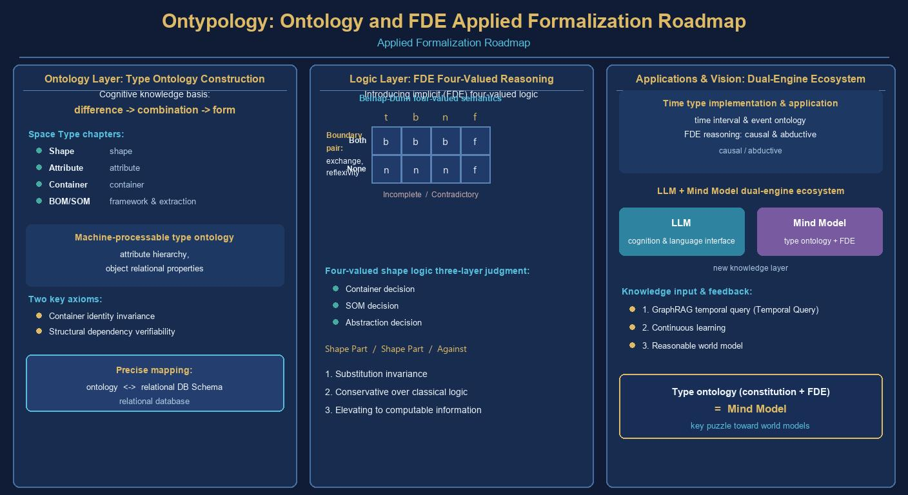

*The ontologization construction of Type and the judgment application of First-Degree Entailment (FDE) four-valued logic*

## Abstract

This paper proposes a formalization route for Ontypology: starting from the cognitive chain of "Difference & Similarity → Split & Merge → Type", it systematically constructs the Type, Attribute, Space Collections, BOM/SOM, Framework, and abstraction established in *The Spatial Type Volume* into a machine-processable Ontology of Type; it then introduces First-Degree Entailment (FDE) four-valued logic to extend the three-level judgments of Type Logic (Container, SOM, abstraction) to the real-world situations of "incomplete knowledge" and "mutually contradictory knowledge".

At the ontology level, this paper gives the core class hierarchy, object property relations, and two key axioms (invariance of container identity, and checkability of structural dependence), and verifies the exact mapping between the ontology and a relational database schema; at the logic level, using Belnap-Dunn four-valued semantics (t/b/n/f) and evidence pairs (support, opposition) to define Type judgment, it elevates "not knowing" and "both true and false" from errors into computable information, and establishes three results: the four-valorization of the three-level judgment, Type replacement invariance, and conservativity over classical two-valued logic.

Furthermore, this paper implements the outline of *The Temporal Type Volume* (Split & Merge, Framework, logic generation, memory management, causal and abductive reasoning, etc.) as a temporal-interval and event ontology, demonstrating the FDE-ization of causal reasoning and abductive reasoning; finally, it sketches the application vision within the LLM + Mind Model dual-engine ecosystem, covering world models, GraphRAG temporal-interval queries, and continuous learning. The conclusion of this paper is: the ontologization of Type answers "what identifiable things the world is composed of", while FDE answers "how judgment can still be made when evidence is insufficient or conflicting" — the confluence of the two is precisely the key missing piece for Mind Model to advance toward a reasoning-capable world model.

**Keywords:** Ontypology, Ontology, knowledge ontology, First-Degree Entailment, FDE, four-valued logic, Type Logic, Temporal Type, contradiction tolerance

## Table of Contents

- Abstract
- Chapter 1 Introduction: From Type to Ontology, From Two-Valued to Four-Valued
  - 1.1 The Journey of Type: Cognition, Description, and Formalization
  - 1.2 Two Gaps: Incompleteness and Contradiction of Knowledge
  - 1.3 FDE: The Four-Valued Answer of First-Degree Entailment
  - 1.4 Structure of This Paper and How to Read It
- Chapter 2 Ontology Construction of Type
  - 2.1 Type as Ontology: Core Classes
  - 2.2 Ontologization of the Three Levels of Added Value
  - 2.3 Object Property and Relation Design
  - 2.4 Axiomatization: Container Identity and Structural Dependence
- Chapter 3 Mapping and Verification of the Ontology: Framework and RDB
  - 3.1 The Four Framework Steps and Ontology Evolution
  - 3.2 Exact Mapping between RDB and Ontology
  - 3.3 Re-verification of Universality
- Chapter 4 Foundations of FDE Logic
  - 4.1 The Predicament of Two Values
  - 4.2 Four-Valued Semantics: The Belnap Diamond Lattice
  - 4.3 Connectives and Direct Entailment
  - 4.4 Tolerant without Chaos: Properties of FDE
- Chapter 5 Applying FDE to Type Logic Judgment
  - 5.1 Four-Valorization of the Three-Level Judgment
  - 5.2 Semantic Positioning of Boundary Cases
  - 5.3 Contradiction Tolerance and Failure of Explosion
  - 5.4 Invariance and Conservativity Theorems
- Chapter 6 Temporal Type and Extended Applications
  - 6.1 Outline Map of Temporal Type
  - 6.2 Temporal Intervals and Event Ontology
  - 6.3 FDE-ization of Causal and Abductive Reasoning
  - 6.4 Application Vision: The Dual-Engine Ecosystem
- Chapter 7 Conclusion
- References
- Appendix A FDE Judgment Quick Reference Table
## Chapter 1 Introduction: From Type to Ontology, From Two-Valued to Four-Valued

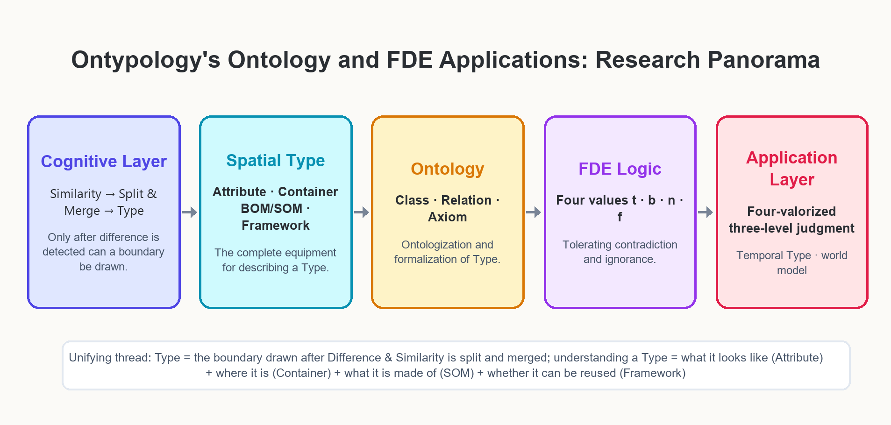

**Figure 1-1 Ontypology's Ontology and FDE Applications: Research Panorama**

**Table 1-1 Chapter Navigation: Core Questions and Key Outputs of Each Chapter**

| Chapter | Core Question | Key Output |
| --- | --- | --- |
| Chapter 1    | Why are ontology and four values needed?   | Review of the cognitive chain, two gaps, FDE fit      |
| Chapter 2    | How does Type become ontology?     | Core classes, three-level added-value ontologization, Axioms 2-1/2-2 |
| Chapter 3    | Does the ontology match engineering reality?  | Framework evolution, RDB↔Ontology mapping    |
| Chapter 4    | How does four-valued logic work?    | Belnap diamond lattice, evidence pairs, Theorem 4-1   |
| Chapter 5    | How is Type judgment four-valorized?    | Definition 5-1, Theorems 5-1/5-2, boundary cases  |
| Chapter 6    | What do the temporal dimension and applications look like? | Temporal ontology, FDE-ization of causal/abductive reasoning, dual engine    |
| Chapter 7    | Conclusion and outlook        | Three major contributions, future work               |

### 1.1 The Journey of Type: Cognition, Description, and Formalization

*The Spatial Type Volume* establishes a cognitive chain: the brain first detects "Difference & Similarity", then draws boundaries through the actions of "Split" and "Merge", and only then is "Type" born — and a Type must have a name. Following this chain, that volume develops a complete set of descriptive equipment — Attributes and Attribute Values answer "what this thing looks like", Space Collections answer "where the thing is", BOM and SOM answer "what parts this thing is composed of and how they depend on one another", and the Framework abstracts the entire derivation process into a method that can be applied repeatedly. Finally, Type Logic uses the three kinds of added value — Container, SOM, and abstraction — to restore one by one the "identity independence", "inter-element structure", and "generation rule" that mathematical Set Theory omits.

However, this theory is currently a narrative text aimed at human readers: it clearly states that "a cup does not become another thing just because it is filled with water", yet it does not provide a machine-checkable form; it tells us that "once an Attribute is extracted, it must be backfilled for all individuals", yet it does not explain how judgment should proceed when knowledge is incomplete or mutually conflicting. To make the judgment engine of the Mind Model truly "think in terms of Type", Type must take two more steps forward: the first is ontologization — writing the classes, relations, and axioms of Type into explicit formal specifications so that machines can share, verify, and reason with them; the second is logicalization — equipping Type judgment with a set of reasoning semantics that can operate under uncertain knowledge.

> **One-Sentence Summary**
>
> Ontologization answers "what identifiable things the world is composed of"; logicalization answers "how judgment can still be made when evidence is insufficient or conflicting". The task of this paper is to advance Type to both of these steps at the same time.

### 1.2 Two Gaps: Incompleteness and Contradiction of Knowledge

Real-world Type judgments are almost never in the ideal state of "complete and consistent evidence". The first gap is incompleteness: when "syringe" appears in the judgment "∈ \[cup\]?", the feature set F(cup) = {can hold liquid, can be held by hand to drink} does not specify whether "used for drinking" is necessary, and so an unresolved case emerges that "can neither be counted as satisfying nor as not satisfying". The second gap is contradiction: when two sources give opposite evidence about the same object — A says "the FAQ robot can converse", B says "the FAQ robot merely looks up a table, which does not count as conversation" — what we get is the coexistence of positive and negative evidence for the same proposition, not noise from which either one can be discarded at will.

Classical two-valued logic fails before both of these gaps. Faced with contradiction, the law of explosion (ex falso quodlibet) instantly paralyzes the entire knowledge base — from p and ¬p any conclusion can be derived, so a single bad datum contaminates all judgments; faced with ignorance, two values force us to choose sides between "true" and "false", disguising "not yet known" as "yes" or "no". For human cognition this is everyday, but for machines it is an abyss: an honest judgment system must be able to speak out "I don't know" and "both true and false".

### 1.3 FDE: The Four-Valued Answer of First-Degree Entailment

First-Degree Entailment (FDE) is the most streamlined member of the family of relevant logics founded by Anderson and Belnap and given a combinatorial semantics by Dunn. Its approach is surprisingly plain: the value of each proposition is not determined by "the world's single truth", but by a pair of evidence sets — the evidence supporting it (E+) and the evidence opposing it (E−). The four combinations yield exactly four values: support only is t (true), opposition only is f (false), both is b (both, both true and false), and neither is n (neither, neither true nor false). b is dedicated to accommodating contradiction, and n is dedicated to expressing ignorance; moreover, the two do not infect each other, and local conflict does not paralyze overall reasoning.

The fit between FDE and Type Logic is far more than "just happening to handle bad data". Recall the essence of the three-level judgment: the Container judgment asks "after the content is replaced, does the identity remain constant", the SOM judgment asks "after a part is removed, is the whole still the same thing", and the abstraction judgment asks "does the new object pass the feature intersection" — every level is "adjudicating the belonging of a Type by evidence". Connecting evidence-pair semantics to the three-level judgment, Type judgment naturally obtains four-valued output: t accepts, f excludes, b marks conflict, n marks pending. This is precisely the "four-valorization of the three-level judgment" to be established in Chapter 5 of this paper.

### 1.4 Structure of This Paper and How to Read It

This paper advances along three stages: "ontology → logic → application". Chapter 2 constructs the Type ontology: core classes, ontologization of the three levels of added value, object properties, and axioms. Chapter 3 uses the four framework steps and the relational database as a touchstone to verify the mapping precision of the ontology. Chapter 4 lays out the four-valued semantics of FDE. Chapter 5 completes the four-valorization of the three-level judgment and establishes the invariance and conservativity theorems. Chapter 6 implements the outline of *The Temporal Type Volume* as a temporal ontology and the FDE-ization of causal/abductive reasoning, converging on the dual-engine application vision. Chapter 7 concludes.

## Chapter 2 Ontology Construction of Type

### 2.1 Type as Ontology: Core Classes

The classic definition of Ontology in information science is "an explicit formal specification of a conceptualization" (Gruber, 1993): it writes "what things exist in a domain and what relations hold among them" into a structure that machines can share and verify. Ontypology happens to have the materials ready for this — Type itself has a clear boundary semantics (the boundary drawn by Split & Merge), the Attribute dimension has a natural normalizing property (the dimension runs through all individuals), and the Primary Key idea has a ready-made concept of identity (identity independent of content). Elevating the terms of *The Spatial Type Volume* one by one into ontology classes yields the Type ontology Ontypology-O.

> **Definition 2-1 (Type Ontology Ontypology-O)**
>
> The Type ontology is a quadruple O = (C, P, I, Γ): C is the set of core classes; P is the set of Object Properties and Data Properties; I is the set of Named Individuals; Γ is the set of axioms and constraints.
>
> The core classes C include at least: Type, Entity, Attribute, Value, Part, Content, Framework, Relation.

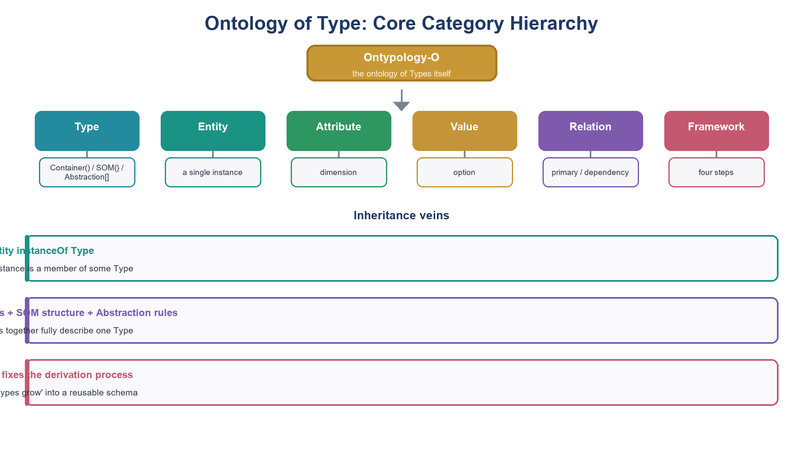

**Figure 2-1 Core Class Hierarchy of the Type Ontology (Ontology of Type)**

Table 2-1 lists the core classes and their origins in Ontypology terminology. Noteworthy is the division of labor between "Type" and "Entity": Type is the question list hanging over all individuals, and an Entity is the product after the list has been concretely answered — this is precisely the ontological restatement of *The Spatial Type Volume*'s "the schema is the Type, and the rows are the entities". An Entity belongs to a Type via instanceOf; the Type itself is jointly constituted by three aspects: the Attribute dimension (what it looks like), the SOM structure (what it is composed of), and the abstraction rule (how new members are generated).

**Table 2-1 List of Core Classes of the Type Ontology**

| Class | Ontology Role | Corresponding Term | Description |
| --- | --- | --- | --- |
| Type       | Class    | Type, category, schema   | The boundary drawn by Split & Merge; the carrier of the question list and generation rule |
| Entity    | Class    | entity, individual, row | The product after the Type is concretely answered, with independent identity (Primary Key)  |
| Attribute | Class    | attribute, dimension     | A question that can be asked; the dimension must run through all individuals  |
| Value    | Class    | attribute value, option, scale | The answer to the question in a concrete situation           |
| Part      | Class    | BOM item    | A component that can be removed and, after removal, is still independently identifiable     |
| Content  | Class    | container content    | Something replaceable that does not define container identity        |
| Framework | Class    | four framework steps     | Solidifies the derivation process of Type into a repeatedly applicable method    |
| Relation  | Class    | master-detail, reference, dependency  | Connections between Type and Type, part and part        |

### 2.2 Ontologization of the Three Levels of Added Value

The three kinds of added value of Type Logic — the identity independence of the Container, the inter-element structure of SOM, and the generation rule of abstraction — each have a precise landing point at the ontology level. The Container added value corresponds to the modeling of "content replaceable while identity stays constant": Content is a class entirely different from Part, the former hanging under the Container via contains and the latter hanging under the SOM Type via hasPart, so the ontological status of the two is never confused. The SOM added value corresponds to the modeling of "parts have dependency relations among them": the composition relation R is a binary relation on the set of parts, and the three-level classification of necessary part, functionally degraded part, and non-necessary part directly becomes the role annotation of R. The abstraction added value corresponds to the modeling of "open classes": the membership of a class is given by the feature-intersection criterion, which can be expressed exactly by the equivalent class (equivalentClass) in ontology language.

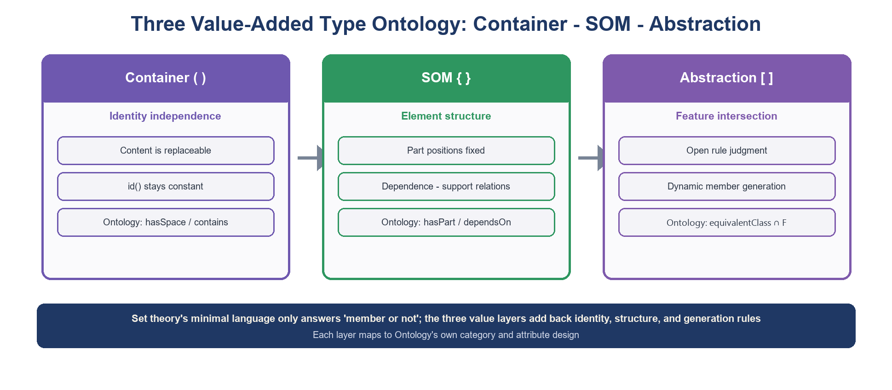

**Figure 2-2 Ontologization of the Three Kinds of Added Value: Container · SOM · Abstraction**

**Table 2-2 Three-Level Added Value → Ontologization Correspondence**

| Added Value | Property Added | Bracket | Ontology Module | OWL Expression |
| --- | --- | --- | --- | --- |
| Container     | independence of identity    | ( )    | contains / id(C)    | ObjectProperty + invariance axiom |
| SOM    | structure among elements    | { }    | hasPart / dependsOn | ObjectProperty + role annotation |
| Abstraction     | feature-intersection generation    | \[ \]  | memberOf / ∩F(T)    | equivalentClass feature intersection  |

> **Definition 2-2 (Ontological Structure of SOM)**
>
> SOM(M) = (P(M), R(M), G(M)): P(M) is the set of parts; R(M) ⊆ P(M) × P(M) is the composition relation (dependency, connection, support); G(M) is the spatial configuration (the spatial position occupied by each part).
>
> The role range of R(M) is {necessary part, functionally degraded part, non-necessary part}, determined by comparing the identity of remove(p, M) with M.

### 2.3 Object Property and Relation Design

The object properties of the Type ontology (Figure 2-3) are deliberately kept lean and symmetric. instanceOf connects an Entity and a Type; hasAttribute and hasValue connect a Type with its Attribute dimensions and an Entity with its concrete values; hasPart and contains strictly distinguish "skeleton" from "guest"; generatedBy marks that an abstract Type is generated by the Framework; references corresponds to the Primary Key → Foreign Key pointing; dependsOn expresses part dependency; memberOf expresses the open membership of an abstract class. As for data properties, each Attribute corresponds to one DataProperty, whose range is exactly the set of Attribute Values of that attribute — this is precisely the ontological form of a "schema field".

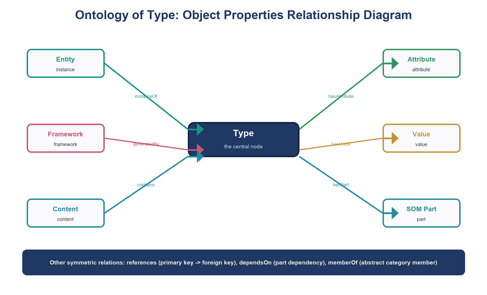

**Figure 2-3 Object Properties Relation Diagram of the Type Ontology**

> **Design Warning: Three Inviolable Boundaries**
>
> First, contains and hasPart must not be used interchangeably — the coffee in the cup is Content, while the handle is a Part; replacing the former leaves it still the same cup, while removing the latter may shake its identity.
>
> Second, the Attribute dimension must run through all individuals — no Entity may be "absent" on any dimension; missing data is marked with the value n, rather than omitting the field.
>
> Third, the identity marker (Primary Key) must not be composed of Attribute Values — attributes are replaceable, identity is not.

### 2.4 Axiomatization: Container Identity and Structural Dependence

> **Axiom 2-1 (Container Identity Invariance)**
>
> For any Container C and any contents e1, e2: replacing e1 in S(C) with e2 does not change id(C). Formalization: ∀C ∀e1 e2 ∈ S(C): id(C) is equal before and after replace(e1, e2).

> **Axiom 2-2 (Structural Dependence is Checkable)**
>
> For SOM(M) and a part p ∈ P(M): the identity comparison of remove(p, M) with M is decidable, and the decision result is exactly one of three — loss of identity (necessary part), functional degradation while identity persists (functionally degraded part), or no effect at all (non-necessary part).

Axiom 2-1 elevates the everyday intuition "whether the cup holds water or coffee" into an inviolable model constraint: any modeling that violates it (for example, treating the content as part of the identity) is regarded as a modeling error. Axiom 2-2 elevates the intuition "remove the bottom of the cup and the cup collapses" into a decidable procedure: it guarantees that SOM judgment is not a matter of taste, but a repeatable, verifiable mechanical procedure. These two axioms correspond one-to-one with the three elements of the Container and the three-level classification of SOM in *The Spatial Type Volume*, forming the load-bearing wall of the ontology.

> **Chapter Summary**
>
> The Type ontology O = (C, P, I, Γ) elevates Type, Entity, Attribute, Part, Content, Framework, and Relation all into verifiable ontology classes; the three levels of added value each have an ontological landing point; the two axioms guard the bottom line of identity and structure. Next step: put it back into engineering reality for verification.

## Chapter 3 Mapping and Verification of the Ontology: Framework and RDB

### 3.1 The Four Framework Steps and Ontology Evolution

The four framework steps — distinguish Difference & Similarity, compare failure, abstract and name, attach judgment — describe the birth process of a Type. Translating them into the language of ontology evolution, the four steps correspond exactly to two kinds of change of completely asymmetric weight. When the difference of a new object "matches" an existing dimension, it suffices to add one Attribute Value under the corresponding attribute (adding an individual), and the schema does not change at all; only when the difference "matches none of the existing dimensions" is abstraction triggered and a new dimension opened — this corresponds to adding a DataProperty and backfilling the values for all existing individuals, a genuine schema change (Figure 3-1).

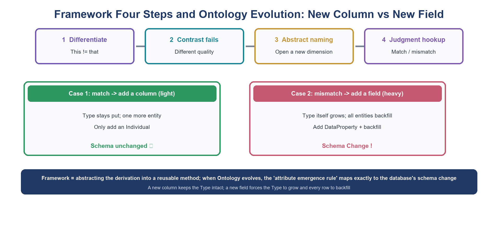

**Figure 3-1 The Four Framework Steps and Ontology Evolution: Adding a Row vs. Adding a Column**

This asymmetry has a profound correspondence in ontology engineering: adding an individual is a conservative extension, and all old conclusions remain valid; adding an Attribute dimension may shake the boundaries of existing classifications — two entities that were originally "indistinguishable" become distinguishable once the "thermal insulation layer" dimension is added. Therefore, the ontology evolution strategy should be consistent with the attribute emergence rule of *The Spatial Type Volume*: never open a new dimension if an existing one can be reused, and opening a new dimension requires backfilling the whole.

### 3.2 Exact Mapping between RDB and Ontology

*The Spatial Type Volume* points out that "the schema is the Type, the rows are the entities, the Primary Key holds up identity, and the master-detail references connect Type with Type". At the ontology level, this set of correspondences can be translated item by item (Figure 3-2, Table 3-1): the schema (the set of fields) maps to the attribute constraints of a Class; each row maps to a NamedIndividual; the Primary Key maps to the identity marker of an individual (in an OWL implementation, an IRI); the Foreign Key maps to the concrete assertion of an ObjectProperty; and a change to the table structure maps to schema evolution.

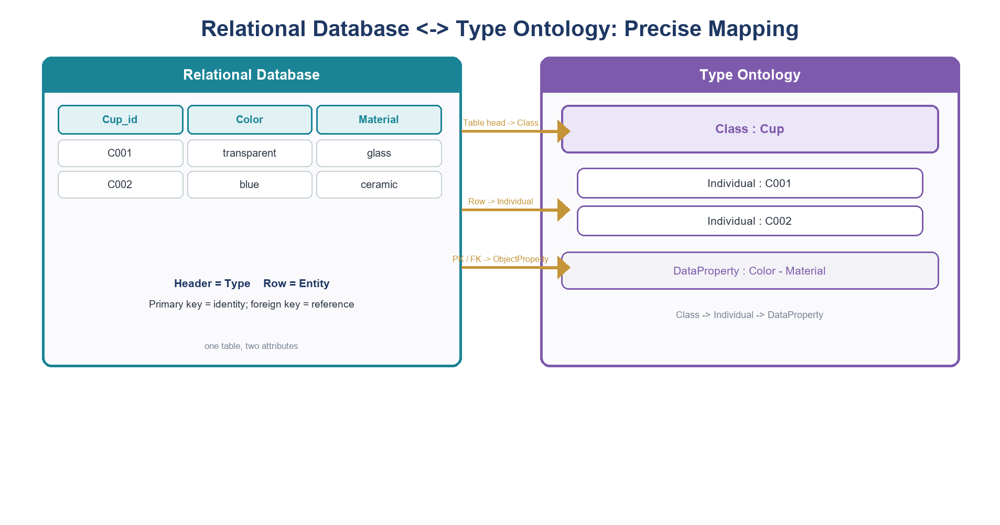

**Figure 3-2 Exact Mapping between Relational Database ↔ Type Ontology**

**Table 3-1 RDB ↔ Type Ontology ↔ Ontology Terminology Correspondence**

| RDB Concept | Ontypology Term | Ontology Correspondence |
| --- | --- | --- |
| schema (set of fields)   | Type (question list)    | Class + DataProperty constraints |
| row        | Entity         | NamedIndividual         |
| Primary Key         | identity marker id(C) | individual IRI / key assertion         |
| Foreign Key         | master-detail reference       | ObjectProperty assertion       |
| add a row       | add an Entity (Type unchanged)  | add an Individual (conservative extension)     |
| add a column       | new Attribute dimension (Type grows) | add a DataProperty + backfill    |
| normalization 1NF    | dimension runs through all individuals   | attribute constraint: single-valued and mandatory              |

The lesson of the mapping is bidirectional. On the one hand, RDB proves that the Type ontology is not a castle in the air — the database operating every day is the implementation site of the Type ontology; on the other hand, the ontology fills in what RDB cannot say: a database can store a "part table", but cannot express the dependency semantics of "removing the bottom of the cup makes it collapse"; a database can set NOT NULL, but cannot express the n state of "this datum is currently unknown, but not absent". The latter is precisely the gap that FDE in the next chapter must fill.

### 3.3 Re-verification of Universality

*The Spatial Type Volume* verified the universality of the Framework through biological classification (kingdom, phylum, class, order, family, genus, species): concrete individuals must first exist before the abstract hierarchy can be derived. This principle of "species before kingdom" holds exactly at the ontology level — the TBox (concept level) of an Ontology is always abstracted from the observations of the ABox (individual level), not the other way around. The six modeling steps of the world model (Type detection → Type definition → structuring → frameworking → formalization → verification and correction) are likewise an unfolding of this principle: detection corresponds to Difference & Similarity, definition to abstract naming, structuring to SOM, frameworking to repeated applicability, formalization to ontologization, and verification and correction to the judgment loop.

> **Chapter Summary**
>
> The four framework steps = the two kinds of ontology evolution change; the RDB ↔ Ontology item-by-item mapping holds; the principle of "species before kingdom" remains fully valid in ontology engineering. The Type ontology has passed the engineering touchstone — now it is logic's turn.

## Chapter 4 Foundations of FDE Logic

### 4.1 The Predicament of Two Values

Classical propositional logic rests on two implicit commitments: every proposition is either true or false (law of excluded middle), and contradiction is intolerable (law of non-contradiction + law of explosion). These two commitments cost very little in a closed world — in the world of mathematical proof, evidence can be exhausted and contradiction means error. But Type judgment operates in an open world: new cups bring dimensions never seen before, and new data sources bring mutually conflicting testimonies. To insist on two values in an open world leaves only two paths: either refuse to acknowledge contradiction (discard data), or let contradiction explode (paralyze the system). Both mistake "knowledge state" for "world truth".

### 4.2 Four-Valued Semantics: The Belnap Diamond Lattice

> **Definition 4-1 (FDE Four-Valued Semantics)**
>
> Let the evidence pair of proposition p be (E+, E−), where E+ is the set of evidence supporting p and E− is the set of evidence opposing p. The value val(p) ∈ {t, b, n, f} of p is determined by the evidence pair:
>
> val(p) = t if E+ ≠ ∅ and E− = ∅ (support only); val(p) = f if E+ = ∅ and E− ≠ ∅ (opposition only); val(p) = b if E+ ≠ ∅ and E− ≠ ∅ (both true and false); val(p) = n if E+ = ∅ and E− = ∅ (neither true nor false).
>
> The four-valued set is equipped with two orders: the truth order (t is the truest, f the falsest, and b and n are incomparable) and the information order (b and n are respectively "too much information" and "insufficient information", while t and f have just the right amount of information).

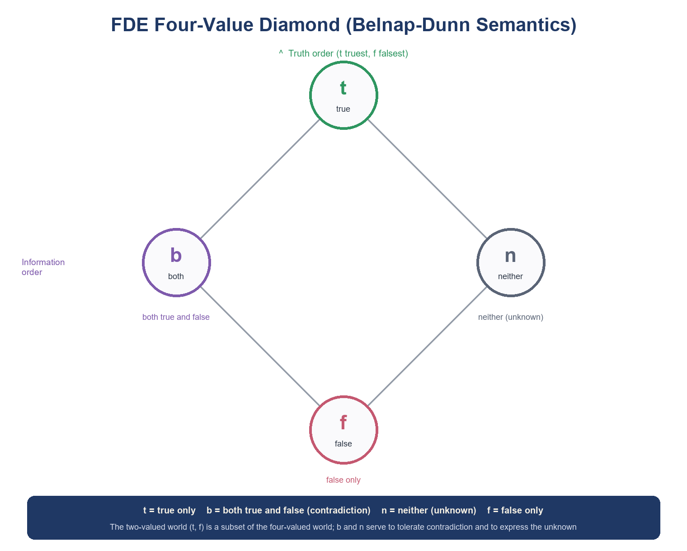

**Figure 4-1 The FDE Four-Valued Diamond Lattice (Belnap-Dunn Semantics)**

The geometry of the diamond lattice explains the two orders at once: the vertical direction is "how true", and the horizontal direction is "how much is known". b stands at the left end — knowing too much, so much as to be self-contradictory; n stands at the right end — knowing too little, so little as to be unable to adjudicate. t and f occupy the top and bottom, the two paradigms of knowledge being exactly sufficient. This geometry is not decoration: the connectives in the next section are precisely the intersection and union on the lattice.

### 4.3 Connectives and Direct Entailment

The connectives of FDE are defined by lattice operations (Figure 4-2): conjunction ∧ takes the lower bound (infimum) of the truth order, disjunction ∨ takes the upper bound (supremum), and negation ¬ swaps t and f while preserving b and n — "both true and false" remains "both true and false" after negation, and "neither true nor false" remains "neither true nor false" after negation, which accords with intuition: ignorance does not become knowledge just because a negation is added. Table 4-1 gives the knowledge interpretation of the four values.

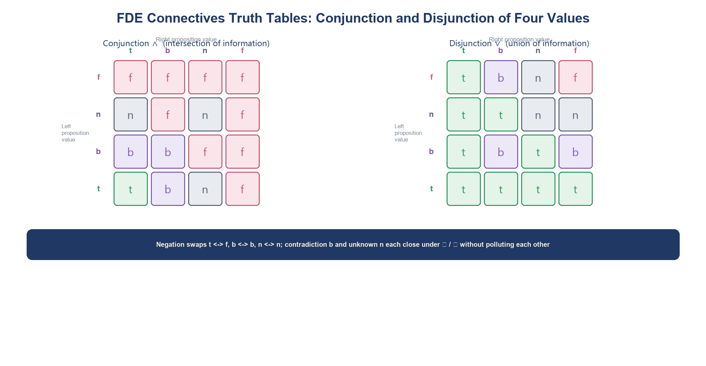

**Figure 4-2 FDE Connective Truth Tables: Defined by the Intersection and Union of the Four-Valued Lattice**

**Table 4-1 Evidence States and Knowledge Interpretation of the Four Values**

| Value | Evidence Pair (E+, E−) | Knowledge Interpretation | Everyday Correspondence |
| --- | --- | --- | --- |
| t     | (yes, no)           | supported, not opposed | "a mug is a cup" — many testimonies, one word      |
| b     | (yes, yes)           | both supported and opposed  | "FAQ can converse" — A says it can, B says it cannot |
| n     | (no, no)           | no one has mentioned it     | "is a syringe a cup" — the rule is undefined    |
| f     | (no, yes)           | opposed, not supported | "a bowl is a cup" — the features clearly do not match      |

The name "first-degree" comes from the fact that FDE handles only "one-off" compound propositions: Boolean combinations of propositional variables, without nested quantifiers or stacked modalities. And "entailment" takes its most direct semantics in FDE: Γ ⊨ φ if and only if "for every assignment of every evidence pair to the variables, as long as the values of all formulas in Γ are t (or at least not f, depending on the version), the value of φ is not f". This direct entailment preserves most of the good habits of classical logic, changing only the treatment of contradiction and ignorance — this is its most fascinating aspect: minimal change, maximal benefit.

### 4.4 Tolerant without Chaos: Properties of FDE

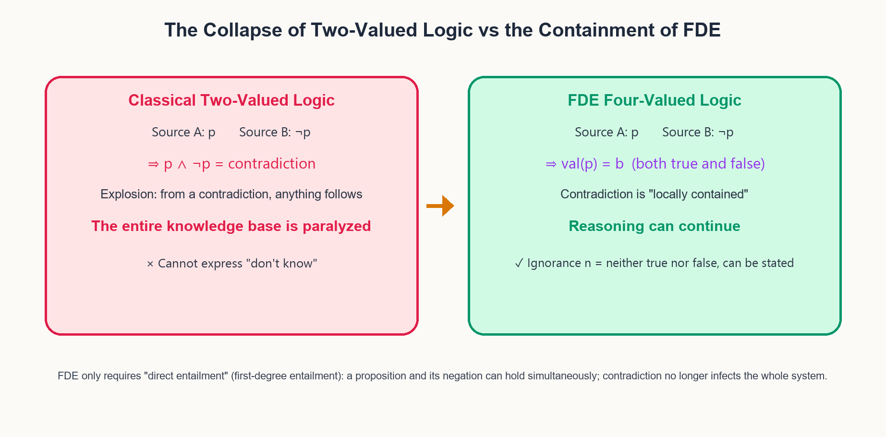

**Figure 4-3 The Collapse of Two-Valued Logic vs. the Containment of FDE**

> **Theorem 4-1 (Double Tolerance)**
>
> FDE satisfies both: (i) contradiction tolerance — for any proposition p, when p and ¬p hold simultaneously (value b), no arbitrary proposition q can be derived; (ii) ignorance tolerance — there exists a proposition p with val(p) = n, and from n one cannot derive t or f.
>
> In addition, De Morgan's laws remain valid under four values, and FDE is conservative over two-valued semantics: when the values of all variables take only t and f, the computation results of all connectives are completely identical to classical logic.

> **Proof**
>
> (i) Let val(p) = b and val(q) = n. The value of p ∧ ¬p is b ∧ b = b, not t; and the value of q is n, not t. Direct entailment only requires that "when the premises are t the conclusion is not f", so q cannot be derived from p ∧ ¬p — the law of explosion fails.
>
> (ii) By Definition 4-1, the evidence pair (∅, ∅) gives exactly n, and ¬n = n, and neither ∧ nor ∨ can turn n into t or f (in the diamond lattice there is only an order relation between n and t, f, with no equational derivation), so ignorance cannot be disguised.
>
> Conservativity: the sublattice of t and f is exactly the two-valued lattice, and the operation tables of ∧, ∨, ¬ on it are identical to the classical ones, hence the proof is complete.

**Table 4-2 Comparison between Two-Valued Logic and FDE**

| Aspect | Classical Two-Valued | FDE Four-Valued |
| --- | --- | --- |
| Value range        | true, false       | t, b, n, f      |
| Contradiction p ∧ ¬p | intolerable → explosion | value b, locally contained    |
| Ignorance        | forced to choose one of two     | value n, explicitly says "don't know" |
| Negation        | true ↔ false     | t ↔ f, b and n preserved |
| De Morgan | holds        | holds           |
| Relation to two values    | —         | conservative containment         |

> **Chapter Summary**
>
> Four values are not "making two values complicated", but honestly putting the "evidence state" into the value range: b contains contradiction, n expresses ignorance, and t/f preserve the classical good habits. Theorem 4-1 guarantees that tolerance is not chaos.

## Chapter 5 Applying FDE to Type Logic Judgment

### 5.1 Four-Valorization of the Three-Level Judgment

> **Definition 5-1 (Four-Valorization Function of Type Judgment)**
>
> Let the knowledge base K be a finite set of source-tagged evidence. For the three-level judgment J ∈ {Container judgment Vc, SOM judgment Vs, abstraction judgment Va}, define the evidence pair (E+(J), E−(J)): E+ is the evidence in K supporting "the judgment holds", and E− is the evidence opposing it.
>
> The judgment value val(J) = f(evidence pair) takes its value according to Definition 4-1; the joint judgment val(J*) = inf{val(Vc), val(Vs), val(Va)} (the lower bound of the truth order).

The key design of four-valorization is: every judgment value must be able to point to its evidence pair — this is the spirit of Axiom 5-1 (checkability of relations). Taking a smartphone as an example, the Container-level evidence is "Apps can be installed/removed while the phone's identity remains unchanged" (supports Vc, no opposition) → t; the SOM-level judgment about the "camera module" is "after removal, one cannot take photos but calls work normally" → functionally degraded part, whose necessity judgment value is f (not a necessary part); at the abstraction level, if F(T) is clear (can communicate, can compute, portable) → t for an iPhone. Table 5-1 re-adjudicates each item of the third-level joint judgment with four values.

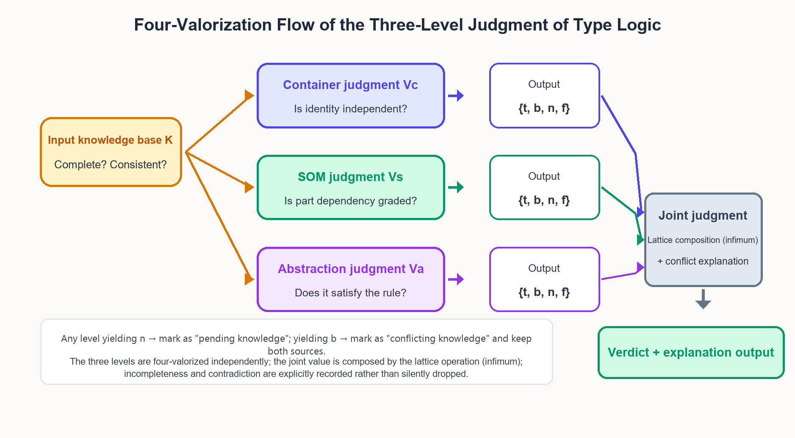

**Figure 5-1 Four-Valorization Flow of the Three-Level Judgment of Type Logic**

**Table 5-1 Four-Valorization of the Three-Level Judgment in the Smartphone Case**

| Level | Judgment Proposition | Evidence Pair | Value |
| --- | --- | --- | --- |
| Container Vc  | phone = Container(App)         | support: installing/removing Apps leaves identity unchanged; opposition: none | t     |
| SOM Vs | motherboard = necessary part            | support: removing it prevents booting; opposition: none     | t     |
| SOM Vs | camera = necessary part             | support: none; opposition: after removal, calls and internet work normally   | f     |
| Abstraction Va  | iPhone ∈ \[smartphone\] | support: all three features pass; opposition: none       | t     |
| Abstraction Va  | tablet ∈ \[smartphone\]     | support: can compute, portable; opposition: cannot communicate  | f     |
| Joint J\* | overall belonging               | inf{t, t, t}        | t     |

### 5.2 Semantic Positioning of Boundary Cases

*The Spatial Type Volume* left behind a batch of intriguing boundary cases: does a syringe count as a cup? Does a FAQ robot count as a dialogue system? In the two-valued era, these cases could only be waved away with "it depends on the completeness of F(T)"; in the four-valued era, they finally have precise coordinates (Figure 5-2, Table 5-2). The essence of the syringe problem is that the feature set "does not define the purpose dimension" — there is neither positive nor negative evidence, landing at n; the essence of the FAQ problem is that the sources each insist on their own reading of the word "dialogue" — positive and negative evidence coexist, landing at b. Though both are "unclear", the prescriptions for n and b are completely different: n requires supplementing evidence (writing F(T) completely), while b requires adjudicating the conflict (aligning the sources on the definition).

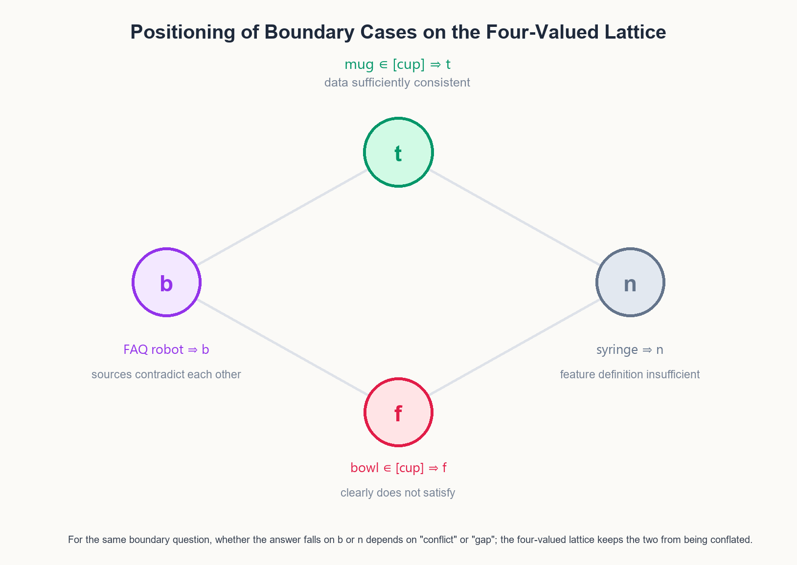

**Figure 5-2 Positioning of Boundary Cases on the Four-Valued Lattice**

**Table 5-2 Four-Valued Judgment Table of Boundary Cases**

| Case | Situation | Value | Prescription |
| --- | --- | --- | --- |
| mug ∈ \[cup\]   | F(T) complete, sources consistent     | t     | accept the classification           |
| bowl ∈ \[cup\]     | cannot be held by hand to drink, evidence clear      | f     | exclude             |
| syringe ∈ \[cup\]   | F(T) does not define "used for drinking"   | n     | supplement the feature dimension and judge again       |
| FAQ ∈ \[dialogue system\] | A attests "can converse", B attests "only looks up tables" | b     | mark the conflict, align sources on the definition    |
| sports water bottle ∈ \[cup\]  | straw mouth allows hand-held drinking, evidence sufficient     | t     | accept, and record the F(T) explanation |
| thermos ∈ \[cup\]   | must be poured out to drink, opposition clear      | f     | exclude but ∈ \[container\]   |

### 5.3 Contradiction Tolerance and Failure of Explosion

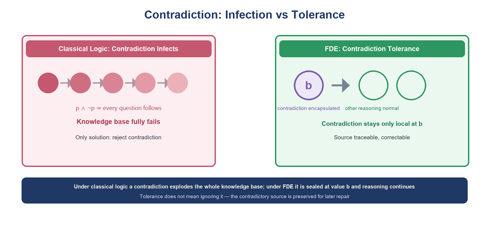

**Figure 5-3 Contagion vs. Containment of Contradiction**

The greatest dividend of connecting FDE to Type judgment is that contradiction is encapsulated locally within the proposition (Figure 5-3). Suppose that in the knowledge base K, "some type of robot ∈ \[dialogue system\]" is simultaneously supported and opposed by two sources, with value b; at this time, other judgments — whether it is a Container, how its parts are graded — are completely unaffected and obtain t or f as usual. Only when the joint judgment takes the lower bound does b press the overall verdict down to the level of "requires human adjudication", and the reason for the lowering is traceable: the evidence pair attached to the value b directly points out "which two sources, about which feature" conflict.

> **Axiom 5-1 (Checkability of Relations)**
>
> Every Type judgment value must come with a traceable finite evidence pair (E+, E−); any judgment value that cannot point to its evidence pair is regarded as an invalid judgment.
>
> Corollary: both n and b are "operable states" — n triggers an evidence-supplementing task, and b triggers a conflict-tracing task.

### 5.4 Invariance and Conservativity Theorems

*The Spatial Type Volume* and *Type Sets and Type Logic* previously established replacement invariance and the necessary-and-sufficient condition of the three-level judgment. Under the FDE framework, these two results not only hold but become more complete: invariance now covers the open situation of "incomplete or conflicting evidence", and conservativity guarantees that four-valorization degenerates back to two values in the ideal case.

> **Theorem 5-1 (Four-Valued Consistency of the Three-Level Composition)**
>
> Let K be a knowledge base, and let val(Vc), val(Vs), val(Va) be the three-level judgment values, with val(J*) = inf{val(Vc), val(Vs), val(Va)}. Then: (i) val(J*) = t if and only if all three levels are t; (ii) if any level is f then val(J*) = f; (iii) when there is no f but there is b/n, val(J*) reflects the information defect (b or n), and the defect can be attributed to a specific level.

> **Proof**
>
> The truth order is the diamond order t &gt; b &gt; n &gt; f (b and n are incomparable, and both &gt; f and &lt; t). The computation of the infimum is obtained by checking point by point: only when all three levels are t is inf = t; if f is included then inf = f; in the remaining cases inf = the "weakest" of the defective values, and since the three-level values are computed independently and the evidence pairs are tagged by level, the defect is attributable. Q.E.D.

> **Theorem 5-2 (Type Replacement Invariance is Preserved under FDE)**
>
> For a Container C and a content replacement replace(e1, e2): id(C) is unchanged (Axiom 2-1), and the three-level judgment values with C as the object are equal before and after the replacement — provided the replacement operation itself adds no evidence about C.
>
> More generally: the open generation of abstract classes is preserved under four-valorization — the judgment of a new individual passing ∩F(T) depends only on its own feature evidence, and is independent of the judgment values of existing individuals.

> **Proof**
>
> Container level: replacing the content does not touch id(C) (Axiom 2-1), nor does it change the existing evidence of hasAttribute and hasPart, so (E+, E−) is unchanged and val is unchanged.
>
> Abstraction level: the decision of ∩F(T) is a feature-by-feature evidence check, and there is no evidence interaction among individuals (an open class does not adjudicate membership by enumeration), so the judgment values are mutually independent. Q.E.D.

> **Significance for AI Classification Systems**
>
> Modern AI classifiers only perform two-valued (or probabilistic) adjudication at the abstraction level: they will tell you "93% a cup", but cannot say "is this 93% ignorance or 93% conflict". The four-valorized Type judgment splits "confidence" into two axes — truth value and information amount — with n going to data supplementation, b going to conflict adjudication, and t/f being the real classification result. This is an indispensable judgment dimension for world models in open environments.

> **Chapter Summary**
>
> Four-valorization of the three-level judgment = evidence pairs + the lower bound of the diamond lattice; boundary cases change from "unclear" to "clearly coordinated"; Theorems 5-1/5-2 guarantee compositional consistency and replacement invariance; Axiom 5-1 makes every judgment traceable.

## Chapter 6 Temporal Type and Extended Applications

### 6.1 Outline Map of Temporal Type

*The Temporal Type Volume* establishes eighteen topics in outline form: Split & Merge, Framework, design patterns, logic generation, memory management, logic application, tagging, continuous learning, abstraction, refactoring, thinking, thinking methods, problem solving, analysis, design, reasoning, causal reasoning, and abductive reasoning. The Spatial Type answers "what it looks like", while the Temporal Type must answer "how it is generated, evolves, and reasons". Re-situating these eighteen topics from the ontological point of view, they naturally cluster into four modules (Figure 6-1, Table 6-1): Split & Merge and Framework (the birth and refactoring of Type), generation and management (logic generation, memory, tagging, design patterns), learning and thinking (continuous learning, thinking methods, problem solving), and analysis and reasoning (design, reasoning, causal and abductive).

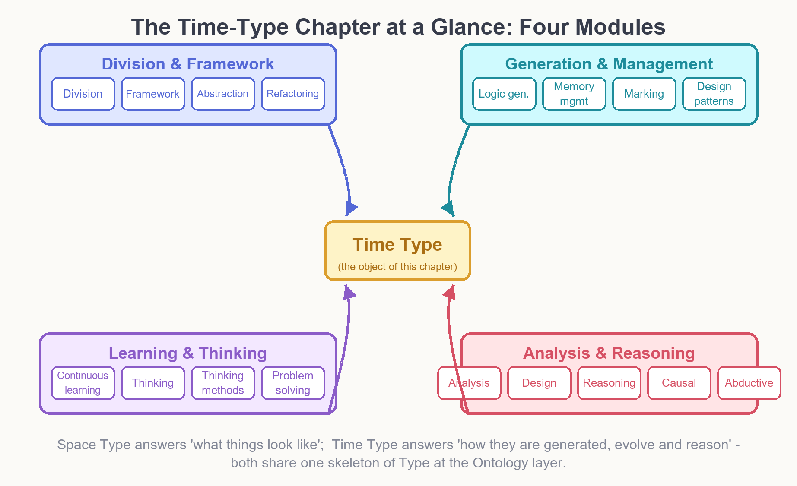

**Figure 6-1 Panorama of the Temporal Type Volume Outline: Four Major Modules**

**Table 6-1 Temporal Type Topics → Ontology Module Correspondence**

| Module | Outline Topics | Ontology Module | FDE Role |
| --- | --- | --- | --- |
| Split & Merge and Framework  | Split & Merge, Framework, abstraction, refactoring        | Type generation and schema evolution | four-valued adjudication of evolution decisions     |
| Generation and Management  | logic generation, memory management, tagging, design patterns  | event generation, memory store, tagging language   | memory gaps marked n, conflicts marked b |
| Learning and Thinking  | continuous learning, thinking, thinking methods, problem solving     | learning loop, strategy store        | four-valued classification of learning signals     |
| Analysis and Reasoning  | analysis, design, reasoning, causal reasoning, abductive reasoning | causal ontology, reasoning engine       | four-valorization of causal/abductive conclusions    |

### 6.2 Temporal Intervals and Event Ontology

The first ontological decision of the temporal dimension is to extend "Type" into temporal intervals: a temporal Type is constituted by three elements — the interval (start and end), the event Type (category), and the causal role (cause/effect) (Definition 6-1). The basic relations between intervals follow Allen's interval algebra (before, meets, overlaps, during, etc.); and when the boundary knowledge of an interval is incomplete — for example, "the meeting starts at 14:00, but when it ends is still unclear" — the boundary is directly marked as n, to be decided after memory backfilling (Figure 6-2). This gives temporal-interval queries four-valued answers: "Is A before B?" can honestly answer t, f, b (two sources each saying their own thing), or n (the data has not arrived), rather than being forced to guess a two-valued answer.

> **Definition 6-1 (Temporal Type)**
>
> A temporal Type Tt = (I, E, κ): I = (s, e) is the temporal interval, with the determinacy of s and e each taking an FDE value; E is the event Type (the Type class to which it belongs); κ ∈ {cause, effect, none} is the causal role.
>
> The interval relation R(I1, I2) takes its value according to Allen's algebra; when the boundary of I1 or I2 contains an n marker, the value of R is conservatively derived with four values: when information is insufficient, R(I1, I2) = n.

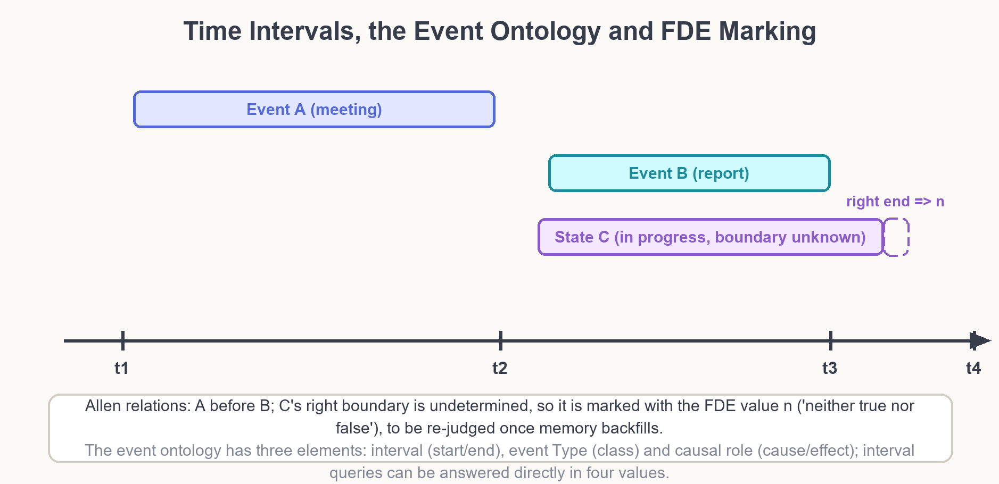

**Figure 6-2 Temporal Intervals · Event Ontology and FDE Marking**

### 6.3 FDE-ization of Causal and Abductive Reasoning

Causal reasoning (from cause to effect, prediction) and abductive reasoning (from effect back to cause, abduction) are the two reasoning engines of the Temporal Type. The payoff of four-valorizing them is immediate: a prediction's conclusion can be b (model conflicts with sensor) without needing to tear down the whole model; an abductive hypothesis can be n (evidence not yet arrived) without needing to force a choice of one cause. The two reasoning engines run around the same "prediction–verification–correction" loop (Figure 6-3): the value b triggers conflict tracing and source alignment, the value n triggers proactive evidence supplementation (this is precisely the work of the memory management and tagging modules), the value t flows into long-term memory, and the value f excludes the hypothesis but retains the audit trail.

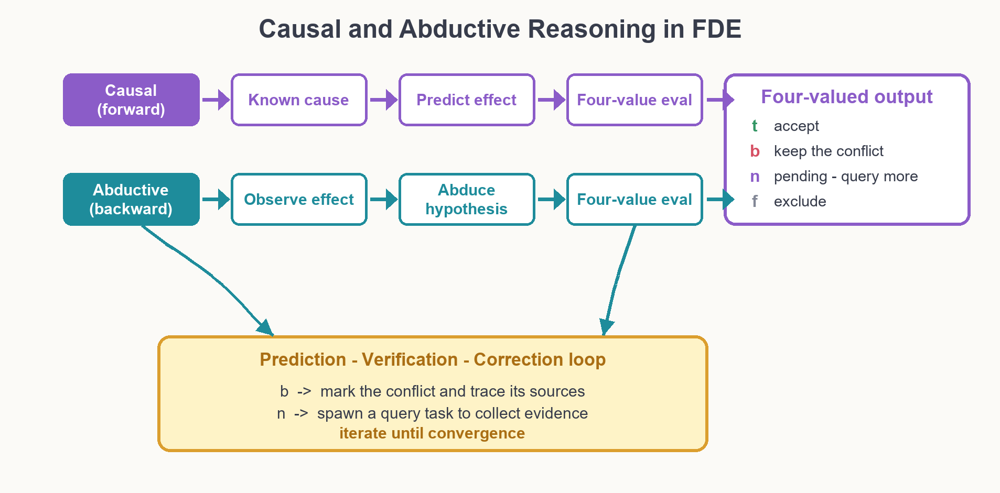

**Figure 6-3 FDE-ization of Causal Reasoning and Abductive Reasoning**

It is worth emphasizing that "abductive reasoning" has long been treated in traditional AI as a non-deductive stopgap; under the four-valued framework, it is symmetric in status with causal reasoning — both are "adjudicating a proposition by an evidence pair", one a proposition facing the future and the other a proposition facing the past. This symmetry is precisely the deeper meaning of *The Temporal Type Volume* listing "causal reasoning/abductive reasoning" as the final chapter of its outline.

### 6.4 Application Vision: The Dual-Engine Ecosystem

Placing the Type ontology and FDE judgment back into the overall architecture of Mind AI yields the complete division of labor of the LLM + Mind Model dual engine (Figure 6-4): the LLM engine is responsible for language generation, understanding, and candidate proposal; the Mind Model engine holds the Type ontology and the four-valued judge, and is responsible for identity tracking, structural analysis, rule adjudication, and conflict governance. GraphRAG's temporal-interval queries can directly answer with four values and attach evidence pairs; the world model (WorldMind) operates through the six steps of Type detection → definition → structuring → frameworking → formalization → verification and correction; domain brains such as ProofMind and SiliconMind reuse the same judgment kernel at the upper layer.

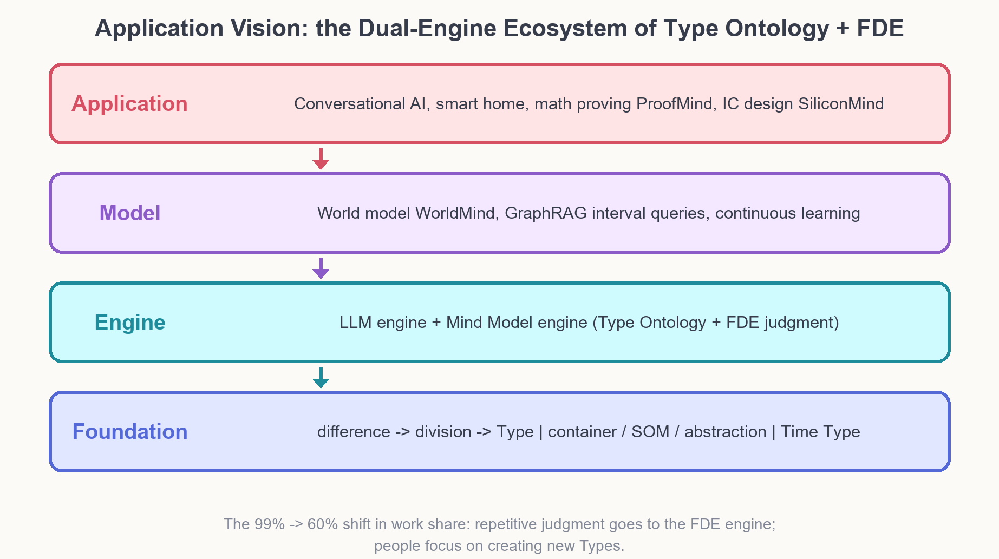

**Figure 6-4 Application Vision: The Dual-Engine Ecosystem of Type Ontology + FDE**

The evolution curve of the work proportion — from 99% of human effort invested in repetitive judgment down to 60% or even lower — is precisely driven by this kernel: judgments that can be formalized are handed to the FDE engine, the parts the engine judges as n and b are handed to humans for adjudication, and the results of human adjudication in turn become new evidence, new axioms, and new F(T). This loop is the concrete form of "continuous learning" and "refactoring" at the ontology level.

> **Chapter Summary**
>
> The eighteen topics of the Temporal Type cluster into four modules; the temporal Type (I, E, κ) enables four-valorization of interval queries; the two reasoning engines of causal/abductive reasoning revolve around the prediction–verification–correction loop, driven by b/n values to trace sources and supplement evidence; the dual-engine ecosystem converges everything into an operable judgment kernel.

## Chapter 7 Conclusion

This paper completes the two-level advancement of Ontypology. The first level is ontologization: taking "Difference & Similarity → Split & Merge → Type" as the foundation, it elevates Type, Entity, Attribute, Part, Content, Framework, and Relation into the core classes of the Type ontology Ontypology-O, defines three ontology modules by the three levels of added value, guards the bottom line of identity and structure with two axioms, and completes engineering verification through framework evolution and RDB mapping. The second level is logicalization: using FDE's evidence-pair semantics and the Belnap diamond lattice, it extends the three-level judgment of Type Logic into four-valued judgment, making "don't know" and "both true and false" first-class citizens, and establishes three theoretical results: three-level compositional consistency (Theorem 5-1), Type replacement invariance (Theorem 5-2), and conservativity over two values.

Taken together, the three contributions of this paper are: first, it provides the first complete formal ontology of Type, moving the theory of *The Spatial Type Volume* from readable to decidable; second, it provides a four-valorization framework for Type judgment, elevating boundary cases from the vague phrase "depends on the completeness of the definition" to operable states with clear b/n coordinates and different prescriptions; third, it implements the outline of *The Temporal Type Volume* as a temporal ontology and the FDE-ization of causal/abductive reasoning, paving the interface toward world models and continuous learning.

There are three outlooks. First, the eighteen topics of *The Temporal Type Volume* deserve to be developed each into full dedicated chapters, especially how memory management and tagging language co-construct with evidence pairs. Second, the Type ontology can be expected to interface with existing ontology toolchains (OWL 2 description-logic reasoners), making the four-valued judge deployable middleware. Third, validate the benefit of four-valued judgment on real loads of GraphRAG and temporal-interval queries — measuring the trigger rate of n/b, adjudication cost, and the improvement in final accuracy. The journey of Type starts from cognition, passes through description and formalization, and will ultimately return to cognition: to let machines, like humans, both recognize the boundaries of all things and honestly say "I don't know" and "there is a dispute here".

## References

[1] Anderson, A. R., & Belnap, N. D. (1975). Entailment: The Logic of Relevance and Necessity (Vol. I). Princeton University Press.

[2] Belnap, N. D. (1977). A useful four-valued logic. In J. M. Dunn & G. Epstein (Eds.), Modern Uses of Multiple-Valued Logic (pp. 5–37). Reidel.

[3] Belnap, N. D. (1977). How a computer should think. In G. Ryle (Ed.), Contemporary Aspects of Philosophy (pp. 30–55). Oriel Press.

[4] Dunn, J. M. (1976). Intuitive semantics for first-degree entailment and “coupled trees”. Philosophical Studies, 29(3), 149–168.

[5] Priest, G. (1979). The logic of paradox. Journal of Philosophical Logic, 8(1), 219–241.

[6] Priest, G. (2008). An Introduction to Non-Classical Logic: From If to Is (2nd ed.). Cambridge University Press.

[7] Shramko, Y., & Wansing, H. (2011). Truth and Falsehood: An Inquiry into Generalized Logical Values. Springer.

[8] Ginsberg, M. L. (1988). Multivalued logics: A uniform approach to reasoning in artificial intelligence. Computational Intelligence, 4(3), 265–316.

[9] Fitting, M. (1991). Bilattices and four-valued logic. Contemporary Mathematics, 114, 49–73.

[10] Gruber, T. R. (1993). A translation approach to portable ontology specifications. Knowledge Acquisition, 5(2), 199–220.

[11] Guarino, N., Oberle, D., & Staab, S. (2009). What is an ontology? In S. Staab & R. Studer (Eds.), Handbook on Ontologies (2nd ed., pp. 1–17). Springer.

[12] Baader, F., Calvanese, D., McGuinness, D. L., Nardi, D., & Patel-Schneider, P. F. (Eds.). (2003). The Description Logic Handbook. Cambridge University Press.

[13] W3C. (2012). OWL 2 Web Ontology Language: Primer (2nd ed.). W3C Recommendation.

[14] Lenzerini, M. (2002). Data integration: A theoretical perspective. In Proc. PODS 2002 (pp. 233–246). ACM.

[15] Allen, J. F. (1983). Maintaining knowledge about temporal intervals. Communications of the ACM, 26(11), 832–843.

[16] van Benthem, J. (1983). The Logic of Time. Reidel.

[17] Arieli, O., Avron, A., & Zamansky, A. (2011). Maximally paraconsistent logics. Artificial Intelligence, 175(1), 297–326.

## Appendix A FDE Judgment Quick Reference Table

Table A-1 consolidates the complete correspondence from evidence pairs to judgment actions, for row-by-row lookup when implementing the Mind Model judge; Table A-2 is the implementation checklist for the three-level judgment.

**Table A-1 Evidence Pair → Value → Follow-up Action Quick Reference Table**

| Evidence Pair (E+, E−) | Value | Knowledge State | Follow-up Action |
| --- | --- | --- | --- |
| (yes, no)           | t     | clearly holds     | accept; store the evidence in long-term memory         |
| (no, yes)           | f     | clearly does not hold    | exclude; retain the audit trail           |
| (yes, yes)           | b     | conflict       | mark the conflict; trace both sources; trigger definition alignment  |
| (no, no)           | n     | missing       | mark as pending; trigger an evidence-supplementing task (query/perception) |

**Table A-2 Implementation Checklist for the Three-Level Judgment**

| Level | Check Item | Decision Point |
| --- | --- | --- |
| Container Vc  | Is the content replaceable? Is identity constant?   | Axiom 2-1; contains and hasPart strictly separated |
| SOM Vs | Is the part removable? Identity after removal?   | Axiom 2-2; three-level classification necessary/degraded/non-necessary           |
| Abstraction Va  | Is F(T) complete? Feature-by-feature check? | intersection criterion ∩F(T); if a dimension is missing, add the dimension first            |
| Joint J\* | Take the truth lower bound; is the defect attributable?   | Theorem 5-1; n supplements evidence, b adjudicates conflict               |
| General     | Does the judgment come with an evidence pair?        | Axiom 5-1; without an evidence pair, the judgment is invalid               |
