# Ontypology-Unit Type and Set Logic

*Unit Type — A Reorganization of Type Set and Type Logic*

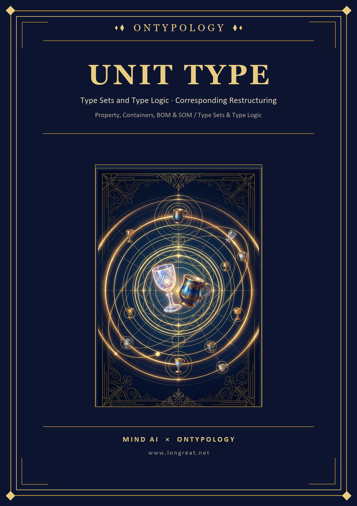

## TABLE OF CONTENTS

- Preface — Correspondence and Reorganization of the Two Texts
- Introduction — The Three Descriptive Dimensions of a Unit Type
- Chapter 1 Property — The Abstract Set [ ] (X Axis)
- 1.1 Property and Property Value: Questions That Can Be Asked
- 1.2 How Properties Emerge Step by Step — The Cup as Example
- 1.3 The Rules of Property Emergence
- 1.4 Abstraction: From a Closed List to an Open Rule
- Chapter 2 Bill of Materials, BOM — The Composition Set { } (Y Axis)
- 2.1 BOM: Open It Up and See What It Is Made Of
- 2.2 The BOM Criterion: Once Taken Off, Does It Still Recognize Itself?
- 2.3 Three-Level Classification of Parts: the remove Criterion
- 2.4 The Step-by-Step Emergence of the BOM and the Division of Labor
- Chapter 3 Spatial Container — The Container Set ( ) (Z Axis)
- 3.1 The Container: Identity Does Not Change with the Contents
- 3.2 The Three Elements of the Container
- 3.3 Formalization and Levels of the Container
- 3.4 Nesting of Containers
- Chapter 4 Type Set — The Complete Notation of a Unit Type
- 4.1 The Limits of the Mathematical Set: Three Omitted Layers of Information
- 4.2 Unit Type ＝ Type Set
- 4.3 Superimposing the Three Value-Adds
- 4.4 One Sentence, Three Layers of Meaning
- 4.5 Three Axes, Three Kinds of Brackets: Describing a Type
- 4.6 Unit Type = Type Set: The Complete Notation
- Chapter 5 Type Logic — Three-Layer Judgment and Its Applications
- 5.1 Container Judgment: Is Identity Independent of the Contents?
- 5.2 BOM Judgment: After a Part Is Removed, Is the Whole Still the Same Thing?
- 5.3 Abstract Judgment: Does a New Object Satisfy the Category Rule?
- 5.4 Three-Layer Joint Judgment: The Smartphone
- 5.5 Judgment Exercises: Six Questions and Answers
- 5.6 The Theoretical Significance of Judgment
- Review — Consolidated Key Points and Self-Check

> *To understand a Type ＝ to understand what it looks like, where it is, what it is made of, and how its parts depend on one another.*

## Preface — Correspondence and Reorganization of the Two Texts

This book is a reorganization of two documents placed in correspondence with each other. Unit Type erects the three axes for describing a Type — Property, Bill of Materials, and Spatial Container; Type Set and Type Logic then supply the same three pieces of equipment with the language of set theory, formal definitions, and judgment procedures. They are two sides of the same object: one side is "how to describe," the other is "how to notate and how to judge."

The reorganization takes "Unit Type as the backbone": the chapters unfold along the three trunks of the X, Y, and Z axes, folding the corresponding content of Type Set and Type Logic — the three kinds of brackets, the three value-adds, the intersection criterion, the remove criterion, the axiom of invariance, and the three-layer judgment — into the axis to which each belongs. The final two chapters then gather up "the complete notation of the Type Set" and "the judgment applications of Type Logic" as a whole. The book follows a single cup throughout; every chapter gives you at once the language of description, the brackets of notation, and the criteria of judgment.

| Unit Type | Type Set and Type Logic | Corresponding Location in This Book |
| --- | --- | --- |
| Introduction — The Three Descriptive Dimensions | 5.1 The Limits of Mathematical Sets | Introduction + 4.1 |
| Ch. 1 Property (X Axis) | 5.4 Abstraction: Generated by Feature Intersection | Ch. 1 Property [ ] |
| Ch. 2 Bill of Materials, BOM (Y Axis) | 5.3 BOM: Compositional Structure | Ch. 2 BOM { } |
| Ch. 3 Spatial Container (Z Axis) | 5.2 Container: Invariant Identity | Ch. 3 Spatial Container ( ) |
| — | The Three Value-Adds and Type Set Notation | Ch. 4 Type Set |
| — | 5.5 Worked Examples of Logical Judgment | Ch. 5 Type Logic |
| Chapter Summary Review | 5.6 Conclusion | Review: Consolidated Key Points |

*Table 0-1 Correspondence Between the Two Source Documents and the Chapters of This Book*

> **Three Conventions for Reading This Book**
>
> - Convention One: the English for "形" is always Type — never Form.
> - Convention Two: each of the three brackets has its own job. Braces { } are the Composition Set (BOM), square brackets [ ] are the Abstract Set (Property), and parentheses ( ) are the Container Set (Spatial Container).
> - Convention Three: a single cup runs through the whole book. A cup is both an everyday object and the most faithful specimen of a "Unit Type."

> *To understand a Type ＝ to understand what it looks like, where it is, what it is made of, and how its parts depend on one another.*

## Introduction — The Three Descriptive Dimensions of a Unit Type

> **Chapter Map**
>
> - This chapter uses a single "cup" to run through the book, answering four basic questions about a Unit Type in order.
> - What does it look like? — "Property and Property Value" (Chapter 1).
> - What parts is it made of? — "Bill of Materials" (Chapter 2).
> - Where does it put things? — "Spatial Container" (Chapter 3).
> - How do the parts depend on one another? — "Structural Dependency Criterion" (Chapters 2 and 5).

Place a cup on a table and it looks like nothing more than a simple everyday object. But when we try to "describe it completely," we find the description unfolding naturally in three directions: what are its color and material like? Which parts — body, handle — is it made of? Where does it hold the water? These three questions correspond exactly to three different "descriptive dimensions," and also to the three axes in space — the X, Y, and Z axes.

Each of the three dimensions answers one kind of question, and none can replace another. Color cannot say what the cup is made of; a parts list cannot say where the cup holds the water; and "holding water" cannot say whether the cup is white or blue. Only when all three are present is a Unit Type completely described.

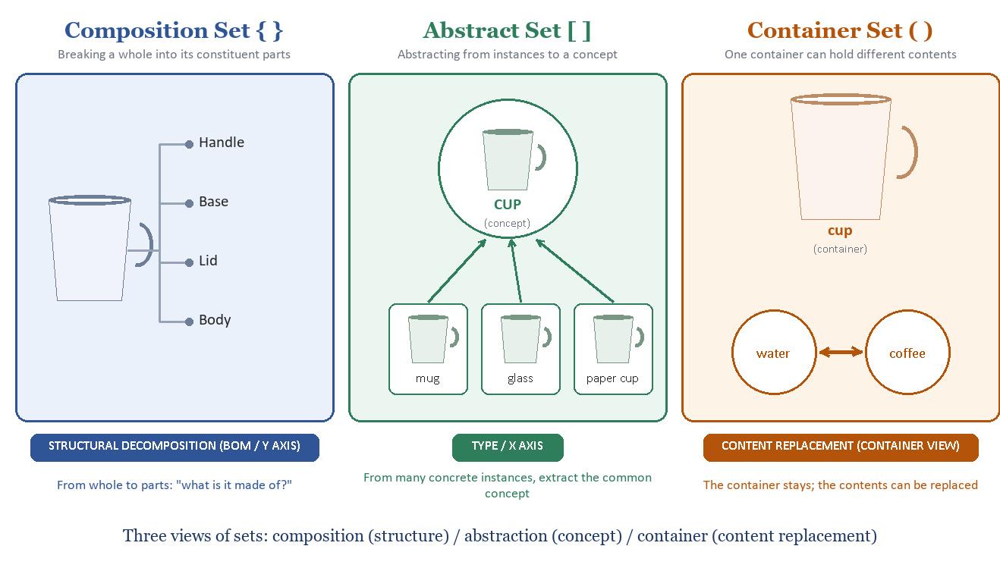

*Figure D-1 Three views of sets side by side: Composition (Y axis), Abstraction (X axis), Container (Z axis)*

In Type Logic each of these three dimensions has its own bracket: the Composition Set uses braces { }, the Abstract Set uses square brackets [ ], and the Container Set uses parentheses ( ). The three brackets are not decorative marks but three different "value-adds" — each restores one of the three layers of information that the mathematical set omits: the structure of the parts, the rule of generation, and the invariant identity.

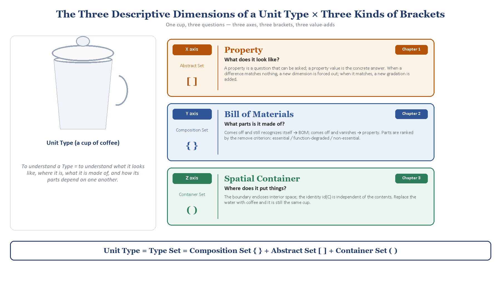

*Figure D-2 The three descriptive dimensions of a Unit Type × the three kinds of brackets*

| Kind of Set | Bracket | Example | Axis | Descriptive Dimension | Word Class | Chapter |
| --- | --- | --- | --- | --- | --- | --- |
| Abstract Set | [  ] | [ white, black, yellow ] | X axis | What does it look like? | Adjective | Chapter 1 |
| Composition Set | {  } | { handle, base, lid, body } | Y axis | What is it made of? | Noun | Chapter 2 |
| Container Set | (  ) | ( water, coffee ) | Z axis | Where are things? | Noun | Chapter 3 |

*Table D-1 Correspondence Table of the Three Kinds of Brackets*

A Unit Type is the union of these three sets. A coffee cup can be notated completely as:

Unit Type ＝ Type Set ＝ coffee cup: { handle, base, lid, body, (container), [color] }

Instance: { handle, base, lid, body, (coffee), [white] }

This formula will be fully explained in Chapter 4. For now you need only remember how to read it: inside the braces are the parts that can be taken apart; inside the parentheses is the content put in; inside the square brackets are the properties that have been stated. A Unit Type is precisely this kind of stable structure — "parts + content + appearance."

## Chapter 1 Property — The Abstract Set [ ] (X Axis)

*Chapter Image · The Axis of Property — Dimensions and Gradations*

The X axis answers the first question: what does it look like? The language that describes "appearance" is built from "Property" and "Property Value" — a Property is a dimension, and a Property Value is a gradation on that dimension. This chapter first establishes the distinction between Property and Property Value, then uses the cup to show how properties emerge step by step through comparison, and finally connects this description to "Abstraction" in Type Logic: an open rule capable of judging new members automatically.

### 1.1 Property and Property Value: Questions That Can Be Asked

A Property is "a question that can be asked"; it has no answer in itself, it only delimits a range of "what is to be asked." A Property Value is the actual answer to that question in a particular situation — the individual options circled out under the property. As an analogy: a Property is like the column heading of a blank form, reading "material"; a Property Value is what actually gets filled in under that column, such as "ceramic." The heading itself does not change, but the answers that can be filled in beneath it differ from object to object.

|  | Property | Property Value |
| --- | --- | --- |
| Position | A question that can be asked | The actual answer to the question in a concrete situation |
| Analogy | The column heading of a form ("material") | What is actually filled in under that column ("ceramic") |
| Variation | The heading itself does not change | Differs with each concrete object |

*Table 1-1 Property versus Property Value*

In the language of sets, this distinction is the Abstract Set [ ]: a Property defines the "coordinate axis" of the set, and Property Values are the "gradations" on that axis. When we say [ white, black, yellow ], what we are enumerating are the candidate answers to the question "color."

| No. | Handle | Base | Lid | Body | Container | Color |
| --- | --- | --- | --- | --- | --- | --- |
| 1 | V | V | V | V | Coffee | White |
| 2 | V | V | V | V | Water | Black |
| 3 | V | V | V | V | Coffee | White |
| 4 | V | V | V | V | Milk | Yellow |

### 1.2 How Properties Emerge Step by Step — The Cup as Example

Properties do not arrive all at once. They are "forced out by difference." Let us put cups on the table one by one and watch how properties come forward through comparison.

#### Step 1: Two Cups — The First Property Appears

Place two cups side by side, detect similarities and differences, and find that the difference falls in only one place: transparent versus blue. The only property to emerge at this stage is "color," with property values { transparent, blue }.

#### Step 2: A Third Cup — Forcing Out "Material" and "Handle"

A third cup (ceramic, blue, with a handle) joins. Look at color first: blue is already an option on the existing color axis, so it hangs directly there and the color axis need not change. But this cup brings two new batches of difference at once: the material changes from "glass" to "ceramic," and this batch of difference does not match the dimension of color, so a second property, "material," is forced out; moreover this cup has a handle, and the first two cups had nothing at all to compare against, so this difference likewise matches neither color nor material, and a third property, "handle," is forced out.

Once "material" and "handle" are established, the first two cups must also be backfilled with values for these two properties: material is filled in as "glass" (they were glass all along, it simply did not need saying before), and handle is filled in as "N" (they never had one, there was simply nothing to compare before). Once a property has been extracted, it must be applied to every individual that has already appeared — a property is a dimension, and a dimension must run through all individuals before it can be used for mutual comparison.

#### Step 3: A Fourth Cup — Forcing Out "Lid"

A fourth cup (glass, transparent, with a handle, with a lid) joins. Color, material, and handle all match existing axes; only the difference "lid" has nothing to correspond to among the first three cups, so a fourth property, "lid," is forced out, and "N" is likewise backfilled for the first three cups.

#### Step 4: Later Cups — Add Gradations Only, Open No New Axis

For cups added from then on, whether the color becomes gold, silver, beige, khaki, white, or gray, or the material becomes stainless steel or paper, all these differences match the two existing dimensions of color and material; therefore one need only add new property values under the corresponding property and need not open any new property at all. Handle and lid also continue to be recorded as Y／N, and no fifth new property appears, because every difference observed so far can be accommodated by these four dimensions.

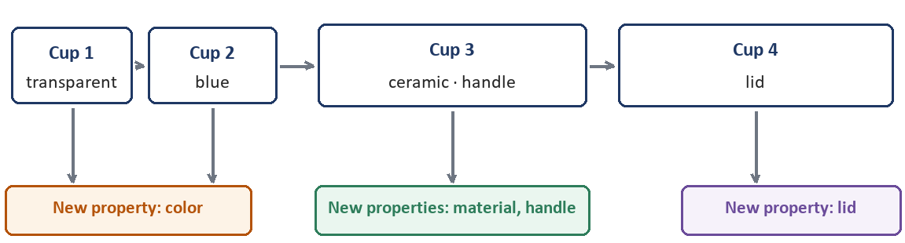

*Figure 1-2 Timeline of properties emerging as cups are added one by one*

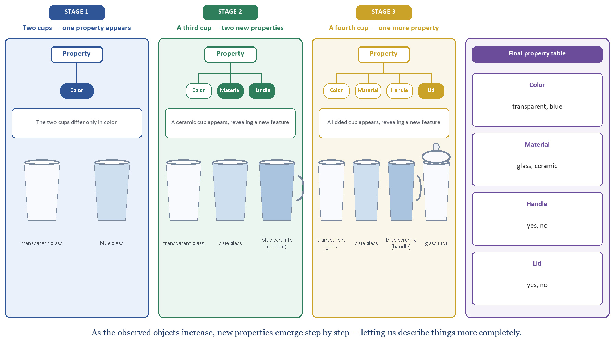

*Figure 1-3 The four stages of property emergence and the consolidated Property–Property Value master table*

Finally everything is consolidated into one complete Property–Property Value master table:

| Property | Property Value |
| --- | --- |
| Material | stainless steel, ceramic, paper, glass |
| Color | transparent, blue, gold, silver, beige, khaki, white |
| Handle | Y／N |
| Lid | Y／N |

*Table 1-2 Property–Property Value master table*

### 1.3 The Rules of Property Emergence

From the cup experiment one rule can be induced: the moment a property emerges is always the moment "this batch of difference matches none of the existing properties"; the moment a property value is added is whenever "the nature of the difference matches some existing property," in which case it is simply placed in. And every time a property emerges, it is accompanied by applying this new dimension back onto every individual that already exists, so that each individual has a definite value on every property; only then is the structure complete, with no gaps.

This rule can be formalized as a judgment procedure: when a new object is compared with existing objects, first ask "which existing property does the nature of this batch of difference agree with?" If the answer is "it agrees with some property," then simply add a new property value under that property, with no need to touch the framework; if the answer is "it matches none of the existing properties," then a new property must be opened, and this new property must be filled in retroactively for every individual that already exists.

> **Rule of Property Emergence (Summary)**
>
> - The difference matches no existing property → open a new property and backfill all existing individuals.
> - The nature of the difference agrees with an existing property → add a new property value under that property only.
> - Few properties, many property values; dimensions are fixed, gradations can be extended.

This mechanism also explains why the number of properties is usually far smaller than the number of property values: properties are "dimensions," standing for the "kinds" of difference; property values are "options," standing for the various possibilities within one kind of difference. In our cup example there are only 4 properties (color, material, handle, lid), yet property values keep expanding as the number of cups grows (color grows from 2 values to more than 7). It is like a coordinate system: the number of axes is fixed (two dimensions are two dimensions), but the gradations on each axis can extend indefinitely. This is the nature of the X axis — the axis of Property: dimensions determine what you can ask, gradations determine what you already know.

### 1.4 Abstraction: From a Closed List to an Open Rule

Mugs, glasses, paper cups, thermoses … these are all concrete, individually different actual objects. Extract their common features — "a container, plus an opening structure that lets a person hold it or put it to the mouth" — and you obtain something new: the category "cup" itself. In Type Logic this operation is called Abstraction (see Type Set and Type Logic 5.4): what it restores is the thing most lacking in the mathematical set — a rule capable of endlessly generating new members, rather than a hard-written list.

The rule used to judge new members is called, in Type Logic, the "intersection criterion," written ∩(T). An abstract category T is determined by two things: the feature set F(T) (which features this category requires) and the intersection criterion ∩(T) (only when every feature passes does it count as belonging).

| Aspect | Closed Set { } | Open Category [ ] |
| --- | --- | --- |
| Source of members | Manual enumeration | Automatic judgment by rule |
| New members | If not on the list, it does not belong | If it satisfies the rule, it belongs automatically |
| Temporality | Static, fixed | Dynamic, extensible |
| Example | { mug, glass, paper cup } | [ x｜x can hold liquid ∧ x can be picked up and drunk from ] |

*Table 1-3 Closed list versus open rule*

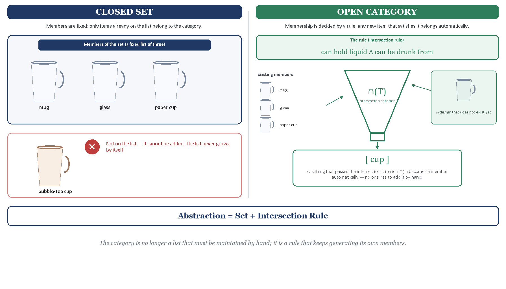

*Figure 1-4 Abstraction: from a "closed list" to an "open rule"*

> **Formal Definition of Abstraction**
>
> - Abstract category T = ( feature set F(T), intersection criterion ∩(T) ).
> - Intersection criterion ∩(T): object x belongs to T ⟺ ∀ fᵢ ∈ F(T), fᵢ(x) = true.
> - Openness: the members of T are not determined by enumeration but generated dynamically by ∩(T) — even designs that have not yet appeared can be correctly classified.

Property and Abstraction are two sides of the X axis: Property is responsible for "stating the appearance clearly" — every individual has a definite gradation on every dimension; Abstraction is responsible for "judging the category clearly" — using the intersection of features to circle out an open category that can automatically generate new members. In Chapter 5, this ∩(T) becomes the engine of "abstract judgment" among the three layers of judgment.

> **Chapter Highlights**
>
> - Property ＝ a question that can be asked (dimension); Property Value ＝ the concrete answer (gradation).
> - Rule of property emergence: if the difference does not match → open a new property and backfill all individuals; if it matches → add a new property value only.
> - Abstraction ＝ an open rule: T = ( F(T), ∩(T) ); only when all features pass does something enter the category — even designs that have not yet appeared are classified automatically.

## Chapter 2 Bill of Materials, BOM — The Composition Set { } (Y Axis)

*Chapter Image · Structural Blueprint — An Exploded View of the Parts*

The Y axis answers the second question: what parts is it made of? The tool that answers this question is the Bill of Materials (BOM) — a "take it apart and look" list, recording which smaller things a thing is composed of once it is opened up. This chapter establishes the BOM criterion, the three-level classification of parts, and the clear boundary between BOM and Property.

### 2.1 BOM: Open It Up and See What It Is Made Of

The Bill of Materials answers "open this thing up and see which smaller things it is composed of." A cup is composed of a body, an ear, and a lid. To obtain a BOM you need only take an individual itself apart; no comparison with any other individual is required. Even if this one cup were the only cup in the world, as long as it has a handle and a lid you can still take it apart into "body + base + ear + lid." This does not rely on comparison; it relies on disassembly.

In the notation of the Type Set, the BOM is the Composition Set { }. The composition set of the coffee cup above is written { handle, base, lid, body }. Within the Type Set the composition set needs no extra brackets — the Type Set itself uses braces { }, and the parts are enumerated directly inside.

### 2.2 The BOM Criterion: Once Taken Off, Does It Still Recognize Itself?

To judge whether a feature should be listed in the BOM there is only one standard: can it be taken off, and after being taken off is it still something with an independent identity that can be recognized? Check a few features of the cup against this standard:

| Feature | Verdict | Explanation |
| --- | --- | --- |
| Ear (handle) | Counts as BOM | It can be taken off, and once off it is still "an ear." |
| Lid | Counts as BOM | It can be removed, and once removed it is still "a lid." |
| Color | Property | It cannot be taken off; remove the color and no "a portion of color that has been taken off" remains — the color simply disappears. |
| Material | Property | Likewise it cannot be taken off: material is "what the body is made of," not "what is inside the body." |

*Table 2-1 BOM criterion checklist — "Once taken off, does it still recognize itself?"*

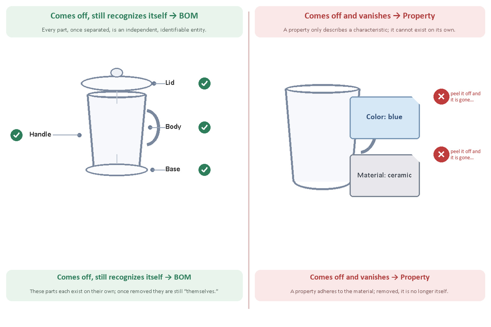

*Figure 2-2 The boundary between BOM and Property: what comes off goes into the BOM, what does not goes into Property*

This criterion can be put more concisely: "once taken off, does it still recognize itself?" If the answer is "yes" (for example, a lid taken off is still a lid), it goes into the BOM; if the answer is "no" (for example, a color "taken off" is nothing at all), it goes into Property. This standard applies not only to cups but to any object: a car's engine, tires, and doors can be removed and still be "an engine," "a tire," "a door," so they are items in the car's BOM; but a car's color, brand, and year of manufacture cannot be removed, so they are properties of the car.

### 2.3 Three-Level Classification of Parts: the remove Criterion

Once the parts list is confirmed, the next question is: how much does each part affect whether "the whole is still the same thing"? Type Logic answers with a remove criterion: remove part pᵢ from the whole M and observe the result (see Type Set and Type Logic 5.3, 5.5.2).

| Level | Judgment result | Definition | Cup example | Phone example |
| --- | --- | --- | --- | --- |
| Essential part | Identity is lost after removal | remove(pᵢ,M) ≢ M | base, body | motherboard, battery |
| Function-degraded part | Function missing but identity persists | remove(pᵢ,M) ≡ M' ⊂ M | handle, lid | camera module, speaker |
| Non-essential part | No effect at all after removal | remove(pᵢ,M) ≡ M | sticker, decoration | screen protector, charm |

*Table 2-2 Three-level classification of parts and the remove criterion*

Take the cup: base and body are essential parts — remove them and the cup is no longer a cup, identity is lost; handle and lid are function-degraded parts — remove the handle and the cup can still hold water and is still recognized as a cup, but loses the function of being held; stickers and decorations are non-essential parts, whose removal has no effect at all. This three-level classification has a direct counterpart in engineering: essential parts correspond to "safety-critical parts," function-degraded parts to "optional-function parts," and non-essential parts to "decorative/consumable parts."

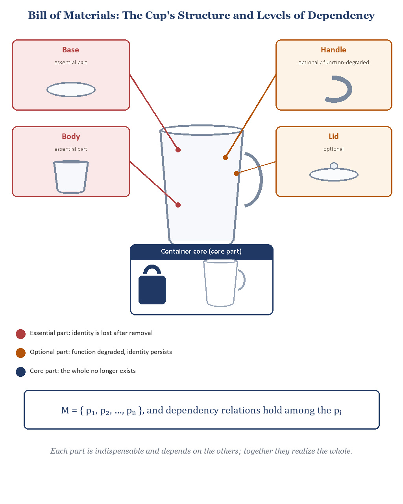

*Figure 2-3 Bill of Materials: the cup's compositional structure and levels of dependency*

### 2.4 The Step-by-Step Emergence of the BOM and the Division of Labor

The BOM likewise emerges gradually as observed samples increase. The first cup (glass, transparent, no handle, no lid) is continuous glass throughout; take away any part and nothing independently nameable remains, so at this stage the BOM has only two items, body and base. The second cup (ceramic, blue, with a handle, no lid) adds a handle that can be taken off, and the BOM grows to three items. The third cup (glass, transparent, with a handle, with a lid) adds a lid, and the BOM grows to four items. The list of parts, like the dimensions of properties, is stretched open step by step by "newly appearing detachable things."

At this point the division of labor between the Y axis and the X axis is entirely clear: the BOM is responsible for answering "open this thing up and see which independently recognizable parts it is composed of"; Property is responsible for answering "what this thing itself (whether the whole, or some part within the BOM) looks like." The BOM decides how many branches the tree structure divides into downward; Property decides the appearance of each branch and each node. Only together can the two describe an individual completely, with nothing omitted.

> **Chapter Highlights**
>
> - BOM criterion: if it still recognizes itself when taken off → it goes into the BOM; if it vanishes when taken off → it goes into Property.
> - Three-level classification by the remove criterion: essential part (identity lost) / function-degraded part (function missing, identity persisting) / non-essential part.
> - The BOM is the branching of the tree structure, Property is the appearance of each node — neither can be dispensed with.

## Chapter 3 Spatial Container — The Container Set ( ) (Z Axis)

*Chapter Image · The Light of the Container — Boundary and Interior Space*

The Z axis answers the third question: where are things? What answers this question is the spatial container — an object with a definite boundary in space, whose boundary encloses a region of interior space so that other things can be put in and taken out. This chapter establishes the three elements of the container, the formal definition of the container and the axiom of invariance, and examines how containers nest layer by layer.

### 3.1 The Container: Identity Does Not Change with the Contents

A spatial container means: an object with a definite boundary in space; this boundary encloses a region of "interior space" so that other things can be put in and taken out, and the container itself does not change who it is depending on whether there is anything in that interior space or what is in it. Put simply, a container answers the question "where are things," not the question "what are things." A cup does not become a different thing because it holds water or coffee — from beginning to end it is the same cup.

This is very different from the identity of an ordinary set (see Type Set and Type Logic 5.2): take the water out of { water } and replace it with { coffee } and it is already "another set" — there is no "cup" to hold that identity up so that it is still recognized as the same thing after the contents change. The container does one thing that the mathematical set does not: it gives the set a "self" independent of its elements.

Container ＝ Set ＋ an identity that does not change as the elements change.

### 3.2 The Three Elements of the Container

A spatial container comprises three elements: boundary, interior space, and independent identity.

#### (1) Boundary

The boundary is the most central part of the container; its function is to distinguish "inside" from "outside." Cup walls, the body of a bowl, the walls of a room, the fabric of a backpack, the stitching of a pocket are all boundaries; a boundary need not be a solid body — a water surface, a line drawn in chalk, anything that can clearly mark the difference between "in" and "not yet in" can constitute a boundary. A boundary may be closed (like a sealed thermos) or open (like a cup without a lid); openness affects whether things can "fall out," but does not affect whether the container itself is a container.

#### (2) Interior Space

Interior space is the region enclosed by the boundary and actually used to hold other objects; its size and shape determine what the container can hold and how much. Interior space can be empty (an empty cup is still a cup), and it can hold several different things at once (a cup can hold water and ice cubes together).

#### (3) Independent Identity

This is the most crucial and most easily overlooked property of the spatial container: the container's identity is not determined by the contents it holds but by its own boundary and structure. Because identity is independent of contents, a container can go through the whole process of "put things in → take them out → put other things in" and each time still be recognized as the same container. This is very different from the identity of ordinary things: if we replace the "water" in a glass of water with "coffee," we do not say "this water has become coffee" but "what is in the cup has changed," "what changed is the contents," while "the container has not changed" — this intuition already reflects the fact that container identity is independent of contents.

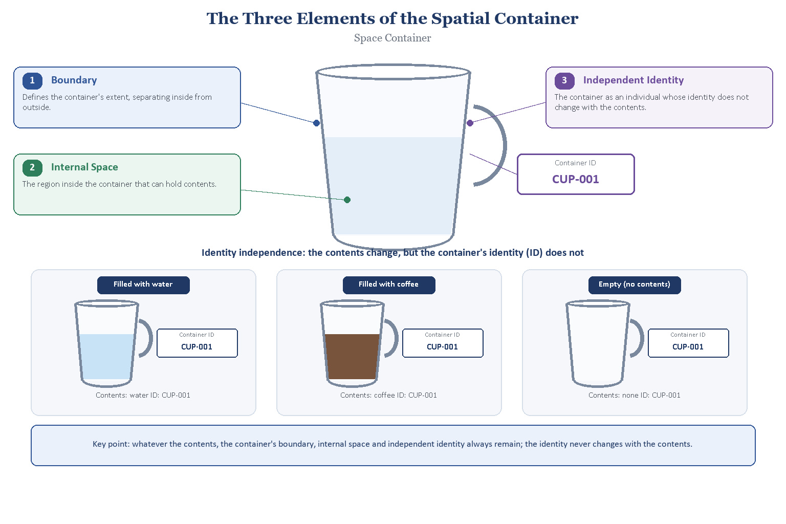

*Figure 3-2 The three elements of the spatial container: boundary, interior space, independent identity*

| Element | Function | Cup example | Openness |
| --- | --- | --- | --- |
| Boundary | Distinguishes inside from outside | Cup wall | Can be closed or open |
| Interior space | Holds the contents | The space inside the cup | Can be empty, can hold several things at once |
| Independent identity | Still itself after the contents are replaced | The ID of CUP-001 | Does not change with the contents |

*Table 3-1 The three elements of the spatial container*

### 3.3 Formalization and Levels of the Container

Type Logic writes the container as an ordered pair (see Type Set and Type Logic 5.2):

> **Formal Definition of the Container**
>
> - Container C = ( identity id(C), interior space S(C) ).
> - Identity id(C): a marker that does not change as the elements in S(C) change.
> - Interior space S(C): a set that can hold elements, whose contents can be replaced and emptied.
> - Axiom of invariance: ∀ e₁, e₂ ∈ S(C), replacing e₁ with e₂ does not change id(C).

The key here lies in "levels." The cup and the water are in fact things at two different levels: the cup is the identity that stays invariant, the water is the contents that can be replaced. Written in the language of sets alone, these two levels get flattened into one — the two elements in { cup, water } have exactly equal status, and one cannot tell which is the identity and which is the contents. Everyday language is never ambiguous: when we say "there is water in the cup," we never treat the cup and the water as the same kind of thing.

This distinction is especially crucial in engineering and data modeling. In a relational database, the "cup table" and the "contents table" are two different tables, and the contents table refers through a foreign key to the primary key of the cup table; this master–detail relationship itself embodies the concept of "levels" — the primary key is id(C), and the foreign key points to "which identity it was put into." What the Z axis teaches us is precisely this: establish the identity first, then talk about the contents.

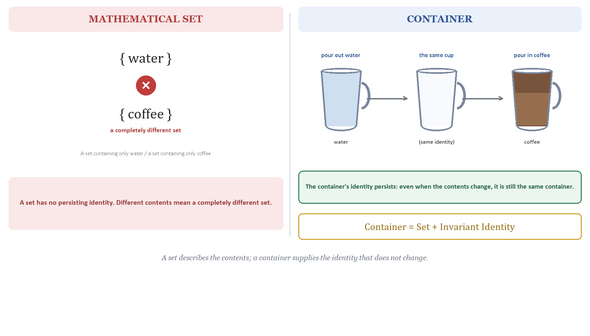

*Figure 3-3 Container: identity does not change with the contents — container ( ) versus a pure set*

### 3.4 Nesting of Containers

From this follows the relation between container and contents: the contents can be replaced and removed, and do not in turn define the container; a container can have a size limit, which is also what distinguishes a container from "space without boundary." Moreover, containers can nest within one another: a cup can go into a bag, a bag into a box, a box into a room; each level of container stands independently and each observes the same three basic elements — "boundary, interior space, independent identity."

*Figure 3-4 Nesting of containers: cup into bag, bag into box, box into room — each level stands independently*

Nesting is the normal state of spatial structure, and it is also the key to how "Unit Types" can be combined into more complex systems: every container is a stable identity, and it can become the contents of the container one level up. At this point all three axes are in place — the X axis gives it appearance, the Y axis gives it parts, the Z axis gives it a position in space. The next step is to join the three axes together: the Type Set of Chapter 4 gives the complete notation of the Unit Type.

> **Chapter Highlights**
>
> - Container ＝ Set ＋ an identity that does not change as the elements change (axiom of invariance).
> - Three elements: boundary (distinguishes inside from outside), interior space (holds the contents), independent identity (id(C) constant).
> - Levels: the container is the identity, the contents are the elements; containers nest, and each layer stands on its own.

## Chapter 4 Type Set — The Complete Notation of a Unit Type

The first three chapters each occupy one axis: Abstraction [ ] on the X axis, Composition { } on the Y axis, Container ( ) on the Z axis. This chapter merges the three and answers one question: how can a Unit Type be "completely notated" with a single set of marks? The answer is the Type Set — on top of the minimal core that is the mathematical set, three value-adds are superimposed, restoring the three omitted layers of information.

### 4.1 The Limits of the Mathematical Set: Three Omitted Layers of Information

The mathematical set answers only one question to begin with: "does it belong?" This language is extremely economical — it assumes the least, and therefore describes the least. When we say "water belongs to what is in the cup," set theory can express this relation precisely as "water ∈ S"; but at the same time it omits entirely the other three layers of information that everyday language naturally carries (see Type Set and Type Logic 5.1):

- Independence of identity: the cup does not become something else because it holds water or coffee.
- Structure among the elements: handle, base, and lid are not placed at random; they depend on one another and each has its place.
- Rule of generation: the category "cup" is not a hard-written list but a rule by which new members can be judged.

What Type Logic does is restore these three omitted layers one by one. To this end we introduce three different bracket systems, each corresponding to a different "value-add":

| Kind of Set | Kind of Bracket | Example | Information Restored |
| --- | --- | --- | --- |
| Composition Set | Braces { } | { handle, base, lid, body } | Bill of Materials — the compositional structure among the elements |
| Abstract Set | Square brackets [ ] | [ white, black, yellow ] | Property — the generative rule of feature intersection |
| Container Set | Parentheses ( ) | ( water, coffee ) | Container — an identity that does not change with the contents |

*Table 4-1 The three kinds of brackets and the three value-adds*

Mathematical set = { handle, base, lid, body, coffee, white } — six elements side by side, their levels flattened. The Type Set, by contrast, puts each of the three layers of information in its proper place.

### 4.2 Unit Type ＝ Type Set

Put the three kinds of brackets together and you get the complete notation of a Unit Type. The Type Set uses braces { } as its outer frame, and the composition set needs no extra brackets within it; the contents are marked with ( ) and the properties with [ ] inside:

Unit Type ＝ Type Set ＝ coffee cup: { handle, base, lid, body, (coffee), [white] }

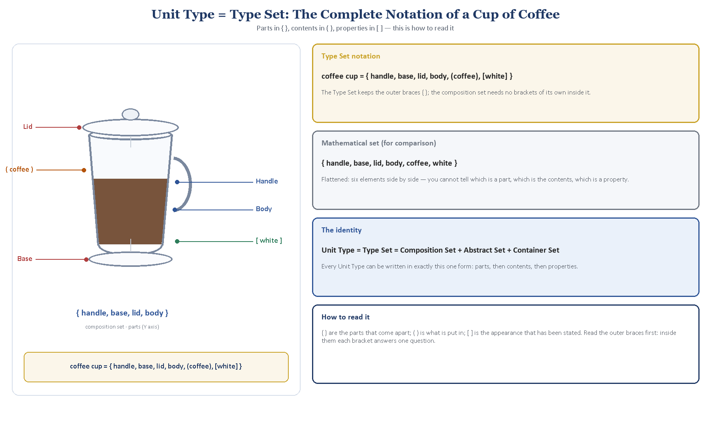

*Figure 4-2 Unit Type ＝ Type Set: the complete notation of a cup of coffee*

This formula deserves slow reading. { handle, base, lid, body } is the composition set — answering "what is it made of," the product of the Y axis; ( coffee ) is the container set — answering "what does it hold," the product of the Z axis; [ white ] is the abstract set — answering "what does it look like," the product of the X axis. With the three kinds of brackets each in place inside one pair of braces, a Unit Type is completely notated.

By contrast, the mathematical set { handle, base, lid, body, coffee, white } flattens the six elements onto one level: one cannot tell which is a part, which is contents, which is a property. The difference between brackets is precisely the difference between levels; the Type Set writes levels into the notation by means of brackets.

### 4.3 Superimposing the Three Value-Adds

The three value-adds can be understood as three superimposed steps (see Type Set and Type Logic 5.1, 5.6): with the mathematical set as the base, first add the part structure of composition { }, then add the category rule of property [ ], and finally add the invariant identity of the container ( ) — each layer superimposed restores one layer of information omitted by the mathematical set.

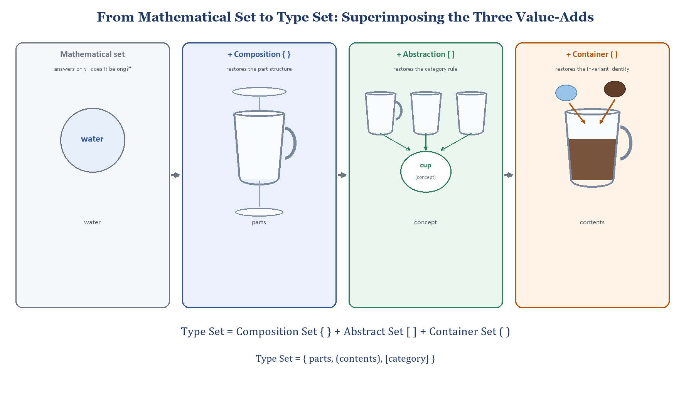

*Figure 4-1 From mathematical set to Type Set: the superimposition of the three value-adds*

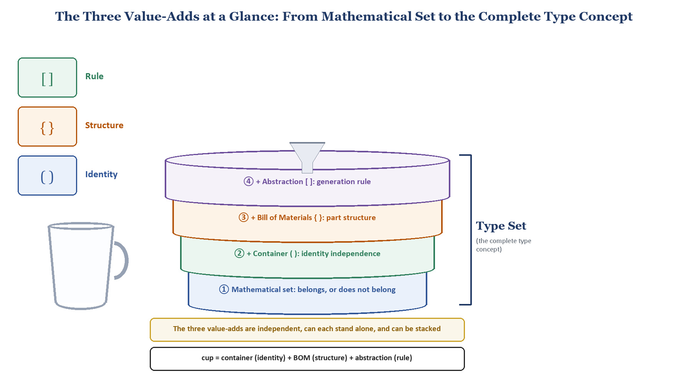

*Figure 4-4 Overview of the three value-adds: from mathematical set to the complete concept of Type*

| Type of Value-Add | Property Restored | Core Contribution | Bracket |
| --- | --- | --- | --- |
| Container | Independence of identity | Adds to the set a "self" that does not change as the elements change | (  ) |
| Bill of Materials | Structure among the elements | The elements in the set are no longer merely side by side but now have relations of dependency | {  } |
| Property | Abstract generative rule | Turns the set from a hard-written list into a criterion that can judge new members automatically | [  ] |

*Table 4-2 Overview of the three value-adds*

These three value-adds are independent of one another; each can exist alone, and they can also be superimposed. A "cup" possesses at once the identity independence of the container, the part structure of the BOM, and the category rule of abstraction — together these three constitute our complete understanding of the concept "cup."

### 4.4 One Sentence, Three Layers of Meaning

When we say "there is water in the cup," we are saying three things at once: first, a set relation (water ∈ what is in the cup); second, the value-add of the container (the cup has an identity that does not change with the contents); third, the replaceability of the contents (pour out the water and put in coffee, and the cup is still that cup). The mathematical set captures only the first layer, yet everyday cognition actually operates all three at once.

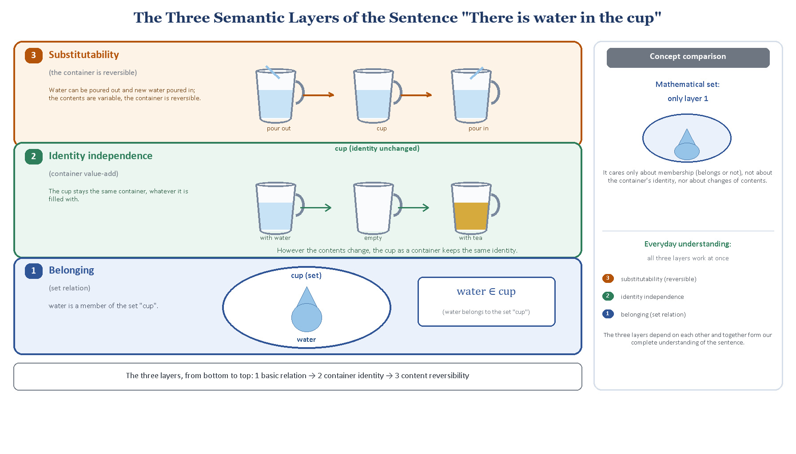

*Figure 4-3 One sentence, three layers of meaning*

The same holds for "the cup is composed of a handle, a base, and a lid": besides expressing "these parts all belong to the cup," it also presupposes that the parts have fixed joining relations among them; "a thermos is also a cup" besides expressing "a thermos belongs to the set of cups," also presupposes a judgment rule that can endlessly generate new members. Every sentence in everyday language compresses all three layers of information at once — the mathematical set keeps only the first part, "does it belong," and the other three layers are all omitted.

The mathematical set is useful precisely because it condenses "a group of things forming a whole" down to nothing but "does it belong." The value of the Type Set is that, on top of this minimal core, it systematically superimposes three value-adds, turning the concept of "Type" from an abstract mathematical tool into a cognitive framework capable of describing the real world completely.

### 4.5 Three Axes, Three Kinds of Brackets: Describing a Type

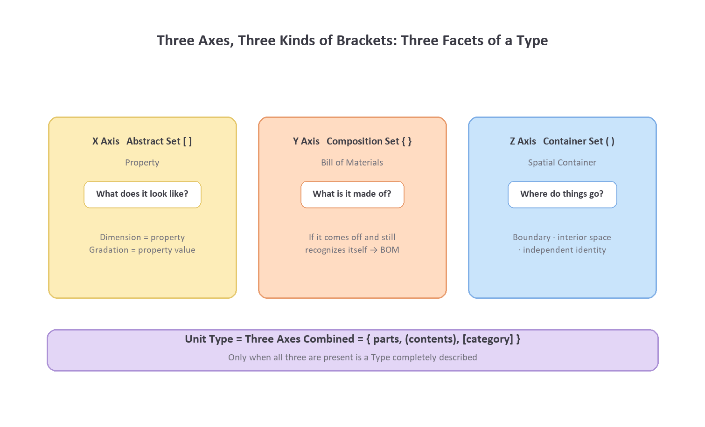

*Figure 2-2 Three axes, three kinds of brackets*

| Axis | Brackets | Question It Answers | Key Criterion |
| --- | --- | --- | --- |
| X Axis · Property | [ ] | What does it look like? | Dimension = property, gradation = property value; if a difference does not fit → open a new property and backfill |
| Y Axis · Bill of Materials | { } | What is it composed of? | "Once taken off, does it still recognize itself?" Three levels of remove: essential / function-degraded / non-essential part |
| Z Axis · Container | ( ) | Where do things go? | Boundary, interior space, independent identity; axiom of invariance: change the contents, id(C) does not change |

#### X Axis: Property Is Forced Out by Difference

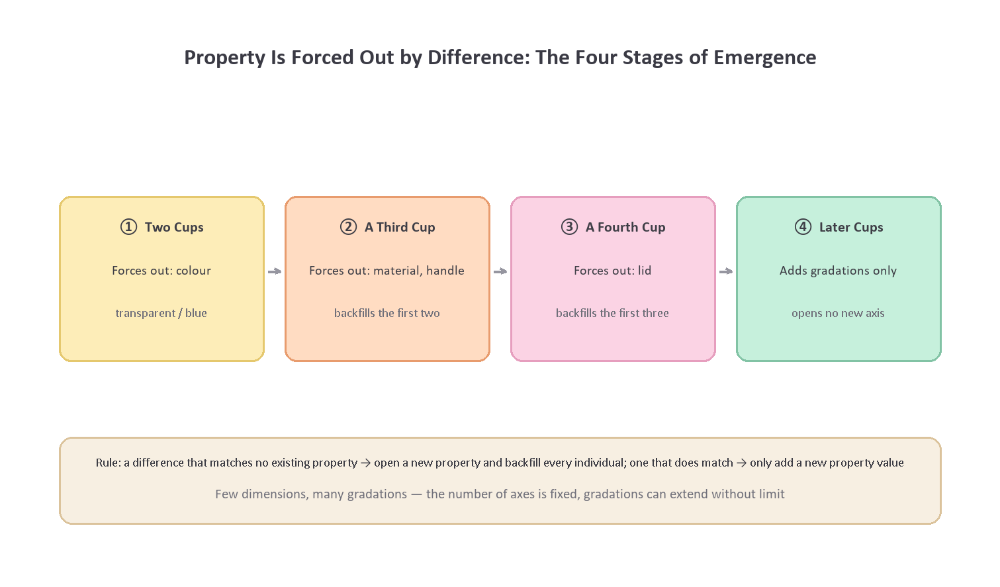

*Figure 2-3 The four stages of property emergence*

#### Y Axis: BOM and the Three Levels of remove

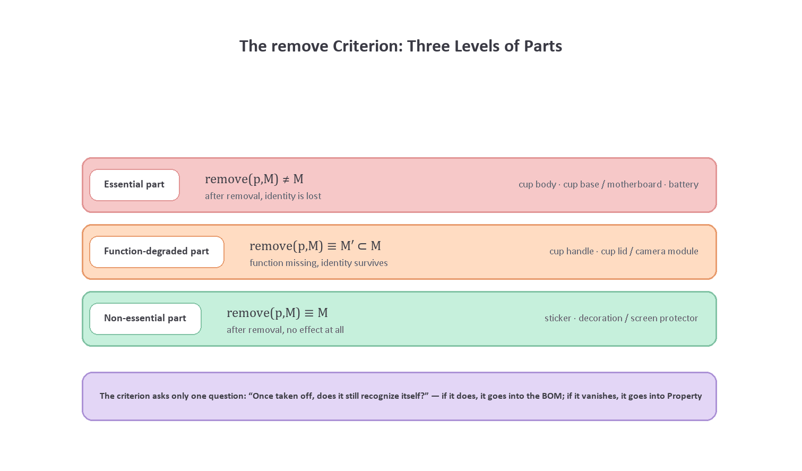

*Figure 2-4 The remove criterion: three levels of parts*

#### Z Axis: The Container's Identity Does Not Change with the Contents

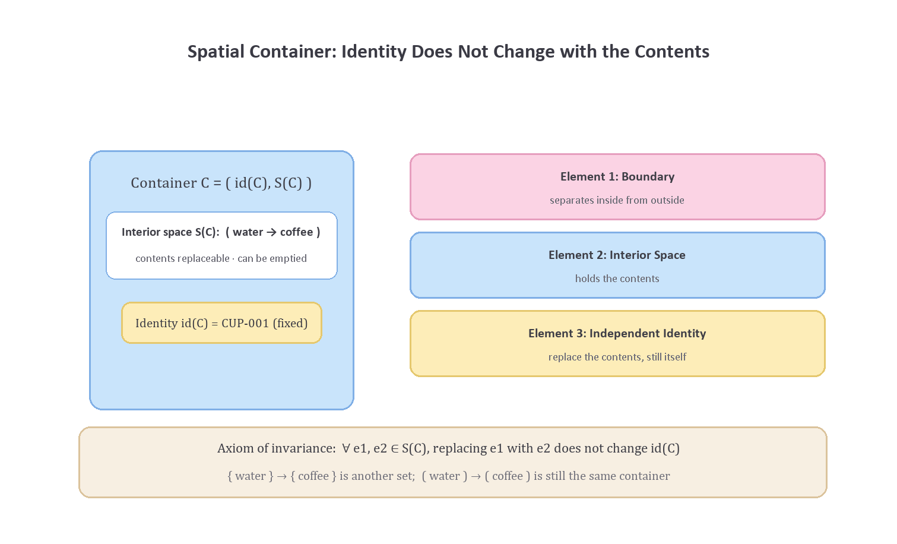

*Figure 2-5 The three elements of the spatial container and the axiom of invariance*

### 4.6 Unit Type = Type Set: The Complete Notation

The mathematical set answers only "does it belong," and in doing so it omits three layers of information: the independence of identity, the structure among the elements, and the rule of generation. The Type Set takes the mathematical set as its core, superimposes the three value-adds, and restores those three layers one by one.

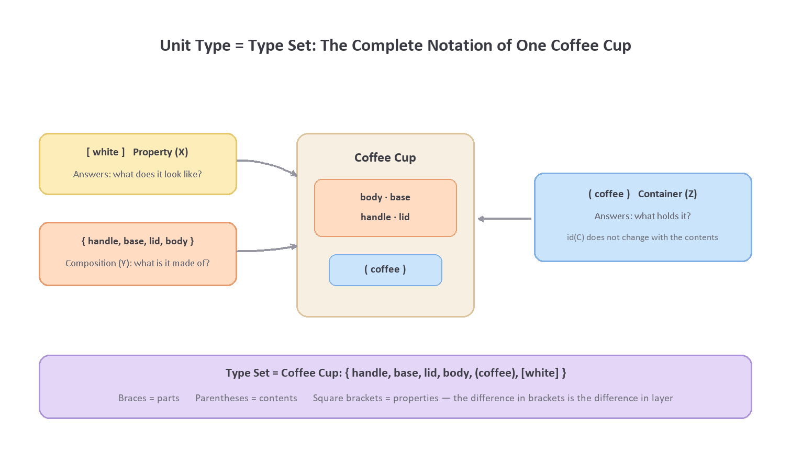

*Figure 2-6 Unit Type = Type Set: the complete notation of one coffee cup*

| Value-add | Brackets | Information Restored | Contribution |
| --- | --- | --- | --- |
| Bill of Materials | { } | The compositional structure among the elements | Parts are no longer merely juxtaposed; they acquire dependency relations |
| Property | [ ] | The generating rule of the feature intersection | The category turns from a hard-coded list into an open rule |
| Container | ( ) | An identity that does not change with the contents | The set gains a "self" that does not vary with its elements |

> **Chapter Highlights**
>
> - The mathematical set answers only "does it belong"; the three omitted layers ＝ independence of identity, compositional structure, rule of generation.
> - Unit Type ＝ Type Set ＝ { parts, (contents), [category] } — three kinds of brackets, three value-adds, three axes.
> - The three value-adds are mutually independent and can be superimposed; a single sentence of everyday language carries all three layers of meaning at once.

## Chapter 5 Type Logic — Three-Layer Judgment and Its Applications

The first four chapters establish a "static structure of knowledge" — how to describe a Type, how to notate a Type. This chapter turns that structure into a "dynamic cognitive operation": faced with a concrete object, how to use the criteria of the three axes to reach a judgment (see Type Set and Type Logic 5.5). Each of the three layers of judgment has its own question: container judgment asks "is identity independent of the contents?"; BOM judgment asks "after a part is removed, is the whole still the same thing?"; abstract judgment asks "does the new object satisfy the category rule?" — and finally a three-layer joint judgment and six exercises show how Type Logic operates in full on actual objects.

### 5.1 Container Judgment: Is Identity Independent of the Contents?

When we face a "whole with something in it," the first question to judge is: does this whole have an identity that does not change with the contents?

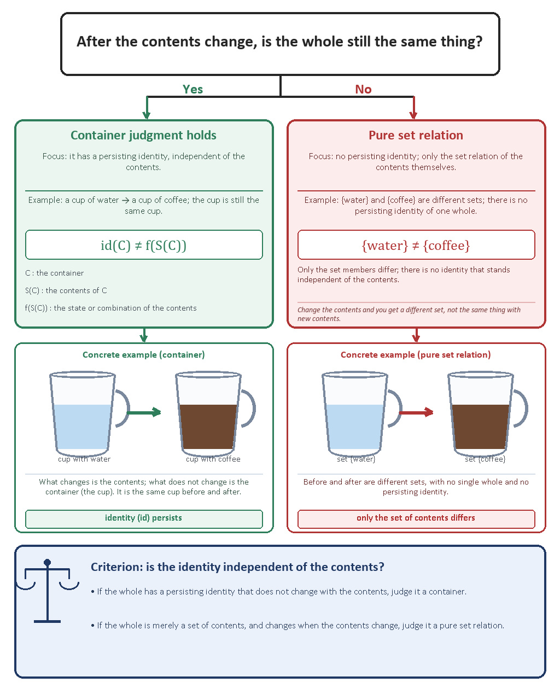

*Figure 5-1 Container judgment procedure: after the contents change, is the whole still the same thing?*

| Step | Operation | Criterion |
| --- | --- | --- |
| 1 | Confirm that the whole contains replaceable contents | The contents can be taken out, replaced, emptied |
| 2 | Replace the contents | Replace e₁ with e₂ |
| 3 | Check the identity | Is id(the whole) the same before and after the replacement? |
| 4a | Same → container judgment holds | Container logic ( ) applies |
| 4b | Different → pure set relation | Only mathematical set ∈ applies |

*Table 5-1 The four steps of container judgment*

Worked examples: put textbooks into a backpack, or swap them for a pencil case, and the backpack is still the same backpack → container ✓; files in a computer folder can be added, deleted, and changed while the folder itself does not change → container ✓; take the apple out of { apple, banana } and put in an orange and it becomes another set → pure set ✗.

### 5.2 BOM Judgment: After a Part Is Removed, Is the Whole Still the Same Thing?

Once a whole is confirmed to have structural parts, the next step is to judge: how much does each part affect the identity of the whole? This is precisely the judgment version of the remove criterion from Chapter 2 — following the question "what happens after removal," parts are divided into three levels: essential, function-degraded, and non-essential.

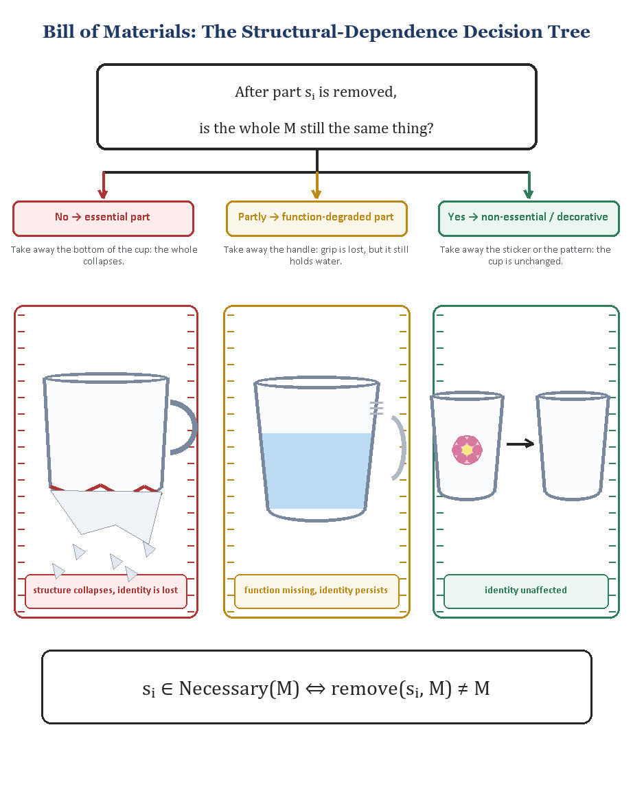

*Figure 5-2 Decision tree for structural dependency in the Bill of Materials*

The decision tree branches from the root question "is remove(pᵢ,M) still ≡ M?" into three paths: no → essential part (identity lost after removal); partly → function-degraded part (function missing but identity persisting); yes → non-essential part. Take the smartphone as an example; the three-level classification is plain at a glance:

| Part | Result after removal | Classification |
| --- | --- | --- |
| Motherboard | Cannot power on; function completely lost | Essential part |
| Battery | No power supply; function lost | Essential part |
| Screen | No display / no touch | Essential part |
| Camera module | Cannot take photos; calling / internet still normal | Function-degraded part |
| Speaker | No external playback; headphones still work | Function-degraded part |
| Screen protector | No effect on function at all | Non-essential part |

*Table 5-2 Three-level classification of smartphone parts*

It is worth noting: BOM judgment is concerned with "structural role," not "mode of implementation." This point will appear again in the electric-car example later in this chapter — as long as the role a part plays does not change, a different mode of implementation does not affect the judgment.

### 5.3 Abstract Judgment: Does a New Object Satisfy the Category Rule?

When we need to judge whether a newly appearing object belongs to some category, we do not consult a list but verify on the spot with the intersection criterion ∩(T).

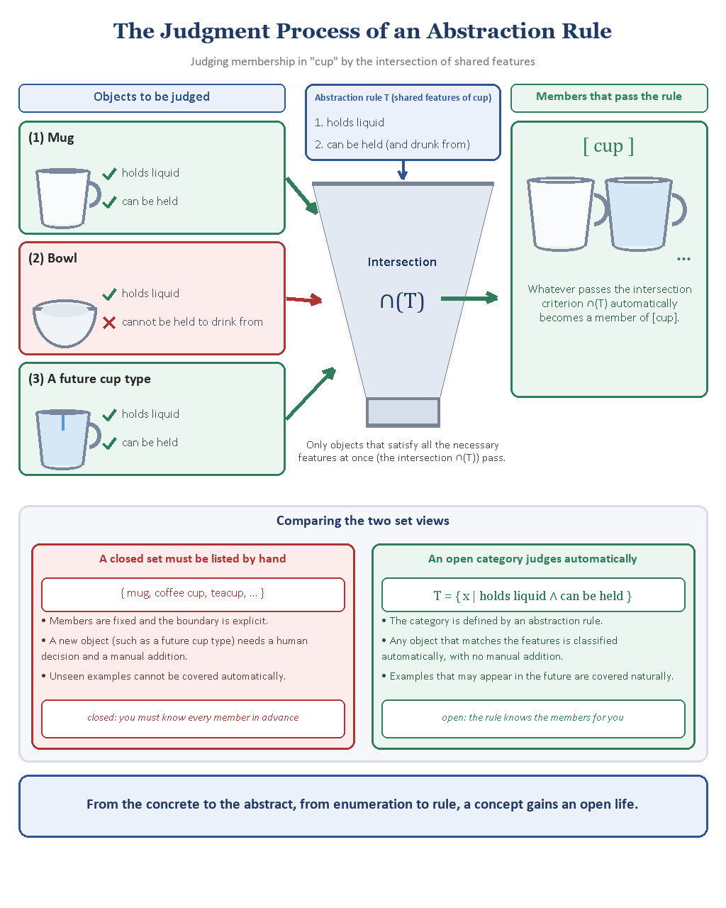

*Figure 5-3 Procedure for judging by abstract rule: three candidate objects pass through the intersection-criterion funnel*

| Step | Operation | Explanation |
| --- | --- | --- |
| 1 | Determine the necessary feature set F(T) of category T | e.g. F(cup) = { can hold liquid, can be held in the hand and drunk from } |
| 2 | Check each feature of the new object o one by one | fᵢ(o) = true / false |
| 3 | Take the intersection | ∩(T)(o) = ∀ fᵢ ∈ F(T), fᵢ(o) = true? |
| 4a | All pass → o ∈ [T] | Classified automatically; no manual addition needed |
| 4b | Any failure → o ∉ [T] | Does not belong to this category |

*Table 5-3 The four steps of abstract judgment*

Boundary cases are the best test of a rule's precision. Bowl: can hold liquid ✓, but cannot be held in the hand and drunk from ✗ → does not belong to [ cup ]; sippy cup: can hold liquid ✓, drunk from through a straw ✓ → belongs to [ cup ]; syringe: can hold liquid ✓, can be held in the hand ✓, but its purpose is not "drinking" → depends on whether F(T) includes "used for drinking." This boundary case shows: the precision of a rule depends on the completeness of the feature set F(T) — the choice of the feature list is itself an understanding of the concept and an expression of a position.

### 5.4 Three-Layer Joint Judgment: The Smartphone

Now put the three layers of judgment together, using the "smartphone" as the test object, to show how Type Logic operates in full on an actual object.

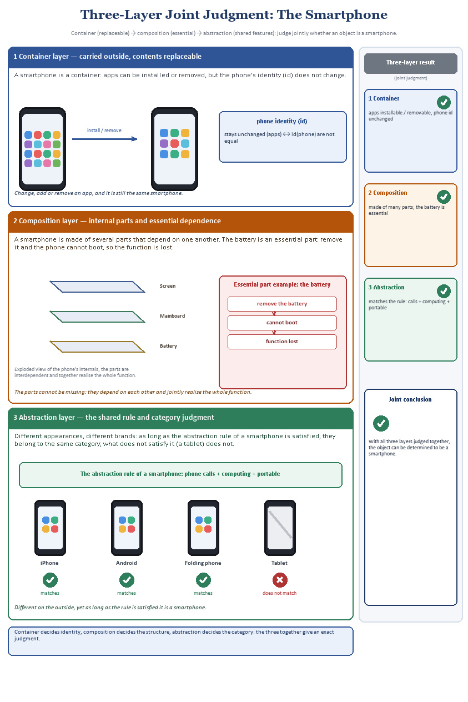

*Figure 5-4 Example of three-layer joint judgment in Type Logic: the smartphone*

#### Layer 1: Container Judgment

Does the phone have replaceable contents? ✓ Apps can be installed and removed. Is the identity unchanged after the contents are replaced? ✓ Install an app or uninstall YouTube and the phone is still the same one. The container judgment holds — phone ＝ Container( App ).

#### Layer 2: BOM Structural Dependency Judgment

Motherboard, battery, and screen are essential parts (see Table 5-2); camera module and speaker are function-degraded parts; the screen protector is a non-essential part. The part structure and dependency relations are clear.

#### Layer 3: Abstract Rule Judgment

F(smartphone) = { can communicate, can compute, is portable }; check each in turn:

| Test Object | Can Communicate | Can Compute | Is Portable | Result |
| --- | --- | --- | --- | --- |
| iPhone | ✓ | ✓ | ✓ | ∈ [ smartphone ] |
| Android phone | ✓ | ✓ | ✓ | ∈ [ smartphone ] |
| Folding phone | ✓ | ✓ | ✓ | ∈ [ smartphone ] |
| Tablet | ✗ | ✓ | ✓ | ∉ [ smartphone ] |
| Smartwatch | ✓ | ✓ | ✗ | ∉ [ smartphone ] |

*Table 5-4 Feature check for F(smartphone)*

> **Conclusion of the Joint Judgment**
>
> - The smartphone satisfies all three layers at once: container layer ✓ (a container of Apps, with independent identity), composition layer ✓ (a clear part structure and dependency relations), abstraction layer ✓ (satisfies "can communicate ∧ can compute ∧ is portable").
> - None of the three layers can be dispensed with: by the container layer alone, a tablet would also be a phone; by the composition layer alone, a calculator would also be a phone; by the abstraction layer alone, a walkie-talkie would also be a phone. Only when all three pass at once can "smartphone" be precisely defined.

### 5.5 Judgment Exercises: Six Questions and Answers

The following six sets of judgment exercises cover the container, BOM, and abstraction layers as well as joint judgment. Each question first presents the situation, then unfolds the solution step by step.

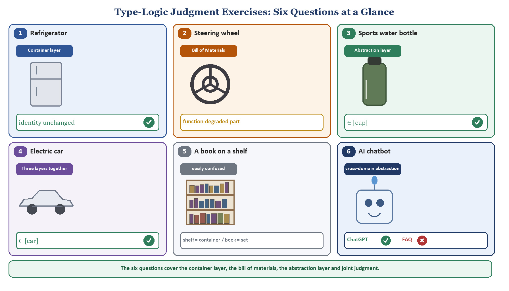

*Figure 5-5 Type Logic judgment exercises: questions and answers*

#### Question 1: Is a Refrigerator a Container? (Container-Layer Judgment)

Question: Various foods can be put into a refrigerator and all of them taken out again. When the contents change, is the refrigerator still the same refrigerator?

Answer: Step 1 confirm replaceable contents ✓ (food can be put in / taken out / swapped); Step 2 perform the replacement (milk for vegetables); Step 3 check identity: before and after, it is still "the same refrigerator," id unchanged; Step 4 the container judgment holds ✓.

Further thought: if the compressor is removed, is it still a "refrigerator"? This is no longer a container-layer question but a BOM-layer one — the compressor is an essential part, and identity is lost once it is removed. The container layer is concerned only with "replacement of contents," not with "removal of structural parts."

#### Question 2: What Level of Part Is a Car's Steering Wheel? (BOM-Layer Judgment)

Answer: with the steering wheel removed the car is still recognizable as a car (the shell, body, and engine are all there), but it cannot be steered → function-degraded part. For comparison: the engine is an essential part (it cannot start and is no longer a drivable car); air conditioning is a function-degraded part (it still drives normally, only less comfortably); the sound system and the badge are non-essential parts (no effect on driving or safety at all).

#### Question 3: Does a Water Bottle Belong to [ cup ]? (Abstraction-Layer Judgment)

Question: F(cup) = { can hold liquid, can be held in the hand and drunk from }. Is a sports bottle (750 ml, with a straw spout) ∈ [ cup ]?

Answer: can hold liquid ✓ ＋ can be held in the hand and drunk from (through the straw spout) ✓ → ∩(T) ✓ → ∈ [ cup ]. Contrast: a thermos flask (2 L, must be poured out to drink): can hold liquid ✓ ＋ cannot be held in the hand and drunk from ✗ → ∉ [ cup ], but ∈ [ container ]. Key insight: different F(T) define different categories, and the same object may belong to a superordinate category without belonging to a subordinate one.

#### Question 4: Is an Electric Car a [ car ]? (Three-Layer Joint Judgment)

Question: the Tesla Model 3 has no internal combustion engine, using batteries and an electric motor instead. Does it still count as a "car"?

Layer 1 (container): passengers / cargo can get in and out ✓, and carrying different people it is still the same car ✓ → container holds. Layer 2 (BOM): battery pack ＝ essential part (taking over the engine's role), electric motor ＝ essential part, center screen ＝ function-degraded part, autonomous-driving sensors ＝ function-degraded part — the BOM is concerned with structural role rather than mode of implementation. Layer 3 (abstraction): F(car) = { can drive on roads, can carry people and cargo, has a power system, can be steered by a driver }, and the Tesla passes all of them → ∈ [ car ].

Joint conclusion: all three layers pass → it is a car. The rule says "has a power system" rather than "has an internal combustion engine," so electric drive does not affect the judgment — an open category captures functional essence rather than implementation detail.

#### Question 5: Are the Books on a Bookshelf a Container Relation or a Set Relation? (A Distinction That Is Easily Confused)

| Object of Judgment | Does Identity Persist | Judgment Result |
| --- | --- | --- |
| Bookshelf (physical structure) | ✓ Whatever books are placed there, the bookshelf does not change | Has container ( ) |
| "The books on the bookshelf" (the combination of books) | ✗ Change the books and the combination changes | A set inside the container { } |
| Bookshelf + books (a display unit) | Depends on context | Has both container and contents |

*Table 5-5 Different objects of judgment within the same physical scene*

Important principle: in the same physical scene, depending on which "whole" you are attending to, different types of judgment may be involved at once. Before judging, first ask "which whole is the object I am judging?"

#### Question 6: Is an AI Chatbot a [ dialogue system ]? (Cross-Domain Abstract Judgment)

Question: F(dialogue system) = { can receive natural-language input, can produce natural-language responses, can maintain conversational context }. FAQ bot vs ChatGPT?

| Feature | FAQ bot | ChatGPT |
| --- | --- | --- |
| Can receive natural-language input | ✓ | ✓ |
| Can produce natural-language responses | △ Can only output preset replies | ✓ Free generation |
| Can maintain conversational context | ✗ Handles each turn independently | ✓ Multi-turn dialogue has context |
| ∩(T) | ✗ | ✓ |
| Result | ∉ [ dialogue system ] | ∈ [ dialogue system ] |

*Table 5-6 Feature comparison of the FAQ bot and ChatGPT*

The FAQ bot does not belong to [ dialogue system ] but to the broader [ information retrieval tool ]. Adjusting the strictness of F(T) changes the result of the judgment. The connection to AI development: Type Logic offers a clear line of thought — do not ask essentialist questions like "is it really a dialogue system," but explicitly list F(T) and check each item. The choice of the feature list is itself an understanding of the concept and an expression of a position.

| No. | Aspect Covered | Teaching Purpose |
| --- | --- | --- |
| Q1 Refrigerator | Basic container-layer judgment | Build the intuition "identity vs contents" |
| Q2 Car steering wheel | Three-level classification in the BOM | Distinguish essential / function-degraded / non-essential parts |
| Q3 Water bottle vs cup | Boundary of an abstract rule | Experience how the completeness of F(T) affects the result |
| Q4 Electric car | Three-layer joint judgment | Show that the three layers are complementary and none can be dispensed with |
| Q5 Books on a bookshelf | Distinguishing easily confused cases | Distinguish different objects of judgment in the same scene |
| Q6 AI chatbot | Cross-domain application | Apply Type Logic to non-physical objects |

*Table 5-7 Design principles of the judgment exercises*

What these exercises have in common: the answers are not guessed by intuition but derived by walking through the judgment procedure. Even if your intuition is right, walking the procedure lets you understand "why it is right"; even if your intuition is wrong, walking the procedure lets you find "which layer is wrong." This is the value of Type Logic as a cognitive tool — it gives you a judgment method that is repeatable, checkable, and debatable.

### 5.6 The Theoretical Significance of Judgment

The crossing from description to judgment. The definitions established in the preceding chapters solve the question "how to describe a Type"; the judgment procedures of this chapter solve the question "how to use these descriptions to make decisions in actual situations." The former is a static structure of knowledge, the latter a dynamic cognitive operation.

The complementarity of the three layers of judgment. Each layer used alone has a blind spot: container judgment cannot distinguish structural differences, BOM judgment cannot handle replacement of contents, and abstract judgment cannot capture the persistence of identity. Used together, the blind spots compensate for one another and form a complete cognitive filter.

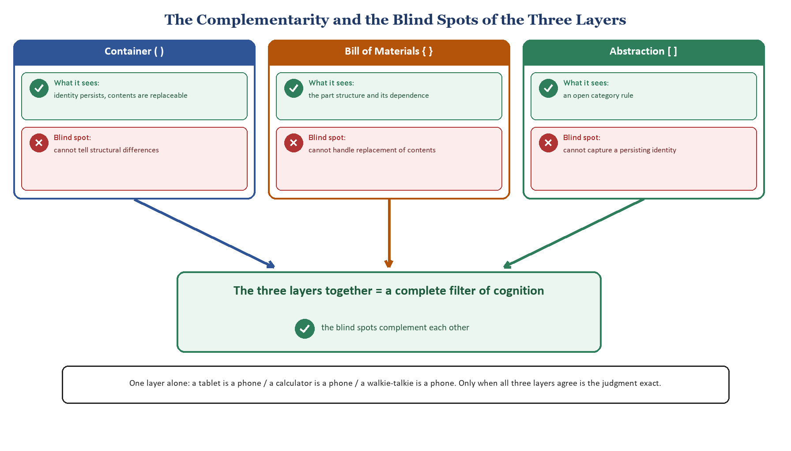

*Figure 5-6 The complementarity and blind spots of the three layers of judgment*

The correspondence with AI classification systems. Modern AI classification systems are essentially performing abstraction-layer judgment. But they usually lack the capacity for the container layer (tracking the persistence of identity) and the composition layer (structural dependency analysis). The three-layer framework of Type Logic points precisely to the gap in current AI classification capability, and to the dimension that future world models need to add.

> **Chapter Highlights**
>
> - Three layers of judgment: container judgment (identity vs contents), BOM judgment (three levels by remove), abstract judgment (∩(T) verified on the spot).
> - In joint judgment none can be dispensed with: only when all three layers pass at once can a category be precisely defined.
> - The value of a judgment procedure: repeatable, checkable, debatable — the answer is derived from the procedure, not guessed by intuition.

## Review — Consolidated Key Points and Self-Check

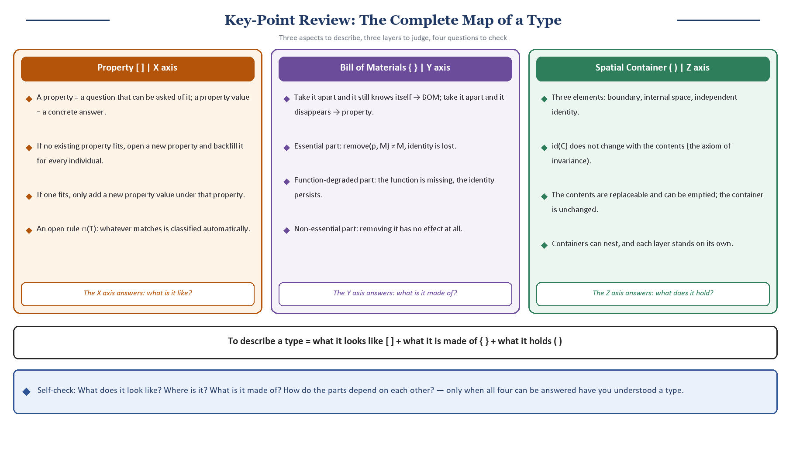

*Figure R-1 Key-point review: the complete map of a Type*

R-1  Three axes, three kinds of brackets, three value-adds. The Property [ ] of the X axis gives a Type its "appearance" — dimensions are properties, gradations are property values; difference forces out new dimensions, and when it matches, a new gradation is added. The Bill of Materials { } of the Y axis gives a Type its "parts" — if it still recognizes itself when taken off, it goes into the BOM; the remove criterion then sorts parts into essential, function-degraded, and non-essential. The Spatial Container ( ) of the Z axis gives a Type its "position" — the boundary encloses interior space, and id(C) does not change with the contents.

R-2  Description and notation are two sides of one thing. To understand a Type ＝ to understand what it looks like, where it is, what it is made of, and how its parts depend on one another; to notate a Type ＝ { parts, (contents), [category] }. The mathematical set answers only "does it belong"; the Type Set restores the three omitted layers — independence of identity, compositional structure, rule of generation — one by one.

R-3  Judgment is the dynamic use of description. Container judgment looks at whether identity is independent of the contents, BOM judgment at whether identity survives after remove, abstract judgment verifies on the spot with ∩(T); the three layers joined compensate for one another's blind spots and form a complete cognitive filter.

| Self-Check Question | What You Should Be Able to Answer |
| --- | --- |
| What does it look like? | List the key properties and property values; explain which batch of difference forced out which property |
| What is it made of? | Give the BOM; each part passes the check "does it still recognize itself when taken off"; mark the essential parts |
| Where are things put? | Point out the container's boundary, interior space, and id(C); explain why the identity does not change after the contents are replaced |
| How do the parts depend on one another? | Use the remove(pᵢ,M) criterion to divide parts into three levels; explain the concrete effect of removal |
| Which category does it belong to? | Write out F(T) and ∩(T); check boundary cases item by item (bowl, sippy cup, thermos flask …) |
| Are the three layers of judgment consistent? | Verify with joint judgment: only when all three layers pass do you draw a conclusion |

*Table R-1 Self-check list*

Starting from a single cup, we have obtained an entire language for describing the world: three axes, three kinds of brackets, three layers of judgment. The cup is the smallest specimen, but this method applies to any Unit Type — a wristwatch, a phone, a city, a system. Put any Type on the table and ask it those four questions, and you are already standing at the starting point of Type Logic.

> *To understand a Type ＝ to understand what it looks like, where it is, what it is made of, and how its parts depend on one another.*

www.longreat.net

Chang Changfeng   gamma@livemail.tw

Chang Tingying   mindaiworks@gmail.com
