# Ontypology-Space as Type

# RDB and Its Relation to Type

*Type, Entity, Primary Key and Relation in a Relational Database*

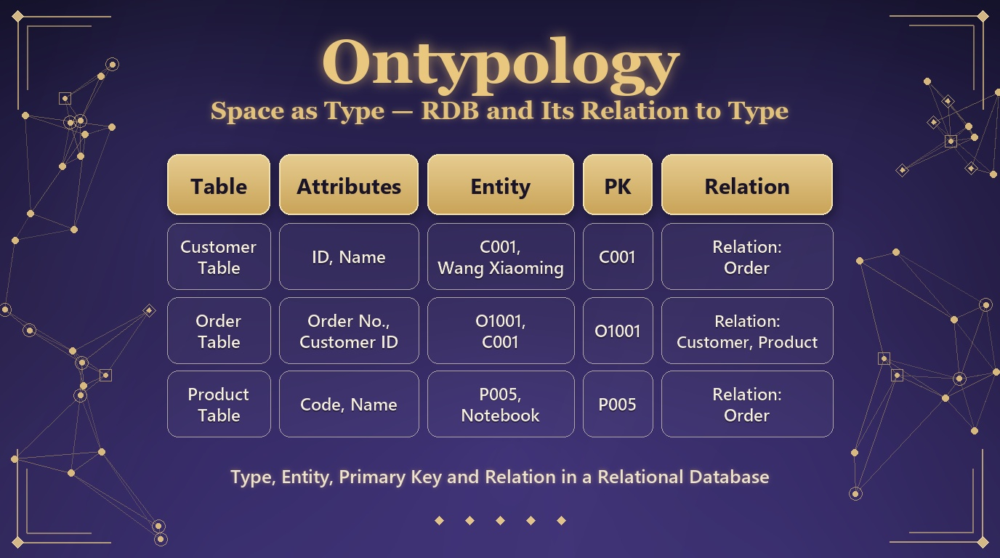

## Introduction — What Type Looks Like in the Engineering World

If Chapter 2 answered "what a Type is", this chapter answers a different question: what a Type looks like in the engineering world. The relational database (RDB) is the most widespread way of organising data in the software industry today, and its core structure — the table — turns out to correspond one-to-one with the distinction between Type and Entity. The correspondence is so exact that we can almost say: an RDB is what the logic of Type looks like once it has been mechanised.

This chapter proceeds in five steps: first we confirm the basic correspondence — the header is the Type, the rows are the Entities (4.1); then we look at the asymmetric cost of "adding data" at the two levels (4.2); next we explain why a column must run through every row (4.3); then we come to the primary key — how the identity of an Entity is fixed (4.4); and finally we see how tables are joined into a network by "reference" (4.5). The cup runs through the whole chapter, and every step comes with a diagram.

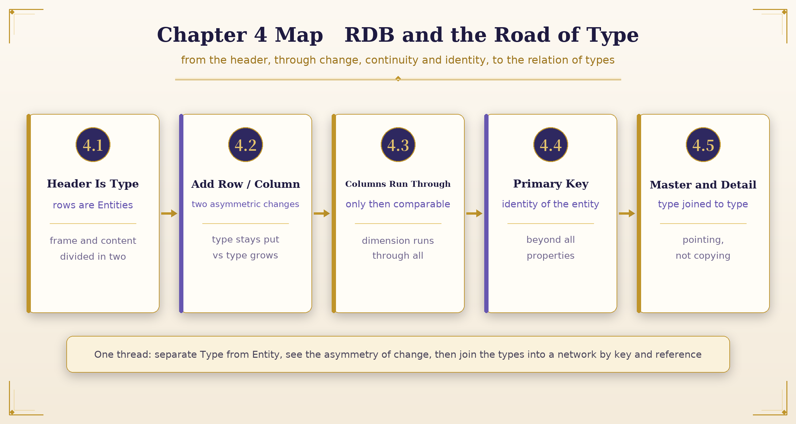

*Figure 4-1 Chapter Map: Five Steps from Header to Relation*

> **◆ The Key to This Chapter**
>
> Whenever you see a table, read it as a compound of Type + Entity: the header is the Type, the rows are the Entities. Every other concept — column, primary key, foreign key, relation — grows out of this one basic correspondence.

### 4.1 The Header Is the Type, the Rows Are the Entities

A database table is born divided into two parts, and those two parts correspond exactly to the distinction made at the very beginning of Chapter 2: a property is a question that can be asked — it has no answer in itself, it only marks out a range of what is to be asked; a property value is the actual answer to that question in one concrete situation.

Apply this correspondence to a table and everything becomes clear: the row of column names at the top (the header) is the Type. It is a list of what is to be asked; it is not itself the answer to any particular thing, but the frame shared by every row. The actual data in each row beneath the header is the Entity — the result of filling the Type with concrete answers, a thing that can be pointed to and exists on its own.

| Cup_id | Colour | Material | Handle | Lid |
| --- | --- | --- | --- | --- |
| C001 | Clear | Glass | N | N |
| C002 | Clear | Glass | Y | N |
| C003 | Blue | Ceramic | N | N |
| C004 | Clear | Glass | Y | Y |

*Table 4-1 The Cup Table: the header (Type) and four cups (Entities); Cup_id is the primary-key column*

The header row (Cup_id, Colour, Material, Handle, Lid) belongs neither to C001 nor to C002; it hangs above every cup as a list of questions shared by all of them. That is exactly what a Type looks like: a frame with no content of its own that nevertheless dictates where the content must grow. Each row below is the actual set of answers that this list of questions yields when it is applied to one concrete cup. That is exactly what an Entity looks like: concrete, independent, pointable (it has its own Cup_id), yet its appearance is grown entirely from the header's questions — it cannot sprout a column the header does not have.

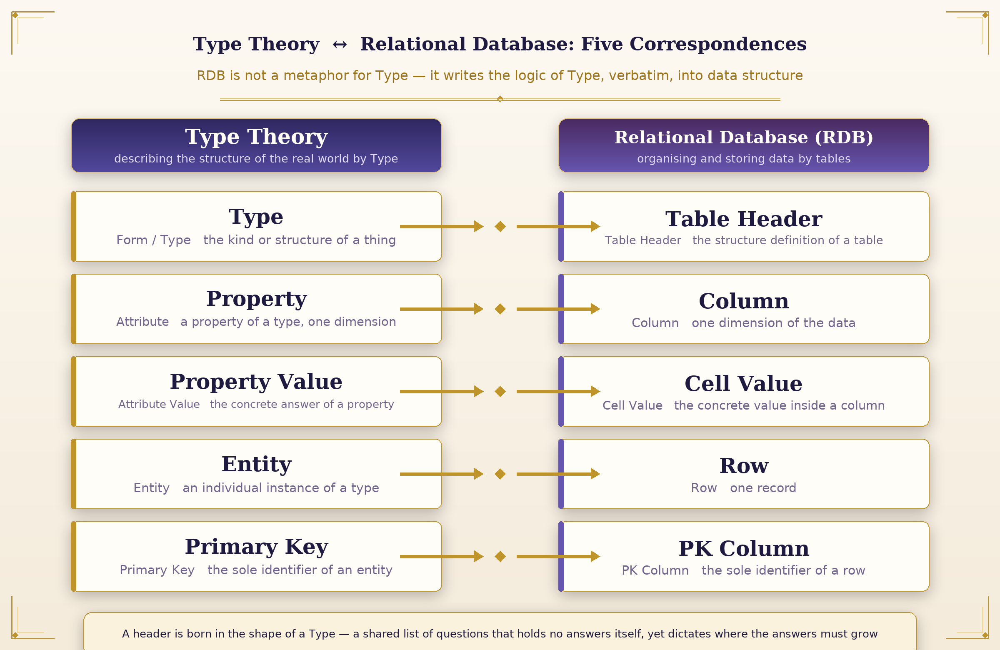

*Figure 4-2 The Fivefold Correspondence between Type Theory and the Relational Database*

> **◆ A Type Is Not a Metaphor**
>
> A header is born in the shape of a Type: a shared list of questions that holds no answers itself yet dictates where the answers must grow. The relation between an RDB and Type theory is not an analogy; it is the same structure appearing in two domains.

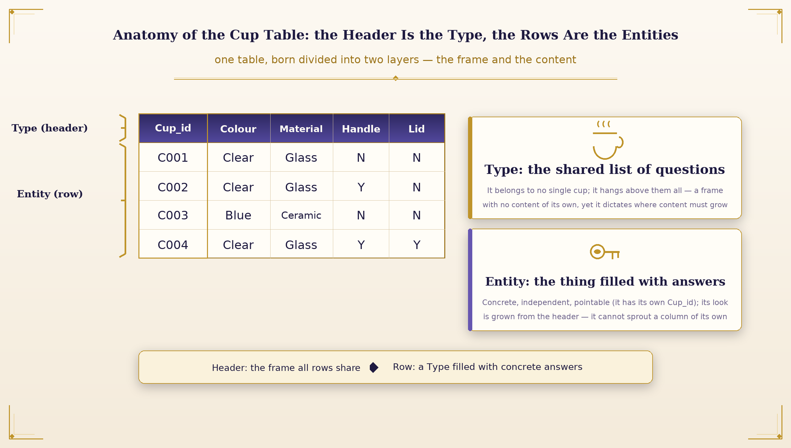

*Figure 4-3 Anatomy of the Cup Table: the Header Is the Type, the Rows Are the Entities*

#### First the Type, Then the Entity

Note the direction of this correspondence: the Type comes first and the Entity follows; we do not pile up Entities first and then generalise a Type. The first step in building a table is to define the header — decide what is to be asked, and only then does the world begin to enter in the form of rows. This agrees completely with the claim of Chapter 2: the Type precedes the description of the individual, and the property precedes the filling in of property values.

Once the header is settled it becomes the entry specification for that kind of thing: any individual that wants to enter this table must describe itself with this same set of questions, hand in an answer for every column, and only then take a row. This is the database version of an old philosophical intuition — an individual is a certain kind of thing not because it happens to look that way, but because it stands under a Type and has answered that Type's questions.

### 4.2 Adding a Row and Adding a Column: Two Asymmetric Changes

The place where this correspondence can best be tested is "adding data", which means completely different things at the two levels:

#### Add a Row: the Type Stays Put, One More Entity

Adding a row (adding an Entity) can happen at any time, and it is light. When a fifth cup arrives, whatever its colour or material, as long as it can be filled into the existing columns (colour, material, handle, lid), you simply append a row and the header does not move at all. This corresponds to what Chapter 2 said: as cups keep arriving, if the nature of the difference matches an existing property, you only need to add a property value under that property — there is no need to open a new property at all. The new cup quietly occupies one more row and disturbs not a single column of the header — the whole Type stays still, and the world simply has one more instance.

#### Add a Column: the Type Itself Grows, Every Entity Backfills

Adding a column (adding a dimension of the Type) happens only when this batch of differences matches nothing in the existing list of questions, and it moves the frame itself. If one day a cup appears carrying a difference that none of the four existing columns can explain — say, whether it has an insulating layer — then filling a value into an existing column will not do; you must open a new question in the header itself: one more column, "Insulating layer". This is the moment Chapter 2 called forcing out a new property: the existing dimensions cannot explain the new difference, so a new dimension must be opened.

> **Add a row: the Type stays put, one more Entity (light).**
>
> Add a column: the Type itself grows, every Entity must backfill (heavy).

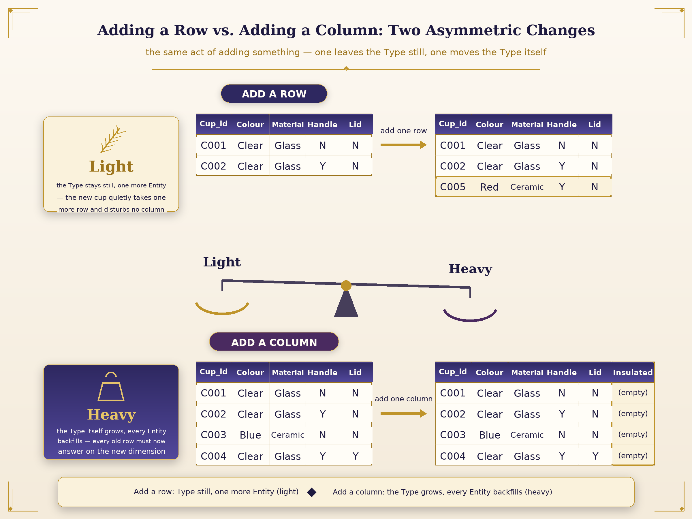

*Figure 4-4 Adding a Row vs. Adding a Column: Two Asymmetric Changes*

And, as emphasised earlier — once a property has been drawn out it must be applied to every individual that has already appeared — when a new column is opened the database automatically fills a default empty value into that column for every existing row, forcing every Entity already in existence to hand in an answer on this new dimension of the Type, even if the answer is for now "empty".

This automatic backfill looks like an engineering detail, but it is the mechanical redemption of a principle of Type theory: dimensions belong to the Type. Once the Type grows a new dimension, every Entity that partakes of that Type must have a position on the new dimension — not one may be missing.

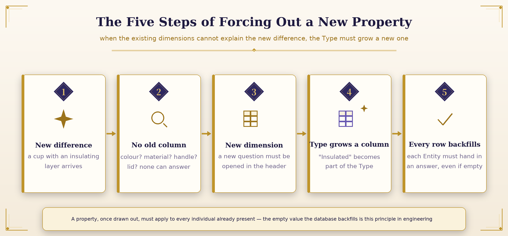

*Figure 4-5 The Five Steps of Forcing Out a New Property*

#### The Exact Counterpart in Normalisation Theory

This asymmetry has an exact counterpart in the theory of database normalisation: first normal form (1NF) requires that each column hold only one value, that multiple values not be crammed into a single column — which is precisely the database version of "a property is one dimension, and each individual can have only one definite value on that dimension". And when we need to add a column, it means the Type itself has changed; in database practice this corresponds to a schema change — an action far graver than adding a row, one that calls for careful assessment.

| Action | Level touched | Counterpart in Type theory | Cost |
| --- | --- | --- | --- |
| Add a row | Content layer | Type unchanged, one more Entity | Light: the structure does not move |
| Add a column | Structure layer | The Type grows a new dimension | Heavy: every Entity must backfill |
| Change the primary key | Identity layer | The Entity's identity is broken | Extreme: the whole relational network snaps |

*Table 4-2 The Levels and Costs of Three Kinds of Change (the third is taken up in 4.4)*

The concept of the primary key also echoes the philosophical discussion of identity: the identity of an object depends not on its property values — a cup can change colour, change material — but on a mark that stands above all properties and serves solely to identify it. This insight is developed in 4.4; before that we must deal with a more basic rule: a column must run through every row.

### 4.3 Why a Column Cannot Change Because of One Row

This "Type" called the header has a rule that looks strict but is in fact natural: in one table all rows share the same set of columns; some cups cannot have one more column and others one less. Put in the language of Chapter 2: a property is a dimension, and a dimension must run through all individuals before they can be compared.

If each row were allowed to decide for itself whether to have a given column, disaster would follow at once: if the question "colour" existed for some cups and not for others, then "compare the colours of all cups" could not be done at all — you could not ask "which cups are transparent", because it would be unclear whether every row even had an answer to look up under "colour".

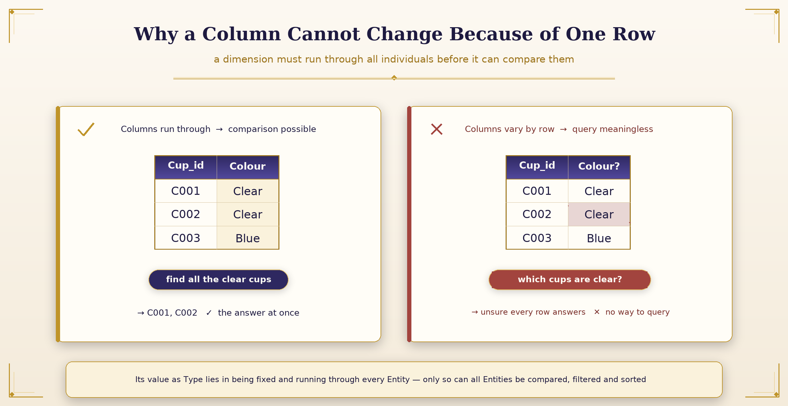

*Figure 4-6 Columns Run Through, and Only Then Is Comparison Possible*

#### The Publicness of a Dimension

A dimension is public by nature. A ruler that is to measure everything cannot exist for only some things; a question that is to compare all individuals must be open to all individuals. The value of the header as Type lies precisely in its being fixed and running through every Entity — only so can all Entities be placed under one frame and compared, filtered, sorted.

The power of a database query rests on exactly this promise: every row has the same set of columns to be queried. "Find all the transparent cups" can be executed as a precise operation because the dimension "colour" is open to every row without exception. Columns running through is the database's promise of comparability.

> **◆ The Precondition of Comparison**
>
> The precondition of comparison is asking the same question of every individual. A table whose columns vary from row to row looks more flexible but in fact robs the whole frame of the ability to compare.

### 4.4 The Primary Key: What Lets Each Row Be Identified on Its Own

We have said the header is the Type and the rows are the Entities, but one thing has been left out: for a row to be identified on its own and pointed to by another table, it first needs a column that belongs to that row alone and has nothing to do with the content of any other column — that is the primary key. Cup_id in the cup table is that table's primary key. It is not the cup's colour or material, nor any property at all; it is purely an identity code whose only function is to say which cup this is.

Even if two cups have exactly the same colour, material, handle and lid, as long as their Cup_id differs the database knows they are two different Entities and will not merge them into one. The primary key has to be unrelated to content because it has to hold up the fact of "the same Type": if a cup changes colour, the primary key must not change with it, or the database will think that after the colour change there is a brand-new cup. The primary key is the bottom-most credential of an Entity's identity — properties may be swapped at will, the primary key may not.

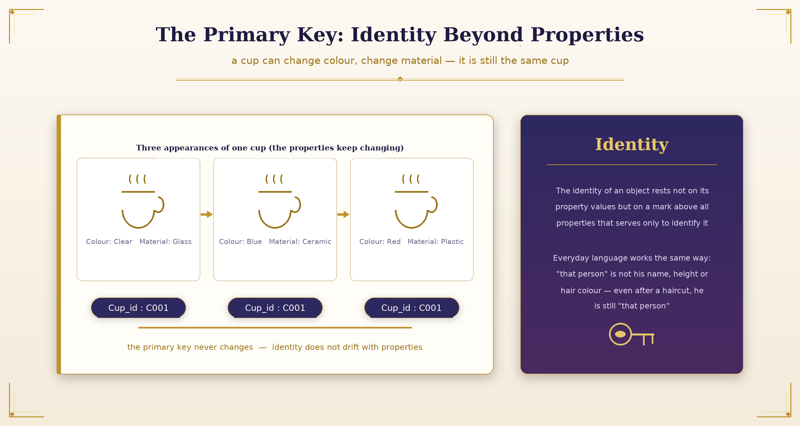

*Figure 4-7 The Primary Key: Identity Beyond Properties*

#### Identity: Pointing in Everyday Language

This design principle has a familiar face in philosophy: the discussion of identity. The identity of an object depends not on its property values but on a mark that stands above all properties and serves solely to identify it. When we say "that person" we do not mean his name, his height or his hair colour, but "that particular person" — even if he has cut his hair and changed height he is still "that person". The primary key of a database is exactly this everyday capacity for pointing, fixed in the form of one column.

In the language of Type theory it can be put more precisely: an Entity is "the one that is pointed to", and the primary key is the structured residue of the act of pointing itself. Properties describe an Entity's appearance; the primary key carries its identity. Appearance belongs to the content layer, identity to the frame layer — the distinction between Type and Entity appearing once again.

#### The Primary Key Is Immutable: Stability of the Relational Network

In practice this principle has an important consequence: once assigned, the value of a primary key should never be changed. If the cup with Cup_id = C001 were renamed C009, every detail record that ever referred to C001 (for instance the rows in the parts table whose "cup" is C001) would point at something that no longer exists, and the whole relational network would snap.

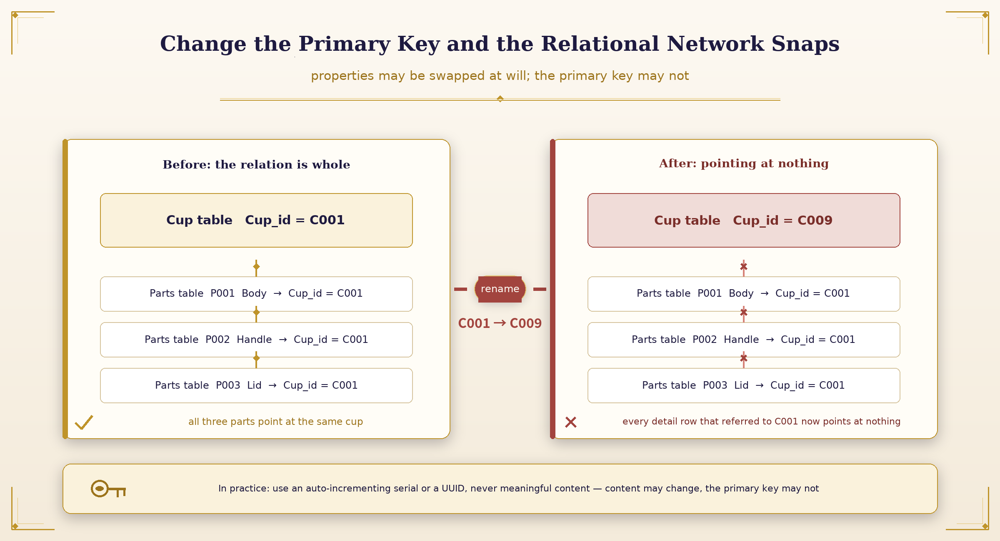

*Figure 4-8 Change the Primary Key and the Relational Network Snaps*

This is why in practice a primary key is usually an auto-incrementing serial number or a randomly generated UUID rather than meaningful content such as colour or material — because meaningful content may change, and the primary key may not. Using a code that is "always meaningless" to carry an identity that "never changes" is engineering's most careful guardianship of identity.

> **◆ Identity and Appearance**
>
> Properties may be swapped at will, the primary key may not — what is swapped is appearance, what must not be swapped is who it is. The identity of an Entity is the only anchor of the whole relational network.

### 4.5 Master and Detail, Reference: How the Cup Table and the Parts Table Are Joined by Type

With a primary key, tables can identify and connect to one another. Let us use the cup table and the parts table to see how it works:

| Cup_id (PK) | Name |
| --- | --- |
| C004 | Cup |

*Table 4-3 The Cup Table (master)*

| Part_id (PK) | Cup_id (FK) | Part name | Material |
| --- | --- | --- | --- |
| P001 | C004 | Body | Glass |
| P002 | C004 | Handle | Glass |
| P003 | C004 | Lid | Glass |

*Table 4-4 The Parts Table (detail, and master of itself): its Cup_id column references the primary key of the cup table*

#### Master: the Source of the Type; Detail: Existing by Attachment

The master-detail relation is about which table's Type the other table attaches to. The cup table is the master and the parts table the detail — every row in the parts table must first belong to some cup before it means anything (the row "handle" must first say which cup's handle it is); a part record cannot exist out of nowhere with no cup to belong to. This is exactly the way of property values: a property value too must first attach to a concrete Type; there cannot be a record "colour = transparent" with no cup whose colour it is. Every row of the detail table must first reference some Type in the master table before it can stand.

#### Reference: Pointing, Not Copying

Reference is about how the detail table knows which Type of the master table it belongs to. The "cup" column in the parts table does not hold the cup's name or colour or any such content, but the cup's primary key — the sole function of that column is to point at one Type in the cup table, and it does nothing else. That is "reference": not copying the whole record over, but storing a primary key that points at another Type, and going back to the corresponding master table for details when they are needed.

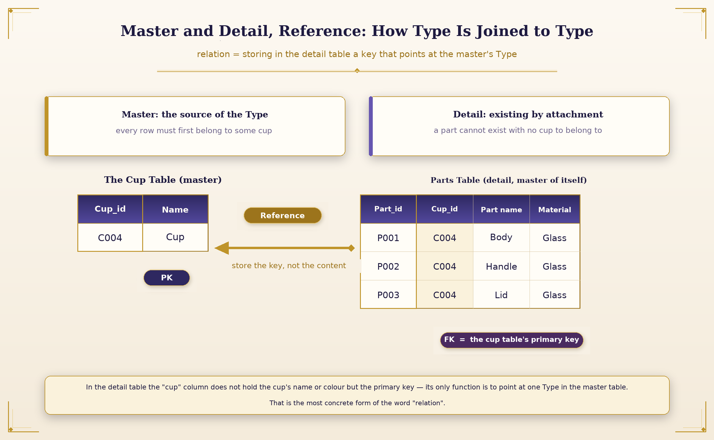

*Figure 4-9 Master and Detail, Reference: Joining Type to Type by Primary Key*

This is the most concrete form of the word "relational" in relational database: Types are not bound to one another by content but by one column in the detail table — storing a primary key that points at a Type in the master table — which joins the two. Content changes, pointing does not; a relation built on pointing is therefore firmer than any copy. The whole database is just such a net woven from primary keys: each Type looks after its own content, and between them they exchange nothing but pointing.

> **◆ The Definition of Relation**
>
> Relation = storing, in the detail table, a column that points at the primary key of the master table. Pointing, not copying — when details are needed, go back to the master table and look them up.

## Essentials — The Essentials of This Chapter

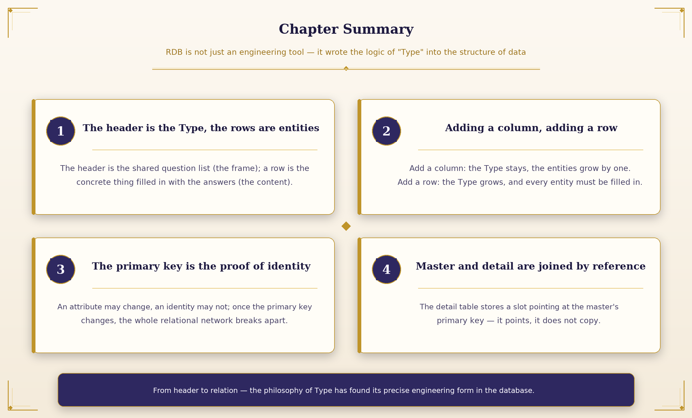

*Figure 4-10 The Essentials of This Chapter: Four Correspondences to Remember*

**Key Points**

- **The header is the Type, the rows are the Entities:** the header is a shared list of questions (the frame), the rows are concrete things filled with answers (the content).

- **Adding a row is light, adding a column is heavy:** a new row leaves the Type still and adds one Entity; a new column grows the Type and every Entity backfills.

- **The primary key is the credential of identity:** properties may change, identity may not; once the primary key is changed the relational network snaps.

- **Master and detail are joined by reference:** the detail table stores a column pointing at the master's primary key — pointing, not copying.

> *From header to relation — the philosophy of Type has found its precise engineering form inside the database. An RDB is not merely an engineering tool; it is a machine that executes the logic of Type billions of times a day.*

*— End of Chapter 4 —*

www.longreat.net

Changfeng Chang  gamma@livemail.tw

Tingying Chang  mindaiworks@gmail.com
