# Ontypology

# Type Set Expressions

*From Notation to Operation — deriving the Type Set into a set of checkable expressions*

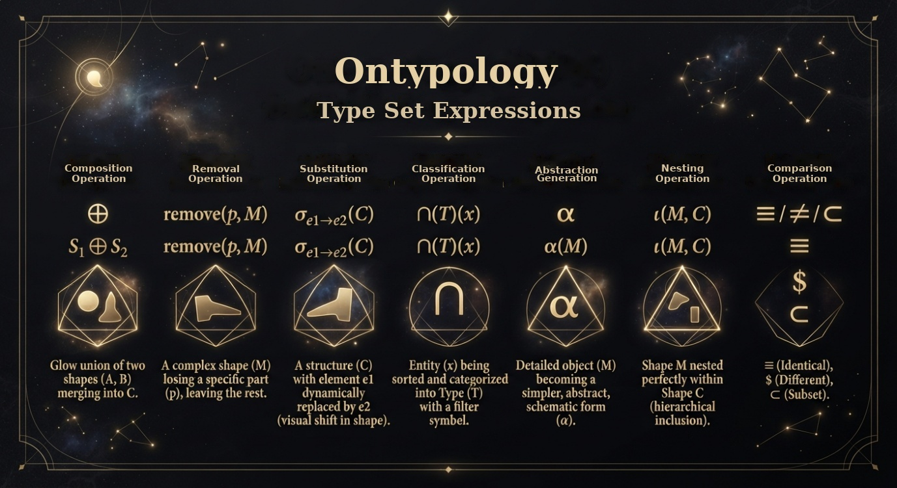

## TABLE OF CONTENTS

- Preface: The Task of This Volume
- Reading Guide: The World of Expressions
- 0.1 What Is an Expression
- 0.2 Why the Type Set Needs Its Own Operations
- 0.3 Derivation Roadmap
- Chapter 1 The Stage of Operations: A Quick Tour of the Type Set Backbone
- 1.1 Three Axes, Three Bracket Forms
- 1.2 Two Ordered Pairs, One Axiom, One Criterion
- 1.3 Anatomy of Type Set Notation
- 1.4 The Kit of Three: Definition, Criterion, Inference
- Chapter 2 The Syntax of Expressions: Objects, Levels, Signs
- 2.1 General Form: Types in, Types out
- 2.2 Three Classes of Operand
- 2.3 Brackets as Levels: The Scope of an Operation
- 2.4 Survey of Operators in This Volume
- Chapter 3 The Composition Operator ⊕: Assembling Parts into One Type
- 3.1 Definition and the Derivation of Closure
- 3.2 Deriving the Algebraic Laws: Associativity Holds, Commutativity Holds
- 3.3 Example: The Coffee Cup and Two Contrasts
- Chapter 4 The Removal Operator remove: Removing Parts, a Three-Level Criterion
- 4.1 Definition and the Three-Level Criterion
- 4.2 Deriving the Algebraic Laws
- 4.3 Example: Three Levels of the Smartphone and Two Contrasts
- Chapter 5 The Substitution Operator σ: Content Changes, Identity Does Not
- 5.1 Definition
- 5.2 The Identity-Preservation Theorem
- 5.3 Algebraic Laws: Commutation, Composition, Clearing
- 5.4 Example: The Cup and Two Contrasts
- Chapter 6 The Classification Operator ∩(T) and Abstraction α: Writing a Category as a Rule
- 6.1 Definition and Derivation of the Classification Operator
- 6.2 Abstraction α: Feature Extraction
- 6.3 The Monotone Inverse Theorem for F(T)
- 6.4 Example: The Sippy Cup and Two Contrasts
- Chapter 7 The Nesting Operator ι: A Type Enters a Container, Each Level Keeps Its Identity
- 7.1 Definition
- 7.2 The Nesting-Chain Level Theorem
- 7.3 ι and σ Commute; a Counterexample to Flattening
- 7.4 Example: Cup into Bag into Box, and Two Contrasts
- Chapter 8 The Comparison Operators ≡ / ≢ / ⊂: Identity at Which Level
- 8.1 Three Kinds of Identity
- 8.2 Degraded Forms and Choosing the Level of Comparison
- 8.3 Example: Comparison in Three Domains
- Chapter 9 Compound Operations and the Master Table of Algebraic Laws
- 9.1 Master Table of Algebraic Laws
- 9.2 Three Counterexample Derivations
- 9.3 A Worked Derivation of a Compound Expression
- Chapter 10 Turning the Three-Layer Judgment into Expressions: Three Simultaneous Conditions
- 10.1 The Three Judgment Expressions
- 10.2 Full Worked Derivation: The Smartphone
- 10.3 The Derivational Value of Judgment Expressions
- Chapter 11 Types in, Types out: Expressions Connect to the Time Type
- 11.1 Every Operation Is Types in, Types out
- 11.2 Higher-Order Composition: The Time Type Function Library
- 11.3 The Two Libraries Compared
- Chapter 12 How to Use It Accurately: The Expression-Derivation Version
- 12.1 The Six Derivation Steps
- 12.2 The Eight-Question Checklist
- 12.3 Five Kinds of Misuse Contrasted
- 12.4 A Complete Case: One Expression from Definition to Proof
- Chapter 13 A Complete Content Plan: learn · practice · apply · teach · build
- 13.1 The Five-Stage Route of learn, practice, apply, teach, build
- 13.2 An Eight-Week Learning Route
- 13.3 Choosing by Situation: Which Operation, When
- 13.4 Acceptance Standards
- Review: Key Points Consolidated and Self-Check
- R-1 Five Expressions, Three Laws, One Judgment
- R-2 Notation and Operation Are Two Sides of One Thing
- R-3 Accuracy Is Checkable Accuracy
- Exercises: Reference Answers
- Appendix A Master Table of Operators
- Appendix B Quick Reference: Terms and Notation
- Appendix C Quick Reference: Derivation Templates

## Preface: The Task of This Volume

This volume does one thing only: it pushes the Type Set from notation to operation.

In Unit Type and Set Logic, a Type can already be fully notated — { part, ( content ), [ category ] }, the three bracket forms each doing their own work, the three axes each answering one question. In Mathematical Proof, this notation can already be written into a proof — the three supplements restore rule, identity and structure one by one, and the six proof steps make every step checkable. But after complete notation and rigorous proof, one step remains unfinished: how do Types operate on one another? How are parts composed, how are they removed? How is content substituted? How is a category judged? How does a Type take its place, how is it compared?

That step is expression derivation. This volume derives the operations of the Type Set one by one: syntax first, then definition by expression, derivation of the algebraic laws by expression, and finally convergence into judgment expressions and method. Every expression obeys the same standard — it can be written step by step, checked item by item, and tested by counterexample.

*Figure D-1 Three Books, One Lineage: The Place of This Volume in the Type Set Derivation*

**[Note] The correspondence of the two books and the place of this volume**

| **Source backbone** | **Already established** | **Derivation position in this volume** |
| --- | --- | --- |
| Three axes, three brackets · Type Set notation | How a Type is described and notated | Chapter 1: the stage of operations |
| Ordered pairs and criteria | T=(F(T),∩(T)), C=(id(C),S(C)), the three levels of remove, the axiom of invariance | Chapters 3–8: derivation expression by expression |
| The three-layer judgment | How the container, the BOM and abstraction are judged | Chapter 10: turning the judgment into expressions |
| The six proof steps | How a proof is written accurately | Chapter 12: the six derivation steps |

*Table 0-1 The Backbones of the Two Books and the Corresponding Derivation Positions in This Volume*

Cases from several domains run in parallel throughout the book: cup, smartphone, electric vehicle, program module and organizational department take the stage in turn. Every expression is paired with a figure, an example and an exercise — one expression, one figure, one example, one exercise: this is the layout convention of the volume.

> **[Key point] In one sentence**
>
> Notation is the Type at rest, operation is the Type in motion; this volume puts the two on the same track.

## Reading Guide: The World of Expressions

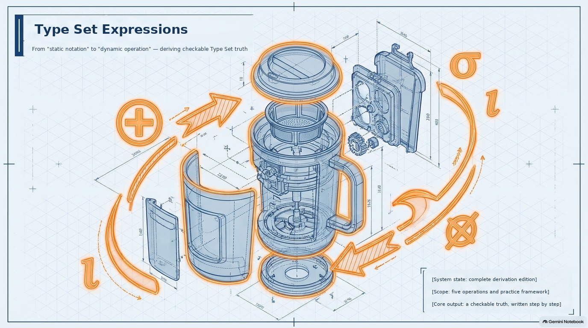

*Figure B-1 Blueprint Overview: Type Set expressions — from static notation to dynamic operation*

### 0.1 What Is an Expression

An expression is a formula that can be written out and checked step by step. It is not decoration of signs but a set of commitments: anyone who follows the expression obtains the same result and can check every one of your steps.

Mathematical set theory has its own operations: union ∪, intersection ∩, complement — they answer belongs or not, precisely and concisely. But the Type Set layers three value-adds on top of the mathematical set: { } adds the compositional structure of parts, ( ) adds an identity that does not change with content, [ ] adds a generation rule that judges new members automatically. Since the notation carries three layers of value-add, operations cannot be of one layer only — composing a Type, removing a Type, substituting a content, judging a category, nesting a position each need their own expression, and each their own algebraic laws.

### 0.2 Why the Type Set Needs Its Own Operations

> **[Derivation] Three reasons**
>
> First, levels must hold. The mathematical set flattens levels: in { cup, water } the cup and the water have equal standing. Operations of the Type Set must be written at the correct level — σ moves only content, ⊕ moves only parts, ∩(T) asks only about category.
>
> Second, identity must hold. The content is replaced, yet the container remains the same container — this axiom of invariance must hold inside the expression, and the identity-preservation theorem for σ is its direct corollary.
>
> Third, derivations must be checkable. Every algebraic law must be marked as holding or failing, and a failing law must come with a counterexample — the counterexample draws the boundary of legitimate use of the expression.

### 0.3 Derivation Roadmap

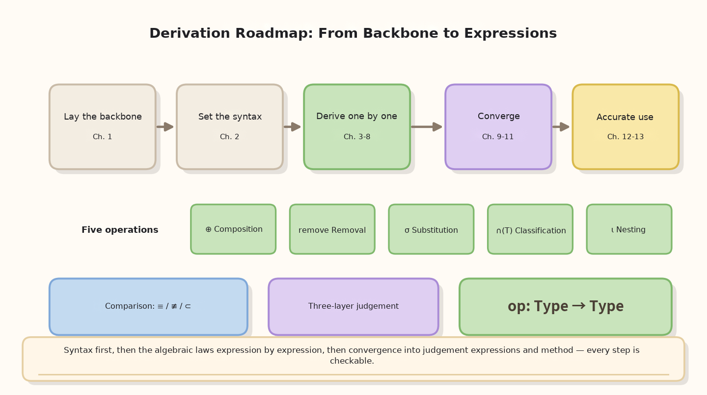

*Figure D-2 Derivation Roadmap: From Backbone to Expression*

The book advances in three parts. The first part lays the backbone: the foundations of the two books are arranged into the stage of operations (Chapters 1 and 2). The second part derives expression by expression: five operations plus comparison, one expression per chapter, each chapter running definition → derivation of algebraic laws → example → exercise (Chapters 3-8). The third part converges: the master table of algebraic laws and counterexamples, the expression form of the three-layer judgment, Types in, Types out and the link to the Time Type, then closing into accurate use and a complete content plan (Chapters 9-13).

> **[Key point] How to read**
>
> Readers in a hurry can grasp the backbone from the definition boxes and key-point boxes of each chapter; readers who want to derive to the end follow the derivation boxes step by step, then write their own expressions in the exercises.

**[Note] Guide to the blueprint cards**

| **Figure no.** | **Blueprint card** | **Contents** | **Location** |
| --- | --- | --- | --- |
| Figure B-1 | Blueprint overview | The whole-book blueprint: five operations and the practice framework | Start of the reading guide |
| Figure B-2 | The stage of operations | Three axes, three bracket forms, four cornerstones, op: Type → Type | End of Chapter 1 |
| Figure B-3 | Composition ⊕ | Assembly into a levelled whole, the status of the algebraic laws, contrastive warnings | End of Chapter 3 |
| Figure B-4 | Removal remove | The three-level identity criterion, idempotence, the asymmetry of removal and composition | End of Chapter 4 |
| Figure B-5 | Substitution σ | The identity-preservation theorem, same-level commutation, level comparison | End of Chapter 5 |
| Figure B-6 | Classification ∩(T) / abstraction α | Feature extraction and the rule-testing funnel, the monotone inverse of F(T) | End of Chapter 6 |
| Figure B-7 | Nesting ι | The nesting-chain level theorem, commutation with σ, levels that cannot be flattened | End of Chapter 7 |
| Figure B-8 | Comparison ≡ / ≢ / ⊂ | Three kinds of identity: container level / composition level / abstraction level, and the degradation marks | End of Chapter 8 |
| Figure B-9 | Master table of algebraic laws | What holds in the green zone, counterexamples and operating boundaries in the red zone | End of Chapter 9 |
| Figure B-10 | Three simultaneous conditions | The three-layer security gate J = J_C ∧ J_B ∧ J_T, single-layer blind spots contrasted | End of Chapter 10 |
| Figure B-11 | Connecting to the Time Type | The pipeline from Space Type to Time Type, effect-to-cause inference worked through | End of Chapter 11 |
| Figure B-12 | The six steps and the eight questions | The checkable six derivation steps, the essence of the eight-question self-check | End of 12.2 |
| Figure B-13 | Misuse and remedies | A guide to avoiding high-frequency misuse | End of 12.3 |
| Figure B-14 | The coffee cup under three tests | Field derivation: three questions on swapping the tea / removing the lid / the insulated cup | End of 12.4 |
| Figure B-15 | learn, practice, apply, teach, build | The evolution from learning to building, checkable accuracy | End of 13.1 |
| Figure B-16 | Implementation route | The five-stage funnel and the situational routing guide | End of 13.3 |
| Figure B-17 | The master blueprint | The Master Blueprint: a panoramic summary | End of review |

*Table 0-2 Blueprint Card Guide: One Card per Chapter, Figure and Text in Correspondence*

## Part One · Laying the Backbone

*First raise the stage of operations: the backbone of the Type Set, and the syntax of expressions*

## Chapter 1 The Stage of Operations: A Quick Tour of the Type Set Backbone

This chapter does not restate the theory of the two books; it only makes clear what the operations are to act upon. Three axes, three kinds of brackets, two ordered pairs, one axiom, one criterion — five pieces of equipment, and that is the whole stage on which every expression is derived.

### 1.1 Three Axes, Three Bracket Forms

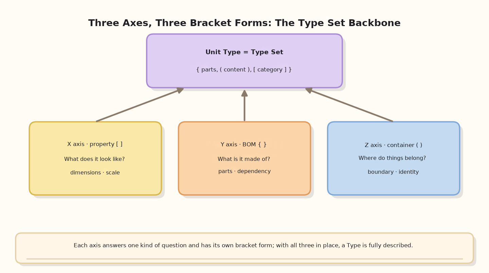

*Figure 1-1 Three Axes, Three Bracket Forms: The Backbone of the Type Set*

The X-axis property [ ] answers 'what it is like' — dimension is a property, scale is a property value; the Y-axis bill of materials { } answers 'what it is made of' — detach it and it still recognizes itself, so it enters the BOM; the Z-axis container ( ) answers 'where the thing is placed' — the boundary encloses an interior space, and identity does not change with content. Each of the three axes has its own bracket, its own criterion, and will have its own operation.

### 1.2 Two Ordered Pairs, One Axiom, One Criterion

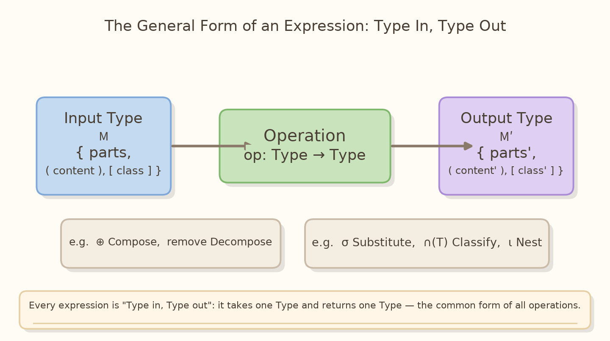

*Figure 1-2 The Foundation of Operation Derivation*

> **[Definition] The Foundation of Operation Derivation**
>
> Abstract category T = ( F(T), ∩(T) ) — feature set plus intersection criterion; x ∈ [T] ⇔ every f(x) holds.
>
> Container C = ( id(C), S(C) ) — identity plus interior space; content is replaceable, identity does not move.
>
> Axiom of invariance ∀ e1, e2 ∈ S(C): replacing e1 → e2 leaves id(C) unchanged.
>
> remove criterion remove(p, M): essential part ≢ M / function-degraded part ≡ M′ ⊂ M / non-essential part ≡ M.

These four are the starting point of every derivation in this volume. Each later theorem is derived from these four plus the Type Set notation — not one of them requires a new assumption.

### 1.3 Anatomy of Type Set Notation

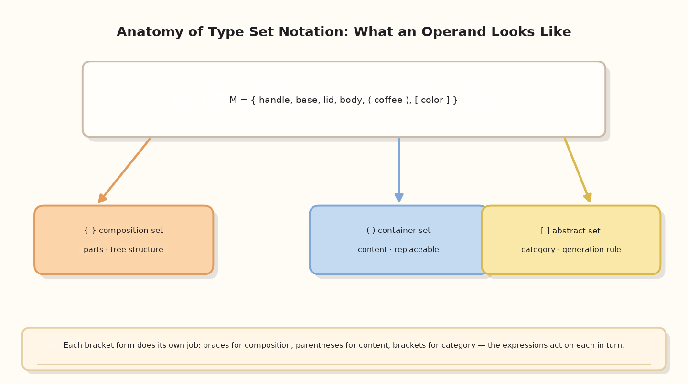

*Figure 1-3 Anatomy of Type Set Notation*

The Type Set M = { part, ( content ), [ category ] } is the object of operations. Inside { } are parts that can be detached, inside ( ) is content that has been put in, inside [ ] is category that has been stated. Brackets are not decoration but marks of level — a point that becomes the first rule of the syntax of operations in Chapter 2.

### 1.4 The Kit of Three: Definition, Criterion, Inference

The derivation of expressions keeps to the kit of three used in proof: the definition first makes clear what the object is, the criterion supplies a standard that can be checked item by item, and the inference moves step by step from definition and criterion to conclusion. The derivation of every algebraic law in this volume follows the same format — write the definition, cite the criterion, walk the inference, look for a counterexample.

> **[Key point] Key Points of This Chapter**
>
> - The stage of operations = three axes and three brackets + two ordered pairs + the axiom of invariance + the remove criterion.
> - The Type Set M = { part, ( content ), [ category ] } is the object of every operation.
> - The kit of three for derivation: definition, criterion, inference — every expression follows this format.

*Figure B-2 Blueprint Card: The Stage of Operations — Three Axes, Three Kinds of Brackets and the Syntax of Types in, Types out*

## Chapter 2 The Syntax of Expressions: Objects, Levels, Signs

Before deriving any expression, establish the syntax: what is the general form of an operation? On which three kinds of object does it act? How do brackets determine the scope in which an operation acts?

### 2.1 General Form: Types in, Types out

*Figure 2-1 The General Form of an Expression: Types in, Types out*

> **[Definition] The General Form of an Expression**
>
> Every expression is a mapping from Type to Type: op: Type → Type. It takes in one Type and gives out one Type — the input may be a part Type, a content Type or a category Type, and the output is likewise a Type that can be operated on again.

This form looks simple, yet it is the junction between this volume and the Time Type volume: the essence of the Time Type (verb, function, method) is precisely Types in, Types out. In Chapter 11 we shall see that the five operations are the basic model and that the higher-order functions of the Time Type library are the composite model — the two run on the same track.

### 2.2 Three Classes of Operand

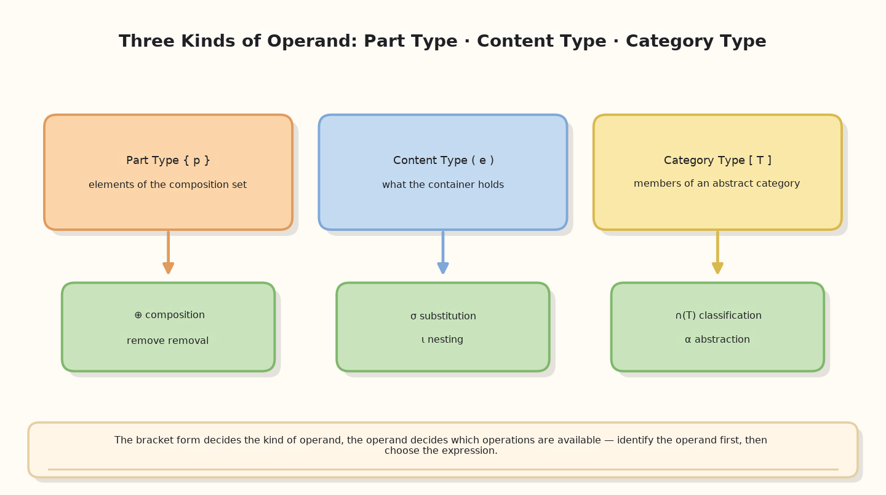

*Figure 2-2 Three Classes of Operand*

The kind of bracket determines the kind of object, and the kind of object determines the operations available: the part Type { p } is operated on by ⊕ and remove; the content Type ( e ) by σ and ι; the category Type [ T ] by ∩(T) and α. Mistaking the object is the commonest cause of misuse in expressions — take a content Type to composition, take a part Type to substitution, and however smoothly the formula is written, it will not derive the right result.

### 2.3 Brackets as Levels: The Scope of an Operation

*Figure 2-3 Brackets as Levels*

An expression is valid only when written inside the bracket scope: ⊕ and remove move parts only within { }; σ moves content only within ( ); ∩(T) asks about category only within [ ]. Write the brackets clearly and the scope of the operation cannot go wrong — a rule that looks trivial, yet is the common root of every algebraic law that later fails to hold: any formula that crosses levels or exceeds its scope must have a separate condition laid down or be rewritten.

### 2.4 Survey of Operators in This Volume

| **Operation** | **Symbol** | **Operand** | **In one sentence** | **Derivation chapter** |
| --- | --- | --- | --- | --- |
| Composition | ⊕ | part Type { p } | Combine parts into one Type, levels preserved | Chapter 3 |
| Removal | remove(p, M) | part Type { p } | Remove a part and see whether identity survives | Chapter 4 |
| Substitution | σ_{e1→e2}(C) | content Type ( e ) | Change the content, identity unmoved | Chapter 5 |
| Classification | ∩(T)(x) | category Type [ T ] | Enters the category only when every feature passes | Chapter 6 |
| Abstraction | α | a group of Types → category | Extract features, generate a category | Chapter 6 |
| Nesting | ι(M, C) | Type into container | Establish standing, each level holding in its own right | Chapter 7 |
| Comparison | ≡／≢／⊂ | Type and Type | Identity at which level? Degradation is marked ⊂ | Chapter 8 |

*Table 2-1 Survey of Operators in This Volume*

> **[Example] Recognising the Object, Choosing the Operation**
>
> Situation: which operation should be used for 'the water in the cup is changed to coffee'?
>
> Analysis: water and coffee are content Types ( e ), and the cup is a container C = (id(C), S(C)) — what is changed is the content, what does not move is the identity, so use σ_{water→coffee}(C).
>
> Contrast: if the question is 'is it still a cup once the lid is removed', what is moved is the part Type, and remove(lid, M) applies; if the question is 'does a thermos count as a cup', the category Type is at issue, and ∩(cup)(thermos) applies.

> **[Exercise] Exercises**
>
> P01 (Object identification): which expression applies to each of the three statements below? (1) Replace the textbook in the schoolbag with a notebook; (2) detach the camera module from the phone; (3) decide whether a sippy cup is a cup.
>
> P02 (Syntactic judgment): why can the rule '⊕ moves only parts, σ moves only content, ∩(T) asks only about category' block most misuse? Give one consequence of misuse for each.

## Part Two · Deriving Expression by Expression

*Five operations plus comparison: one expression, one figure, one example, one exercise each; every expression runs 'definition → algebraic law → example → exercise'*

## Chapter 3 The Composition Operator ⊕: Assembling Parts into One Type

The first operation acts on the part Type { p }: it combines the parts of two (or more) Types into one Type. Composition is the starting point of every structure — without it the BOM is only a list; with it, parts become a whole.

### 3.1 Definition and the Derivation of Closure

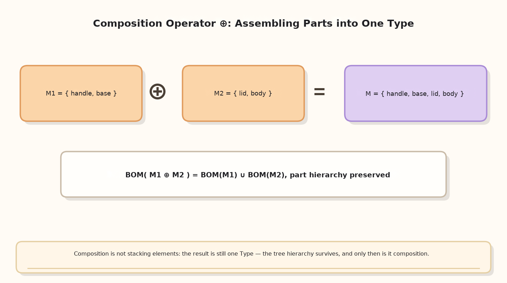

*Figure 3-1 The Composition Operator ⊕*

> **[Definition] Definition 3-1 (Composition)**
>
> Let M1 and M2 be Type Sets. The composition M1 ⊕ M2 is defined as a new Type M satisfying:
>
> (i) BOM(M) = BOM(M1) ∪ BOM(M2) — every part is taken in;
>
> (ii) the levels and dependencies among the parts are preserved (tree structure);
>
> (iii) the content ( ) and category [ ] of M are set separately according to the situation of construction.

> **[Theorem] Theorem 3-1 (Closure): A Composition Is Still a Type**
>
> Derivation: (1) by definition, every part of M1 ⊕ M2 enters BOM(M); (2) levels and dependencies are preserved, so the parts are no longer merely side by side; (3) content and category each have their place. Taken together, M satisfies the complete notation of a Type Set { part, ( content ), [ category ] } — hence the output of composition is still a Type. (Q.E.D.)

Closure guarantees that ⊕ can be used repeatedly: the result of a composition can itself be composed again — which is exactly how complex Types are built up level by level.

### 3.2 Deriving the Algebraic Laws: Associativity Holds, Commutativity Holds

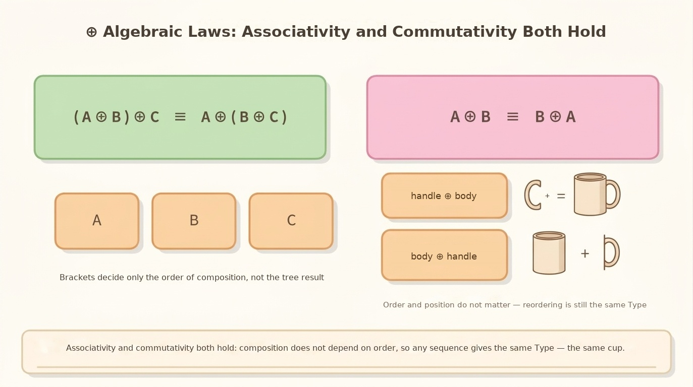

*Figure 3-2 The Algebraic Laws of ⊕*

> **[Theorem] Theorem 3-2 (Commutativity)**
>
> A ⊕ B ≡ B ⊕ A

> **[Theorem] Theorem 3-3 (Associativity)**
>
> ( M1 ⊕ M2 ) ⊕ M3 ≡ M1 ⊕ ( M2 ⊕ M3 )

> **[Derivation] Derivation of Associativity**
>
> (1) once expanded, both sides have the BOM BOM(M1) ∪ BOM(M2) ∪ BOM(M3) — union is itself associative;
>
> (2) the levels and dependencies of the parts are fixed by the structure of 'what is attached to what', and have nothing to do with the bracket order of composition;
>
> (3) by the comparison standard for Type identity (same BOM and same dependency structure, see Chapter 8), the two sides are ≡. (Q.E.D.)

Further, if M2 has no parts at all (an empty BOM), then M1 ⊕ M2 ≡ M1 — the 'partless Type' plays the role of the identity element. This property is much used in the construction flow of 'raise the skeleton first, then fill in the parts'.

### 3.3 Example: The Coffee Cup and Two Contrasts

> **[Example] Example 3-1**
>
> Coffee cup = handle ⊕ base ⊕ lid ⊕ body.
>
> Derivation: the four parts are composed one by one — (handle ⊕ base) ⊕ (lid ⊕ body), and by associativity the brackets may be placed at will; after composition BOM = { handle, base, lid, body }, the handle depends on the body and the lid covers the body — levels preserved, and the formation of the coffee cup holds.
>
> Contrast 1 (organizational department): the business department ⊕ the administration department make up a division — each department has its own remit and reporting relations (dependencies); swap the order and reconnect the relations, and it is another organizational Type.

> **[Exercise] Exercises**
>
> P03 (Composition derivation): write the composition formula for 'a smartphone' (mainboard, battery, screen, camera module: at least four parts) and mark one set of dependencies among them.
>
> P04 (Counterexample search): find an example in your life or work where 'commutativity of ⊕ holds', and write out at which level A ⊕ B differs from B ⊕ A.

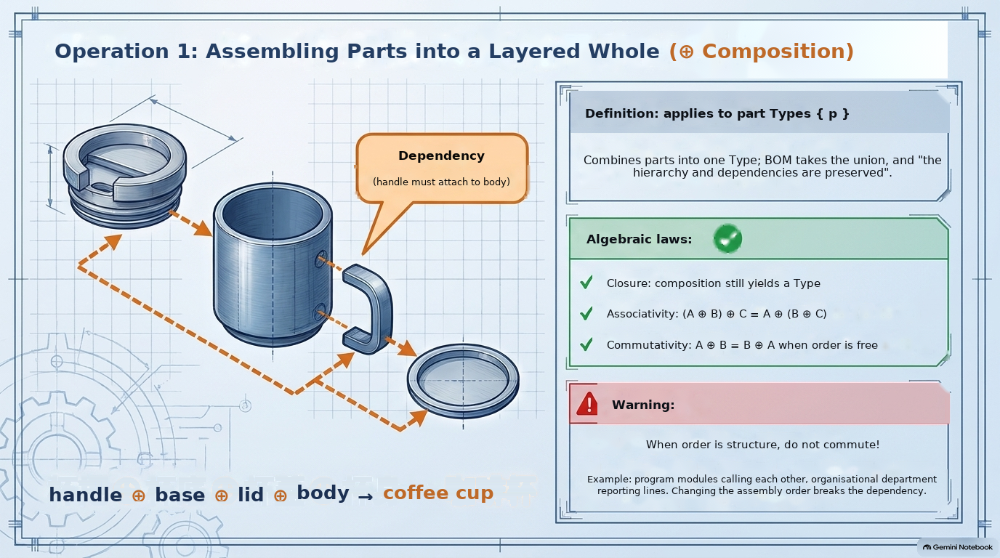

*Figure B-3 Blueprint Card: Operation One ⊕ Composition — Assembling Parts into a Whole That Has Levels*

## Chapter 4 The Removal Operator remove: Removing Parts, a Three-Level Criterion

The opposite of composition is removal. But 'removal' is not a simple inverse operation — taking off the handle and taking off the base have entirely different consequences. The remove operator writes this difference into a criterion formula that can be checked item by item.

### 4.1 Definition and the Three-Level Criterion

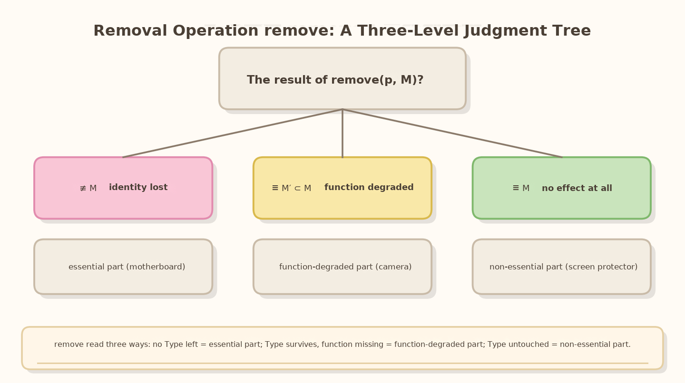

*Figure 4-1 The remove Decision Tree*

> **[Definition] Definition 4-1 (Removal)**
>
> remove(p, M): the operation that removes part p from Type M. The result after removal branches three ways according to identity:
>
> Essential part — remove(p, M) ≢ M: identity is lost, M is no longer M (dissolution);
>
> Function-degraded part — remove(p, M) ≡ M′ ⊂ M: the Type remains, the function is missing; record the degraded form;
>
> Non-essential part — remove(p, M) ≡ M: the Type does not move at all.

The derivation of the three-level criterion formula is direct: it is the remove criterion itself, merely rewritten in the language of expressions. What matters is the use that follows — each of the three levels gives a statement about the identity of the whole, and in a proof one need only match the case.

### 4.2 Deriving the Algebraic Laws

> **[Theorem] Theorem 4-1 (Idempotence): remove( p, remove(p, M) ) ≡ remove(p, M)**
>
> Derivation: (1) after the first remove, p is no longer in the BOM; (2) the second remove finds no p and changes neither BOM, levels nor dependencies; (3) the results of the two are identical Types. (Q.E.D.)

> **[Theorem] Theorem 4-2 (Branch Distribution)**
>
> If p belongs only to the BOM of M2, then ( M1 ⊕ M2 ) remove p ≡ M1 ⊕ ( M2 remove p ).
>
> Derivation: (1) remove acts only on the branch M2, where p lies; (2) the BOM and levels of the M1 branch are unaffected; (3) by the closure of ⊕, both sides are still Types, with the same BOM and the same dependencies. (Q.E.D.)

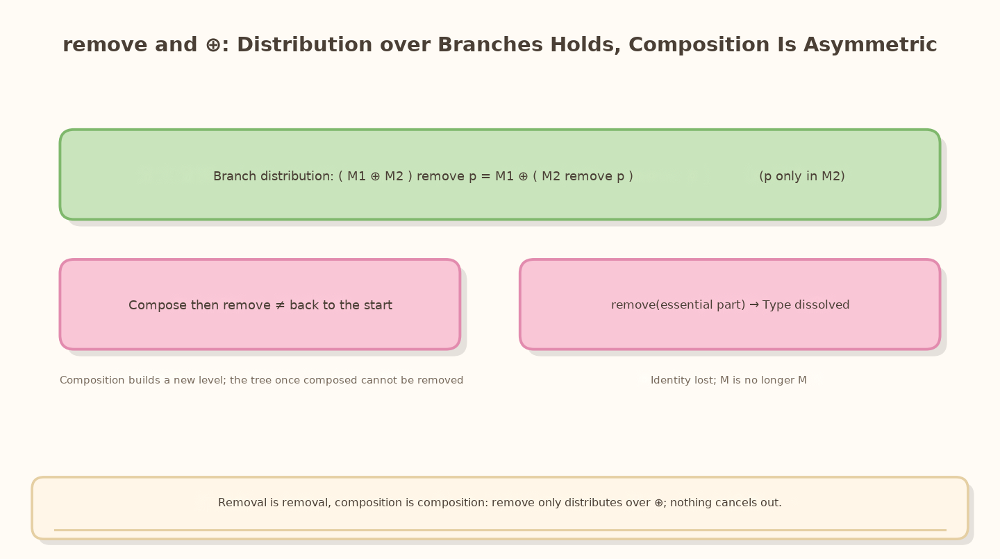

*Figure 4-2 The Relation between remove and ⊕*

> **[Misuse] Counterexample 4-1 (Asymmetry of Removal and Composition)**
>
> 'Compose first, then remove' cannot return to the point before composition: the dependencies established at composition already exist, and removing a part leaves only a break, it does not cancel the structure that was once composed.
>
> More extreme is remove(essential part, M): identity is lost, and what is produced is no longer any Type that existed before — this is called dissolution. Removal is not the inverse operation of composition; the two are independent.

### 4.3 Example: Three Levels of the Smartphone and Two Contrasts

> **[Example] Example 4-1**
>
> M = smartphone: remove(mainboard, M) ≢ M (essential part, dissolution); remove(camera module, M) ≡ M′ ⊂ M (function-degraded part, loss of photography); remove(screen protector, M) ≡ M (non-essential part).
>
> Contrast 1 (car): the steering wheel is a function-degraded part — after removal it is still recognized as a car, but it cannot steer; the engine is an essential part, and its removal is dissolution.
>
> Contrast 2 (organization): abolishing an essential department (finance, say) amounts to dissolution — the organization is no longer an organization; abolishing an optional department (a product line, say) is degradation; abolishing an ad hoc project team is the removal of a non-essential part.

> **[Exercise] Exercises**
>
> P05 (Three-level classification): take at least six parts of 'a laptop computer', sort them into three levels with the remove criterion formula, at least one part per level, and write out the derivations.
>
> P06 (Branch distribution): let M = bookshelf ⊕ book, with an unimportant magazine p on the shelf. Using Theorem 4-2, write two equivalent forms of (M) remove p, and explain why p is a non-essential part.

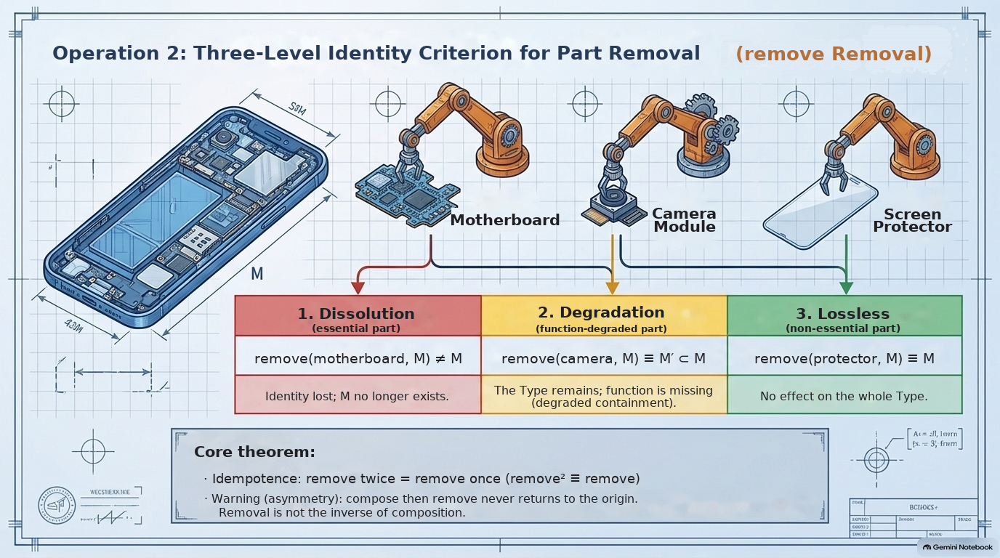

*Figure B-4 Blueprint Card: Operation Two remove Removal — the Three-Level Identity Criterion for Removing a Part*

## Chapter 5 The Substitution Operator σ: Content Changes, Identity Does Not

The third operation leaves the parts behind and enters the level of ( ): substitution of content. It is the heart of container logic — and the first embodiment of the axiom of invariance inside an expression.

### 5.1 Definition

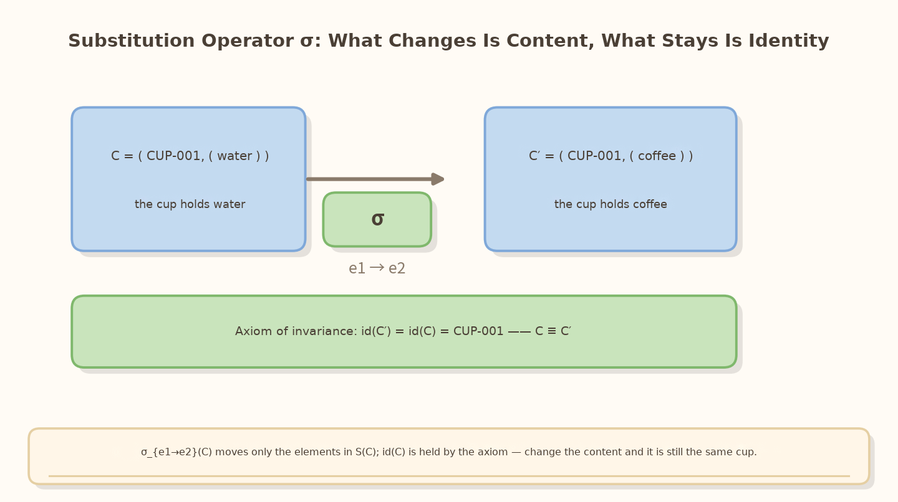

*Figure 5-1 σ and the Axiom of Invariance*

> **[Definition] Definition 5-1 (Substitution)**
>
> Let C = ( id(C), S(C) ) and e1 ∈ S(C). The substitution operator σ_{e1→e2}(C) replaces e1 in S(C) with e2, producing C′.
>
> Convention: σ moves only content within the scope of ( ), touching neither id(C) nor the parts { } and category [ ].

### 5.2 The Identity-Preservation Theorem

> **[Theorem] Theorem 5-1 (Identity preservation): id( σ_{e1→e2}(C) ) = id(C)**
>
> Derivation: (1) by definition, σ alters only elements in S(C); (2) by the axiom of invariance — ∀ e1, e2 ∈ S(C), replacing e1 with e2 does not change id(C); (3) hence after substitution id(C) is constant, and σ(C) ≡ C (identity at the container level). (Q.E.D.)

This theorem is the expression form of 'the content has changed and it is still the same cup'. It also supplies a tool of judgment: when you want to confirm 'is this the same thing', check whether the change falls only within the scope of σ — if it does, identity is held by the axiom; if id or a part is touched, the analysis must switch to remove or comparison.

### 5.3 Algebraic Laws: Commutation, Composition, Clearing

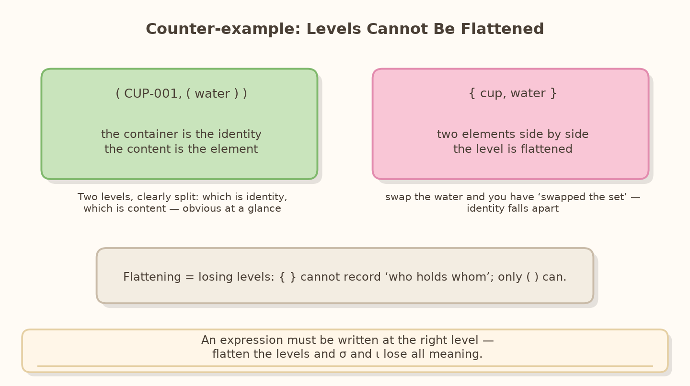

*Figure 5-2 The Algebraic Laws of σ*

> **[Theorem] Theorem 5-2 (commutativity)**
>
> Two substitutions in the same container commute:σb( σa( C ) ) ≡ σa( σb( C ) ) (a and b are not each other's substitution target).
>
> Derivation: ① both substitutions act only on S(C); ② two independent changes to set elements are independent of order; ③ the final states of S(C) are the same in both expressions and id(C) is untouched in both, hence ≡. (Q.E.D.)

Composition and emptying are the other two members of the σ family:σc( σb( σa(C) ) ) is successive substitution, which can first be merged into a single expression; σ_{e→∅} empties the content—an empty cup is still a cup, and id(C) remains unchanged.

> **[Misuse] Contrast 5-1 (difference of level)**
>
> { water } replaced by { coffee }: a pure set has swapped its element and becomes another set—the two are ≢.
>
> ( water ) replaced by ( coffee ): the container changes its content, id(C) is unchanged—the two are ≡.
>
> The same sentence, "water replaced by coffee", written inside { } and inside ( ) is two different operations—the brackets determine the level, and the level determines the result.

### 5.4 Example: the cup and two contrasts

> **[Example] Example 5-1**
>
> C = ( CUP-001, (water) ): σ_{water→coffee}(C) = ( CUP-001, (coffee) ). Derivation: σ moves only S(C) → by Theorem 5-1, id is unchanged → the container level is ≡.
>
> Contrast 1 (folder): a folder is a container and a file is content—replace report.docx with slides.pptx and the folder is still that folder; σ holds.
>
> Contrast 2 (position): a position is a container and a person is content—A leaves and B takes over; the duties, establishment and number of the position are unchanged, and the id of σ_{A→B}(position) is unchanged; but if even the remit of the position is changed, what moves is the parts and the category, and it is no longer σ.

> **[Exercise] Exercises**
>
> P07 (identity-preservation derivation): using Theorem 5-1, write out the full derivation for "the banknote in the wallet is replaced by another", and state which axiom is invoked in the second step.
>
> P08 (the boundary of σ): is "replace the cup with a bowl, with water in the bowl" a σ? Why? (Hint: is it the content or the container itself that moves?)

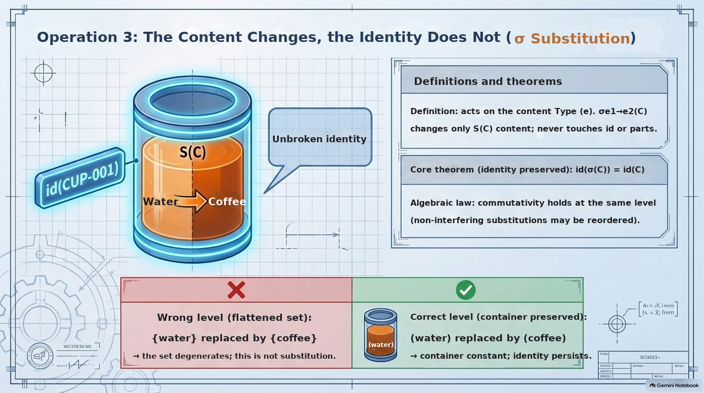

*Figure B-5 Blueprint card: operation three, σ substitution—what is changed is the content, what is not moved is the identity*

## Chapter 6 The classification operator ∩(T) and abstraction α: writing a category as rules

The fourth operation leaves parts and content behind and enters the level of [ ]. Classification asks "does x count as T"; abstraction asks "how is T generated"—one judges, one generates, a mutually inverse pair at the category level.

### 6.1 Definition and derivation of the classification operator

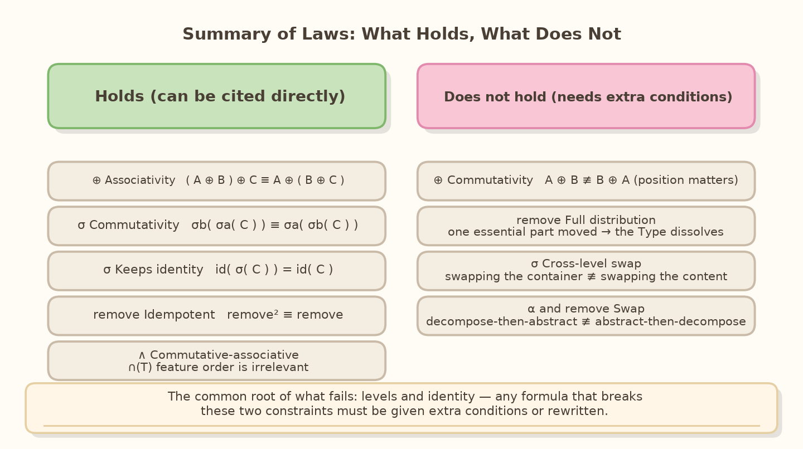

*Figure 6-1 The ∩(T) intersection-criterion funnel*

> **[Definition] Definition 6-1 (classification)**
>
> Let T = ( F(T), ∩(T) ), F(T) = { f1, f2, ..., fn }. The classification operator is defined as:
>
> ∩(T)( x ) = f1(x) ∧ f2(x) ∧ ... ∧ fn(x).
>
> x ∈ [T] ⇔ ∩(T)(x) = true; if any single feature fails, then x ∉ [T].

> **[Theorem] Theorem 6-1 (feature order is irrelevant)**
>
> The result of ∩(T)(x) does not depend on the order in which the features are checked.
>
> Derivation: ① the classification formula is a conjunction (∧) of features; ② conjunction is commutative and associative; ③ so the order in which f1 and f2 are checked does not affect the result—the judgment can always be broken into a chain of independently checkable small steps. (Q.E.D.)

Obvious as this theorem looks, it is the theoretical warrant for a tick-box checklist: a reviewer can reproduce your classification judgment in any order.

### 6.2 Abstraction α: feature extraction

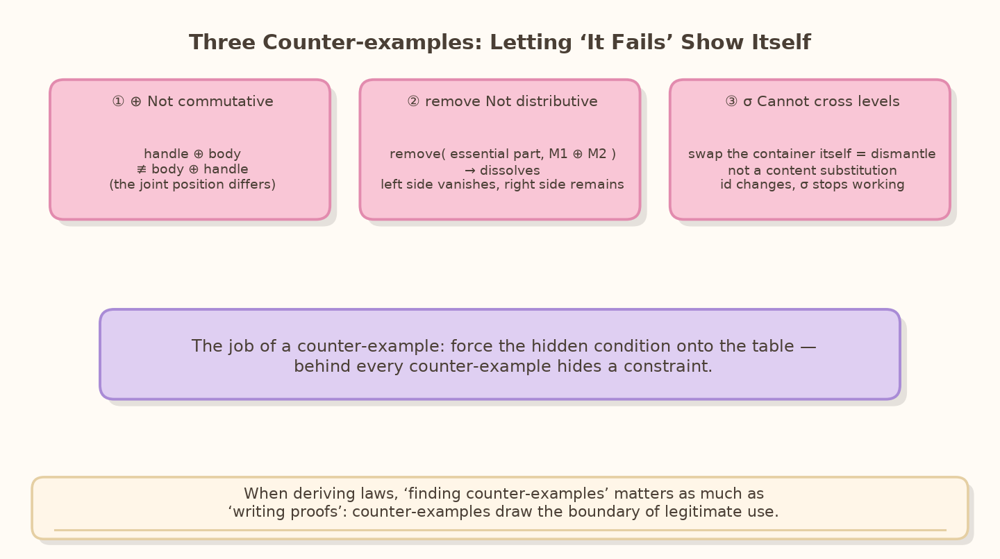

*Figure 6-2 Abstraction α*

> **[Definition] Definition 6-2 (abstraction)**
>
> α( x1, x2, ..., xk ) → T: extract the shared features from a group of concrete Types and generate the abstract category T = ( F(T), ∩(T) ) .
>
> The property-emergence rule (following Unit Type and Set Logic): if a difference matches no existing property → open a new property and backfill it; if it matches → only add a new property value.

α is the operation that goes from samples to rules: mug, glass, paper cup → α → the category "cup". Once T is generated, even a thermos cup or a sippy cup that has not yet appeared can be classified correctly by ∩(T) automatically—exactly what a closed list cannot do.

### 6.3 The monotone inverse theorem for F(T)

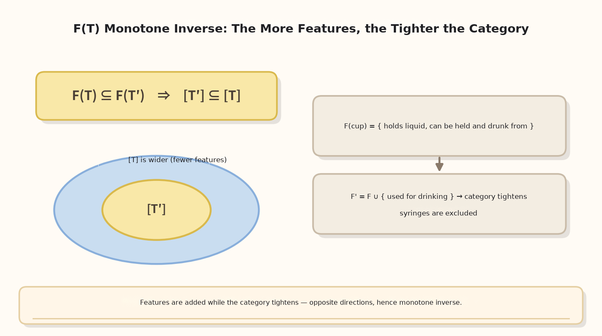

*Figure 6-3 Monotone inverse of F(T)*

> **[Theorem] Theorem 6-2 (monotone inverse)**
>
> If F(T) ⊆ F(T′), then [T′] ⊆ [T].
>
> Derivation: ① F(T′) demands more features than F(T); ② x ∈ [T′] means that x passes all the features of T′, and therefore passes all the features of T as well; ③ hence x ∈ [T], that is, [T′] ⊆ [T]. (Q.E.D.)

A feature is an addition, a category is a tightening—the directions are opposed, hence monotone inverse. The theorem applies directly to rule revision: to make a category stricter, add features; to make it broader, remove features—the effect of a change can be derived in advance instead of re-tested case by case.

### 6.4 Example: the sippy cup and two contrasts

> **[Example] Example 6-1**
>
> F(cup) = { can hold liquid, can be drunk from by hand }. Sippy cup: f1 passes, f2 passes (drunk from by hand through a straw) → ∩(cup)(sippy cup) = true → sippy cup ∈ [cup].
>
> Borderline cases: a bowl fails f2 → ∉; a syringe passes both, but is excluded if F(T) contains "used for drinking"—the choice of feature list is a stance on the concept.
>
> Contrast 1 (program interface): does a module count as a "pluggable interface"? F = { has explicit inputs and outputs, implementation is replaceable }—item-by-item checking is more effective than a general argument.
>
> Contrast 2 (organizational remit): does a given project team count as a "research unit"? F(R&D) = { carries out prototype development, produces technical documents }—the classification formula turns a qualification review into a checkable process.

> **[Exercise] Exercises**
>
> P09 (classification derivation): let F(electric vehicle) = { can travel on roads, can carry people and goods, has a power system, can be driven and controlled }, and use the classification formula to derive Tesla Model 3 ∈ [electric vehicle] item by item, writing out the f(x) judgment at each step.
>
> P10 (monotone inverse): if the feature "capacity under 500ml" is added to F(cup), derive the change in [T′] with Theorem 6-2, and give an object that was originally in the category and is later excluded.

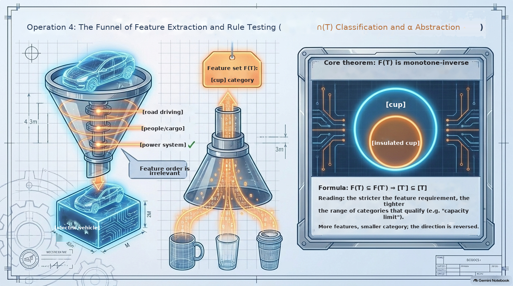

*Figure B-6 Blueprint card: operation four, ∩(T) classification and α abstraction—the funnel of feature extraction and rule checking*

## Chapter 7 The nesting operator ι: a Type enters a container, each layer keeps its own identity

The fifth operation puts a Type into a container—it establishes position. Nesting is the normal state of spatial structure: cup into bag, bag into box, box into room; the compositional world of Types grows layer by layer through nesting.

### 7.1 Definition

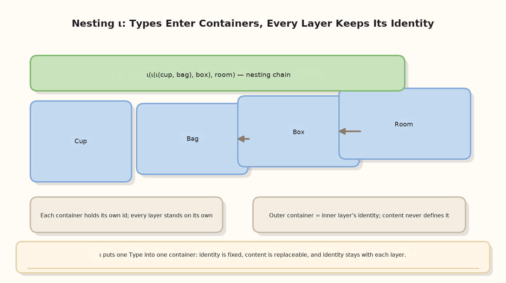

*Figure 7-1 The ι nesting chain*

> **[Definition] Definition 7-1 (nesting)**
>
> ι( M, C ): place Type M into the interior space S(C) of container C; M becomes the content of C.
>
> Nesting chain: ι( ι( ι( cup, bag ), box ), room )—each layer is a structure of container plus content.

### 7.2 The nesting-chain level theorem

> **[Theorem] Theorem 7-1 (each layer keeps its own identity)**
>
> Every container layer in a nesting chain keeps its own id, which does not change when the content of the layers above or below changes.
>
> Derivation: ① each layer of ι establishes only one container-content relation; ② by the axiom of invariance, a change in the content of a layer does not change the id(C) of that layer; ③ the id of the layer below is part of the content of this layer, and its change still falls within the scope of σ; ④ by induction, the id of every layer in the chain is constant. (Q.E.D.)

The theorem gives nesting a clean reading: the container above is the identity of the layer below, and content does not define the container in reverse—settle the identity first, then speak of content, layer after layer.

### 7.3 Commutation of ι and σ, and the counterexample to flattening

> **[Theorem] Theorem 7-2 (ι and σ commute)**
>
> At the correct level, "nest first, then change the content" and "change the content first, then nest" are equivalent: ι( σ_{e1→e2}(M), C ) ≡ σ_{e1→e2}( ι(M, C) ) (the substitution occurs inside M).
>
> Derivation: ① σ acts on S(M) of M; ② ι only puts the whole M into C and does not touch the interior of M; ③ the levels and ids of the final states of both expressions are identical. (Q.E.D.)

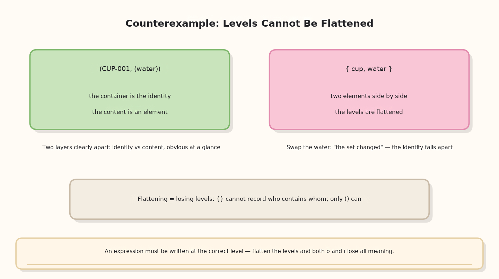

*Figure 7-2 Counterexample: levels cannot be flattened*

> **[Misuse] Counterexample 7-1 (levels cannot be flattened)**
>
> { cup, water } flattens container and content into sibling elements—replace the water and it becomes another set, and the identity disperses.
>
> ( CUP-001, ( water ) ) keeps both levels: the container is the identity, the content is the element—only then does σ have room to act.
>
> Conclusion: once the levels are flattened, σ and ι lose all meaning—an expression must be written at the correct level.

### 7.4 Example: cup into bag into box, and two contrasts

> **[Example] Example 7-1**
>
> ι(cup, bag): the cup becomes the content of the bag; the id of the cup does not change by going into the bag, and the id of the bag does not change by holding the cup.
>
> Contrast 1 (data directory): file ι folder ι disk—each layer is a container in its own right; moving the file (changing layer) changes neither the file itself nor the id of any folder layer.
>
> Contrast 2 (organizational hierarchy): employee ι department ι business group—the employee is content and the department is a container; transferring an employee is σ (changing content), and the departmental establishment is unchanged; the department layer is not flattened with the employees into a single list.

> **[Exercise] Exercises**
>
> P11 (nesting derivation): write the full nesting chain for "phone ι case ι shipping box ι truck", and use Theorem 7-1 to explain why the identity of the phone is unchanged when the truck is swapped for another.
>
> P12 (distinguishing flattening): is "a list of the 30 students in the class" a Type? Which layer does it lack, such that σ and ι cannot be applied? (Hint: is the list a { } or a ( )?)

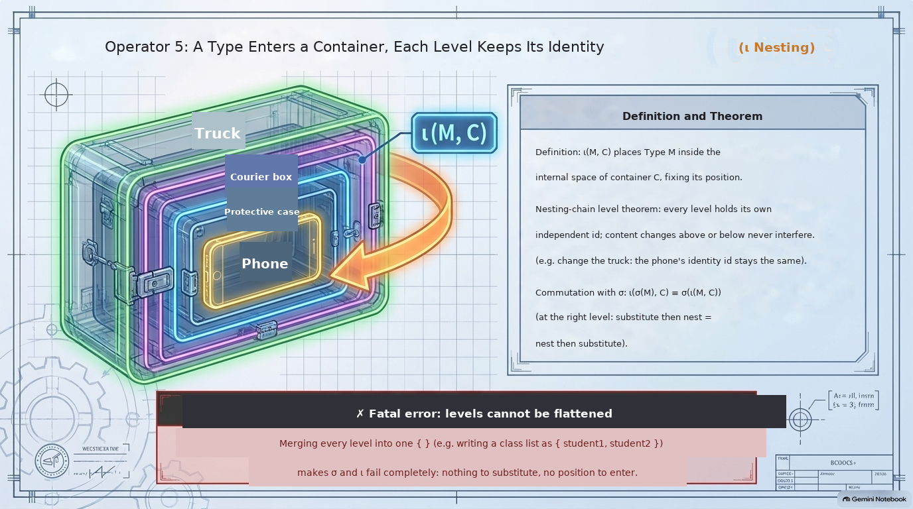

*Figure B-7 Blueprint card: operation five, ι nesting—a Type enters a container, each layer keeps its own identity*

## Chapter 8 The comparison operators ≡ / ≢ / ⊂: identity at which level

The last operation does not build Types but compares two of them. Yet identity comes in three kinds: identity of id, identity of Type, identity of class—before comparing, ask which level.

### 8.1 The three kinds of identity

*Figure 8-1 The comparison operators: three kinds of identity*

> **[Definition] Definition 8-1 (the three kinds of identity)**
>
> Identity of id (container level): id(C) is the same before and after σ—water becomes coffee, and CUP-001 is still CUP-001.
>
> Identity of Type (composition level): the BOM and the dependency structure are the same—two phones of the same model ≡ one and the same Type.
>
> Identity of class (abstraction level): all ∩(T) criteria pass—an electric vehicle and a petrol vehicle ≡ the car Type.

### 8.2 The degradation formula and choosing the level of comparison

Degradation is written with ⊂: the result of remove(function-degraded part) is written M′ ⊂ M—M′ is still a Type of M, but with one function less. The full symbol set of the comparison operators is: ≡ (identical), ≢ (not identical), ⊂ (degradation containment)—three symbols, each in its place, never mixed.

> **[Derivation] Derivation demonstration: electric vehicle ≡ car Type**
>
> ① Identify the objects of comparison: Tesla Model 3 and the car Type; ② choose the level: this case compares identity of class (the classification level); ③ cite the criteria: F(car) = { can travel on roads, can carry people and goods, has a power system, can be driven and controlled }; ④ item by item: all pass, ∩(car)(Tesla) = true; ⑤ conclusion: electric vehicle ≡ car Type—the mode of power (internal combustion engine or electric motor) is not in F(T) and does not affect identity of Type. (Q.E.D.)

> **[Misuse] Contrast 8-1 (wrong level of comparison chosen)**
>
> "The books on the shelf": the shelf is a container (swap the books, not the shelf, identity of id); the combination "books on the shelf" is a { } set (swap the books and the combination changes, ≢);
>
> In one physical scene, different objects of comparison mean different levels—before comparing, ask "which whole am I comparing".

### 8.3 Example: comparison in three domains

> **[Example] Example 8-1**
>
> Cup: (water) and (coffee) are ≡ at the container level (the same CUP-001); two white porcelain cups are ≡ at the identity-of-Type level; a mug and a paper cup are ≡ at the identity-of-class level (both are cups).
>
> Program: the same service switches to a different database implementation—interface and responsibilities unchanged, identity of class ≡; a microservice is split into two—the BOM changes, ≢.
>
> Organization: the company is renamed—id unchanged (the same legal entity), identity of id ≡; after a merger the departments are restructured—BOM and dependencies all change, ≢.

> **[Exercise] Exercises**
>
> P13 (choosing the level): "the same employee moves to another seat"—identity at which level? Write the derivation and state the level of comparison.
>
> P14 (degradation formula): the air conditioning is removed from a car; write the full judgment formula for M′ ⊂ M and explain why it is written ⊂ and not ≢.

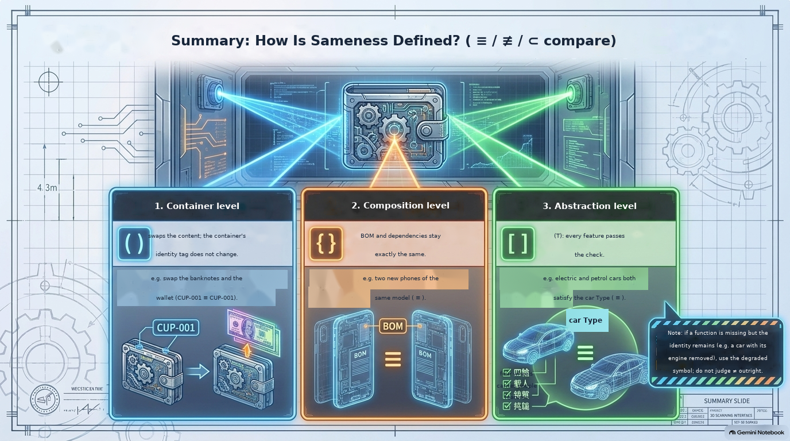

*Figure B-8 Blueprint card: the comparison operators ≡ / ≢ / ⊂—how to define identity*

## Part II · Confluence

*Gathering the five expressions: the master table of algebraic laws, simultaneous judgment formulas, Types in Types out, and the link to Time Type*

## Chapter 9 Composite operations and the master table of algebraic laws

All five operations have now been derived one by one. This chapter puts them together: which algebraic laws can be cited with confidence, which must be given conditions of their own, what the counterexamples to the ones that fail look like—a single master table gathers the whole derivation.

### 9.1 Master table of algebraic laws

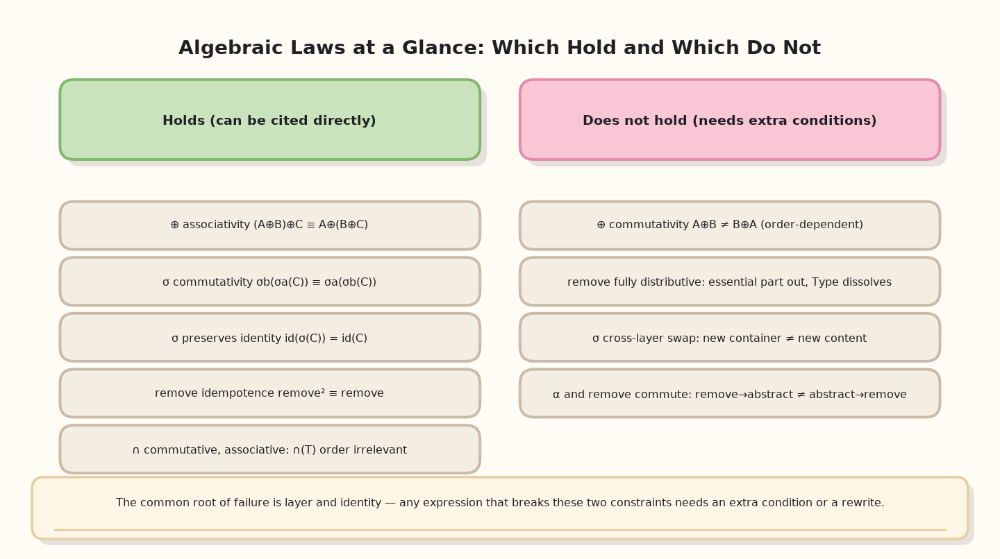

*Figure 9-1 Master table of algebraic laws*

| **Algebraic law** | **Formula** | **Status** | **Condition / reason** |
| --- | --- | --- | --- |
| ⊕ associativity | (A⊕B)⊕C ≡ A⊕(B⊕C) | Holds | union is associative; the level is independent of bracketing |
| ⊕ identity element | M ⊕ ε ≡ M | Holds | ε = the partless Type |
| ⊕ commutativity | A⊕B ≡ B⊕A | Holds | order-independence is part of the Type |
| remove idempotence | remove² ≡ remove | Holds | p is not found the second time |
| remove distributes over a branch | (M1⊕M2) remove p ≡ M1⊕(M2 remove p) | Holds | when p is only in M2 |
| remove distributes in full | remove(essential part) → dissolution of the Type | Does not hold | after dissolution it is not the original Type |
| σ commutativity | σb(σa(C)) ≡ σa(σb(C)) | Holds | same container, neither is the other's target |
| σ preserves identity | id(σ(C)) = id(C) | Holds | axiom of invariance |
| σ across levels | changing the container ≠ changing the content | Does not hold | touching the id leaves the scope of σ |
| ∩(T) order | feature check order is irrelevant | Holds | conjunction is commutative and associative |
| F(T) monotone inverse | F(T) ⊆ F(T′) ⇒ [T′] ⊆ [T] | Holds | more features, tighter category |
| α and remove commute | remove then abstract ≢ abstract then remove | Does not hold | the samples change, so the rules change with them |
| ι and σ commute | ι(σ(M),C) ≡ σ(ι(M,C)) | Holds | when the substitution is inside M |

*Table 9-1 Master table of algebraic laws: five hold, four do not, two hold with conditions*

### 9.2 Three Counterexample Derivations

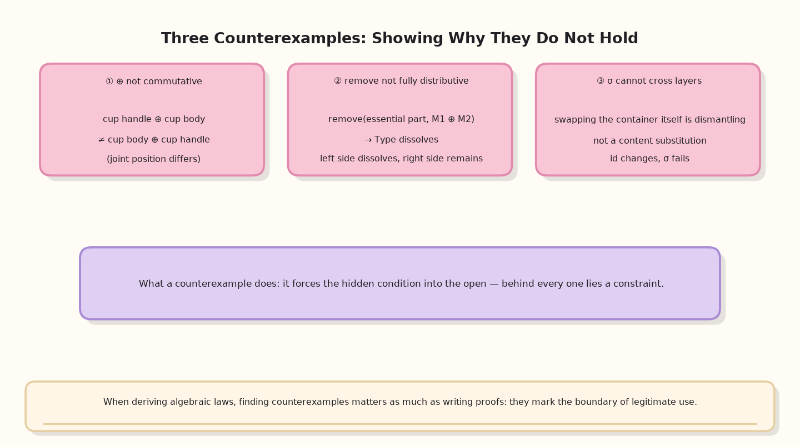

*Figure 9-2 Three Counterexample Derivations*

> **[Misuse] What counterexample derivation does**
>
> ① ⊕ is not commutative: cup handle ⊕ cup body ≢ cup body ⊕ cup handle—the joint position differs, so the dependency structure differs.
>
> ② remove is not fully distributive: remove(essential part, M1⊕M2) dissolves the Type outright—the left side vanishes while the right side M1⊕(M2 remove p) remains; the two sides are not equal.
>
> ③ σ cannot cross levels: replacing 'the container itself' is disassembly (it moves id), not content substitution—the precondition of σ is broken.
>
> Behind every counterexample lies a constraint: level and identity. Any expression that violates these two must either carry an added condition or be rewritten.

### 9.3 A Composite Derivation, Demonstrated

> **[Derivation] Demonstration: the composite of σ and ⊕**
>
> Situation: coffee cup M = { cup handle, cup base, lid, cup body, (coffee), [white] }; replace the content with tea and add a coaster.
>
> ① Replace the content: σ_{coffee→tea}(M) = { cup handle, cup base, lid, cup body, (tea), [white] }—only ( ) moves;
>
> ② Add a part: M′ = σ(M) ⊕ coaster = { cup handle, cup base, lid, cup body, coaster, (tea), [white] }—only { } moves;
>
> ③ Check: the two steps belong to different levels and do not interfere (level independence); the result is uniquely determined. (Q.E.D.)

A composite derivation has only one rule: move one level at a time. Level independence guarantees that operations on different levels do not interfere—this is the fundamental reason a complex expressioncan be broken into a string of simple expressions.

> **[Exercise] Exercises**
>
> P15 (judging the laws): which of the following hold? ① (M1⊕M2)⊕M3 ≡ M1⊕(M3⊕M2) (hint: commutativity); ② σ followed by σ; ③ remove(p, M) ⊕ p ≡ M (hint: removal and composition are asymmetric).
>
> P16 (build your own counterexample): construct a concrete counterexample to 'α and remove do not commute' (hint: if part of the sample is removed first, what becomes of the extracted features?).

*Figure B-9 Blueprint card: system confluence—the master table of laws and the boundaries of operation*

## Chapter 10 The Three-Layer Judgment as Expressions: Three Formulas in Simultaneous Form

The three-layer judgment of Type Logic—container gate, BOM gate, abstraction gate—can now be written as three expressions and then combined into a single judgment. Judgment is upgraded from 'walking a process' to 'deriving a formula'.

### 10.1 The Three Judgment Formulas

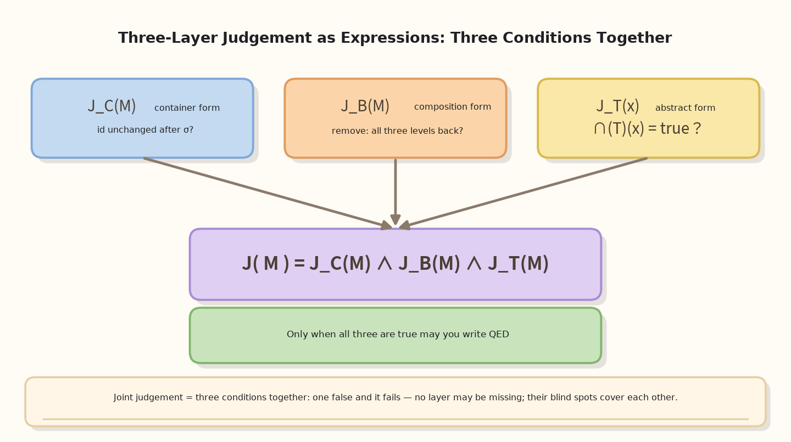

*Figure 10-1 Three formulas in simultaneous form*

> **[Definition] Definition 10-1 (three-layer judgment formulas)**
>
> Container formula J_C(M): does there exist a content substitution σ that leaves id unchanged?—J_C = true ⇔ the container gate holds.
>
> Composition formula J_B(M): does the BOM pass the check 'taken apart, it still knows itself', and does every part's remove land back at all three levels?
>
> Abstraction formula J_T(x): ∩(T)(x) = true?
>
> Joint judgment J( M ) = J_C(M) ∧ J_B(M) ∧ J_T(M)—only when all three are true may 'Q.E.D.' be written.

The division of labour among the three formulas matches exactly the mutual covering of the three layers' blind spots: J_C guards identity, J_B guards structure, J_T guards rules. If any one formula is false the judgment fails—this is the expression-level version of 'no layer may be missing'.

### 10.2 A Full Derivation, Demonstrated: the smartphone

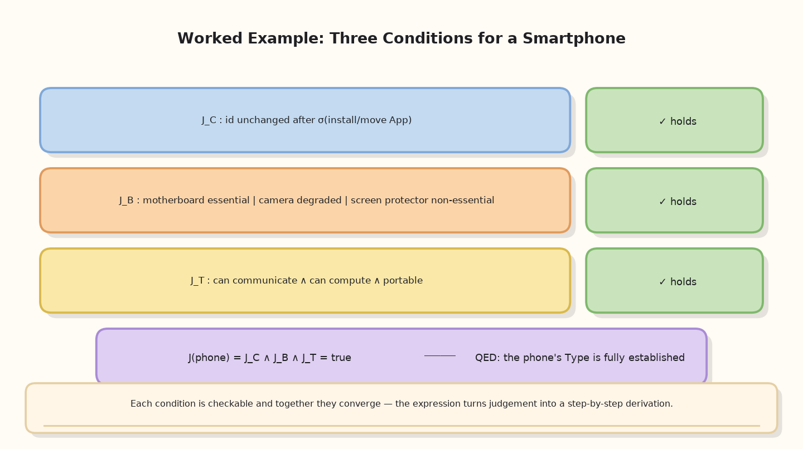

*Figure 10-2 The smartphone in three simultaneous formulas*

> **[Derivation] Demonstration: J(smartphone)**
>
> ① Identify the object: M = smartphone; write the Type Set: M = { mainboard, battery, screen, camera module, speaker, ..., (App), [smartphone] }.
>
> ② J_C: after σ_{install/move App}(M) the id is unchanged—J_C = true.
>
> ③ J_B: mainboard remove ≢ M (essential); camera module ≡ M′ ⊂ M (degraded); screen protector ≡ M (non-essential)—all three levels return in place, J_B = true.
>
> ④ J_T: F = { can communicate, can compute, is portable }, each item passes, ∩(T)(M) = true.
>
> ⑤ Simultaneous: J = true ∧ true ∧ true = true—the smartphone's Type holds in full. (Q.E.D.)

> **[Example] Contrast: the blind spots of a single-layer judgment**
>
> Look only at J_C: a tablet also installs Apps and would be misjudged as a phone; look only at J_B: a calculator also has a part structure; look only at J_T: a walkie-talkie can also communicate.
>
> Once the three formulas are simultaneous, the blind spots cover one another—any object that a single layer lets through is stopped by the other two.

### 10.3 The Derivative Value of Judgment Formulas

Writing the judgment as formulas has three immediate benefits. Checkable: a reviewer ticks each formula and reproduces the conclusion. Composable: a complex judgment can be derived formula by formula and then closed by simultaneous form. Error-locating: whichever formula is false marks the layer where the blind spot lies—far more precise than 'the judgment was wrong'.

> **[Exercise] Exercises**
>
> P17 (three simultaneous formulas): write the full J_C, J_B and J_T for 'electric vehicle', together with the simultaneous form, and mark at least one essential part in J_B.
>
> P18 (locating the blind spot): use the three simultaneous formulas to judge a 'smartwatch', and state at which formula it is stopped and why that formula returns false.

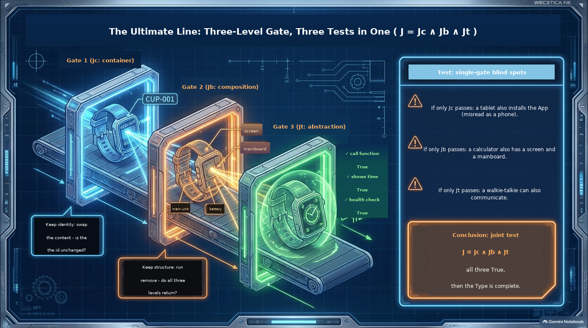

*Figure B-10 Blueprint card: the last line of defence—the three-layer security gate of simultaneous formulas*

## Chapter 11 Types In, Types Out: expressions join track with the Time Type

With the five operations derived, return to the general form set down in Chapter 2: op: Type → Type. This form is not merely the syntax of this volume—it is the definition of the Time Type.

### 11.1 Every Operation Is Types In, Types Out

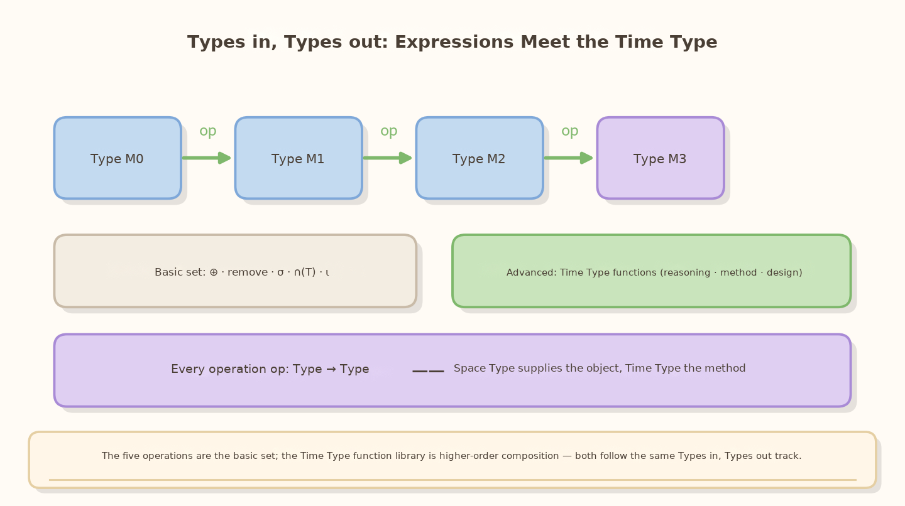

*Figure 11-1 Types in, types out, and the Time Type*

The Space Type (noun) supplies the objects of operation: the Type Set is 'what'. The Time Type (verb) supplies the action of operation: the function is 'how'. The five formulas ⊕, remove, σ, ∩(T) and ι are the 'basic models' of Types in, Types out—one in, one out, simple syntax, laws that can be checked.

### 11.2 Higher-Order Composition: the Time Type function library

> **[Definition] Basic models and higher-order models**
>
> Basic models: the five operations—they act on the parts, content and category of a Type Set, one step, one Type.
>
> Higher-order models: the Time Type function library—reasoning (causal / retroductive / simulation / statistical / reverse), thinking methods (forward / reverse / horizontal / vertical / first principles), design, analysis, problem solving—all are composite chains of the basic models: one Type in, one Type out.

> **[Example] Example 11-1: a reasoning chain as a composite of operations**
>
> Situation: 'The lid is gone—where did the cup go?'—retroductive reasoning.
>
> ① Observe the Type: remove(lid, M) ≡ M′ ⊂ M (degraded)—the lid is a function-degraded part;
>
> ② Trace back the chain: in which containers did M′ after σ_{lid→∅} once appear?—reverse lookup along the ι chain: cup ι desk ι office;
>
> ③ Compare: run an ≡ comparison on the Type at each candidate location and lock onto the one whose id matches.
>
> A reasoning chain = remove + σ + ι reverse lookup + ≡ comparison, composed—every step of the Time Type stands on a Type of the Space Type.

### 11.3 The Two Libraries Compared

| **Angle** | **The five operations of this volume** | **The Time Type function library** |
| --- | --- | --- |
| Position | The basic models of Types in, Types out | The higher-order composites of Types in, Types out |
| Granularity | One step, one Type | A string of formulas, many Types back and forth |
| Derivation | Laws checkable formula by formula | Grounded in the laws of the basic models |
| Use | Write formulas | Choose functions, assemble derivation chains |

*Table 11-1 The five operations and the Time Type function library compared*

This comparison explains one thing: why the Time Type depends on the Space Type—what a function takes in and puts out is always a Type; without a Type a function has nothing to move. The five formulas derived in this volume are the shared underlying operations of the whole library.

> **[Exercise] Exercises**
>
> P19 (decomposing a composite): break 'find out where the lid of the coffee cup on the desk went' into at least three basic operations and write the composite expression.
>
> P20 (positioning the judgment): is 'design search' a basic model or a higher-order model? Why? Write out the basic operations it may contain.

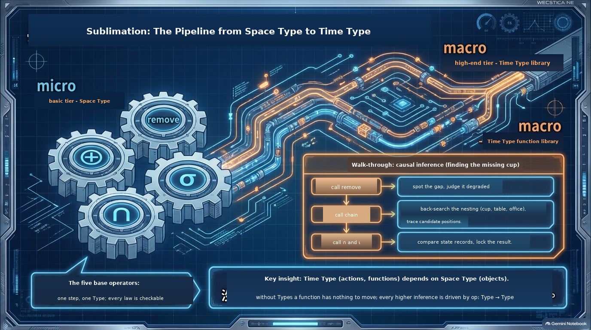

*Figure B-11 Blueprint card: sublimation—the pipeline from the Space Type to the Time Type*

## Chapter 12 Accurate Use: the derivation version

The tools of derivation are all in place. The final chapter gathers them into a method: faced with a real problem, how to write the correct expression step by step, and how to check it yourself before handing it over. Accurate means checkably accurate.

### 12.1 The Six Derivation Steps

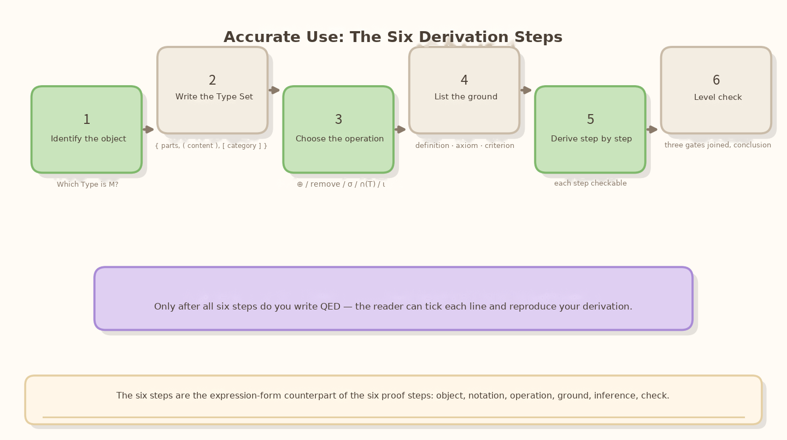

*Figure 12-1 The six derivation steps*

| **Step** | **Action** | **Output** | **Common tools** |
| --- | --- | --- | --- |
| 1 Identify the object | Name the object of the judgment | One sentence: which Type M is | — |
| 2 Write the Type Set | Full notation | { parts, ( content ), [ category ] } | Three brackets |
| 3 Choose the operation | Pick the formula by the question | ⊕ / remove / σ / ∩(T) / ι / ≡ | Table of operation objects |
| 4 Lay out the foundation | Write the definition, axiom, criterion | T, C, axiom of invariance, remove | Chapter 1 foundations |
| 5 Derive step by step | One step, one level | The derivation body | Master table of laws |
| 6 Check the levels | Three-layer joint check | Conclusion (Q.E.D.) | Three simultaneous formulas |

*Table 12-1 The six derivation steps as an operation table*

The six steps are the expression version of the six proof steps: step three, 'choose the proposition', becomes 'choose the operation'; step five, 'criterion reasoning', expands into 'step-by-step derivation'—the rest of the spirit is identical: identify the object first, write the notation second, walk the reasoning third, check last.

### 12.2 The Eight-Question Checklist

| **#** | **Check question** | **Pass standard** |
| --- | --- | --- |
| 1 | Is the object identified? | You can say in one sentence 'which Type I am deriving' |
| 2 | Is the Type Set written in full? | All three segments of { parts, ( content ), [ category ] } present |
| 3 | Are object and operation matched? | Parts use ⊕/remove, content uses σ/ι, category uses ∩(T)/α |
| 4 | Are the bracket scopes marked clearly? | No ambiguity in the scope of any formula |
| 5 | Does the cited law hold? | Check the master table: cite only what holds, attach conditions where it does not |
| 6 | Have counterexamples been sought? | At least one boundary case is correctly judged |
| 7 | Is every step checkable? | A reader can tick it sentence by sentence and reproduce the derivation |
| 8 | Has the three-layer check been done? | Only when J_C ∧ J_B ∧ J_T all pass may Q.E.D. be written |

*Table 12-2 The eight questions before handing over a derivation*

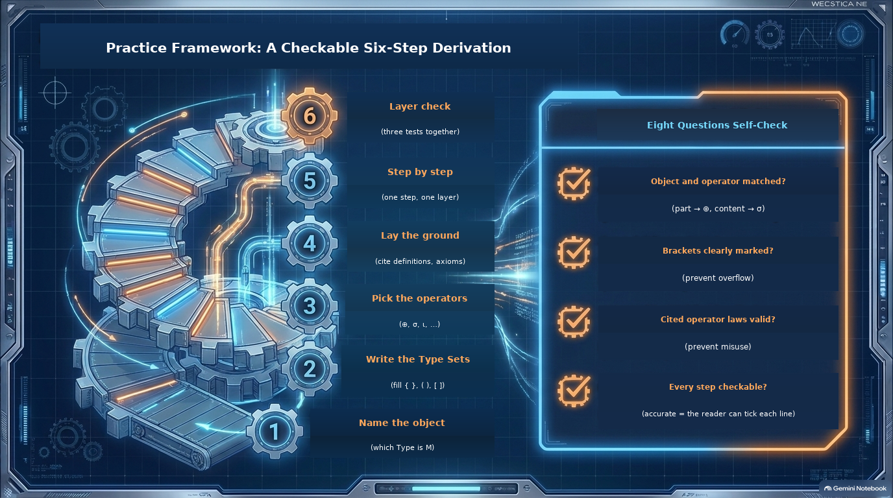

*Figure B-12 Blueprint card: the practice framework—the checkable six derivation steps and the eight-question self-check*

### 12.3 Five Misuses Compared

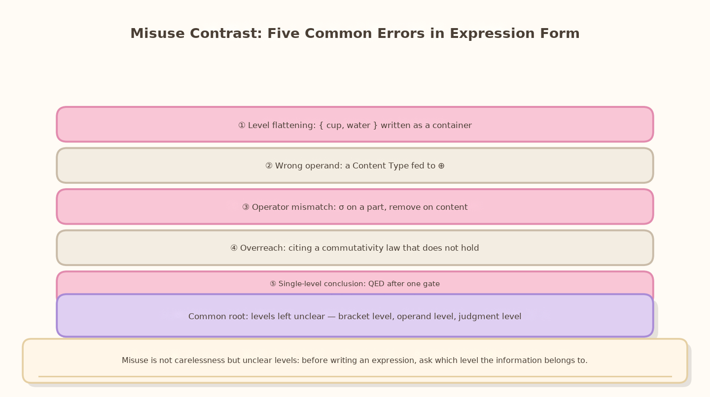

*Figure 12-2 Five misuses compared*

| **#** | **Misuse** | **The problem** | **Correct writing** |
| --- | --- | --- | --- |
| 1 | Levels flattened | Writing {cup, water} as a container, so σ loses its space | Containers take ( ), mark id(C) |
| 2 | Object misidentified | Taking a content Type to ⊕ | Distinguish part / content / category before choosing the formula |
| 3 | Operation mismatched | σ applied to parts, remove applied to content | The bracket decides the operation; scope may not be crossed |
| 4 | Derivation out of bounds | Citing a commutativity that does not hold | Check the master table: cite only what holds, attach conditions where it does not |
| 5 | Single-layer conclusion | Writing Q.E.D. after only one layer of judgment | Draw the conclusion only after the three formulas are simultaneous |

*Table 12-3 Five misuses and their correct writing*

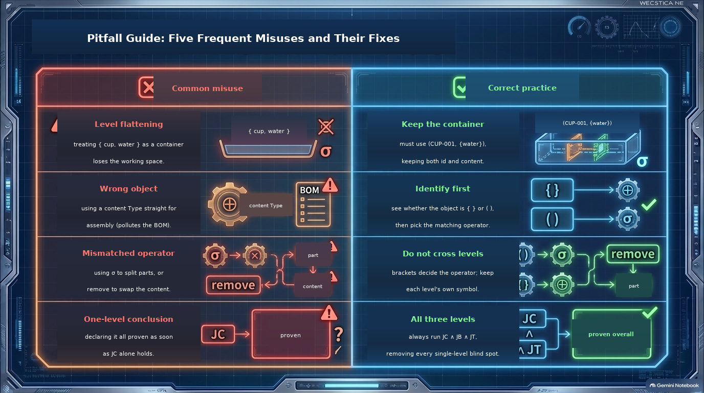

*Figure B-13 Blueprint card: a guide to avoiding error—high-frequency misuses and their remedies*

### 12.4 A Complete Case: one set of formulas from definition to Q.E.D.

> **[Derivation] Full demonstration: three questions about a coffee cup derived in one pass**
>
> Situation: M = coffee cup = { cup handle, cup base, lid, cup body, (coffee), [white] }. Three questions: ① after swapping to tea, is it the same cup? ② what if the lid is taken off? ③ does a thermos count as a cup?
>
> [Steps 1–2] Identify the object, write the Type Set—M as above, id(M) = CUP-001.
>
> [Steps 3–4] Choose the operations: ① σ; ② remove; ③ ∩(T). Foundation: axiom of invariance, remove criterion, F(cup) = { can hold liquid, can be held in the hand and drunk from }.
>
> [Step 5] (1) σ_{coffee→tea}(M): only S(C) moves → by Theorem 5-1, id is unchanged → ≡ the same cup. (2) remove(lid, M): the lid is detachable and identifiable → ≡ M′ ⊂ M, function degraded, identity persists. (3) ∩(cup)(insulated cup) = can hold liquid ∧ can be held and drunk from = true → ∈ [cup].
>
> [Step 6] Three-layer check: container layer ✓ (σ preserves identity); composition layer ✓ (remove returns to the right one of the three levels); abstraction layer ✓ (∩(T) all pass) — the three formulae hold jointly, and all is proved.

> **[Exercise] Exercises**
>
> S01 (the full six steps): choose an object from your own work (a document, a product, an organization — any will do), walk through the six derivation steps, and write out at least two expressions.
>
> S02 (self-check for misuse): use Table 12-3 to check three judgments you have written in the past, mark the misuses you committed, and rewrite them.

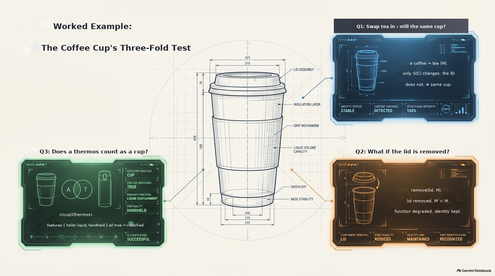

*Figure B-14 Blueprint card: derivation in practice — the triple test of the coffee cup*

## Chapter 13 The Complete Content Plan: learn · practice · apply · teach · build

Finally, the complete delivery plan for this derivation system: how to learn, how to practice, how to apply, how to teach, how to build — five stages joined into a single growth line.

### 13.1 The five-stage route: learn, practice, apply, teach, build

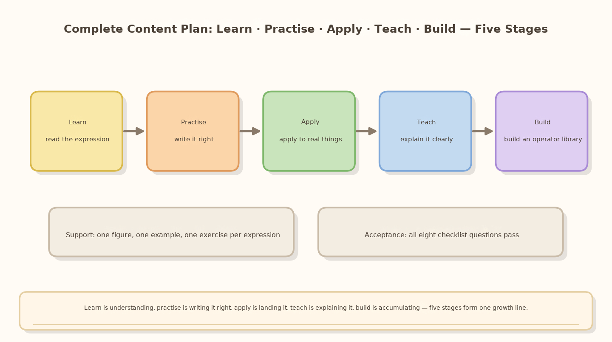

*Figure 13-1 The five-stage route: learn, practice, apply, teach, build*

| **Stage** | **Goal** | **Method** | **Acceptance** |
| --- | --- | --- | --- |
| Learn | Understand every formula | One formula, one figure, one example; start with the definition box and the key-point box | Can restate the object and scope of the five formulae |
| Practice | Write every formula correctly | Hand-write the derivation for every exercise P01–P20 in each chapter | All exercises completed and checked against the answers |
| Apply | Apply to real objects | Each week choose 2 real objects and run the six steps | Eight or more derivation cards |
| Teach | Explain every formula clearly | Explain one formula to someone who does not know it | The listener can solve one problem correctly |
| Build | Build a library of operator cards | Distil frequently used compound formulae into cards | A personal operator library of twenty or more cards |

*Table 13-1 The five-stage operating table: learn, practice, apply, teach, build*

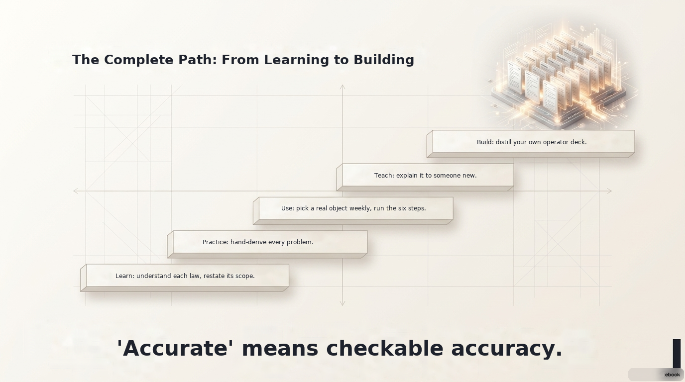

*Figure B-15 Blueprint card: the complete plan — evolution from learning to building*

### 13.2 An eight-week learning route

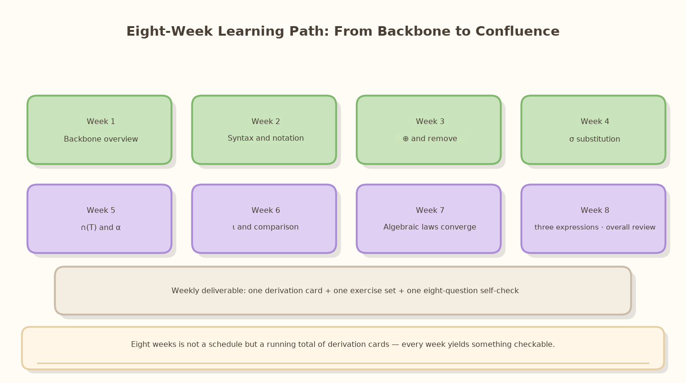

*Figure 13-2 The eight-week learning route*

The eight weeks are not a schedule but a running tally of derivation cards: each week delivers one derivation card, one set of exercises and one eight-question self-check. In the first six weeks take one or two operators per week; week seven is devoted to the summary table of algebraic laws and to counterexamples; week eight covers the joint three-formula test and the general review — every week has a checkable output.

### 13.3 Choosing by situation: which operator to use when

| **The problem you face** | **Operator of first choice** | **Supporting tool** |
| --- | --- | --- |
| Combining several parts into one whole | ⊕ composition | Associativity; check of the dependency structure |
| Removing one part: is it still the same thing | remove, the removal operator | The three-level criterion |
| Replacing what is inside: does the identity remain | σ substitution | Identity-preservation theorem, axiom of invariance |
| Does a new thing belong to this category | ∩(T) classification | F(T) boundary cases |
| How a group of samples becomes a rule | α abstraction | The property-emergence rule |
| Putting something inside: how the levels are ordered | ι nesting | Level theorem, non-flattening |
| Are two things the same | ≡ / ≢ / ⊂ | First choose the level of comparison |

*Table 13-2 Decision table for choosing by situation*

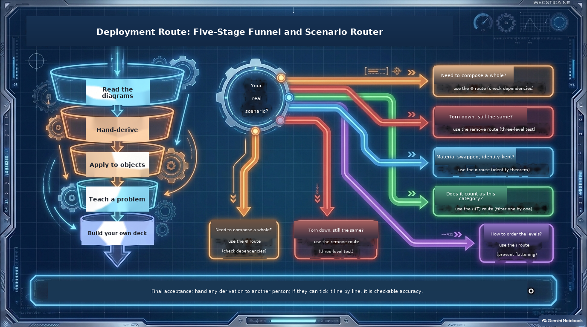

*Figure B-16 Blueprint card: the delivery route — the five-stage funnel and the situational selection guide*

### 13.4 Acceptance standards

> **[Key point] Overall acceptance**
>
> - Individual level: can write the five formulae from memory, recite the summary table of algebraic laws, and run the six steps on a real object within 30 minutes.
> - Output level: eight derivation cards, a personal operator library of twenty cards, and all exercises P01–P20 checked against the answers.
> - Review level: hand any derivation to another person and that person can tick it off sentence by sentence — accurate means checkably accurate.

## Review Consolidated key points and self-check

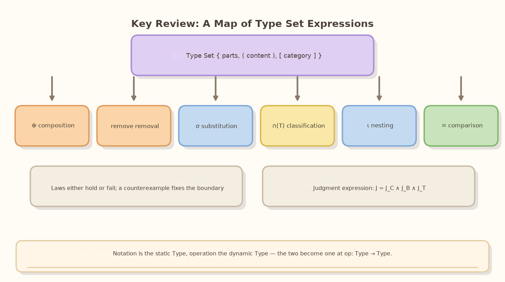

*Figure R-1 Key-point review: a map of Type Set expressions*

### R-1 Five formulae, three laws, one judgment

The five operators each govern one layer: ⊕ composition and remove govern parts { }, σ substitution and ι nesting govern content ( ), and ∩(T) classification together with α abstraction govern categories [ ]. The comparison operators ≡ / ≢ / ⊂ settle the distinction between two types. Of the algebraic laws some hold and some do not — the counterexamples that fail all point to two constraints: level and identity. Judgment is condensed into the joint three-formula test J = J_C ∧ J_B ∧ J_T.

### R-2 Notation and operation are two faces of one thing

Notation is the static type: { part, ( content ), [ category ] }; operation is the dynamic type: op: Type → Type. The two become one in 'Types in, Types out' — the five operators are the basic set, and the Time Type function library is the higher-order composite.

### R-3 Accuracy is accuracy that can be checked

Derivation rests not on intuition but on procedure: walk the six steps one by one, check the eight questions item by item, let counterexamples fix the boundary, and only the joint three-formula test counts as proof. A reader can tick off your derivation sentence by sentence — that is what the word 'accurate' means.

| **Self-check question** | **What you should be able to answer** |
| --- | --- |
| The general form of an operation? | op: Type → Type — Types in, Types out |
| Which layer does each of the five operators act on? | ⊕/remove govern parts, σ/ι govern content, ∩(T)/α govern categories |
| Which algebraic laws hold? | Associativity, idempotence, commutativity (σ within the same container), identity preservation, monotone inversion |
| The common root of those that fail? | Level and identity — counterexamples draw the boundary |
| How is judgment written as a formula? | J = J_C ∧ J_B ∧ J_T, the joint three-formula test |
| Where does a derivation begin? | Identify the object → write the Type Set → choose the operator → lay the foundation → derive → check |

*Table R-1 Self-check list*

> **[Key point] In one sentence**
>
> Notation is the static type, operation is the dynamic type — see the type clearly, derive the formula exactly.

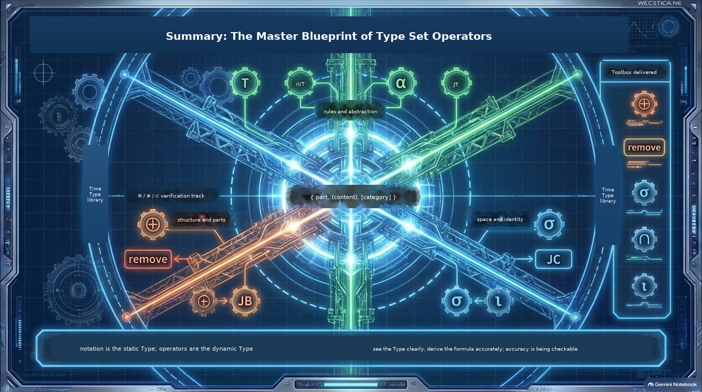

*Figure B-17 Blueprint summary: the master blueprint of Type Set operations (The Master Blueprint)*

## Exercise Section Reference answers

What follows are model answers for P01–P20 and S01–S02. An answer is not unique — as long as the six steps are followed correctly, the layers are stated clearly and every step can be checked, it is a good answer.

#### P01 Identifying the object

> **[Derivation] Model answer**
>
> (1) The textbook in the schoolbag is replaced by a notebook — textbook and notebook are content types ( e ), the schoolbag is the container → σ_{textbook→notebook}(schoolbag), id(schoolbag) unchanged.
>
> (2) The camera module is taken off — a part type { p } → remove(camera module, phone), and the result ≡ M′ ⊂ M (a function-degraded part).
>
> (3) Is a sippy cup a cup — a category type [ T ] → ∩(cup)(sippy cup), testing F = { can hold liquid, can be held and drunk from } item by item.

#### P02 Judging the syntax

> **[Derivation] Model answer**
>
> Because the brackets fix the layer, and the root of misuse is a misplaced layer: ⊕ applied to content mistakenly composes 'what is inside' as a part, and the BOM is polluted; σ applied to parts mistakes 'detaching' for 'swapping', and the id judgment loses its ground; ∩(T) applied to parts misreads a 'structural difference' as a 'categorical difference'.
>
> The scope rules lock each formula inside its own layer — once a formula crosses the boundary it cannot be written, and misuse is blocked at the moment of writing.

#### P03 Composition derivation

> **[Derivation] Model answer**
>
> M = motherboard ⊕ battery ⊕ screen ⊕ camera module (by associativity, brackets may be placed anywhere).
>
> BOM(M) = { motherboard, battery, screen, camera module }; dependency: the screen depends on the motherboard (without the motherboard there is no display output) — the layers are preserved, and the composition holds.

#### P04 Finding a counterexample

> **[Derivation] Model answer**
>
> Example: 'preface ⊕ body' and 'body ⊕ preface' of an article — the reading order and the logical dependency differ, so they are two different types.
>
> The difference lies in the dependency layer: the preface leads into the body (dependency direction A → B), and after the order is swapped the dependency reverses — position and sequence are part of the type.

#### P05 Three-level classification

> **[Derivation] Model answer**
>
> M = laptop. Essential parts: motherboard, battery — remove(p, M) ≢ M (it cannot start up; the type is dissolved);
>
> Function-degraded parts: touchpad, built-in speakers — remove ≡ M′ ⊂ M (external devices can be used; function degraded);
>
> Non-essential parts: stickers, feet — remove ≡ M (no effect at all).

#### P06 Branch distribution

> **[Derivation] Model answer**
>
> ( bookshelf ⊕ books ) remove magazines ≡ bookshelf ⊕ ( books remove magazines ) — the magazines lie only in the 'books' branch, and by Theorem 4-2 branch distribution holds.
>
> remove(magazines, books) ≡ books (the whole of the books is unaffected by one magazine) → magazines are a non-essential part.

#### P07 Identity-preservation derivation

> **[Derivation] Model answer**
>
> (1) C = ( WALLET-001, (banknote A) ), write out id(C); (2) the change: σ_{banknote A→banknote B}(C), only S(C) moves;
>
> (3) invoke the axiom of invariance (∀ e1, e2 ∈ S(C), substitution does not change id(C)); (4) hence id(C) is constant, and the wallet is the same wallet. (Q.E.D.)

#### P08 The boundary of σ

> **[Derivation] Model answer**
>
> This is not σ. 'Replacing the cup with a bowl' moves the container itself — id(CUP-001) becomes id(BOWL-001), and the identity changes;
>
> the precondition of σ is that id does not move and only the elements inside S(C) are swapped. Changing the container is detaching (the inverse of ι) plus a new container, and should be recorded as ≢ with a new type established.

#### P09 Classification derivation

> **[Derivation] Model answer**
>
> F = { can drive on roads, can carry people and goods, has a power system, can be steered by a driver }.
>
> f1(Tesla) = true (drives on roads); f2 = true (carries 5 people); f3 = true (battery plus electric motor = power system); f4 = true (steered by wheel).
>
> ∩(electric vehicle)(Tesla) = true ∧ true ∧ true ∧ true = true → Tesla ∈ [electric vehicle]. (Q.E.D.)

#### P10 Monotone inversion

> **[Derivation] Model answer**
>
> F(T′) = F(T) ∪ { capacity below 500ml } ⊋ F(T) → by Theorem 6-2, [T′] ⊆ [T], and the category tightens.
>
> Example: a 750ml sports bottle was originally ∈ [cup], and once the feature is added ∉ [T′] — features are added and the category tightens, in opposite directions.

#### P11 Nesting derivation

> **[Derivation] Model answer**
>
> ι( ι( ι( phone, case ), courier box ), truck ).
>
> By Theorem 7-1: changing the truck moves only the outermost S(logistics system) — the id of each layer stays constant, and the id(SM-001) of the phone is unchanged at every layer of the whole chain. (Q.E.D.)

#### P12 Distinguishing flattening

> **[Derivation] Model answer**
>
> A class list is a composition/set notation of the form { student 1, student 2, ... } — only a juxtaposition, with no container layer of 'who holds whom'.
>
> It lacks ( ): there is no id(C) and no S(C), so σ finds no scope to substitute and ι finds no position to occupy — to apply σ/ι one must first establish a container (such as the class container 'third-year class A').

#### P13 Choosing the layer

> **[Derivation] Model answer**
>
> The employee is the container (duties and staff number are its type), the seat is one of the contents → changing seats is σ_{seat A→seat B}, the employee id unchanged — the same id (container layer).
>
> Note: if 'employee' is regarded as the content of the organizational container, then a transfer of employees is a σ of the organization — the level of comparison depends on the whole you identify.

#### P14 The degradation formula

> **[Derivation] Model answer**
>
> remove(air conditioning, car) ≡ M′ ⊂ M: the car is still recognized as a car (the id and the main BOM remain), but the air-conditioning function is gone.
>
> Record ⊂, not ≢: identity persists, only the function is subsetted — ≢ is reserved for dissolution, ⊂ for degradation.

#### P15 Deciding the algebraic laws

> **[Derivation] Model answer**
>
> (1) Holds: commutativity of ⊕, (M1⊕M2)⊕M3 ≡ M1⊕(M3⊕M2) (M2 and M3 swapped give the same type).
>
> (2) Holds: composition of σ — two substitutions in the same container can be merged and can be commuted.
>
> (3) Does not hold: removal and composition are asymmetric, remove(p,M) ⊕ p rebuilds a 'new composite', whose dependency break differs from the original M.

#### P16 Constructing your own counterexample

> **[Derivation] Model answer**
>
> Samples: { a cup with a lid, a bowl without a lid }. remove(lid) first and then α → the features do not include 'has a lid'; α first and then remove → the category already contains the 'has a lid' feature, and after remove the samples no longer match the rule.
>
> Different order, different F(T) extracted → remove-then-abstract ≢ abstract-then-remove — α and remove do not commute.

#### P17 The joint three-formula test

> **[Derivation] Model answer**
>
> J_C: passengers getting on and off are σ, the vehicle id unchanged → true.
>
> J_B: battery pack and electric motor = essential parts (remove ≢ M); center console screen = degraded part; badge = non-essential part → the three levels fall into place, true.
>
> J_T: F(car) = { can drive on roads, can carry people and goods, has a power system, can be steered by a driver } all pass → true.
>
> J = true ∧ true ∧ true = true. (Q.E.D.)

#### P18 Blind-spot location

> **[Derivation] Model answer**
>
> Smartwatch: J_C = true (apps can be installed); J_B = true (it has a part structure); J_T = false — although "portable" in F(smartphone) passes, the test fails if F contains "independent calling / large-screen operation" (depending on the F(T) you set).
>
> The intended answer for this exercise: judged by F = { can communicate, can compute, is portable }, the watch passes all three and enters the category — so the blind spot lies in the insufficient precision of F(T); further features (such as "can install applications independently") are needed to tighten the category. Conclusion: which formula blocks it depends on the stance taken in F(T) — this is precisely the case showing that the feature list is the stance.

#### P19 Compound decomposition

> **[Derivation] Model answer**
>
> ① observe remove(lid, M) → M′ ≡ M′ ⊂ M (lid missing); ② ι reverse lookup: M ι desk ι office, listing the candidate container chain;
>
> ③ compare the σ state at each level: the record of σ_{lid→∅} plus ≡ comparison → lock onto the container with the matching id.
>
> Compound form: compare( ι-reverse-lookup( remove(lid, M) ), σ record ) — abductive inference = a compound chain of the basic operators.

#### P20 Position judgment

> **[Derivation] Model answer**
>
> The advanced version: design search must "find the design Type from the requirement Type", shuttling among many Types and involving comparison and extraction.
>
> Basic operators it may contain: ∩(T) (testing whether a candidate fits the requirement category), ≡ (comparing against known designs), ⊕ (combining candidate schemes), remove (excluding inapplicable parts) — a higher-order function is a compound of the basic ones.

#### S01 · S02 Integrated questions

> **[Derivation] Model answer (key points)**
>
> S01: after choosing your own object, always write the Type Set before choosing the formula; the two expressions should belong to different levels (for example one σ and one remove) so as to demonstrate level independence.
>
> S02: the point of the misuse self-check is not to "find errors" but to mark "where the level is wrong" — the common root of the five misuses is that the level was never stated clearly.

## Appendix A Master table of operators

| **Symbol** | **Name** | **Defining formula** | **Level of action** |
| --- | --- | --- | --- |
| ⊕ | Composition operator | BOM(M1⊕M2) = BOM(M1) ∪ BOM(M2) | { } part |
| remove(p, M) | Removal operator | Three grades: ≢M / ≡M′⊂M / ≡M | { } part |
| σ_{e1→e2}(C) | Substitution operator | e1 in S(C) replaced by e2 | ( ) content |
| ∩(T)(x) | Classification operator | f1(x) ∧ f2(x) ∧ ... ∧ fn(x) | [ ] category |
| α(x1...xk) | Abstraction generation | Extract features → T = (F(T), ∩(T)) | [ ] category |
| ι(M, C) | Nesting operator | M ∈ S(C), establishing its standing | ( ) content |
| ≡ / ≢ | Comparison operator | Three kinds of identity: id / Type / category | All three levels |
| ⊂ | Degradation mark | M′ ⊂ M (function degradation) | { } part |
| op: Type → Type | General form | Types in, Types out | All |

*Table A-1 Master table of operators*

## Appendix B Quick reference to terms and notation

| **Term** | **English / notation** | **One-line definition** |
| --- | --- | --- |
| Type | Type | An object that has been fully described |
| Unit Type | Unit Type | The union of three sets: { part, ( content ), [ category ] } |
| Type Set | Type Set | The complete notation of a Unit Type |
| Abstract category | T = (F(T), ∩(T)) | An open category determined by features and criteria |
| Intersection criterion | ∩(T) | Membership only if every feature passes |
| Container | C = (id(C), S(C)) | A set plus an unchanging identity |
| Axiom of invariance | ∀ e1, e2 ∈ S(C) | Replacing the content does not change id(C) |
| remove criterion | remove(p, M) | Remove a part and see whether identity survives |
| Three-layer judgment | J_C ∧ J_B ∧ J_T | Container / composition / abstraction, the three formulas held together |
| Types in, Types out | op: Type → Type | One Type in, one Type out |
| Time Type | Function / Method | A higher-order compound of Types in, Types out |
| Accurate | Checkable accuracy | The reader can tick off each line and reproduce the derivation |

*Table B-1 Quick reference to terms*

| **Notation** | **Read as** | **Use** |
| --- | --- | --- |
| { } | Braces | Composition set (parts) |
| ( ) | Parentheses | Container set (contents) |
| [ ] | Square brackets | Abstract set (category) |
| ∈ / ∉ | Belongs to / does not belong to | Membership statement |
| ≡ / ≢ / ⊂ | Identical / not identical / degraded | Comparison operator |
| ∀ / ∧ | For all / and | Universal quantifier / conditional connective |
| ⇔ | If and only if | Definitional equivalence |

*Table B-2 Quick reference to notation*

## Appendix C Quick reference to derivation templates

> **[Definition] Template 1: single-formula derivation card**
>
> [Object] M = { part, ( content ), [ category ] }, id = ...
>
> [Question] One sentence.
>
> [Operator] ⊕ / remove / σ / ∩(T) / ι / ≡ (choose one).
>
> [Ground] The definitions / axioms / criteria cited.
>
> [Derivation] ① ② ③... one step per level, derived step by step.
>
> [Conclusion] Proved / verdict, plus level label.

> **[Definition] Template 2: algebraic-law decision card**
>
> [Formula] Write out the law to be decided.
>
> [Holds?] Check against the master table in Chapter 9.
>
> [Derivation or counterexample] If it holds, give a derivation; if not, a counterexample.
>
> [Condition] If a further condition is needed, state the premise.

> **[Definition] Template 3: three-formula card**
>
> [Object] M = ...
>
> [J_C] Does id stay unchanged after σ? → true/false plus reason.
>
> [J_B] Do all three grades of remove fall into place? → true/false plus reason.
>
> [J_T] ∩(T)(x) = ? → true/false plus item-by-item table.
>
> [Joint] J = J_C ∧ J_B ∧ J_T → proved or not.

The three templates are the six steps condensed: Template 1 walks a single formula, Template 2 decides an algebraic law, Template 3 closes the conclusion. Print them out and keep them on your desk, filling in the cells one by one as you derive — if you can fill them in, you can derive.
