# Liquid Neural Networks and Ontypology

*Relations · the Accurate Method of Use and Architecture · a Complete Content Plan*

*Grounded in the Spatial Type and the Temporal Type*

Chang Changfeng · Chang Tingying, Authors

*Ontypology · LonGreat / Mind AI Series*

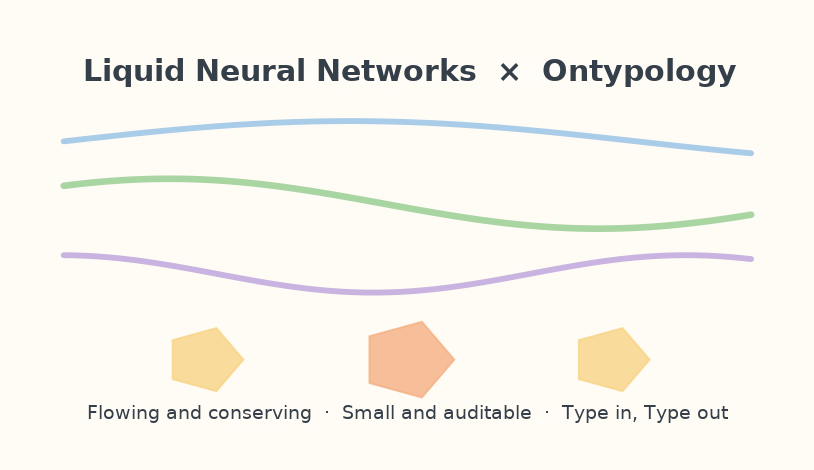

> **In One Sentence**
>
> Liquid neural networks flow and yet conserve; Ontypology writes this “stability within flow” as a Type that can be reviewed —
>
> Structure is the Spatial Type, dynamics is the Temporal Type, and the Accurate Method of Use makes every judgment writable step by step and checkable item by item.

## TABLE OF CONTENTS

- Preface The Task of This Volume
- Why We Need Type: The Rise of Liquid Networks
- 1-1 From Discrete Steps to Continuous Time
- 1-2 Three New Things: Liquid, Closed-form, Auditable
- 1-3 Why Read Liquid Networks with Ontypology
- The Backbone at a Glance: An Ontypology Reading Map
- 2-1 The Four-Piece Backbone
- 2-2 The Reading Map
- 2-3 [Pro Column C1] RNN → LSTM → Neural ODE: What Gap Each Generation Filled
- Spatial Type: The Type of a Liquid Network
- 3-1 A Network Is a Type: Take It Apart
- 3-2 What It Looks Like: Properties and Scales
- 3-3 Where Things Sit: Container and Identity
- 3-4 The Ontypological Meaning of Liquid: Joined Without Falling Apart
- 3-5 Three-Layer Judgment: Auditing a Network
- 3-6 [Pro Column C2] The Mathematics of LTC: Liquid τ and Bounded Stability
- Temporal Type: The Time of Liquid
- 4-1 Type In, Type Out: Defining the Temporal Type
- 4-2 Liquid τ(t): Time Breathes
- 4-3 Closed-form Solution: Every Step Can Be Written
- 4-4 Continual Learning: Type and Function Grow Together
- 4-5 Two Libraries Compared: The Basic and the Advanced
- 4-6 [Pro Column C3] Neural ODE and Continuous Depth: The Ontypological Position
- The Accurate Method of Use, Integrated
- 5-1 Body—Use—Accuracy: The Three-Character Key
- 5-2 Three Supplements: Putting Back What Was Omitted
- 5-3 Six Steps: Writing a Judgment to Reviewable Form
- 5-4 The Eight-Question Checklist
- 5-5 Misuse Compared: Sixteen Deviations
- 5-6 A Complete Demonstration: An Autonomous-Driving Network Through Six Steps
- 5-7 Choosing a Route: When to Use a Liquid Network
- 5-8 [Pro Column C4] Auditable Autonomy in NCP and the Three Ontypological Layers
- 5-9 [Pro Column C5] Liquid AI: Bringing Liquid to the Edge
- The Overall Architecture
- 6-1 Two Libraries, One Hub, One Loop × Liquid Networks
- 6-2 The Master Reading Table
- 6-3 The Four-Question Card: Typing Your Liquid Task
- 6-4 Toward Mind AI: The Three Unifications
- 6-5 [Pro Column C6] Continuous Depth and Ontypology: Type Before Number
- 6-6 [Pro Column C7] Landing Interpretability in Engineering
- 6-7 [Pro Column C8] Connecting with Mind AI: The Ontypological Ground of the Three Unifications
- A Complete Content Plan
- 7-1 Five Stages: Learn · Practise · Apply · Teach · Build
- 7-2 An Eight-Week Learning Route
- 7-3 Four Stages of Library Building
- 7-4 Integrated Case: The Type Chain of a Time Series
- 7-5 Acceptance Criteria
- Conclusion
- Exercises
- Exercises E07–E12
- Integrated Exercises S01–S02
- Appendix A Terms and Notation
- Appendix B Quick-Reference Cards
- Appendix C Sample Answers to the Exercises
- Appendix D Index of Figures and Tables
- Afterword

## Preface The Task of This Volume

This volume does one thing only: it puts “liquid neural networks” and “Ontypology” on the same track, and condenses the results of that parallel reading into an Accurate Method of Use and a complete content plan.

Liquid Neural Networks are among the most intriguing branches of recent artificial intelligence: their time constants “flow”, changing rhythm with input and state; their behaviour is proven stable and bounded — the liquid flows, yet never spills out of the cup; their members can be as few as a dozen neurons, small enough that every single connection can be inspected by hand. Flowing, conserving, auditable — these three words sound less like a description of a neural network and more like a description of a Type.

Ontypology is exactly the study of Type: the Spatial Type describes what a Type looks like, what it is made of, and where things sit; the Temporal Type describes how a Type operates, how it changes, how Type goes in and Type comes out. Set side by side, a liquid neural network is almost a living specimen of the Temporal Type, and Ontypology gives it a language for description, judgment and acceptance.

> **[Conventions] The three conventions of this volume**
>
> - Convention One: this volume takes Ontypology (Spatial Type and Temporal Type) as its theoretical ground, but does not recopy the theory chapter by chapter — it raises the backbone with architecture diagrams and illustrated summaries only.
> - Convention Two: throughout this volume the term is always written Type. Each of the three brackets has its own duty: { } composition, [ ] property, ( ) container.
> - Convention Three: this volume does not do system implementation — we discuss parallel reading, method and plan; writing code is left to implementers, writing accurately is left to this book.

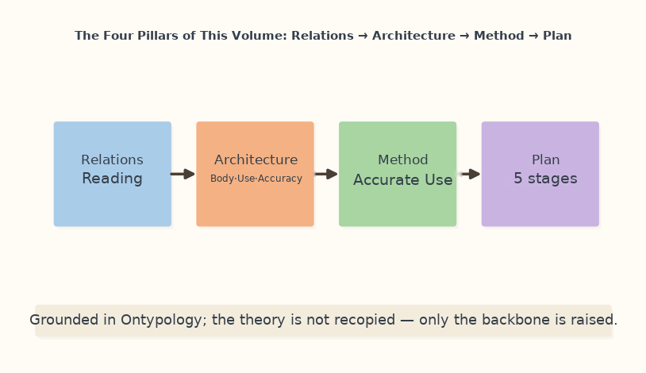

*Figure D-1 The four pillars of this volume: relations → architecture → method → plan*

The book has eight parts. The upper part establishes relations: first the rise and lineage of liquid networks (Part One), then the reading map raised on the Ontypology backbone (Part Two); the middle part does the parallel reading: the Spatial Type read against structure (Part Three), the Temporal Type read against dynamics (Part Four); the lower part gathers results: the integrated Accurate Method of Use (Part Five), the overall architecture (Part Six), the complete content plan (Part Seven) and the conclusion (Part Eight). Three appendices collect the terminology table, the quick-reference cards and the sample answers.

There are two ways to read: those who want speed can read the key boxes and figure captions of each part and grasp the skeleton; those who want to go all the way can follow the Pro Columns and the exercises and write the formulas out step by step.

## Part One Why We Need Type: The Rise of Liquid Networks

Everything starts with “time”. The past half century of neural network history can be read as a long march to “write time correctly”: from discrete-step networks beating a fixed tempo, to differential-equation networks that let time flow continuously, to liquid networks that let the time constant move with the Type. What remains at the end of this road is no longer the question “can it predict”, but “can it be stated clearly” — and stating clearly is exactly the work of Type.

### 1-1 From Discrete Steps to Continuous Time

Recurrent neural networks (RNN) and their gated descendant LSTM process sequences in fixed time steps: each Δt is a beat, and the state jumps one cell. The approach is simple and effective, but it turns time into a staircase — while real-world signals clearly flow continuously.

The Neural ODE that rose in 2018 rewrote deep networks as continuous dynamical systems, and time finally flowed again; but its inference relies on a numerical solver iterating step by step — slow, and a black box. The Liquid Time-constant Network (LTC) of 2021 went further: the time constant itself “flows” with input and state, like the membrane time constant of a biological neuron; the Closed-form Continuous-time model (CfC) of 2022 then gave a closed-form solution, turning step-by-step solving into a single written expression — one to five orders of magnitude faster in training and inference than the ODE control group.

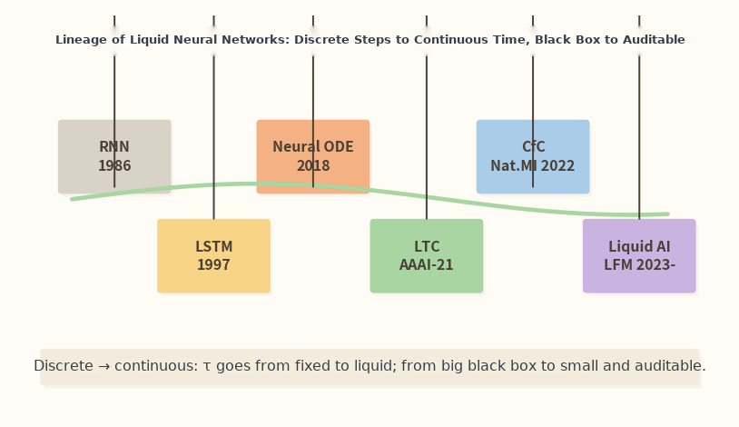

*Figure 1-1 The lineage of liquid neural networks: from discrete steps to continuous time, from black box to auditable*

> **[Sources] Three stations in the lineage**
>
> - LTC: Hasani, Lechner, Amini, Rus, Grosu, “Liquid Time-constant Networks”, AAAI-21 (arXiv:2006.04439).
> - CfC: Hasani et al., “Closed-form Continuous-time Neural Models”, Nature Machine Intelligence 4, 992–1003 (2022).
> - Liquid AI: incubated and founded from MIT CSAIL in 2023, by Ramin Hasani (CEO), Mathias Lechner (CTO), Alexander Amini (CSO) and Daniela Rus.

### 1-2 Three New Things: Liquid, Closed-form, Auditable

Spread out, the innovation of liquid networks is really three things.

- **Liquid (the time constant breathes):** each neuron's time constant τ is not a fixed parameter but a function that changes with input and state. The rhythm of memory suits the Type — when the signal comes urgently, it responds quickly; when the signal is calm, it remembers.
- **Closed-form (every step can be written):** CfC writes the dynamics — previously only numerically approximable — as a closed-form solution, with time appearing explicitly in the expression: anyone who has the formula can write it step by step and check it item by item.
- **Auditable (small enough to see clearly):** represented by Neural Circuit Policies (NCP), a dozen or so neurons suffice for auditable autonomous control. Small does not mean insufficient capability; it is for the sake of seeing clearly.

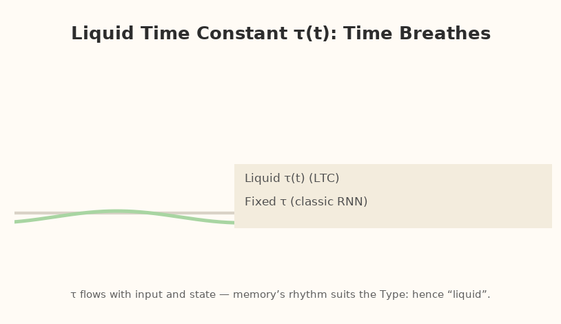

*Figure 1-2 The liquid time constant τ(t): time breathes*

> **[Key Point] The turn of the question**
>
> Liquid networks turn the question of artificial intelligence from “can it” to “can it be stated clearly”. Stating something clearly — what it looks like, what it is made of, where it sits, how it operates — is exactly the business of Ontypology.

### 1-3 Why Read Liquid Networks with Ontypology

The two great branches of Ontypology each correspond to one face. The Spatial Type (noun, static) answers “what the Type is”: three axes — property [ ], bill of materials { }, spatial container ( ) — describe an object completely; the Temporal Type (verb, dynamic) answers “how the Type operates”: a function takes in a Type and puts out a Type, Type in and Type out.

Shine these two faces on a liquid network and the mapping is almost seamless: the structure of the network — neurons, synapses, layers — is the Type of the Spatial Type; the dynamics of the network — liquid τ, state evolution, decision output — is the function of the Temporal Type; the robustness and auditability of the network correspond to the axiom of invariance and the three-layer judgment. The route of this volume is to open up these three mappings one by one and then condense them into a method.

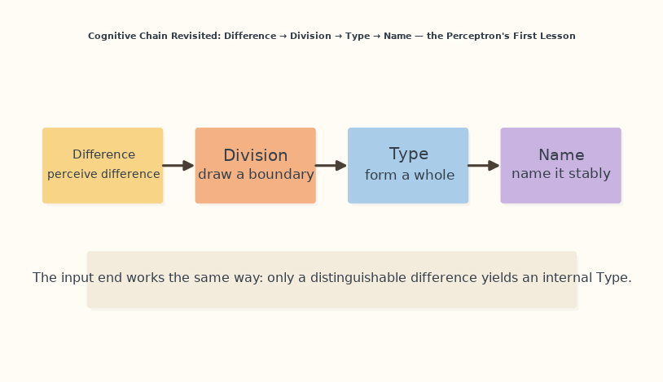

*Figure 1-3 Recalling the cognitive chain: difference → division → Type → name, also the first lesson of the perceptron*

## Part Two The Backbone at a Glance: An Ontypology Reading Map

This part does not retell Ontypology theory; it only raises “what the parallel reading is to act on”. One page of cognitive chain, one page of three axes and three brackets, one page of Type Set notation, plus one reading map — four pages raise the backbone, and the six parts that follow grow flesh on this skeleton.

### 2-1 The Four-Piece Backbone

The backbone of Ontypology can be condensed into four pieces. First, the cognitive chain: difference → division → Type → name — first there is distinguishable difference, then the act of drawing a boundary, then a recognisable whole, then a name that can be pointed to. Second, three axes: X property [ ] answers “what it looks like”, Y bill of materials { } answers “what it is made of”, Z container ( ) answers “where things sit”. Third, Type Set notation: Unit Type ＝ { parts, ( content ), [ category ] } — the three brackets each do their duty, and a Type is completely notated. Fourth, the Temporal Type: op: Type → Type — every operation is Type in, Type out.

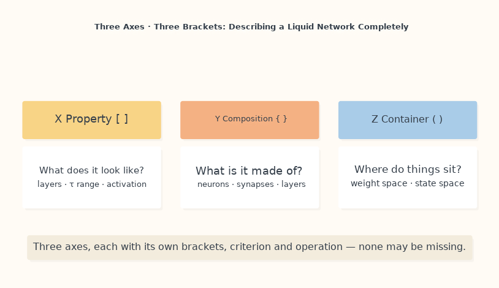

*Figure 2-1 Three axes · three brackets: describing a liquid network completely*

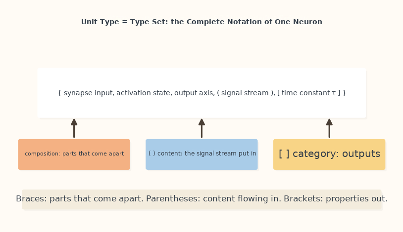

*Figure 2-2 Unit Type ＝ Type Set: the complete notation of one neuron*

### 2-2 The Reading Map

Placing the two sides side by side, the reading map has four main roads. Structure against structure: the composition of the network against the Spatial Type; dynamics against dynamics: liquid τ and ODE against the Temporal Type; robustness against conservation: bounded stability and interference resistance against the axiom of invariance; auditability against reviewability: item-by-item inspection of a small circuit against the three-layer judgment and the Accurate Method of Use.

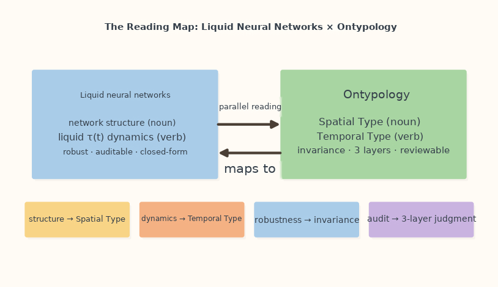

*Figure 2-3 The reading map: liquid neural networks × Ontypology*

| **The main roads of parallel reading** | **On the liquid neural network side** | **On the Ontypology side** |
| --- | --- | --- |
| Structure ↔ Spatial Type | Neurons · synapses · layers · readout head | { } BOM, [ ] property, ( ) container |
| Dynamics ↔ Temporal Type | Liquid τ(t), ODE, Type in and Type out | op: Type → Type, the function library |
| Robustness ↔ Conservation | Bounded stability, interference resistance, transferability | Axiom of invariance: change the content, id(C) unchanged |
| Auditable ↔ Reviewable | Small NCP circuits, closed-form solutions | Three-layer judgment, six steps, eight questions |
| [Key Point] Parallel reading is not analogy The purpose of parallel reading is not to stick new terms onto old labels, but to use the criteria of Ontypology to answer four practical questions: how to describe a liquid network, how to judge it, how to use it accurately, and how to pass the method on. These four questions are exactly the themes of Parts Five to Seven. | [Key Point] Parallel reading is not analogy The purpose of parallel reading is not to stick new terms onto old labels, but to use the criteria of Ontypology to answer four practical questions: how to describe a liquid network, how to judge it, how to use it accurately, and how to pass the method on. These four questions are exactly the themes of Parts Five to Seven. | [Key Point] Parallel reading is not analogy The purpose of parallel reading is not to stick new terms onto old labels, but to use the criteria of Ontypology to answer four practical questions: how to describe a liquid network, how to judge it, how to use it accurately, and how to pass the method on. These four questions are exactly the themes of Parts Five to Seven. |
| [Exercise] E01 (warm-up for parallel reading) Choose any neural network you know, write its minimal description in Type Set notation { parts, ( content ), [ category ] }, and point out which item belongs to the X axis, which to the Y axis, and which to the Z axis. | [Exercise] E01 (warm-up for parallel reading) Choose any neural network you know, write its minimal description in Type Set notation { parts, ( content ), [ category ] }, and point out which item belongs to the X axis, which to the Y axis, and which to the Z axis. | [Exercise] E01 (warm-up for parallel reading) Choose any neural network you know, write its minimal description in Type Set notation { parts, ( content ), [ category ] }, and point out which item belongs to the X axis, which to the Y axis, and which to the Z axis. |

### 2-3 [Pro Column C1] RNN → LSTM → Neural ODE: What Gap Each Generation Filled

Seen through the eyes of Ontypology this lineage is especially clear: each generation fills the gap the previous one left on the “Temporal Type”. RNN compresses the sequence into a fixed step, and long-range dependence drains away in vanishing gradients — time is chopped up; LSTM guards memory with gates but is still a discrete step — time still beats a staircase; Neural ODE lets time flow continuously but hands the evolution to a numerical solver — time flows, but each step cannot be stated; LTC lets the time constant move with the Type, and CfC writes the evolution in closed form — time both flows and can be written at every step.

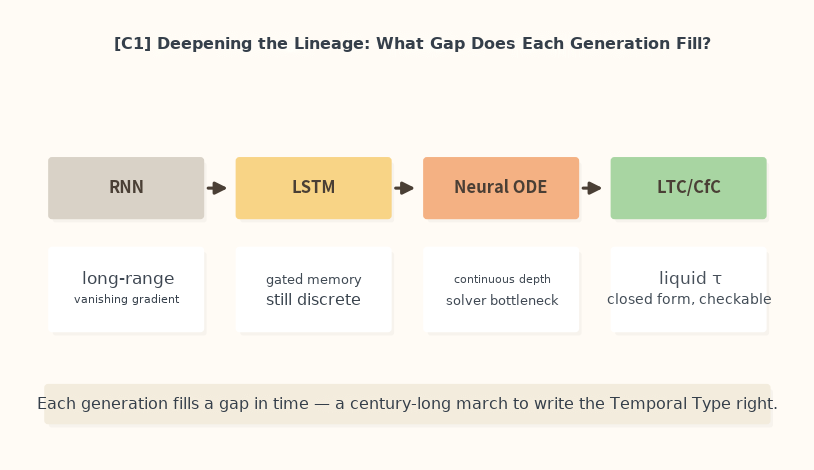

*Figure 2-4 [C1] Deepening the lineage: what gap each generation solved in the previous one*

From the standpoint of Ontypology the end of this century-long march is already visible: a Temporal Type must satisfy three things at once — flow (able to express continuous dynamics), conservation (identity not scattered by flow), writability (every step reviewable). Liquid networks are currently the engineering practice closest to all three at once.

## Part Three Spatial Type: The Type of a Liquid Network

This part dissects a liquid network as a “Type”. There is only one method: follow the three axes of Ontypology — first see what it is made of (Y axis), then what it looks like (X axis), then where things sit (Z axis), and finally gather it with the three-layer judgment. The whole process discusses no training and no code, only Type.

### 3-1 A Network Is a Type: Take It Apart

Ask the first question: what is a liquid network made of? “Take it apart”, and the answer is a bill of materials (BOM): input layer, hidden layers (the liquid core), output layer, readout head, and inside each layer a community of neurons and synapses. The BOM criterion is only one — “after taking it apart, does it still recognise itself?” A synapse taken apart is still a synapse, a layer taken apart is still a layer, so they enter the BOM; the range of τ taken apart is nothing, so it is a property.

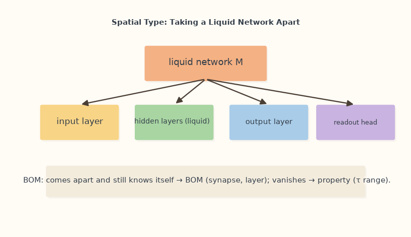

*Figure 3-1 Spatial Type: taking a liquid network apart*

Next, grade the parts with the remove criterion: remove part p from network M and see whether identity survives. Remove the trunk layers and the network is no longer a network — essential part, remove(p,M) ≢ M; remove an attention head or a bypass and function is missing but the network is still that network — function-degraded part, ≡ M′ ⊂ M; remove a redundant node or a decorative regulariser and nothing is affected — non-essential part, ≡ M. These three grades are exactly the Ontypological language of model pruning and ablation experiments: pruning is remove, ablation is the implementation of the three-grade criterion.

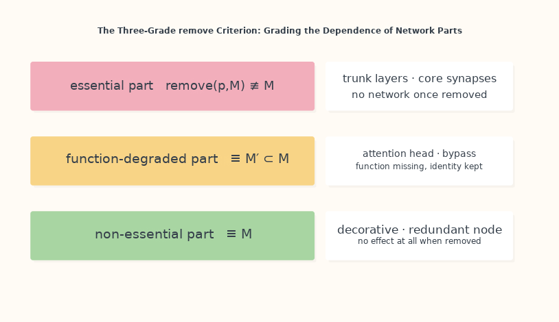

*Figure 3-2 The three-grade remove criterion: grading the dependence of network parts*

### 3-2 What It Looks Like: Properties and Scales

Second question: what does it look like? A property is a dimension; a property value is a scale. The property table of a liquid network grows naturally: number of layers, neurons per layer, range of τ, gate type, readout-head structure. Properties are forced out by difference — when two networks fail to match on “whether the time constant flows”, “τ type” is forced to stand as a new dimension and is back-filled onto every network that has appeared. This is exactly the four steps of the Spatial Framework: distinguish difference → failed comparison triggers abstraction → name the dimension → judge belonging.

### 3-3 Where Things Sit: Container and Identity

Third question: where do things sit? Container C = ( id(C), S(C) ) — identity plus internal space. The weight space is a container, the training data stream is content; the state space is a container, the signal flowing through time is content. The axiom of invariance says: change the content, id(C) unchanged. This is exactly the Ontypological meaning of “robustness” in liquid networks — the rainy-day video stream replaces the sunny-day video stream and the network is still the same network; the content flows, the identity does not move.

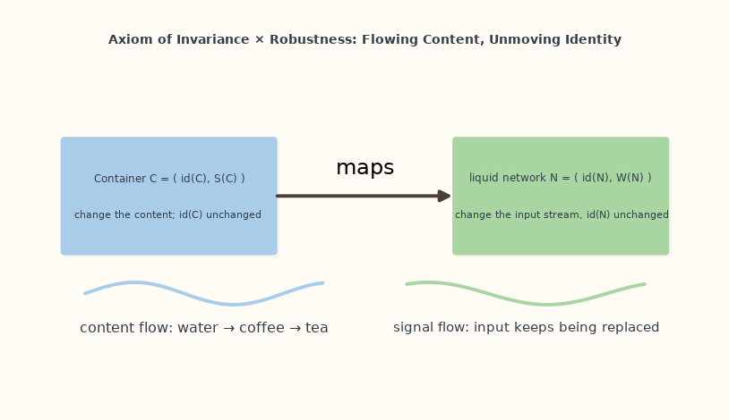

*Figure 3-3 Axiom of invariance × robustness: flowing content, unmoving identity*

> **[Key Point] The Ontypological definition of robustness**
>
> Robustness is not “beating everything” but “identity surviving the replacement of content” — id(C) unchanged, which is the axiom of invariance. The repeatedly verified interference resistance and transferability of liquid networks are, in Ontypology, the engineering incarnation of one axiom.

### 3-4 The Ontypological Meaning of Liquid: Joined Without Falling Apart

The word “liquid” deserves one more reading through Ontypology. The property of a liquid is flow: the state is constantly rewritten, the time constant constantly modulated; yet the whole mass of the network remains one identifiable Type — wherever there is joining there is Type, and the act of joining is not scattered by flow. This corresponds to two basic laws of Type Set operations: the σ replacement operation preserves identity (the content changes, the container is still the same container), the ι nesting operation holds levels (a neuron is in a layer, a layer is in a network, each level holds its own identity and cannot be flattened).

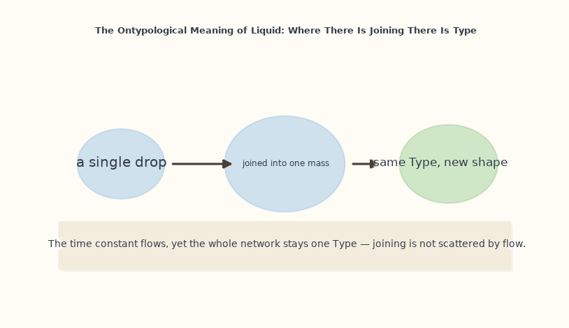

*Figure 3-4 The Ontypological meaning of liquid: where there is joining there is Type, and flow is still one body*

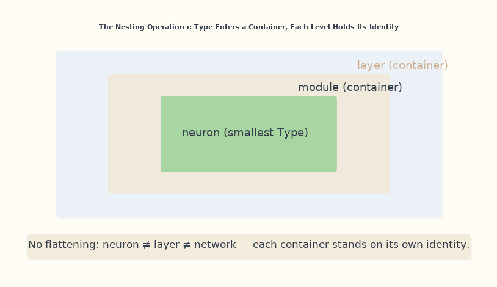

*Figure 3-5 The nesting operation ι: Type enters a container, each level holds its own identity*

### 3-5 Three-Layer Judgment: Auditing a Network

The three-layer judgment of Type Logic — container judgment, BOM judgment, abstract judgment — is the joint gate for accepting a Type. Container judgment asks: is identity independent of content? (Change the input stream, id(N) unchanged — pass.) BOM judgment asks: does identity survive taking apart? (The three-grade remove is clear — pass.) Abstract judgment asks: do all features pass? (∩(T) checks item by item whether the network belongs to the “liquid network” category — time constant modulated by state, continuous-time evolution, bounded stability — all pass.) The three layers jointly J = container ∧ BOM ∧ abstract, none may be missing, and only then is a conclusion drawn.

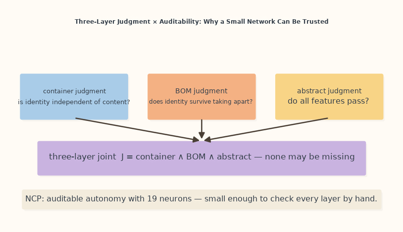

*Figure 3-6 Three-layer judgment × auditability: why a small network can be trusted*

This structure explains why only small networks are auditable: the three-layer judgment requires every layer to be reviewable by hand. NCP completes auditable autonomous driving with nineteen neurons precisely because it is small enough that every connection can be inspected one by one — auditability is not an add-on feature, it is the joint product of scale and notation.

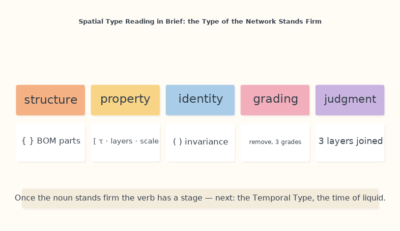

*Figure 3-7 Spatial Type reading in brief: the Type of the network stands firm*

### 3-6 [Pro Column C2] The Mathematics of LTC: Liquid τ and Bounded Stability

Each neuron of LTC is a linear first-order dynamical system, modulated by nonlinear interconnection gates: dx/dt = −x/τ(x, I) + f(x, I). The key is that τ is not a constant but a function of state and input — the time constant “hangs” on the hidden state, hence “liquid time constant”. The paper measures expressivity by trajectory length: in the latent trajectory space, the upper bound of LTC's trajectory length is better than that of models in the same family, and the dynamics are proven stable and bounded — the liquid flows, but does not spill out of the cup.

Restated in the language of operations: an LTC neuron is itself an implementation of op: Type → Type — it takes in a signal Type, passes through liquid dynamics, and puts out a state Type. Its operation laws can be checked: closure holds (the state is still in the state space), associativity holds (a chained network is still a network), commutativity does not hold (the order of layers is the dependence structure — exactly the dynamic version of the non-commutativity of the BOM tree).

> **[Exercise] E02 (implementing remove)**
>
> Apply the three-grade remove to a network you know: give one essential part, one function-degraded part and one non-essential part, and write your grounds (which of the three outcomes of remove(p,M) each one is).

## Part Four Temporal Type: The Time of Liquid

The previous part set the Type firmly; this part looks at how it moves. The definition of the Temporal Type is only one: op: Type → Type — take in a Type, put out a Type. Liquid networks implement this definition vividly in a continuous version: the signal Type flows in, passes through the breathing of the liquid time constant, and the decision Type flows out.

### 4-1 Type In, Type Out: Defining the Temporal Type

Ontypology says: the Temporal Type (verb, function, method) depends on the Spatial Type — what a function takes in and puts out are both Types, and without a Type the function has nothing to move. Liquid networks are the very picture of this sentence: the right-hand side f(x, I) of the ODE is a function whose input is the state Type x and the signal Type I, and whose output is the rate of change of the state; after one step of evolution there is again a new state Type. The inference of the whole network is a string of Type in, Type out.

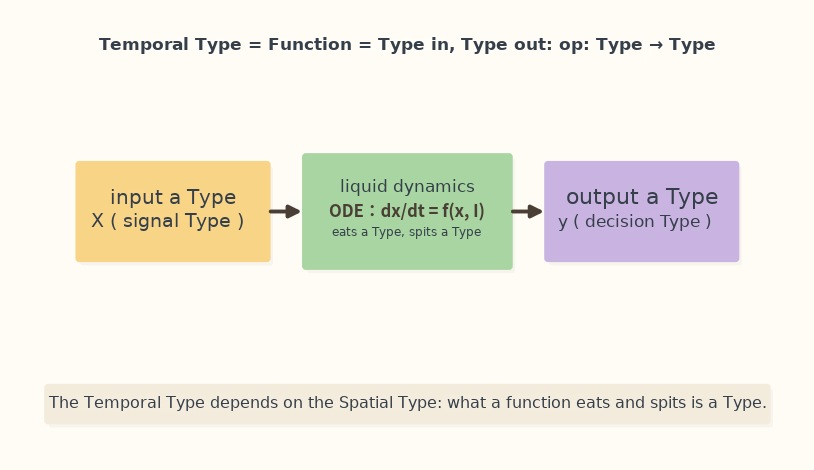

*Figure 4-1 Temporal Type ＝ function ＝ Type in, Type out: op: Type → Type*

### 4-2 Liquid τ(t): Time Breathes

The time constant of a traditional RNN is fixed — the rhythm is hard-wired, whatever the urgency of the signal. The τ(t) of a liquid network is modulated by input and state: when the signal comes urgently, τ shortens and the response quickens; when the signal is calm, τ lengthens and memory is retained. This is the most moving picture of the Temporal Type — the rhythm of the function suits the Type. In the language of the Spatial Framework, the modulation of τ is the dynamic version of “judging belonging”: a new difference arrives, and if it matches an existing rhythm it is hung there; if not, a new rhythm is tuned out.

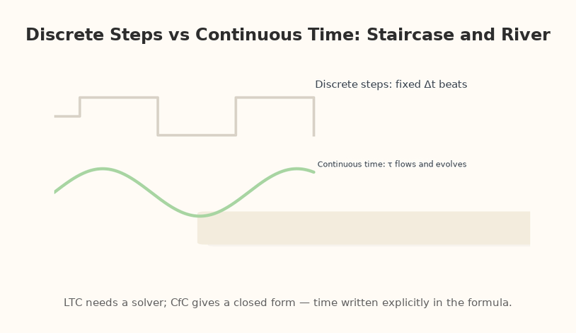

*Figure 4-2 Discrete steps vs continuous time: staircase and river*

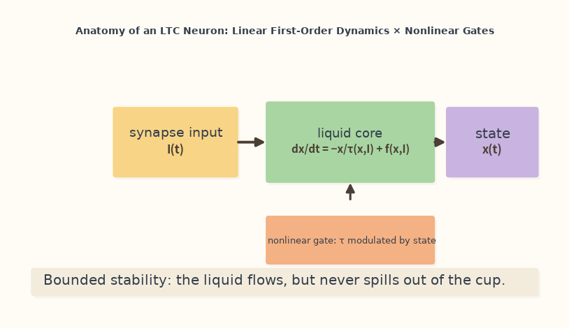

*Figure 4-3 Anatomy of an LTC neuron: linear first-order dynamics × nonlinear interconnection gates*

### 4-3 Closed-form Solution: Every Step Can Be Written

The breakthrough of CfC is to write the liquid dynamics as a closed-form solution — time appears explicitly in the expression, and a numerical solver iterating step by step is no longer needed. In engineering this step brings one to five orders of magnitude of speed-up; in Ontypology it brings “accuracy”: accuracy ＝ reviewable accuracy, and the precondition of reviewability is that every step can be written. A numerical solver's iteration is like a student who gives only the answer and not the process; a closed-form solution is like a student who writes every step on paper — only the latter passes the eight questions.

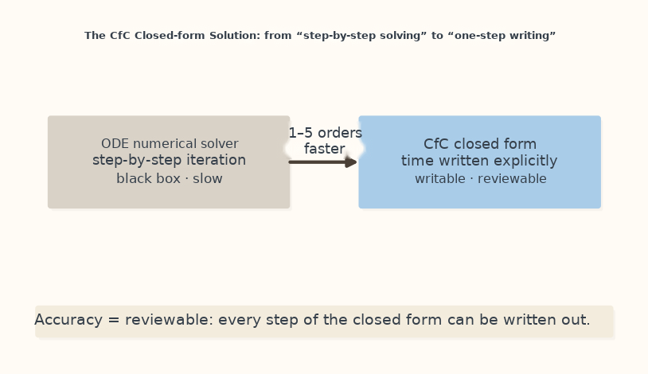

*Figure 4-4 The CfC closed-form solution: turning “step-by-step solving” into “one-step writing”*

> **[Sources] The CfC speed-up factor**
>
> Hasani et al. (Nature Machine Intelligence, 2022) state in the original: closed-form networks are one to five orders of magnitude faster than the differential-equation control group in training and inference, and scale significantly better than ODE-type continuous networks. This volume quotes it as “1–5 orders of magnitude”, without inflating or deflating.

### 4-4 Continual Learning: Type and Function Grow Together

In the function library of the Temporal Type there is a set of moves called continual learning: input a Type, output a Type, the world changes because of the output, and the new difference forces out a new Type. The training loop of a liquid network is exactly this set of moves: the data Type flows into the network, the decision Type flows out, and after deployment new situations feed back as new differences, and the network grows new rhythms in fine-tuning — while identity never changes (id(N) unchanged, guarded by the axiom of invariance). This is “Type and function grow together”: the Spatial Type expands in the running of the Temporal Type, and the Temporal Type learns new moves on the new Type.

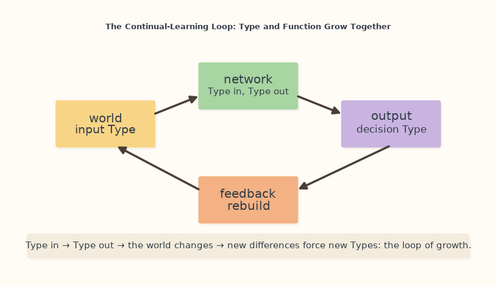

*Figure 4-5 The continual-learning loop: Type and function grow together*

### 4-5 Two Libraries Compared: The Basic and the Advanced

The five great operations of Type Sets — ⊕ join, remove split, σ replace, ∩(T) classify, ι nest — are the “basic line” of Type in and Type out: one in, one out, simple syntax, checkable operation laws. The higher-order functions of the Temporal Type function library — reasoning, thinking methods, design, analysis, problem solving — are the “composite line”: a reasoning chain is a composite of remove ＋ σ ＋ ι ＋ ≡ comparison. The position of liquid networks in this comparison table is clear: a single neuron is the continuous implementation of the basic line, and the overall inference is a higher-order composite chain.

| **Angle** | **The five operations (basic line)** | **The continuous implementation in liquid networks** |
| --- | --- | --- |
| Definition | op: Type → Type | dx/dt = f(x, I): Type in, Type out |
| Closure | A joined Type is still a Type | The state is still in the state space |
| Levels | Brackets are levels; no crossing | The ι chain, each level holding its own identity |
| Identity preserved | σ replacement, id(C) unchanged | Change the input stream, id(N) unchanged |
| Reviewable | The formula written step by step | The CfC closed form written step by step |
| [Exercise] E03 (Type in, Type out) Write in the form op: Type → Type what the input Type and the output Type of a “time-series classifier” are, and explain which Spatial Types this function depends on (what it eats, what it spits out). | [Exercise] E03 (Type in, Type out) Write in the form op: Type → Type what the input Type and the output Type of a “time-series classifier” are, and explain which Spatial Types this function depends on (what it eats, what it spits out). | [Exercise] E03 (Type in, Type out) Write in the form op: Type → Type what the input Type and the output Type of a “time-series classifier” are, and explain which Spatial Types this function depends on (what it eats, what it spits out). |

### 4-6 [Pro Column C3] Neural ODE and Continuous Depth: The Ontypological Position

Neural ODE redefines depth from “number of layers” to “time” — the depth of a network is a continuous evolutionary trajectory. This turn has a clear echo in Ontypology: does number come before Type, or Type before number? Ontypology says Type comes first, and then number — the number of layers is a “sub-comparison of the small Type inside the Type”, counting how many times the same Type (the layer) appears; Neural ODE turning layer count into continuous time is in fact a return to the origin of “Type”: first there is the continuous Type of evolution, and the layer count is only a subsequent scale.

Likewise, the comparison of parameter counts is also a sub-comparison: the nineteen-neuron NCP and a million-parameter large network are not compared by number but by “which Type” — the choice of Type precedes the amount of number. This is the deepest endorsement Ontypology gives to “small models”: small is not saving, small is Type standing straight.

## Part Five The Accurate Method of Use, Integrated

This part is the heart of the book. The previous two parts raised the parallel reading; this part condenses it into a set of Accurate Methods of Use that can be taken up directly: the three-character key Body—Use—Accuracy, the three supplements, the six steps, the eight questions, the misuse comparison and a complete demonstration. The method has only one standard — accuracy ＝ reviewable accuracy. Anyone who follows it will reach the same judgment, and can check every step of yours.

### 5-1 Body—Use—Accuracy: The Three-Character Key

To use a liquid network accurately, first remember three characters. Body: it is a Type — set it firmly with three axes and three brackets; Use: it is operating — describe its dynamics with Type in, Type out; Accuracy: it can stand checking — write the judgment to reviewable form with the three supplements, the six steps and the eight questions. None may be missing: body without use is a dead model, use without accuracy is a black box, and accuracy without body has nothing to check against.

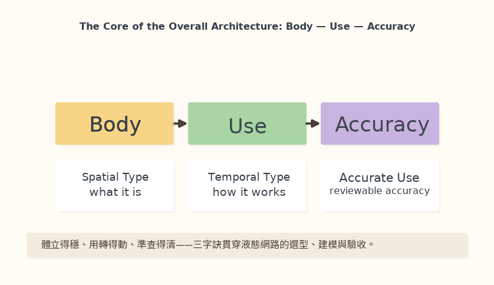

*Figure 5-1 The core of the overall architecture: Body — Use — Accuracy*

### 5-2 Three Supplements: Putting Back What Was Omitted

Mathematical language is precise, but it omits a lot. Describing a network with pure sets omits three layers of information — rule, identity, structure. The three supplements each restore one layer: [ ] writes the category as an open rule (the range of τ, the gate rule, verifiable item by item); ( ) writes identity as an invariant (change the input stream, change the deployment scenario, id(N) unchanged); { } writes structure as dependence (the three-grade remove of layers and synapses). Wherever the gap is, that is where the bracket supplements.

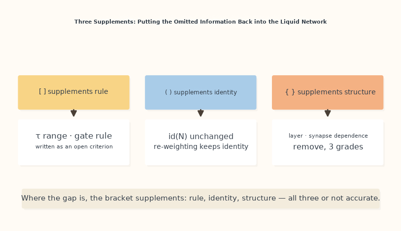

*Figure 5-2 Three supplements: putting the omitted information back into the liquid network*

> **[Definition] Three supplements × liquid networks**
>
> [ ] supplements rule: write “what counts as a liquid network” as T = (F(T), ∩(T)) — feature set and intersection criterion. F(liquid network) = { time constant modulated by state, continuous-time evolution, bounded stability }; only when all features pass does it enter the category.
>
> ( ) supplements identity: C = ( id(N), W(N) ) — weights and input stream are replaceable content, id(N) is the unchanging mark. Axiom of invariance: fine-tuning, quantisation, deployment on a different device — id(N) unchanged.
>
> { } supplements structure: the BOM criterion plus the three-grade remove — only what recognises itself when taken apart enters the BOM; after removal, look at whether identity survives, and grade into essential, function-degraded and non-essential parts.

### 5-3 Six Steps: Writing a Judgment to Reviewable Form

Facing any judgment of “does this network count, which one is it, is it usable”, always walk six steps.

| **Step** | **Operation** | **Output** | **Common tools** |
| --- | --- | --- | --- |
| ① Identify the whole | Name the object of judgment: which network is M? | One sentence: what M is | ------ |
| ② Describe by axis | Write X property, Y composition, Z container once each | Property table, BOM, container | Three brackets |
| ③ Write the Type Set | Complete notation | { parts, ( content ), [ category ] } | Type Set |
| ④ Choose the proposition | Belonging, invariance, or grading? | One sentence of theorem | ------ |
| ⑤ Criterion reasoning | Walk the corresponding criterion step by step | The body of the reasoning | ∩(T), id(N), remove |
| ⑥ Three-layer check | Joint verification of container, BOM and abstract | Conclusion (proven) | Three-layer judgment |

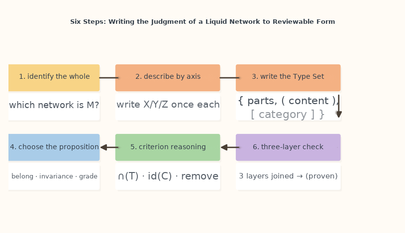

*Figure 5-3 Six steps: writing the judgment of a liquid network to reviewable form*

### 5-4 The Eight-Question Checklist

After the six steps, accept with the eight questions. Only when all eight pass do you write (proven) — accuracy is not a feeling, it is a reviewable process.

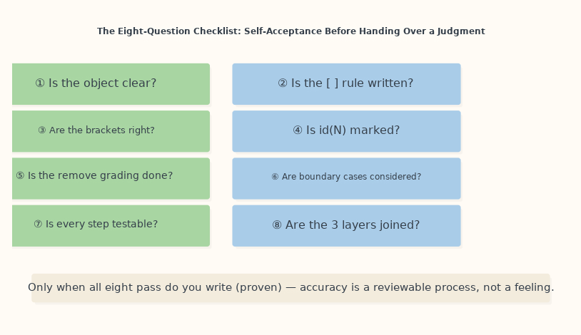

*Figure 5-4 The eight-question checklist: self-acceptance before handing over a judgment*

> **[Key Point] The eight questions are the acceptance criteria**
>
> The eight questions are not a format but the acceptance criteria of the three supplements: ② corresponds to the [ ] rule, ④ to the ( ) identity, ⑤ to the { } structure, ⑧ to the three-layer joint. Whichever question cannot be answered, go back to the corresponding supplement, complete it, and hand over again.

### 5-5 Misuse Compared: Sixteen Deviations

Misuses are of a thousand kinds, but the root is one class — the levels are not written clearly. The levels of brackets, the levels of container and content, the levels of judgment: confuse any one level and the formula, however smoothly written, cannot yield the right result. The table below condenses the sixteen most common misuses in liquid-network scenarios into six classes, each with the correct writing.

| **#** | **Misuse** | **Where the problem lies** | **Correct writing** |
| --- | --- | --- | --- |
| 1 | Using ( ) as an ordinary set | The input stream is written as { signal }, identity disappears | Put the content in ( ), mark it with id(N) |
| 2 | Writing [ ] as a closed list | A new architecture cannot be classified | Use the open rule T = (F(T), ∩(T)) |
| 3 | Using comparison instead of taking apart | Property relies on comparison, BOM on taking apart | Entering the BOM only asks “does it recognise itself when taken apart” |
| 4 | Calling it a different network as soon as the content changes | Confusing container and content | Fix id(N) first, then discuss the input stream |
| 5 | Concluding after only one layer of judgment | Each of the three layers has blind spots | Conclude only after the three layers are joined |
| 6 | Writing dynamics as a static table | τ(t) is a function, not a scale | Write the Temporal Type as op: Type → Type |
| 7 | Flattening levels to count parameters | Nineteen is not the same as the input dimension | Ask “which Type” first, then “how many” |
| 8 | Pruning without the three grades | Essential parts are pruned as non-essential | Grade every part with the three-grade remove before cutting |
| 9 | Treating a deployment change as a new network | The invariance of id(N) is ignored | Axiom of invariance: change the scenario, still the same one |
| 10 | Mixing closed-form and numerical solutions | Reviewability is not of the same grade | CfC is written step by step; a numerical solution gives only an approximation |
| 11 | Not writing the range of τ into F(T) | The definition of “liquid” floats | State it at the head of F(T) and verify item by item |
| 12 | Judging life or death by a single accuracy metric | The criterion only picks what is easy to verify | Multiple criteria plus boundary-case testing |
| 13 | Not auditing a small network line by line | Auditability is given up for nothing | Inspect line by line, NCP style, and keep records |
| 14 | Flattening the nesting chain | The levels of the ι chain disappear | Neuron, layer and network each hold their own identity |
| 15 | Treating parallel reading as analogy | Terms are stuck on at random | The four questions of parallel reading: describe, judge, use accurately, pass on |
| 16 | Judging only the result, not the process | The black box is restored | Six steps leave a trace, every step can be ticked and reproduced |

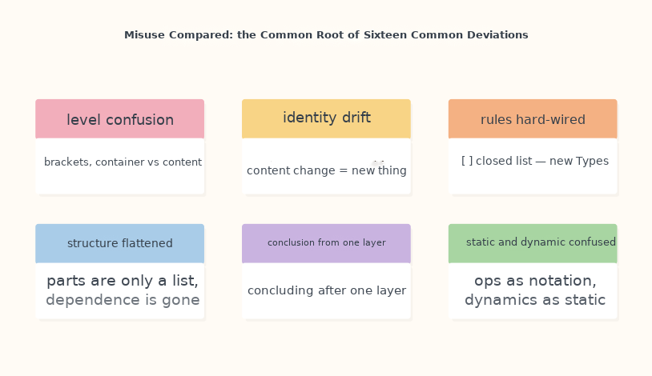

*Figure 5-5 Misuse compared: the common root of sixteen common deviations*

### 5-6 A Complete Demonstration: An Autonomous-Driving Network Through Six Steps

Walk the method once. Situation: an autonomous steering decision network N with NCP at its core, deployed in a rainy region; we must judge “is the rainy-day N the same N as the sunny-day N, and is the functional grading stable”.

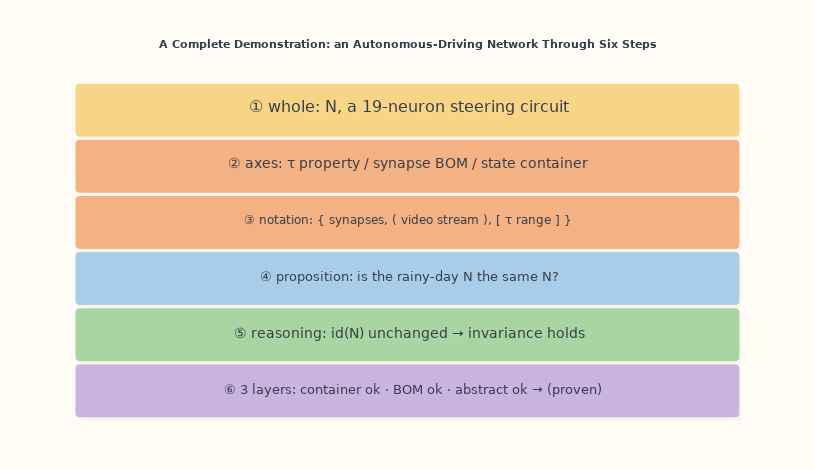

*Figure 5-6 A complete demonstration: an autonomous-driving network through six steps*

> **[Demonstration proof] Is the rainy-day N still N?**
>
> (1) Identify the whole: the object of judgment is N (a 19-neuron steering circuit).
>
> (2) Describe by axis: X — range of τ, response delay, camera resolution; Y — BOM = { sensing front end, core circuit, readout head }; Z — S(N) = ( video stream ), with id(N) as the model signature.
>
> (3) Write the Type Set: N = { sensing front end, core circuit, readout head, ( video stream ), [ range of τ, response delay ] }.
>
> (4) Choose the proposition: this problem proves “invariance” — whether id(N) survives deployment in rain, and whether the functional grading is stable.
>
> (5) Criterion reasoning: the rainy-day video stream is a content replacement of S(N) (σ_{sunny→rainy}); by the axiom of invariance, id(N) is unchanged. remove(readout head, N) ≡ M′ ⊂ M — the readout head is a function-degraded part, and this still holds in rain.
>
> (6) Three-layer check: container ✓ (change the content, id unchanged); BOM ✓ (the three-grade grading does not change with weather); abstract ✓ (all three features of ∩(T) still pass). All three layers pass — the rainy-day N is still N. (Proven)

### 5-7 Choosing a Route: When to Use a Liquid Network

The last link of the method is route selection. A liquid network is not a panacea — it performs best in scenarios with continuous time, sequential decisions and high robustness requirements. The route decision tree condenses common situations into two questions: is the problem a continuous-time sequential decision? Is what is sought robust and auditable?

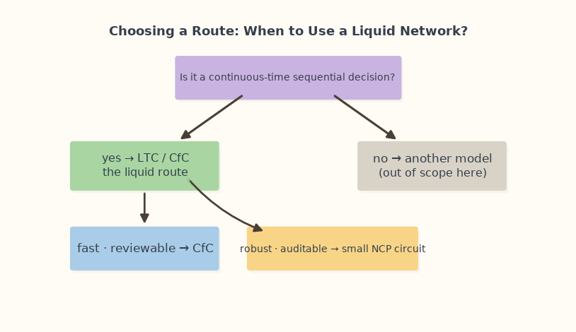

*Figure 5-7 Choosing a route: when to use a liquid network?*

> **[Example] Three route demonstrations**
>
> - Scenario one: automotive steering control, continuous camera streaming, auditable required — the liquid route, take NCP (seeking robustness and auditability).
> - Scenario two: anomaly detection on industrial sensor time series, limited edge-device compute — the liquid route, take CfC (seeking speed and reviewability).
> - Scenario three: static image classification — not a continuous-time sequential decision, take another model, no need to force liquid.

> **[Exercise] E04 (implementing the six steps)**
>
> Choose a sequential decision problem you are working on (or know well) and walk the six steps completely: identify the whole → describe by axis → write the Type Set → choose the proposition → criterion reasoning → three-layer check, and write your (proven) or (in doubt).

> **[Exercise] E05 (diagnosing misuse)**
>
> Pick from the sixteen misuses the one you commit most often in real work, and write: the misuse situation, where the problem lies, the correct writing, and how you plan to avoid it in your next project.

### 5-8 [Pro Column C4] Auditable Autonomy in NCP and the Three Ontypological Layers

Neural Circuit Policies, inspired by the nematode nervous system, complete the loop from perception to control with an extremely small recurrent circuit. Its “auditability” is not post-hoc explanation but pre-hoc checkability: the behaviour of each node can be tested independently, and the contribution of each connection traced independently.

Translated with the three-layer judgment: container layer — the identity of the circuit is independent of the input scenario (axiom of invariance); BOM layer — the role of each node can be graded by remove (core nodes are essential parts, regulatory nodes are function-degraded parts); abstract layer — circuit behaviour can be described by rules (∩(T) checked item by item). Only when all three layers pass does an “auditable autonomy” stand. This is also the confidence behind this volume's repeated claim that “small is for the sake of seeing clearly”.

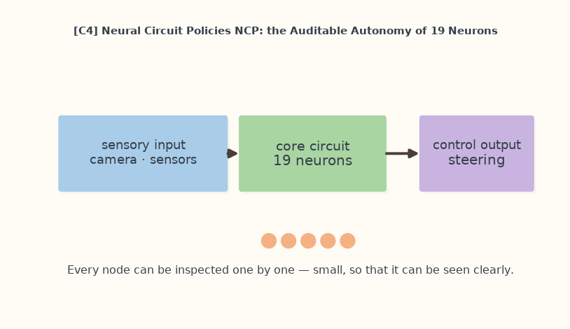

*Figure 5-8 [C4] Neural Circuit Policies NCP: the auditable autonomy of 19 neurons*

### 5-9 [Pro Column C5] Liquid AI: Bringing Liquid to the Edge

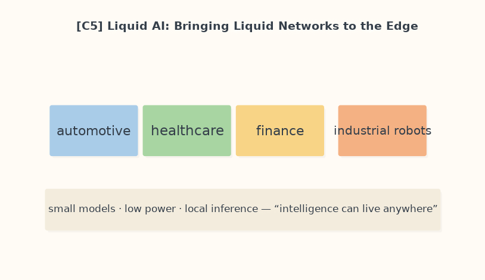

*Figure 5-9 [C5] Liquid AI: bringing liquid networks to edge devices*

Liquid AI, founded in 2023, was incubated by MIT CSAIL, and its founders are precisely the core authors of the LTC/CfC papers: Ramin Hasani (CEO), Mathias Lechner (CTO), Alexander Amini (CSO) and Daniela Rus. The company's mission is to build efficient, aligned and trustworthy general-purpose AI systems, so that “intelligence can live anywhere” — automotive, consumer electronics, finance, healthcare and industrial robotics are all its landing scenarios.

Seen through Ontypology, the route of Liquid AI is a “devolution of Type”: the big black box that only a data centre could afford is compressed into a small Type that can live in an edge device — and the auditability and reviewability of the small Type are exactly where the Accurate Method of Use of Ontypology comes into its own. The further a model goes toward the edge, the more “accuracy ＝ reviewable accuracy” becomes a hard requirement.

## Part Six The Overall Architecture

This part puts the parts of the first five parts back into one machine. First see how Body—Use—Accuracy each take their place in the overall architecture, then how “two libraries, one hub, one loop” houses liquid networks, and finally use one master reading table and the four-question card to see the mappings of the whole book at once.

### 6-1 Two Libraries, One Hub, One Loop × Liquid Networks

The practice architecture of Ontypology is two libraries, one hub, one loop: the Type library holds Spatial Types (structural Types), the function library holds Temporal Types (dynamic moves), the hub does the three-layer judgment and reasoning, and the loop handles learning and evolution. Liquid networks have a double identity in this architecture — they are both a Type in the Type library (notatable, gradable, auditable) and a set of moves in the function library (Type in and Type out, τ modulation, closed-form evolution).

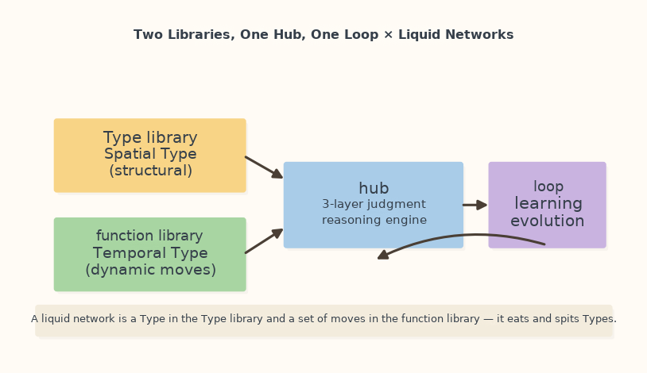

*Figure 6-1 Two libraries, one hub, one loop × liquid networks*

> **[Key Point] The conditions for entering the library**
>
> For a liquid network to enter the Type library it must pass three gates: the Type Set notation is complete (② by axis), the three-grade remove is clear (⑤ reasoning), and the three-layer check fully passes (⑥ acceptance). What cannot enter is not bad, it is just not yet stated clearly — state it clearly and then enter.

### 6-2 The Master Reading Table

Condense the mappings of the whole book into one table. On the left is the engineering language of liquid networks, on the right the Ontypological language, and the correspondence in the middle is not analogy but two descriptions of the same reality.

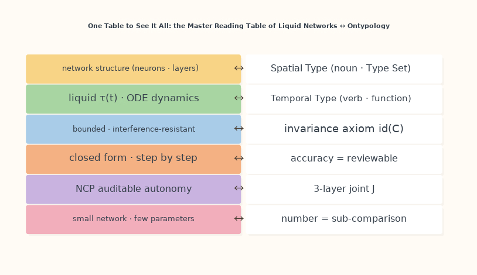

*Figure 6-2 One table to see it all: the master reading table of liquid networks ↔ Ontypology*

| **Liquid neural networks** | **Ontypology** | **The reading sentence** |
| --- | --- | --- |
| Network structure (neurons · layers · readout head) | Spatial Type · Type Set | { parts, ( content ), [ category ] } |
| Liquid τ(t) · ODE dynamics | Temporal Type · function | op: Type → Type, Type in and Type out |
| Bounded stability · interference resistance · transferability | Axiom of invariance | Change the content, id(C) unchanged |
| The CfC closed-form solution | Accuracy ＝ reviewable accuracy | Every step can be written |
| The auditable small NCP circuit | Three-layer judgment | container ∧ BOM ∧ abstract |
| Pruning · ablation experiments | Three-grade remove | essential / function-degraded / non-essential part |
| Small models · edge deployment | Type before number | number ＝ sub-comparison of the small Type inside the Type |

### 6-3 The Four-Question Card: Typing Your Liquid Task

The card most used in practice is the four-question card. Given a liquid task, fill four columns first: name (what it is, the identity mark), input Type (what Type it eats), output Type (what Type it spits out), criterion (how correctness is counted, how it is reviewed). If the four columns can be filled, the task has its Type standing; if not, do not write code yet — the Type has not yet been set firmly.

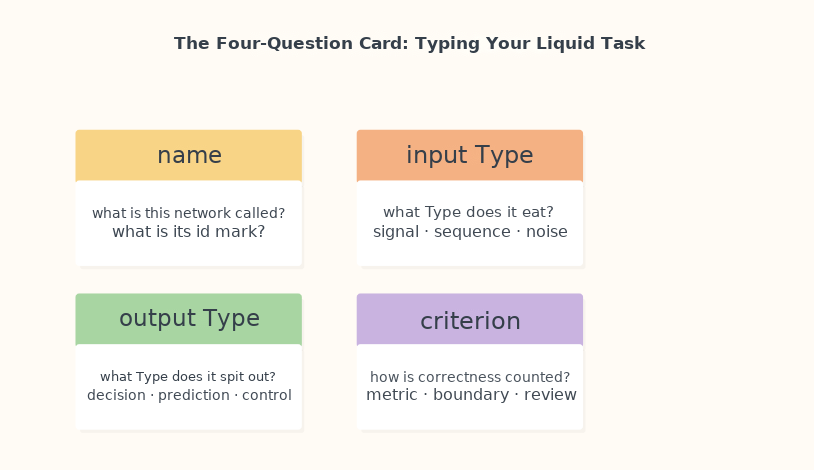

*Figure 6-3 The four-question card: typing your liquid task*

### 6-4 Toward Mind AI: The Three Unifications

The prospect of Ontypology is Mind AI: unification of knowledge (all things notatable), unification of thought (reasoning reviewable), unification of intelligence (self-evolution). Liquid networks are a live brick on this road — they demonstrate how a dynamical system can be both flowing and conserving, both small and auditable. As such Types gather, and the Type library and function library grow fuller, the three unifications cease to be a vision and become a roadmap.

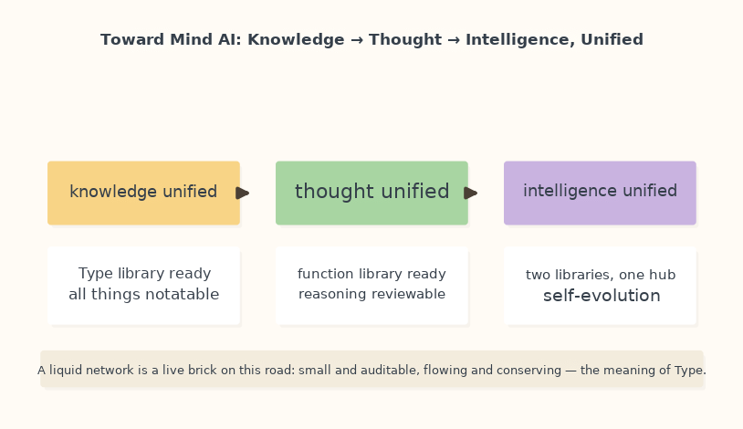

*Figure 6-4 Toward Mind AI: unification of knowledge → unification of thought → unification of intelligence*

### 6-5 [Pro Column C6] Continuous Depth and Ontypology: Type Before Number

Neural ODE redefines depth as time, and LTC/CfC redefine the time constant as a function of state — the direction of these two “redefinitions” is the same: from a fixed number back to a flowing Type. The core proposition of Ontypology, “Type comes first, then number”, finds its engineering echo here: layer count, parameter count and step size are all “sub-comparisons of the small Type inside the Type”, scales that are counted, not essences. Choose the model by choosing the Type first, then discuss number — this is a piece of advice the parallel reading gives to model-selection practice.

### 6-6 [Pro Column C7] Landing Interpretability in Engineering

Interpretability is often treated in engineering as a post-hoc “manual”; Ontypology moves it forward to a pre-hoc “notation”. If a network has its Type Set written, its three-grade remove graded and its id(N) marked at the very start of modelling, then its interpretability is not explained but built into the notation. Line-by-line checkability in NCP, closed-form writability in CfC, and the joint verification of the three-layer judgment — the three together are the complete landing route of interpretability: notate beforehand, leave traces in the process, review afterwards.

### 6-7 [Pro Column C8] Connecting with Mind AI: The Ontypological Ground of the Three Unifications

The three unifications of Mind AI — unification of knowledge, of thought, of intelligence — each have a concrete Type in Ontypology. The Type of knowledge unification is the Type library: all things can be notated as { parts, ( content ), [ category ] }, and liquid networks demonstrate that even a “dynamical system” can enter the library; the Type of thought unification is the function library plus the hub: reasoning, thinking methods, design and analysis are all composite chains of Type in and Type out, and the three-layer judgment guarantees that every chain is reviewable; the Type of intelligence unification is the loop: Type and function grow together, and the system evolves itself while running.

Liquid networks leave one brick at each of these three stations: entering the library (its structure is notatable), being checkable (its dynamics are reviewable), and growing (its τ moves with the Type, continual learning). Write the specifications of these three bricks clearly — which is exactly what the Accurate Method of Use in this volume does — and the three unifications are no longer a slogan but a drawing that can be built item by item.

## Part Seven A Complete Content Plan

The method gives “how to use accurately”; the plan gives “how to learn”. This part condenses the content of the whole book into an executable learning and library-building route: five stages, an eight-week timetable, four stages of library building, an integrated case and acceptance criteria.

### 7-1 Five Stages: Learn · Practise · Apply · Teach · Build

Learning this method of parallel reading takes five stages: learn (understand the parallel reading), practise (write the formulas), apply (enter a project), teach (explain to others), build (build the Type library). The five are not a one-way linear road — after building the library, go back and learn again, spiralling upward.

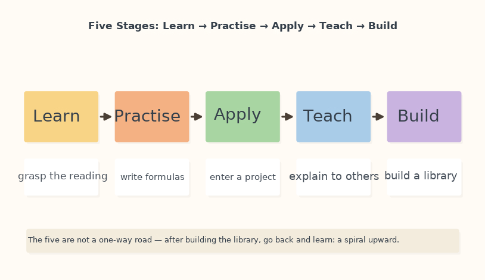

*Figure 7-1 Five stages: learn → practise → apply → teach → build*

### 7-2 An Eight-Week Learning Route

Arrange the five stages into an eight-week timetable. The first two weeks raise the backbone and the parallel reading; weeks three and four do dismantling exercises on the Spatial Type; week five attacks the Temporal Type and Type in, Type out; week six practises the Accurate Method of Use; week seven walks a complete case; week eight builds the library and accepts. Every week has a clear deliverable.

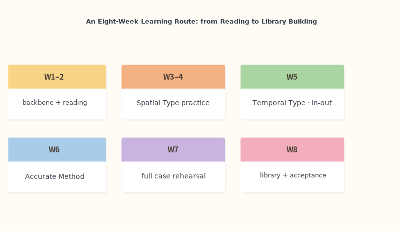

*Figure 7-2 An eight-week learning route: from parallel reading to library building*

| **Week** | **Theme** | **Deliverable** |
| --- | --- | --- |
| W1–2 | Backbone and parallel reading | Your own reading map ＋ E01 completed |
| W3–4 | Spatial Type practice | Type Sets of three networks ＋ three-grade remove table |
| W5 | Temporal Type · Type in, Type out | Three four-question cards filled |
| W6 | Accurate Method of Use | Six steps rehearsed twice ＋ eight-question self-check |
| W7 | Complete case rehearsal | One end-to-end case report |
| W8 | Library building and acceptance | First version of a personal Type library ＋ acceptance checklist |

### 7-3 Four Stages of Library Building

Library building is the harvest of the five stages and the starting point of the next round. Four stages: inventory (take existing networks apart into Types), notation (register each Type Set item by item), acceptance (pass the eight questions, three-layer check), entry (hang the Type library and function library onto the hub). Each stage has a deliverable and acceptance criteria — library building itself must be reviewable.

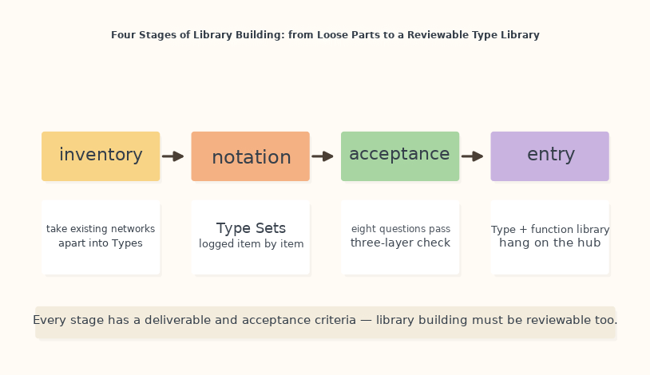

*Figure 7-3 Four stages of library building: from loose parts to a reviewable Type library*

### 7-4 Integrated Case: The Type Chain of a Time Series

Finally string the method of the whole book into one chain. Situation: anomaly detection on industrial sensor time series. The data stream is ( signal ); after typing it is { features, [ scales ] }; the liquid network takes in the signal Type and puts out the decision Type; the output Type returns to the world (alert, shutdown, re-inspection). Every station leaves a notation and a criterion — go back and check any step, and it can be ticked and reproduced item by item.

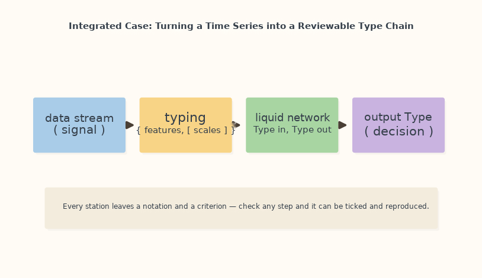

*Figure 7-4 Integrated case: turning a time series into a reviewable Type chain*

> **[Example] Reading the case through the four questions**
>
> - Name: Anomaly-LTC-01, id is the model signature — ( ) identity set.
> - Input Type: sensor time series ( signal stream ), containing noise and gaps — the content is replaceable, the id does not change.
> - Output Type: the anomaly decision Type (normal / warning / anomalous), graded by the ∩(T) criterion.
> - Criterion: precision metrics ＋ boundary cases (spikes, shutdowns, sensor failure) verified one by one — accuracy ＝ reviewable.

### 7-5 Acceptance Criteria

The last page of the plan is acceptance. The standard for a person having “learned” this method is not an exam score but three checkable things: the ability to write a complete Type Set for any network; the ability to walk the six steps for any judgment and leave a trace; the ability to self-check with the eight questions and self-correct. Only when all three pass is the training complete.

| **Acceptance item** | **Standard** | **How it is checked** |
| --- | --- | --- |
| Type Set notation | Can write { parts, ( content ), [ category ] } for any network | Three networks drawn at random and written on the spot |
| Six steps leave a trace | Every step has an output, tickable and reproducible sentence by sentence | Submit one complete rehearsal record |
| Eight-question self-check | All eight pass, or doubtful items explicitly marked | Self-check sheet ＋ list of doubts |
| Avoiding misuse | Can identify the sixteen misuses and give corrections | One misuse-diagnosis report |
| Library-building ability | The first version of the Type library passes the three gates | Type library register ＋ acceptance record |
| [Exercise] E06 (designing a plan) Design a condensed two-week learning route for your team: pick the required stages from the five, write the daily themes and deliverables, and explain how you will accept them. | [Exercise] E06 (designing a plan) Design a condensed two-week learning route for your team: pick the required stages from the five, write the daily themes and deliverables, and explain how you will accept them. | [Exercise] E06 (designing a plan) Design a condensed two-week learning route for your team: pick the required stages from the five, write the daily themes and deliverables, and explain how you will accept them. |

## Part Eight Conclusion

From beginning to end this volume has done one thing only: read liquid neural networks into Type, and give the language of Type back to engineering. Condensed into three sentences.

- **First sentence: a liquid network is a Type.** Its structure is the Spatial Type — { parts, ( content ), [ category ] } completely notated; its dynamics is the Temporal Type — op: Type → Type, Type in and Type out. Flowing and yet conserving — this is exactly the original meaning of “Type”.
- **Second sentence: accuracy ＝ reviewable accuracy.** The three supplements restore rule, identity and structure; the six steps write the judgment out; the eight questions raise the gate. The closed-form solution and the auditable small circuit are the two engineering incarnations of this standard.
- **Third sentence: parallel reading is for moving forward.** Ontypology gives liquid networks a language of description, judgment and acceptance; liquid networks give Ontypology a living specimen that is dynamic, conserving and auditable. Where the two meet, the road leads to the three unifications of Mind AI.

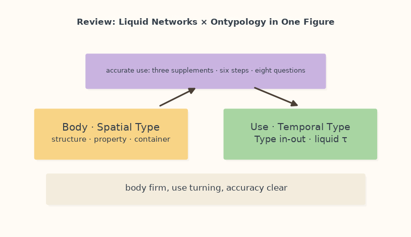

*Figure 8-1 Review: liquid networks × Ontypology condensed in one figure*

> **In One Sentence**
>
> Liquid neural networks flow and yet conserve; Ontypology writes this stability within flow as a reviewable Type — the body stands firm, the use turns, the accuracy checks clear.
>
> Make the Type clear, turn it into a visible discipline, and make it practice as Mind AI.

*── Liquid Neural Networks and Ontypology · Relations, the Accurate Method of Use and Architecture, a Complete Content Plan ──*

## Exercises

There are fourteen exercises in all: E01–E06 are distributed through the parts, and E07–E12 and S01–S02 are collected here. Each has a sample answer (Appendix C) — the answer is a demonstration, not the standard; writing your own formula is the real exercise.

### Exercises E07–E12

> **[Exercise] E07 (Type Set notation)**
>
> Write the CfC model as a complete Type Set notation: list the BOM (using the “does it recognise itself when taken apart” criterion), the content and the category, and mark the three-grade remove belonging of each part.

> **[Exercise] E08 (axiom of invariance)**
>
> A liquid network is quantised to INT8 and deployed to an edge device. Write this change in the language of σ replacement through quantisation, and judge whether id(N) survives and on what grounds.

> **[Exercise] E09 (three-layer judgment)**
>
> Someone says “our model has only a hundred thousand parameters, so it is auditable”. Comment on this sentence with the three-layer judgment of Ontypology: at which layer does it hold, and at which layer does it not?

> **[Exercise] E10 (Type in, Type out)**
>
> Write “causal reasoning” as a composite chain of Type in and Type out: assemble a reasoning chain with the four basic operations remove, σ, ι and ≡ (hint: reason back from effect, forward from cause).

> **[Exercise] E11 (route decision)**
>
> Route three scenarios: ① wake-word detection (edge, low power) ② long-range weather-series forecasting (data centre) ③ insurance-claim text classification. Which model route should each take? Give the reasons and criteria.

> **[Exercise] E12 (integrated)**
>
> Use the four-question card to type a “medical time-series monitoring” task: write the name, input Type, output Type and criterion clearly, and self-check your four-question card with the eight questions.

### Integrated Exercises S01–S02

> **[Exercise] S01 (short essay on parallel reading)**
>
> Write a thousand-word essay on “one property of liquid networks × one principle of Ontypology” (suggested topics: bounded stability × axiom of invariance / closed-form solution × reviewability / small circuit × three-layer judgment). Requirement: support your argument with one run of the six steps or one four-question card.

> **[Exercise] S02 (library-building practice)**
>
> Collect three Types for your personal Type library: a network Type (such as CfC), a data Type (such as a time-series dataset) and a task Type (such as anomaly detection). Write a complete Type Set notation ＋ four-question card for each, and enter them after the eight-question self-check.

## Appendix A Terms and Notation

This appendix collects the terminology comparison and a notation quick reference for both sides, liquid neural networks and Ontypology.

### A-1 Terminology Table

| **Liquid network term** | **Ontypology term** | **In one sentence** |
| --- | --- | --- |
| Neuron | Unit Type (Type Set) | { synapse, ( signal stream ), [ τ ] } |
| Layer | Container (one link of the ι nesting chain) | Each level holds its own identity; no flattening |
| Time constant τ(t) | Temporal Type (rhythm) | Time breathes: it suits the Type |
| ODE dynamics | Temporal Type (function) | op: Type → Type |
| Closed-form (CfC) | Reviewable accuracy | Every step can be written |
| Robustness | Axiom of invariance | Change the content, id(C) unchanged |
| Pruning | The remove operation | Remove a part, look at identity |
| Ablation | The three-grade remove criterion | essential · degraded · non-essential |
| Interpretability | Three-layer judgment ＋ notation | Auditable ＝ see clearly |
| NCP, Neural Circuit Policies | The Type of auditable autonomy | Small enough to check every line |
| Continual learning | Type and function grow together | The loop learns and evolves |
| Edge deployment | The devolution of Type | A small Type enters the edge |

### A-2 Notation Quick Reference

| **Notation** | **Reading** | **Usage** |
| --- | --- | --- |
| { } | braces | Composition Set (parts · BOM) |
| ( ) | parentheses | Container Set (content · identity) |
| [ ] | brackets | Abstract Set (category · property) |
| ≡ / ≢ / ⊂ | same / not same / degraded | The three-grade remove criterion |
| ∩(T) | intersection criterion | Only when all features pass does it enter the category |
| id(C) | identity | A mark that does not change with content |
| op: Type → Type | Type in, Type out | The general form of the Temporal Type |
| τ(t) | liquid time constant | A rhythm modulated by state |

## Appendix B Quick-Reference Cards

The three-mirror quick-reference card ＋ a printable blank template. It is recommended to print B-3 and carry it, filling it in whenever a task arrives.

### B-1 The Three Mirrors of Parallel Reading

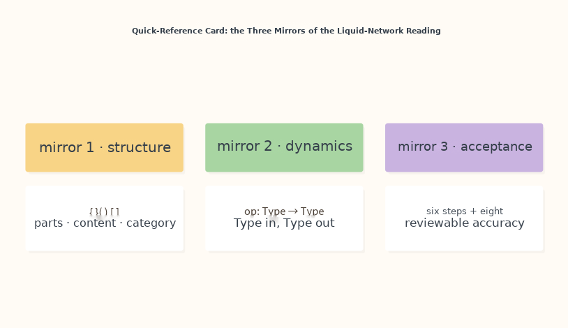

*Figure B-1 Quick-reference card: the three mirrors of the liquid-network parallel reading*

### B-2 Six Steps ＋ Eight Questions, Pocket Edition

| **Six steps** | **Pocket reminder** |
| --- | --- |
| ① Identify the whole | What is M? Can you say it in one sentence? |
| ② Describe by axis | Write X looks, Y composition, Z position once each |
| ③ Write the Type Set | { parts, ( content ), [ category ] } |
| ④ Choose the proposition | Belonging? Invariance? Grading? |
| ⑤ Criterion reasoning | Choose correctly among ∩(T) / id(N) / remove, then reason |
| ⑥ Three-layer check | container ∧ BOM ∧ abstract → (proven) |

### B-3 Printable Blank Template (four-question card ＋ Type Set card)

(this page can be printed and copied whole)

| **Field** | **To be filled in** |
| --- | --- |
| Name (what is it? id mark) |  |
| Input Type (what Type does it eat?) |  |
| Output Type (what Type does it spit out?) |  |
| Criterion (how is correctness counted? how is it reviewed?) |  |
| Type Set { parts, ( content ), [ category ] } |  |
| Three-grade remove: essential / function-degraded / non-essential part |  |
| Eight-question self-check result (✓ / × / in doubt) |  |

## Appendix C Sample Answers to the Exercises

The following are sample answers, grouped by exercise number into four sets: E01–E03, E04–E06, E07–E12, S01–S02. What is demonstrated is “how to write”, not “the only solution” — as long as your answer walks the right criterion and is written to reviewable form, it is a good answer.

### E01–E03

> **[Answer] E01 warm-up for parallel reading**
>
> Sample (taking LSTM as an example): LSTM = { input gate, forget gate, output gate, cell state, ( word-embedding sequence ), [ hidden dimension, number of layers ] }.
>
> By axis: the four parts in { } are the Y axis (they recognise themselves when taken apart); ( word-embedding sequence ) is the Z-axis content (replaceable, id unchanged); [ hidden dimension, number of layers ] is the X-axis property (dimension and scale).

> **[Answer] E02 implementing remove**
>
> Sample (taking CNN as an example): essential part — the trunk convolution layers (remove(p,M) ≢ M, no network after removal); function-degraded part — the SE attention module (≡ M′ ⊂ M, discriminative power drops but the network still stands); non-essential part — weight-initialisation decoration (≡ M, no effect when removed).
>
> How to write the grounds: for each part, write once the comparison of the three outcomes of remove(p,M).

> **[Answer] E03 Type in, Type out**
>
> Sample (time-series classifier): op: TS → Label. Input Type TS = ( time-series signal ), output Type Label = [ category ] (classified by the ∩(T) criterion).
>
> The Spatial Types it depends on: the dataset Type (a container holding the time series), the feature Type (property scales), the label Type (abstract category). What the function eats is a Type and what it spits out is a Type — without a Type, the function has nothing to move.

### E04–E06

> **[Answer] E04 implementing the six steps**
>
> Sample skeleton: ① M = “customer-service dialogue router”; ② X — number of intent labels, response delay; Y — BOM = { encoder, classification head }; Z — ( dialogue stream ); ③ write the Type Set; ④ proposition: after fine-tuning, is the router the same one? ⑤ fine-tuning is σ replacement of the weight content, the id does not change (axiom of invariance); ⑥ after the three-layer check, write (proven) or mark in doubt.
>
> Key point: leave a trace at every step — the reader can tick and reproduce your reasoning sentence by sentence.

> **[Answer] E05 diagnosing misuse**
>
> Sample: misuse #4, “calling it a different network as soon as the content changes”. Situation: the model's input data source is changed and the team immediately sets up a new model number. Problem: confusing the levels of container and content. Correct writing: fix id(N) first (model signature, architecture); content replacement is a σ operation, and id(N) does not change; setting up a new number instead cuts the evolutionary chain. How to avoid: before every “change”, ask first — is it the content that moves, or the identity?

> **[Answer] E06 designing a plan**
>
> Sample skeleton: D1–2 backbone and parallel reading (deliverable: reading map); D3–5 Spatial Type (deliverable: three Type Sets); D6 Temporal Type (deliverable: four-question card); D7–8 Accurate Method of Use (deliverable: six-step rehearsal); D9–10 library building and acceptance (deliverable: first version of the Type library ＋ eight-question self-check). Acceptance: a daily deliverable gate; missing items are made up before moving on.

### E07–E12

> **[Answer] E07 Type Set notation**
>
> Sample: CfC = { input mapping, liquid closed-form core, readout head, ( time-series input ), [ range of τ, closed-form type ] }.
>
> Three-grade remove: the liquid closed-form core ＝ essential part (not CfC after removal); the readout head ＝ function-degraded part (can still be fine-tuned with another head); the debugging log module ＝ non-essential part.

> **[Answer] E08 axiom of invariance**
>
> Sample: quantisation is a σ replacement — the weights change from FP32 to INT8, a content replacement of S(N). If the model signature (architecture, topology, semantics) is unchanged, id(N) survives — the axiom of invariance holds; if quantisation changes the topology (such as structured pruning), then the BOM is touched, and the three-grade remove and the three-layer check must be walked again.

> **[Answer] E09 three-layer judgment**
>
> Sample: this sentence holds at the level of “number” (few parameters, small count), but in the three-layer judgment it touches only a corner. The container layer is untested (is the id unchanged?); the BOM layer is untested (can the parts be graded by remove?); the abstract layer is untested (can the behaviour be tested by rules?). Ontypological conclusion: number ＝ sub-comparison of the small Type inside the Type — few parameters does not equal auditable; only the three layers joined count.

> **[Answer] E10 Type in, Type out**
>
> Sample reasoning chain (effect to cause): remove (split candidate causes out of the phenomenon) → σ (replace the situation for a control) → ι reverse lookup (trace back the position along the nesting chain) → ≡ (compare whether it is the same as a known cause). The whole chain eats the phenomenon Type and spits out the causal Type — a higher-order composite of Type in and Type out.

> **[Answer] E11 route decision**
>
> Sample: ① wake-word detection — continuous time series, edge and low power, take the liquid route with CfC (seeking speed and reviewability); ② long-range weather forecasting — continuous time series, seeking robustness, the liquid route may try LTC, with long-range forecast metrics as criteria; ③ claim text classification — not a continuous-time sequential decision, take another model, no need to force it.

> **[Answer] E12 integrated four-question card**
>
> Sample: name Med-Seq-01 (id ＝ model signature); input Type ( physiological time-series stream ) (replaceable content); output Type [ risk grading ] (∩(T) criterion); criterion — precision and recall ＋ boundary cases (sensor detachment, spikes) ＋ eight-question self-check. If the seventh question (every step testable) is in doubt, add the closed-form evolutionary trajectory and then proceed.

### S01–S02

> **[Answer] S01 short essay on parallel reading**
>
> Sample topic “bounded stability × axiom of invariance”, key points: the bounded stability of liquid networks (the paper proves it with trajectory length and dynamic bounds) and the axiom of invariance (change the content, id unchanged) are two statements of the same thing — flow without losing control, conservation without rigidity. As evidence, use the four-question card: in the criterion column write “under perturbation testing, id(N) survives and the dynamics are bounded”.

> **[Answer] S02 library-building practice**
>
> Sample register, three rows: ① Type “CfC” — { input mapping, liquid closed-form core, readout head, ( time-series input ), [ range of τ ] }, four-question card complete; ② Type “time-series dataset” — { feature table, ( raw stream ), [ category labels ] }; ③ Type “anomaly detection task” — { metrics, ( prediction stream ), [ criterion ] }. The three Types enter the library after each passes the eight questions.

## Appendix D Index of Figures and Tables

All 40 figures of the book are indexed in order, for easy lookup.

| **Figure no.** | **Title** |
| --- | --- |
| Figure D-1 | The four pillars of this volume: relations → architecture → method → plan |
| Figure 1-1 | The lineage of liquid neural networks: from discrete steps to continuous time |
| Figure 1-2 | The liquid time constant τ(t): time breathes |
| Figure 1-3 | Recalling the cognitive chain: difference → division → Type → name |
| Figure 2-1 | Three axes · three brackets: describing a liquid network completely |
| Figure 2-2 | Unit Type ＝ Type Set: the complete notation of one neuron |
| Figure 2-3 | The reading map: liquid neural networks × Ontypology |
| Figure 2-4 | [C1] Deepening the lineage: what gap each generation solved in the previous one |
| Figure 3-1 | Spatial Type: taking a liquid network apart |
| Figure 3-2 | The three-grade remove criterion: grading the dependence of network parts |
| Figure 3-3 | Axiom of invariance × robustness: flowing content, unmoving identity |
| Figure 3-4 | The Ontypological meaning of liquid: where there is joining there is Type, and flow is still one body |
| Figure 3-5 | The nesting operation ι: Type enters a container, each level holds its own identity |
| Figure 3-6 | Three-layer judgment × auditability: why a small network can be trusted |
| Figure 3-7 | Spatial Type reading in brief: the Type of the network stands firm |
| Figure 4-1 | Temporal Type ＝ function ＝ Type in, Type out |
| Figure 4-2 | Discrete steps vs continuous time: staircase and river |
| Figure 4-3 | Anatomy of an LTC neuron: linear first-order dynamics × nonlinear interconnection gates |
| Figure 4-4 | The CfC closed-form solution: turning “step-by-step solving” into “one-step writing” |
| Figure 4-5 | The continual-learning loop: Type and function grow together |
| Figure 5-1 | The core of the overall architecture: Body — Use — Accuracy |
| Figure 5-2 | Three supplements: putting the omitted information back into the liquid network |
| Figure 5-3 | Six steps: writing the judgment of a liquid network to reviewable form |
| Figure 5-4 | The eight-question checklist: self-acceptance before handing over a judgment |
| Figure 5-5 | Misuse compared: the common root of sixteen common deviations |
| Figure 5-6 | A complete demonstration: an autonomous-driving network through six steps |
| Figure 5-7 | Choosing a route: when to use a liquid network? |
| Figure 5-8 | [C4] Neural Circuit Policies NCP: the auditable autonomy of 19 neurons |
| Figure 5-9 | [C5] Liquid AI: bringing liquid networks to edge devices |
| Figure 6-1 | Two libraries, one hub, one loop × liquid networks |
| Figure 6-2 | One table to see it all: the master reading table of liquid networks ↔ Ontypology |
| Figure 6-3 | The four-question card: typing your liquid task |
| Figure 6-4 | Toward Mind AI: unification of knowledge → unification of thought → unification of intelligence |
| Figure 7-1 | Five stages: learn → practise → apply → teach → build |
| Figure 7-2 | An eight-week learning route: from parallel reading to library building |
| Figure 7-3 | Four stages of library building: from loose parts to a reviewable Type library |
| Figure 7-4 | Integrated case: turning a time series into a reviewable Type chain |
| Figure 8-1 | Review: liquid networks × Ontypology condensed in one figure |
| Figure B-1 | Quick-reference card: the three mirrors of the liquid-network parallel reading |
| Figure D-2 | Cover image: liquid wave × the crystal of Type |

### Afterword

This volume was born from a simple observation: in the 2021 paper on liquid time-constant networks, the sentence “the time constant flows with the state” and the Ontypological definition “the Temporal Type depends on the Spatial Type, Type in and Type out” turn out to say the same thing — only the two languages did not yet know each other. Putting the two languages on the same track became this book.

The deeper the parallel reading goes, the more one thing is confirmed: the three keywords of liquid networks — flow, conservation, auditability — are exactly the three faces of “Type”. Flow is the Type in, Type out of the Temporal Type; conservation is the axiom of invariance of the Spatial Type; auditability is the reviewable standard of the Accurate Method of Use. Engineering produced these three things with differential equations and closed-form solutions, and Ontypology states them clearly with brackets, criteria and six steps; producing and stating clearly were always meant to be a pair.

Three things are left for the reader to continue. First, use the four-question card on every model in your hands — set the Type first, then start. Second, make the six steps a habit — writing a judgment to reviewable form is a respect for your own time. Third, collect your Types into a Type library — Type and function grow together, and a person's Type library is the starting point of a person's Mind AI.

*Deriving once is a harvest; turning the derivation into a method is what lets the harvest happen repeatedly.*

> **The End**
>
> Make the Type clear, turn it into a visible discipline, and make it practice as Mind AI.
>
> www.longreat.net · Ontypology Series
