# Ontology and Ontypology

*Ontology × Ontypology*

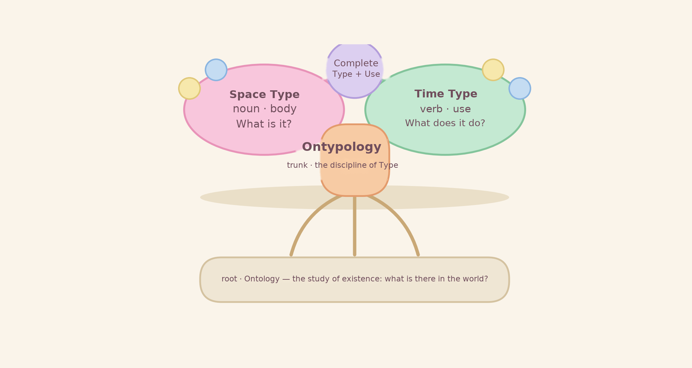

> **In One Line**
>
> Ontology answers "what exists"; Ontypology answers "what a Type is, and how to use it".
>
> The first is the root, the second the trunk — only by seeing "existence" clearly can a "Type" be used precisely.

## TABLE OF CONTENTS

- Guide — Three questions, and the scope of this paper
- Chapter 1 Two Disciplines — What is ontology? What is Ontypology? Where does a Type come from?
- Chapter 2 How They Relate — Root and trunk: six faces compared, three layers of reading
- Chapter 3 One Type, Two Faces — Space Type (body) and Time Type (use)
- Chapter 4 Using It Precisely — Routing questions · the five steps · wording rules · misuse and fixes · checklist
- Chapter 5 The Overall Framework — The philosophical, methodological and practical layers, and the rules that join them
- Chapter 6 A Complete Content Plan — Goals, module plan, learning path, teaching suggestions
- Chapter 7 Conclusion — Three closing sentences
- Appendix A — Glossary
- Appendix B — One-Page Quick Reference

## Guide — Three Questions and the Scope of This Paper

This paper focuses on one subject: the relation between ontology and Ontypology. It then sets out an operable way to use the concepts precisely, together with the overall framework. Having read it, you will be able to answer three questions:

- How exactly do ontology and Ontypology relate?
- How do you use this set of concepts precisely — which question goes to which discipline, in what order do you proceed, and which common misuses should you avoid?
- What does the overall framework look like — how many layers, what does each layer own, and how do they hand over to one another?

> **Scope**
>
> - This paper builds on the Introduction and concentrates on three things: relation, usage and framework.
> - The deeper material of the individual Ontypology volumes (Space Type, Time Type), and anything at the level of system implementation, lie outside this paper — first make the relation and the usage firm at the conceptual level, then go on to the volumes.

Reading it is simple: look at the figure first to build intuition, then read the definitions. The pastel box at the end of each chapter is the distilled summary, and can be used as a revision card.

## Chapter 1 Two Disciplines

### 1.1 Ontology: the study of "existence"

Ontology is the most fundamental discipline in philosophy. It asks: what is there in the world? How does everything come to "be what it is"? Naming the things on the table one by one — a cup, water, a table — is the most everyday ontological act: first acknowledge what exists, and only then can anything else be discussed.

But listing what exists is not enough. A list tells you there is a cup on the table, but not what that cup is like, what it is made of, where the water sits inside it, or what it can be used for. Answering those questions takes a second discipline.

### 1.2 Ontypology: the study of "Type"

Ontypology = ont (existence) + typology — the discipline that turns existence into Type.

What is a "Type"? A Type is the boundary drawn by splitting and joining — the "thing" we can recognise and can name.

The task of Ontypology: to see Type clearly, and to move it from philosophy into a leading science — teachable, practicable, checkable. Logic was philosophy a century ago; once seen clearly it became a leading science. Ontypology must take the same road for Type.

### 1.3 The Birth of a Type: the cognitive chain

The birth of a Type follows a fixed cognitive chain: first the sense of sameness and difference, then the acts of splitting and joining, and only then a Type — and a Type always has a name.

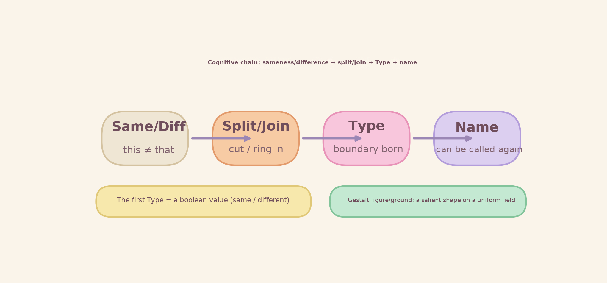

*Figure 1-1 The cognitive chain: sameness/difference → split/join → Type → name*

- Sameness/difference: first you sense that "this ≠ that" — the first Type of cognition, like a boolean value (same / different).
- Split/join: cut apart what differs, ring in what is the same.
- Type: a boundary is born — the thing that has been ringed in is something we recognise.
- Name: every Type has a name — the name lets the Type be pointed to again, and talked about.

### 1.4 Summary: what each discipline owns

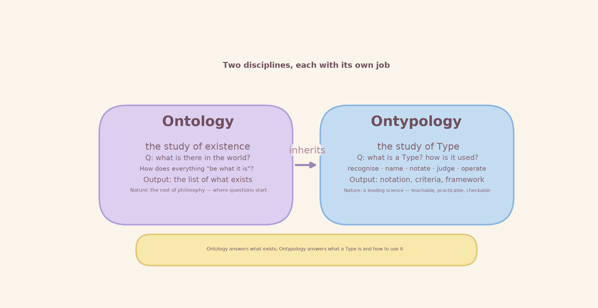

*Figure 1-2 Two disciplines compared: ontology and Ontypology*

## Chapter 2 How They Relate: ontology is the root, Ontypology the trunk

### 2.1 Locating the relation

In one sentence: ontology is the root, Ontypology is the trunk. The root supplies the nutrients — the list of what exists and its categories; the trunk grows those nutrients into Type — a method that can be pointed to, named, judged and operated.

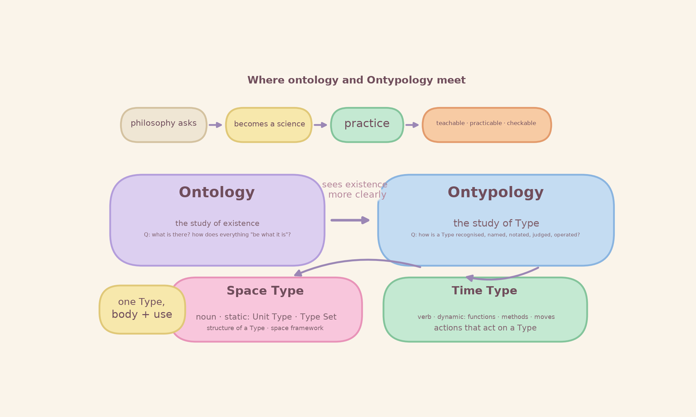

*Figure 2-1 Where ontology and Ontypology sit in relation to each other*

### 2.2 Six faces compared

| **Face** | **Ontology** | **Ontypology** |
| --- | --- | --- |
| Core question | What is there in the world? How does everything "be what it is"? | What is a Type? How is it recognised, named, notated, judged and operated? |
| Basic unit | Existence · entity | Type · Unit Type |
| Main output | The list of what exists, and its categories | Notation, criteria and framework for Type |
| Language used | What it is, what there is, which category it belongs to | The language of Type: Type Set {parts, (content), [category]} and so on |
| Character | The root of philosophy — where the question starts | A leading science — teachable, practicable, checkable |
| Practical direction | Understanding the world | Putting Type to work: recognise, name, judge, operate |

### 2.3 Reading the relation in three layers

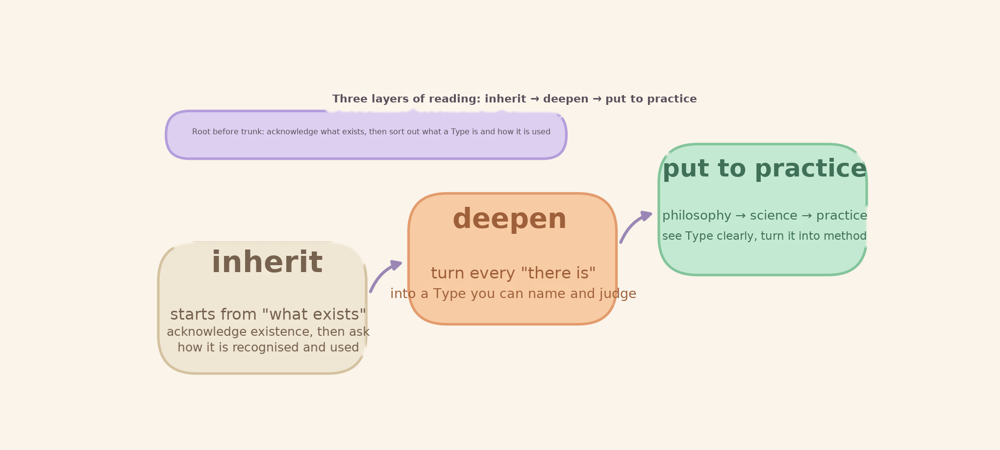

*Figure 2-2 Three layers of reading: inherit → deepen → put into practice*

- Inherit: Ontypology starts from the ontological question — first acknowledge what exists, then ask how it is recognised, named and used.
- Deepen: ontology lists what exists; Ontypology turns each "there is" into a Type that can be pointed to, named, judged and operated.
- Put into practice: along the road philosophy → leading science → practice, see Type clearly, turn it into method, and move towards application.

> **Key Sentences of This Chapter**
>
> Ontology answers "what exists"; Ontypology answers "what a Type is, and how to use it".
>
> The first is the root, the second the trunk — only by seeing "existence" clearly can a "Type" be used precisely.

## Chapter 3 One Type, Two Faces: Space Type and Time Type

### 3.1 Why two faces

A complete Type has two faces at once — what it is, and what it does — like noun and verb in grammar; neither can be dropped. Ontypology calls the first the Space Type and the second the Time Type.

### 3.2 Space × Time compared

| **Face** | **Space Type** | **Time Type** |
| --- | --- | --- |
| Grammatical role | Noun | Verb |
| Character | Static structure (body) | Dynamic operation (use) |
| Answers | What is it? | What does it do? How? |
| Contains | The structure of a Type: parts, content, category | The actions and methods that act on a Type |
| Example | Cup: {handle, body, lid, base} + (coffee) + [white] | Fill, pour, wash |

### 3.3 Three sentences on the relation

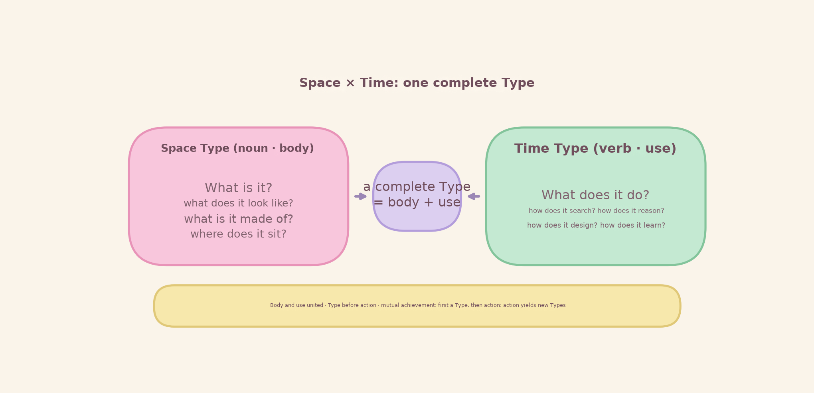

*Figure 3-1 Space × Time: one complete Type*

- Body and use united: the Space Type is the body of a Type, the Time Type is its use — one complete Type has both faces.
- Type before action: first there is a Type, then there is action. The Time Type rests on the Space Type — just as number rests on Type.
- Mutual achievement: actions (design, generation, restructuring) produce new Types; Types support richer actions — the two grow each other.

### 3.4 A Small Scene · A Cup's Day

> **A Small Scene · A Cup's Day**
>
> In the morning the cup (Space Type) stands quietly on the table; "fill → pour → wash" (Time Type) acts on it one by one.
>
> The cup does not become another cup because it holds water or coffee — what changes is the content, what does not change is the Type.
>
> And each "fill, pour, wash" is a verb (a function): a Type goes in, a Type comes out.

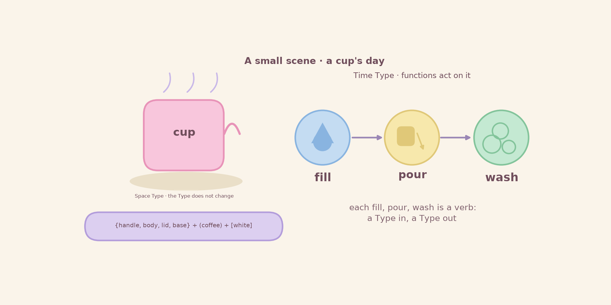

*Figure 3-2 A cup's day: the Type stays, the function acts on it*

## Chapter 4 Using It Precisely

Once the concepts are understood, what matters most is using them precisely. This chapter gives an operable method: route the question first, then take five steps, keep to the wording rules, avoid the common misuses, and finally check with a checklist.

### 4.1 Routing the question: decide first whom you are asking

The first step in using these concepts is to route the question. Three typical questions each have their own home:

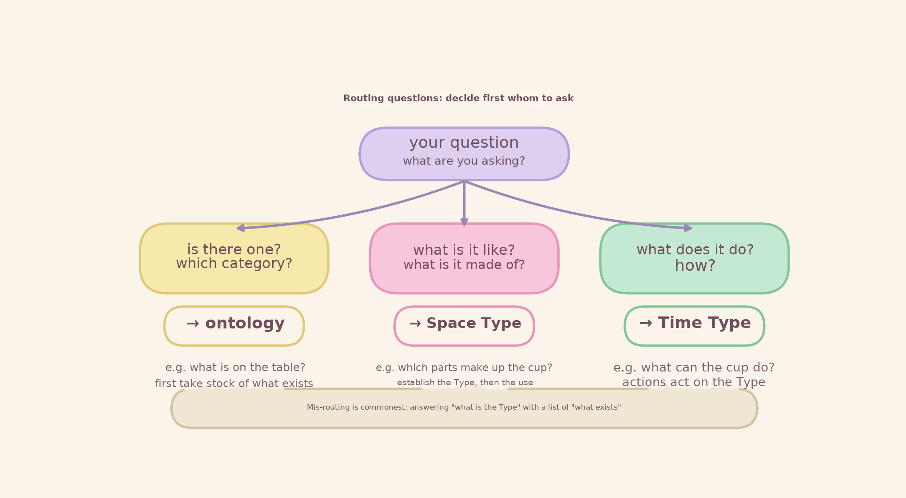

*Figure 4-1 Routing questions: decide first whom you are asking*

- "Is there one? Which category does it belong to?" → ontology. Example: "What is on the table?" — first take stock of what exists.
- "What is it like? What is it made of?" → Space Type. Example: "Which parts make up this cup?"
- "What does it do? How?" → Time Type. Example: "What can the cup be used for?"

> **Caution · mis-routing is the commonest error**
>
> Using a list of "what exists" to answer the question "what is the Type" — listing "there is a cup" while being unable to say what the cup's Type is.
>
> Routing decides everything that follows: route it correctly, and the method stands firm.

### 4.2 The five steps of precise use

After routing, walk five steps along the cognitive chain. The steps are fixed and the order is not reversed:

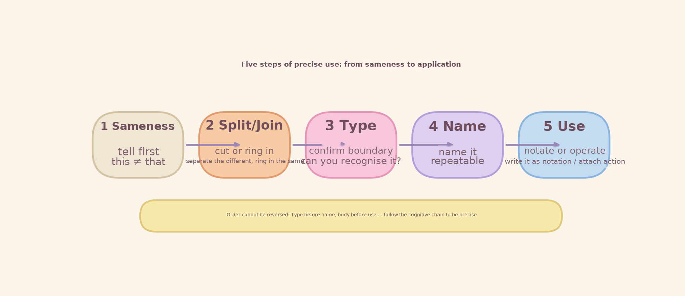

*Figure 4-2 The five steps of precise use: from sameness/difference to application*

- Step 1 · Sameness/difference: first tell that "this ≠ that".
- Step 2 · Split/join: cut apart or ring in — separate what differs, ring in what is the same.
- Step 3 · Type: confirm the boundary — is the thing you ringed in something you recognise?
- Step 4 · Name: name it — give it a name you can call again and again.
- Step 5 · Use: notate or operate — write the Type as a notation, or let actions act upon it.

> **Caution · the order cannot be reversed**
>
> Type before name, body before use — only by following the cognitive chain can anything be called precise.

### 4.3 Using language and notation precisely

Each discipline has its own language; mixing them is the source of misuse.

- The language of ontology: "what it is", "what there is", "which category it belongs to" — it speaks of existence.
- The language of Ontypology: the notation and criteria of Type — for example describing a Type with the Type Set {parts, (content), [category]}.

Three wording rules:

- Rule 1 · Fix the referent first: when you say "cup", first settle whether you mean the object on the table (an ontological existent) or "the Type cup" (an Ontypological Type).
- Rule 2 · Keep body and use apart: to describe the Type, speak of parts, content and category; to describe the use, speak only of the actions that act on the Type.
- Rule 3 · Content may change, the Type does not: with water or with coffee the cup is still a cup — keep the content and the Type apart.

> **Notation example · Cup**
>
> Cup = {handle, body, lid, base} + (coffee) + [white]
>
> Curly brackets are parts, round brackets are content, square brackets are category — that is the notation of the Space Type;
>
> "fill → pour → wash" is the Time Type acting upon it.

### 4.4 Common misuses and their fixes

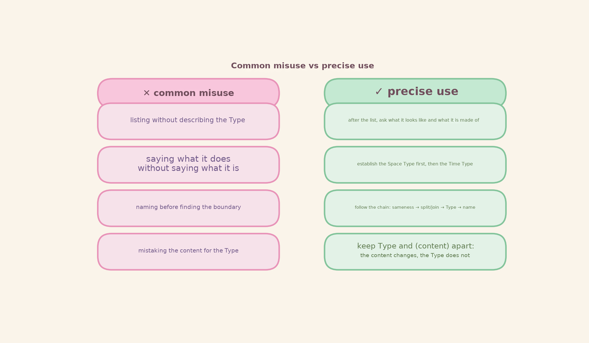

*Figure 4-3 Common misuse vs precise use*

| **Common misuse** | **Symptom** | **Fix** |
| --- | --- | --- |
| List instead of Type | Answering only "what exists" and thinking that is all | After the list, ask what it looks like, how it is composed, what it can do |
| Use before body | Saying what it does while unable to say what it is | Establish the Space Type first, then discuss the Time Type |
| Name before Type | Naming first, then looking for the boundary | Follow the cognitive chain: sameness/difference → split/join → Type → name |
| Content confusion | Taking what is put inside for the Type itself | Keep "Type" and "(content)" apart — the content changes, the Type does not |

### 4.5 A checklist for precise use

> **Checklist · ask yourself before each use**
>
> - Was this question routed correctly? (what exists / what it is / what it does)
> - Did I ask "what exists" before "what is the Type"?
> - Have I found the Type's boundary? Does the name match the Type?
> - Is it Type before action, body before use?
> - Have I mistaken the content for the Type?

## Chapter 5 The Overall Framework: philosophical, methodological, practical

### 5.1 The three-layer framework

Gathering the relation and the usage into one framework: the whole thing has three layers, and from top to bottom it is the road "root → trunk → fruit".

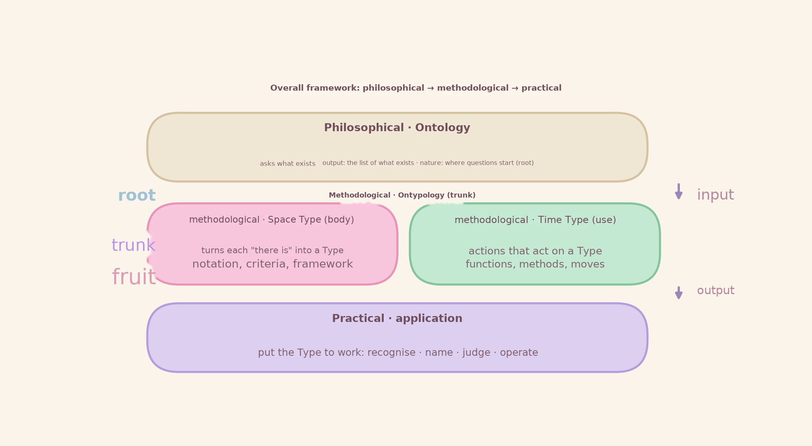

*Figure 5-1 The overall framework: philosophical → methodological → practical*

- Philosophical layer (ontology · root): where the question starts. Ask "what exists", and produce "the list of what exists and its categories".
- Methodological layer (Ontypology · trunk): the discipline of Type. Taking the list as input, it turns each "there is" into a Type and produces "the notation, criteria and framework of Type"; internally it has two faces, Space Type (body) and Time Type (use).
- Practical layer (application · fruit): put the Type to work — recognise, name, judge, operate.

### 5.2 Who owns what in the framework

| **Layer** | **Core question** | **Main output** | **Language used** |
| --- | --- | --- | --- |
| Philosophical · Ontology | What exists? | The list of what exists and its categories | What it is, what there is, which category it belongs to |
| Methodological · Ontypology | What is a Type? How is it used? | The notation, criteria and framework of Type | Type Set {parts, (content), [category]} and so on |
| Practical · application | How is it put to work? | An executable recognise, name, judge, operate | The language of action and method |

### 5.3 Interface rules: how root and trunk hand over

For the framework to work there are three interface rules, plus one feedback path:

- Input interface: the output of ontology (the list of what exists and its categories) is the input of Ontypology.
- Order interface: first acknowledge "what exists", then sort out "what the Type is" — root before trunk, not reversible.
- Output interface: the output of Ontypology (the notation and criteria of Type) is what the practical layer relies on.
- Feedback: new "existents" found in practice go back to the philosophical layer for a fresh count — the framework is alive, not a one-way street.

## Chapter 6 A Complete Content Plan

### 6.1 Goals and intended readers

- Goal: to explain the relation between ontology and Ontypology by the shortest road, and to give an operable way of using it precisely, together with the framework.
- Readers: learners who want to grasp where Ontypology stands; teachers and authors who want to teach and organise knowledge with this set of concepts.
- Prerequisite: no systems or programming background is needed — this paper stops at concept and method and does not touch system implementation.

### 6.2 Module plan

| **Module** | **Topic** | **Learning goal** | **Core figures** | **Suggested hours** |
| --- | --- | --- | --- | --- |
| M1 | Two disciplines | Can state the core question of each in one sentence | Cognitive chain, comparison card | 1 hour |
| M2 | Root and trunk | Can explain the three layers: inherit, deepen, put into practice | Relation map, three layers of reading | 1 hour |
| M3 | One Type, two faces | Can tell body from use, with examples | One Type two faces, a cup's day | 1 hour |
| M4 | Precise use | Can route correctly, walk the five steps, avoid misuse | Routing decision tree, five steps | 2 hours |
| M5 | Overall framework | Can draw and explain the three layers and their interfaces | Three-layer framework diagram | 1 hour |
| M6 | Practice and check | Pass the checklist and complete the combined exercise | Quick reference card | 1 hour |

### 6.3 Suggested learning path

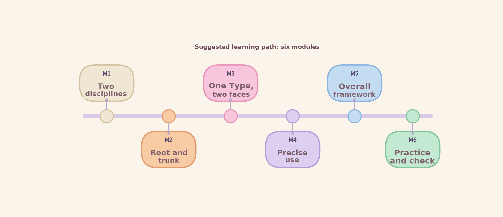

*Figure 6-1 Suggested learning path: six modules*

Learn in the order M1 → M6: build a shared language first (M1–M3), then practise the method (M4–M5), and finally check it as a whole (M6). If you already have the basics you can go straight to M4, precise use, and start using the handbook.

### 6.4 Teaching suggestions (the pastel method)

- Figure before text: look at the figure to build intuition, then read the definitions.
- Example before rule: start from everyday examples such as the cup, then converge on the rule.
- Learn by doing: after each module, walk the five steps once with an example of your own.
- Return to the card: Appendix B is a one-page reference; consult it at any time.

## Chapter 7 Conclusion

Three sentences to close the whole paper:

- Relation: ontology asks what exists, Ontypology asks what a Type is and how to use it — root and trunk.
- Two faces: Space Type = noun (body), Time Type = verb (use); a complete Type = body + use.
- Usage and framework: usage goes routing → five steps → checklist; the framework goes philosophical → methodological → practical.

> **Key Sentences of This Paper**
>
> Only by seeing "existence" clearly can a "Type" be used precisely —
>
> that is the relation between ontology and Ontypology.

To go further into the internal structure of Type and the unfolding of "verbs", continue with the Ontypology volumes. To start doing, take the routing decision tree and the five steps from Chapter 4 and run one round of practice on an example near you.

## Appendix A Glossary

| **Term** | **English** | **In one sentence** |
| --- | --- | --- |
| Ontology | Ontology | The study of existence: what is there in the world? |
| Ontypology | Ontypology | The study of Type: ont (existence) + typology |
| Type | Type | The boundary drawn by split and join — the "thing" we can recognise and name |
| Unit Type | Unit Type | The basic unit of a Type |
| Space Type | Space Type | The "body" of a Type — a noun, answering "what it is" |
| Time Type | Time Type | The "use" of a Type — a verb, answering "what it does" |
| Cognitive Chain | Cognitive Chain | Sameness/difference → split/join → Type → name: the fixed path by which a Type is born |
| Body–Use Unity | Body–Use Unity | A complete Type = Space Type (body) + Time Type (use) |
| Type before Action | Type before Action | First there is a Type, then there is action; the order cannot be reversed |
| Type Set | Type Set | {parts, (content), [category]}: the way a Type is notated |

## Appendix B One-Page Quick Reference

The whole paper on one page. Print it or screenshot it and pin it in front of you.

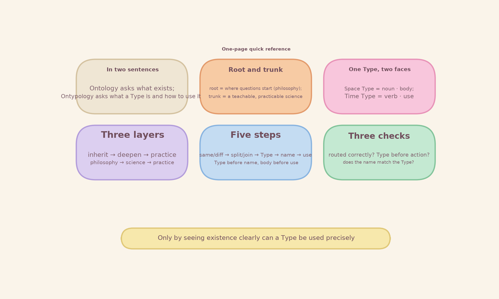

*Figure B-1 One-page quick reference*

www.longreat.net

Chang Changfeng gamma@livemail.tw

Chang Tingying mindaiworks@gmail.com
