**ONTYPOLOGY**

# Physical Proof

Ontypology

---

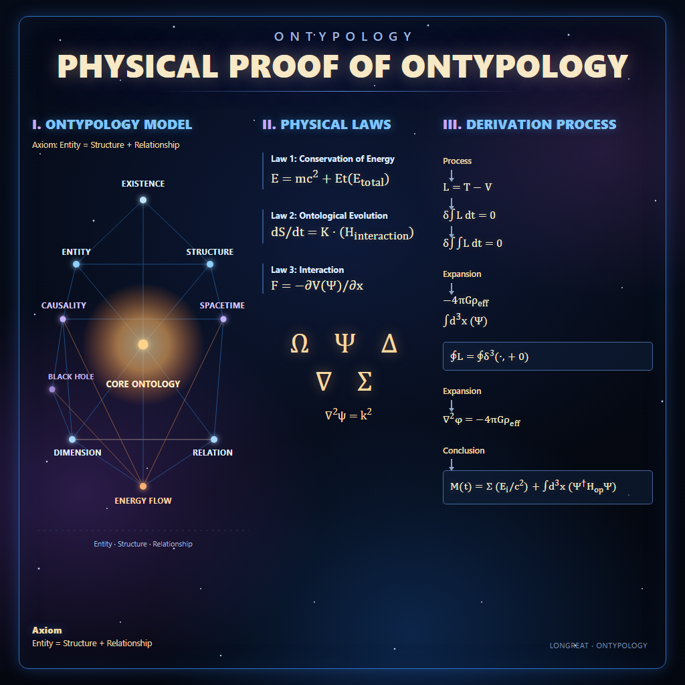

> **In One Line**
>
> ◆ Equations are the skeleton of a physical proof; the three supplements of Type are its flesh.
> ◆ Space Type gives the system its form, Time Type writes the process as a function — superpose the two languages, and a physical proof is complete.

## Contents

| Chapter | Topic |
| --- | --- |
| Before We Begin | The task of the physical proof volume |
| Guide | The two languages of physical proof |
| Chapter 1 | What physical proof does inside equations |
| Chapter 2 | Space Type: giving a physical system its form |
| Chapter 3 | Time Type: writing a process as a function |
| Chapter 4 | Proof demonstrations across five domains |
| Chapter 5 | Using it precisely: six steps, misuse, checklist |
| Review | Key points and self-check |
| Appendix | Glossary and notation |

## Before We Begin — The Task of the Physical Proof Volume

This small book is a supplement to Unit Type and Set Logic and a companion to Mathematical Proof. Mathematical Proof answers one question: when a mathematical proof is written in the notation of set theory, how must this toolkit be used to be accurate? This book answers a parallel question: when the object becomes physical — a collision in mechanics, an equilibrium in thermodynamics, a circuit in electromagnetism, interference in light, the world of the atom — how should a proof be given its form, how should it be derived, and how should it be accepted?

Concretely, the book does three things. First, it looks closely at the site of physical proof: on what does a physical derivation stand? Where is the language of equations not enough? Second, it puts both pillars of Ontypology to work: Space Type (the noun) gives the physical system its form — the three brackets restore rule, identity and structure; Time Type (the verb) writes the physical process as a function, so that every step of conservation and evolution has a track. Third, it gathers everything into a complete "accurate use" framework: three supplements, six proof steps, a three-layer check, a misuse comparison and an eight-question checklist — with one demonstration per domain, in a format you can copy.

> **Three conventions for reading this book**
>
> ◆ Convention one: each bracket has its own job. Braces { } are the composition set (bill of materials); square brackets [ ] are the abstract set (attributes); parentheses ( ) are the container set (spatial container).
> ◆ Convention two: the English word for 形 is Type — an object that has been completely described. The book uses "Type" throughout.
> ◆ Convention three: all five domains are covered — mechanics, thermodynamics, electromagnetism, wave optics and modern physics each receive one demonstration; the cup remains the book's most faithful specimen.

| Gap in the proof | Supplement | Criterion used | Chapter |
| --- | --- | --- | --- |
| Rule omitted — the category is written as a dead list | [ ] abstract set | T = (F(T), ∩(T)) | Chapter 2 |
| Identity omitted — the process scatters as it runs | ( ) container set | C = (id(C), S(C)), invariance axiom | Chapter 2 |
| Structure omitted — parts merely juxtaposed | { } composition set | BOM criterion, three remove levels | Chapter 2 |
| Process omitted — input and output unwritten | Time Type | op: Type → Type, four function questions | Chapter 3 |
| All four converge — put back into one proof | six steps + three-layer check | ∩(T) · id(C) · remove combined | Chapter 5 |

**Table 0-1 Supplement map: the four gaps in a physical proof and the four tools**

**A proof is accurate because every layer of information is written where it belongs.**

## Guide — The Two Languages of Physical Proof

Physical proofs are almost always written in the language of equations. Its virtue is extreme precision: F = ma says one thing, and says it unambiguously to ten decimal places. Precisely because it assumes the least, it also omits the most — the system's boundary, the dependence among parts, the constancy of identity, the input and output of a process are all flattened inside lines of beautiful formulas.

The language of Type restores exactly these four layers. Space Type gives the system its form: { } writes the composition, ( ) writes an identity that does not change with content, [ ] writes a generation rule that can judge new members automatically. Time Type gives the process its form: every physical process is a function that takes one Type in and puts one Type out. The two languages do not replace each other; they superpose — the skeleton of the proof is written in equations, and its completeness comes from Type.

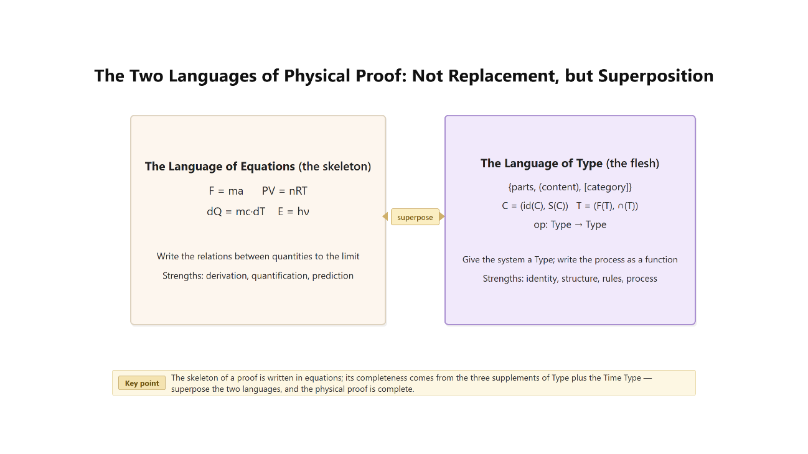

*Figure D-1 The two languages of physical proof: an equation core, with Type as added value*

| Pillar | Bracket / notation | Job | Embodiment in physics |
| --- | --- | --- | --- |
| Space Type (noun) | [ ] attribute | dimension × scale | physical quantities: length, temperature, energy |
| Space Type (noun) | { } composition | BOM, three remove levels | system parts: resistor, capacitor, cup lid |
| Space Type (noun) | ( ) container | id(C), invariance axiom | system boundary: closed system, isolated system |
| Time Type (verb) | op: Type → Type | four function questions, Type in / Type out | physical laws and processes: F = ma, cooling, charging |

**Table D-1 Space Type and Time Type at a glance**

> **One sentence, split into four layers**
>
> ◆ "The hot water in the cup has cooled" should be split into four layers: rule (judged by ∩(T)), identity (id unchanged), structure (dependence among parts), process (the cooling function converts the Type).
> ◆ An equation writes down only one corner; only when all four layers are supplied is the physical proof complete.

## Chapter 1 What Physical Proof Does Inside Equations

Before writing a physical proof, first understand what it stands on. This chapter takes apart the three-piece set of physical proof, and sees what the language of equations can do — and where it leaves four gaps. Where the gap is, that is where the supplement goes.

### 1.1 The Three-Piece Set: Model, Law, Derivation

Every physical proof, opened up, is a combination of three things. Model: first give the Type — say clearly who your object is, where the boundary lies, which idealisations are made; "smooth plane", "ideal gas", "point mass" are all entry rules of the Type. Law: supply criteria that can be checked item by item — F = ma, conservation of energy, the ideal-gas equation; each is a ruler. Derivation: start from model and law and walk step by step to the conclusion, with every step checkable.

None of the three can be missing. Without a model, the proof has no object; without a law, the proof can only rely on feeling; without a derivation, there is a conclusion but no process. Physics also differs from pure mathematics in one point: after the derivation is proved, there is still the test of experiment — the conclusion must be taken back and reconciled with the world. This is the full meaning of "reproducible accuracy" in physics.

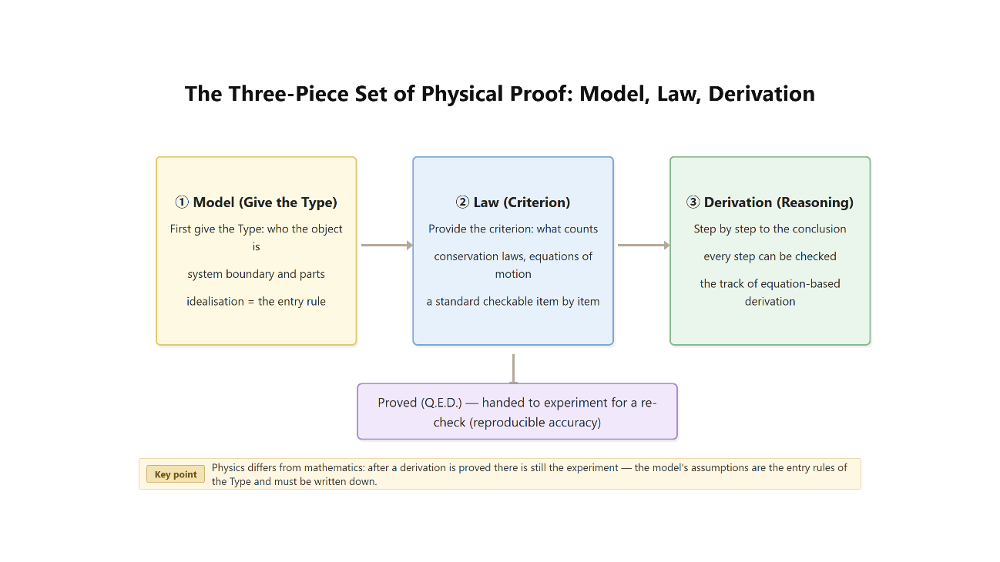

*Figure 1-1 The three-piece set of physical proof: model, law, derivation*

### 1.2 What the Language of Equations Can Do

The core of the language of equations is the quantities and relations on the two sides of the equals sign. "F = ma" locks force, mass and acceleration into one equation; "PV = nRT" binds four state quantities together. It can state proportion, conservation and evolution precisely — the skeleton of most physical derivations is built from a few such formulas.

| Formula | How to read it | Use in a proof |
| --- | --- | --- |
| F = ma | an equation between force and acceleration | derive motion (the skeleton of a process) |
| PV = nRT | a constraint among state quantities | constrain possible states (the skeleton of a rule) |
| Q = mc·ΔT | heat and temperature | derive energy transfer (change of content) |
| E = hν | energy and frequency | judge a quantum event (the skeleton of a criterion) |

**Table 1-1 Common equations and what they can do in a proof**

For physical derivation this is already enough — provided you only need to answer "are the quantities equal". As soon as a proof needs to ask "what is this system composed of", "after the content is replaced is it still the same", "what does this law eat and what does it spit out", "does this new case count as this category", the language of equations begins to omit.

### 1.3 Four Gaps: Rule, Identity, Structure, Process

The language of equations omits four layers of information; in a physical proof these become four concrete gaps.

Gap one, rule. { mug, glass, paper cup } is a hard-coded list — does a newly appeared insulated tumbler count as a "cup"? Likewise, "what counts as an ideal gas" and "what counts as simple harmonic motion" each need an open generation rule, not a few memorised examples.

Gap two, identity. Water in a cup drops from 80°C to room temperature; the content changes, the temperature changes, yet the cup is still that cup and the system is still that system. The equation writes the curve T(t), but does not answer "is it the same one along the way" — wherever a proof needs "to stay the same through change", it needs an identity that does not change with content.

Gap three, structure. { power source, resistor, capacitor, wire } — four parts juxtaposed, and you cannot see which depends on which: removing the power source and removing a decorative lamp have completely different consequences. Wherever a proof needs "to separate the essential from the secondary", it needs the dependence structure of parts.

Gap four, process. Equations write relations between states, but "what Type does this process take in, and what Type does it put out" is flattened — a derivation that skips steps is usually a case where the input Type and output Type were never written down. Wherever a proof needs "a checkable process", it needs the Time Type.

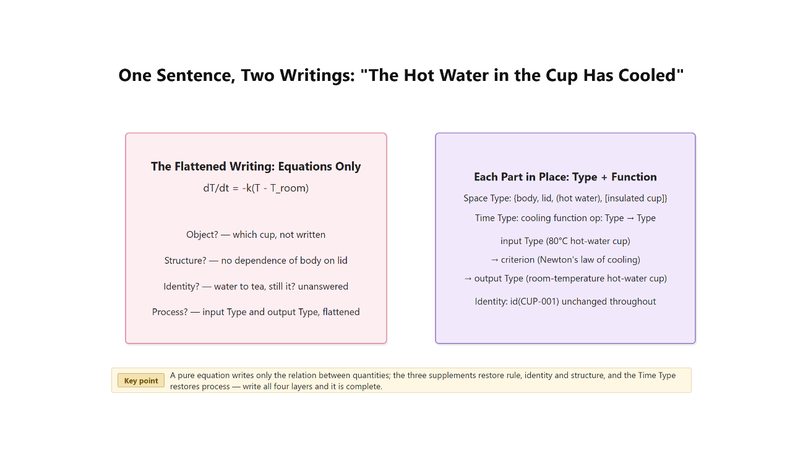

*Figure 1-2 One sentence, two ways of writing it: layers flattened and each put in place*

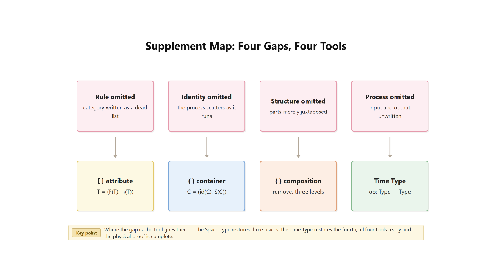

*Figure 1-3 Supplement map: each of the four gaps has its own supplement*

| Gap | The equation-style writing | The supplemented writing | Tool |
| --- | --- | --- | --- |
| Rule | a list of examples (closed) | [ x \ | x passes ∩(T) ] (open rule) |
| Identity | curve T(t) (the process scatters) | (hot water) → (cold water), id(C) unchanged | ( ) |
| Structure | parts juxtaposed (no primary or secondary) | remove(p, M), three-level classification | { } |
| Process | jumping straight to the conclusion | op: input Type → output Type, written step by step | Time Type |

**Table 1-2 The four gaps and the four tools**

> **Key points of this chapter**
>
> ◆ Three-piece set: model (give the Type), law (criterion), derivation (reasoning) — after proof comes the experimental re-check.
> ◆ The language of equations answers "are the quantities equal" precisely, and omits all four other layers.
> ◆ The four gaps — rule, identity, structure, process — are supplied by [ ], ( ), { } and the Time Type respectively.

> **Exercises (P1)**
>
> ◆ P1-1 Write "an apple falls from a tree" as one sentence, and point out the four layers of information that the sentence omits.
> ◆ P1-2 Why is "ideal gas" a rule rather than a list? Give one boundary case (hint: a gas at low temperature and high pressure).
> ◆ P1-3 In the expression dT/dt = -k(T - T_room), which part answers "identity"? Which part does not?
> ◆ Hint: first ask yourself — which whole is this sentence talking about?

## Chapter 2 Space Type: Giving a Physical System Its Form

Space Type is the Type of the noun — it describes what a physical system "is". Each of the three axes takes one bracket: the X attribute uses [ ], writing a physical quantity as dimension and scale; the Y bill of materials uses { }, writing parts as a dependence structure; the Z container uses ( ), writing the system boundary as an unchanging identity. Only when the three axes are all in place does a physical system stand.

### 2.1 [ ] Attribute: Physical Quantity = Dimension × Scale

Every physical quantity can be split in two: the dimension asks "what is being measured" — length, mass, time, temperature; the scale asks "which mark is read" — the unit and the reading, for example 100 degrees Celsius. The dimension is the field of the attribute; the scale is the grid on the field. What [ ] holds is exactly this rule of "field × grid".

Here we connect to a core proposition of Ontypology: a number is a small Type inside a Type, a comparison of scales. 100°C is not a lonely number but the result of one comparison, on the Type called temperature, at scale mark 100. Measurement is reading the scale; calculation is comparing scales — first there is a Type, then there is a number.

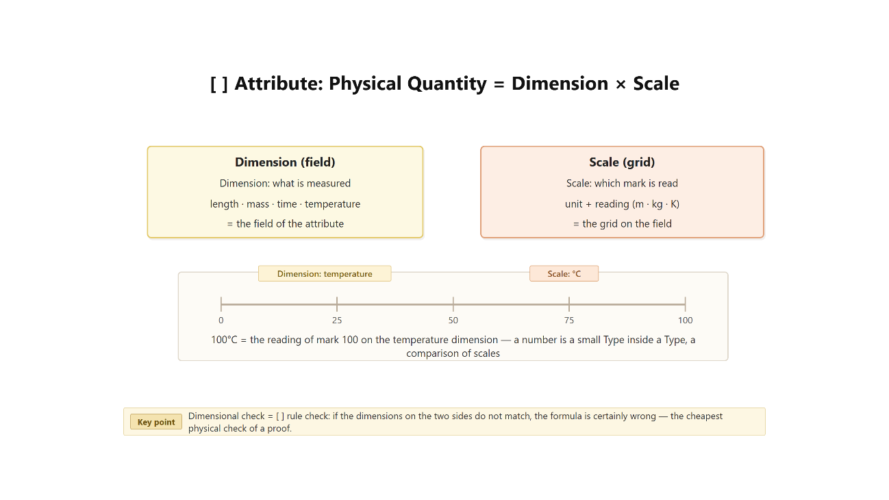

*Figure 2-1 [ ] attribute: physical quantity = dimension × scale*

| Physical quantity | Dimension (field) | Scale (grid) | Ontypological reading |
| --- | --- | --- | --- |
| Length 2.4 m | length | metre | a scale reading on the length Type |
| Temperature 100°C | temperature | degree Celsius | a scale reading on the temperature Type |
| Energy 5 J | energy | joule | a scale reading on the energy Type |

**Table 2-1 Dimension and scale of physical quantities**

In practice the [ ] rule also gives you a free health check: dimensional analysis. If the dimensions on the two sides of an equation do not match, the formula is certainly wrong — the cheapest and hardest-to-fool proof check.

### 2.2 ( ) Container: System Boundary = Identity

Write the container as a pair: C = ( identity id(C), internal space S(C) ). id(C) is a marker that does not change when the content of S(C) changes; S(C) is a space that can hold and can have its content replaced. The invariance axiom says: for any e1, e2 in S(C), replacing e1 with e2 does not change id(C).

A physical system is first of all a container problem: where the boundary is drawn, what may enter and leave, what must be isolated. An open system writes its exchange terms in the entry rule of ( ); a closed system cuts off exchange of matter; an isolated system cuts off even energy — the writing is always the same kind: first write id(C), then write what S(C) may receive. The cup is the best specimen for practising containers: change the water to tea, and id(CUP-001) is unchanged; only when the cup is broken does the identity end.

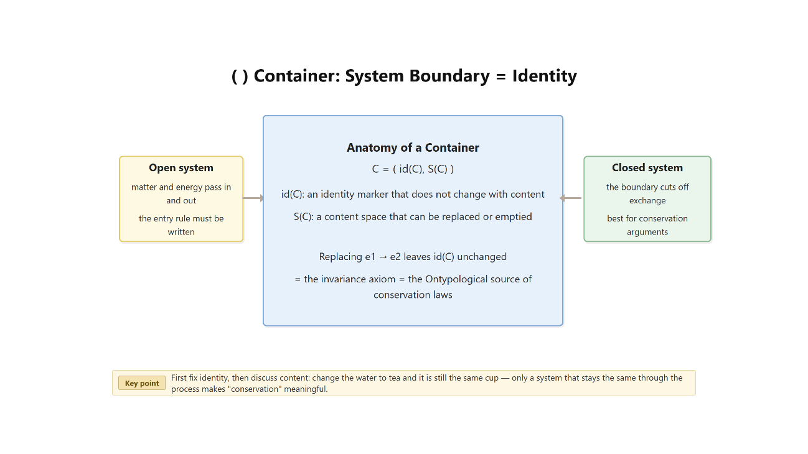

*Figure 2-2 ( ) container: system boundary = identity*

> **Definition (container · physics version)**
>
> ◆ Container C = ( id(C), S(C) ); id(C) does not change when the content changes.
> ◆ Invariance axiom: for any e1, e2 ∈ S(C), replacing e1 with e2 does not change id(C).
> ◆ Entry rule: open / closed / isolated differ only in the list of items ( ) allows in and out — the rule must be written explicitly.

### 2.3 { } Composition: the BOM Criterion and the Three remove Levels

Everyone can make a list of parts; what a proof needs is dependence. First pass the BOM criterion: if you take it off, does it still recognise itself? A resistor taken off is still a resistor, so it enters the BOM; "conductivity" taken off is nothing, so it enters the attributes. Then use the remove criterion to grade: remove part p from the whole M, and see which level the result falls into.

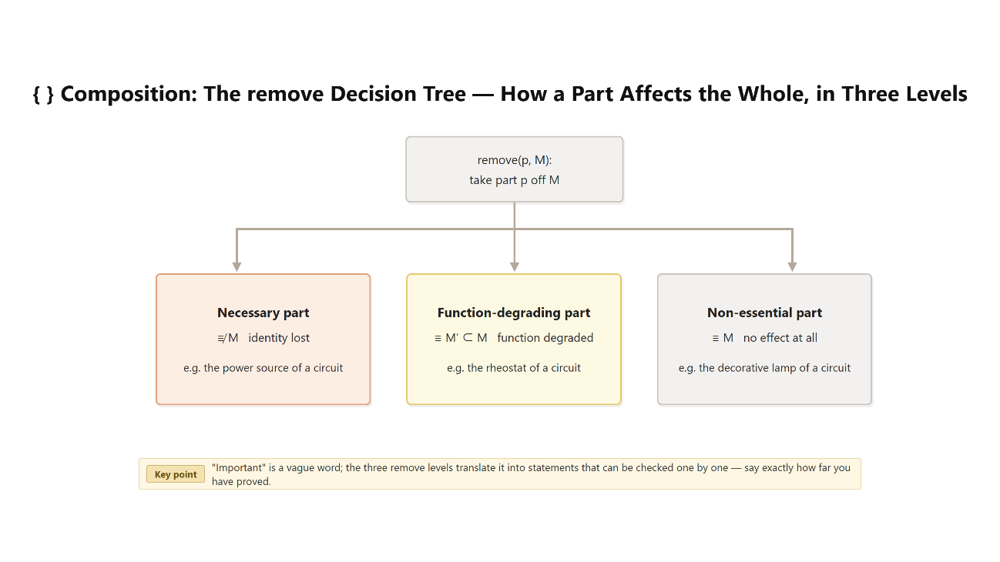

*Figure 2-3 { } composition: the remove decision tree — how a part affects the whole, in three levels*

| Level | Result of the judgement | Circuit example | Use in a proof |
| --- | --- | --- | --- |
| Necessary part | remove(p,M) ≢ M | power source | prove "without it there is no whole" |
| Function-degrading part | remove(p,M) ≡ M′ ⊂ M | rheostat | prove "function missing, identity present" |
| Non-essential part | remove(p,M) ≡ M | decorative lamp | prove "removal changes nothing at all" |

**Table 2-2 The three remove levels (physics-system version)**

Compare with 2.2: the invariance axiom guards the replacement of a container's content, the remove criterion guards the removal of a whole's parts — one inside, one outside, and the layers are clear. The vague word "important" is hereby translated into three statements that can each be checked.

### 2.4 Proof Demonstration: Type Set and Three-Layer Judgement

Once the three axes are in place, a physical system can be written as a complete Unit Type: { parts, (content), [category] }. Only what can be written out can be judged — and the judgement uses three layers: the container layer verifies identity, the BOM layer verifies structure, the abstract layer verifies classification. The three are joined as J = J_C ∧ J_B ∧ J_T, and none may be missing.

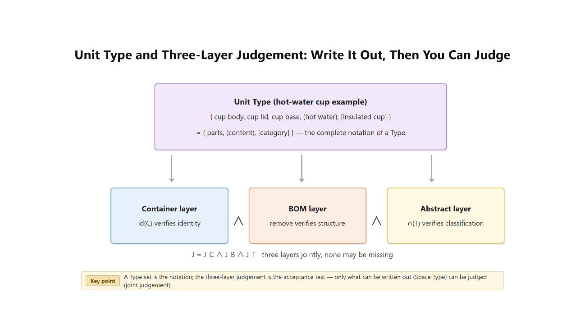

*Figure 2-4 Unit Type and three-layer judgement: write it out, then you can judge*

> **Proof demonstration**
>
> ◆ 【Theorem】Hot water in a cup can be written as a valid Unit Type, and after the water is replaced the system is still the same system.
> ◆ 【Proof】
> ◆ (1) Identify the whole: M = this cup (CUP-001).
> ◆ (2) Describe by axis: [ ] temperature 80°C (dimension = temperature, scale = °C); { } BOM = {cup body, cup base, cup lid} (each passes the check "taken off, it still recognises itself"); ( ) S(M) = (hot water).
> ◆ (3) Write the Type set: M = { {cup body, cup base, cup lid}, (hot water), [insulated cup] }.
> ◆ (4) Three-layer judgement: container layer — pour out the water and replace it with tea, id(CUP-001) unchanged, ✓; BOM layer — remove(cup lid, M) ≡ M′ ⊂ M (degrading part), remove(cup base, M) ≢ M (necessary part), the grading is clear, ✓; abstract layer — F(insulated cup) = {can hold liquid, can be held and drunk from, can slow heat loss} passes ∩(T) item by item, ✓.
> ◆ (5) All three layers pass: J = J_C ∧ J_B ∧ J_T holds. (Q.E.D.)
> ◆ 【Contrast】Replacing {hot water} with {tea} gives another set; replacing (hot water) with (tea) is still the same container — the difference is not in the content but in the identity.

> **Key points of this chapter**
>
> ◆ [ ] physical quantity = dimension × scale — a number is a small Type inside a Type, a comparison of scales; dimensional analysis is the cheapest health check.
> ◆ ( ) container C = (id(C), S(C)) — fix the identity before discussing the content, and write the entry rule for open / closed explicitly.
> ◆ { } composition — the BOM criterion separates inside from outside, the three remove levels separate primary from secondary; write the Unit Type in full, and the three-layer judgement can run to the end.

> **Exercises (P2)**
>
> ◆ P2-1 Write "a lamp that is switched on" as a Unit Type {parts, (content), [category]}, and mark id(C).
> ◆ P2-2 Grade the parts of your lamp with remove: to which level does the bulb, the wire, the shade and a decorative sticker belong? Give the reason for each grading.
> ◆ P2-3 Use ∩(T) to judge: does a headlamp (a lamp worn on the head) count as [desk lamp]? Do you need to add a feature to F(T)?
> ◆ Hint: write F(T) first, then let every candidate object pass through the sieve — the choice of feature list is your position on "lamp".

## Chapter 3 Time Type: Writing a Process as a Function

Time Type is the Type of the verb — it describes how a physical process "works". In Ontypology the Time Type is a function: one Type in, one Type out, written op: Type → Type. Physical laws are the basic form of the Time Type: each law is a conversion card that turns a system Type into a system Type. The Time Type exists in dependence on the Space Type — only when there is a system Type is there a process to speak of.

### 3.1 Time Type = Function: Type In, Type Out

To give a "process" its form, the first thing is to write the input Type and the output Type. An apple falls: the input Type is "an apple released from a height", and after passing the two conversion cards of the law of gravity and Newton's second law, the output Type is "an apple falling with constant acceleration". Cooling: the input Type is "a cup of hot water at 80°C", the output Type is "a cup of hot water at room temperature". Type in, Type out — only then does the process have two ends that can be checked.

The Time Type is more than a single function. The Time Type function library of Ontypology holds twelve groups of methods — function search, design search and extraction, design patterns, logic generation and application, continuous learning, restructuring and recombination, problem solving, analysis, design, reasoning (causal, reverse-causal, simulation, statistical, inverse), thinking methods, R&D exploration, self-evolution. What physicists use every day is exactly this library: the problem-solving group corresponds to solving equations, the reasoning group to working back from result to cause (reverse-causal), the simulation group to thought experiments.

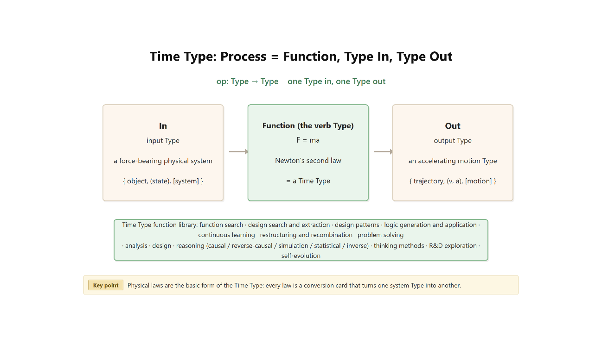

*Figure 3-1 Time Type: process = function, Type in and Type out*

### 3.2 The Four-Question Function Card

To use a law accurately, first write it as a four-question function card: what is its name, what is the input Type, what is the output Type, what is the criterion. Answer all four, and the law counts as a function "that can be put to use" — especially the criterion line: it states the conditions and the scale under which this card holds.

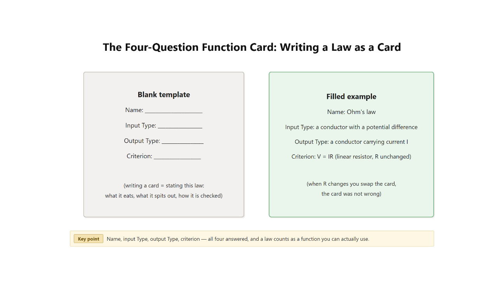

*Figure 3-2 The four-question function card: blank template and filled example*

| Law (name) | Input Type | Output Type | Criterion |
| --- | --- | --- | --- |
| Newton's second law | an object under a net force | an object with acceleration | F = ma |
| Ohm's law | a conductor with a potential difference across it | a conductor carrying current | V = IR (R unchanged) |
| Law of heat conduction | a wall with a temperature difference across it | a wall transferring heat | Q/t = kA·ΔT/L |

**Table 3-1 Three four-question function cards**

One thing to grasp when using a card: when a parameter changes you swap the card, the card is not wrong. When the R of a conductor changes, swap in a "non-linear resistor" card — do not force the old card and then blame the world for not obeying.

### 3.3 Conservation Law = the Invariance Axiom on the Time Axis

The invariance axiom of the Space Type says: the content is replaced, id(C) is unchanged. Put the same axiom on the time axis, and you get the conservation law: when the process has run through and all the content has been replaced, the quantity that holds identity up is unchanged — conservation of energy, conservation of momentum, conservation of charge are all the evidence that the system is "still the same one" on the time axis.

In a proof its embodiment is called an invariant: a property that stays true under a certain class of changes. Writing it into a proof follows five fixed steps: fix the identity, list the variable content, write the invariant expression, check the replacement step by step, conclude. Used in reverse it also holds: to prove that "two states belong to the same system", the cheapest path is to find the invariant that holds identity up, rather than comparing contents one by one.

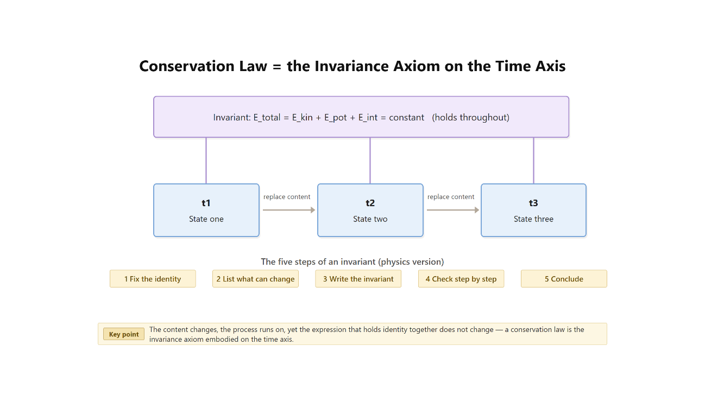

*Figure 3-3 Conservation law = the invariance axiom on the time axis*

### 3.4 Proof Demonstration: the Function Chain of Free Fall

> **Proof demonstration**
>
> ◆ 【Theorem】For free fall with zero initial velocity, the velocity is v = g·t and the displacement is h = ½g·t².
> ◆ 【Proof】
> ◆ (1) Write the input Type: M = an apple released from a height (initial velocity 0, under gravity).
> ◆ (2) Function ① (law of gravity card): input Type M → output Type "an apple under force F = mg".
> ◆ (3) Function ② (Newton's second law card): input Type "under force F = mg" → output Type "an apple with acceleration a = g".
> ◆ (4) Integrate a = g step by step (each integration is an "integration card", input Type in, output Type out): v = g·t, h = ½g·t².
> ◆ (5) Three-layer check: container — after air resistance is entered into the entry rule of S(M), id(M) is unchanged; BOM — the Earth's gravitational field is a necessary part; abstract — the whole process passes the ∩(T) of [free fall]. (Q.E.D.)
> ◆ 【Contrast】Writing h = ½g·t² directly skips steps; the function chain writes the input Type and output Type of every link, so that the derivation can be re-checked.

Put the equipment of 3.1 to 3.3 into one minimal derivation.

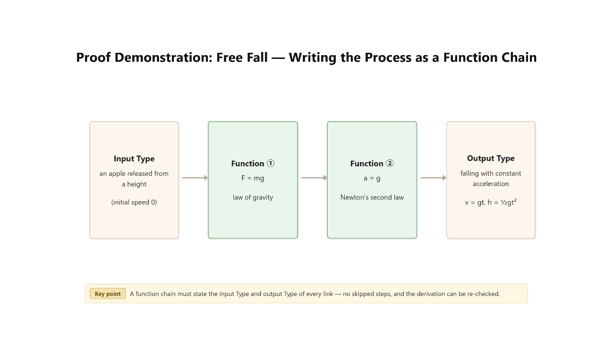

*Figure 3-4 Proof demonstration: free fall — writing the process as a function chain*

> **Key points of this chapter**
>
> ◆ Time Type = function: op: Type → Type — physical laws are the basic form, and the twelve groups of the function library are the full toolkit.
> ◆ Four-question function card: name, input Type, output Type, criterion — when a parameter changes you swap the card, the card is not wrong.
> ◆ Conservation law = the invariance axiom on the time axis — five steps for an invariant: fix identity, list what can change, write the invariant, check step by step, conclude.

> **Exercises (P3)**
>
> ◆ P3-1 Fill in a four-question function card for Ohm's law and for Newton's law of cooling.
> ◆ P3-2 A pendulum swings from one side to the other: write the input Type and the output Type, and point out which quantity is the conserved invariant.
> ◆ P3-3 Why do we say "when a parameter changes you swap the card, the card is not wrong"? Give a physical example.
> ◆ Hint: both the input Type and the output Type must be written as a "Type" — system + state — not just a number.

## Chapter 4 Proof Demonstrations Across Five Domains

All the tools are in place. This chapter takes the same method to the sites of five domains — mechanics, thermodynamics, electromagnetism, wave optics and modern physics, one demonstration each. Each follows the same format: state the theorem, give the Type, choose the criterion, derive, close with three layers. Readers can follow the format and substitute their own problems. First the route map:

| Domain | Proposition | Main criterion | Ontypological landing point |
| --- | --- | --- | --- |
| Mechanics | momentum conservation | dP/dt = F_ext = 0 | ( ) entry rule + invariant |
| Thermodynamics | energy conservation | Q_out = Q_in | invariance axiom (time version) |
| Electromagnetism | solution of RC charging | V0 = iR + q/C | Time Type function chain |
| Wave optics | criterion for bright and dark fringes | d·sinθ = m·λ | ∩(T) classification funnel |
| Modern physics | photoelectric effect | h·ν = W + Ek | boundary case + discrete scale |

**Table 4-1 The five-domain demonstration overview**

### 4.1 Mechanics: Momentum Conservation in Collisions

> **Proof demonstration · Mechanics**
>
> ◆ 【Theorem】For a collision of two balls whose net external force is zero, the total momentum is conserved.
> ◆ 【Proof】(1) Give the Type: M = {ball 1, ball 2}, ( ) entry rule = net external force is zero; (2) invariant candidate: P = m1·u1 + m2·u2; (3) from Newton's second law, dP/dt = F_ext = 0, so P does not change with time; (4) substitute the states before and after the collision: m1·u1 + m2·u2 = m1·v1 + m2·v2; (5) three-layer check: container — id(M) unchanged; BOM — both balls are necessary parts; abstract — passes the ∩(T) of [collision]. (Q.E.D.)

Two balls collide on a smooth horizontal plane. Take the two balls together as the system, and the entry rule of ( ) states "the net external force on the system is zero" — this is the footing of conservation.

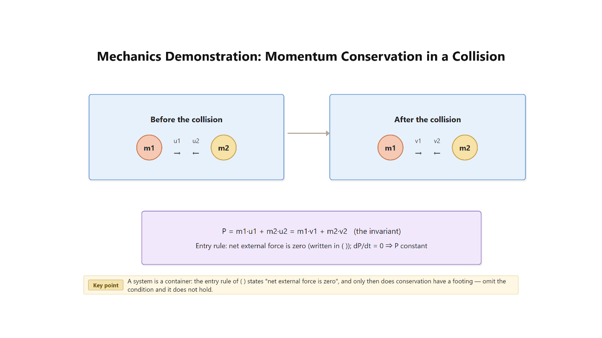

*Figure 4-1 Mechanics demonstration: momentum conservation in a collision*

### 4.2 Thermodynamics: Energy Conservation at Thermal Equilibrium

An ice cube is put into hot water, with the container insulated from the outside — the entry rule of ( ) states "no heat exchange with the surroundings". Heat flows from the hot side to the cold side until both are at the same temperature.

> **Proof demonstration · Thermodynamics**
>
> ◆ 【Theorem】For ice and water mixed in an adiabatic container, at equilibrium Q_out = Q_in, and the total energy is conserved.
> ◆ 【Proof】(1) Give the Type: M = {cup, hot water, ice}, the content of S(M) is replaceable and id(M) is unchanged; (2) invariant candidate: E_total; (3) by conservation of energy (the time version of the invariance axiom): heat has only changed pockets, m1·c·(T1 - Tf) = m2·c·(Tf - T2); (4) solve for the equilibrium temperature Tf; (5) three-layer check: container — the adiabatic entry rule holds; BOM — the cup is a necessary part; abstract — passes the ∩(T) of [thermal equilibrium]. (Q.E.D.)

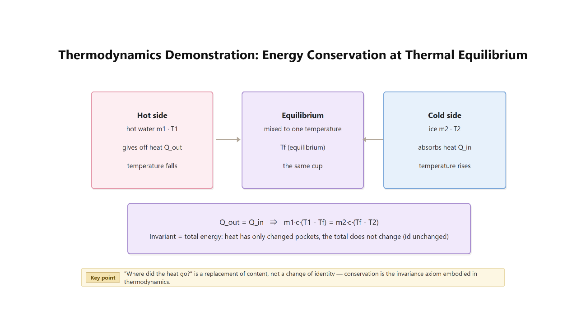

*Figure 4-2 Thermodynamics demonstration: energy conservation at thermal equilibrium*

### 4.3 Electromagnetism: the Charging of an RC Circuit

A power source charges a capacitor through a resistor. The capacitor is a standard container: charge is the content, it can go in and out and be replaced, and id(C) does not change; the charging curve is the Time Type of this circuit.

> **Proof demonstration · Electromagnetism**
>
> ◆ 【Theorem】When an RC series circuit charges, the capacitor voltage is V(t) = V0(1 - e^(-t/RC)).
> ◆ 【Proof】(1) Give the Type: M = {power source, resistor, capacitor}, inside the capacitor ( ) the space S(C) = (charge); (2) choose the criterion: Kirchhoff's voltage law V0 = iR + q/C; (3) substitute i = dq/dt to obtain a first-order differential equation, and solve it step by step (the function chain does not skip steps): q(t) = C·V0(1 - e^(-t/RC)), hence V(t) = q/C; (4) three-layer check: container — charge enters and leaves while id(C) is unchanged; BOM — the power source is a necessary part; abstract — passes the ∩(T) of [RC charging]. (Q.E.D.)

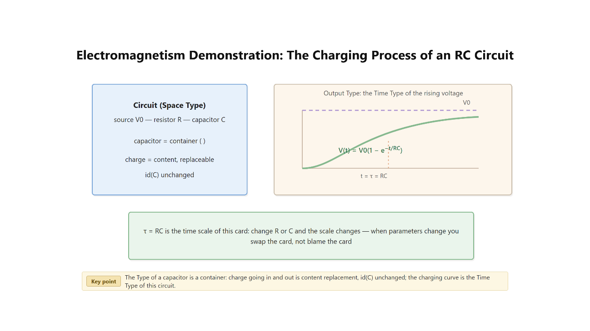

*Figure 4-3 Electromagnetism demonstration: the charging process of an RC circuit*

### 4.4 Wave Optics: the Classification Criterion for Double-Slit Interference

Light passes through two slits and a pattern of alternating bright and dark fringes appears on the screen. Which point is bright and which is dark is a standard classification problem — put the ∩(T) funnel onto the screen.

> **Proof demonstration · Wave Optics**
>
> ◆ 【Theorem】A point on the screen is a bright fringe if and only if its path difference d·sinθ = m·λ.
> ◆ 【Proof】(1) Give the Type: the objects to be judged = points on the screen; (2) define the category [bright fringe]: F = {the phase difference of the two beams is an integer multiple of 2π}, criterion ∩(T); (3) the path difference d·sinθ converts to a phase difference 2π·d·sinθ/λ; set it equal to 2πm and obtain d·sinθ = m·λ; (4) contrast with [dark fringe]: d·sinθ = (m+½)·λ does not pass the sieve of [bright fringe] and is judged into the other category; (5) three-layer check: container — the screen is the ( ) boundary; BOM — the double slit is a necessary part; abstract — the two categories are mutually exclusive and exhaustive. (Q.E.D.)

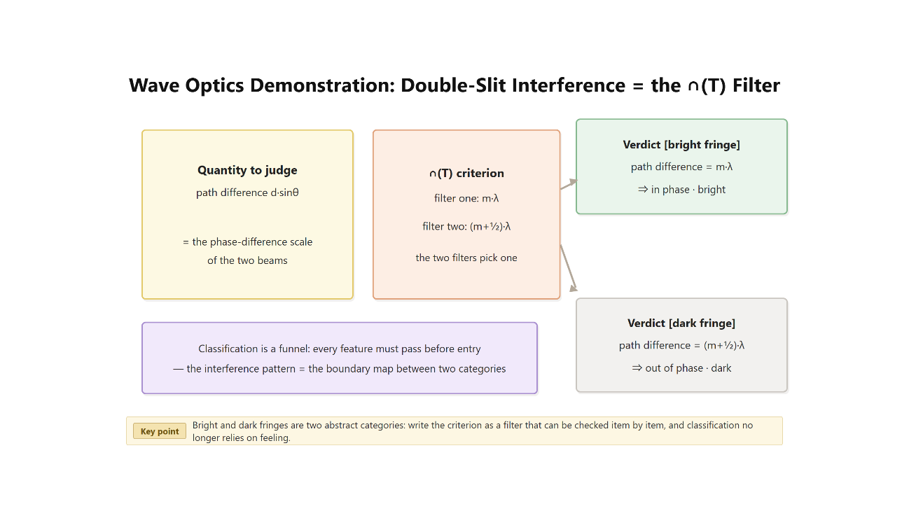

*Figure 4-4 Wave optics demonstration: double-slit interference = the ∩(T) sieve*

### 4.5 Modern Physics: the Photoelectric Effect as a Boundary Case

Light shines on a metal; whether electrons escape depends on frequency rather than intensity — the key experiment that re-forms "what Type light is".

> **Proof demonstration · Modern Physics**
>
> ◆ 【Theorem】In the photoelectric effect, electrons escape if and only if the incident frequency ν ≥ ν0 (the cutoff frequency).
> ◆ 【Proof】(1) Give the Type: light = a group of photons, each photon with E = h·ν (quantisation = discretisation of the scale); (2) define the category [photoelectric effect]: F = {the energy of an incident photon ≥ the work function W}; (3) from Einstein's equation h·ν = W + Ek(max) and Ek ≥ 0, derive h·ν ≥ W, that is ν ≥ ν0 = W/h; (4) boundary case: when ν < ν0, no matter how strong the light, no electrons escape — intensity is content (number of photons), frequency is identity (photon energy), and the layers are distinct; (5) three-layer check: container — the metal surface is ( ); BOM — the electron is a necessary part; abstract — passes ∩(T). (Q.E.D.)

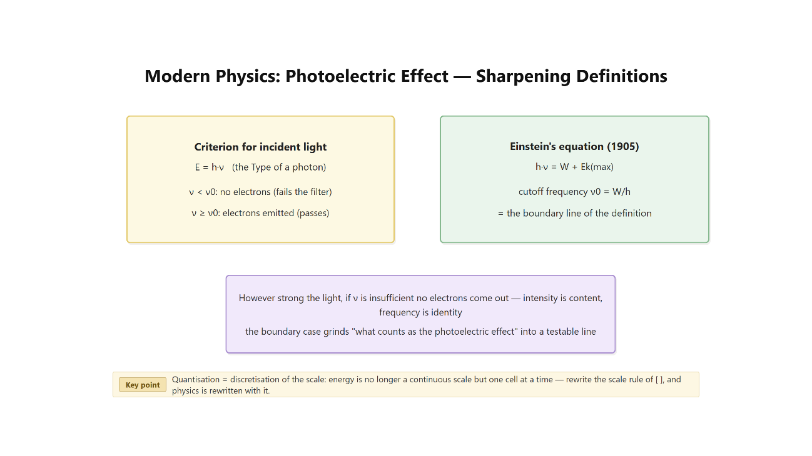

*Figure 4-5 Modern physics demonstration: the photoelectric effect — boundary cases sharpen the definition*

> **Exercises (P4)**
>
> ◆ P4-1 Following the format of 4.1, prove that "the period of a small-angle pendulum T = 2π√(L/g) is independent of the bob's mass".
> ◆ P4-2 In 4.3 the resistance of the RC circuit is doubled: is this swapping the card or a wrong card? How does τ change?
> ◆ P4-3 Rewrite the criterion of 4.5 in the language of ∩(T), and give a boundary case (give the Type first, then choose the criterion, then close with three layers).

## Chapter 5 Using It Precisely — Putting the Supplements Back into Physical Proof

All four tools are in place. The last chapter puts them back into one workflow: the six steps of physical proof, one example that walks the whole way, a comparison of five misuses, and an eight-question checklist before handing in a proof — this is what the book's title calls the "accurate use" framework.

### 5.1 The Six Steps of Physical Proof

Faced with a physical proposition to be written as a proof, always take six steps. Step one, identify the whole — first ask "which whole is my proof about"; the same physical scene often has several objects of judgement. Step two, describe by axis — write the X attribute, Y composition and Z container once each. Step three, write the Type set — record the object as {parts, (content), [category]}. Step four, choose the proposition — is it classification, invariance, grading or process? Step five, reason with criteria — walk step by step through the corresponding criterion (∩(T), the invariance axiom, remove, op). Step six, three-layer check — after verifying container, composition and abstract layers jointly, close the conclusion.

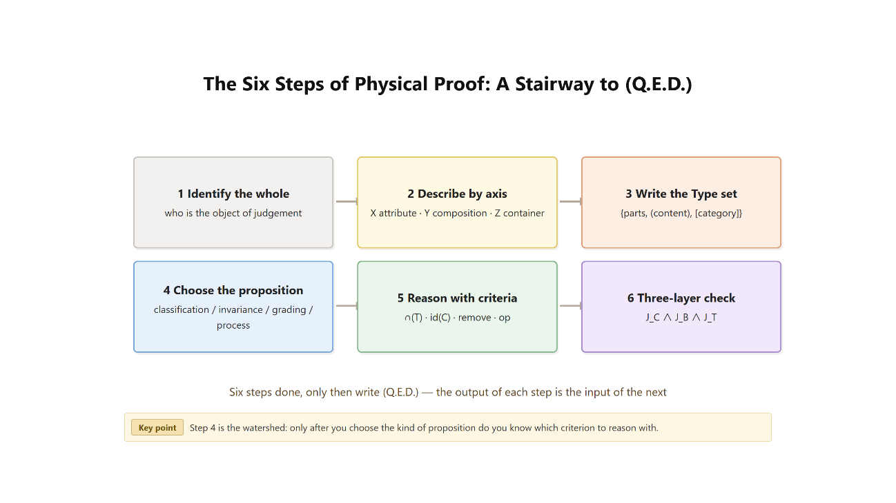

*Figure 5-1 The six steps of physical proof: a stairway to (Q.E.D.)*

| Step | Operation | Output | Usual tool |
| --- | --- | --- | --- |
| 1 Identify the whole | point out the object of judgement | one sentence: what M is | — |
| 2 Describe by axis | describe each of the three axes once | attribute table, BOM, container | three brackets |
| 3 Write the Type set | complete notation | {parts, (content), [category]} | Type set |
| 4 Choose the proposition | classification / invariance / grading / process | one sentence of theorem | — |
| 5 Reason with criteria | reason step by step with the right criterion | the body of the derivation | ∩(T) · id(C) · remove · op |
| 6 Three-layer check | joint check of the three layers | conclusion (Q.E.D.) | three-layer judgement |

**Table 5-1 The six-step operation table**

### 5.2 A Complete Example: Hot Water Cooling in a Cup

Use the book's most faithful specimen, and walk all six steps through.

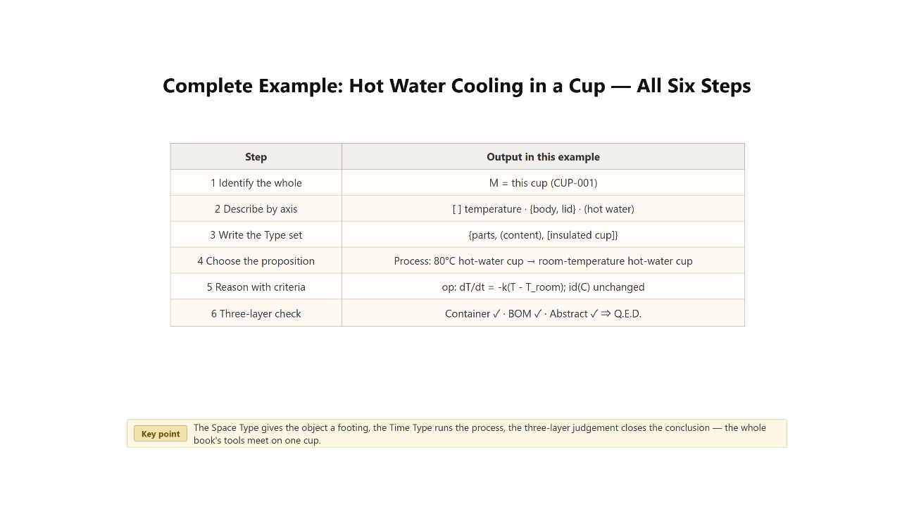

> **Proof demonstration · the whole journey**
>
> ◆ 【Theorem】Hot water at 80°C in an insulated cup cools to room temperature, and the cup and the system remain the same one throughout.
> ◆ 【Proof】
> ◆ (1) Identify the whole: M = this cup (CUP-001).
> ◆ (2) Describe by axis: [ ] temperature (dimension = temperature, scale = °C); { } BOM = {cup body, cup base, cup lid}; ( ) S(M) = (hot water), id(CUP-001).
> ◆ (3) Write the Type set: M = { {cup body, cup base, cup lid}, (hot water), [insulated cup] }.
> ◆ (4) Choose the proposition: a process problem — input Type (80°C hot-water cup) → output Type (room-temperature hot-water cup), with id unchanged.
> ◆ (5) Reason with criteria: the cooling card op: dT/dt = -k(T - T_room); solve step by step T(t) = T_room + (T0 - T_room)·e^(-kt); throughout the process the content is replaced and id(CUP-001) is unchanged (invariance axiom).
> ◆ (6) Three-layer check: container — change to tea or cool down, id unchanged in both cases, ✓; BOM — remove(cup base) ≢ M (necessary part), remove(cup lid) ≡ M′ ⊂ M (degrading part), ✓; abstract — passes the ∩(T) of [insulated cup] (insulating property verified by the cooling rate), ✓. All three layers pass. (Q.E.D.)

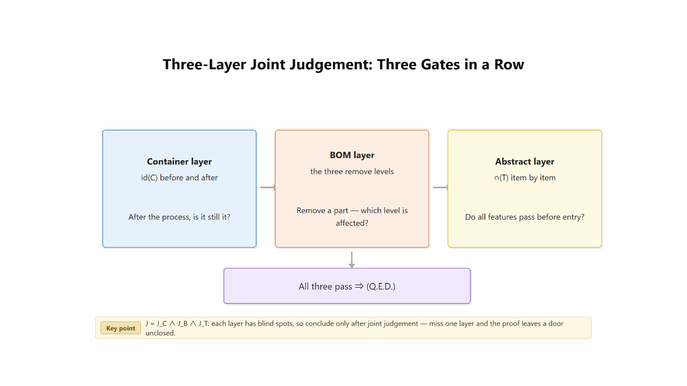

*Figure 5-2 Complete example: hot water cooling in a cup — all six steps*

### 5.3 Misuse Comparison: Five Common Errors

| # | Misuse | What is wrong | Correct writing |
| --- | --- | --- | --- |
| 1 | Treating ( ) as an ordinary set | (hot water) is written as {hot water}, and identity disappears | write content in ( ) and mark id(C) |
| 2 | Writing [ ] as a closed list | new cases cannot be classified | use the open rule T = (F(T), ∩(T)) |
| 3 | Numbers without dimensions | the number leaves the Type, and the scale loses meaning | write the dimension first, then the scale reading |
| 4 | Skipping steps in the derivation | input Type and output Type are not written | use a function chain, writing op: Type → Type step by step |
| 5 | Concluding after only one layer of judgement | each layer has its blind spot | joint three layers J = J_C ∧ J_B ∧ J_T |

**Table 5-2 Five common misuses and their correct writing**

The common root of all five misuses is that "layer" was never made clear: the layer of brackets, the layer of container and content, the layer of number and Type, the layer of process. When writing a proof, always ask yourself one question — on which layer should this piece of information go?

### 5.4 The Checklist Before Handing In a Proof

| # | Check question | Passing standard |
| --- | --- | --- |
| 1 | Is the object identified? | you can say in one sentence "which whole I am proving" |
| 2 | Is the entry rule written? | the idealisations of the model and the exchange terms of ( ) are listed |
| 3 | Are the brackets used correctly? | { } parts, ( ) content, [ ] category, each in its place |
| 4 | Is id(C) marked? | when a process is involved, the identity marker is explicit |
| 5 | Is the remove grading done? | when the effect of parts is discussed, each has a level |
| 6 | Are all four function questions answered? | every law has a name, input Type, output Type and criterion |
| 7 | Is every step checkable? | a reader can tick the reasoning off sentence by sentence |
| 8 | Has the three-layer joint check been made? | container, composition and abstract all pass before writing (Q.E.D.) |

**Table 5-3 Checklist: eight questions before handing in a proof**

**All eight questions passed, and only then is the proof "written accurately". This checklist is not just a format — it is the acceptance standard of the four tools.**

> **Key points of this chapter**
>
> ◆ Six steps: identify the whole → describe by axis → write the Type set → choose the proposition → reason with criteria → three-layer check.
> ◆ The common root of the five misuses: the layers were not written clearly.
> ◆ The eight-question checklist is the acceptance standard of accurate use.

> **Exercises (P5)**
>
> ◆ P5-1 Use the six steps to prove in full: "an insulated cup of hot coffee, left until tomorrow morning, is still the same system".
> ◆ P5-2 Against Table 5-2, check whether your proof in P5-1 commits any of the misuses, answering item by item.
> ◆ P5-3 Apply the eight questions of Table 5-3 to any worked example in your physics textbook, and point out which layers it is missing.
> ◆ Hint: in step 4, choose the kind of proposition before choosing the criterion — reverse the order and you will skip steps.

## Review — Key Points and Self-Check

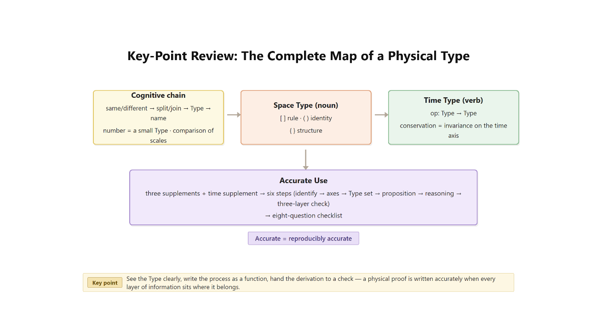

*Figure R-1 Key-point review: the complete map of a physical Type*

#### R-1 Four supplements, four gaps

[ ] turns a hard-coded list into an open rule — T = (F(T), ∩(T)); ( ) gathers scattered content under an unchanging identity — C = (id(C), S(C)) and the invariance axiom; { } arranges juxtaposed parts into a dependence structure — the three remove levels; the Time Type unfolds a flattened process into a function chain — op: Type → Type. Wherever the gap is, the tool goes there.

#### R-2 Three pieces, two languages, one axis

Model first, law in the middle, derivation last; equations are the skeleton, the supplements of Type are the flesh. Space Type gives the object its footing, Time Type walks the process to the end — only by superposing the two languages is a physical proof complete.

#### R-3 Accurate means reproducibly accurate

Judgement does not rely on intuition but on process: check ∩(T) item by item, compare id(C) before and after, grade with the three remove levels, walk the function chain step by step; conclude only after the three-layer joint check. A reader can tick off and reproduce your derivation sentence by sentence, and experiment can re-test your conclusion — this is what the word "accurate" means in physics.

| Self-check question | What you should be able to answer |
| --- | --- |
| How is the system given its Type? | write {parts, (content), [category]}, with each of the three axes assigned |
| How is a physical quantity read? | dimension × scale — a number is a small Type inside a Type, a comparison of scales |
| How is a process written? | four-question function card: name, input Type, output Type, criterion |
| How is conservation used? | five steps of an invariant; conservation = the invariance axiom on the time axis |
| How does a proof start? | walk the six steps: from identifying the whole to (Q.E.D.) |
| How are misuses avoided? | self-check against the five misuses, writing the layers clearly |

**Table R-1 Self-check list**

**A proof is accurate because every layer of information is written where it belongs.**

## Appendix — Glossary and Notation

| Term | English / notation | One-line definition |
| --- | --- | --- |
| 形 | Type | an object that has been completely described |
| 單位形 | Unit Type | the union of three sets: { parts, (content), [category] } |
| 形集合 | Type Set | the complete notation of the Unit Type |
| 屬性・維度・刻度 | [ ] | physical quantity = dimension (field) × scale (grid) |
| 抽象類別 | T = (F(T), ∩(T)) | an open category determined by features and criterion |
| 交集判準 | ∩(T) | all features must pass before membership |
| 容器 | C = (id(C), S(C)) | system boundary plus unchanging identity |
| 身份識別 | id(C) | a marker that does not change with content |
| 內部空間 | S(C) | the content set that can hold and be replaced |
| 不變性公理 | ∀ e1, e2 ∈ S(C) | replacing content does not change id(C) |
| 物料清單 | BOM | the composition list, seen by taking things apart |
| remove 判準 | remove(p,M) | three levels: necessary ≢M / degrading ≡M′⊂M / non-essential ≡M |
| 時間本形 | Time Type | the Type of the verb = function: op: Type → Type |
| 函式四問卡 | name / input Type / output Type / criterion | writing a law as a usable card |
| 不變量 | invariant | a property that stays true under a certain class of changes |
| 三層判斷 | J = J_C ∧ J_B ∧ J_T | joint check of container, BOM and abstract layers |
| 證明六步驟 | six steps | identify → axes → Type set → proposition → reasoning → three-layer check |

**Table A-1 Glossary and notation**

#### Reference answers to the exercises

| No. | Key points of the answer |
| --- | --- |
| P1-1 | Rule (what counts as "apple"); identity (the same one throughout the fall); structure (dependence of fruit, stalk and leaf); process (gravity turns the resting Type into a moving Type). All four layers are omitted in the sentence. |
| P1-2 | Because "ideal gas" is determined by features such as F(T) = {no forces between molecules, molecular volume negligible} plus ∩(T); at low temperature and high pressure the features fail and the gas is judged out of the category — a list cannot answer such a new case, a rule can. |
| P1-3 | In -k(T - T_room), the "T_room" is anchored by the constant identity of the environment container; the expression answers the rate of temperature change but not "which system is cooling" — identity must be supplied by id(C). |
| P2-1 | M = { {lamp base, bulb, shade}, (current), [desk lamp] }, with id(C) defined freely, say LAMP-007. |
| P2-2 | Bulb — necessary part (remove ≢ M, without it the lamp does not light); wire — necessary part (supply circuit); shade — function-degrading part (≡ M′ ⊂ M, still lit but no longer shaded); sticker — non-essential part (≡ M). |
| P2-3 | If F(T) of a headlamp has only {can emit light, can be placed on a desk} it fails the sieve; to include a headlamp you must rewrite the features (e.g. "can provide illumination") — rewriting the feature list is rewriting your position. |
| P3-1 | Ohm's law: name = Ohm's law; input Type = a conductor with a potential difference across it; output Type = a conductor carrying current; criterion = V = IR. Newton's cooling: name = Newton's law of cooling; input Type = a body with a temperature difference from its surroundings; output Type = a body tending to room temperature; criterion = dT/dt = -k(T - T_room). |
| P3-2 | Input Type = a pendulum pulled to one side; output Type = a pendulum swinging to the other side; invariant = mechanical energy E conserved in the interchange of force and energy (ideal case), plus the length L unchanged. |
| P3-3 | Example: a change in conductor temperature changes R, so the linear card V = IR no longer applies — swap in a "resistance varies with temperature" card; forcing the old card gives a wrong current, and what is wrong is the choice of card, not the world. |
| P4-1 | Give the Type: M = {bob, string, Earth's gravitational field}; the small-angle [simple harmonic motion] criterion passes; in the derivation of T = 2π√(L/g) the mass cancels — remove(bob mass, conditional expression) ≡ M (non-essential part), so the period is independent of mass. |
| P4-2 | Swap the card: in the criterion V0 = iR + q/C, R is a parameter of the card; doubling R gives τ = 2RC and slower charging — the same card with a new parameter, or another card with a different scale; both readings hold, the point is to re-mark the scale. |
| P4-3 | The ∩(T) version: F of [photoelectric effect] = {incident photon energy ≥ W}; boundary case: at ν = ν0, Ek = 0 and an electron just escapes — the definition is sharpened at the boundary. |
| P5-1 | Follow the format of 5.2: (1) M = the cup; (2) [ ] temperature · {body, lid, base} · (coffee); (3) the Type set; (4) a process problem; (5) the cooling card + id unchanged; (6) all three layers pass — the system is the same one. |
| P5-2 | Check against the five misuses one by one: was the content written as {hot water}? was the category hard-coded? did the numbers carry dimensions? did the derivation skip steps? was only one layer checked? |
| P5-3 | Textbook examples usually give only the equation derivation of step 5 — they lack the Type-giving of steps 1–3 and the three-layer check of step 6; tick the eight questions one by one and it shows. |

**Table A-2 Reference answers to the exercises**

> **End of the book**
>
> ◆ Space Type gives the system its form, Time Type writes the process as a function, and accurate use hands the proof to a check.
> ◆ See the Type clearly, put every layer of information where it belongs — and the physical proof is written accurately.
