# The World-Model Brain

*A Complete Framework for the Accurate Use of Outputs*

Grounded in Ontypology — Space Type × Time Type · Powered by Mind AI

Chang Changfeng · Chang Tingying

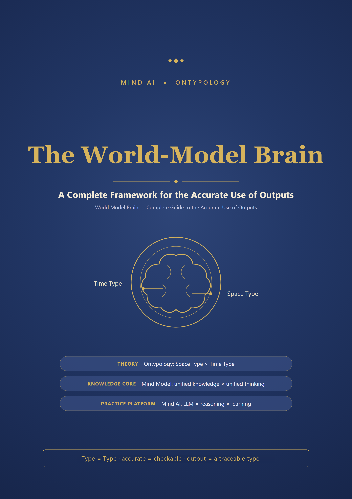

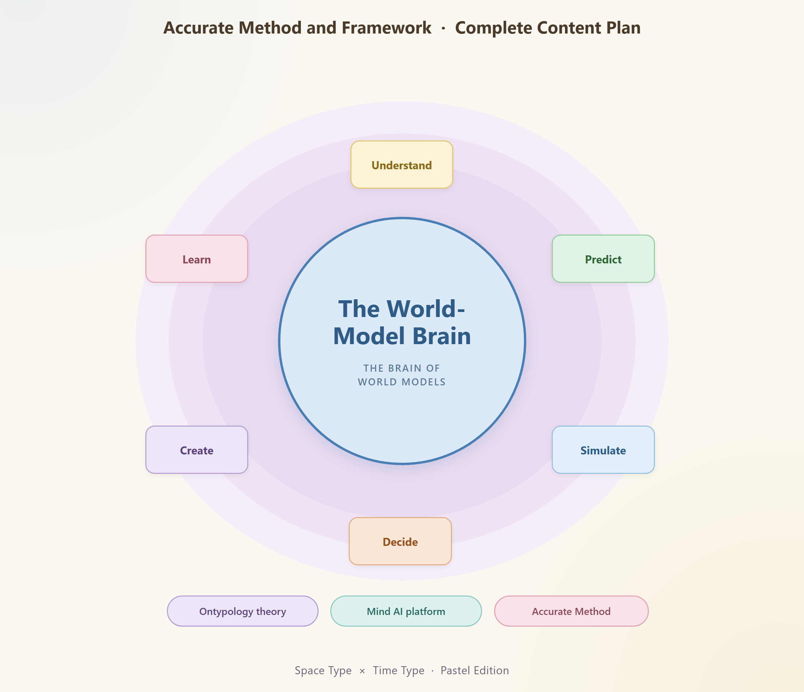

## TABLE OF CONTENTS

- Preface · What This Book Is
- How to Read This Book
- Part Map
- Part One · What Is a World Model? What Must a Brain Do?
- 1.1 · The World Model: More Than a Map
- 1.2 · The Five Things a Brain Does
- 1.3 · Three-Layer Positioning: Theory, Platform, Application
- 1.4 · The World's Four Questions
- Part Two · The Overall Architecture: An Anatomy of the Brain
- 2.1 · Two Libraries, One Hub, One Loop
- 2.2 · The World Form Library: Where the World's Appearance Is Kept
- 2.3 · The World Function Library: Where the World's Operations Are Kept
- 2.4 · The Three-Layer Judgment Hub: What Counts
- 2.5 · The Cognitive Chain and the Learning Loop
- 2.6 · Interface with the Mind AI Platform
- Part Three · The World's Form: The Space Type Dimension
- 3.1 · Writing the World into Form
- 3.2 · Forming along Three Axes: X Attributes · Y Composition · Z Container
- 3.3 · The World's Four Forms: Entity · Relation · Field · State
- 3.4 · Five Domains Formed Side by Side
- 3.5 · The Remove Test and Invariance
- Part Four · The World's Time: The Time Type Dimension
- 4.1 · Type In, Type Out: The World's Operation Is a Function
- 4.2 · Six Families in the World Function Library
- 4.3 · State Transition and the Causal Chain
- 4.4 · The Dynamics of Five Domains Side by Side
- 4.5 · Simulation and Counterfactual
- Part Five · How the Brain Judges: Reasoning and Thinking
- 5.1 · How the Three-Layer Judgment Works
- 5.2 · The Five Families of Reasoning
- 5.3 · Choosing a Road with Thinking Methods
- 5.4 · The Full Rollout: Tuning a City's Traffic Lights
- Part Six · The Accurate Method: What Counts as Accurate Use
- 6.1 · The Definition of Accurate: Checkable Accuracy
- 6.2 · The Three Supplements
- 6.3 · The Six-Step Proof
- 6.4 · The Eight-Question Checklist
- 6.5 · The Full Contrast of Misuses
- 6.6 · Complete Demonstration: Writing Until It Is Reviewable
- Part Seven · The Complete Content Plan: Putting the World into the Brain
- 7.1 · A Blueprint for Forming All World Knowledge
- 7.2 · The Four Stages of Library Building
- 7.3 · Routing Table for Situations
- 7.4 · Acceptance Standards
- Part Eight · The Complete Framework Plan: Roadmap and Vision
- 8.1 · The Five Stages: Learn, Practise, Use, Teach, Build
- 8.2 · The Eight-Week Learning Route
- 8.3 · Three Stages of Growth
- 8.4 · The Vision
- Appendix 1 · Terms and Notation at a Glance
- Appendix 2 · The Accurate Method Quick Card
- Appendix 3 · Reference Answers to the Exercises
- Closing · After You Close the Book

## Preface · What This Book Is

"World model" is one of the most fashionable terms in contemporary artificial intelligence: giving a machine an internal world so that it can rehearse, in its mind, what has not yet happened. But most world models today look like an exquisitely precise map. They can describe the world, and yet they often cannot think. A map does not predict the next moment, does not ask "what if...", and certainly does not answer for a decision. What is missing is a brain.

This book sets out to raise "the brain of the world model." Its theoretical foundation is Ontypology. Space Type teaches us to see the world clearly — everything can be written as a Type. Time Type teaches us to write down how the world operates — every operation is a function. The Accurate Method answers the final question: what counts as valid? Its platform is Mind AI. Language ability is delegated to the LLM; intelligence ability is carried by the Mind Model; the brain grows on top of the platform.

The book delivers two principal products. The first is the Accurate Method: three supplements, the six-step proof, the eight-question check and a full contrast of misuses, so that every step in using a world model can be ticked and reviewed. The second is a complete content and framework plan: a blueprint for forming world knowledge, four stages of library building, context routing and an eight-week route, so that the brain grows one class at a time and becomes more accurate the more it is used.

The boundaries of the book should be stated at the outset. The theoretical source texts and the existing material of Mind AI are not copied again; the theoretical backbone is presented through architecture diagrams and summaries. Everything discussed here is method and plan, not system implementation. A reader needs only one disposition — the wish to see the world clearly — to keep reading.

The figures use a consistent colour code, so that the colour alone tells you which of the three axes is being discussed.

| **Colour** | **Stands for** | **Notation** | **In one line** |
| --- | --- | --- | --- |
| Yellow | Attributes (X axis) | [ ] | What it looks like — dimension × scale |
| Orange | Composition (Y axis) | { } | What it is made of — the bill of materials |
| Blue | Container (Z axis) | ( ) | Where it sits — identity and boundary |
| Green | Time | function | How it works — Type in, Type out |
| Purple | Summary | — | Key points and closure |
| Pink | Misuse | — | Pitfalls and the way back |

There are twenty-two exercises, numbered in three groups: W for part-end exercises (W01–W13), A for the Accurate Method part (A01–A04), and S for the plan parts (S01–S05). All reference answers are collected in Appendix 3.

## How to Read This Book

The book is designed as a double track. The main text is the teaching route: one concept, one figure, one example, one exercise. The Professional Notes are the deeper track for AI and engineering readers: eight notes, C1–C8, which may be read out of order or skipped without affecting the main line.

| **Reading element** | **What it does** |
| --- | --- |
| Reading guide | "What this part says" at the start of each part. Read it before the main text. |
| Figure | Forty pastel figures. Figure and text complement each other: the figure shows the skeleton, the text supplies the flesh. |
| Example box | Lands a concept on a concrete object. Read the example, then do the exercise. |
| Exercise box | Write a Type, write a card. When you finish, compare against the "check when done" line. |
| Key points | Five sentences at the end of each part — a pocket card for review. |
| Professional Note | C1–C8, an extension from the AI and engineering point of view. |

## Part Map

| **Part** | **The question it answers** | **Main content and output** |
| --- | --- | --- |
| Part One | What is a world model? What must a brain do? | Three-layer positioning · the five things a brain does · the world's four questions |
| Part Two | What does the brain look like? | Two libraries, one hub, one loop · interface with the platform |
| Part Three | How is the world's "form" written? | Type Sets · three axes · four basic Types · forming five domains |
| Part Four | How is the world's "time" written? | Type in, Type out · six function families · cause and simulation |
| Part Five | How does the brain judge? | Three-layer judgment · five reasoning families · thinking-method routing · full rollout |
| Part Six | How is it used accurately? | Three supplements · six-step proof · eight questions · sixteen misuses |
| Part Seven | How is the content built? | Forming blueprint · four library stages · context routing · acceptance |
| Part Eight | How does the framework grow? | Learn–Practice–Use–Teach–Build · eight weeks · three stages · vision |

## Part One · What Is a World Model? What Must a Brain Do?

> **Reading guide · what this part says**
>
> A world model is an internal representation of the world — but description alone is not a brain. This part positions the brain of the world model: which five things it must do, which three layers it stands on, and which four questions it asks.
>
> How to read: 1.1 the difference between a map and a brain → 1.2 the five tasks → 1.3 three-layer positioning → 1.4 the world's four questions; exercises W01–W02.

### 1.1 · The World Model: More Than a Map

A world model is the world inside a system. It records what the world looks like and how the world operates, so that the system can rehearse the world internally before it acts. A good world model does three things: it records the world's appearance, records the world's operations, and rolls out what has not yet happened.

The problem is that most world models today do only the first half. They are like a precise map: they mark the intersections, measure the distances, draw the relations — but a map will not tell you what happens next, will not ask what would happen if the lights changed, and will not choose a road for you. Describing the world and thinking about the world are two different things.

Ontypology's answer is clear: **world model = the world's form + the world's time + judgment and reasoning.** Space Type raises the world's form — everything in the world can be written as a Type. Time Type raises the world's time — every operation is a function. The hub that puts form and function to work, and judges what counts, is what this book calls the brain.

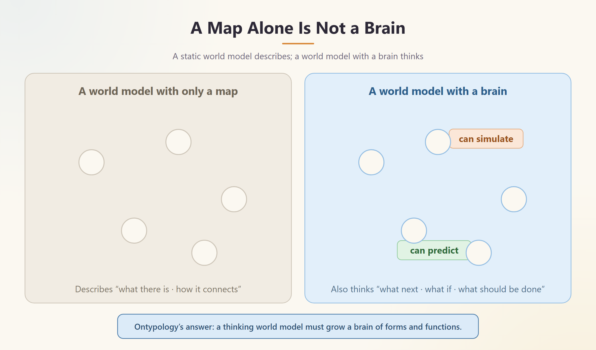

*Figure 01 · A map alone is not a brain*

> **Professional Note C1 · Where world models sit in AI research**
>
> - In the machine-learning community, *world models* mean an internal representation learned from data that can be rolled out — whether a latent state, a simulator or a world representation. The goal is always to let the model rehearse in its mind: roll a few steps, inspect the result, then act.
> - What Ontypology adds is a **checkable description**: the internal representation must have a name (a Type Set), must pass judgment (three layers), and must be handover-ready (the function's four questions). A black-box representation is good at rollout; a formed description is good at review. Used together, a world model can both think and explain itself.

### 1.2 · The Five Things a Brain Does

Only with a brain does a world model think. The brain's work can be gathered into five tasks. **Understand the world** — recognize what is in front of you and what it is made of. **Predict the future** — infer what the world will look like in the next moment. **Simulate situations** — answer "if this, then what?". **Decide and act** — choose one road among many and write down the reason. **Create new knowledge** — make a form the world did not have, and file it in the world form library.

The order cannot be shuffled: understand before predict; simulate before decide; only after decisions have accumulated is there a foundation for creation. Jumping straight from understanding to decision is the most common disease of world models — Parts Five and Six give the full diagnosis and the cure.

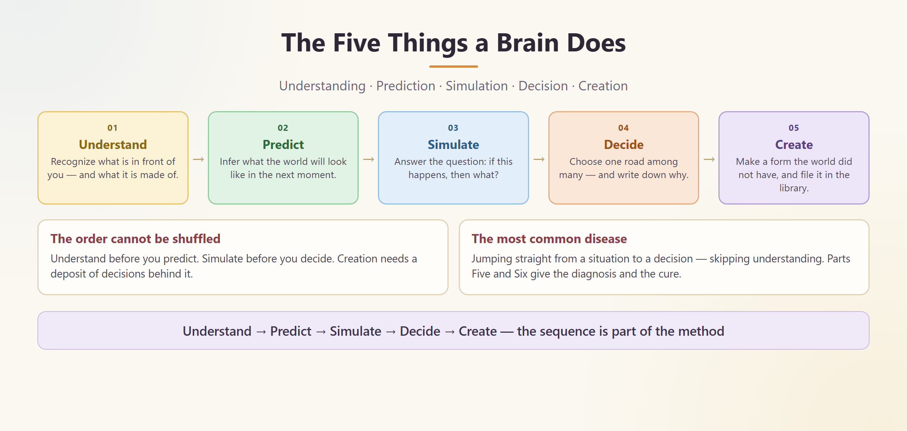

*Figure 02 · The five things a brain does*

### 1.3 · Three-Layer Positioning: Theory, Platform, Application

The brain of the world model did not fall from the sky. It stands on three layers. **Theory is the root** — Ontypology's Space Type, Time Type and Accurate Method are the complete language with which the brain sees, writes and judges the world. **Platform is the ground** — Mind AI combines the language ability of the LLM with the intelligence ability of the Mind Model; it is the soil in which the brain grows. **Application is the fruit** — this brain gathers theory and platform into a usable method for world models.

Each layer does its own job: theory answers "in what language do we think"; platform answers "what do we run on"; application answers "what is it for". This book works at the third layer; theory and platform are cited through architecture diagrams, not rewritten.

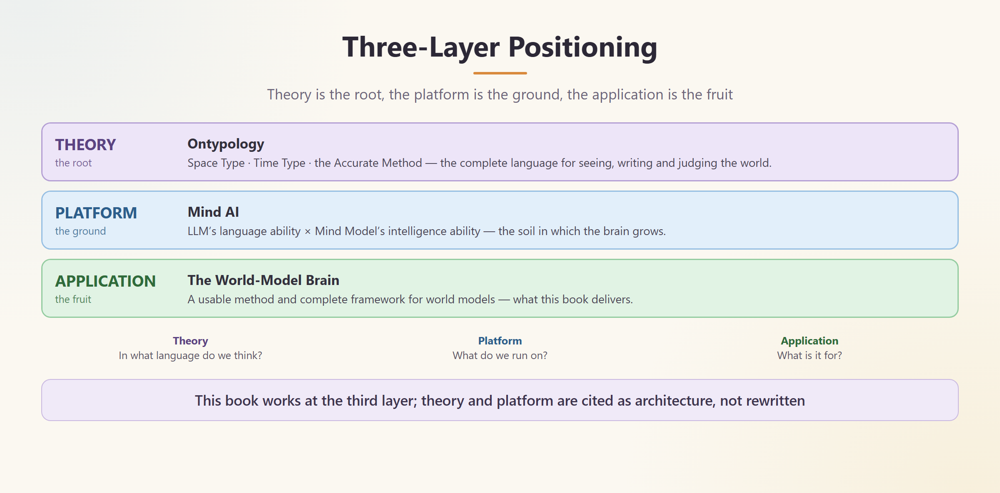

*Figure 03 · The world-model brain in three layers*

### 1.4 · The World's Four Questions

To see the world clearly, first ask the right questions. Ontypology's four learning questions, applied to a world model, become the world's four questions. **What does the world look like?** — this is X attributes [ ], dimensions and scales. **What is the world made of?** — this is Y composition { }, the bill of materials. **Where do things sit?** — this is Z container ( ), identity and boundary. **How does the world work?** — this is Time Type, functions and moves.

The first three questions belong to Space Type; the fourth belongs to Time Type. Only when all four can be answered has the world truly taken form. The order of cognition is also hidden in the four questions: first see sameness and difference, then split and join, then raise the form, then take the name — where there is composition, there is form.

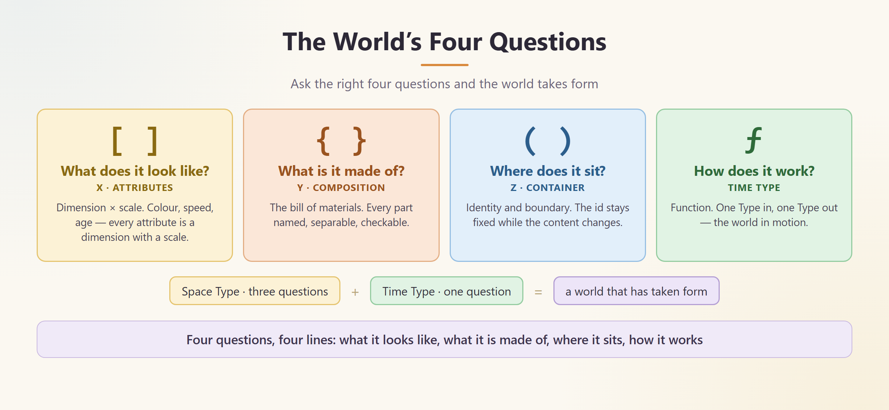

*Figure 04 · The world's four questions: asking the world into form*

> **Example · The four questions for a car**
>
> - **What does it look like?** White, three-box saloon, electric, seats five — attributes of colour, body type, power and seating, each with a scale.
> - **What is it made of?** Engine or motor, wheels, body shell, battery — a bill of materials, taken apart part by part.
> - **Where does it sit?** This is *this* car: the plate and the id do not change. Today it is in the car park, tomorrow on the motorway — it is still the same car.
> - **How does it work?** Charging, driving, servicing, repair: each action is a function, one Type in and one Type out.

> **Exercise W01 · Ask the four questions about your work object**
>
> - Choose the object you know best in your work — a customer, a machine, a report. Write out the world's four questions one by one. At least one line per question; attributes must reach a scale.
> - **Check when done:** if you hand the four answers to a colleague, can they recognize the object without asking you a third question?

> **Exercise W02 · Put the five tasks into your work**
>
> - Recall one task you did last week. Which of the brain's five tasks did it use? Which one was skipped? Add the skipped step and write down the one action that would have supplied it.
> - **Check when done:** the order is Understand → Predict → Simulate → Decide → Create. Did your task skip a step?

> **Part One · Key points**
>
> - **World model = the world's form + the world's time + a brain.** What only describes is a map; what thinks is a brain.
> - **The five things a brain does:** Understand · Predict · Simulate · Decide · Create. Understand before deciding; the order cannot be shuffled.
> - **Three-layer positioning:** Ontypology is the root, Mind AI the ground, the world-model brain the fruit.
> - **The world's four questions:** what it looks like [ ], what it is made of { }, where it sits ( ), how it works (Time Type).
> - **Cognitive chain:** difference → split and join → form → name. Where there is composition there is form; form first, number second.

## Part Two · The Overall Architecture: An Anatomy of the Brain

> **Reading guide · what this part says**
>
> This part opens the brain up: two libraries, one hub, one loop. The world form library holds the world's appearance; the world function library holds the world's operations; the three-layer judgment hub decides what counts; the cognitive chain and learning loop make the brain more accurate with use. Finally we see how it stands on the Mind AI platform.
>
> How to read: 2.1 the overall diagram → 2.2–2.3 the two libraries → 2.4 the hub → 2.5 the loop → 2.6 the interface; exercises W03–W04.

### 2.1 · Two Libraries, One Hub, One Loop

Open the brain and four parts appear. **The world form library** is a warehouse for "the world's appearance": any object enters as a one-line Type Set. **The world function library** is a rack of the world's operations: any action hangs on the wall as a four-question function card. **The three-layer judgment hub** is the gate that decides "what counts": any conclusion must pass the container gate, the BOM gate and the abstraction gate. **The cognitive chain and learning loop** is the cycle that makes the brain more accurate with use: each act of cognition settles into memory, and each memory upgrades the form library.

None of the four can be missing. Without the form library there is nothing to think about; without the function library there is nothing to do; without the hub there is no standard; without the loop the brain stops growing. The world enters from the left as perception; results leave from the right as predictions, decisions and new forms.

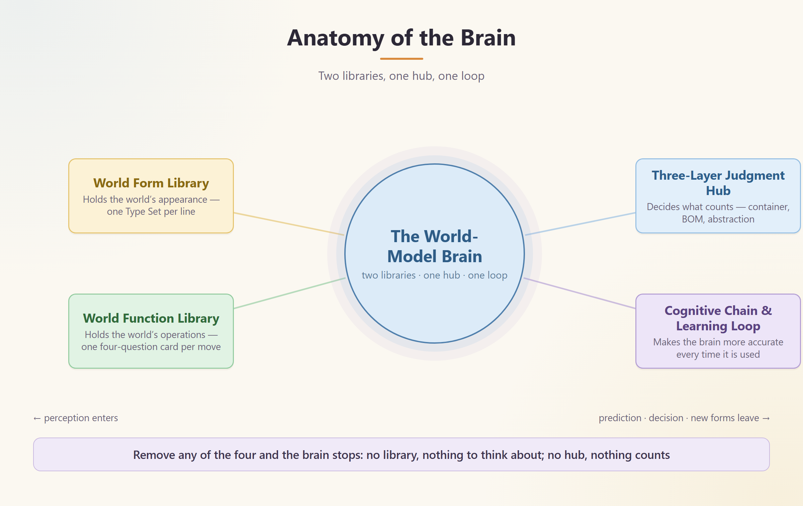

*Figure 05 · Anatomy of the world-model brain*

### 2.2 · The World Form Library: Where the World's Appearance Is Kept

The world form library collects **Types**. Any world object, written as one line of the Type Set { parts, (content), [category] }, enters the library. The Types inside fall into four basic kinds: entity (something visible), relation (a connection between things), field (a place where things stay) and state (how things stand right now). Part Three opens each of them.

The rule for consulting the library is "compare first, open a new entry second". When a new object arrives, take its form and compare it with the library. If it matches, hang it under an existing category; only if it does not match should you open a new dimension and raise a new form. The library grows with use without becoming chaotic, because every entry has a name and a criterion.

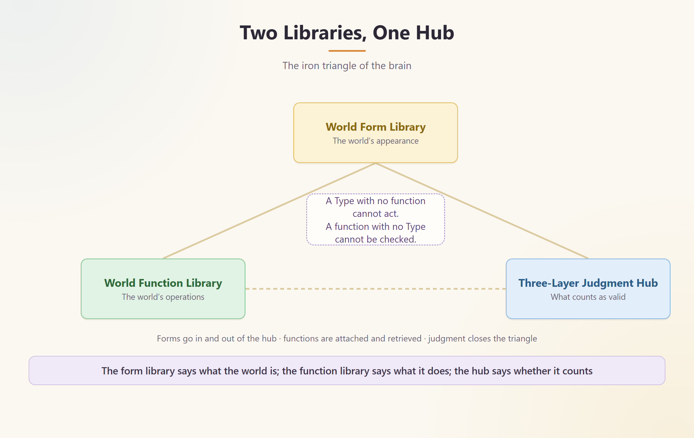

*Figure 06 · Two libraries and one hub: the iron triangle*

### 2.3 · The World Function Library: Where the World's Operations Are Kept

The world function library collects **functions**: every operation of the world — observe, predict, simulate, design, learn, decide — gathered into six families of moves. Before any function goes on duty, its four questions must be complete: name, input Type, output Type and criterion. Only when all four are written does a verb take form.

Faced with a task, the first action is not invention but search: write the task as a form and compare it with the function library. If it matches, an existing move goes on duty directly. If not, only then do you enter extraction, generation and design. **Search first, invent second** — this is the underlying discipline that saves the brain effort and keeps it from repeating mistakes.

### 2.4 · The Three-Layer Judgment Hub: What Counts

The judgment hub is the brain's court. Any form, any conclusion, must pass three gates. **The container gate** asks "whose identity is this?" — what is the id, has invariance been kept? **The BOM gate** asks "are the parts all here?" — can it be taken apart and recognized again, is not one essential part missing? **The abstraction gate** asks "which class does it belong to?" — compare against the criterion T = (F(T), ∩(T)) line by line: the function matches and the intersection matches, and only then does it enter the class.

The three gates judge jointly; none can be skipped. Abstraction alone mixes things that share a name but not a reality; the container gate alone knows identity but not class; the BOM gate alone can open a thing but not close it again. Only when all three pass does the judgment count.

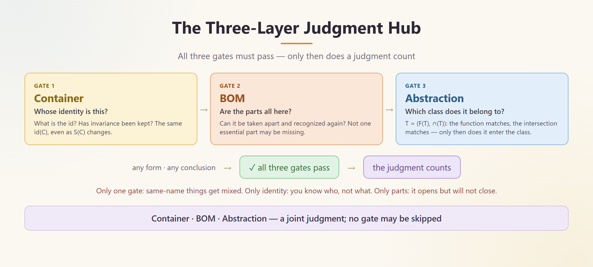

*Figure 07 · The three-layer judgment hub: all three gates must pass*

### 2.5 · The Cognitive Chain and the Learning Loop

How does the brain grow a new form? It walks the cognitive chain. First **sameness and difference** — seeing a difference is the beginning of cognition. Then **split and join** — only when it can be taken apart and put back together do you touch its structure. Then raise the **form** — write the structure as a Type Set. Then take the **name** — everyone can look it up and hand it over. One round of four steps, and the world's appearance enters the library one cell at a time.

The core proposition of the cognitive chain is "**where there is composition, there is form**": whenever several small forms combine into a whole, that whole necessarily has its own form — do not overlook it. "Number" is the comparison of smaller forms inside a form, one level lower: form first, number second. Memory settles in the loop: each completed round thickens the library and sharpens judgment — this is continuous learning.

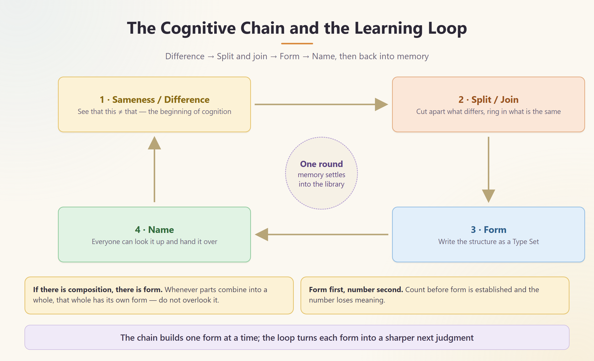

*Figure 08 · The cognitive chain and the learning loop*

### 2.6 · Interface with the Mind AI Platform

The brain is not an island; it stands on the Mind AI platform. The platform gives it two things: the **language ability of the LLM** — it understands the world in words and states results in words; and the **intelligence ability of the Mind Model** — unified knowledge, deep reasoning, long-term memory and thought management. The division of labour is clear: the LLM handles language, the Mind Model handles intelligence, and Ontypology supplies the language of form.

The interface works "above and below the form": the brain hands forms and functions to the platform for storage and computation; the platform hands the results of reasoning and memory back to the brain for judgment. Theory supports from the bottom — Space Type raises form, Time Type raises function, the Accurate Method raises review. Stack the three layers and you have a complete application.

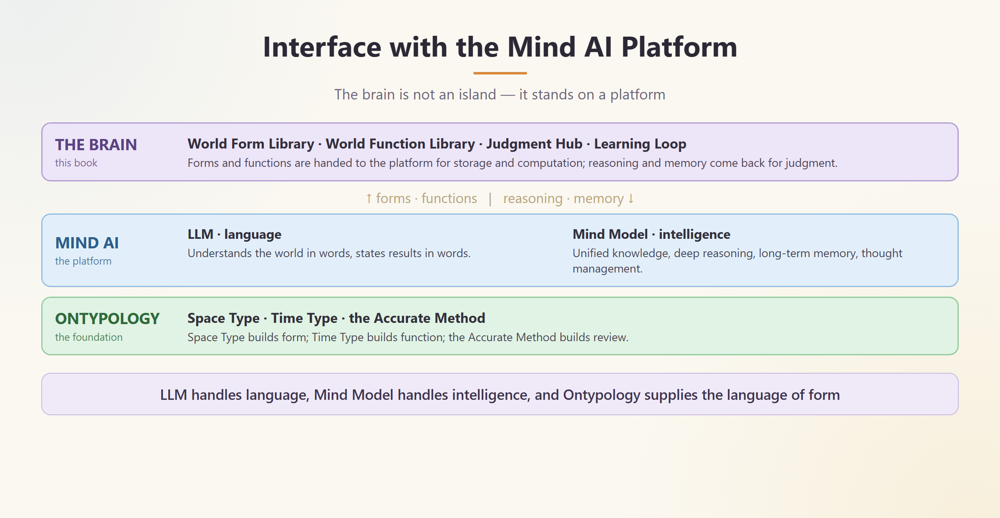

*Figure 09 · Interface with the Mind AI platform*

> **Professional Note C3 · What a world model adds in the age of the LLM**
>
> - The LLM has taken "talking about the world" to its limit: understanding language, generating language, recalling knowledge — all astonishing. But being able to speak is not the same as being able to rehearse. Running the world's operations in the mind, and answering for the consequences of that rollout, is the job of the world model. A language model answers "what does it resemble"; a world model answers "what will happen".
> - The division in one sentence: the LLM is responsible for saying things clearly, the world model for thinking the world clearly, and the brain glues the two together — the language of form makes the LLM's output reviewable and the world's rollout speakable. In practice, every LLM output is **formed and filed**: first write the Type Set and the function's four questions, pass the three-layer check, then enter the world form library. Language ability thus settles into a checkable asset rather than a one-off conversation.

> **Professional Note C2 · Why a knowledge graph is not enough**
>
> - A traditional knowledge graph is already good at describing entities and relations, but for a world model there are still gaps: limited expressive power — it can write "connected to", but not "made of what, and what happens when a part is removed"; difficulty with abstract concepts — the boundary of a class can only be agreed, not judged; no structure for thought — a graph answers "what is", not "how to think"; and it evolves with difficulty — when new knowledge arrives, the schema must be changed first.
> - Ontypology's solution is to make **form a first-class citizen**: the Type Set carries composition and category; three-layer judgment carries membership reasoning; the function library carries thought structure; open places carry room for evolution. A world graph describes the world; a world form library thinks about it.

> **Exercise W03 · Write the two library lists for your field**
>
> - In your field of work, which three kinds of thing would the form library hold? Which three actions would the function library hold? Write three lines each — every action must state "what Type comes in, what Type goes out".
> - **Check when done:** can you point to a concrete example in your head for each of the six lines?

> **Exercise W04 · Run the three-layer judgment once**
>
> - Take the object you wrote in W01 and answer gate by gate. Container gate — what is its id? BOM gate — which part, removed, would stop it being itself? Abstraction gate — which class does it belong to, and what is the criterion?
> - **Check when done:** do the three answers contradict one another? For example, the class says "car", but the essential parts are missing a wheel.

> **Part Two · Key points**
>
> - **Two libraries, one hub, one loop:** the form library holds appearance, the function library holds operations, the hub decides what counts, the loop makes it grow.
> - **Consulting rule:** compare first, open a new entry second. **Task rule:** search first, invent second.
> - **Three-layer judgment:** container gate (identity) · BOM gate (parts) · abstraction gate (criterion T = (F(T), ∩(T))) — none may be skipped.
> - **Cognitive chain:** difference → split and join → form → name. Where there is composition there is form; form first, number second.
> - **Platform interface:** the LLM handles language, the Mind Model handles intelligence; form above and below, theory supports from the bottom.

## Part Three · The World's Form: The Space Type Dimension

> **Reading guide · what this part says**
>
> This part writes out the world's *form*: one-line Type Sets, three axes, four basic Types, five domains written side by side, and finally the remove test that guards invariance. After this part, any object in the world can be written down.
>
> How to read: 3.1 learn the one-line notation → 3.2 the three axes → 3.3 the four basic Types → 3.4 five domains → 3.5 the remove test; exercises W05–W07.

### 3.1 · Writing the World into Form

The first step in seeing the world clearly is to write the world down. Ontypology's notation is the **Type Set** — one line, one Type: **{parts, (content), [category]}**. Curly braces hold the parts: what this thing comes apart into. Round brackets hold the content: what its container carries inside. Square brackets hold the category: which class it belongs to. One line, and anyone can look it up and check it.

Why insist on one line? Because a world model has to be handed over. A Type that exists only in the head is a cloud of feeling; written as a Type Set, it becomes material that can be taught, practised and reviewed. There is also an iron rule to remember: **form first, number second**. Count before the form is established and the number loses its meaning; once the form stands firm, the number has somewhere to hang.

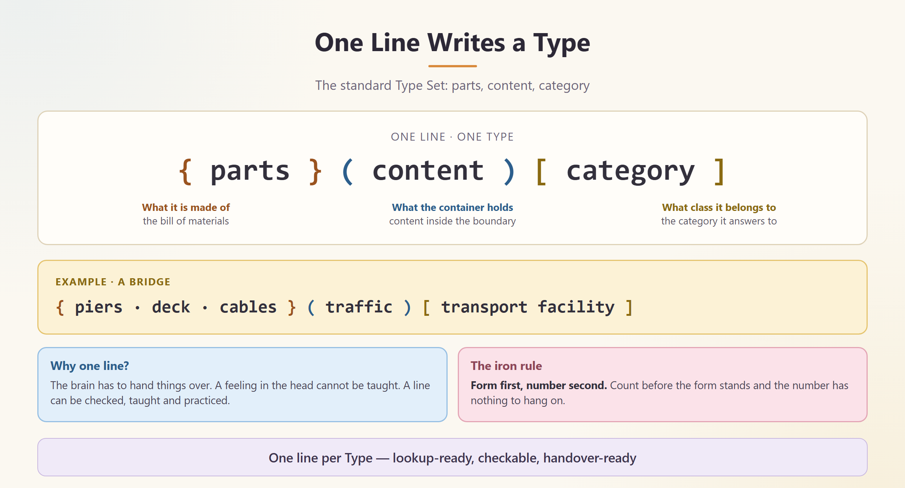

*Figure 10 · One line writes a Type*

### 3.2 · Forming along Three Axes: X Attributes · Y Composition · Z Container

Every Type can be opened along three axes. **X attributes [ ]**: what it looks like — each attribute is a dimension, and each dimension carries a scale (colour has a scale, speed has a scale, age has a scale). **Y composition { }**: what it is made of — the bill of materials, taken apart piece by piece. **Z container ( )**: where it sits — identity and boundary; a container has a fixed identity id(C) and a changing content S(C); only while the id stays the same is it the same container.

The three axes are independent of one another and none can be omitted. With attributes alone you cannot write structure; with composition alone you cannot recognize a category; with the container alone you cannot say what is inside. Once the three axes have been opened, a world object is written as a Type Set that anyone can check.

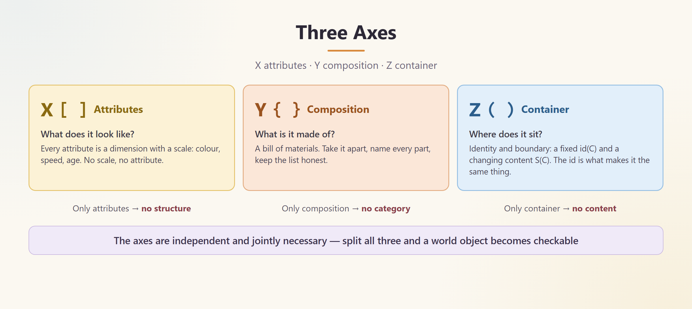

*Figure 11 · The world seen along three axes*

> **Example · A cat along three axes**
>
> - **X attributes:** coat colour (ginger and white), age (three years), weight (4.2 kg) — every dimension carries a scale.
> - **Y composition:** {skeleton, organs, fur, (food), [mammal]} — take it apart and recognize each piece; remove the heart and it is no longer a living cat.
> - **Z container:** this cat is called *Ginger*, and the id does not change — in the living room today, in the yard tomorrow, Ginger is still Ginger; the living room is only her container at this moment.

### 3.3 · The World's Four Forms: Entity · Relation · Field · State

There are countless world objects, but only four basic forms. **Entity**: something you can see and touch — a bridge, a cat. **Relation**: the line between things — a bridge joining two banks, a mother and child depending on each other. **Field**: the place where things stay — a city, an ecosystem. **State**: how things look at this moment — traffic jammed, seeds germinating. Once the four forms are distinguished, everything in the world has a seat.

All four are written in exactly the same way, as one line of a Type Set. What differs is the nature of the parts: an entity's parts are components; a relation's parts are two ends and the link; a field's parts are regions and rules; a state's parts are the values of each attribute at this moment. When the brain of the world model recognizes a form, it recognizes the four forms first and the details second — this is the entrance to the abstraction gate.

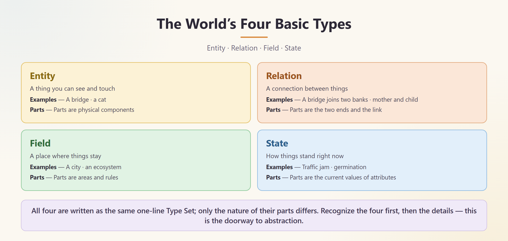

*Figure 12 · The world's four basic forms*

### 3.4 · Five Domains Formed Side by Side

Is this notation only good for engineering? Watch five domains write at the same time. **Physics** — a bridge becomes {piers, deck, cables, (traffic), [transport infrastructure]}. **Biology** — a cat becomes {skeleton, organs, fur, (food), [mammal]}. **Language** — a sentence becomes {subject, verb, object, (context), [sentence]}. **Software** — a module becomes {functions, variables, interfaces, (data), [component]}. **Organization** — a company becomes {departments, roles, processes, (customers), [enterprise]}.

Five domains, five sets of common sense, one way of writing. Change the domain and only the names of the parts change; the structure of the Type Set, the way the three axes are opened, the way the criterion is written — all stay the same line. This is what Ontypology calls **unified cognition**: cross-domain knowledge is first unified at the level of *form*, and only then does thinking have a chance to be unified.

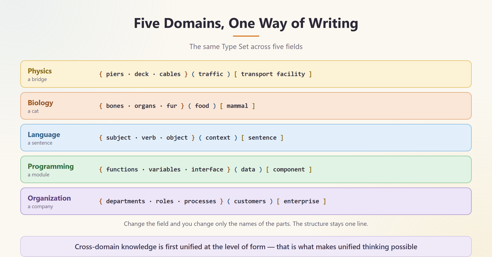

*Figure 13 · Five domains formed: one notation, valid across fields*

### 3.5 · The Remove Test and Invariance

Once a form is standing, how do you guard it? With the **remove test**: take the parts off one by one and ask, "with this removed, does it still recognize itself?" The answers fall into three levels. **Essential part** — remove it and the form falls apart (≢ M): take the engine and wheels off a car and it is no longer a car. **Function-degrading part** — remove it and the function degrades (≡ M′ ⊂ M): take off the air conditioning and the sound system and it is still a car, but comfort has degraded. **Non-essential part** — remove it and the form is unchanged (≡ M): take off the ornaments and the stickers and the car is still the car.

This is the container's axiom of invariance: while id(C) stays the same, it is the same container; the essential parts guard the form, while the content S(C) may change. The brain of the world model tracks the world by this axiom — the A3 bridge ten years later has had its cables replaced, and it is still the same bridge; take away the piers and it is no longer a bridge.

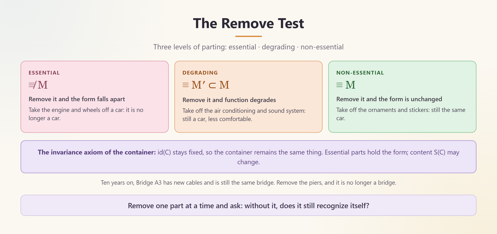

*Figure 14 · The remove test: three levels*

> **Professional Note C4 · State representation and the Type Set**
>
> - In engineering, "the way the world looks at this moment" is usually represented by a **state vector**: a string of numbers fed into a model for rollout. The advantage of a vector is that it computes fast; the disadvantage is that it cannot be read and cannot be handed over — two engineers may read two different worlds out of the same string of numbers.
> - A Type Set is the **legible notation** of a state: attributes carry scales, composition carries parts, the container carries identity. In practice the two layers are used together — the computing layer uses vectors, the handover and review layer uses forms. The Type Set is responsible for making the state *speak clearly*; the vector is responsible for making it *compute fast*.

> **Exercise W05 · Write a Type Set for one object**
>
> - Choose an object you handle often and write it as one line of a Type Set: at least three parts, the content clearly stated, the category named. Then add one line of description along each of the three axes.
> - **Check when done:** if you hand this line to a colleague, can they recognize the same class of object from it?

> **Exercise W06 · One line for each of five domains**
>
> - Following the table in 3.4, write one line of a Type Set for five things you know well — drawn from five different domains if possible.
> - **Check when done:** do the five lines have the same structure? Are parts, content and category always in the same position?

> **Exercise W07 · Run the remove test once**
>
> - Take the object from W05 and run the remove test: list at least one essential part, one function-degrading part and one non-essential part, marking them ≢ M, ≡ M′ ⊂ M and ≡ M.
> - **Check when done:** with all the essential parts removed, does the object still recognize itself? If it does not, you have found the real essential parts.

> **Part Three · Key points**
>
> - **One line of Type Set writes one Type:** {parts, (content), [category]} — checkable, verifiable, handover-ready.
> - **Three axes:** X attributes [ ] (dimension × scale) · Y composition { } (bill of materials) · Z container ( ) (id(C) and S(C)).
> - **The world's four forms:** entity · relation · field · state — recognize the four forms first, the details second.
> - **One notation across five domains:** changing the domain only changes the names of the parts; the structure stays the same line.
> - **The remove test guards invariance:** essential ≢ M, degrading ≡ M′ ⊂ M, non-essential ≡ M. Form first, number second.

## Part Four · The World's Time: The Time Type Dimension

> **Reading guide · what this part says**
>
> The world's form is still; the world's time is moving. This part writes the world's operation as a function: Type in and Type out, six families of moves, state transitions, cause and effect reversed, the dynamics of five domains, and finally simulation and counterfactual — the moment when the brain most resembles a brain.
>
> How to read: 4.1 Type in, Type out → 4.2 the six families → 4.3 walking the time stream → 4.4 five domains → 4.5 learning to roll out; exercises W08–W10.

### 4.1 · Type In, Type Out: The World's Operation Is a Function

The world is not a still life; the world is always operating. Ontypology writes every operation as a **Time Type**: function = method = move = service. Every function is written in one sentence — **input a Type, output a Type**. Observation is a function: input the Type of the scene, output the Type of the record. Prediction is a function: input the Type of this moment, output the Type of the next. Decision is also a function: input the Type of the situation, output the Type of the action.

Verbs have to take form too. A verb gives only a name, and everyone does something different under it. Write the **four-question function card** for it — name, input Type, output Type, criterion — and it becomes a move that can be taught, practised and reviewed. The criterion matters most: only when it is written so that it can be ticked sentence by sentence is it written in full.

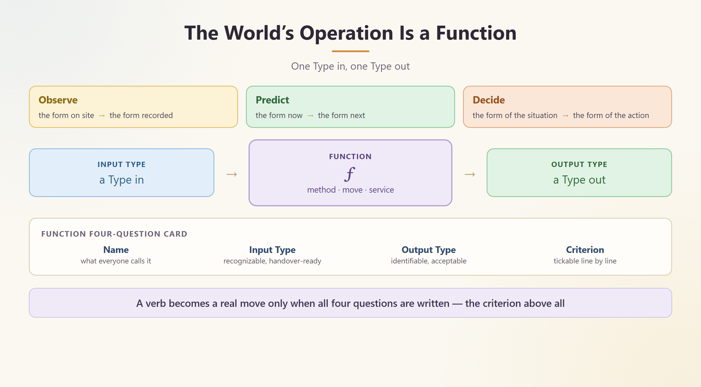

*Figure 15 · The world's operation is a function: Type in, Type out*

### 4.2 · Six Families in the World Function Library

The world's moves are countless, and they gather into six families. **Observation**: see the world clearly — search, extract, compare. **Prediction**: infer the next moment — cause to effect, effect to cause, statistics. **Simulation**: run it once in the mind — simulate, reverse, roll out. **Design**: build a new plan — design, generate, combine. **Learning**: grow more accurate with use — continuous learning, restructuring. **Decision**: choose one road and walk it — solve, plan, decide.

The six families have an order of use: observe before predicting; simulate before deciding; the learning family runs through the whole — at the end of every job, the moves used are settled back into the function library. The question in Part Seven, "did I choose the right move?", asks exactly whether the move you picked from these six families fits the situation.

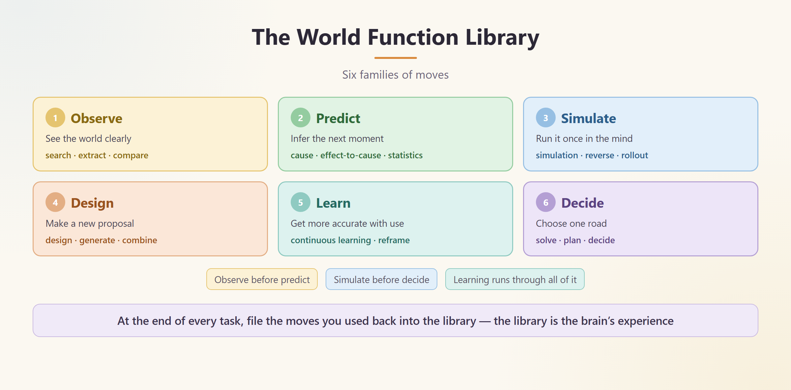

*Figure 16 · The World Function Library: six families of moves*

### 4.3 · State Transition and the Causal Chain

How is the world's time written down? As a **state transition**: every moment of the world is a state Type, and time is the relay of Types — S0 hands the baton to S1, S1 to S2, and the hand that passes it is the function f. The dry road surface in the morning (S0) is handed on by the *weather function* to the afternoon's dark clouds (S1), and again to the evening's downpour (S2) — every leg is "input a Type, output a Type".

Causality is the sense of direction along this chain. **Cause forward**: from cause to effect — dark clouds gather, so a downpour is coming; used for prediction and rollout. **Effect backward**: from effect to cause — water pools on the road, so the drainage is blocked; used for diagnosis and root cause. One forward, one backward: two keys opening two doors of the world. When the brain of the world model meets a problem, it first asks about direction: do I want "what happens next", or "why did it become this way"?

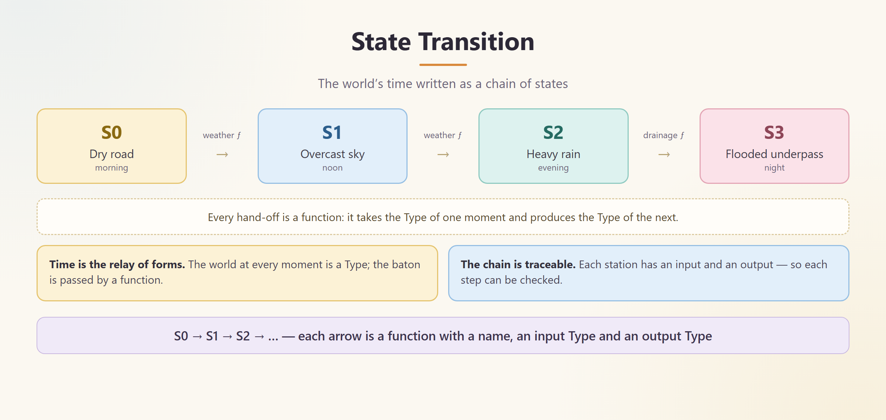

*Figure 17 · The world's time: a chain of state transitions*

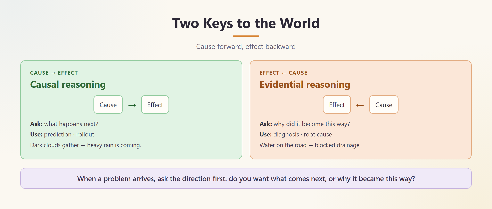

*Figure 18 · Two keys to reasoning: cause and effect*

### 4.4 · The Dynamics of Five Domains Side by Side

The function notation is equally valid across domains. The parabola of physics: initial speed and angle go in, the landing point comes out. Photosynthesis in biology: light, water and carbon dioxide go in, nutrients come out. Syntactic generation in language: meaning goes in, a sentence comes out. Function execution in software: the input Type goes in, the output Type comes out. A leave request in an organization: the application goes in, the approval comes out.

Five domains, five sets of mechanisms, one sentence of notation — input a Type, output a Type. This is the unifying power of the Time Type: cross-domain *practice* is first unified at the level of form, and only then can reasoning be borrowed across domains — Part Four's forms and Part Five's reasoning both return to this point.

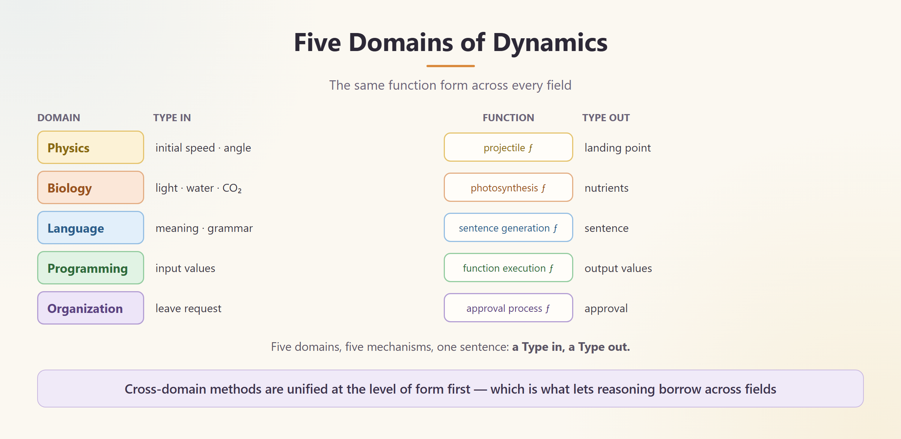

*Figure 19 · Five domains of dynamics: what the world's moves look like*

### 4.5 · Simulation and Counterfactual

The moment the brain most resembles a brain is when "nothing has happened yet, and it has already walked through it in the mind". That is **simulation reasoning**: start from the state Type of this moment and roll several paths forward a few steps each — what if the green-light timing were changed; what if it were kept; what if only the route were adjusted. Roll them all out, compare, then choose one.

The key to the counterfactual is that **nothing lands**: every path in the rollout is a provisional Type, until the criterion is ticked and the decision is fixed — only then does one path become reality. Here the spirit of the open slot in the criterion T = (F(T), ∩(T)) is needed: the Types in a rollout must leave an open slot for new evidence; when the traffic changes, the rollout must be run again. A rollout is not a guess: every road is written as a Type, paired with a criterion, and only then chosen.

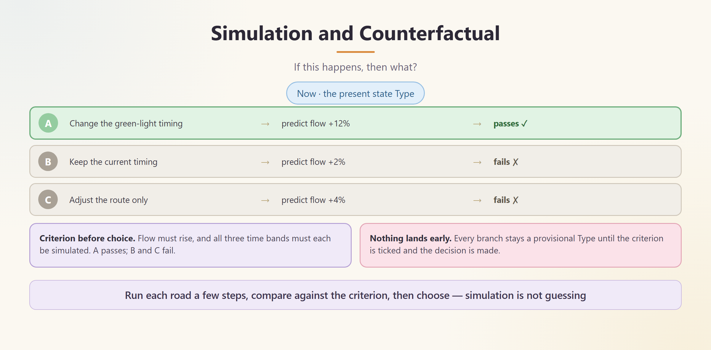

*Figure 20 · Simulation and counterfactual: if this, then what?*

> **Professional Note C5 · Type in, Type out and state space**
>
> - Writing the world as states and operations as transition functions is precisely the shared skeleton of cybernetics and reinforcement learning: a transition function eats the current state and emits the next; a rollout is a relay of transitions. Ontypology's increment is to give every state and transition a **registered identity** — input Type and output Type written clearly, so that every station in the rollout can be reviewed, not merely a string of latent vectors.
> - There are two practical benefits. First, **handover**: engineer and domain expert converse in the same set of forms. Second, **review**: every step of the rollout path can be ticked, the decision has a clear provenance, and only then is a counterfactual really refutable.

> **Example · The four-question function card for city traffic lights**
>
> - **Name:** signal tuning (a design function).
> - **Input Type:** {intersection, traffic flow, (signal regime), [urban district]}.
> - **Output Type:** {new signal plan, predicted flow speed, [plan]}.
> - **Criterion:** the predicted improvement in flow speed is quantifiable; each of the three time bands is simulated once; a plan missing any band is not accepted.

> **Exercise W08 · Write a four-question function card for one action**
>
> - Choose an action you do every day at work but cannot quite explain (a meeting, an inspection, answering a complaint). Write all four questions of the function — the criterion must be written so that it can be ticked sentence by sentence.
> - **Check when done:** with only the card and no questions to you, can a colleague perform exactly the same action?

> **Exercise W09 · Draw a state-transition chain**
>
> - Think of something in progress (a reporting process, a project, a production line). Draw at least three state Types and mark the transition function and direction of each leg.
> - **Check when done:** is every leg really "input a Type, output a Type"? Is there a leg whose input you cannot actually state?

> **Exercise W10 · Run one counterfactual rollout**
>
> - Take the chain from W09 and choose one node for three "what if..." branches: roll each two steps forward, write one line of predicted result and one criterion for each, then choose one and write down why.
> - **Check when done:** is the criterion for the road you chose tickable? If not, rewrite the criterion and choose again.

> **Part Four · Key points**
>
> - **The world's operation is a function:** input a Type, output a Type — a verb takes form only when all four questions are written.
> - **Six families in the function library:** observe · predict · simulate · design · learn · decide — observe before deciding, search before inventing.
> - **State transition:** every moment is a Type and time is their relay; cause forward predicts, effect backward diagnoses.
> - **Five domains, one notation:** physics · biology · language · software · organization — the function form stays the same line.
> - **Simulation and counterfactual:** roll several roads a few steps, keep an open slot for new evidence, and land only when the criterion is ticked.

## Part Five · How the Brain Judges: Reasoning and Thinking

> **Reading guide · what this part says**
>
> The forms are standing and the functions are hung; now the brain starts to turn. Three-layer judgment governs right and wrong; five reasoning families govern which move to make; thinking methods govern which road to take. Finally the whole flow is rolled out once on a city traffic light — from "it feels jammed" to "checkable accuracy".
>
> How to read: 5.1 judgment → 5.2 reasoning → 5.3 choosing a road → 5.4 the whole run; exercises W11–W13.

### 5.1 · How the Three-Layer Judgment Works

Judgment is not a feeling; it is a relay of three gates. Take "a bridge" through the hall. The **container gate** asks first: which bridge is this? Answer: the id does not change; ten years later the A3 bridge is still itself, and only when the identity can be written is it recognized. The **BOM gate** asks next: are the parts all present? Answer: piers, deck and cables are all there; without cables it is not a suspension bridge, and only when the remove test has been passed are the parts complete. The **abstraction gate** asks last: which class does it belong to? Answer: its function is to carry traffic, and its criterion intersection matches "transport infrastructure"; only then is it judged into this class.

Each gate has its purpose in a world model. The container gate is responsible for **tracking the same thing** — the world changes, the identity does not. The BOM gate is responsible for **structural integrity** — any rollout from an incomplete object is sent back. The abstraction gate is responsible for **classification and prediction** — the same class shares the same criterion, and only then does prediction have a basis. When all three gates are passed, the judgment about this bridge counts.

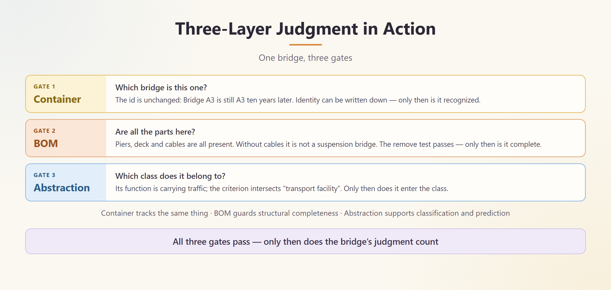

*Figure 21 · How the three-layer judgment runs inside a world model*

### 5.2 · The Five Families of Reasoning

The brain makes its moves through five families of reasoning. **Causal reasoning** — from cause to effect, predicting the next moment. **Effect-to-cause reasoning** — from effect back to cause, diagnosing the root. **Simulation reasoning** — running it once in the mind, rolling out scenarios. **Statistical reasoning** — from numbers to tendency, reading distributions and trends. **Reverse reasoning** — working back from the goal, planning a path.

The five are not mutually exclusive options; they are teammates in a relay. To diagnose a problem: first use effect-to-cause to find the root, then cause-to-effect to check what happens once it is fixed, and statistics when you need to know whether it is typical. To plan a road: first work back from the goal to milestones, then simulate the walk twice. Before choosing a family, ask yourself which direction you need: toward the future, or toward the past?

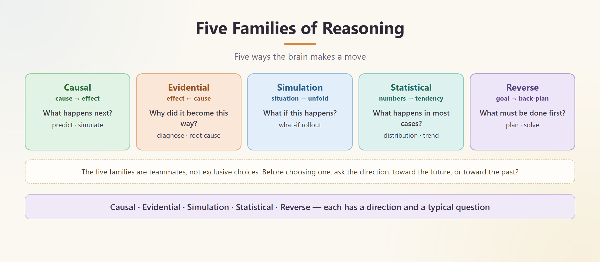

*Figure 22 · The brain's five families of reasoning*

| **Family** | **Direction** | **Typical question** | **Use in a world model** |
| --- | --- | --- | --- |
| Causal | cause → effect | What happens next? | Prediction · rollout |
| Effect-to-cause | effect ← cause | Why did it become this way? | Diagnosis · root cause |
| Simulation | situation → unfold | What if this were so? | What-if rollout |
| Statistical | numbers → tendency | What holds in most cases? | Distribution · trend |
| Reverse | goal → work back | What must be done first to get there? | Planning · problem solving |

### 5.3 · Choosing a Road with Thinking Methods

Reasoning is walking; a thinking method is choosing which road to walk. When information is complete, take **forward thinking** — step by step to the answer. When you have walked into a dead end, switch to **reverse thinking** — work back from the conclusion. When homogenization is hitting a wall, use **lateral thinking** — jump elsewhere and borrow a form. When there is a root beneath the surface, use **vertical thinking** — dig down layer by layer. When there is nothing ready-made and you start from zero, go to **first principles** — return to the most basic forms and rebuild.

There are two disciplines in choosing a road. First, **the choice must be explained**: "I just felt like thinking this way" does not count; write the form at the entrance — what the task's form looks like, such that it deserves this road. Second, **choosing a road is not walking it**: the thinking method only selects a direction; the actual advance still depends on reasoning, step by step. The routing tree in this part and the question "did I choose the right move?" in Part Seven are the operational versions of these two disciplines.

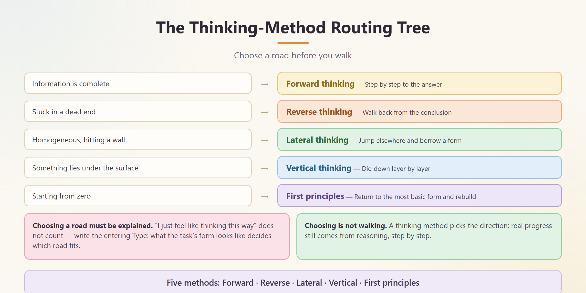

*Figure 23 · The thinking-method routing tree*

### 5.4 · The Full Rollout: Tuning a City's Traffic Lights

Now string the first five parts into one complete operation. Situation: the intersection jams at every peak, and citizens are complaining. **Understand** — the brain first recognizes "this is a queuing and bottleneck problem". **Form** — the intersection is written as {lanes, traffic flow, (signal regime), [intersection]}, with a scale on every dimension (flow = vehicles per fifteen minutes). **Function** — set up the prediction function "the form of the signal regime goes in, the form of flow speed comes out". **Rollout** — roll three roads forward a few steps each: A, change the green-light timing; B, keep the current regime; C, adjust only the routes.

**Judge** — the output Type of every road passes the three-layer check and its criterion is ticked: how much flow speed improves, with each of the three time bands simulated once. **Decide** — A passes the criterion, B and C do not; take A, and file the Types from this rollout into the form library — next time a similar intersection is met, search first and invent second. Six steps done, the world model has moved from "it feels jammed" to "checkable accuracy".

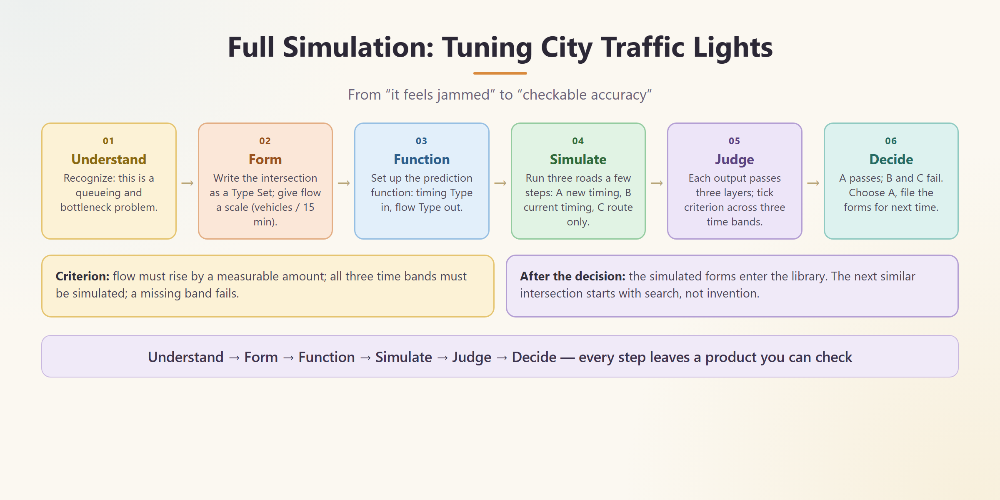

*Figure 24 · The full rollout: tuning a city's traffic lights*

> **Professional Note C6 · Memory and continuous learning**
>
> - The difference between a brain and a search engine lies in how memory is used. A search engine starts from zero every time; a brain settles every act of cognition into a form — the form library is the body of memory, and the function library is the body of experience. Continuous learning in a world model therefore has a concrete address: not "the parameters were updated again", but "the form library grew thicker and the criteria grew more accurate".
> - There are three handles in practice. **The end-of-job routine**: every task records the moves it used as a card. **Same-class comparison**: similar cards are periodically laid side by side to extract the common form. **Version upgrade**: forms and functions both have v1, v2 — more accurate with use, and every version traceable.

> **Exercise W11 · Take one thing through the three gates**
>
> - Choose a scene at work where you must "recognize the same thing" (the same machine, the same customer, the same contract) and write the question and the answer for each of the three gates.
> - **Check when done:** if you look at your three-gate record three months from now, can you still recognize the same thing?

> **Exercise W12 · Choose a reasoning family**
>
> - Take a real problem — ideally one you are stuck on now — and decide which family of reasoning it needs: toward the future or toward the past? A trial walk or a reverse plan? Write down your choice and one sentence of reason.
> - **Check when done:** roll three lines out with another family — if the conclusion differs, whose assumptions are steadier?

> **Exercise W13 · Choose a thinking method and walk three steps**
>
> - Following the routing tree in 5.3, choose a thinking-method road for the problem in W12 — write the form at the entrance (what the task's form looks like) — then actually walk out three steps of reasoning.
> - **Check when done:** did you choose a road without walking it? Have the three steps of reasoning been written out?

> **Part Five · Key points**
>
> - **Three-layer judgment:** the container gate tracks identity, the BOM gate guards structure, the abstraction gate governs classification — a relay of three, each tickable.
> - **Five families of reasoning:** causal · effect-to-cause · simulation · statistical · reverse — ask the direction first (future or past), then choose the family.
> - **Five thinking methods:** forward · reverse · lateral · vertical · first principles — the choice must be explained, the walking is done by reasoning.
> - **Six steps of full rollout:** understand → form → function → rollout → judge → decide — every step has a checkable output.
> - **Memory is the form library:** record cards at the end of a job, compare same-class cards, upgrade versions — more accurate with use, and traceable.

## Part Six · The Accurate Method: What Counts as Accurate Use

> **Reading guide · what this part says**
>
> This part is the heart of the book: the Accurate Method. Four tools — three supplements (writing the four questions in full), the six-step proof (reviewing the operation), the eight-question check (acceptance before going live), and the full contrast of misuses (avoiding the pits). Finally the whole toolkit is strung into one complete demonstration.
>
> How to read: 6.1 the definition → 6.2–6.4 the tools → 6.5 avoiding misuse → 6.6 the demonstration; exercises A01–A04.

### 6.1 · The Definition of Accurate: Checkable Accuracy

What is accuracy? There is only one definition: **checkable accuracy** — the reader can tick it sentence by sentence and reproduce your reasoning. Not "I think it is right", not "the model says it is right", but "open the record, and anyone who walks it once arrives at the same conclusion". Every judgment, every rollout, every output of a world model must be closed out against this standard.

The Accurate Method stands on a three-layer architecture. **Body** — Space Type raises the form and answers "what it is". **Use** — Time Type raises the function and answers "what it will do". **Accuracy** — the Accurate Method raises the review and answers "what counts". Without body, the method has nothing to attach to; without use, the form stands still; without accuracy, nothing can be reviewed.

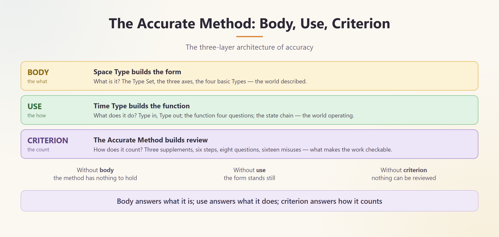

*Figure 25 · The Accurate Method: body, use, criterion*

### 6.2 · The Three Supplements

When the four-question function card is incomplete, do not force it — fill it along the three axes. Criterion unclear? Use the **[ ] rule supplement**: write the criterion down to dimensions and scales — "the effect should be good" does not count, "each of three indicators reaches a given score" does. Input Type unrecognizable? Use the **( ) identity supplement**: write the container's identity clearly — who the object is, what the id is. Output Type's parts unclear? Use the **{ } structure supplement**: list the parts — what the output is made of, and whether it survives a missing part.

The three supplements correspond one-to-one to the three axes, with no confusion: the rule supplement fills attributes, the identity supplement fills the container, the structure supplement fills composition. Each also has its own checkpoint question: can the criterion be ticked sentence by sentence? Can the input Type be recognized and handed over? Can the output Type be identified and accepted? When all three questions say yes, the card is complete.

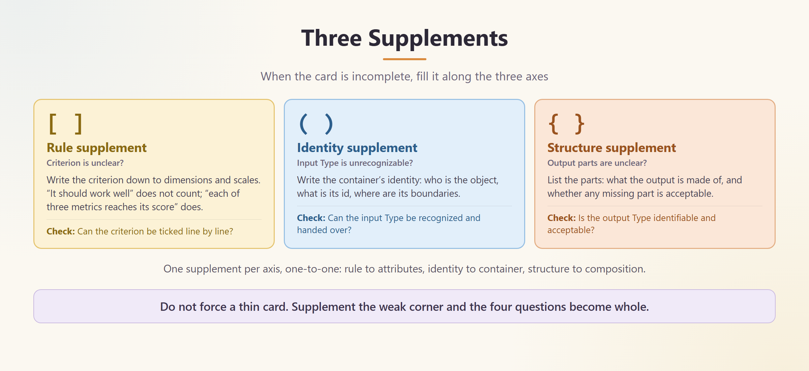

*Figure 26 · The three supplements: when the card is incomplete, fill it along the three axes*

### 6.3 · The Six-Step Proof

The card is written and the operation is done — how do you review it? Walk the **six-step proof**. **Identify the whole** — write the task's form: goal, constraints and setting, one by one. **Describe along the axes** — open the task along three axes: which attributes [ ] are wanted, which parts { } are wanted, which container ( ) it sits in. **Write the Type Set** — one line for the input Type and one for the output Type. **Choose the proposition** — pick the function, the pattern, the thinking method. **Reason against the criterion** — execute and tick step by step, so the reasoning can be reproduced. **Three-layer check** — the output Type passes the container, BOM and abstraction gates.

Every one of the six steps has an output: the task's form, the three-axis description table, the two lines of Type in and Type out, the chosen move, the criterion checklist, and the reviewable result. Lay out these six outputs and a reader can tick them sentence by sentence and reproduce your operation. The six steps raise the form on the spatial side, the function on the temporal side, and the rollout on the world-model side — the notation is universal.

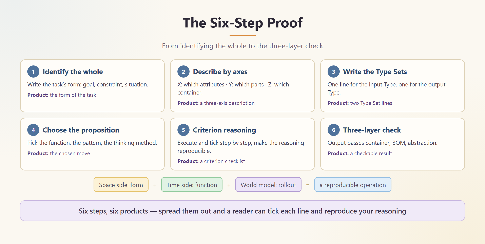

*Figure 27 · The six-step proof: from identifying the whole to the three-layer check*

### 6.4 · The Eight-Question Checklist

Six steps done — the final acceptance: the **eight-question check**. Four questions before going live: is the name right? Is the input Type recognizable? Can the output Type be handed over? Is the criterion tickable? Four questions after going live: was the right move chosen? Did it pass the three-layer check? Is the process reviewable? Has the output become a new form?

The value of the eight questions lies in "what if it fails" — every question comes with a way back. If the criterion cannot be ticked, use the **[ ] rule supplement**. If the output's provenance is unclear, return to the three-layer check, correct it, and state which layer it stuck at. Only when all eight are passed has the verb "accurately" completed a task. The eight questions can be printed and pinned up in the workspace: before closing out any important action, finish all eight ticks.

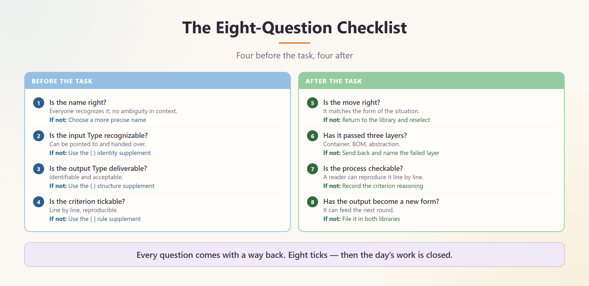

*Figure 28 · The eight-question checklist*

| **#** | **Question** | **What it checks** | **If it fails** |
| --- | --- | --- | --- |
| 1 | Is the name right? | Everyone recognizes it; no confusion of context | Choose a more precise name |
| 2 | Is the input Type recognizable? | Can be identified and handed over | Use the ( ) identity supplement |
| 3 | Can the output Type be handed over? | Identifiable and acceptable | Use the { } structure supplement |
| 4 | Is the criterion tickable? | Ticked sentence by sentence; reviewable | Use the [ ] rule supplement |
| 5 | Was the right move chosen? | Matches the form of the situation | Return to the function library and choose again |
| 6 | Did it pass the three-layer check? | Container · BOM · abstraction | Send back to correct, and state which layer |
| 7 | Is the process reviewable? | The reader can reproduce it sentence by sentence | Add the missing criterion reasoning |
| 8 | Has the output become a new form? | Can feed the next round | File it into the form and function libraries |

### 6.5 · The Full Contrast of Misuses

Misuse is the shadow of method — where there is a method there is a shadow, and once the shadow is laid out in the open you will not step into it. Sixteen misuses on four sides gather into one large table: five on the spatial side, five on the verb side, three on the pattern side, three on the thinking-method side. Their common root is one: **the level was not written clearly**.

How to read the table: first find your likely pit by side, then copy the "correct notation" directly. In world-model practice the most common pits are the five on the verb side — "reporting only the name, not the four questions", "an unverifiable criterion" and "output that skips the three-layer check" are the source of almost every rollout that goes off the rails.

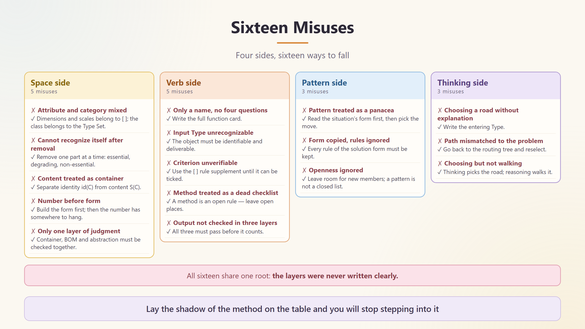

*Figure 29 · The full contrast of misuses: four sides, sixteen kinds*

| **Side** | **Common misuse** | **What is wrong** | **Correct notation** |
| --- | --- | --- | --- |
| Spatial | Mixing attributes with category | [ ] dimension and scale ≠ [category] | Dimensions go to attributes; category goes to the Type Set |
| Spatial | It no longer recognizes itself after removal | An essential part is removed and the form falls apart | Try removal piece by piece with the three-level remove test |
| Spatial | Treating content as the container | id(C) and S(C) are not distinguished | Separate identity from content |
| Spatial | Numbers before form | Counting before the form is established | Form first, number second |
| Spatial | Only one layer of judgment | All three are needed | Check container · BOM · abstraction together |
| Verb | Reporting only the name, not the four questions | Everyone does something different | Write all four questions of the function |
| Verb | The input Type cannot be identified | The object is vague | The input Type must be identifiable and deliverable |
| Verb | The criterion cannot be verified | "The effect should be good" cannot be ticked | Use the [ ] rule supplement until it is tickable |
| Verb | Treating the method as a dead checklist | It will not fit a new situation | A method is an open rule; keep an open slot |
| Verb | Output skips the three-layer check | The result has no clear provenance | All three layers must pass |
| Pattern | Treating a pattern as a universal cure | One pattern for every situation | Recognize the situation's form first, then choose |
| Pattern | Copying the form without keeping the rules | The shell is copied, the solution form is not | Every rule of the solution form must be kept |
| Pattern | Ignoring openness | Treated as a dead list | Keep an open slot for new members |
| Thinking | Choosing a road without explanation | "I just felt like thinking this way" | Write the form at the entrance |
| Thinking | The path does not match the problem | Using the forward road into a dead end | Choose again against the routing tree |
| Thinking | Choosing a road but not walking it | Beautiful thinking, no reasoning | Thinking chooses the road; reasoning walks it |

### 6.6 · Complete Demonstration: Writing Until It Is Reviewable

Finally, string the whole toolkit together once. Task: city traffic prediction — citizens ask "will tomorrow's peak be jammed?", and if you cannot answer, you lose their trust. First set up the form with the four questions of the function: name = city traffic prediction (a prediction function); input Type = {intersection, traffic flow, (signal regime), [urban district]}; output Type = {hotspot map, recommendations, [report]}; criterion = updated every fifteen minutes, error under ten percent is a tick.

Then fill the corners with the three supplements: [ ] write the error scale down to ten percent; ( ) give intersections with different signal regimes separate ids, so samples are not mixed; { } reject a hotspot map missing any administrative district. Next, review the whole run with the six-step proof: identify the whole (the task's form — goal, constraints, setting), describe along the axes (three axes), write the Type Sets (intersection and flow in; hotspot map and recommendation out), choose the proposition (prediction function + causal reasoning + statistical reasoning), reason against the criterion (tick time band by time band), three-layer check (the hotspot map passes container, BOM and abstraction).

Finally all eight questions pass — a traffic prediction has moved from "it feels jammed by intuition" to "checkable accuracy". This is the complete flow of the Accurate Method: four questions → supplements → six steps → three layers → eight questions — every step tickable.

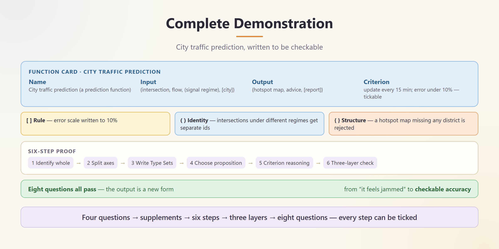

*Figure 30 · Complete demonstration: "city traffic prediction" written until reviewable*

> **Professional Note C7 · Reviewability and evaluation**
>
> - Evaluation of AI systems often stops at the metric layer: accuracy, error, pass rate. Metrics tell you *how often* it is right; reviewability tells you *why* it is right. For a world model to go live, both are needed — the metric is the health report, reviewability is the medical record.
> - Ontypology makes reviewability an operational specification: every four-question card, every six-step run, every tick of the eight questions is a landing point for evaluation. In practice you can run **review sampling**: periodically take one output and have a second person walk it again from the record. The step that cannot be walked is exactly where the criterion needs supplementing.

> **Exercise A01 · Write one action until it is reviewable**
>
> - Choose a verb at work that "runs smoothly but cannot be explained" and take it through the whole route: four-question function + three supplements + six-step proof + eight-question check.
> - **Check when done:** if you hand the card to a colleague, can they go live without asking you a third question?

> **Exercise A02 · Diagnose a misuse**
>
> - Recall the last time "the method did not run smoothly" and locate the misuse in the large table (at least two), writing one line of correction for each.
> - **Check when done:** among the sixteen misuses, which three are your "usual pits"? Write them as your private warning.

> **Exercise A03 · Eight-question acceptance for one meeting**
>
> - Take a recent meeting as the object and tick each question: name, input Type, output Type, criterion, move, three layers, reviewability, new form — and write the way back for any that fails.
> - **Check when done:** if three or more of the eight cannot be ticked, the meeting's "form" is not yet standing — return to the three supplements in 6.2.

> **Exercise A04 · Design your go-live checklist**
>
> - Turn the eight questions into a checklist specific to your role: replace each with your own language and give each a "what if it fails" line; print it or save it as a template.
> - **Check when done:** use the checklist for three tasks in a row — is the third noticeably faster and steadier?

> **Part Six · Key points**
>
> - **Accurate = checkable accuracy** — the reader can tick it sentence by sentence and reproduce your reasoning.
> - **Three supplements:** [ ] fills the criterion, ( ) fills the input identity, { } fills the output structure — do not force an incomplete card.
> - **Six-step proof:** identify the whole → describe along the axes → write the Type Sets → choose the proposition → reason against the criterion → three-layer check.
> - **Eight-question check:** four before going live and four after; every question comes with a way back.
> - **Sixteen misuses, one root — "the level was not written clearly";** the full flow: four questions → supplements → six steps → three layers → eight questions.

## Part Seven · The Complete Content Plan: Putting the World into the Brain

> **Reading guide · what this part says**
>
> The method is learned; this part lays it out as a road you can walk — the complete content plan: a blueprint for forming world knowledge, four stages of library building, a routing table for situations, and acceptance standards. The world's knowledge enters the library class by class, and the brain grows cell by cell.
>
> How to read: 7.1 the blueprint → 7.2 arrange the library → 7.3 route real situations → 7.4 set acceptance; exercises S01–S03.

### 7.1 · A Blueprint for Forming All World Knowledge

The first step in putting the world into the brain is to divide the world into classes. The blueprint gathers twelve classes of knowledge: physics, chemistry, biology, language, mathematics, software, society, economics, engineering, philosophy, experience and the tacit. The first eleven are established disciplines; the twelfth, **the tacit**, shows the most craft — a master's feel for the work, a team's unspoken understanding, a customer's intuition. These knowledges cannot be said clearly, yet they truly exist, and they too must be formed into the library cell by cell.

Every class enters the library by the same production line: **form** — write the objects of this class as Type Sets; **stand** — write the operations of this class as the four questions of a function; **set the criterion** — write the criteria of this class until they can be ticked; **file** — after passing the three-layer check, receive them into the world form library. Twelve lines run in parallel and share one notation — this is what "unified knowledge" looks like concretely inside a world model.

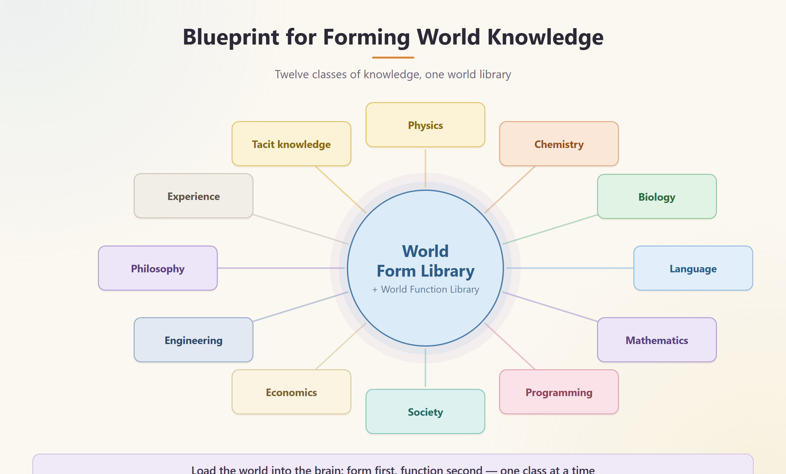

*Figure 31 · A blueprint for forming all world knowledge*

| **Class** | **Objects to form** | **Form to raise first** | **Function to raise first** |
| --- | --- | --- | --- |
| Physics · chemistry | Bridge · material · reaction | Entity · state | Mechanics and reaction functions |
| Biology | Cat · ecosystem | Entity · field | Metabolism and evolution functions |
| Language · mathematics | Sentence · proof | Relation · state | Generation and derivation functions |
| Software · engineering | Module · system | Entity · relation | Execution and design functions |
| Society · economics | Organization · market | Field · relation | Operation and decision functions |
| Philosophy · experience · tacit | Value · feel · unspoken understanding | Relation · state | Criterion and extraction functions |

### 7.2 · The Four Stages of Library Building

The world form library is not read into existence; it is grown. Four stages: **borrow, extract, stand, transform**. **Borrow** — first record the moves you have used as cards: every completed task starts with a four-question card, and a new task first searches the library for a ready-made move. **Extract** — lay same-class cards side by side and extract the common form: take three or more similar cards, ask "where are they the same, where do they differ?", and count the extraction successful only when it fits every card.

**Stand** — after repeated verification, gather the result into a pattern card: once the common form has been verified again and again, upgrade it into a move that can be hung on the wall, stating the form of the situation, the form of the solution and the criterion. **Transform** — upgrade the version at every reflection: v1, v2, v3 growing on, and old versions are never deleted — traceability is the brain's honesty. The four stages cycle, the library grows larger — this is your own and your team's method asset.

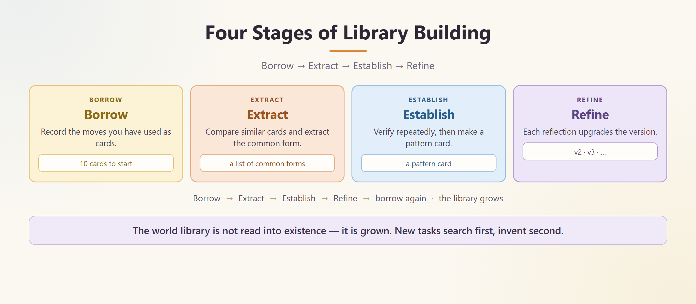

*Figure 32 · The four stages of library building: borrow → extract → stand → transform*

### 7.3 · Routing Table for Situations

The field formula is "recognize the form of the situation first, and let the three layers take their places" — for the same situation, first choose the function (which move), then the pattern (which card), then the thinking method (which road). The table below demonstrates the complete routing for three common situations; fill in your own situations by imitation, and it becomes your field manual.

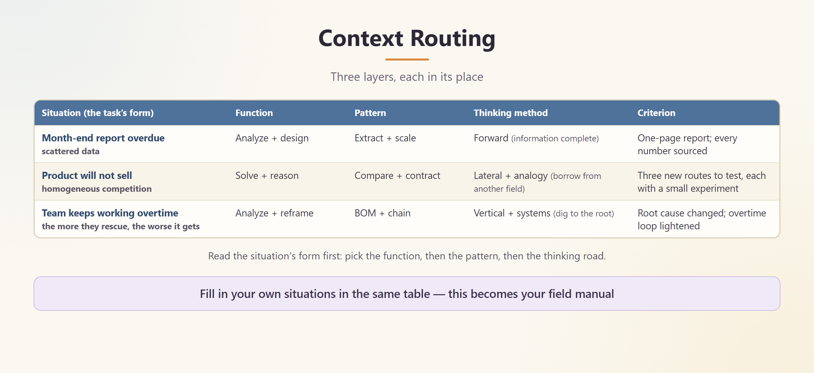

*Figure 33 · Routing table for situations: the three layers take their places*

| **Situation (task form)** | **Function** | **Move** | **Thinking method** | **Criterion** |
| --- | --- | --- | --- | --- |
| Report not ready at month end (scattered data) | Analyse + design | Extract + scale | Forward (information complete) | Report understood on one page; every number sourced |
| Product will not sell (homogeneous competition) | Solve + reason | Compare + contract | Lateral + analogy (borrow a form from another domain) | Three new paths worth trying, each with a small experiment |
| Team repeatedly working overtime (the more you rescue, the worse it gets) | Analyse + restructure | BOM + chain | Vertical + systems (dig to the root, see the whole) | Root cause changed; the overtime loop lightens |
| New business has no process (from nothing) | Generate + design | Open template + contract | Design (build a solution) | Process repeatable; criterion verifiable |
| New skill learned and forgotten | Continuous learning | Loop + form | Forward + hypothesis (raise a form, test it) | Every cycle has a checkable output; the form grows more accurate |

### 7.4 · Acceptance Standards

How well the content has been built cannot be left to feeling — set acceptance. Two gates: **all eight questions passed + the three-layer check**. The eight questions govern "was this task done accurately" — tick them at every go-live. The three-layer check governs "can this output be received" — only when container, BOM and abstraction all pass is the result received into the world form library, becoming a new form that feeds the next round.

Beyond acceptance, add an **asset inventory**: every so often, count the form cards and function cards in the library, leaf through the version-upgrade record, and pull one card for a review sample. The library is growing, accuracy is rising, errors are fewer — when all three are visible, the content plan is really running.

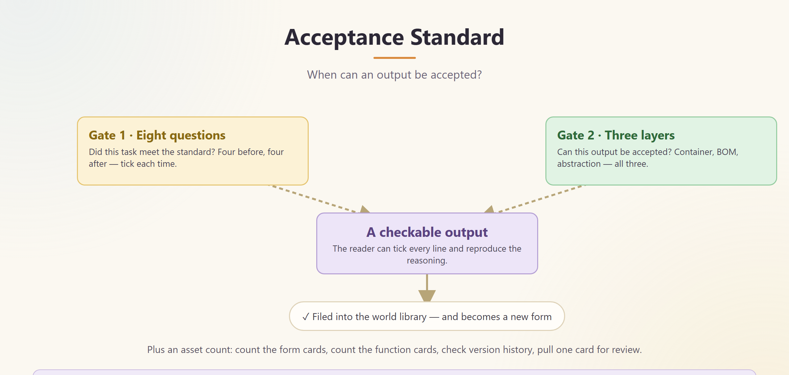

*Figure 34 · Acceptance standards: when can a result be received*

> **Exercise S01 · Route three situations**
>
> - Choose one real situation each from your work, your learning and your life, and fill in one row for each, following the table in 7.3 (function, move, thinking method, criterion).
> - **Check when done:** are the choices at the three layers consistent with one another? Is the criterion tickable?

> **Exercise S02 · Plan your four library stages**
>
> - Following the four stages in 7.2, lay out the first month of your personal form library: which ten cards to borrow, which class of common form to extract, which pattern card to stand, which old experience to transform.
> - **Check when done:** does each stage have a concrete product? (How many cards, how many list items, how many pattern cards, which version reached.)

> **Exercise S03 · Run an acceptance inventory**
>
> - Lay out all the cards you made in W01–W13 and A01–A04 and run one round of eight-question sampling + three-layer check: pull three cards for review and record which question most often fails.
> - **Check when done:** the question that most often fails is the skill to build next — write it as a one-line improvement plan.

> **Part Seven · Key points**
>
> - **The blueprint's twelve classes, one production line:** form → stand → set the criterion → file — what unified knowledge looks like concretely.
> - **Four stages of library building:** borrow (record cards) → extract (common form) → stand (pattern card) → transform (version upgrade) — the library is grown.
> - **Situation routing:** recognize the form of the situation first, and let the three layers take their places — function, move, thinking method.
> - **Two acceptance gates + an asset inventory:** all eight questions and all three layers passed before a result enters the library; growth must be visible.
> - **The output becomes a new form** — what enters the library is the ready-made move the next task searches for first.

## Part Eight · The Complete Framework Plan: Roadmap and Vision

> **Reading guide · what this part says**
>
> The content is there and the method is there; the final part lays out the *framework* as a development road: the five-stage loop Learn–Practise–Use–Teach–Build, an eight-week learning route, three stages of growth, and where this brain is going.
>
> How to read: 8.1 the five stages → 8.2 the timetable → 8.3 growth → 8.4 the vision; exercises S04–S05.

### 8.1 · The Five Stages: Learn, Practise, Use, Teach, Build

For the framework to grow, it needs a closed-loop road. **Learn** — understand forms and functions: read this book, look at the figures, and produce a note of the key points for each part. **Practise** — write concepts into cards: one concept, one exercise, producing four-question cards and move cards. **Use** — go live on real problems: walk the situation routing, producing three real cases. **Teach** — lead others in writing cards: one concept, one figure, one example, one exercise, producing a small handout (teaching is the best learning). **Build** — grow a personal form library: walk the four stages of library building, producing your form library v1.

All five stages have tickable acceptance: in **learn**, you can recite the six families of moves; in **practise**, every card's criterion is tickable; in **use**, all eight questions pass; in **teach**, the learner can write a card; in **build**, a new task searches before inventing. When the five stages are walked, the method truly belongs to you — and will keep growing.

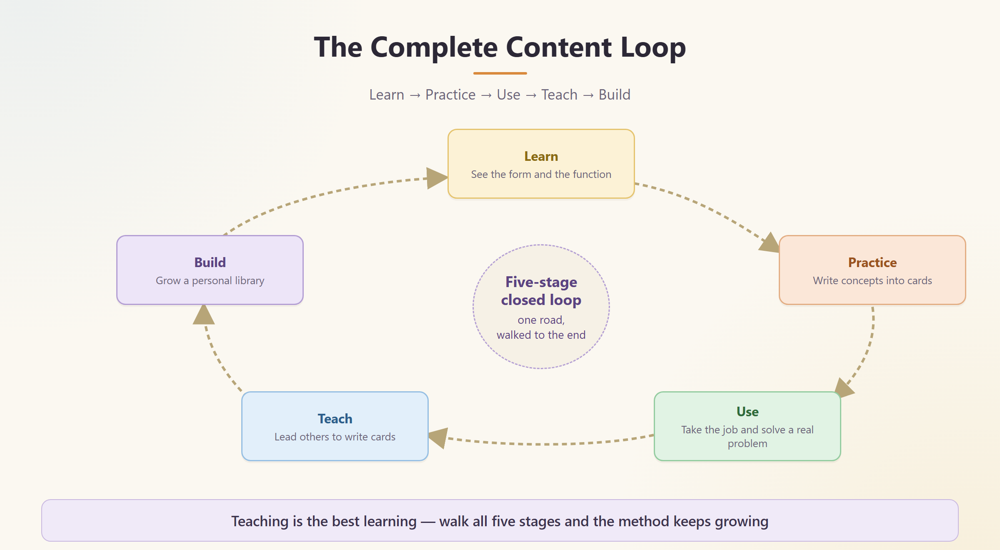

*Figure 35 · The complete content plan: learn → practise → use → teach → build*

### 8.2 · The Eight-Week Learning Route

The whole book is laid out as an eight-week route — each week, read one part, do one set of exercises, produce one card. The design principle of the rhythm is **small steps, walked quickly**: better to walk one small step each week than to read everything in week one and forget it all by week three. Readers with a foundation can compress it to four weeks (two segments a week); teachers leading a class can extend it to twelve weeks (one practical session a week).

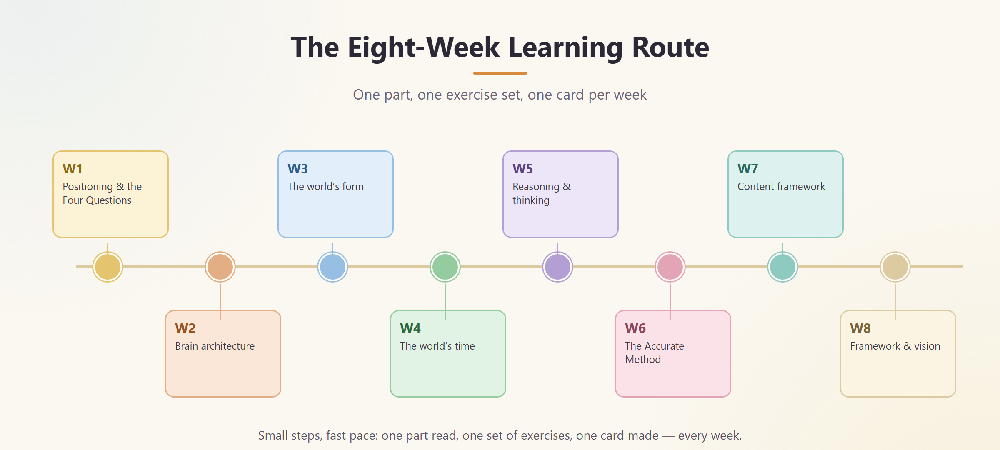

*Figure 36 · The eight-week learning route*

| **Week** | **Theme** | **Read** | **Exercises** | **Output** |
| --- | --- | --- | --- | --- |
| W1 | Positioning and the world's four questions | Part One | W01–W02 | Your first four-question card |
| W2 | The brain's architecture | Part Two | W03–W04 | Two library lists + one three-layer judgment |
| W3 | The world's form | Part Three | W05–W07 | A Type Set and a remove-test record |
| W4 | The world's time | Part Four | W08–W10 | A four-question function card + rollout branches |
| W5 | Reasoning and thinking | Part Five | W11–W13 | A routing card + a full rollout record |
| W6 | The Accurate Method | Part Six | A01–A02 | A complete, reviewable card |
| W7 | The content plan | Part Seven | A03–A04, S01–S02 | A go-live checklist + a library plan |
| W8 | The framework plan and vision | Part Eight | S03–S05 | A v1 plan for your personal form library |

### 8.3 · Three Stages of Growth

The brain of a world model is not built in a day — its growth corresponds to three great stages of artificial intelligence. **Stage one · unified knowledge**: the world form library takes shape — cross-domain knowledge enters by one notation, and language, mathematics, physics and engineering speak the same language for the first time. **Stage two · unified thinking**: reasoning and thinking operate from the same library — five reasoning families, thinking-method routing and three-layer judgment relay inside one brain, and the system begins to *really think*. **Stage three · unified intelligence**: knowledge, thinking, memory, learning and creation become one — the brain not only solves the problem in front of it, but grows forms the world did not have.

The language of acceptance runs through all three stages: **checkable**. Unified knowledge is accepted as "findable"; unified thinking as "reproducible"; unified intelligence as "becoming a new form again". This road of growth is the road to AGI — this book puts the method in your hands; the road is walked one step at a time.

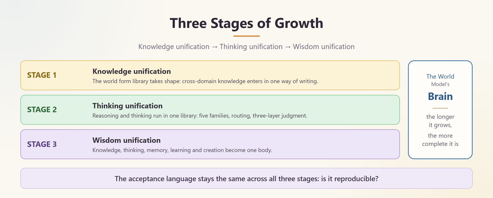

*Figure 37 · Three stages in the growth of the world-model brain*

### 8.4 · The Vision

Finally, return to the question at the beginning: why does a world model need a brain? Because the world does not only need to be described; it needs to be understood, predicted, rolled out, and responsibly changed. Let the world model grow a real brain — one that sees the form clearly, thinks the reasoning through, and uses the method accurately; from information processing toward intelligence generation.

This is the vision of this book, and the shared direction of theory and platform: see the form clearly, turn it into explicit knowledge, and put it into practice as the brain of a world model. Let artificial intelligence be more than a tool — a brain that understands, reasons, learns and creates. Where the world's four questions reach, the form is raised; where the form is raised, the world is seen clearly.

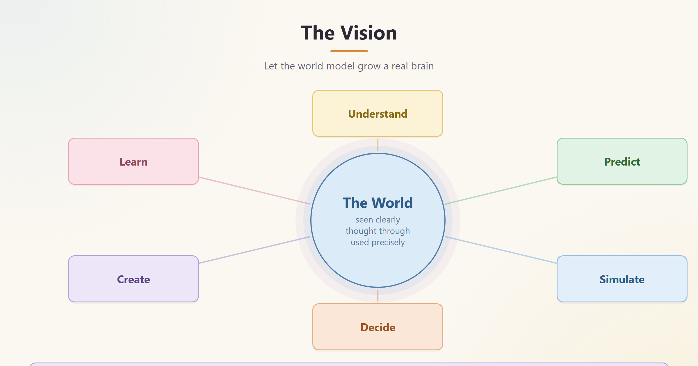

*Figure 38 · The vision: let the world model grow a real brain*

> **Professional Note C8 · From world models to AGI**
>
> - The industry usually discusses AGI from a list of capabilities: can it reason, can it plan, can it learn. Ontypology's route starts from **representation**: first let knowledge have a unified form (unified knowledge), so that thinking has a unified carrier (unified thinking), and capability has an integrated foundation (unified intelligence). The three stages are not a product roadmap but an order of acceptance — if the previous stage is not checkable, the next stage does not begin.
> - The implication for practitioners is direct: you do not have to wait for "complete AGI" to benefit. Today, let your world model write forms, stand functions, set criteria and file them — every checkable form is a brick on this long road.

> **Exercise S04 · Lay out your eight-week route**
>
> - Following the table in 8.2, lay out your own eight-week route: which part to read each week, which exercises to do, which card to produce — in a busy week, shrink the output to one card.
> - **Check when done:** at the end of eight weeks, how many cards will you have in hand? If fewer than eight, make the steps smaller.

> **Exercise S05 · Write to your library three years from now**
>
> - Imagine your personal form library v10 three years from now: which forms are collected, which moves are hung, how far have the criteria evolved? Write it as a half-page "vision statement for the library".
> - **Check when done:** can every cell in the vision start growing today? Pick the first cell and write the step you will take this week.

> **Part Eight · Key points**
>
> - **Five stages in a closed loop:** learn to see, practise by writing cards, use by going live, teach by leading others, build by growing the library — teaching is the best learning.
> - **Eight weeks, small steps:** one part, one set of exercises, one card per week; compress to four weeks, extend to twelve.
> - **Three stages of growth:** unified knowledge → unified thinking → unified intelligence — one language of acceptance throughout: checkable.
> - **Vision:** see clearly, think through, use accurately — from information processing toward intelligence generation.
> - **Where the four questions reach, the form is raised; where the form is raised, the world is seen clearly.**

## Appendix 1 · Terms and Notation at a Glance

This appendix collects the terms and notation used throughout the book for quick reference. The English word for the core Ontypology term is **Type** — one word, one meaning, used consistently throughout.

| **Term / notation** | **Read as** | **One-line definition** |
| --- | --- | --- |
| Type | type | The basic unit of cognition and description; structured, judgeable, nameable |
| Type Set | {parts, (content), [category]} | The standard one-line notation for a Type |
| [ ] attributes | square brackets | X axis: what it looks like — dimension × scale |
| { } composition | curly braces | Y axis: what it is made of — the bill of materials |
| ( ) container | round brackets | Z axis: where it sits — identity and boundary |
| C = (id(C), S(C)) | container pair | id(C) is the fixed identity; S(C) is the changing content |
| T = (F(T), ∩(T)) | abstraction criterion | Only when F(T) matches function and ∩(T) matches intersection does it belong to the class |
| remove test, three levels | part-removal test | essential ≢ M · degrading ≡ M′ ⊂ M · non-essential ≡ M |
| cognitive chain | difference → split and join → form → name | Four steps of one act of cognition; where there is composition there is form, form first and number second |
| four questions of a function | name · input Type · output Type · criterion | The standard card that gives a verb form; the criterion must be tickable |
| three-layer judgment | container · BOM · abstraction | Three gates judged together; none can be omitted |
| three supplements | [ ] rule · ( ) identity · { } structure | When the four-question card is incomplete, fill it along the three axes |
| six-step proof | identify → axes → Type Sets → proposition → reasoning → three layers | The standard flow for reviewing one operation |
| eight-question check | four before + four after | The go-live acceptance list; finish all eight ticks before closing out |
| checkable accuracy | the definition of accurate | The reader can tick it sentence by sentence and reproduce your reasoning |
| Type in, Type out | input a Type, output a Type | The standard notation for every operation |

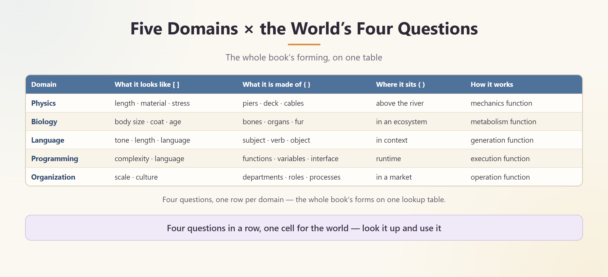

*Figure 39 · Five domains × the world's four questions: summary table*

## Appendix 2 · The Accurate Method Quick Card

This card is the pocket edition of the whole book: four questions to raise the card, three supplements to fill the corners, six steps to review, eight questions to accept. Print it and pin it up in your workspace, or save it as the template you open before every go-live.

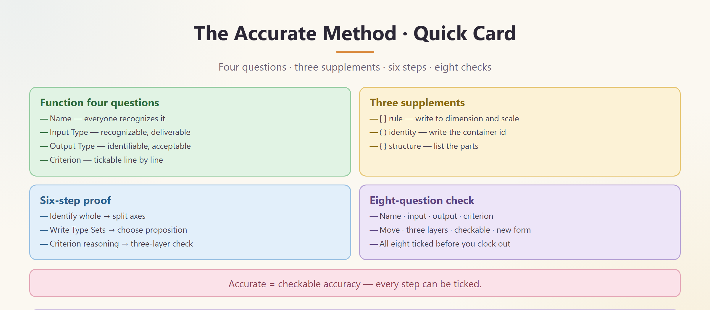

*Figure 40 · The Accurate Method: quick card*

> **The order of use — one line all the way**
>
> - **Raise the card:** the four questions of a function — name, input Type, output Type, criterion.
> - **Fill the corners:** three supplements — [ ] fills the rule, ( ) fills the identity, { } fills the structure.
> - **Review:** the six-step proof — identify the whole → describe along the axes → write the Type Sets → choose the proposition → reason against the criterion → three-layer check.
> - **Accept:** the eight-question check — name · input · output · criterion · right move · three layers · reviewable · new form.
> - **Close out:** the output becomes a new form — file it into the form and function libraries; next round, search first and invent second.

## Appendix 3 · Reference Answers to the Exercises

Below are reference answers to the twenty-two exercises. The answer is not unique; what matters is that it is **checkable** — if your answer can also be ticked sentence by sentence, it is a right answer.

> **W01 · The four questions for a coffee machine**
>
> **What does it look like?** Black, fully automatic, thirty cups a day (dimensions: colour, type, capacity — each with a scale). **What is it made of?** {grinder, boiler, brew head, (coffee beans), [appliance]}. **Where does it sit?** The one in the kitchenette; the id does not change. **How does it work?** Switch on, brew, clean, descale — each is a function. **Check:** attributes carry scales, composition can be taken apart and recognized, the id is clear.

> **W02 · The five tasks in a client presentation**
>
> A client presentation used understand (read the client's needs) → predict (guess the client's follow-up questions) → decide (fix the deck structure), and skipped simulate (rehearse it once). The missing step: try the talk out on a colleague before going on stage and rehearse the follow-up questions twice. **Check:** the five tasks are not skipped.

> **W03 · Two library lists for software operations**
>
> The form library holds "the form of a service, the form of an incident, the form of a change". The function library holds inspection (system Type in, checklist Type out), firefighting (incident Type in, recovery Type out), and post-mortem (incident Type in, improvement plan Type out). **Check:** all six lines have an identifiable example.

> **W04 · The coffee machine through three gates**
>
> Container gate — asset number CF-07; three years later it is still the same machine. BOM gate — remove the boiler and it is no longer a usable coffee machine (essential part). Abstraction gate — its function is brewing drinks and its criterion intersection matches "appliance · kitchen". **Check:** the three gates do not contradict one another — if the class is appliance, the boiler cannot be missing from the essential parts.

> **W05 · A Type Set for a monthly report**
>
> {data, narrative, (deadline), [report]}. **X** — length (within ten pages), tone (objective), timeliness (by the third of the following month). **Y** — data tables, summary, recommendations. **Z** — the October 2026 monthly report; the id does not change when the layout is revised. **Check:** a colleague can recognize the same class of object from the one line.

> **W06 · Five lines across five domains**
>
> Cup {body, handle, lid, (tea), [vessel]}; sentence {subject, verb, object, (context), [sentence]}; project {tasks, resources, milestones, (client), [project]}; ecosystem {producers, consumers, decomposers, (energy flow), [ecosystem]}; transaction {buyer, seller, subject matter, (contract), [transaction]}. **Check:** in all five lines, parts, content and category sit in the same position.

> **W07 · The remove test on a monthly report**
>
> Essential — the data (≢ M; without data it is not a monthly report). Function-degrading — the polished charts (≡ M′ ⊂ M; still valid without them, but readability degrades). Non-essential — the cover decoration (≡ M). **Check:** with all essential parts removed the form of "monthly report" has fallen apart — which means the essential parts were found correctly.

> **W08 · A four-question function card for complaint handling**
>
> Name = complaint handling (a service function). Input Type = {complaint content, evidence, (customer), [complaint]}. Output Type = {reply, compensation plan, [closure]}. Criterion = reply within forty-eight hours, the compensation plan has a clause basis, the customer confirms receipt. **Check:** a colleague can perform the same action from the card.

> **W09 · A state-transition chain for procurement**
>
> S0 requirement raised → S1 approved → S2 ordered → S3 delivered. Transition functions: application review, ordering, acceptance. Every leg has a Type in and a Type out — the approval form's Type in, the purchase order's Type out. **Check:** no leg has an input that cannot be stated.

> **W10 · Three branches at the ordering step**
>
> A, order early — earlier delivery, more inventory pressure. B, split the order — more flexibility, higher unit price. C, keep the current order — as before, with delivery-date risk. Criterion: delivery-date error under three days and unit-price increase under ten percent. Choose B, with the reason "delivery flexibility first". **Check:** choose only when the criterion is tickable.

> **W11 · Tracking the same production machine**
>
> Container gate — machine number M-12; after a major overhaul three years later it is still M-12. BOM gate — spindle, motor and controller are essential parts. Abstraction gate — its function is cutting and it belongs to the class "CNC lathe". **Check:** from the record alone, M-12 is still recognizable three months later.

> **W12 · Repeated customer complaints**
>
> Look to the past for the root cause — choose effect-to-cause reasoning. Reason: "why did it become this way" must be answered before prediction. Trying three lines of causal reasoning yields the prediction "it will happen again", but the assumption (the root cause remains) is less stable — so effect-to-cause comes first. **Check:** the direction and the reason are written down.

> **W13 · Three steps of vertical thinking**
>
> The form at the entrance = "a recurring defect, with complete data" → choose vertical thinking. Three steps: first, dig down to "the reply template was not updated"; second, dig further to "the new product line reused the old template"; third, locate "no version control on templates". **Check:** the three steps of reasoning are written out — not just the road chosen.

> **A01 · Lesson preparation written until reviewable**
>
> Four questions — name = lesson preparation (a design function). Input Type = {materials, learner level, (hours), [course]}. Output Type = {lesson plan, exercises, [syllabus]}. Criterion = one segment every forty minutes; each segment has one figure, one example, one exercise. Supplements — [ ] write the criterion down to minutes and item counts; ( ) separate class ids; { } reject a lesson plan with no exercise. After the six steps and eight questions, hand it to a colleague to teach. **Check:** the colleague goes live without a third question.

> **A02 · Diagnosing two common misuses**
>
> "The criterion cannot be verified" (writing "do it a bit better" as a criterion) and "the output skips the three-layer check" (handing it over and calling it done). One line of correction each: rewrite the criterion as a tickable scale; run the three-layer check before handing over. Private warning: "write the form before you start; tick the boxes before you close."

> **A03 · Eight-question acceptance for a weekly meeting**
>
> Name ✓ (weekly meeting). Input Type ✓ (each team's progress form). Output Type ✗ (the resolution has no owner). Criterion ✓ (every agenda item reaches a conclusion). Move ✓. Three layers ✗ (the resolution did not pass the BOM gate). Reviewable ✓. New form ✗ (the minutes were not filed). Way back: the { } structure supplement — reject a resolution without an owner. **Check:** three or more failures = the form is not standing; supplement first.

> **A04 · The eight questions for a project manager**
>
> Is the requirement right? Is the scope recognizable? Can the deliverable be handed over? Is acceptance tickable? Is the route right? Has the risk passed the three gates? Is the provenance traceable? Has the experience entered the library? Give each a way back. **Check:** the third task is noticeably faster — the checklist is working.

> **S01 · Routing a cross-department failure**
>
> Function = analyse + design. Move = chain + contract. Thinking method = vertical (dig to the root). Criterion = every handover point has an owner; the failure rate falls measurably. **Check:** the three layers are consistent and the criterion is tickable.

> **S02 · A one-month library plan**
>
> Borrow — ten four-question function cards (two or three a week from this week). Extract — the common form of "communication" (extract at month end). Stand — a pattern card for "meeting resolutions" (hang it on the wall after three verifications). Transform — upgrade last year's "runaway project" experience to v2. **Check:** each stage has a product and a number.

> **S03 · A sample acceptance run**
>
> Pull cards W05, W08 and A01 through the eight questions — the one that most often fails is "can the output Type be handed over?" One-line improvement plan: whenever you write an output Type, also write "who accepts it, and how". **Check:** the most frequent failure has been found.

> **S04 · An eight-week route for busy weeks**
>
> The busy version — read only one part and produce only one card each week; at the end of eight weeks you hold eight cards, just about a small form library. **Check:** eight or more, the route is feasible; fewer than eight, shrink the step.

> **S05 · A half-page vision for the library**
>
> The v10 library holds three thousand forms, three hundred move cards, and criteria upgraded three times on average. The first cell is "record one card every day" — start this week. **Check:** the first cell is concrete enough to do this week.

## Closing · After You Close the Book

Where the world's four questions reach, the form is raised; where the form is raised, the world is seen clearly. See the form clearly, turn it into explicit knowledge, and put it into practice as the brain of a world model — this road begins the moment you write your first four-question card.
