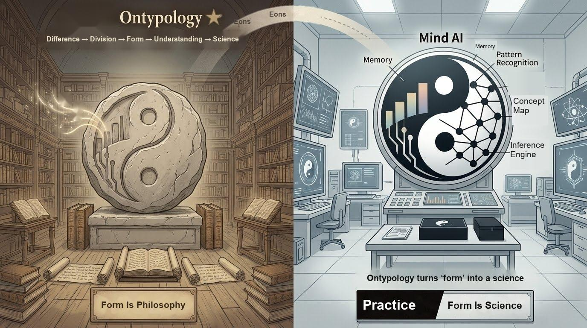

# :star: Ontypology :star:

  <a href="https://github.com/mindaiworks/.github/blob/main/profile/README.en.md">🏠 Home</a> ｜ 
  <a href="https://github.com/mindaiworks/Paper"> 📖 Mind AI</a>

From difference and similarity, to division and combination; from division and combination to form; from form to understanding — the brain has traveled this path for billions of years.

Logic was philosophy a century ago; once seen clearly, it became a manifest discipline (science).

Today, exploring "form" (a concept of the brain) is philosophy. Ontypology turns "form" into a clear, manifest discipline (science) and puts it into practice as Mind AI.

Ontypology = Ont (being) + Typology (types)

Fei-Fei Li: The Explosion of the Digital Cambrian

She describes how, in the distant Cambrian period, everything was pitch-black. A trilobite-like creature was the first to perceive light; after perceiving light, it developed a nervous system, followed by "understanding and thinking," and finally execution. This is the law of biological development.

----------------------------------------

# Space Type

-----------------------------------------------

## [Introduction (Space Type)](Ontypology-SpaceType)

## [Type Number](Ontypology-SpaceType/1.TypeNumber)

## [Unit Type Set Logic](Ontypology-SpaceType/3.UnitTypeSetLogic)
 
## [Space FrameWork](Ontypology-SpaceType/SpaceFramework)

## [Mathematical Proof](Ontypology-SpaceType/5.MathematicalProof)

## [Type Set Expression](Ontypology-SpaceType/TypeSetExpression)

## [RDB Relation to Type](Ontypology-SpaceType/RDBRelationToType)

-----------------------------------------------

# System

## [Mind AI](https://github.com/mindaiworks/Paper)

## [Knowledge Graph Bill of Materials](https://github.com/mindaiworks/Paper/tree/main/Knowledge%20Graph%20Bom)

## [LLM vs Mind Model (Physical AI, Industrial-Grade AI, World Model)](https://github.com/mindaiworks/Paper/tree/main/MindAI/LLM%20vs%20Mind%20Model)

## [Mind RAG](Ontypology/MindRAG)

# Theoretical Application

## [Ontology × Ontypology](Ontypology/OntologyAndOntypology)

## [Dependent Type × Lean](Ontypology/DependentTypeLean)

## [Palantir & Mind AI](Applications/PalantirAndMindAI)

## [Insufficiency of Knowledge Graphs](Applications/InsufficiencyofKnowledgeGraphs)

## [Liquid Neural Networks and Ontypology](Ontypology/LiquidNeuralNetworksAndOntypology)

## [Physical Proof](Ontypology/PhysicalProof)

## [Chemical Proof](Ontypology/ChemicalProof)

## [Mathematical Modeling](Ontypology/MathematicalModeling)

-----------------------------------------------

# Model Application

## [VLA and Mind AI](Applications/VLA&Mind_AI)

## [Brain of the World Model 1](Applications/WorldModel)

## [Brain of the World Model 2](Ontypology/WorldModelBrain)

-----------------------------------------------

# Business Applications

## [AI TCM Consultation and Prescription](Applications/AITCMConsultationAndPrescription)

## [AI Western Medicine Consultation and Prescription](Applications/AIWesternMedicineConsultation)

## [AI Biological Experiment Brain](Applications/AIBioLabBrain)

## [AI Drug Discovery Brain](Applications/AIDrugRDBrain)

## [AI Gene Discovery Brain](Applications/AIGeneRDBrain)

## [Genome-Wide Association Study (GWAS) × Mind AI](Applications/GWASAndMindAI)

----------------------------------------

## [AI Drone Brain](Applications/AIDroneBrain)

## [IC Design Brain](Applications/ICDesignBrain)

## [Mechanical Design and PLM](Applications/AIMechanicalDesignAndPlm)

## [Wargames Brain](Applications/AIWargameBrain)

## [AI Enterprise Information System Integration](Applications/AIEnterpriseSystemIntegration)

## [AI Information Security](Applications/AICybersecurity)

----------------------------------------

## Contact Information
Chang-Feng Chang gamma@livemail.tw

Ting-Ying Chang mindaiworks@gmail.com

## www.longreat.net

  

