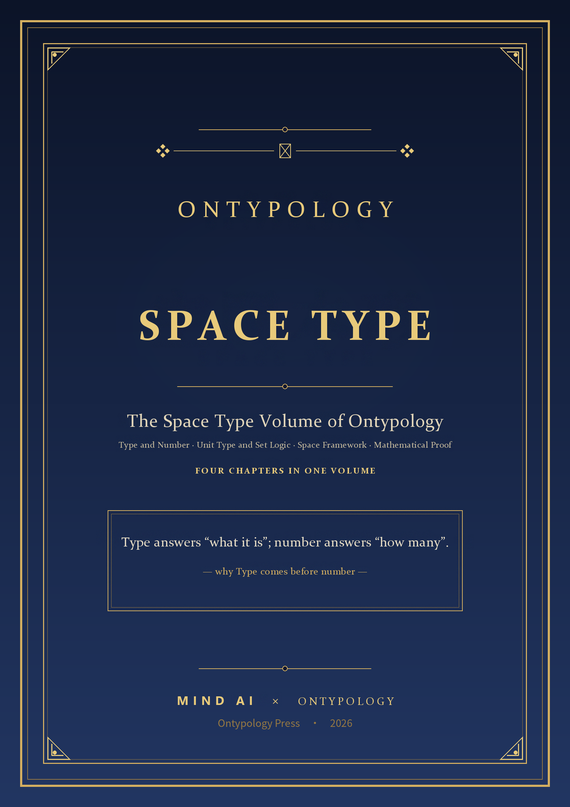
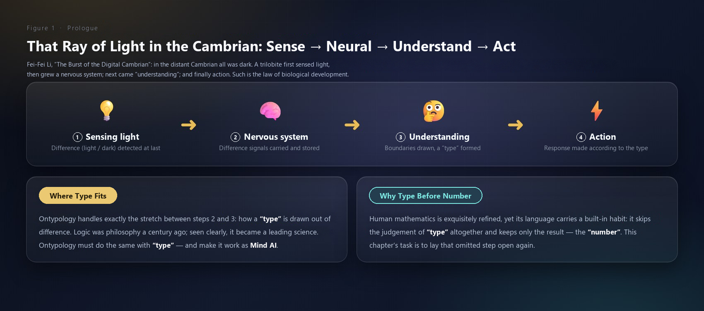

# Space Type INTRODUCTION

> *"Type answers 'what it is'; number answers 'how many'."*
>
> This book is the Ontypology volume on Space Type. Its four chapters form one unbroken chain: first we prove that Type comes before number; then we build a structure in which a Type can be notated; then we fix the derivation into a repeatable method; finally we write description and judgement as a proof anyone can check.

## The Four Chapters at a Glance

| Ch. | Theme | In One Line |
| --- | --- | --- |
| Chapter 1 | Type and Number | Type first, number second — number hides inside Type; cognition begins with difference |
| Chapter 2 | Unit Type and Set Logic | Three axes, three brackets — a complete toolkit for describing, notating and judging |
| Chapter 3 | Space Framework | Fixing a single derivation into a method you can reuse |
| Chapter 4 | Mathematical Proof | A supplement from set theory — making "accurate" mean "checkable" |

## Reading Routes

| Starter route Ch. 1 → Ch. 3 Build the intuition that Type comes before number, then see how the framework works. | Main route Ch. 1 → Ch. 2 → Ch. 4 Follow the three axes and brackets down to a proof you can write and check. |
| --- | --- |
| Applied route Ch. 2 → Ch. 3 Take the Type Set notation and the four steps into your field: describe, classify, judge. | Toolkit route Ch. 2 → Ch. 4 Go straight for the criteria and proof tools: property, BOM, container, six proof steps. |

## Chapter 1 Type and Number — Why Type Comes First

*Every joining yields a Type; number = a smaller Type inside a Type · compared again.*

*Figure 1-1 The Cambrian chain of cognition: sense → nerve → understand → act*

Cognition begins with sameness and difference: only where there is difference can the brain draw a boundary; and the moment a boundary closes, a Type is born — and a Type always has a name. A thought experiment pushes this chain to its limit — in a one-dimensional world, the first Type a single sensor recognises is in fact a boolean value. To count, things must first be joined into one unit: 3 + 2 = 5 holds because an apple and a peach have both been judged to be "fruit". Mathematics keeps this premise hidden; this chapter brings it into the open — first comes Type, then number.

> **Chapter Highlights**
>
> - Sameness / difference → split / join → Type → name: the first chain of cognition
> - No difference, no Type: a Type is a boundary that has been drawn
> - Every joining yields a Type: the act of joining necessarily produces a new Type
> - 3 + 2 = 5 has an invisible premise: only the same Type can be added

## Chapter 2 Unit Type and Set Logic — Three Axes, Three Brackets

*One Type = property [ ] + composition { } + container ( ).*

*Figure 2-1 Chapter image · the axis of property — dimensions and scales*

Using a single cup as the specimen, we take "describing a Type" apart into three operable axes: property answers "what does it look like", and the [ ] abstract set turns the question into a dimension; the bill of materials answers "what is it made of", and the { } composition set records its parts and their dependencies; the spatial container answers "where is it", and the ( ) container set guards an identity that does not change with its contents. Stack the three axes and you have the Type Set — the complete notation of a Unit Type; the three layers of Type Logic — container, bill of materials, abstraction — then turn that static notation into criteria you can actually run against a real object.

> **Chapter Highlights**
>
> - Three axes: property (X), BOM (Y), container (Z)
> - Three brackets: [ ] rule, { } structure, ( ) identity
> - The Type Set = the complete notation of a Unit Type
> - Three layers of Type Logic: identity → structure → category

## Chapter 3 Space Framework — From Derivation to Method

*A framework is what is left behind after the framework has done its work.*

*Figure 3-1 Chapter image · the helm of the framework — turning a derivation into a repeatable course*

Dimensions are not simply there from the start; they are forced out step by step by comparison failure. The framework lifts the whole derivation out and turns it into a procedure that can be applied again and again — to a cup, to clothing, to living things: tell sameness from difference → comparison failure triggers abstraction → each result is named as a dimension → new differences are judged and attributed. From one and the same master table you can grow quite different trees — a parallel-attribute type or a nested-branch type; kingdom, phylum, class, order, family, genus, species and the four properties of a cup work the same way — the concrete individual exists first, and only then can the abstract hierarchy be derived.

> **Chapter Highlights**
>
> - Four framework steps: sameness / difference → comparison failure → naming → attribution
> - Where nothing matches an existing dimension, a new dimension is born
> - From one and the same master table, the angle of entry decides the shape of the tree
> - The concrete precedes the abstract: species are the raw material

## Chapter 4 Mathematical Proof — A Set-Theory Supplement

*Accurate means accurate enough to be checked.*

*Figure 4-1 Chapter image · the gate of proof — definition, criterion, reasoning*

Written in the notation of set theory, a plain set answers only "member or not" — the rule of the category, the invariance of identity, the dependency of parts: all three are dropped. [ ] writes the category as a rule T = (F(T), ∩(T)), ( ) writes invariance as an axiom C = (id(C), S(C)), { } writes dependency as a criterion (the BOM criterion and the remove levels). These three supplements are fitted back into the "six proof steps": identify the whole → describe it axis by axis → write the Type Set → choose the proposition → reason with the criteria → run the three-layer check — and once the proof is written, you can sign it off yourself.

> **Chapter Highlights**
>
> - The proof triad: definition, criterion, reasoning
> - Three gaps: rule, identity, structure
> - Three supplements [ ] ( ) { } each in its own place
> - Six proof steps plus a checklist: accurate, and checkable

*The four chapters form one unbroken chain: from "what it is" all the way to "let me prove it to you."*

**Format** A4 · 106 pages · four chapters + two appendices · over a hundred figures and tables ｜ **For readers** who want to see a "concept" clearly, and who want description and judgement to become formal.

www.longreat.net

Chang Changfeng gamma@livemail.tw

Chang Tingying mindaiworks@gmail.com
