

  <a href="https://youtu.be/ek3m6X2idWk">💻Landscape</a> ｜ 
 <a href="https://v.douyin.com/ETtNqubX3mw">📱Portrait</a> 
 

# Ontypology   Ontypology

# Space Type Space

❖ ❖ ❖

**S P A C E　F R A M E W O R K**

**S P A T I A L　F R A M E W O R K**

*Framework——turning the derivation process into a repeatable practice*

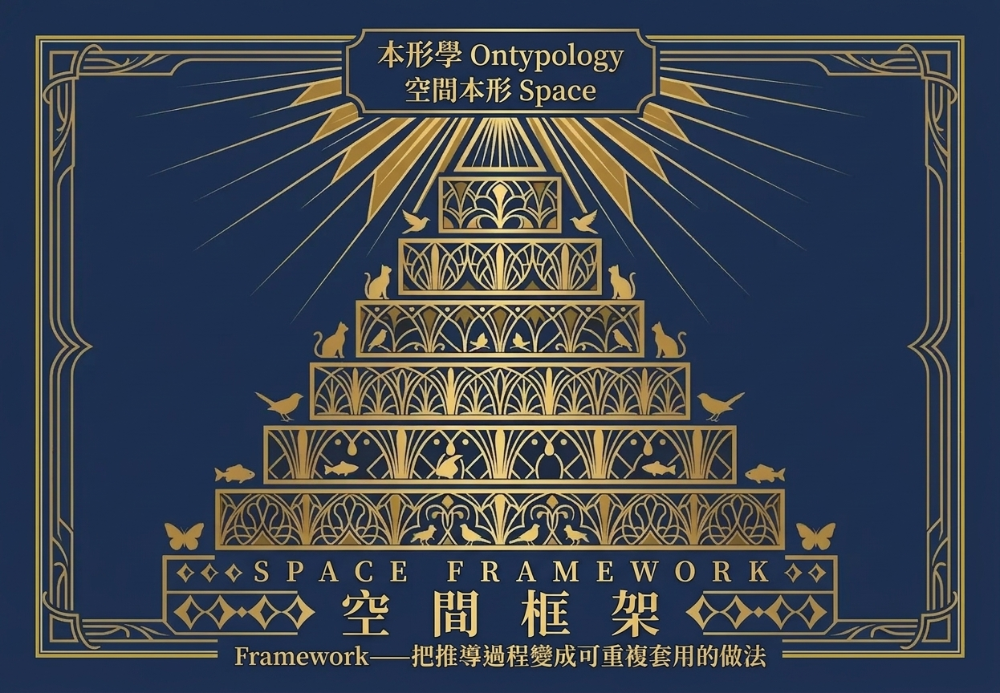

## Table of Contents

**❖　Introduction——Turning the derivation process into a repeatable practice**

**◆　Chapter One　The Four Steps of the Framework**

1-1　Starting from "comparison failure"

1-2　The four steps of the Framework

1-3　The two cases of judging belonging

**◆　Chapter Two　The Many Ways the Framework Unfolds**

2-1　The parallel-attribute type and the nested-branch type

2-2　The angle of entry of the four ways of unfolding

2-3　The clothing example: the same master table, different trees

**◆　Chapter Three　The Universality of the Framework: Biological Classification as an Example**

3-1　Species is the raw material; the concrete precedes the abstract

3-2　The extraction funnel: starting from species, returning to species

**❖　Chapter Key Points Review**

## Introduction——Turning the derivation process into a repeatable practice

> *Chapter imagery・The helm of the Framework——turning derivation into a repeatable course*

A Framework refers to the basic structure, format, and norms of a thing or system. In different fields, it represents a tool or concept that provides a foundational skeleton and a standardized process, helping people quickly build systems, organize information, or analyze problems.

In the chapter "Attributes and Attribute Values," we used a cup as an example, starting from the initial distinction of "this is not that," and derived all the way to four attributes: color, material, handle, and lid, finally converging into a complete attribute—attribute value master table. That derivation answered "what attributes does a cup have"; but the truly precious output of the derivation process is not actually the master table itself, but the entire process of "how dimensions grow out of a pile of differences."

What the Framework is meant to do is precisely to extract this entire derivation process and turn it into a practice that can be repeatedly applied no matter what it is swapped for—cups, clothing, organisms, or any batch of distinguishable things. **A Framework is the result left behind after the Framework has finished operating**: when the four steps have run and the dimensions have been set up one by one, the skeleton left standing there is the Framework.

In other words, "Attributes and Attribute Values" demonstrates one successful derivation; the Framework demonstrates the method that lets this kind of derivation be replayed again and again. The former gives you a fish, the latter gives you a course for fishing—this is also where the weight of the words "repeatedly applicable" lies.

> **❖　Chapter Map**
>
> **◆** "Attributes and Attribute Values" used a cup to derive four attributes—color, material, handle, lid—this chapter extracts "this entire derivation process" and turns it into a practice applicable to anything.
>
> **◆** What do you do when differences fail to match existing dimensions?—"The Four Steps of the Framework" (Chapter One).
>
> **◆** Once the dimensions are laid out, how can they be arranged?—"The Many Ways of Unfolding" (Chapter Two).
>
> **◆** Does the Framework only apply to cups?—"Biological Classification as an Example" (Chapter Three).

> **The Framework provides the fact of "what dimensions there are"; how to arrange these dimensions is the freedom of the applier**

## Chapter One　The Four Steps of the Framework

> *Chapter imagery・The staircase of four steps——from distinguishing Difference & Similarity to judging belonging*

### 1-1　Starting from "comparison failure"

Going back to the very beginning, when there were only two cups, transparent and blue, we could indeed distinguish "this is not that," but this was merely the most primitive "difference," and there was absolutely no need to give this batch of differences a higher-level name, because there was simply no second kind of difference in nature to compare against.

When a third cup appeared (ceramic, blue, with a handle), the situation changed: the material went from "glass" to "ceramic," and this batch of differences is completely different in nature from the color dimension—color is "the hue as it looks," while material is "the material it is made of / feels like when touched"; the same cup also gained a "handle," and this batch of differences cannot even be explained by material. It was only then that we first felt that "these differences cannot be understood by the same set of standards."

It is precisely this **comparison failure**—"this batch of differences fails to match any existing dimension"—that forced us to name them separately and put them in different places: material became independent from under color, and handle became independent from under material. Abstraction (naming a dimension) is not an action that automatically pops out once you put things together; it is only after a batch of differences of a different nature appears and comparison fails that there is both the necessity and the means to split it off into a newly named dimension.

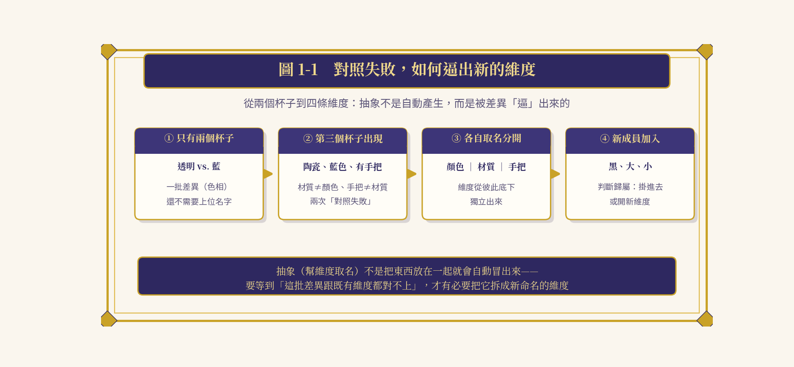

> **Figure 1-1** How comparison failure forces out a new dimension

**Comparison failure → abstraction and naming → dimension independence → judging belonging**

### 1-2　The four steps of the Framework

From this we can summarize the four steps of how the Framework operates:

> **One　Step One・Distinguishing Difference & Similarity**
>
> When you get a group of things, it is enough to first be able to distinguish "this is not that." At this point abstraction is not yet needed; calling them x, y, z is fine, just like the most primitive "present/absent."

> **Two　Step Two・Triggering Abstraction**
>
> Only when a second batch of differences of a different nature appears is the need for abstraction triggered. When you find that the new difference (such as material) fails to match the old difference (such as color) and cannot be explained by the same set of standards, you then realize that "these are actually two different kinds of things changing."

> **Three　Step Three・Naming Dimensions**
>
> Give each batch of differences its own name and divide them into different dimensions. This step is the act of abstraction itself—the two names "color" and "material" are the result of encircling each batch of differences of the same nature and putting a label on it.

> **Four　Step Four・Judging Belonging**
>
> When something new joins, you must first judge which dimension it matches. The way to judge is: can the nature of this batch of new differences be explained by the existing dimensions?

**Table 1-1　Overview of the Four Steps of the Framework**

| **Step** | **Triggering occasion** | **Action** |
| --- | --- | --- |
| **One・Distinguishing Difference & Similarity** | Getting a group of things, able to distinguish "this is not that" | Do not abstract yet; calling them x, y, z is fine (the most primitive "present/absent") |
| **Two・Triggering Abstraction** | A second batch of differences of a different nature appears | Finding that the new difference fails to match the old difference and cannot be explained by the same set of standards |
| **Three・Naming Dimensions** | The two batches of differences must be understood separately | Naming each, attaching labels, encircling them into different dimensions |
| **Four・Judging Belonging** | Something new joins | Judging whether the nature of the new difference can be explained by existing dimensions |

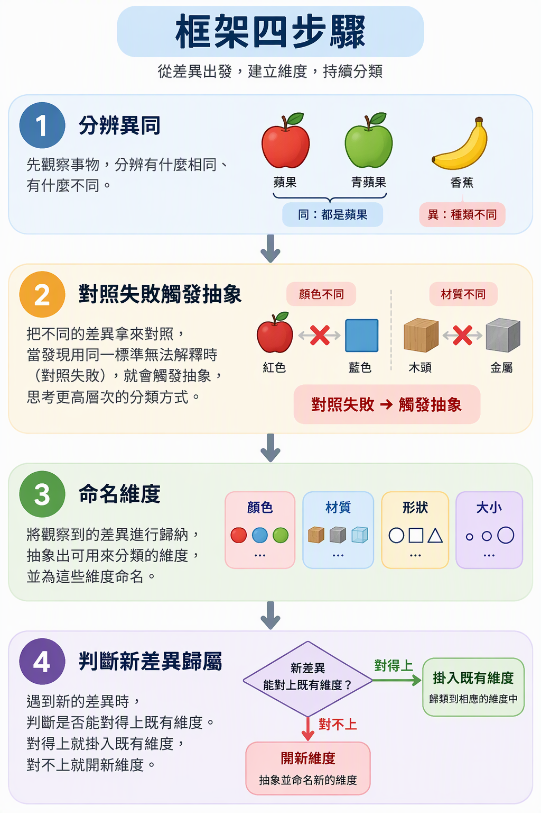

> **Figure 1-2** The four steps of how the Framework operates

### 1-3　The two cases of judging belonging

The fourth step, "judging belonging," includes two cases:

> **Case One (matches an existing dimension) → hang it directly in**
>
> For example, after red, blue, and gold, "black" appears; black is also a difference in hue, matching the nature of the "color" dimension, so it is hung directly under the color axis, becoming {red, blue, gold, black}, with no need for re-abstraction.

> **Case Two (fails to match all existing dimensions) → open a new dimension**
>
> Another batch of new things appears; there really are differences among them, but this batch of differences is neither a change in hue nor a change in material—for example, two red ceramic cups, one large and one small, with color and material completely identical, yet the difference is still obvious. This batch of differences, when compared against the color axis and the material axis, matches neither, and neither existing dimension can explain it, so the act of abstraction is repeated once more: encircle this batch of differences of the same nature, name it "size," and it becomes a third independent dimension, with options such as {large, medium, small} under it.

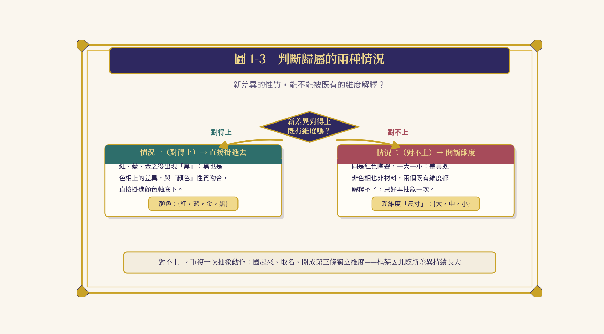

> **Figure 1-3** The two cases of judging belonging

It is worth noting that judging belonging is not the conclusion of the Framework, but the entrance through which the Framework keeps growing. Whenever a "failure to match" occurs, abstraction runs once more and there is one more dimension; whenever a "match" occurs, the existing dimension takes in one more attribute value. The former expands the Framework's skeleton, the latter expands the flesh on the skeleton—the Framework is therefore not a hard-wired list, but a machine that keeps growing with new differences.

You can also look at the four steps backwards: the "judgment" of the fourth step is possible because the first three steps have already set up the dimensions and given them names; and the first three steps are necessary because the fourth step will sooner or later encounter new differences that "fail to match." The four steps are mutually causal, forming a cycle that can run repeatedly—this is precisely the meaning of "repeatedly applicable" at the level of mechanism.

> **❖　Chapter Summary**
>
> Abstraction is not a talent that automatically emerges from gazing at all things, but a response forced out by "comparison failure." The four steps—distinguishing Difference & Similarity, triggering abstraction, naming dimensions, judging belonging—solidify this "process of being forced out" into a mechanism that can run repeatedly.

## Chapter Two　The Many Ways the Framework Unfolds

> *Chapter imagery・Parallel and branching——different appearances of the same master table*

### 2-1　The parallel-attribute type and the nested-branch type

The four attributes hang side by side under the cup, with no order of precedence, emphasizing that "the Framework is responsible for listing which mutually independent dimensions there are." This is the most direct way of drawing the output after the four steps of the Framework have run—the parallel-attribute type.

Beyond that, you can also branch first by material, then under material branch by color, and under color take up handle and lid; each path followed to the end represents a concrete cup instance—the nested-branch type. Or you can switch to branching by color first, echoing that color was originally the attribute that appeared first; this ordering reflects the historical order in which the attributes were forced out.

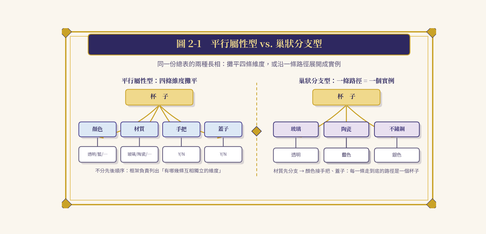

> **Figure 2-1** Parallel-attribute type vs. nested-branch type——comparison of two attribute structures

### 2-2　The angle of entry of the four ways of unfolding

The different ways of unfolding are actually drawing the same master table; the only difference is "which attribute is placed at the top level of the tree": material-first looks from the manufacturing angle, color-first echoes the historical order in which the attributes were forced out, functional-feature-first looks from the usage angle, and the parallel-attribute type simply does not order them at all and lays the four dimensions out flat.

Which one to choose depends on whether you want the reader to see at a glance "how it is made," "what it looks like," or "what it is used for."

**Table 2-1　The angle of entry of the four ways of unfolding**

| **Way of unfolding** | **Top level** | **Angle of entry** | **Seen at a glance** |
| --- | --- | --- | --- |
| **Parallel-attribute type** | No ordering, four dimensions laid flat | No ordering, directly juxtaposed | "What dimensions there are"——the structure itself |
| **Nested type・material-first** | Material branches first | Manufacturing angle | "How it is made" |
| **Nested type・color-first** | Color branches first | The historical order in which attributes were forced out | "The attribute that appeared first" |
| **Nested type・functional-feature-first** | Functional feature branches first | Usage angle | "What it is used for" |

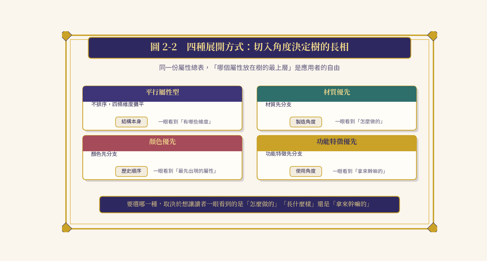

> **Figure 2-2** Four ways of unfolding: the angle of entry determines the appearance of the tree

### 2-3　The clothing example: the same master table, different trees

Under the abstract container "cup (Framework)" hang the four attribute dimensions of color, material, handle, and lid, and under each dimension hang all the attribute values that have ever appeared. The Framework is responsible for answering "which dimensions there are," while Attributes and Attribute Values are responsible for answering "what each dimension actually looks like underneath"; the parallel-attribute type draws this structure itself, while the nested-branch type draws the unfolding result of this structure applied to one concrete individual after another.

Taking clothing as an example, the parallel-attribute type would list the four dimensions "color, size, material, style," without any order of precedence; if the nested-branch type gives priority to "occasion," it would first divide into "formal occasion → casual occasion → sports occasion," and under each occasion further divide by color, size, and so on. For the same attribute master table, a different angle of entry produces a different tree structure, but the underlying dimensions and attribute values are completely identical.

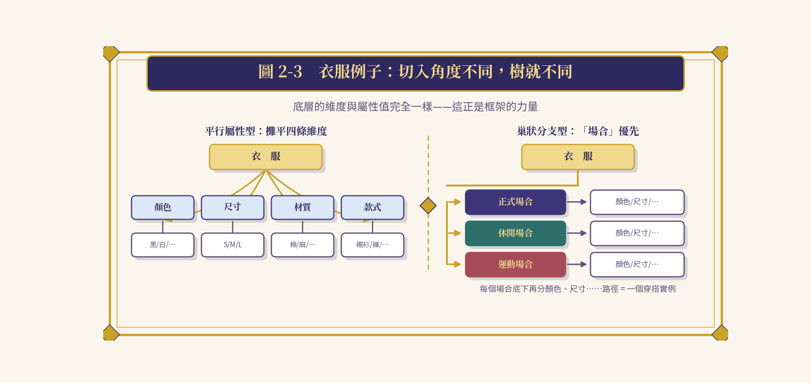

> **Figure 2-3** The clothing example: a different angle of entry, a different tree

If you look at several angles side by side, you will find: the list of dimensions has not changed from beginning to end; all that changed is "who stands at the top level of the tree." This reveals a key characteristic of the Framework—the Framework and the arrangement are two different things. The Framework answers "which dimensions there are and what each of them is"; the arrangement answers "what I want the reader to see first." Confusing the two will lead you to mistakenly think that changing the way of drawing changes the Framework, when in fact only the angle of entry has changed.

This also explains why the same cup Framework grows into three completely different trees in a factory's SOP, a store's catalog, and a design textbook: the dimension facts they extract are the same, only that each lifts the dimension it cares about most to the top level.

> **❖　Chapter Summary**
>
> What the Framework provides is the fact of "which dimensions there are" itself; as for how to arrange these dimensions, that is something the applier can freely choose. The parallel-attribute type draws the structure itself, while the nested-branch type draws the unfolding result applied to concrete individuals—the same master table, a different angle of entry, a different tree.

## Chapter Three　The Universality of the Framework: Biological Classification as an Example

> *Chapter imagery・The ladder of life——from concrete species to abstract hierarchy*

### 3-1　Species is the raw material; the concrete precedes the abstract

The matter of the Framework does not apply only to the cup example. Look at kingdom, phylum, class, order, family, genus, species in biological classification—the same reasoning holds: whichever classification system it is, concrete species must exist first—tigers, lions, domestic cats, wolves, salmon... all of them are concrete individuals that were observed first.

**Species is the most primitive material**; without species, nothing can be extracted afterwards. Once species exist, we begin extracting their commonalities level by level upward: what is extracted first is the commonality with the largest scope, and what is extracted is the kingdom; after the kingdoms are divided, within the same kingdom we look for the next level of commonality and extract the phylum; within the phylum we extract the class; within the class we extract the order; within the order we extract the family; within the family we extract the genus.

Each level continues, within the scope already divided at the previous level, to look for "whether one more commonality can still be extracted from this scope," extracting all the way until nothing more can be extracted and each group has only a unique individual left—and then we return to the most primitive species. Only by then, every species has been placed under a path of kingdom, phylum, class, order, family, genus.

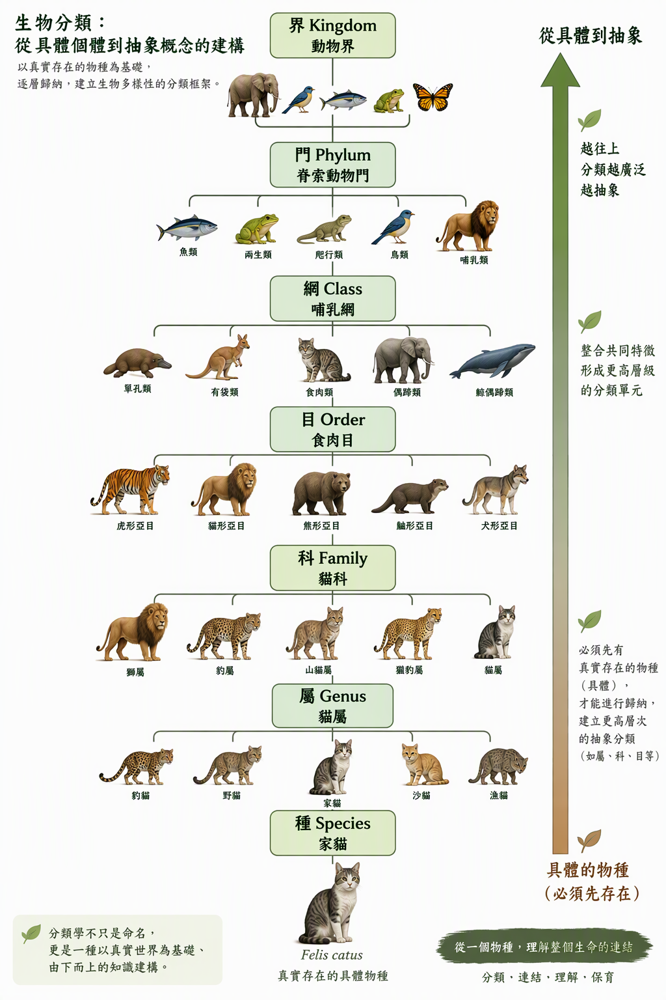

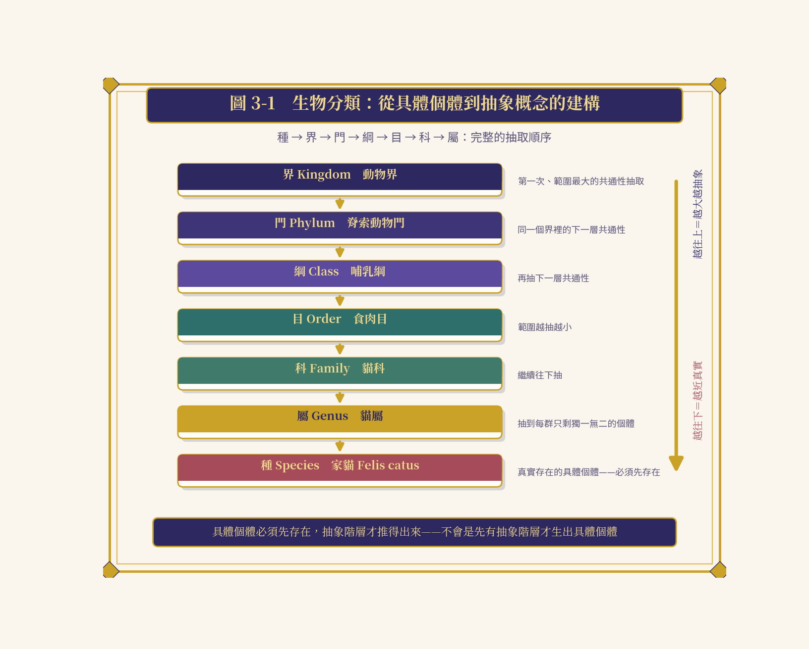

> **Figure 3-1** Biological classification: the construction from concrete individuals to abstract concepts

**Table 3-1　kingdom, phylum, class, order, family, genus, species——from the concrete to the abstract**

| **Level** | **Positioning** |
| --- | --- |
| **Species** | The most primitive material, the concrete individual that must exist first (tigers, lions, domestic cats, wolves, salmon...); without species, nothing can be extracted afterwards |
| **Kingdom** | The first and also the largest-scope extraction of commonality from the pile of species |
| **Phylum** | The next level of commonality found within the same kingdom |
| **Class・Order・Family・Genus** | Within the scope already divided at the previous level, continuing to extract level by level downward, with the scope getting smaller and smaller |
| **Returning to species** | When each group has only a unique individual left, we return to the most primitive species—every species has already been placed under a path of kingdom, phylum, class, order, family, genus |

### 3-2　The extraction funnel: starting from species, returning to species

So the complete order is: species → kingdom → phylum → class → order → family → genus. Species is the raw material that must exist first; the kingdom is the first and also the largest-scope extraction of commonality from the pile of species; the phylum, class, order, family, and genus are extracted level by level downward within the scope already divided by the kingdom, with the scope getting smaller and smaller, and finally extracted back to that very pile of species itself.

**Concrete individuals must exist first before an abstract hierarchy can be derived**; it is not that an abstract hierarchy comes first and then produces concrete individuals. The Framework does not have only one appearance; the appearance depends on whether the attributes stand in an independent relation or a nested relation to one another.

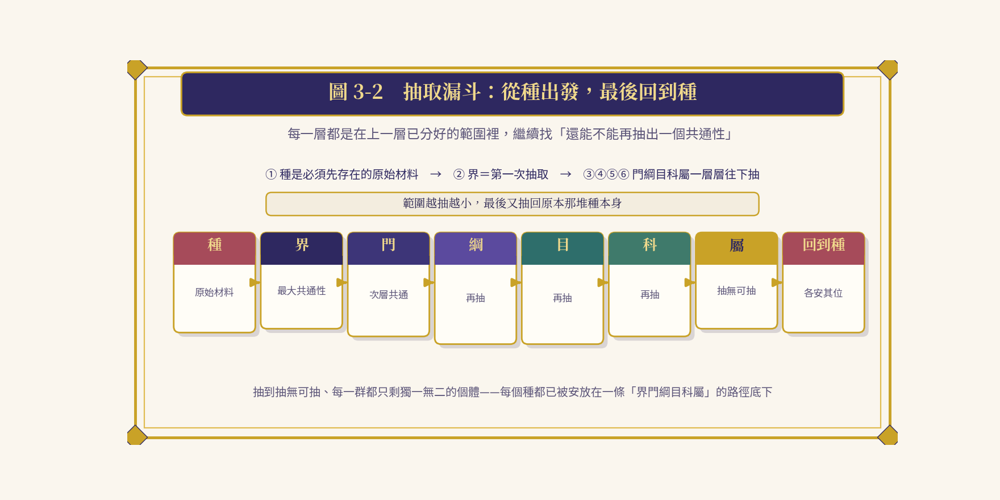

> **Figure 3-2** The extraction funnel: starting from species, finally returning to species

Putting cups and biological classification side by side for comparison makes it clearer: the cup example is small in scale and fast in steps, with the four dimensions set up within a few comparison failures; biological classification is vast in scale, yet it runs the same machine—when a difference fails to match, extract a level of names upward, all the way up to the genus and back to the species. Different in scale, the same machine—this is precisely what the universality of the Framework means: the Framework is not a technique tailor-made for cups, but the same path that every derivation "from difference to dimension" must pass through.

Even more important is that the order cannot be reversed. Only when concrete individuals exist first can an abstract hierarchy be extracted—this order of precedence is completely consistent between cups and biological classification, and will appear again and again in the applications in the subsequent articles, so it is worth firmly remembering here.

> **❖　Chapter Summary**
>
> kingdom, phylum, class, order, family, genus, species and the cup's four attributes follow the same reasoning: concrete individuals must exist first before an abstract hierarchy can be derived. The universality of the Framework lies not in its being able to grow only one appearance, but in that the derivation path "from difference to dimension" is the same path everywhere.

## Chapter Key Points Review

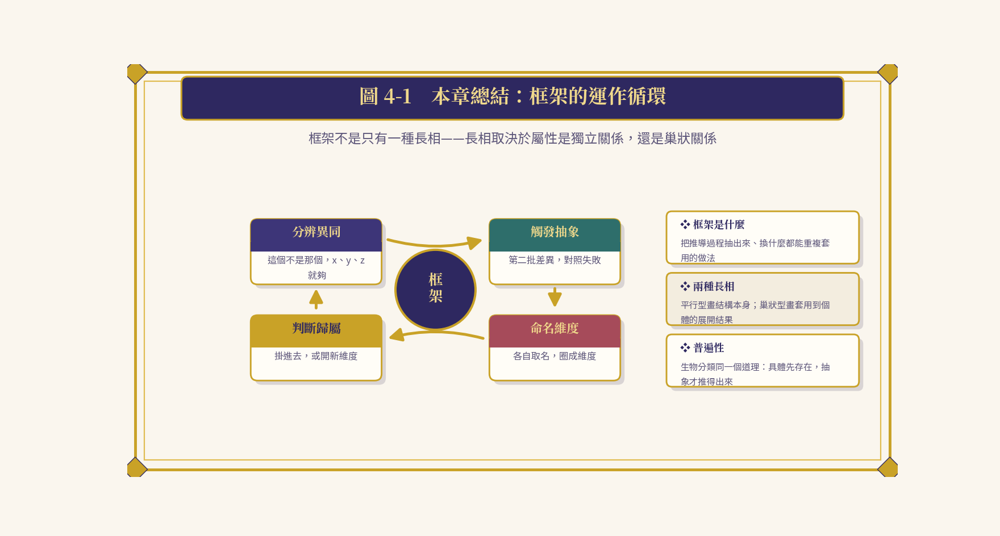

> **Figure 4-1** Chapter summary: the operating cycle of the Framework

**Table 4-1　Chapter Key Points Review**

| **Key point** | **One-sentence summary** |
| --- | --- |
| **❖ What the Framework is** | Extracting an entire derivation process and turning it into a practice that can be repeatedly applied no matter what it is swapped for; it is the result left behind after the Framework has finished operating. |
| **❖ The four steps (Chapter One)** | Distinguishing Difference & Similarity → comparison failure triggers abstraction → naming each into dimensions → judging the belonging of new differences; if it matches, hang it in; if it fails to match, open a new dimension. |
| **❖ Many ways of unfolding (Chapter Two)** | The parallel-attribute type draws the structure itself, the nested-branch type draws the unfolding result applied to concrete individuals; the same master table, with the angle of entry freely chosen. |
| **❖ Universality (Chapter Three)** | The kingdom, phylum, class, order, family, genus, species of biological classification follow the same reasoning: concrete individuals must exist first before an abstract hierarchy can be derived. |

---

> **Deriving once is a harvest; turning derivation into a Framework lets the harvest happen repeatedly.**
>
> *──"The Theory of Space Type" series・Spatial Framework──*

[www.longreat.net](https://www.longreat.net)

Chang-Feng Chang [gamma@livemail.tw](mailto:gamma@livemail.tw)

Ting-Ying Chang [mindaiworks@gmail.com](mailto:mindaiworks@gmail.com)
