

  <a href="https://youtu.be/GB96818ERBw">💻Landscape</a> ｜ 
 <a href="https://v.douyin.com/Pc-qeLbf-IU">📱Portrait</a> 
 

# Ontypology

# Space Type

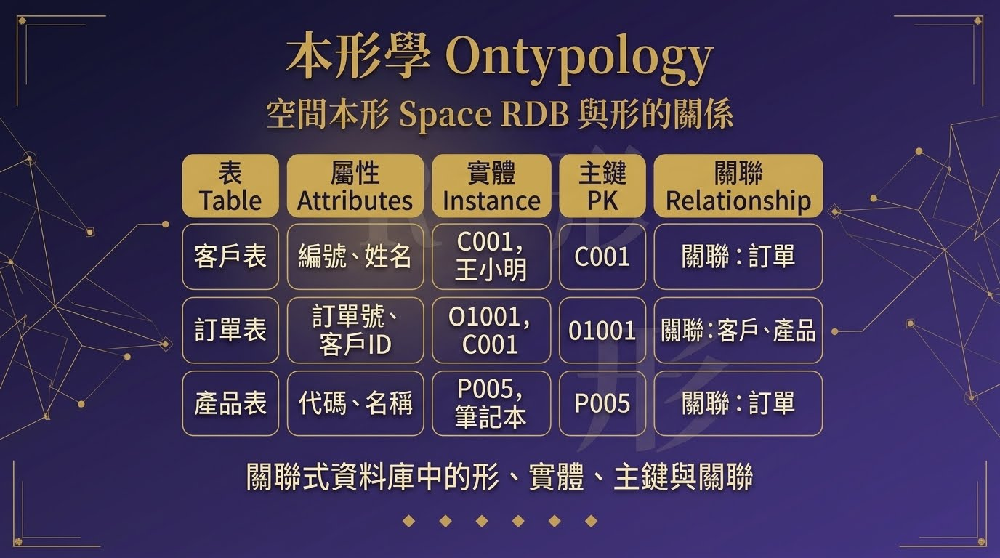

**The Relationship Between RDB and Type**

Types, entities, primary keys, and relations in a relational database

◆ **Reading Guide　What Type Looks Like in the Engineering World**

If Chapter Two answered "what a Type is," what this chapter has to answer is: **what a Type looks like in the engineering world**. The Relational Database (hereafter RDB) is the most widespread way of organizing data in the contemporary software industry, and its core structure—the Table—turns out to correspond one-to-one with the distinction between "Type / entity," and so neatly that we can almost say: RDB is what the logic of Type looks like after it has been mechanized.

This chapter unfolds along five steps: first, confirm the basic correspondence that "the schema is the Type and the rows are entities" (4.1); then look at the asymmetric cost of "adding data" at the two levels (4.2); next, explain why a field must run through all rows (4.3); then move on to the primary key—how the identity of an entity is pinned down (4.4); and finally see how tables and tables are connected into a network by "reference" (4.5). Throughout the chapter the "cup" serves as the running example, and every step comes with a diagram.

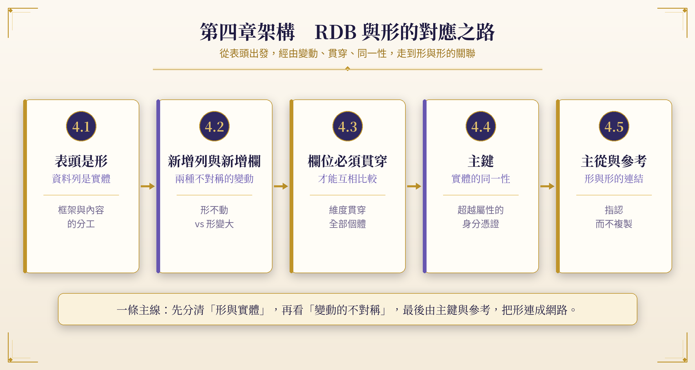

**Figure 4-1　**Architecture of this chapter: the five-step path from schema to relation

| ◆ **The key to reading this chapter**Whenever you see a "table," read it as a composite of "Type ＋ entity": the schema is the Type, the rows are entities. All the remaining concepts—fields, primary keys, foreign keys, relations—grow out of this basic correspondence. |
|---|

◆ **4.1　The schema is the Type, the row is the entity**

A database table is innately divided into two parts, and these two parts happen to correspond to the distinction made at the very beginning of Chapter Two: an attribute is "a question that can be asked"; it has no answer in itself, it merely delimits a range of "what is to be asked." An attribute value is the actual answer to that question in some concrete situation.

Apply this correspondence to a table and everything becomes clear: the top row of field names in a table (the **schema**) is the **Type**. It is a list of "what to ask"; it is not the answer to any one concrete thing, but the framework shared by all rows. Each row of actual data beneath the schema is an **entity**—the result of the Type being filled in with concrete answers, a thing that can be identified and exists independently.

| **Cup_id** | **Color** | **Material** | **Handle** | **Lid** |
|---|---|---|---|---|
| **C001** | Transparent | Glass | N | N |
| **C002** | Transparent | Glass | Y | N |
| **C003** | Blue | Ceramic | N | N |
| **C004** | Transparent | Glass | Y | Y |

Table 4-1　The cup table: the schema (Type) and four cups (entities), with Cup_id as the primary key field

The schema row (Cup_id, Color, Material, Handle, Lid) belongs neither to C001 nor to C002; it hangs above all cups and is a set of questions shared by all cups. This is exactly what a "Type" looks like: a framework that has no content itself but prescribes "where the content is to grow." Each row below is the actual answer that this list of questions is filled out into when applied to one concrete cup. This is exactly what an "entity" looks like: concrete, independent, identifiable (with its own Cup_id), yet its appearance grows entirely according to the questions in the schema, and it cannot spontaneously grow a field that the schema does not have.

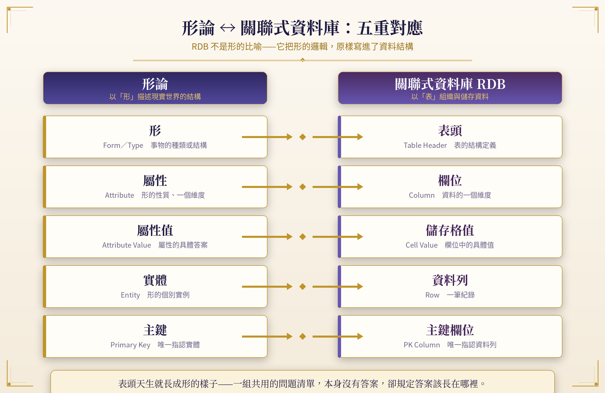

**Figure 4-2　**The fivefold correspondence between Type theory and the relational database

| ◆ **A Type is not a metaphor**The schema is innately shaped like a Type: a shared list of questions that has no answers itself, yet prescribes where the answers are to grow. The relation between RDB and Type theory is not an analogy, but the same structure appearing in two domains. |
|---|

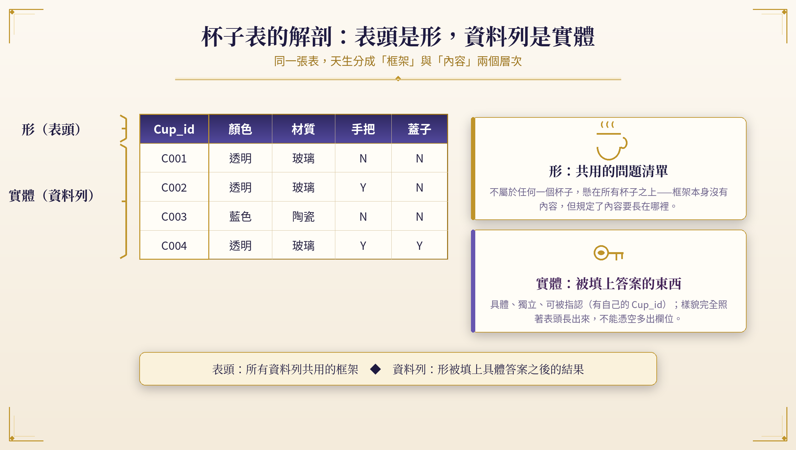

**Figure 4-3　**Anatomy of the cup table: the schema is the Type, the rows are entities

◇ **First the Type, then the entity**

It is worth noting the "direction" of this correspondence: the Type comes first and the entity after; it is not that entities are piled up first and a Type is then induced. The database engineer's first step in building a table is to define the schema—first "what to ask" is decided, and only then does the world begin to come in in the form of rows. This is fully consistent with Chapter Two's claim: the Type precedes the description of the individual, and the attribute precedes the filling in of the attribute value.

Once the schema is settled, it becomes the "admission specification" for this kind of thing: any individual that wants to enter this table must describe itself with this set of questions and hand in an answer for every field before it obtains a row. This is precisely the database version of an ancient philosophical intuition—an individual is something of a certain kind not because it happens to look that way, but because it stands under some Type and has handed in answers to that Type's questions.

◆ **4.2　Adding a row and adding a column: two asymmetric kinds of change**

The place where this correspondence can best be verified is that "adding data" means completely different things at these two levels:

◇ **Adding a row: the Type does not move, there is one more entity**

Adding a row (adding an entity) can happen at any time, and it is very light. When a fifth cup comes in, no matter what its color or material is, as long as it can be filled into the existing fields (Color, Material, Handle, Lid), we simply add one more row, and the schema does not have to move at all. This corresponds to what Chapter Two says: if the nature of the difference matches existing attributes, a cup that keeps being added only requires adding an attribute value under the corresponding attribute, and no new attribute needs to be opened at all. The newly added cup just quietly occupies one more row and **does not disturb any field in the schema**—the whole Type stays put, and the world merely has one more instance.

◇ **Adding a column: the Type itself grows, and all entities must be filled in**

Adding a column (adding a dimension to the Type) happens only when "this batch of differences matches none of the existing list of questions," and it touches the framework itself. If one day a kind of cup appears whose difference cannot be explained by the previous four fields—say, "whether it has a thermal insulation layer"—then it is not enough to fill one value into an existing field; a new question must be opened in the schema itself: add one more column, "Insulation Layer." This action corresponds to the moment described in Chapter Two as "forcing out a new attribute": the existing dimensions cannot explain the new difference, so a new dimension must be opened.

| **Adding a row: the Type does not move, there is one more entity (light). Adding a column: the Type itself grows, and all entities must be filled in accordingly (heavy).** |
|---|

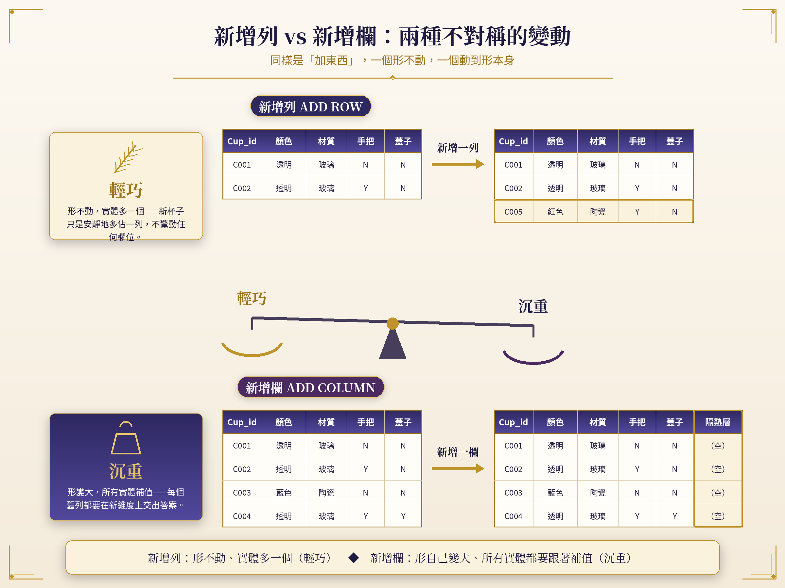

**Figure 4-4　**Adding a row and adding a column: two asymmetric kinds of change

Moreover, just as emphasized earlier—"once an attribute has been extracted, it must be applied to all individuals that have appeared"—when a new column is opened, the database automatically fills in a default null value in this new column for all existing old rows, forcing every existing entity to hand in an answer along this new dimension of the Type—even if the answer is temporarily "empty."

This automatic filling action seems to be only an engineering detail, but it is in fact the mechanical redemption of a principle of Type theory: **dimensions belong to the Type**. Once the Type grows a new dimension, all entities that partake of this Type must have a position in the new dimension—not one of them may be missed.

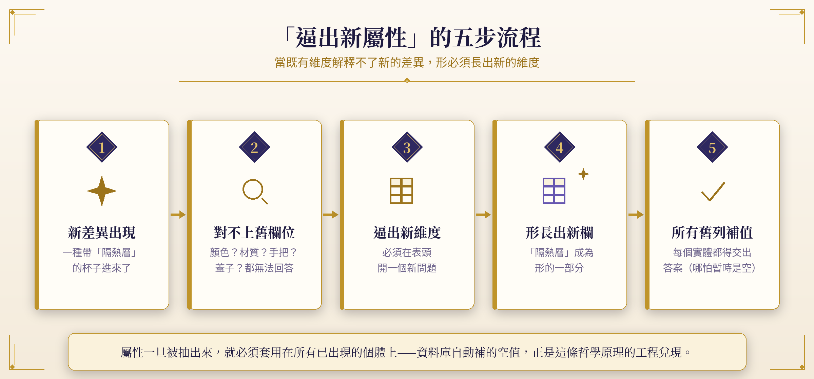

**Figure 4-5　**The five-step process of "forcing out a new attribute"

◇ **The precise correspondence in normalization theory**

This asymmetry has a precise counterpart in database design's Normalization theory: First Normal Form (1NF) requires that each field hold only one value and that multiple values not be stuffed into the same field; this is precisely the database version of "an attribute is a dimension, and each individual can have only one definite value in that dimension." And when we need to add a field, it means that the "Type" itself has changed; in database practice this corresponds to a "Schema Change"—an action far more significant than adding a row, and one that requires careful evaluation.

| **Action** | **Level touched** | **Correspondence in Type theory** | **Cost** |
|---|---|---|---|
| Add a row | Content level | The Type does not move, there is one more entity | Light: the structure does not change at all |
| Add a column | Structure level | The Type grows a new dimension | Heavy: all entities must be filled in |
| Change the primary key | Identity level | The identity of the entity is destroyed | Extremely heavy: the entire relational network breaks |

Table 4-2　The levels and costs of the three kinds of "change" (the third is left to be unfolded in 4.4)

In addition, the concept of the primary key also echoes the philosophical discussion of "Identity": the identity of an object does not depend on its attribute values—a cup can change color or change material—but on a marker that transcends all attributes and is used specifically to identify it. This insight will be unfolded in 4.4; before that, we must first deal with a more basic rule: a field must run through all rows.

◆ **4.3　Why a field cannot change because of one row**

The schema, this "Type," has a rule that looks very strict but is in fact very natural: within the same table, all rows share the same set of fields; it cannot be that some cups have one more column and some cups have one less. Put in the language of Chapter Two, this is "an attribute is a dimension, and a dimension must run through all individuals in order to be used for mutual comparison."

If each row were allowed to decide for itself whether to have a certain field, disaster would immediately follow: the question "Color" would exist for some cups and not for others, and the very act of "comparing the colors of all cups" could not be carried out—one could not ask "which cups are all transparent-colored," because **it would be entirely uncertain whether each row has a "Color" answer to look up**.

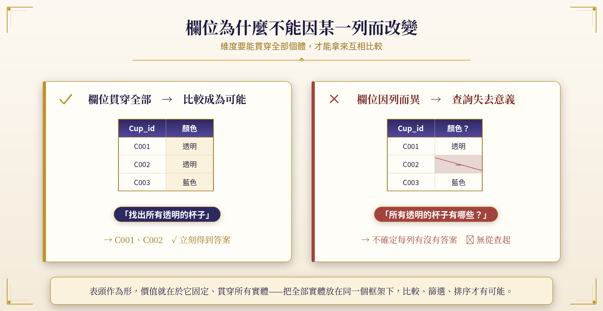

**Figure 4-6　**Fields run through, and only then does comparison become possible

◇ **The commonality of a dimension**

The essence of a dimension is commonality. For a ruler to be usable for measuring everything, it cannot exist for only some things; for a question to be usable for comparing all individuals, it must be open to all individuals. The value of the schema as a Type lies precisely in its being fixed and running through all entities—only thus can all entities be compared, filtered, and sorted under the same framework.

The reason "Query" in a database is so powerful is precisely that it is built on this promise: every row has the same set of fields to query. The reason the sentence "find all transparent cups" can be executed as a precise operation is that the dimension "Color" is open to every row, without exception. Fields running through is the database's promise of "comparability."

| ◆ **The premise of comparison**The premise of comparison is "asking the same question of all individuals." A table whose fields differ from row to row looks more flexible, but in fact it robs the whole framework of the ability to compare. |
|---|

◆ **4.4　Primary key: by what is each row independently identified**

Earlier we said "the schema is the Type and the rows are entities," but one thing was left out here: for a row of data to be independently identified and pointed to by other tables, there must first be a field that belongs only to this row and has nothing to do with the content of any other field—this is the primary key. Cup_id in the cup table is the primary key of this table. It is not the cup's color or material, nor any attribute; it is purely an identity code, whose sole function is to "point out which cup this is."

Even if two cups have exactly the same color, material, handle, and lid, as long as their Cup_id differ, the database knows that these are two different entities and will not merge them into one. The reason the primary key must be unrelated to content is that it has to hold up the matter of "the same Type": if a cup changes color, the primary key must not change along with it, otherwise the database will think that after the color change it has become a brand-new cup. The primary key is the most fundamental credential of an entity's identity—attributes may be swapped at will, but the primary key may not.

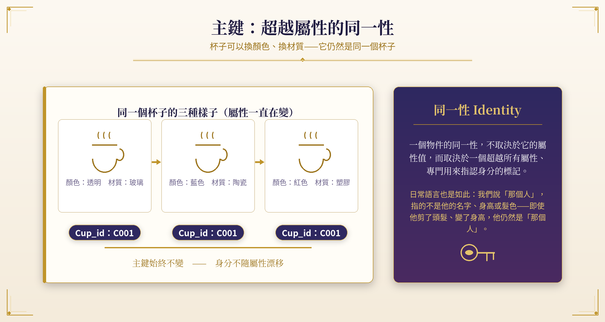

**Figure 4-7　**Primary key: identity beyond attributes

◇ **Identity: identification in everyday language**

This design principle has a familiar face in philosophy: the discussion of "Identity." The identity of an object does not depend on its attribute values, but on a marker that transcends all attributes and is used specifically to identify it. When we say "that person," we do not mean his name, his height, or his hair color, but "that particular person"—even if he cuts his hair or changes height, he is still "that person." The database's primary key is precisely the fixing, in the form of a field, of this everyday ability to "identify."

In the language of Type theory, this can be put more precisely: an entity is "the one that is identified," and the primary key is **the structured residue of the act of "identifying" itself**. Attributes describe an entity's appearance; the primary key carries an entity's identity. Appearance belongs to the content level, identity to the framework level—this is the distinction between Type and entity appearing once again.

◇ **Primary keys are immutable: the stability of the relational network**

In practice this principle has an important implication: once a primary key's value has been assigned, it should never be changed again. If the cup with Cup_id = C001 were renamed to C009, all child-table records that once referenced C001 (for example, those rows in the parts table where "owning cup = C001") would point to something that does not exist, and the entire relational network would break.

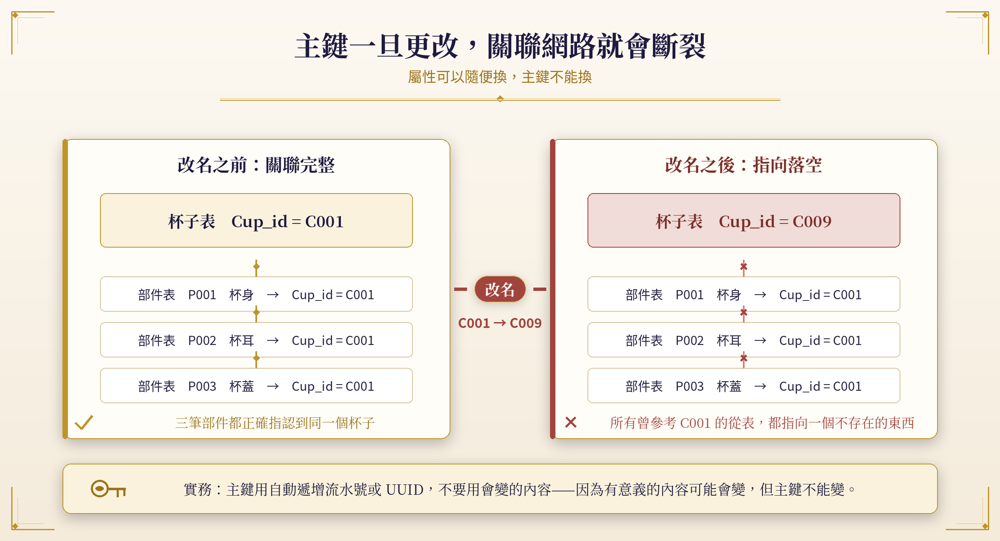

**Figure 4-8　**Once the primary key is changed, the relational network breaks

This is why, in practice, primary keys usually use an auto-incrementing serial number or a randomly generated UUID rather than meaningful content (such as color or material)—because meaningful content may change, but the primary key may not. Using a code that is "forever meaningless" to carry an identity that is "forever unchanging" is engineering's most cautious safeguarding of identity.

| ◆ **Identity and appearance**Attributes may be swapped at will, but the primary key may not—because what is swapped is the appearance, while what cannot be swapped is "who it is." The identity of an entity is the only anchor of the entire relational network. |
|---|

◆ **4.5　Master and detail, and reference: how the cup table and the parts table are joined by the Type**

With a primary key, tables can identify and connect to one another. Let us use the cup table and the parts table to see how this works:

| **Cup_id (Primary Key)** | **Name** |
|---|---|
| C004 | Cup |

Table 4-3　The cup table (master)

| **Part id (Primary Key)** | **Cup_id (Foreign Key)** | **Part Name** | **Material** |
|---|---|---|---|
| P001 | C004 | Body | Glass |
| P002 | C004 | Handle | Glass |
| P003 | C004 | Lid | Glass |

Table 4-4　The parts table (detail, and at the same time its own master): the Cup_id column references the primary key of the cup table

◇ **Master: the source of the Type; detail: exists by attaching**

The master-detail relation is about which table's Type a table attaches to. The cup table is the "master" and the parts table is the "detail"—every row in the parts table is meaningful only if it first belongs to some cup (the row "handle" must first state clearly which cup's handle it is); a parts record cannot exist out of thin air without knowing which cup it belongs to. This is exactly the same principle as attribute values: an attribute value must first attach to a concrete Type, and there cannot be a record "Color = Transparent" without knowing which cup's color it is. **Every row of the detail table must first reference some Type in the master table before it can hold.**

◇ **Reference: identifying, not copying**

Reference is about how the detail table knows which master table's Type it belongs to. The "owning cup" column in the parts table is not filled with the cup's name or color or any such content, but with the cup's primary key—the sole function of this field's existence is to point to some Type in the cup table, and it does nothing else. This is "reference": not copying the whole record over, but storing a primary key that points to another Type, and when details are needed, going back to the corresponding master table to look them up.

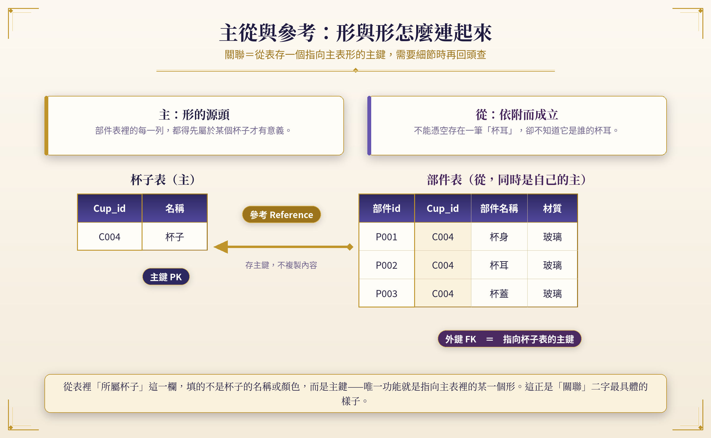

**Figure 4-9　**Master and detail, and reference: joining Type to Type by primary key

This is precisely the most concrete appearance of the word "relational" in relational database: Types are not bound together by content, but by a field in the detail table—storing a primary key that points to some Type in the master table—which joins the two. Content changes, identification does not; hence a relation built on identification is more solid than any copy. The whole database is thus a **"net woven from primary keys"**: each Type is responsible for its own content, and they exchange only identifications with one another.

| ◆ **The definition of a relation**Relation ＝ storing in the detail table a field that points to the master table's primary key. Identifying, not copying—when details are needed, go back to the master table and look them up. |
|---|

◆ **Essence　The essence of this chapter**

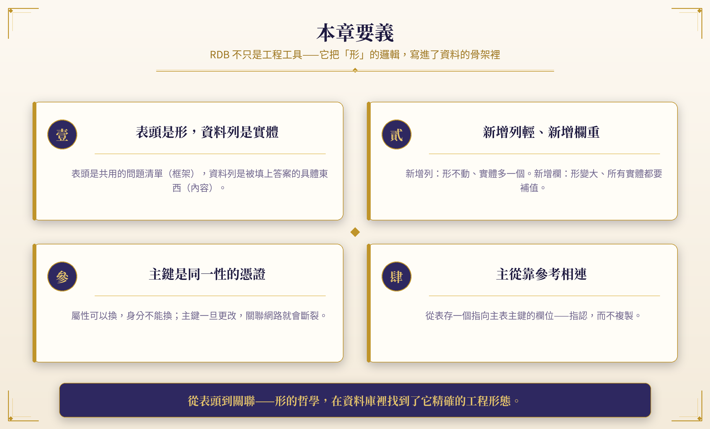

**Figure 4-10　**The essence of this chapter: four correspondences that must be remembered

**Key Review**

- **The schema is the Type, the rows are entities:** the schema is the shared list of questions (the framework), the rows are the concrete things filled with answers (the content).
- **Adding a row is light, adding a column is heavy:** adding a row leaves the Type unmoved and gives one more entity; adding a column enlarges the Type and all entities must be filled in.
- **The primary key is the credential of identity:** attributes may be swapped, identity may not; once the primary key is changed, the relational network breaks.
- **Master and detail are joined by reference:** the detail table stores a field pointing to the master table's primary key—identifying, not copying.

| **From schema to relation—the philosophy of Type has found its precise engineering form in the database. RDB is not merely an engineering tool; it is a machine that executes the logic of "Type" billions of times a day.** |
|---|

—  E n d   o f   C h a p t e r   F o u r  —

[www.longreat.net](https://www.longreat.net)

Chang-Feng Chang[gamma@livemail.tw](mailto:gamma@livemail.tw)

Ting-Ying Chang[mindaiworks@gmail.com](mailto:mindaiworks@gmail.com)
