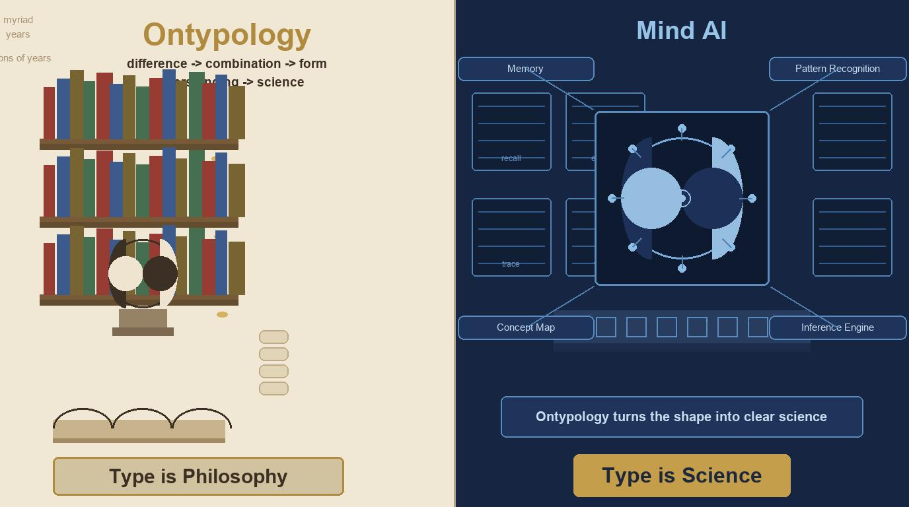
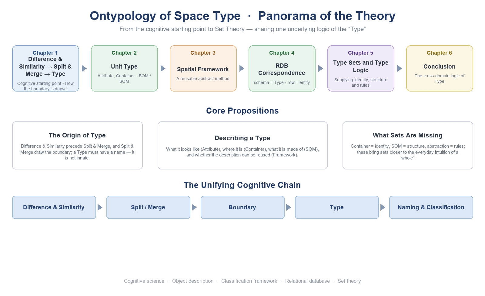
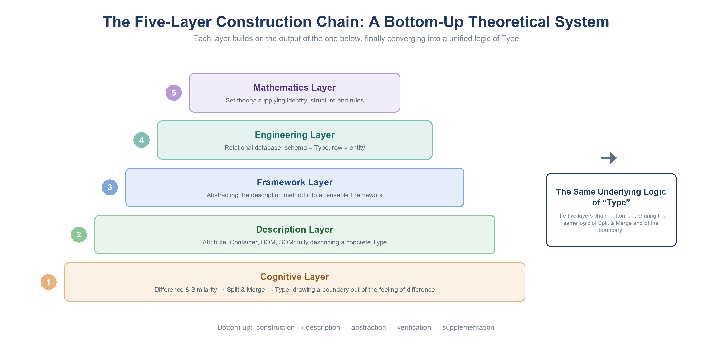
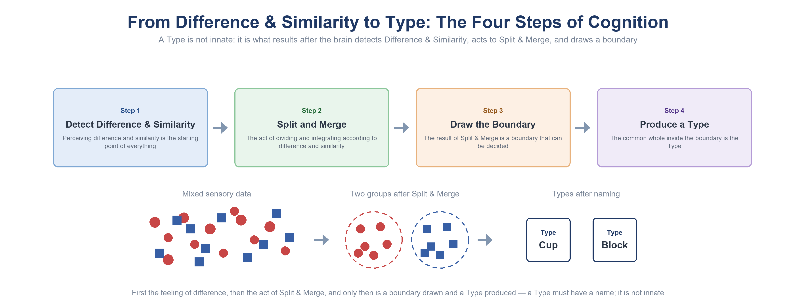
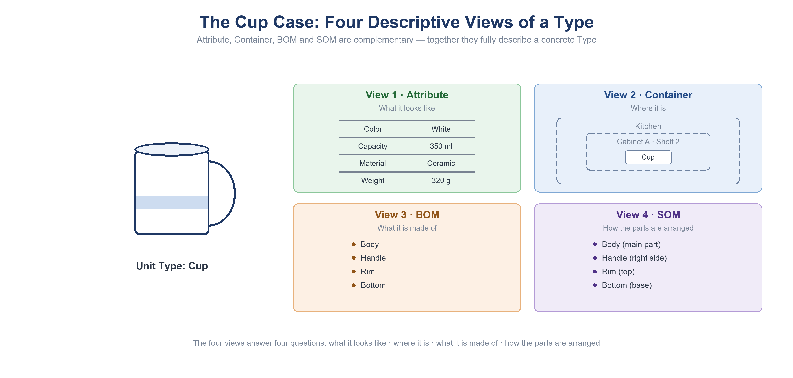
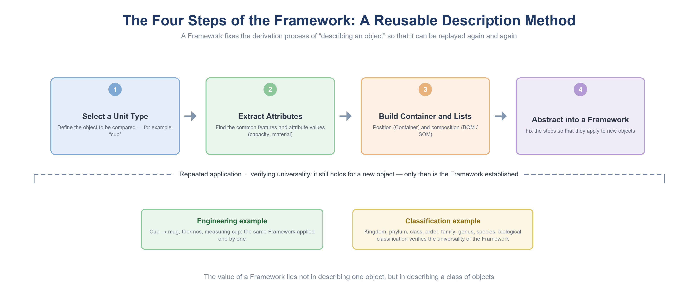
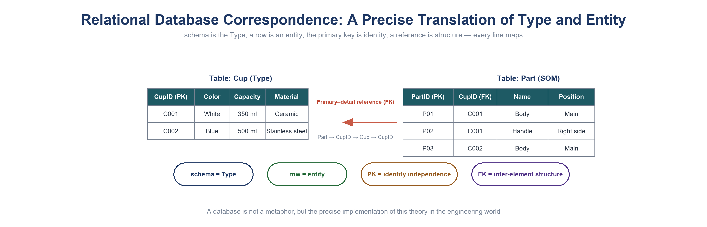
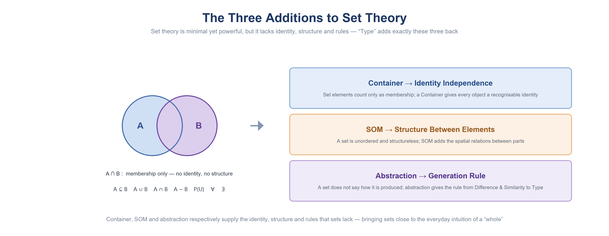
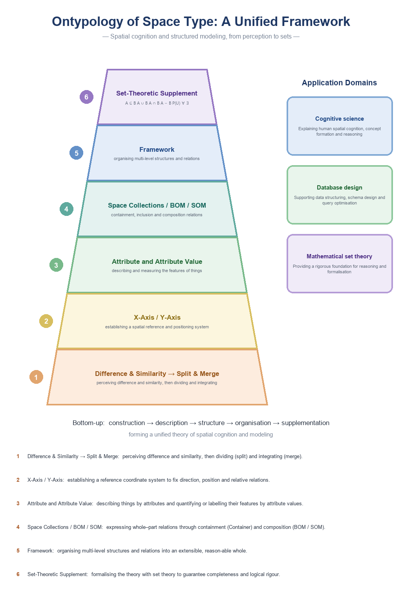

 

  <a href="https://youtu.be/zBdZ4OqzbOI">💻Landscape</a> ｜ 
 <a href="https://v.douyin.com/K3S5wEwpWkw">📱Portrait</a> 
 

# Ontypology Ontology
## Space Type Space
### A Theoretical Framework from Difference & Similarity and Split & Merge to Formal Logic

---

## Abstract

This paper proposes a theoretical framework that starts from a cognitive starting point and constructs the concept of "Type" layer by layer. The paper first explains that a "Type" does not exist innately; rather, the brain first detects "Difference & Similarity", and only after drawing a boundary through the acts of "Split" and "Merge" does a Type come into being. It then takes "Attribute and Attribute Value" as its core to explain how a "Unit Type" gradually emerges in the process of comparing concrete objects (using a cup as an example), and extends this into two complementary perspectives for describing objects: "Space Collections" and "Space Object Model" (BOM／SOM). It further points out that a "Framework" is the abstraction of this derivation process into a method that can be applied repeatedly, and verifies its universality by analogy with the biological taxonomic hierarchy (kingdom, phylum, class, order, family, genus, species). It then maps the entire theory onto the table structure of a Relational Database, explaining the logical relationships between the schema (Type) and rows (entities), Primary Keys, and master-detail references. Finally, it returns to mathematical Set Theory, pointing out that containers, SOM, and abstraction respectively supply the three properties that mathematical sets lack: "identity independence", "inter-element structure", and "generation rule".

The paper consists of six chapters, advancing in the order "cognition → description → framework → engineering → mathematics → unification", with each chapter overviewed by a single infographic. The paper attempts to show that from cognition, object description, and data structures to Set Theory, they in fact share the same underlying logic of the "Type".

**Keywords:** Type, Split & Merge, Attribute, Space Collections, SOM, Framework, Relational Database, Set Theory

---

## Introduction

This paper proposes a theoretical framework that starts from a cognitive starting point and constructs the concept of "Type" layer by layer. A "Type" does not exist innately; rather, the brain first detects "Difference & Similarity", and only after drawing a boundary through the acts of "Split" and "Merge" does a Type come into being. From cognition, object description, and data structures to Set Theory, they in fact share the same underlying logic of the "Type".

The reason a unified theory of the "Type" is needed is that each field has long since developed its own language for describing the "Type", yet these languages do not communicate with one another: cognitive science talks about concept formation, databases talk about schema, engineering talks about bills of materials, and mathematics talks about sets. These languages describe the same thing—how to divide a chaotic world into units that can be identified, described, and reasoned about—yet they cannot verify one another because of the barriers between their terminologies. The goal of this paper is precisely to provide a vocabulary that is sufficiently fundamental and sufficiently neutral for the conclusions of these fields to be translated into one another.

Methodologically, this paper does not adopt axiomatic deduction but rather a "cognitive starting point + cross-validation": it begins from a thought experiment that anyone can reproduce (facing a pile of clutter, how do we say "this is a cup"), obtaining a minimal set of concepts; it then takes this set of concepts and tests it in the three domains of object description, data structures, and Set Theory, revising any concept that fails the test and retaining any property that all three domains require.

The structure of the paper is as follows: Chapter 1 establishes the cognitive starting point; Chapter 2 develops four perspectives for describing a Type; Chapter 3 abstracts the description method into a Framework; Chapter 4 uses a Relational Database for engineering verification; Chapter 5 returns to Set Theory to fill the mathematical gap; and Chapter 6 summarizes the cross-domain consistency and looks ahead to applications.

*Figure 1 Ontypology of Space Type・Panorama of the Theory: the six-chapter chain from the cognitive starting point to Set Theory*

### How to Read This Theory

This theory can be seen as a bottom-up construction chain. At the very bottom is the question of cognitive science: where exactly does a "Type" come from? The answer is not that there is first a noun and then a thing, but rather that there is first the perception of difference, then the acts of Split & Merge, and only at the end is a boundary drawn and a Type born. Once a Type exists, the question at the second level is: how do we fully describe a concrete Type? Thus Attribute, container, Bill of Materials (BOM), and Space Object Model (SOM) are established one by one.

The third level abstracts the very act of "describing an object" into a "Framework" that can be applied repeatedly; the fourth level verifies the precise correspondence of this Framework in the world of engineering and data—the schema, rows, Primary Keys, and master-detail references of a Relational Database can be translated almost item by item into the terminology of this paper. The fifth level then steps back to mathematics, pointing out that although the parsimony of Set Theory is powerful, it lacks identity, structure, and generation rules, and the "Type" precisely supplies these three back.

> **In One Sentence**
> To understand a Type is to understand "what it looks like" (Attribute), "where it is" (container), "what it is made of" (SOM), and "whether this description method can be applied repeatedly" (Framework).

| Chapter | Core Question | Key Output |
| --- | --- | --- |
| Type and Number | Where does a Type come from? | Difference & Similarity → Split & Merge → Type; X axis and Y axis |
| Unit Type | How do we describe a concrete object? | Attribute, Space Collections, BOM, SOM |
| Spatial Framework | How can the description method be applied repeatedly? | Framework four steps, multiple expansions, universality |
| RDB | How does it map onto data structures? | schema=Type, row=entity, Primary Key and references |
| Type Set | What is Set Theory missing? | The three value-adds: identity, structure, rules |
| Conclusion | Why are the domains consistent? | They share the same underlying logic of the "Type" |

*Figure 2 The Five-Layer Construction Chain: a bottom-up theoretical system*

---

## 1. The Cognitive Starting Point: From Difference & Similarity to Type

### 1.1 Difference & Similarity Precede Split & Merge

Any description presupposes a world that has already been divided, but where does the division itself come from? The answer of this paper is: from the detection of "Difference & Similarity". When our gaze sweeps across a tabletop, we do not need to first know the word "cup" in order to feel that the color and texture of some region differ from its surroundings; this sense of difference precedes any naming and any classification. In other words, Difference & Similarity is not the result of comparing two already-known objects, but the precondition that allows objects to become "comparable".

Appearing together with Difference & Similarity is similarity: difference makes a region emerge from the background, while similarity makes the many individual sensations within a region be treated as "the same cluster". Difference and Similarity are two sides of one coin, neither dispensable—with only difference, the world is shattered points; with only similarity, the world is an undifferentiated expanse.

### 1.2 Split & Merge Draw the Boundary

Given Difference & Similarity, there still needs to be an act to fix it in place, and this act is "Split" and "Merge". Split is to exclude what is perceptually different beyond the boundary; Merge is to include what is perceptually similar within the boundary. Split & Merge is not completed in one stroke but adjusted repeatedly: first a rough cluster is split off, then subdivided according to new differences, then merged again according to new similarities, until the boundary stabilizes.

Once the boundary stabilizes, a key transformation occurs: the many sensations within the boundary are no longer individual noise but are treated as a unit that can be identified as a whole. This "common whole enclosed by a boundary" is what this paper calls a "Type". Therefore a Type is not discovered but drawn; first the boundary, then the Type.

### 1.3 A Type Must Have a Name

Once a Type is established, it demands a name. A name is not decoration but a necessary means of fixing the boundary in place: without a name, the boundary dissipates after the next shift of attention; with a name, the boundary can be repeatedly summoned, communicated, and accumulated. This is the meaning of "a Type must have a name"—name and Type are two ends of the same cognitive act.

> **Core Proposition**
> Difference & Similarity precede Split & Merge, and Split & Merge draw the boundary; within the boundary a Type is born, and a Type must have a name—a Type does not exist innately.

*Figure 3 From Difference & Similarity to Type: the four operations of cognition*

---

## 2. Describing a Type: Attribute, Container, and Lists

Given a Type, the next question is: how do we fully describe a concrete Type? This paper gives four complementary perspectives: Attribute, Space Collections, BOM, and SOM. The four respectively answer "what it looks like", "where it is", "what it is made of", and "how the composition is arranged"; missing any one of them makes the description incomplete.

### 2.1 Attribute and Attribute Value

An Attribute is a measurable aspect of a Type, and an Attribute Value is the concrete reading on that aspect. When we place two cups side by side, the reason we can say "they are both cups but different" is precisely that they share the same set of Attributes (color, capacity, material, weight) while differing from each other in Attribute Value. An Attribute is thus the coordinate system that makes comparison possible: only with a common framework of Attributes can differences be articulated.

It is worth noting that the framework of Attributes is itself a product of the Type: the reason we know to compare "capacity" rather than "mood" is that the Type "cup" has already presupposed which aspects are relevant. Attribute and Type are mutually presupposing, and this is precisely the meaning of a unit type—a minimal descriptive unit that carries a presupposed framework of Attributes.

### 2.2 Space Collections

Attribute answers "what it looks like" but does not answer "where it is". Space Collections supply this dimension: any concrete Type occupies a position and is also contained by a larger position. The kitchen contains the cabinet, the cabinet contains the shelf, the shelf contains the cup—a container is a nested "where" layer by layer, allowing a Type to be located and retrieved.

### 2.3 BOM and SOM

Describing a Type also requires opening it up to look inside. BOM (Bill of Materials) answers "what it is made of": the cup body, cup handle, cup rim, cup base. But a list alone is not enough—the same four parts, with different assembly relationships, are different things. SOM (Space Object Model) adds spatial relationships on top of the list: the cup handle is on the right side of the cup body, the cup rim is at the top, the cup base is at the bottom. BOM gives the composition, SOM gives the arrangement of the composition.

> **Four Complementary Perspectives**
> Attribute = what it looks like; container = where it is; BOM = what it is made of; SOM = how the composition is arranged. Only the four together constitute a complete description of a Type.

*Figure 4 The Cup Case: four descriptive perspectives on a single Type*

| Perspective | Question Answered | Key Output | Everyday Intuition |
| --- | --- | --- | --- |
| Attribute | What does it look like? | Table of Attributes and Attribute Values | "What it looks like" |
| Container | Where is it? | Nested container positioning | "Where it is placed" |
| BOM | What is it made of? | Bill of Materials | "What it is made from" |
| SOM | How is the composition arranged? | List with positions | "How it is assembled" |

---

## 3. Framework: A Reusable Description Method

Describing an object is only an individual case; fixing "how to describe" itself is what makes a method. A Framework is precisely the product of this level: it organizes the four perspectives of Chapter 2 into a set of steps that can be applied repeatedly.

### 3.1 The Four Steps of the Framework

A Framework consists of four steps: first, select a Unit Type and define the object to be compared; second, extract Attributes and identify common features and Attribute Values; third, establish containers and lists to complete the description of positioning and composition; fourth, abstract into a Framework, fixing the above steps so that it can be applied to new objects. Once the four steps are complete, what we obtain is not the description of one object but a method for describing a class of objects.

### 3.2 Multiple Expansions and Universality

The value of a Framework is verified by "still holding when applied to new objects". In engineering, the cup framework can be applied one by one to mugs, thermoses, and measuring cups; in taxonomy, the hierarchy of kingdom, phylum, class, order, family, genus, species is precisely the same framework expanded in the biological domain—each level being an act of selecting a Unit Type and extracting Attributes. When a Framework can expand across multiple domains without breaking, we say it has universality.

> **The Value of the Framework**
> The value of a Framework lies not in describing one object but in describing a class of objects; only when it can be applied repeatedly does a Framework hold.

*Figure 5 The Four Steps of the Framework: a reusable description method*

---

## 4. Engineering Verification: Correspondence with Relational Databases

Whether a theory is precise is best tested by seeing whether it can be translated item by item into the world of engineering. The Relational Database provides just such a mirror.

### 4.1 Schema and Rows: Type and Entity

In a Relational Database, the schema defines which columns exist, while rows are individual concrete records. This corresponds exactly to the distinction in this paper: the schema is the "Type"—it prescribes the framework of Attributes; a row is an "entity"—it is a concrete instance of the Type. Without the schema, rows cannot be interpreted; without the Type, entities cannot be described.

### 4.2 Primary Key and References: Identity and Structure

Finer correspondences hold as well: a Primary Key gives each row an identifiable identity, corresponding to the identity independence conferred by a container; a Foreign Key lets one row point to another, corresponding to the inter-element structure described by SOM. Database designers have long since invented in practice the two value-adds that this paper's theory advocates, only without unifying them under a single cognitive starting point.

> **A Precise Translation**
> schema = Type, row = entity, Primary Key = identity, Foreign Key = structure—a database is not a metaphor but a precise implementation of this theory.

*Figure 6 Relational Database Correspondence: a precise translation of Type and entity*

| Ontypology Term | RDB Correspondence | Explanation |
| --- | --- | --- |
| Type | schema | Prescribes the framework of Attributes |
| entity | row | A concrete instance of the Type |
| identity independence | Primary Key (PK) | An identifiable unique identity |
| inter-element structure | Foreign Key (FK) | The pointing relationship between rows |
| container | database／schema (schema level) | Positioning and containment |
| SOM | sub-table + reference | The arrangement of the composition |

---

## 5. Mathematical Supplement: The Three Value-Adds to Set Theory

Finally, we step back to mathematics. Set Theory supports the whole of mathematics with very few concepts (membership, subset, union, intersection), but its parsimony is also its gap: a set cares only about "who is a member", not about the identity of members, the structure among members, or how the set is generated.

### 5.1 The Parsimony and the Gap of Sets

In Set Theory, {a, b} and {b, a} are the same set; elements have no order and no position; whether elements are "the same" is determined solely by membership, with no independent identity; and a set does not explain how it was constructed. These gaps are harmless in pure mathematics, but once we need to describe objects in the real world that have identity, structure, and provenance, they must be filled.

### 5.2 The Three Value-Adds

The three constructs of this paper precisely fill these three gaps: a container confers identity independence—objects in a container remain distinguishable individuals even if they have the same Attributes; SOM confers inter-element structure—the positional and assembly relationships between parts are explicitly recorded; abstraction confers a generation rule—the derivation process from Difference & Similarity to Type explains how this whole was constructed.

> **Three Value-Adds**
> A container adds identity, SOM adds structure, abstraction adds rules—once these are supplied, sets come close to the everyday intuition of a "whole".

*Figure 7 The three supplements to Set Theory*

---

## 6. Cross-Domain Consistency and Outlook

Reviewing the whole paper, the four domains of cognitive science, object description, data structures, and Set Theory appear on the surface to have different terminologies but in fact share the same underlying logic: all start from difference, all draw boundaries through Split & Merge, all require names and identity, and all require structure and generation rules. This consistency is not a coincidence, but because they face the same problem—how to divide a chaotic world into units that can be identified, described, and reasoned about.

Looking ahead to applications, this Framework offers at least three paths: in cognitive science, it provides a computable descriptive layer for concept formation and classificatory reasoning; in databases and knowledge engineering, it provides a cognitive foundation for schema design and ontology construction; and for the World Model of Artificial General Intelligence (AGI), it provides a unified modeling language from perception to structure—allowing machines not merely to store data, but to "draw boundaries and give birth to Types" as humans do.

*Figure 8 Ontypology of Space Type: the unified framework and its application domains*

> **One Sentence Summarizing the Whole Paper**
> To understand a Type is to understand "what it looks like" (Attribute), "where it is" (container), "what it is made of" (SOM), and "whether this description method can be applied repeatedly" (Framework).

---

## Conclusion

This paper starts from the most plain cognitive act—perceiving difference, performing Split & Merge, drawing a boundary—and constructs layer by layer the Type, Attribute, container, list, and Framework, completing verification in data structures and Set Theory. We hope this vocabulary can become a common foundation for cross-domain dialogue: whether you come from cognitive science, engineering, or mathematics, when you say "Type", we mean the same thing.

---

## Appendix: Glossary

To facilitate cross-domain reading and citation in subsequent chapters, the core terms of the whole paper and their definitions are listed here in a unified manner.

| Term | English | Definition |
| --- | --- | --- |
| Type | Type | The common whole within a boundary; the basic unit of description |
| Difference & Similarity | Difference & Similarity | The perception of difference and similarity; the starting point of cognition |
| Split & Merge | Split & Merge | The act of drawing a boundary |
| Attribute / Value | Attribute / Value | The measurable aspects of a Type and their readings |
| Space Collections | Space Collections | The nested "where", conferring identity and positioning |
| BOM | Bill of Materials | The bill of materials; answers what it is made of |
| SOM | Space Object Model | The space object model; answers how the composition is arranged |
| Framework | Framework | A reusable description method |
| Unit Type | Unit Type | The minimal descriptive unit that carries a presupposed framework of Attributes |
