 

  <a href="https://youtu.be/dANUjKB41GU">💻Landscape</a> ｜ 📱Portrait
  <a href="https://v.douyin.com/aR9I8UDoZRs">Why Can Different Things Be Added Together</a> 
  <a href="https://v.douyin.com/1jMENGp2mf8">Why Must There Be a Type Before There Can Be Number</a> 
   <a href="https://v.douyin.com/WkOxsMUuxLI">Why the "Type" Must Be Defined Before Arithmetic</a> 

 
 

# Ontypology-Space Type   Ontology-Space

# Type and Number　TypeNumber

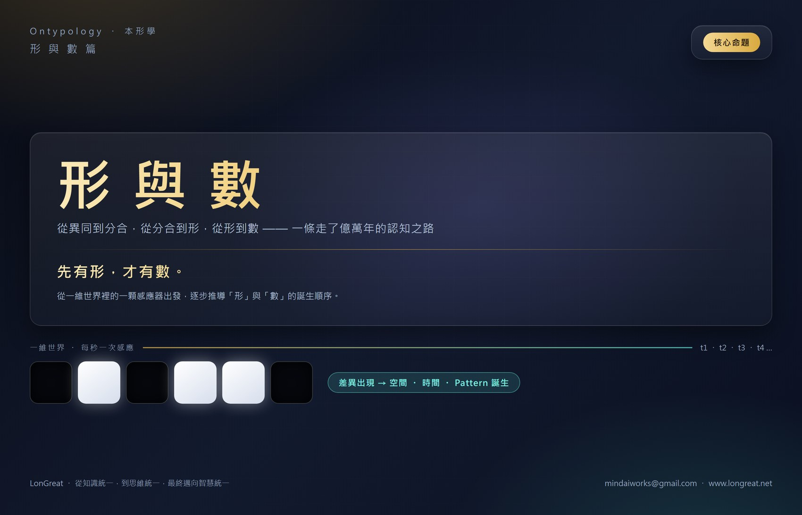

**Why must there be a Type before there can be Number?**

*── From Difference & Similarity to Taiji, from Gestalt to Mathematical Symbols: a cognitive chain ──*

**❝  A Type answers "what it is"; a Number answers "how many".  ❞**

## Table of Contents

- **Chapter 1**　Introduction: Starting from That Beam of Light in the Cambrian

- **Chapter 2**　Where the Type Comes From: Difference & Similarity → Split & Merge → Type → Name

- **Chapter 3**　Thought Experiment: A Single Sensor in a One-Dimensional World

- **Chapter 4**　The Birth of Number: First Merge, Then Count

- **Chapter 5**　Stacking of Types: Type and Sub-type

- **Chapter 6**　Case Study: The Unwritten Steps Behind 3 + 2 = 5

- **Chapter 7**　Conclusion: First the Type, Then the Number

- **Appendix**　Concept Quick-Reference Table

> **Guide ・ What This Chapter Is About**
>
> This chapter answers a question that seems simple but is in fact extremely fundamental: between "Type" and "Number", which comes first? Starting from a single sensor in a one-dimensional world, we will derive step by step two core propositions—"wherever there is Merge, there must be a Type" and "Number = sub-types within a Type・count comparison"—and finally arrive at the conclusion of the whole chapter: first the Type, then the Number. The brain has walked this path for hundreds of millions of years; to see it clearly is the path Ontypology must take.

## Chapter 1　Introduction: Starting from That Beam of Light in the Cambrian

### Where the Type Comes From

A Type—that is, the "thing" we can recognize—does not exist innately. Its birth follows a fixed order: first the perception of "Difference & Similarity", then the acts of "Split" and "Merge", and only at the end is a "Type" born, and a Type must have a name.

In plain terms, the brain must first perceive that "this is different from that" or that "this is the same as that", and only then does it circle the parts that are the same (Merge) and cut apart the parts that are different (Split). The boundary drawn by this "circling / cutting apart" is what we call a "Type".

Imagine a situation in which only two kinds of things exist in the world: the brain in fact does not need to name them, but only needs to know that "there is a thing" is different from "there is no thing (or another different thing)", and this is the most primitive "Difference". Pushed to the extreme—an observer whose field of vision is entirely black with nothing distinguishable (for example, a person who is completely color-blind)—such an observer will remain forever in a formless state, because there is no "difference" for the brain to draw a boundary with.

From this we can generalize a most basic cognitive chain:

> Difference & Similarity → the brain draws a boundary (Merge) → two Types are produced → they are named "Being" and "Non-being" respectively (one can also think of them as X and Y, black and white)

This chain in fact echoes the Daoist saying "Wuji gives birth to Taiji": before anything has differentiated, there is "Wuji"; once the most basic two poles of "Being／Non-being" and "black／white" have been distinguished, "Taiji" (the first Type) is born.

From the perspective of cognitive science, this chain corresponds to the "Figure-Ground" principle in Gestalt psychology: the human visual system is innately disposed to divide perceived information into "foreground" (figure) and "background" (ground), and this act of "splitting" is precisely the most primitive starting point in the chain "Difference & Similarity → Split & Merge → Type". When the background is uniform and the foreground stands out, the brain can easily draw a boundary; conversely, when everything before the eyes is homogeneous (for example, all black), the brain has nothing to draw a boundary with, and a "Type" cannot be born.

In addition, research in developmental psychology also indicates that infants can distinguish "familiar" from "unfamiliar" faces within a few weeks of birth, which shows that the ability to detect "Difference & Similarity" is innate and requires no learning; but to be able to single out "mother's face" from all faces and give it a stable identity (naming) requires the accumulation of time and experience. This precisely echoes the claim of this paper: Difference & Similarity is innate, Split & Merge occurs naturally, but the birth of a "Type" requires that a boundary be drawn, and the drawing of the boundary requires a sufficient stimulus of difference.

### ▍1-1　The Explosion of the Digital Cambrian

Fei-Fei Li told a story: in the distant Cambrian, the world was pitch black and nothing could be seen. Until a certain trilobite was the first to perceive light. After perceiving light, it developed a nervous system; with a nervous system, the next step was "understanding and thinking", and finally execution. This is the law of biological development.

The key to this story is not light but "difference". In a pitch-black world there is no difference at all, and nothing happens; light is the first detected difference—the difference between light and dark. With difference, the nervous system has something to transmit; with transmission, understanding becomes possible; with understanding, action becomes possible.

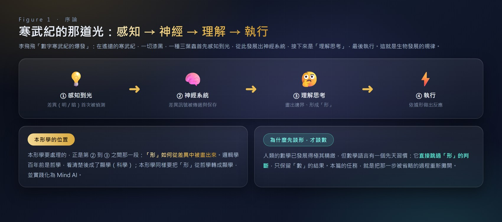

*Figure 1-1　The Cambrian cognitive chain: perception → nervous system → understanding → execution*

### ▍1-2　A Path Omitted by Mathematics

Logic was philosophy a hundred years ago; once people saw it clearly, it became a prominent discipline (a science). Today, when we explore the "Type"—a concept in the brain—it still belongs to the realm of philosophy; what Ontypology aims to do is to see the "Type" clearly, turn it into a prominent discipline, and actualize it as Mind AI.

Why start from "Type and Number"? Because although human mathematics is refined, it has an innate habit: it skips directly over the judgment of the "Type" and retains only the result of the "Number". The legitimacy of every arithmetic expression in fact depends on a step that is not written out. The task of this chapter is to lay this omitted step out in the sunlight.

> **Core Propositions of This Chapter (two sentences that run through the whole chapter)**
>
> 1. Wherever there is Merge, there must be a Type: to circle things that were originally independent into the same whole—this act itself produces a new Type at a higher level.
> 2. Number = sub-types within a Type・count comparison: under the same Type, counting how many times its sub-types appear—Number always attaches to a Type that has already been recognized.

## Chapter 2　Where the Type Comes From: Difference & Similarity → Split & Merge → Type → Name

### ▍2-1　A Type Does Not Exist Innately

A Type—that is, the "thing" we can recognize—does not exist innately. Its birth follows a fixed order: first the perception of "Difference & Similarity", then the acts of "Split" and "Merge", and only at the end is a "Type" born, and a Type must have a name.

In plain terms: the brain must first perceive that "this is different from that" or that "this is the same as that", and only then does it circle the parts that are the same (Merge) and cut apart the parts that are different (Split). The boundary drawn by this "circling / cutting apart" is what we call a "Type".

Imagine a situation in which only two kinds of things exist in the world: the brain in fact does not need to name them, but only needs to know that "there is a thing" is different from "there is no thing (or another different thing)", and this is the most primitive "Difference". Pushed to the extreme—an observer whose field of vision is entirely black with nothing distinguishable (for example, a person who is completely color-blind)—such an observer will remain forever in a formless state, because there is no "difference" for the brain to draw a boundary with.

**From this we can generalize a most basic cognitive chain:**

> **Cognitive Chain**
>
> Difference & Similarity → the brain draws a boundary (Merge) → two Types are produced → they are named "Being" and "Non-being" respectively (one can also think of them as X and Y, black and white)

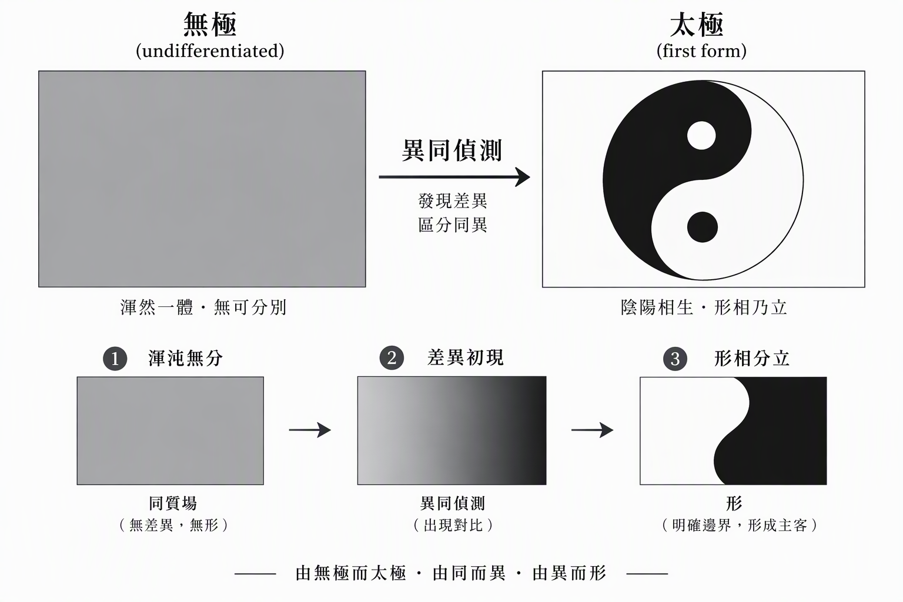

This chain in fact echoes the Daoist saying "Wuji gives birth to Taiji": before anything has differentiated, there is "Wuji"; once the most basic two poles of "Being／Non-being" and "black／white" have been distinguished, "Taiji" (the first Type) is born.

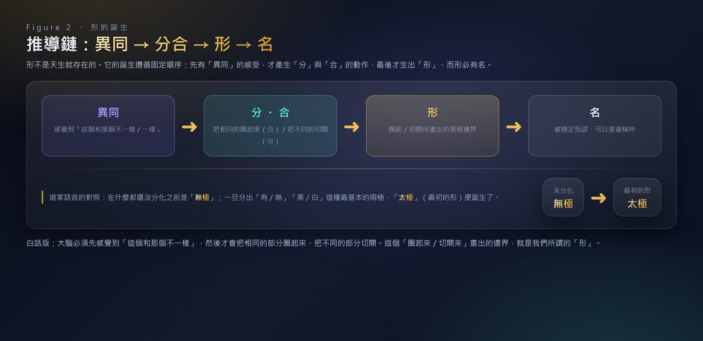

*Figure 2-1　The derivation chain Difference & Similarity → Split & Merge → Type → Name, and its comparison with "Wuji gives birth to Taiji"*

### ▍2-2　Corroboration from Cognitive Science: the Gestalt "Figure-Ground"

From the perspective of cognitive science, this chain corresponds to the "Figure-Ground" principle in Gestalt psychology: the human visual system is innately disposed to divide perceived information into "foreground" (figure) and "background" (ground), and this act of "splitting" is precisely the most primitive starting point in the chain "Difference & Similarity → Split & Merge → Type". When the background is uniform and the foreground stands out, the brain can easily draw a boundary; conversely, when everything before the eyes is homogeneous (for example, all black), the brain has nothing to draw a boundary with, and a "Type" cannot be born.

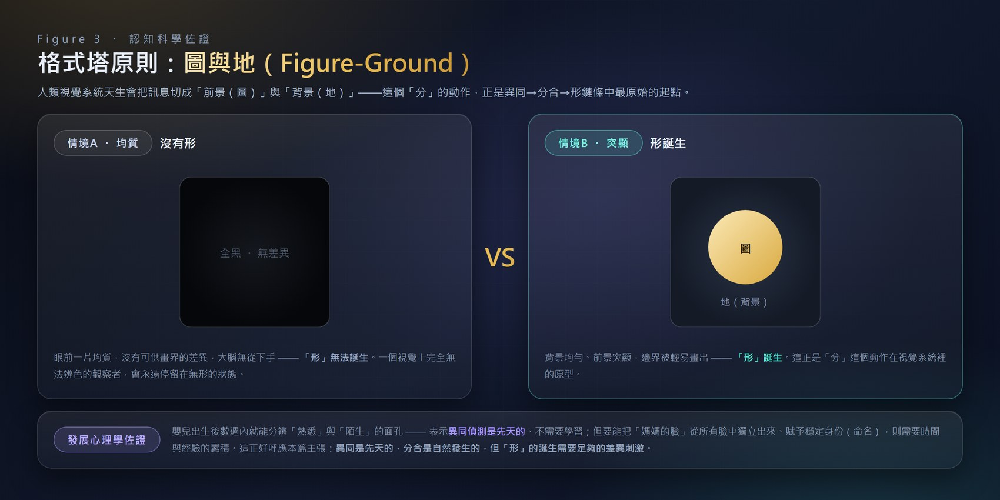

*Figure 2-2　The Gestalt "Figure-Ground" principle: the homogeneous is formless, the salient has form; and corroboration from developmental psychology*

In addition, research in developmental psychology also indicates that infants can distinguish "familiar" from "unfamiliar" faces within a few weeks of birth, which shows that the ability to detect "Difference & Similarity" is innate and requires no learning; but to be able to single out "mother's face" from all faces and give it a stable identity (naming) requires the accumulation of time and experience. This precisely echoes the claim of this chapter: Difference & Similarity is innate, Split & Merge occurs naturally, but the birth of a "Type" requires that a boundary be drawn, and the drawing of the boundary requires a sufficient stimulus of difference.

## Chapter 3　Thought Experiment: A Single Sensor in a One-Dimensional World

### ▍3-1　Experimental Setup

Suppose a one-dimensional world that contains only a single sensor—it senses color once per second and has no other function. The entire history of the universe is just this sensor's record of sensations, cell by cell. Next, in this most minimal world, we observe how "Type" and "Number" are born in succession.

### ▍3-2　Scenario A: Always the Same Color

If the color this sensor senses every second is the same (for example, always black), then every result it sees is identical and equally long. In this case there is neither space nor time—because no "difference" can be discerned, and everything is merely the repetition of the same thing. The world is as if frozen in a single cell.

### ▍3-3　Scenario B: The Color Begins to Alternate

When "difference" appears (the difference here refers to a difference the senses can discern), the situation is entirely different. Suppose that this second the sensor sees black, the next second white, the second after that black again, and so on—space and time will appear simultaneously.

One insight worth noting is that time is in fact derived from change in space; only because there are states that differ in sequence does the concept of "time" come into being. At the same time, because states begin to alternate regularly, a Pattern (regularity／pattern) also arises.

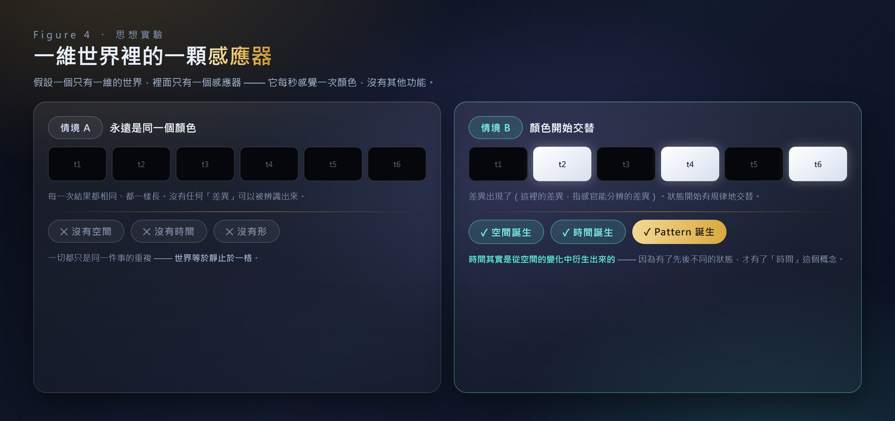

*Figure 3-1　The one-dimensional sensor thought experiment: without difference there is no space-time; with difference, space-time and Pattern are born simultaneously*

### ▍3-4　The First "Type" Is a Boolean Value

Black and white are two different states. When the sensor can distinguish "this is black" from "this is not black (it is white)", this very judgment of "difference／sameness" is the production of the first "Type".

The Type here is essentially a Boolean value (bool)—"Being" or "Non-being", "is" or "is not", "different" or "same". It is the most primordial act of recognition, not yet involving "quantity" or "how many".

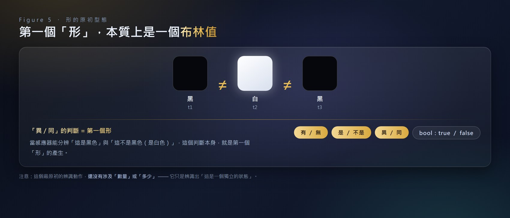

*Figure 3-2　black ≠ white ≠ black: the first "Type" = the judgment of Difference & Similarity = a Boolean value*

## Chapter 4　The Birth of Number: First Merge, Then Count

### ▍4-1　Once and Twice

Only when the way black and white alternate becomes more complex does Number begin to appear. For example: this second is black, the next second is white, and the second after that is white again—white appears twice in a row. At this point the sensor will discover that black appears for a shorter time and white appears for a longer time. In other words, black appears only once, while white appears twice.

**This distinction between "once" and "twice" is the production of the first "Number", and hence a new Pattern arises.**

### ▍4-2　What "Merge" Does Quietly in the Background

To be able to count that "white appears twice", the premise is that these two appearances of white must first be judged to be "the same kind of thing"—that is, there must first be an act of "Merge" that circles two independent instants into "two instances of the same Type", and only then can they be treated as the same unit for cumulative counting. If every appearance of white were treated as a completely different, independent thing, then there would be only "difference" and no "sameness", and counting would be impossible.

In other words: Number is not merely the act of "counting occurrences"; it also presupposes the judgment of "which things can be regarded as the same unit", and this judgment is precisely what "Merge" does quietly in the background.

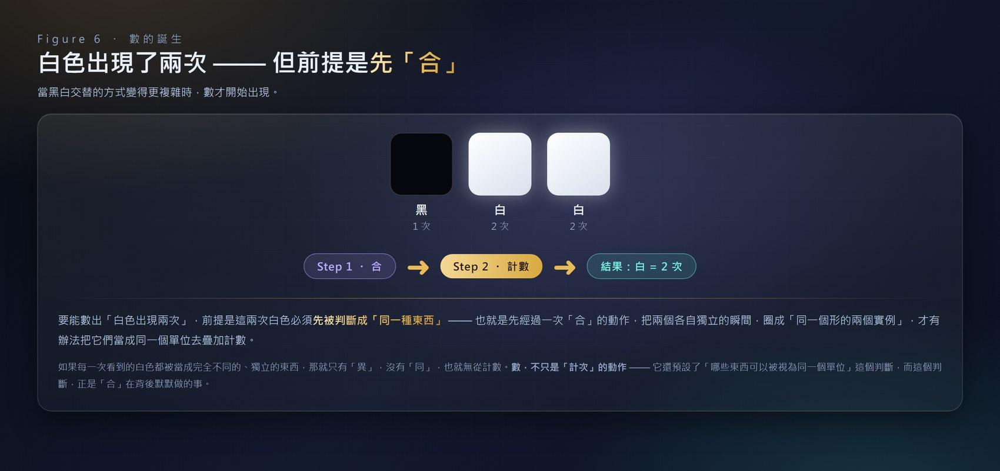

*Figure 4-1　The birth of Number: only after "Merge" into the same unit can we count that "white = 2 times"*

### ▍4-3　The Key Difference Between Type and Number

The dividing line between Type and Number emerges right here:

- **Type** answers "what it is／what it is not" (the recognition of Difference & Similarity). Without a Type, one cannot recognize "this is an independent state". It is the more primordial and more fundamental cognitive act—a Type can exist without Number.

- **Number** answers "how many／how many times" (a further measurement on top of the Type). Number, building on the already-achieved recognition of Types, goes on to count "how many times such a Type has appeared"—Number cannot exist separately from the Type.

|  | Type | Number |
|---|---|---|
| Question answered | what it is／what it is not | how many／how many times |
| Cognitive act | recognition of Difference & Similarity (drawing a boundary) | measuring an already-recognized Type |
| Condition of existence | can exist without Number | cannot exist separately from the Type |

Suppose we define "black" as A, "black white" as B, and "white" as C. Among A, B, and C, we can judge through "Difference & Similarity" that they are different Types—this is the level of Type. But when we go on to ask "how many times did A appear" or "which appears more often, B or C", we have crossed from "recognition of Types" into "measurement of Number".

**This shows one thing: Number cannot exist separately from the Type, but the Type can exist without Number. The Type is the more primordial and more fundamental cognitive act; Number is the next layer of abstraction built on top of the Type—the result of "measuring an already-recognized Type".**

## Chapter 5　Stacking of Types: Type and Sub-type

### ▍5-1　Inner-Outer Split & Merge Is the Most Basic Type

Consider first the most basic state: a circle. This circle, with its inner-outer Split & Merge, is a basic Type—it exists, has a boundary, and can be recognized as "a thing (a unity)".

Next, place several such circles together and merge them into a group. This act of "Merge" itself produces something new: these originally independent circles are now regarded as one whole. In other words, we no longer see only "three separate circles", but see "a larger Type that contains three circles".

**Wherever there is Merge, there must be a Type.** This "larger Type" does not exist to begin with; it is produced by the act of "Merge". Before the Merge, there were only three independent basic Types; after the Merge, there is one more new Type at a higher level—a Type that can express the very fact that "these things are the same group".

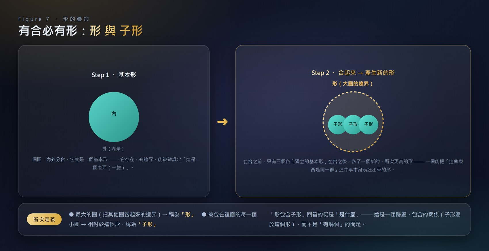

*Figure 5-1　From basic Type to Type and Sub-type: the act of Merge produces a new Type at a higher level*

Once this new, larger Type appears, two levels can be distinguished:

- The largest circle, that is, the boundary that encloses all the other circles, is called the "Type".

- Each small circle enclosed within, relative to this large Type, is called a "Sub-type".

The fact that "a Type contains sub-types" still answers the question "what it is"—this is a relationship of belonging and containment (the sub-type belongs to this Type), not a question of "how many there are".

### ▍5-2　Plain Definitions of Split, Merge, and Type

- **Split:** seeing the places where these things "differ from one another".

- **Merge:** among these differing things, finding the parts that "can actually be counted as the same class".

- **Type:** the boundary drawn by Split & Merge; the "thing" we ultimately recognize and can name.

### ▍5-3　Infinite Stacking: Number Is Asked Anew at Every Level

The brain's way of classifying gradually refines from "the whole" to "features". When there are only two things at first, counting is not needed; but when the second thing appears, the concept of "Number" is born, because at this point it becomes necessary to distinguish "this one", "that one", and "one more".

This structure can in fact be stacked downward infinitely: under one sub-type, still smaller sub-sub-types can be contained. In other words, the stacking of Types is the process by which the Type itself continuously extends and continuously grows new levels, and this whole process still belongs to the domain of Type.

But whenever, at any one of these levels, we stop to ask "how many are there under this level", Number is produced anew at that level. In other words:

- The stacking of Types is an extension in structure;

- The production of Number is the result of counting sub-types at some one level of structure.

Number does not appear out of thin air; it always attaches to a Type at some level that has already been recognized. Without first distinguishing the sub-types one by one, the question "how many" cannot even be asked.

What the two scenarios have in common is this: recognition always occurs before counting—

- **Black-white alternation:** first we can distinguish black from white (Type), and then we go on to count "how many times black appears and how many times white appears" (Number).

- **Type and Sub-type:** first we can distinguish "which small circles belong to this large Type" (Type), and then we go on to count "how many sub-types there are under this large Type" (Number).

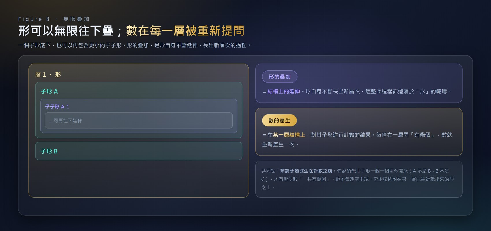

*Figure 5-2　The infinite stacking of Types: stacking is structural extension; Number is asked anew at every level*

## Chapter 6　Case Study: The Unwritten Steps Behind 3 + 2 = 5

### ▍6-1　A Primary-School Problem

There are three apples, two potatoes, and two peaches; how many fruits are there in total? The answer most people give is just an arithmetic expression: 3 + 2 = 5.

But for this expression to hold, a step that is not written out has in fact already occurred beforehand: the brain must first judge that "apples" and "peaches" both belong to the higher-level category "fruit", so that the two can be regarded as the same unit and put into the same addition expression to be added together.

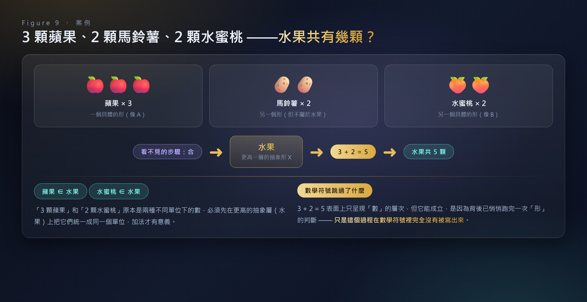

*Figure 6-1　The invisible premise of 3 + 2 = 5: apple ∈ fruit, peach ∈ fruit*

### ▍6-2　What Mathematical Language Skips Over

An apple is a concrete Type (like A), a peach is another concrete Type (like B), and "fruit" is the abstract Type (X) that circles A and B together and gives them a common name. If the belonging judgment "apple ∈ fruit" and "peach ∈ fruit" is not completed first, then 3 and 2 simply cannot be added—because "3 apples" and "2 peaches" were originally numbers under two different units, and they must first be unified into the same unit at a higher level of abstraction (fruit) for the addition to be meaningful.

In other words, the expression 3 + 2 = 5 on the surface presents only the level of "Number", but it holds because a judgment of "Type" (apple, peach → merged into fruit) has already quietly been completed behind it—only this process is not written out at all in the mathematical symbols; mathematical language skips directly over the "Type" and retains only the result of the "Number".

> **Key Sentence**
>
> Whether things can be added depends on whether a Type can first be found that merges the two into the same unit—and this step is precisely the part that mathematical symbols never write out.

## Chapter 7　Conclusion: First the Type, Then the Number

Gathering the derivation of the whole chapter together, it is one sentence:

**First the Type, then the Number.**

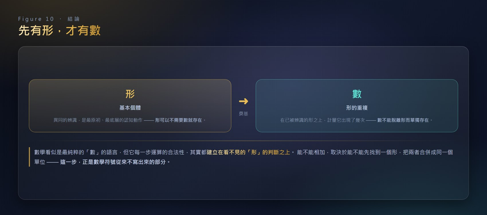

*Figure 7-1　Conclusion: the Type is the basic individual, the Number is the repetition of the Type; first the Type, then the Number*

### ▍7-1　The Significance for Mind AI

This derivation chain has a direct implication for artificial intelligence: a system that only processes "Number"—whether a statistical model or a vector space—if it has not first recognized the "Type" (entities, boundaries, belonging relationships), then all its computations are rootless. True understanding must first complete the segment "Difference & Similarity → Split & Merge → Type": dividing the world into units that can be identified, named, and assigned, and only then can measurement and reasoning be carried out on top of these units.

From the unification of knowledge, to the unification of thought, and ultimately toward the unification of intelligence. This is the eternal way of AGI pursued by LonGreat—making artificial intelligence not merely a tool, but a truly intelligent living system with the capacity for understanding, reasoning, learning, and creation.

### ▍7-2　Review of the Whole Chapter's Derivation

- Difference & Similarity is innate: without difference, there is nothing at all (an all-black world is formless).

- Split and Merge occur naturally: circle the same, cut apart the different, and the boundary is drawn accordingly.

- Type = boundary, and a Type must have a name: the first Type is a Boolean value (difference／sameness).

- Wherever there is Merge, there must be a Type: the act of Merge itself grows a new Type at a higher level.

- Number = sub-types within a Type・count comparison: Number attaches to an already-recognized Type and is asked anew at every level.

- Mathematics skips over the "Type": the legitimacy of 3 + 2 = 5 rests on an invisible judgment of belonging.

> **In One Sentence**
>
> Difference & Similarity → Split & Merge → Type → Name; a Type can be stacked infinitely and still be a Type; Number is the result of asking "how many" at any one level. Recognition always occurs before counting—so first the Type, then the Number.

## Appendix　Concept Quick-Reference Table

| Concept | One-Sentence Definition |
|---|---|
| Difference & Similarity | Perceiving that "this and that are different／the same". The most primitive, innate spark of cognition. |
| Split | Seeing the places where these things "differ from one another"—the act of cutting apart. |
| Merge | Among differing things, finding the parts that "can be counted as the same class"—the act of circling together. |
| Type | The boundary drawn by Split & Merge; the "thing" we can recognize and name. The first Type is a Boolean value. |
| Name | The label by which a Type is stably identified and can be repeatedly referred to. |
| Sub-type | Each small Type enclosed within a larger Type; the two are in a relationship of belonging, answering "what it is". |
| Number | Under the same Type, counting how many times a sub-type appears—the sub-types within a Type・count comparison. |
| (Pattern) | The pattern formed by the regular alternation of states; born together with difference and time. |
