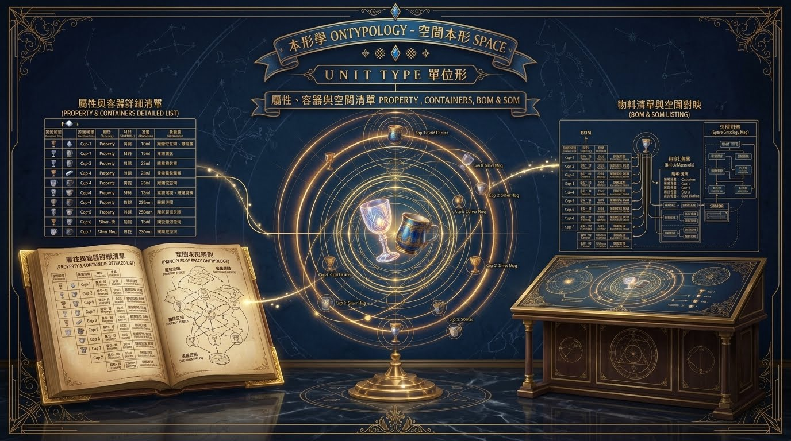
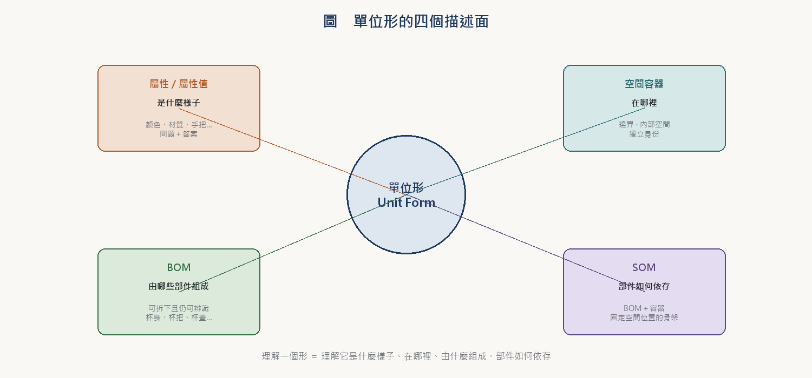
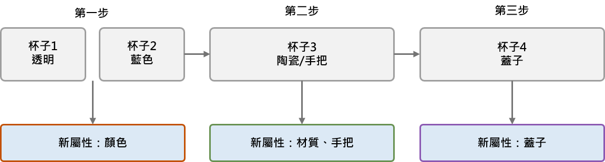
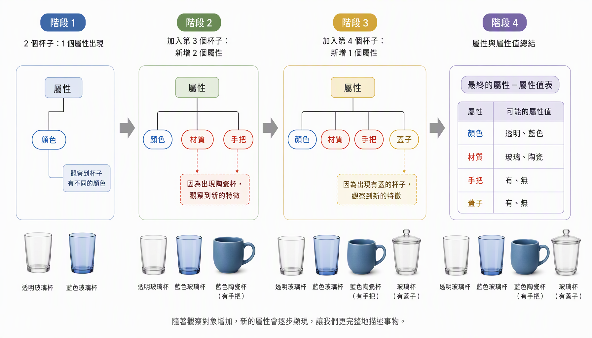
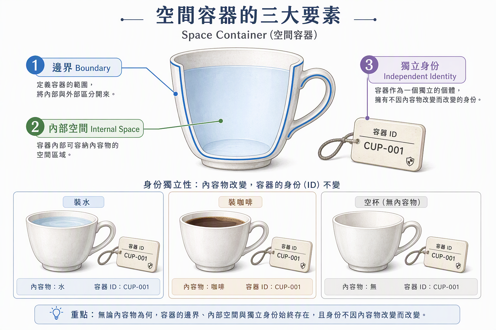
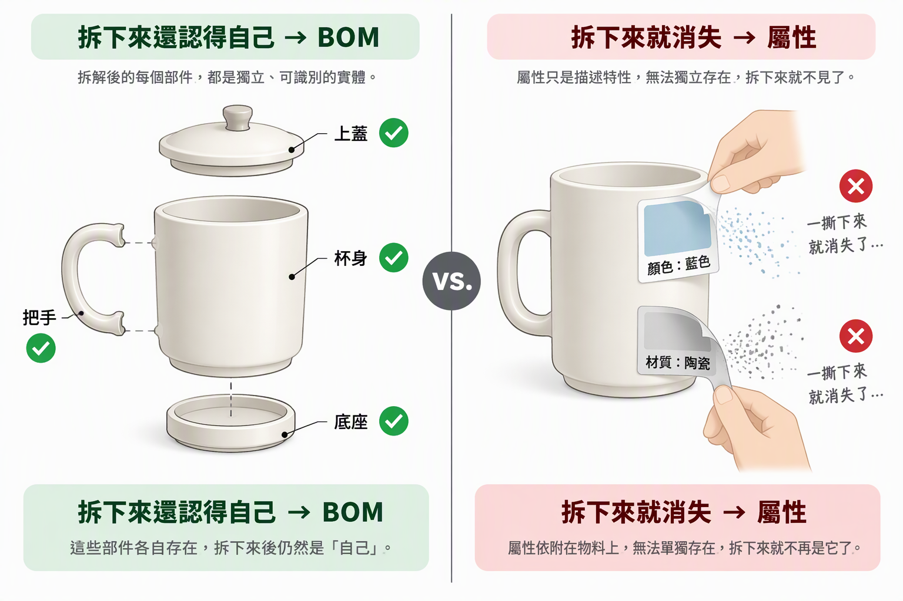
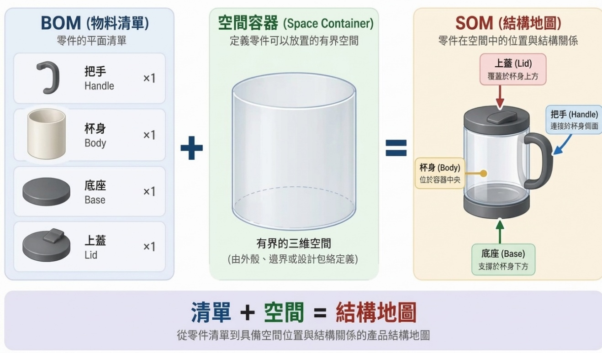
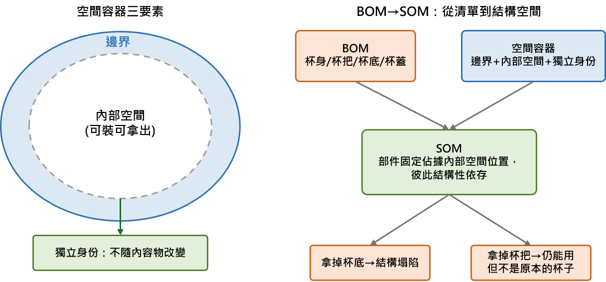

  <a href="https://youtu.be/6y4EZyKeGhk">💻Landscape</a> ｜ 
 <a href="https://v.douyin.com/Z6qcrkO2J5U">📱Portrait</a> 
 

# Ontypology

# Space Type Space

**Unit Type  UNIT TYPE**

**Property, Containers & Space Inventory**

*Property , Containers, BOM &amp; SOM*

## Table of Contents

**❖　Introduction——The Four Descriptive Aspects of a Unit Type**

**◆　Chapter One　Attributes and Attribute Values**

**◆** 1.1　How Attributes Gradually Emerge——Using a Cup as an Example

**◆　Chapter Two　Space Collections**

**◆　Chapter Three　Space Inventory: BOM and SOM**

**◆** 3.1　BOM (Bill of Materials)

**◆** 3.2　SOM (Space of Materials, Space Inventory)

**❖　Chapter Key Points Review**

*To understand a Type = to understand what it looks like, where it is, what it is composed of, and how its parts depend on one another*

## Introduction——The Four Descriptive Aspects of a Unit Type

> **Chapter Map**
>
> **◆** This chapter uses a single "cup" to run through the entire chapter, answering in sequence the four basic questions about a Unit Type.
>
> **◆** What does it look like?——"Attributes and Attribute Values" (Chapter One).
>
> **◆** Where does it put things?——"Space Collections" (Chapter Two).
>
> **◆** What parts is it composed of?——"BOM Bill of Materials" (Chapter Three).
>
> **◆** How do the parts depend on one another?——"SOM Space Inventory" (Chapter Three).

> **Figure 1-1** The four descriptive aspects of a Unit Type

## Chapter One　Attributes and Attribute Values

> *Chapter Imagery・The Axis of Attributes——Dimensions and Scales*

An Attribute is "a question that can be asked." It has no answer itself; it merely delimits a range of "what to ask." An Attribute Value, on the other hand, is the actual answer to that question in a particular concrete situation—the individual options circled out under the Attribute. By analogy: an Attribute is like the column header of a blank table, reading "Material"; an Attribute Value is the content actually filled into that column, such as "Ceramic." The header itself does not change, but the answers that can be filled in beneath it differ depending on the concrete object.

**Table 1-1　Comparison of Attributes and Attribute Values**

|  | **Attribute** | **Attribute Value** |
| --- | --- | --- |
| **Positioning** | A question that can be asked | The actual answer to the question in a concrete situation |
| **Analogy** | The column header of a table ("Material") | The content actually filled into the column ("Ceramic") |
| **Change** | The header itself does not change | Differs depending on the concrete object |

### 1.1　How Attributes Gradually Emerge——Using a Cup as an Example

**Step One:** Two cups are placed together, their difference & similarity is detected, and the difference is found to fall in only one place: transparent versus blue. The only Attribute emerging at this stage is "Color," with Attribute Values {transparent, blue}.

**Step Two:** A third cup (ceramic, blue, with a handle) is added. Looking first at the color blue, the existing color axis already has this option, so it is attached directly, and the color axis needs no change. But this cup simultaneously brings two batches of new difference: the material changes from "glass" to "ceramic," and this batch of difference does not match the dimension of color, thus forcing out a second Attribute, "Material"; moreover, this cup has a handle, while the first two cups have nothing at all to compare against, and this difference likewise matches neither color nor material, thus forcing out a third Attribute, "Handle."

Once "Material" and "Handle" are established, the first two cups must also backfill values for these two Attributes—Material is filled in as "glass" (it was glass all along, it just did not need to be stated before), and Handle is filled in as "N" (it was absent all along, there was just nothing to compare before). Once an Attribute is extracted, it must be applied to all individuals that have already appeared; it cannot be that only the newly arrived object has it while the rest remain blank, because an Attribute is a dimension, and a dimension must run through all individuals in order to be used for mutual comparison.

**Step Three:** A fourth cup (glass, transparent, with a handle, with a lid) is added. Color, Material, and Handle all match existing axes, but only the difference "Lid" has nothing in the first three cups to compare against, thus forcing out a fourth Attribute, "Lid," again backfilling "N" for the first three cups.

**Step Four:** For cups added thereafter, whether the color becomes gold, silver, beige, khaki, white, or gray, or the material becomes stainless steel or paper, all these differences match the two existing dimensions of Color and Material, so one need only add Attribute Values under the corresponding Attributes, with no need at all to open new Attributes; Handle and Lid likewise continue to be recorded as Y／N, and no fifth new Attribute will pop up, because all currently observed differences can already be accommodated by these four dimensions.

> **Figure 1-2** Timeline of Attributes emerging as cups are gradually added

> **Figure 1-3** The four stages of Attribute emergence and the consolidated Attribute–Attribute Value master table

Finally it is consolidated into a complete Attribute–Attribute Value master table:

**Table 1-2　Attribute–Attribute Value Master Table**

| **Attribute** | **Attribute Value** |
| --- | --- |
| Material | stainless steel, ceramic, paper, glass |
| Color | transparent, blue, gold, silver, beige, khaki, white |
| Handle | Y／N |
| Lid | Y／N |

From this a rule can be induced: the moment an Attribute emerges is always the moment when "this batch of difference matches none of the existing Attributes"; the moment an Attribute Value increases is whenever "the nature of the difference matches some existing Attribute," in which case it is simply put in. Moreover, each time an Attribute emerges, it is accompanied by applying this new dimension back onto all individuals that already exist, so that every individual has a definite value on every Attribute; only then is this structure complete and free of gaps.

This rule can be formalized as a decision procedure: when a new object is brought up for comparison with existing objects, first ask "the nature of this batch of difference—which existing Attribute does it match?" If the answer is "it matches some Attribute," then simply add a new Attribute Value under that Attribute, with no need to touch the Framework; if the answer is "it matches none of the existing Attributes," then a new Attribute must be opened, and this new Attribute must be backfilled for all individuals that already exist. This procedure ensures the completeness of the Attribute structure: every individual has a definite value on every Attribute, and there will be no gap such as "some cup is blank on some Attribute."

This mechanism also explains why the number of Attributes is usually far smaller than the number of Attribute Values: an Attribute is a "dimension," representing the "kind" of difference; an Attribute Value is an "option," representing the various possibilities within the same kind of difference. In our cup example, there are only 4 Attributes (Color, Material, Handle, Lid), but the Attribute Values keep expanding as the number of cups increases (Color grows from 2 values to 7 or more). This is like a coordinate system: the number of axes is fixed (two dimensions are two dimensions), but the scales on each axis can extend indefinitely.

> **Attribute Emergence Rule (Summary)**
>
> **◆** The difference matches none of the existing Attributes → open a new Attribute and backfill all existing individuals.
>
> **◆** The nature of the difference matches an existing Attribute → only add a new Attribute Value under that Attribute.
>
> **◆** Few Attributes, many Attribute Values; dimensions are fixed, scales can extend.

## Chapter Two　Space Collections

> *Chapter Imagery・The Light of the Container——Boundary and Interior Space*

A Space Collection refers to: an object that has a definite boundary in space, where this boundary encloses a piece of "interior space" that allows other things to be put in and taken out, while the container itself does not change who it is because of whether there is anything in its interior space or what is inside it. In short, a container answers the question "where is the thing," not the question "what is the thing"; a cup does not become a different thing because it holds water or coffee—it is the same cup from beginning to end.

A Space Collection comprises three elements:

#### (1) Boundary

The boundary is the most core part of the container; its function is to distinguish "inside" from "outside." The wall of a cup, the body of a bowl, the wall of a room, the fabric of a backpack, the stitching of a pocket—all are boundaries; a boundary does not have to be a solid physical body—a water surface, or a line drawn with chalk, can constitute a boundary as long as it clearly marks the difference between "in" and "not yet in." A boundary can be closed (like a sealed thermos) or open (like a cup without a lid); being open or not affects whether things can "fall out," but does not affect whether the container itself is a container.

#### (2) Interior Space

The interior space is the piece of space enclosed by the boundary and actually used to contain other objects; its size and shape determine what the container can hold and how much. The interior space can be empty (an empty cup is still a cup), and can also simultaneously contain multiple different things (a cup can hold water and ice cubes at the same time).

#### (3) Independent Identity

This is the most crucial and also the most easily overlooked property of a Space Collection: the identity of a container is not determined by the contents it holds, but by its own boundary and structure. Because identity is independent of the contents, a container can undergo the entire process of "put something in → take it out → put something else in," and each time still be recognized as the same container. This is very different from the identity of ordinary things: if we replace the "water" in a glass of water with "coffee," we do not say "this glass of water became coffee," but rather "what is in the cup has changed," "what changed is the content," while "the container has not changed"—this linguistic sense actually already reflects the property that a container's identity is independent of its contents.

> **Figure 2-1** The three major elements of a Space Collection: boundary, interior space, independent identity

From this the relationship between container and contents extends: the contents are replaceable and removable, and do not in turn define the container; a container can have size limits, and this is also what distinguishes a container from "boundaryless space." In addition, containers can nest within one another—a cup can be put into a bag, a bag into a box, a box into a room; each layer of container stands independently on its own, each obeying the three basic elements of "boundary, interior space, independent identity."

> **Figure 2-2** The nesting of containers: cup into bag, bag into box, box into room, each layer standing independently on its own

## Chapter Three　Space Inventory: BOM and SOM

> *Chapter Imagery・Structural Blueprint——Exploded View of Parts*

### 3.1　BOM (Bill of Materials)

The BOM answers "when you open this thing up, what smaller things is it composed of"—a cup is composed of a body, an ear, and a lid. To obtain a BOM, one need only take the individual itself apart; there is no need to compare it with any other individual; even if only this one cup existed in the world, as long as it has a handle and a lid, it can still be taken apart into "body + bottom + ear + lid"—this does not rely on comparison, it relies on disassembly.

To judge whether a feature should be listed in the BOM, there is only one criterion: whether it can be taken off, and whether after being taken off it is still a thing with an independent identity that can be recognized. Use this criterion to check several features on a cup:

**Table 3-1　BOM Criterion Checklist——"After it is taken off, does it still recognize itself?"**

| **Feature** | **Verdict** | **Explanation** |
| --- | --- | --- |
| **Cup ear (handle)** | **Counts as BOM** | Can be taken off, and after being taken off is still "a cup ear." |
| **Cup lid** | **Counts as BOM** | Can be taken off, and after being taken off is still "a lid." |
| **Color** | **Attribute** | Cannot be taken off; removing the color does not leave "a portion of extracted color"—the color simply disappears. |
| **Material** | **Attribute** | Likewise cannot be taken off; material is what the body "is made of," not what the body "has inside it." |

> **Figure 3-1** The boundary between BOM and Attribute: what can be taken off goes into BOM, what cannot goes into Attribute

This criterion clearly draws the boundary between BOM and Attribute: what can be taken off, and after being taken off is still an independent individual, goes into BOM; what can only be used to describe "what this thing itself looks like" and cannot be taken off goes into Attribute.

This criterion can be expressed more concisely: "After it is taken off, does it still recognize itself?" If the answer is "yes, it does" (for example, a cup lid taken off is still a lid), then it goes into BOM; if the answer is "no, it does not" (for example, a color, once "taken off," is nothing at all), then it goes into Attribute. This criterion applies not only to cups but to any object: a car's engine, tires, and doors can be taken off and still be "an engine," "a tire," "a door," so they are items of the car's BOM; but a car's color, brand, and year of manufacture cannot be taken off—they are the car's Attributes.

Taking the cup as an example, the BOM gradually emerges as observation samples increase: the first cup (glass, transparent, no handle, no lid) is a continuous piece of glass as a whole, and taking away any part leaves nothing independently nameable, so at this stage the BOM has only two items, body and bottom; the second cup (ceramic, blue, with a handle, no lid) adds a detachable handle, and the BOM grows to three items; the third cup (glass, transparent, with a handle, with a lid) adds a lid, and the BOM grows to four items.

The BOM is responsible for answering "when this thing is opened up, what independently recognizable parts is it composed of"; Attributes are responsible for answering "what does this thing (whether as a whole, or as some part within the BOM) itself look like." The BOM determines how many branches the tree structure splits into downward; Attributes determine the appearance of each branch and each node itself. Only the two together can describe an individual completely and without omission.

### 3.2　SOM (Space of Materials, Space Inventory)

**SOM ＝ BOM ＋ Space Collections**

The BOM can tell you "what parts can be disassembled," but it will not tell you how these parts are arranged in space, whether they depend on one another, or which part, if removed, would destabilize the whole; the BOM is a "list," not a "map." Space Collections are the opposite: they can tell you "there is a boundary, there is interior space," but the things in the interior space are treated as freely replaceable contents (swapping water for coffee makes no difference), and they cannot present the matter of "parts having fixed positions and mutually depending on one another." What SOM is meant to handle is precisely the question that neither of the two can answer but that only their superposition can: what space does this object occupy, and can the things in this piece of space be removed at will.

What SOM describes is: an object that simultaneously possesses the Space Collection's "boundary, interior space," but whose interior space holds not freely replaceable contents, but parts that are fixed at specific spatial positions, structurally depend on one another, and together constitute this object itself. In other words, SOM is a "container," but what the container holds is not water, but the container's own skeleton.

**The properties of SOM are half inherited from Space Collections and half inherited from BOM:**

**Table 3-2　The Inheritance Structure of SOM**

| **Inheritance Source** | **Inherited Properties** |
| --- | --- |
| **Inherited from Space Collections** | Boundary (distinguishing "the extent of this object" from "outside the extent"), interior space (the place the parts actually occupy and exist in), independent identity (having its own identity as a whole, rather than being merely a stacked list of parts). |
| **Inherited from BOM** | Structural parts (the things in the interior space are not just anything that can be put in, but the parts necessary to constitute this whole), the dependency relations among parts (the parts have supporting, connecting, and attaching relations with one another, rather than being mutually independent and equal in status), and the fact that removing a part destabilizes the identity of the whole (unlike a container, once SOM removes a part, it very likely is no longer "the same thing"). |

Taking the cup as an example to look at SOM: the interior space (from Space Collections) is the space enclosed by the boundary; inside it is not empty, but filled with structural parts; the structural parts (from BOM) are the body, handle, bottom, and lid, each occupying a piece of the interior space, with their positions fixed relative to one another—the handle grows at the middle of the side, the bottom is at the very bottom, and their positions cannot be swapped at will; the dependency relations (from BOM) are manifested in that if the bottom disappears, the entire structure collapses and the cup ceases to be a cup, and if the handle disappears, the cup can still hold water, but it is no longer the original "cup with a handle."

> **Figure 3-2** SOM ＝ BOM ＋ Space Collections: from parts list to structural map

This is a completely different level of description from the earlier standalone "cup as container" (holding water, holding coffee): looking at a cup that holds water is viewing the cup as a Space Collection; how the cup itself is constituted by body, handle, and bottom is viewing the cup as a SOM. The two can hold simultaneously, only answering two different questions: "what guest is inside it" and "how did this thing itself grow into being." SOM puts "structure"—this originally abstract relation—back onto the concrete stage of "space," so that the dependency relations between parts are not merely a logical description, but an existence that can be seen, located, and actually occupying space.

> **Figure 3-3** The three elements of a Space Collection, and how the BOM combines with Space Collections to form SOM

Chapter Key Points Review

| **❖ Attribute／Attribute Value**  If a difference matches no existing dimension, open a new Attribute and backfill all existing individuals; if a difference matches an existing Attribute, only add a new Attribute Value under that axis. Few and fixed dimensions, many and extensible scales. | **❖ Space Collections**  The boundary distinguishes inside from outside, the interior space contains the contents, and the independent identity does not change with the contents. Containers can nest layer by layer, each layer standing independently on its own. |
| --- | --- |
| **❖ BOM Bill of Materials**  Only what can be taken off and still recognizes itself after being taken off is a part. Color and material cannot be taken off—they belong to Attributes, not BOM. | **❖ SOM Space Inventory**  SOM ＝ BOM ＋ Space Collections. Parts fixedly occupy spatial positions and structurally depend on one another; removing a part destabilizes the identity of the whole. |

[www.longreat.net](https://www.longreat.net)

Chang-Feng Chang [gamma@livemail.tw](mailto:gamma@livemail.tw)

Ting-Ying Chang [mindaiworks@gmail.com](mailto:mindaiworks@gmail.com)
