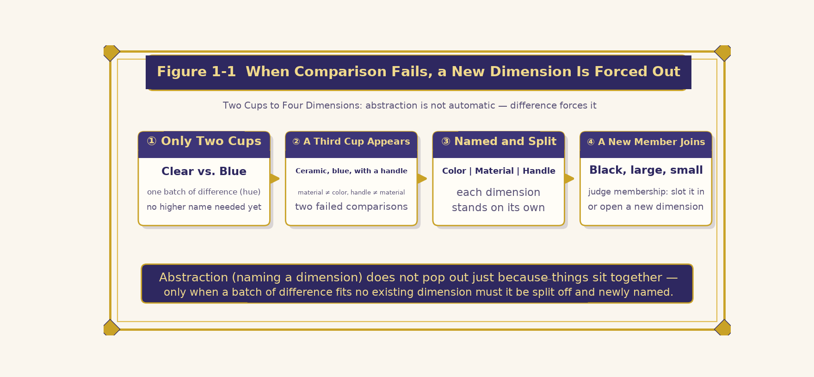
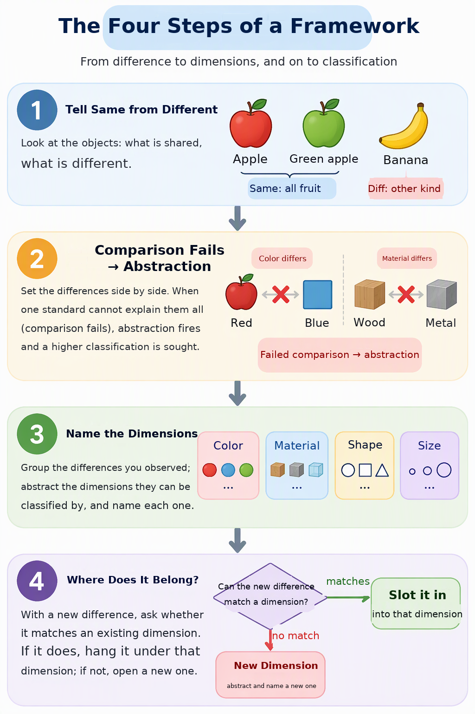
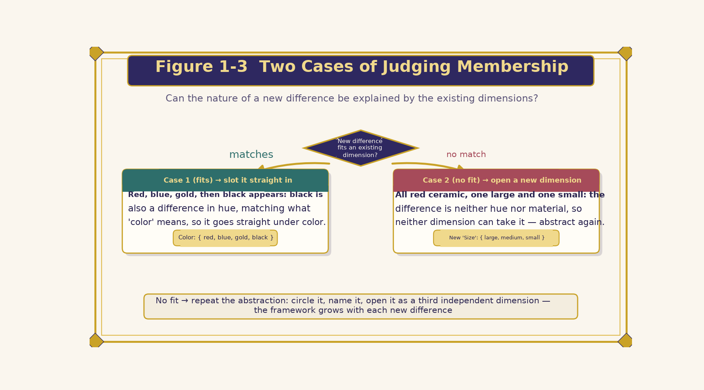
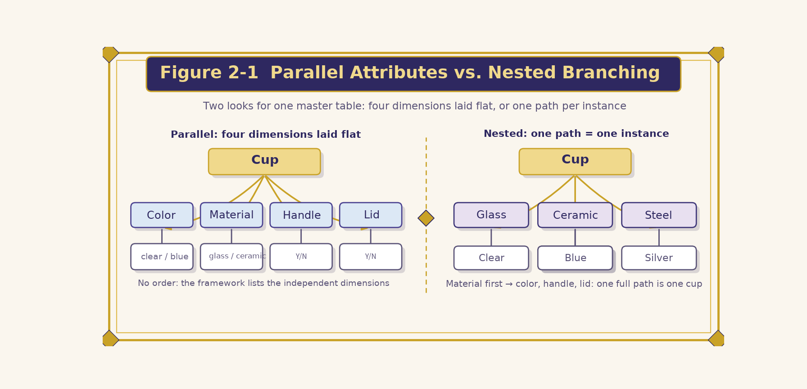
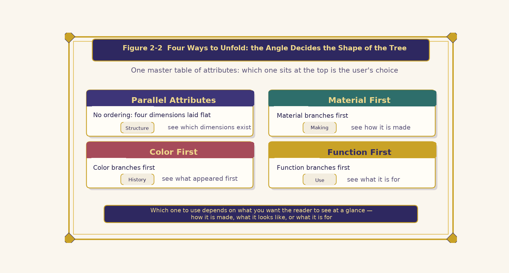
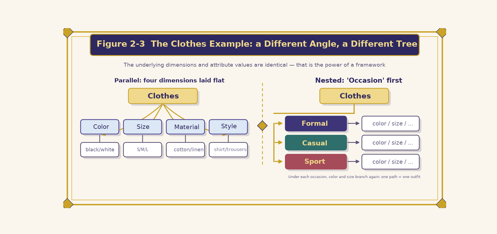
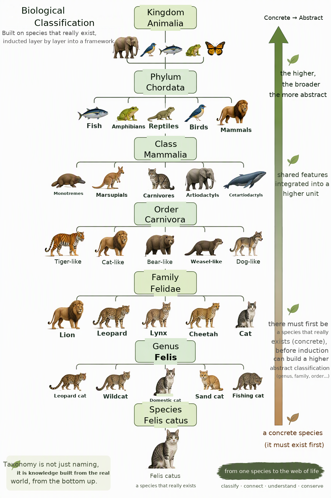
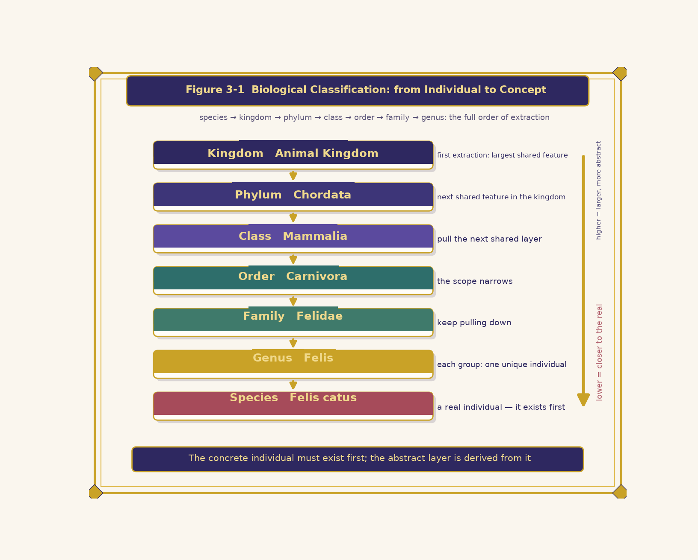
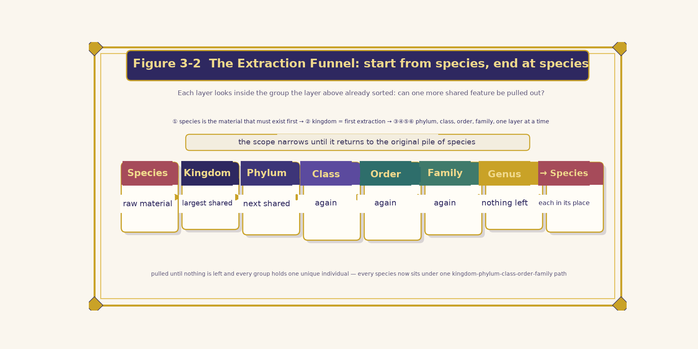
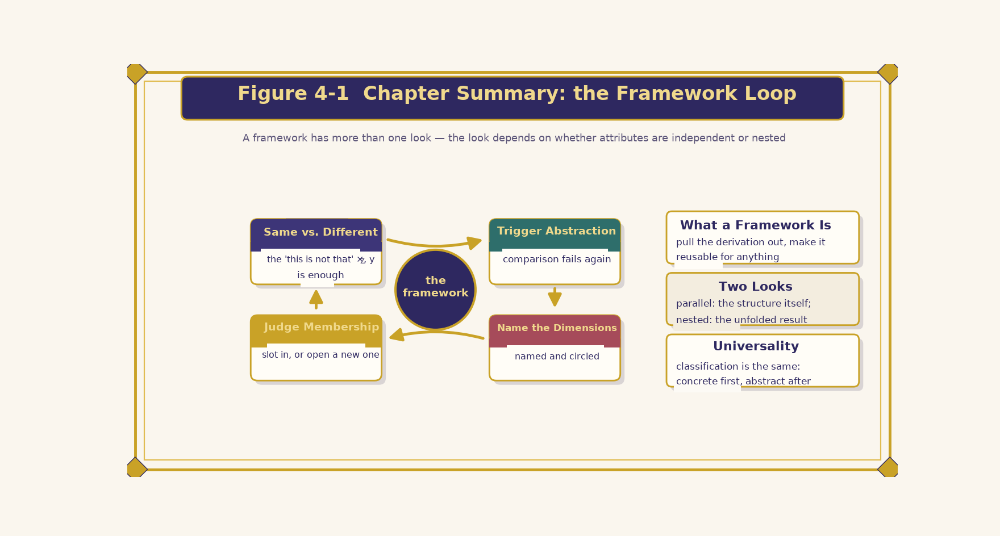

# Ontypology

# Spatial Type

# Space Framework

*Turning a Derivation into a Repeatable Method*

## TABLE OF CONTENTS

- Introduction: Making Derivation Repeatable
- Chapter 1 The Four Steps
- 1-1 Starting from Comparison Failure
- 1-2 The Four Steps
- 1-3 Two Cases of Membership
- Chapter 2 Ways to Expand the Framework
- 2-1 Parallel-Attribute and Nested-Branch
- 2-2 Four Expansion Patterns
- 2-3 The Clothing Example
- Chapter 3 Universality: Biological Classification
- 3-1 Species as Raw Material
- 3-2 The Extraction Funnel
- Chapter Review

## Introduction — Making Derivation Repeatable

*Chapter Image · The Helm of the Framework — turning derivation into a repeatable course*

Framework refers to the basic structure, format and norms of a thing or a system. In different fields it stands for a tool or concept that supplies a basic skeleton and a standardized process, helping people quickly build systems, organize information, or analyse problems.

In the chapter “Property and Property Value” we used a cup as an example: starting from the first distinction of “this is not that”, we derived colour, material, handle and lid, and finally converged into a complete property — property value master table. That derivation answered “what properties does a cup have”; but the truly valuable output of the process was not the master table itself, but the whole process of “how dimensions grow out of a pile of differences”.

What the framework does is exactly to extract this whole derivation process and turn it into a method that can be applied again and again no matter what the objects are — cups, clothes, living things, or any set of distinguishable things. The framework is what remains after the framework has done its work: once the four steps have run and the dimensions stand up one by one, the skeleton left standing there is the framework.

In other words, “Property and Property Value” shows one successful derivation; the framework shows the method that lets such derivations be replayed again and again. The former gives you a fish, the latter gives you the route to fish — and that is the weight of the phrase “repeatably applicable”.

> **❖ Chapter Map**
>
> - “Property and Property Value” derives four properties — colour, material, handle and lid — from a cup — this chapter extracts “this whole derivation process” and turns it into a method any object can use.
> - What if a difference matches no existing dimension? — “The Four Steps” (Chapter 1).
> - Once the dimensions are laid out, how may they be arranged? — “Ways to Expand the Framework” (Chapter 2).
> - Is the framework good only for cups? — “Universality: Biological Classification” (Chapter 3).

> *The framework supplies the fact of “which dimensions exist”; how to arrange those dimensions is left to the freedom of the user*

## Chapter 1 The Four Steps

*Chapter Image · A Staircase of Four Steps — from Distinguishing to Assigning*

### 1-1 Starting from Comparison Failure

Go back to the very beginning, when there were only two cups, one clear and one blue. You could indeed tell that “this is not that”, but that is only the most primitive kind of “difference”. There is no need at all to give this batch of differences a higher-level name, because there is no second kind of difference, of a different nature, to compare it against.

When a third cup appears — ceramic, blue, with a handle — the situation changes: the material shifts from “glass” to “ceramic”, and this batch of differences is completely unlike the colour dimension in nature — colour is “the hue you see”, material is “what it feels like / what it is made of”; the same cup also gains a “handle”, and that batch of differences cannot even be explained by material. Only now do you feel for the first time that “these differences cannot be understood with one and the same standard”.

It is precisely this **comparison failure** — “this batch of differences matches none of the existing dimensions” — that makes us name them separately and put them apart: material becomes independent of colour, and the handle becomes independent of material. The act of abstraction (naming a dimension) does not emerge automatically just because things are placed together; only after a batch of differences of a different nature has appeared and comparison has failed does it become both necessary and possible to split them off into a newly named dimension.

*Figure 1-1 How Comparison Failure Forces Out a New Dimension*

**Comparison Failure → Abstraction and Naming → Independent Dimension → Membership Test**

### 1-2 The Four Steps

From this we can summarize the four steps by which the framework operates:

> **I Step One · Distinguish Similarity and Difference**
>
> Given a group of things, it is enough first to be able to tell that “this is not that”. No abstraction is needed yet; calling them x, y, z is fine, just like the most primitive “present / absent”.

> **II Step Two · Trigger Abstraction**
>
> Only when a second batch of differences of a different nature appears is abstraction triggered. When a new difference (such as material) matches none of the old differences (such as colour) and cannot be explained by the same standard, you realize that “these are really two different kinds of things changing”.

> **III Step Three · Name the Dimensions**
>
> Name each batch of differences and separate them into distinct dimensions. This step is the act of abstraction itself — the two names “colour” and “material” are the result of circling each homogeneous batch of differences and putting a label on it.

> **IV Step Four · Determine Membership**
>
> When a new thing joins, first determine which dimension it matches. The test is: can the nature of this new batch of differences be explained by an existing dimension?

| Step | When It Triggers | Action |
| --- | --- | --- |
| I · Distinguish | A group of things is given; you can tell “this is not that” | No abstraction yet; calling them x, y, z  will do (the most primitive “present / absent”) |
| II · Trigger Abstraction | A second batch of differences of a different nature appears | The new differences match none of the old ones and cannot be explained by the same standard |
| III · Name Dimensions | The two batches must be understood separately | Name each, label each, circle them into distinct dimensions |
| IV · Determine Membership | A new thing joins | Ask whether the nature of the new differences can be explained by an existing dimension |

*Table 1-1 The Four Steps at a Glance*

*Figure 1-2 The Four Steps by Which the Framework Operates*

### 1-3 Two Cases of Membership

The fourth step, “determining membership”, covers two cases:

> **Case One (it matches an existing dimension) → hang it straight in**
>
> For example, after red, blue and gold comes “black”. Black is also a difference in hue, matching the nature of the colour dimension, so it hangs directly under the colour axis and becomes {red, blue, gold, black}, with no fresh abstraction needed.

> **Case Two (it matches none of the existing dimensions) → open a new dimension**
>
> Another batch of new things appears, and there really are differences among them, but these differences are neither hue changing nor material changing — for instance two red ceramic cups, one large and one small, identical in colour and material yet clearly different. Measured against the colour axis and the material axis, this batch matches neither; both existing dimensions fail to explain it. So the act of abstraction repeats: circle this homogeneous batch of differences, name it “size”, and it becomes a third independent dimension with the options {large, medium, small}.

*Figure 1-3 The Two Cases of Determining Membership*

Note that determining membership is not the close of the framework but the doorway through which it keeps growing. Every time a mismatch happens, abstraction runs once more and one more dimension appears; every time a match happens, an existing dimension takes in one more property value. The former expands the skeleton, the latter expands the flesh on it — the framework is therefore not a hard-coded list but a machine that keeps growing with each new difference.

The four steps can also be read backwards: the judgement of step four is possible only because the first three steps have already set up the dimensions and given them names; and the first three steps are necessary only because step four will sooner or later meet a new difference that does not match. The four steps are cause and effect to one another, forming a cycle that can run over and over — this is what “repeatably applicable” means at the level of mechanism.

> **❖ Chapter Summary**
>
> Abstraction is not a gift that surfaces automatically when you gaze at all things; it is a response forced out by comparison failure. The four steps — distinguishing similarity and difference, triggering abstraction, naming dimensions, determining membership — fix this forced-out process into a mechanism that can run again and again.

## Chapter 2 Ways to Expand the Framework

*Chapter Image · Parallel and Branching — one master table, many faces*

### 2-1 Parallel-Attribute and Nested-Branch

The four properties hang side by side under the cup with no order of precedence; what is emphasized is that “the framework lists which independent dimensions exist”. This is the most direct way to draw the output once the four steps have run — the parallel-attribute form.

Beyond that, you can branch first by material, then by colour under material, then by handle and lid under colour, with each path to the bottom standing for one concrete cup instance — the nested-branch form. Or you can branch by colour first, echoing the fact that colour was the first property to appear; that ordering reflects the historical order in which the properties were forced out.

*Figure 2-1 Parallel-Attribute vs. Nested-Branch — two property structures compared*

### 2-2 Four Expansion Patterns

Different expansion patterns actually draw the same master table; the only difference is “which property sits at the top of the tree”. Material first looks from the manufacturing angle; colour first echoes the historical order in which the properties were forced out; functional features first looks from the angle of use; and the parallel-attribute form simply refuses to order anything and lays the four dimensions flat.

Which one to choose depends on whether you want the reader to see at a glance “how it is made”, “what it looks like”, or “what it is for”.

| Expansion Pattern | Top Level | Angle | Seen at a Glance |
| --- | --- | --- | --- |
| Parallel-Attribute | No ordering; four dimensions laid flat | No sequence, simply juxtaposed | “Which dimensions exist” — the structure itself |
| Nested · Material First | Material branches first | Manufacturing angle | “How it is made” |
| Nested · Colour First | Colour branches first | The historical order in which properties emerged | “The first property to appear” |
| Nested · Function First | Functional features branch first | Angle of use | “What it is for” |

*Table 2-1 The Angles of the Four Expansion Patterns*

*Figure 2-2 Four Expansion Patterns: the angle decides the shape of the tree*

### 2-3 The Clothing Example

Under the abstract container “cup (framework)” hang the four property dimensions colour, material, handle and lid, and under each dimension hang all the property values that have ever appeared. The framework answers “which dimensions exist”; property and property value answer “what each dimension actually looks like”. The parallel-attribute form draws this structure itself, while the nested-branch form draws the result of applying it to one concrete individual after another.

Take clothing. The parallel-attribute form lists four dimensions — colour, size, material, style — with no order. A nested-branch form that puts “occasion” first splits into “formal → casual → sport”, and under each occasion colour, size and the rest branch out. One and the same property master table, a different angle, and the tree comes out different, while the underlying dimensions and property values stay exactly the same.

*Figure 2-3 The Clothing Example: a different angle, a different tree*

Set several angles side by side and you will find that the list of dimensions never changes; what changes is only “who stands at the top of the tree”. This reveals a key trait of the framework — the framework and the arrangement are two different things. The framework answers “which dimensions exist and what each of them is”; the arrangement answers “what I want the reader to see first”. Confuse the two and you will imagine that a different drawing means a different framework, when in fact only the angle has changed.

This also explains why the same cup framework grows into three completely different trees in a factory SOP, a retail catalogue and a design textbook: they extract the same dimensional facts, but each lifts the dimension it cares about most to the top.

> **❖ Chapter Summary**
>
> What the framework supplies is the fact of “which dimensions exist”; how those dimensions are arranged is left free to the user. The parallel-attribute form draws the structure itself, the nested-branch form draws the result of applying it to concrete individuals — one master table, a different angle, a different tree.

## Chapter 3 Universality: Biological Classification

*Chapter Image · The Ladder of Life — from concrete species to abstract hierarchy*

### 3-1 Species as Raw Material

The framework is not something that applies only to the cup example. Look at the biological ranks kingdom, phylum, class, order, family, genus and species, and the reasoning is the same: in any classification system concrete species must exist first — tiger, lion, domestic cat, wolf, salmon … all of them are concrete individuals observed first.

**Species are the most primitive material**; without species nothing further can be extracted. Once species exist, their commonalities are drawn upward layer by layer: the widest commonality is drawn first and becomes the kingdom; within the kingdom the next level of commonality is sought and drawn out as the phylum; within the phylum the class; within the class the order; within the order the family; within the family the genus.

At each level you stay inside the range already separated by the level above and keep asking whether that range can yield one more commonality, drawing until nothing more can be drawn and every group holds only unique individuals — which brings you back to the original species — except that each species is now placed under a path of kingdom, phylum, class, order, family and genus.

*Figure 3-1 Biological Classification: from concrete individuals to abstract concepts*

| Rank | Role |
| --- | --- |
| Species | The most primitive material; concrete individuals that must exist first (tiger, lion, domestic cat, wolf, salmon … ). Without species nothing further can be extracted. |
| Kingdom | The first and widest extraction of commonality from the pile of species |
| Phylum | The next level of commonality found within a kingdom |
| Class · Order · Family · Genus | Drawn layer by layer inside the range already separated above, the range growing ever smaller |
| Back to Species | When every group holds only unique individuals you are back at the original species — each one now placed under a path of kingdom, phylum, class, order, family and genus |

*Table 3-1 Kingdom to Species — from concrete to abstract*

### 3-2 The Extraction Funnel

So the complete order is: species → kingdom → phylum → class → order → family → genus. Species are the raw material that must exist first; the kingdom is the first and widest extraction of commonality from the pile of species; phylum, class, order, family and genus are drawn layer by layer inside the range already separated, the range growing ever smaller, until at last you are drawn back to the very pile of species you started from.

**Concrete individuals must exist first before an abstract hierarchy can be derived**; it is never the abstract hierarchy that gives birth to concrete individuals. The framework does not have only one shape — the shape depends on whether the properties stand in an independent or a nested relation to one another.

*Figure 3-2 The Extraction Funnel: starting from species, ending back at species*

Set the cup and biological classification side by side and it becomes clearer. The cup example is small in scale and quick in steps: four dimensions stand up within a few comparison failures. Biological classification is vast in scale, yet runs the same machine — when a difference does not match, draw one more name upward, all the way to genus and back to species. Different scale, same machine: this is what the universality of the framework means. The framework is not a trick tailored to cups but the single road that any derivation “from difference to dimension” must travel.

More importantly, the order cannot be reversed. Concrete individuals come first, and only then can the abstract hierarchy be drawn — the same precedence holds for cups and for biological classification, and it will recur again and again in the applications that follow, so it is worth fixing firmly in mind here.

> **❖ Chapter Summary**
>
> Kingdom to species and the four properties of the cup follow the same reasoning: concrete individuals must exist first before an abstract hierarchy can be derived. The universality of the framework lies not in its having only one shape, but in the fact that the road “from difference to dimension” is the same everywhere.

## Chapter Review

*Figure 4-1 Chapter Summary: the operating cycle of the framework*

| Point | In One Sentence |
| --- | --- |
| ❖ What the Framework Is | Extracting an entire derivation process and turning it into a method that applies again and again no matter what the objects are; it is what is left after the framework has done its work. |
| ❖ The Four Steps (Ch. 1) | Distinguish similarity and difference → comparison failure triggers abstraction → name each into dimensions → new differences are tested for membership; if they match, hang them in, if not, open a new dimension. |
| ❖ Many Expansions (Ch. 2) | The parallel-attribute form draws the structure itself, the nested-branch form draws the result of applying it to concrete individuals; one master table, the angle freely chosen. |
| ❖ Universality (Ch. 3) | Kingdom to species in biological classification follow the same reasoning: concrete individuals must exist first before an abstract hierarchy can be derived. |

*Table 4-1 Chapter Review*

> **❖ ────── ✦ ────── ❖**
>
> One derivation is a harvest;
>
> turning derivation into a framework lets the harvest happen again and again.
>
> ——The Spatial Type Theory Series · Space Framework——

www.longreat.net

Chang Changfeng    gamma@livemail.tw

Chang Tingying    mindaiworks@gmail.com
