# Ontypology

# The Expression of Type Sets

*From Notation to Operation — deriving the Type Set into a set of checkable formulas*

## TABLE OF CONTENTS

- Before We Begin: The Task of This Volume
- Introduction: The World of Expressions
- 0.1 What Is an Expression
- 0.2 Why the Type Set Needs Its Own Operations
- 0.3 Derivation Roadmap
- Chapter 1 The Stage of Operation: A Quick Tour of the Type-Set Skeleton
- 1.1 Three Axes, Three Kinds of Brackets
- 1.2 Two Pairs, One Axiom, One Criterion
- 1.3 Anatomy of the Type-Set Notation
- 1.4 The Trio: Definition, Criterion, Reasoning
- Chapter 2 The Syntax of Expressions: Operand, Level, Sign
- 2.1 General Form: Type In, Type Out
- 2.2 Three Kinds of Operand
- 2.3 Brackets Are Levels: The Scope of an Operation
- 2.4 The Operators of This Volume at a Glance
- Chapter 3 The Compose Operation ⊕: Combining Parts into One Type
- 3.1 Definition and the Closure Derivation
- 3.2 Deriving the Laws: Associativity and Commutativity Both Hold
- 3.3 Example: A Coffee Cup and Two Contrasts
- Chapter 4 The Decompose Operation remove: Three-Level Criterion
- 4.1 Definition and the Three-Level Criterion Formula
- 4.2 Deriving the Laws
- 4.3 Example: The Phone's Three Levels and Two Contrasts
- Chapter 5 The Substitution Operation σ: The Content Changes, the Identity Does Not
- 5.1 Definition
- 5.2 The Identity-Preservation Theorem
- 5.3 The Laws: Commute, Compose, Clear
- 5.4 Example: The Cup and Two Contrasts
- Chapter 6 Classification ∩(T) and Abstract Generation α: Writing a Class as a Rule
- 6.1 Definition and Derivation of Classification
- 6.2 Abstract Generation α: Extracting Features
- 6.3 The Inverse-Monotonicity Theorem for F(T)
- 6.4 Example: A Straw Cup and Two Contrasts
- Chapter 7 The Nesting Operation ι: Types into Containers, Identity Kept
- 7.1 Definition
- 7.2 The Nesting-Chain Level Theorem
- 7.3 ι Commutes with σ; the Non-Flattening Counter-example
- 7.4 Example: Cup into Bag into Box, and Two Contrasts
- Chapter 8 The Comparison Operation ≡ / ≢ / ⊂: Identity at Which Level
- 8.1 Three Kinds of Identity
- 8.2 The Degradation Formula and Choosing the Comparison Level
- 8.3 Example: Comparisons in Three Domains
- Chapter 9 Composite Operations and the Master Table of Laws
- 9.1 The Master Table of Laws
- 9.2 Three Counter-example Derivations
- 9.3 A Worked Composite Derivation
- Chapter 10 Putting the Three-Level Judgement into Expressions
- 10.1 The Three Judgement Formulas
- 10.2 A Full Worked Derivation: The Smartphone
- 10.3 Why the Judgement Formulas Are Worth Deriving
- Chapter 11 Type In, Type Out: Expressions Meet the Time-Type Rail
- 11.1 Every Operation Is Type In, Type Out
- 11.2 Higher-Order Composition: The Time-Type Function Library
- 11.3 The Two Libraries Compared
- Chapter 12 How to Use It Precisely: The Expression-Derivation Edition
- 12.1 The Six Derivation Steps
- 12.2 The Eight-Question Checklist
- 12.3 Five Common Misuses
- 12.4 A Full Case: One Expression from Definition to Proof
- Chapter 13 A Complete Content Plan: Learn · Practise · Apply · Teach · Build
- 13.1 The Five-Stage Route
- 13.2 The Eight-Week Learning Route
- 13.3 Choosing by Situation: Which Operation, When
- 13.4 Acceptance Criteria
- Review Key Points and Self-Check
- R-1 Five Formulas, Three Laws, One Judgement
- R-2 Notation and Operation Are Two Sides of One Thing
- R-3 Precision Is Checkable Precision
- Exercises Reference Answers
- Appendix A Master Table of Operators
- Appendix B Quick Reference: Terms and Signs
- Appendix C Quick Reference: Derivation Templates

## Before We Begin: The Task of This Volume

This booklet does one thing only: it pushes the Type Set from 'notation' to 'operation'.

In Unit Type and Set Logic a Type could already be notated completely — { part, ( content ), [ class ] }, three kinds of brackets each doing its own job, three axes each answering one question. In Mathematical Proof that notation could already be written into a proof — three kinds of completion restoring rule, identity and structure one by one, and the six proof steps making every step checkable. But after 'notated completely' and 'proved rigorously' one step was still unfinished: how do Type and Type operate on each other? How are parts combined and taken apart? How is content swapped? How is a class judged? How does a Type take its position, and how are Types compared?

That step is 'expression derivation'. This volume derives the operations of the Type Set one by one: first the syntax, then a definition and a derivation of the laws for each formula, and finally a confluence into judgement formulas and method. Every expression obeys the same standard — it can be written step by step, checked item by item, and tested by counter-examples.

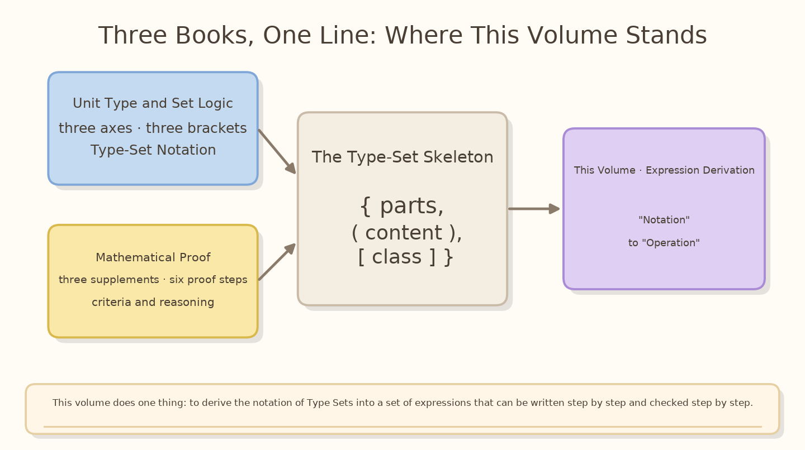

*Figure D-1 One Lineage, Three Books: where this volume sits in the Type-Set derivation*

> **[Note] The Two Books and This Volume's Position**

*Table 0-1 Mapping the two books' skeletons to the derivation in this volume*

Examples run across domains: cup, smartphone, electric vehicle, program module, organisational department, in turn. Every expression comes with a diagram, an example and an exercise — one diagram, one example, one exercise per formula is the editorial convention of this volume.

> **[Key] In One Sentence**
>
> Notation is the static Type, operation is the dynamic Type; this volume puts the two on the same rail.

## Introduction — The World of Expressions

### 0.1 What Is an Expression

An expression is a formula that can be written out and checked step by step. It is not decoration with symbols but a set of promises: follow the formula and anyone reaches the same result, and can check every step you took.

Set theory in mathematics has its own operations: union ∪, intersection ∩, complement — they answer 'member or not', precisely and concisely. But the Type Set adds three value-adds on top of the mathematical set: { } adds the composition structure of parts, ( ) adds an identity that does not change with the content, [ ] adds a generation rule that judges new members automatically. Since the notation carries three levels of value-add, the operations cannot be of one level only — composing a Type, decomposing a Type, swapping a content, judging a class and nesting a position each need their own expression, and each needs its own laws.

### 0.2 Why the Type Set Needs Its Own Operations

> **[Derivation] Three Reasons**
>
> First, the levels must hold. A mathematical set flattens the levels: in { cup, water } the cup and the water stand on the same footing. The Type Set's operations must be written at the right level — σ touches only content, ⊕ touches only parts, ∩(T) asks only about class.
>
> Second, identity must hold. The content changes, yet the container is still the same container — this axiom of invariance must hold inside the expression, and the identity-preservation theorem for σ is its direct corollary.
>
> Third, the derivation must be checkable. Every law must be marked 'holds' or 'does not hold', and the ones that fail need a counter-example — a counter-example draws the boundary of legitimate use.

### 0.3 Derivation Roadmap

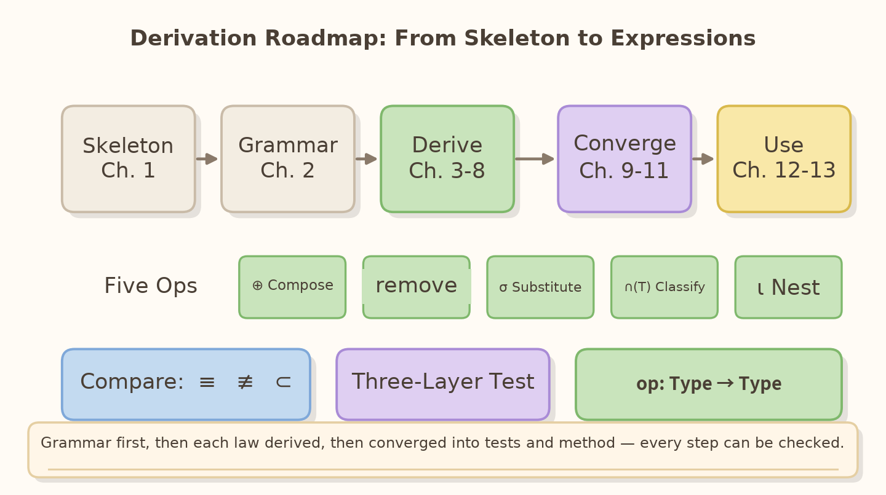

*Figure D-2 Derivation roadmap: from skeleton to expression*

The volume advances in three parts. The upper part builds the skeleton: it organises the two books' foundations into a stage for operation (Chapters 1–2). The middle part derives formula by formula: five operations plus comparison, one formula per chapter, each chapter running 'definition → derivation of the laws → example → exercise' (Chapters 3–8). The lower part converges: the master table of laws and counter-examples, the three-level judgement as expressions, Type in and Type out meeting the Time Type, then closing into precise usage and a complete content plan (Chapters 9–13).

> **[Key] How to Read**
>
> If you want a quick read, the definition boxes and key boxes in each chapter carry the skeleton; if you want to derive to the end, follow the derivation boxes step by step and then write your own formulas in the exercises.

## Part One · Building the Skeleton

First raise the stage: the skeleton of the Type Set and the syntax of expressions

## Chapter 1 The Stage of Operation: A Quick Tour of the Type-Set Skeleton

This chapter does not re-teach the theory of the two books; it only makes clear what the operations act on. Three axes, three kinds of brackets, two pairs, one axiom, one criterion — five pieces of equipment, and that is the whole stage for expression derivation.

### 1.1 Three Axes, Three Kinds of Brackets

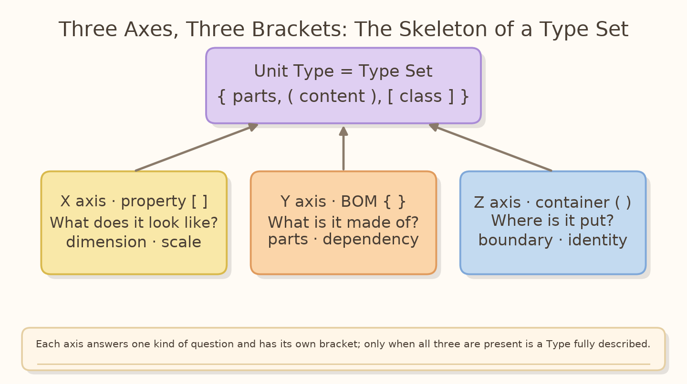

*Figure 1-1 Three Axes, Three Kinds of Brackets: the skeleton of the Type Set*

The X axis, Property [ ], answers 'what is it like' — dimensions are properties, scales are property values; the Y axis, Bill of Materials { }, answers 'what is it made of' — if a part still knows itself once taken off, it enters the BOM; the Z axis, Container ( ), answers 'where do things sit' — a boundary encloses an interior space, and identity does not change with the content. Each axis has its own brackets, its own criterion, and will have its own operation.

### 1.2 Two Pairs, One Axiom, One Criterion

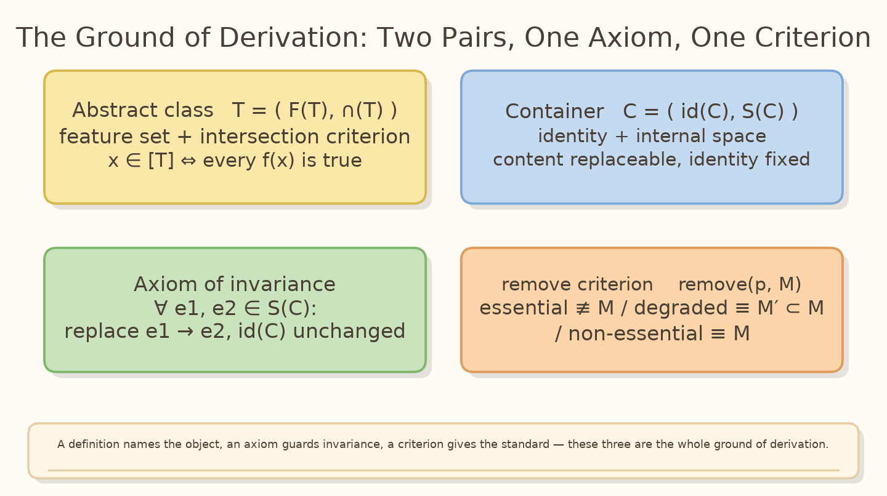

*Figure 1-2 The foundation of operation derivation*

> **[Definition] The Foundation of Operation Derivation**
>
> Abstract class T = ( F(T), ∩(T) ) — feature set plus intersection criterion; x ∈ [T] ⇔ every f(x) is true.
>
> Container C = ( id(C), S(C) ) — identity plus interior space; the content may be replaced, the identity does not move.
>
> Axiom of invariance ∀ e1, e2 ∈ S(C): replacing e1 → e2 leaves id(C) unchanged.
>
> remove criterion remove(p, M): essential part ≢M / function-degraded part ≡M′⊂M / non-essential part ≡M.

These four are the starting point of every derivation in this volume. Every later theorem is derived from these four plus 'Type-Set notation' — not one of them needs a new assumption.

### 1.3 Anatomy of the Type-Set Notation

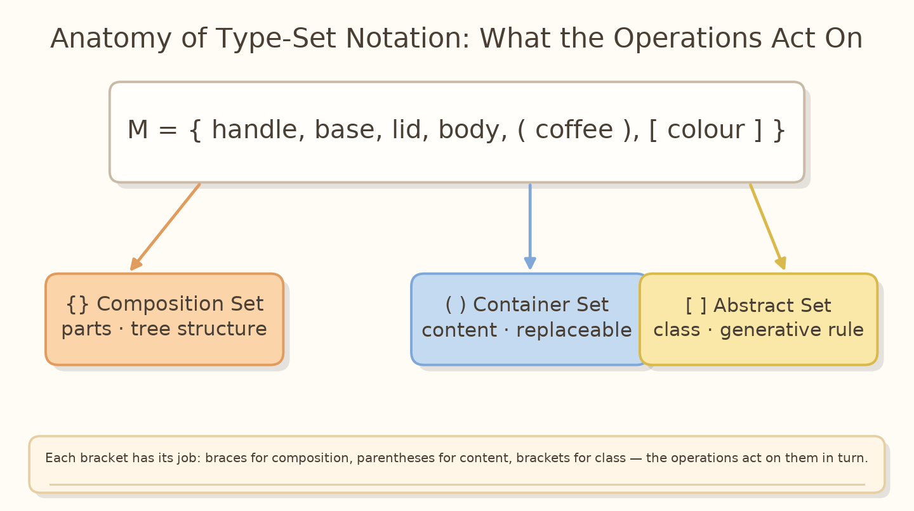

*Figure 1-3 Anatomy of the Type-Set notation*

The Type Set M = { part, ( content ), [ class ] } is the object of every operation. Inside { } are the parts that can be taken apart, inside ( ) the content that is put in, inside [ ] the class that is stated. The brackets are not decoration but marks of level — a point that becomes the first rule of expression syntax in Chapter 2.

### 1.4 The Trio: Definition, Criterion, Reasoning

Expression derivation follows the trio already used in proof: the definition first makes clear what the object is, the criterion supplies a standard that can be checked item by item, and the reasoning walks from definition and criterion to the conclusion step by step. Every law in this volume is derived in the same format — write the definition, cite the criterion, walk the reasoning, find the counter-example.

> **[Key] Chapter Summary**
>
> - The stage of operation = three axes and three brackets + two pairs + the axiom of invariance + the remove criterion.
> - The Type Set M = { part, ( content ), [ class ] } is the object of every operation.
> - The derivation trio: definition, criterion, reasoning — every formula follows this format.

## Chapter 2 The Syntax of Expressions: Operand, Level, Sign

Before deriving any expression, fix the syntax: what is the general form of an operation? On which three kinds of object does it act? How do the brackets fix the scope of an operation?

### 2.1 General Form: Type In, Type Out

*Figure 2-1 The general form of an expression: Type in, Type out*

> **[Definition] The General Form of an Expression**
>
> Every expression is a mapping from Type to Type: op: Type → Type. It takes in a Type and puts out a Type — the input may be a part Type, a content Type or a class Type, and the output is again a Type that can be operated on further.

The form looks simple, yet it is where this volume joins The Time-Type Volume: the essence of a Time Type (verb, function, method) is exactly Type in, Type out. In Chapter 11 we shall see that the five operations are the basic model and the higher-order functions of the Time-Type library are the composite model — both run on the same rail.

### 2.2 Three Kinds of Operand

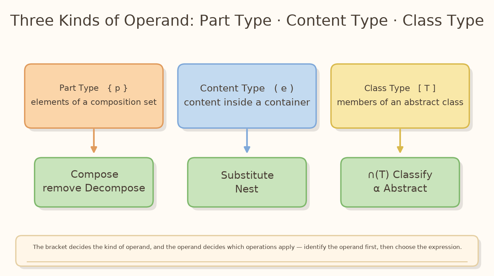

*Figure 2-2 Three kinds of operand*

The kind of bracket decides the kind of object, and the kind of object decides which operations are available: the part Type { p } is operated on by ⊕ and remove; the content Type ( e ) by σ and ι; the class Type [ T ] by ∩(T) and α. Mistaking the object is the commonest cause of misuse — compose a content Type, substitute into a part Type, and however smoothly the formula is written it will not derive the right result.

### 2.3 Brackets Are Levels: The Scope of an Operation

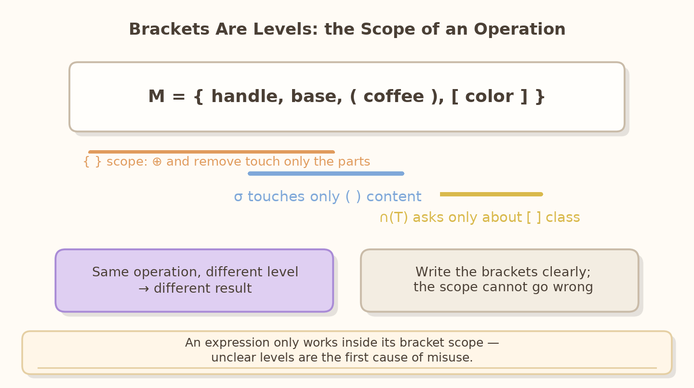

*Figure 2-3 Brackets are levels*

An expression is valid only inside its bracket scope: ⊕ and remove move parts only within { }; σ moves content only within ( ); ∩(T) asks about class only within [ ]. Write the brackets clearly and the scope cannot go wrong — the rule looks plain, yet it is the common root of every later law that 'does not hold': any formula that crosses a level or exceeds a scope must either take an extra condition or be rewritten.

### 2.4 The Operators of This Volume at a Glance

| Operation | Sign | Operand | In one sentence | Derived in |
| --- | --- | --- | --- | --- |
| Compose | ⊕ | part Type { p } | Combine parts into one Type, levels kept | Chapter 3 |
| Decompose | remove(p, M) | part Type { p } | Remove a part, watch identity survive | Chapter 4 |
| Substitution | σ_{e1→e2}(C) | content Type ( e ) | Change the content, identity stays | Chapter 5 |
| Classification | ∩(T)(x) | class Type [ T ] | All features pass, then it enters the class | Chapter 6 |
| Abstract generation | α | a group of Types → class | Extract features, generate the class | Chapter 6 |
| Nesting | ι(M, C) | Type into container | Fix the position, every level holds on its own | Chapter 7 |
| Comparison | ≡ / ≢ / ⊂ | Type and Type | Identity at which level? Degradation sign ⊂ | Chapter 8 |

*Table 2-1 The operators of this volume at a glance*

> **[Example] Example: recognise the object, choose the operation**
>
> Situation: 'the water in the cup is changed to coffee' — which operation applies?
>
> Analysis: water and coffee are content Types ( e ), the cup is a container C = (id(C), S(C)) — what is 'changed' is the content, what does not move is the identity, so use σ_{water→coffee}(C).
>
> Contrast: if the question is 'is it still a cup once the lid is off', the parts move, so use remove(lid, M); if the question is 'does a thermos count as a cup', the class is being asked about, so use ∩(cup)(thermos).

> **[Exercise] Exercises**
>
> P01 (recognising the object): which expression does each of these three sentences need? (1) swap the textbooks in the schoolbag for notebooks; (2) take the camera module off the phone; (3) decide whether a straw cup is a cup.
>
> P02 (judging the syntax): why does the rule '⊕ moves only parts, σ moves only content, ∩(T) asks only about class' block most misuse? Give one consequence of misuse for each.

## Part Two · Formula-by-Formula Derivation

Five operations plus comparison: one formula, one diagram, one example, one exercise; each runs 'definition → laws → example → exercise'

## Chapter 3 The Compose Operation ⊕: Combining Parts into One Type

The first operation acts on the part Type { p }: it combines the parts of two (or more) Types into one Type. Compose is the starting point of every structure — without compose a BOM is only a list; with compose the parts become a whole.

### 3.1 Definition and the Closure Derivation

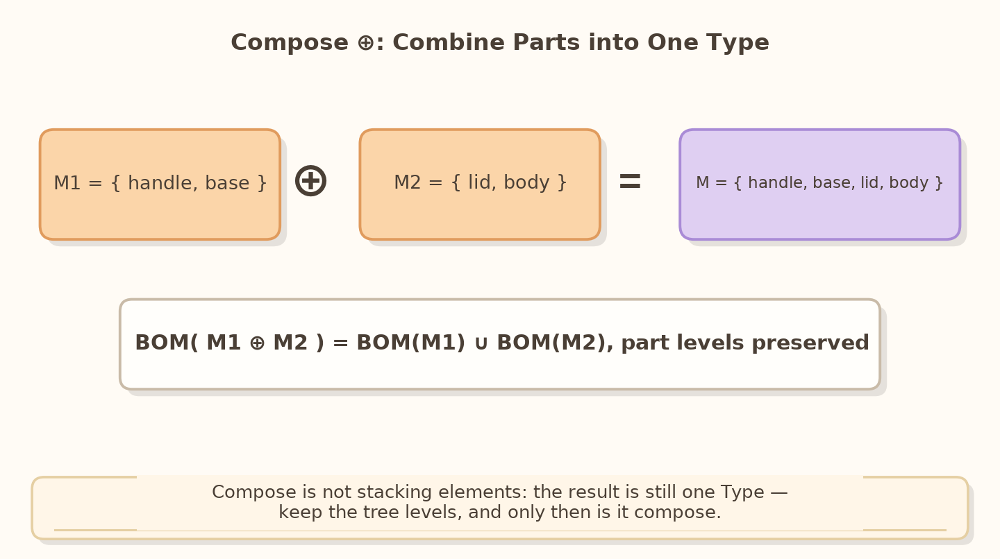

*Figure 3-1 The compose operation ⊕*

> **[Definition] Definition 3-1 (compose)**
>
> Let M1, M2 be Type Sets. The compose M1 ⊕ M2 is defined as a new Type M satisfying:
>
> (i) BOM(M) = BOM(M1) ∪ BOM(M2) — every part is taken in;
>
> (ii) the levels and dependencies among the parts are preserved (tree structure);
>
> (iii) the content ( ) and the class [ ] of M are set separately according to the composition situation.

> **[Theorem] Theorem 3-1 (closure): a compose is still a Type**
>
> Derivation: (1) by definition every part of M1 ⊕ M2 enters BOM(M); (2) levels and dependencies are preserved, so the parts are no longer merely side by side; (3) content and class each have their place. Taken together, M satisfies the full Type-Set notation { part, ( content ), [ class ] } — so the output of compose is still a Type. (QED)

Closure guarantees that ⊕ can be used repeatedly: the result of a compose can be composed again — and that is exactly how a complex Type is built up level by level.

### 3.2 Deriving the Laws: Associativity Holds, Commutativity Holds

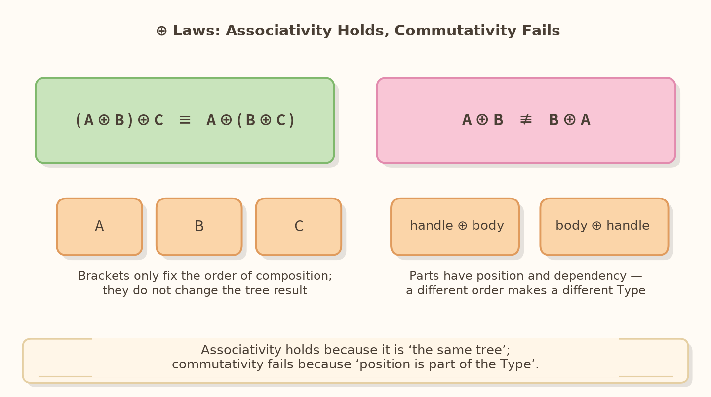

*Figure 3-2 The laws of ⊕*

> **[Theorem] Theorem 3-2 (commutativity)**
>
> A ⊕ B ≡ B ⊕ A
>
> [Theorem] Theorem 3-3 (associativity)
>
> ( M1 ⊕ M2 ) ⊕ M3 ≡ M1 ⊕ ( M2 ⊕ M3 )

> **[Derivation] Deriving associativity**
>
> (1) after expansion both sides have BOM(M1) ∪ BOM(M2) ∪ BOM(M3) — union is itself associative;
>
> (2) the levels and dependencies of the parts are fixed by the 'who is attached to whom' structure, independent of the bracket order of the compose;
>
> (3) by the comparison basis for Type identity (same BOM and same dependency structure, see Chapter 8), the two sides are ≡. (QED)

Moreover, if M2 has no part at all (empty BOM), then M1 ⊕ M2 ≡ M1 — the 'part-less Type' plays the role of the unit element. This property is often used in the construction flow 'raise the skeleton first, then fill in the parts'.

### 3.3 Example: A Coffee Cup and Two Contrasts

> **[Example] Example 3-1**
>
> Coffee cup = handle ⊕ base ⊕ lid ⊕ body.
>
> Derivation: the four parts are composed one by one — (handle ⊕ base) ⊕ (lid ⊕ body), and by associativity the brackets may go anywhere; after composing, BOM = { handle, base, lid, body }; the handle depends on the body and the lid covers the body — the levels are preserved, so the coffee cup holds. (QED)
>
> Contrast 1 (program module): module A ⊕ module B must preserve the joining order of the interfaces — which is connected first, who calls whom; that is the dependency structure. A changed call order may break the whole, so module merging is likewise not commutative.
>
> Contrast 2 (organisational department): the business department ⊕ the administration department form one division — each department has its own remit and reporting relation (dependency); swap the order and rewire the relations and you have another organisational Type.

> **[Exercise] Exercises**
>
> P03 (compose derivation): write the compose formula for 'a smartphone' (at least four parts: mainboard, battery, screen, camera module) and mark one dependency among them.
>
> P04 (finding a counter-example): find a case in your life or work where 'the commutativity of ⊕ does not hold', and state at which level A ⊕ B and B ⊕ A differ.

## Chapter 4 The Decompose Operation remove: Removing Parts, a Three-Level Criterion

The reverse of compose is decompose. But 'taking apart' is not a simple inverse — removing the handle and removing the base have completely different consequences. The remove operation writes that difference as a criterion formula that can be checked item by item.

### 4.1 Definition and the Three-Level Criterion Formula

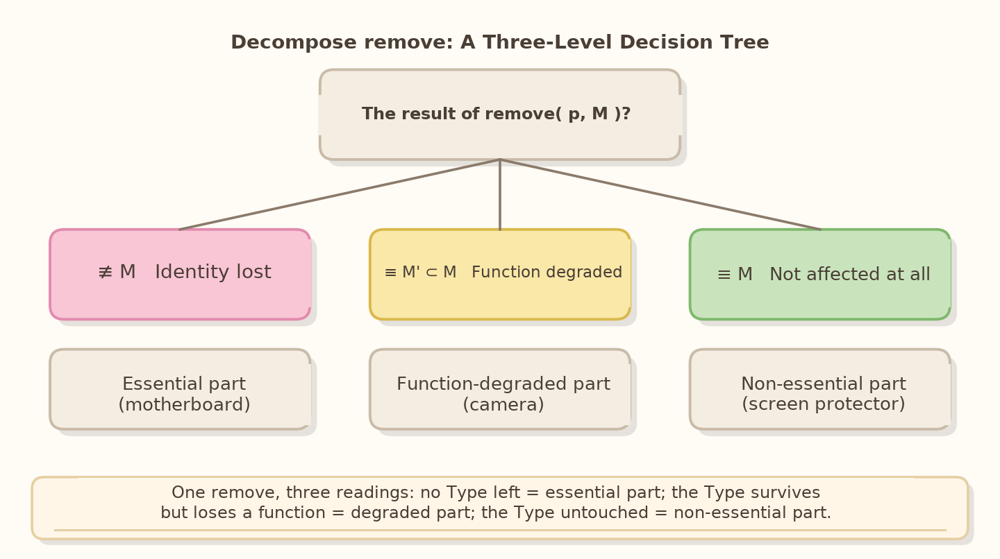

*Figure 4-1 The remove decision tree*

> **[Definition] Definition 4-1 (decompose)**
>
> remove(p, M): the operation that removes part p from Type M. The result branches three ways by identity:
>
> essential part — remove(p, M) ≢ M: identity is lost, M is no longer M (dissolution);
>
> function-degraded part — remove(p, M) ≡ M′ ⊂ M: the Type survives, a function is missing; write the degradation formula;
>
> non-essential part — remove(p, M) ≡ M: the Type does not move at all.

The derivation of the three-level criterion formula is direct: it is the remove criterion itself, only rewritten in the language of expressions. What matters is the 'derived usage' — each of the three levels states something about the identity of the whole, and in a proof you simply take the matching seat.

### 4.2 Deriving the Laws

> **[Theorem] Theorem 4-1 (idempotence): remove( p, remove(p, M) ) ≡ remove(p, M)**
>
> Derivation: (1) after the first remove, p is no longer in the BOM; (2) the second remove finds no p and changes neither BOM, levels nor dependencies; (3) the two results are the same Type. (QED)

> **[Theorem] Theorem 4-2 (branch distribution)**
>
> If p belongs only to the BOM of M2, then ( M1 ⊕ M2 ) remove p ≡ M1 ⊕ ( M2 remove p ).
>
> Derivation: (1) remove acts only on the branch M2 where p lives; (2) the BOM and levels of the M1 branch are untouched; (3) by the closure of ⊕ both sides are still Types, with the same BOM and dependencies. (QED)

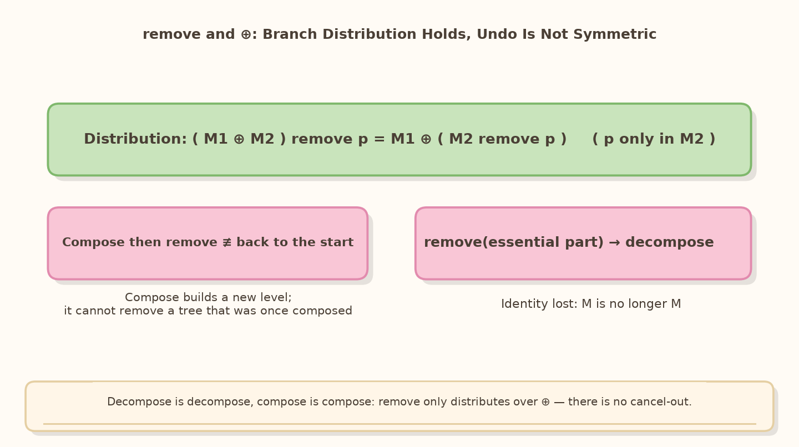

*Figure 4-2 remove and ⊕*

> **[Misuse] Counter-example 4-1 (compose and decompose are not symmetric)**
>
> 'Compose then decompose' cannot return to the point before composing: the dependencies built during compose already exist, and removing a part only leaves a gap — it does not cancel the 'once composed' structure.
>
> More extreme is remove(essential part, M): identity is lost and the output is no longer any Type that existed before — this is called dissolution. Decompose is not the inverse of compose; the two stand on their own.

### 4.3 Example: The Phone's Three Levels and Two Contrasts

> **[Example] Example 4-1**
>
> M = smartphone: remove(mainboard, M) ≢ M (essential part, dissolution); remove(camera module, M) ≡ M′ ⊂ M (function-degraded part, photography lost); remove(screen protector, M) ≡ M (non-essential part).
>
> Contrast 1 (car): the steering wheel is a function-degraded part — remove it and the thing is still recognisably a car, but it cannot steer; the engine is an essential part, remove it and the Type dissolves.
>
> Contrast 2 (organisation): abolishing an essential department (finance, say) is dissolution — the organisation is no longer an organisation; abolishing an optional department (a product line, say) is degradation; abolishing a temporary project team is the removal of a non-essential part.

> **[Exercise] Exercises**
>
> P05 (three-level classification): take at least six parts of 'a laptop', sort them into three levels with the remove criterion formula, at least one part per level, and write the derivation formulas.
>
> P06 (branch distribution): let M = bookshelf ⊕ books, with one unimportant magazine p on the shelf. Use Theorem 4-2 to write two equivalent forms of (M) remove p, and explain why p is a non-essential part.

## Chapter 5 The Substitution Operation σ: The Content Changes, the Identity Does Not

The third operation leaves the parts and enters the level of ( ): content substitution. It is the heart of container logic — and the first embodiment of the axiom of invariance inside an expression.

### 5.1 Definition

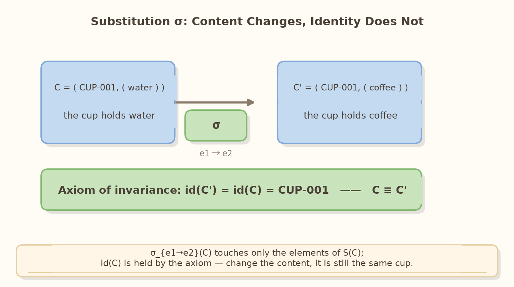

*Figure 5-1 σ and the axiom of invariance*

> **[Definition] Definition 5-1 (substitution)**
>
> Let C = ( id(C), S(C) ), e1 ∈ S(C). The substitution σ_{e1→e2}(C) replaces e1 in S(C) with e2 and yields C′.
>
> Convention: σ moves only the content inside ( ), touching neither id(C) nor the parts { } nor the class [ ].

### 5.2 The Identity-Preservation Theorem

> **[Theorem] Theorem 5-1 (identity preservation): id( σ_{e1→e2}(C) ) = id(C)**
>
> Derivation: (1) by definition σ changes only elements of S(C); (2) by the axiom of invariance — ∀ e1, e2 ∈ S(C), replacing e1 with e2 does not change id(C); (3) hence after substitution id(C) is constant and σ(C) ≡ C (identity at the container level). (QED)

This theorem is the expression form of 'the content changed, it is still the same cup'. It also gives a diagnostic: when you want to confirm 'is this the same thing', check whether the change falls inside the scope of σ — if it does, identity is guarded by the axiom; if the change touches id or the parts, you must turn to remove or to comparison for the analysis.

### 5.3 The Laws: Commute, Compose, Clear

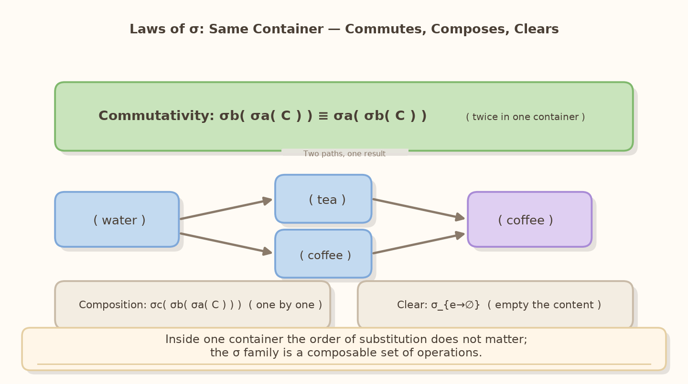

*Figure 5-2 The laws of σ*

> **[Theorem] Theorem 5-2 (commutativity)**
>
> Two substitutions in the same container commute: σb( σa( C ) ) ≡ σa( σb( C ) ) (a and b are not each other's substitution target).
>
> Derivation: (1) both substitutions act only on S(C); (2) two independent changes of set elements do not depend on order; (3) both sides end with the same S(C) and untouched id(C), so they are ≡. (QED)

Composition and clearing are the other two members of the σ family: σc( σb( σa(C) ) ) is substitution one after another and may first be merged into a single formula; σ_{e→∅} clears the content — an empty cup is still a cup, and id(C) still does not change.

> **[Misuse] Contrast 5-1 (a difference of level)**
>
> { water } changed to { coffee }: a pure set has changed its element and become another set — the two are ≢.
>
> ( water ) changed to ( coffee ): the container changes its content, id(C) does not change — the two are ≡.
>
> The same sentence 'water changed to coffee', written inside { } and inside ( ), is two different operations — the brackets decide the level, the level decides the result.

### 5.4 Example: The Cup and Two Contrasts

> **[Example] Example 5-1**
>
> C = ( CUP-001, (water) ): σ_{water→coffee}(C) = ( CUP-001, (coffee) ). Derivation: σ moves only S(C) → by Theorem 5-1 id does not change → identical at the container level.
>
> Contrast 1 (folder): a folder is a container, files are content — change report.docx to slides.pptx and the folder is still that folder, so σ holds.
>
> Contrast 2 (post): a post is a container, a person is the content — A leaves and B takes over, the duties, establishment and number of the post do not change, so the id of σ_{A→B}(post) does not change; but if even the remit of the post is altered, what moves is the parts and the class, and it is no longer σ.

> **[Exercise] Exercises**
>
> P07 (identity-preservation derivation): use Theorem 5-1 to write the full derivation for 'the banknote in the wallet is swapped for another', and say which axiom is cited in the second step.
>
> P08 (the boundary of σ): is 'swap the cup for a bowl and put water in the bowl' a σ? Why? (Hint: does it move the content or the container itself?)

## Chapter 6 Classification ∩(T) and Abstract Generation α: Writing a Class as a Rule

The fourth operation leaves parts and content and enters the level of [ ]. Classification asks 'does x count as T', abstraction asks 'how is T generated' — one judges, one generates, a mutually inverse pair at the class level.

### 6.1 Definition and Derivation of Classification

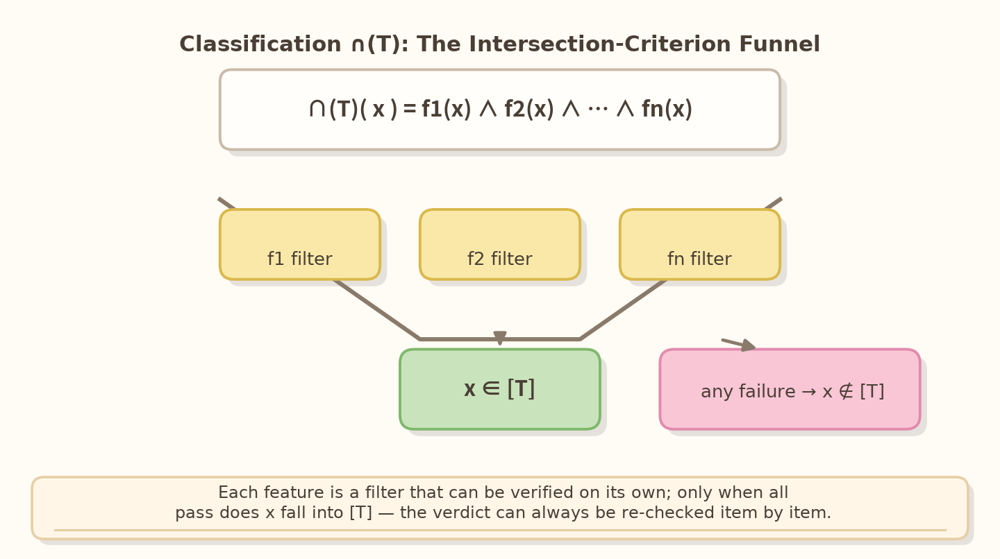

*Figure 6-1 The ∩(T) intersection-criterion funnel*

> **[Definition] Definition 6-1 (classification)**
>
> Let T = ( F(T), ∩(T) ), F(T) = { f1, f2, …, fn }. The classification operation is defined as:
>
> ∩(T)( x ) = f1(x) ∧ f2(x) ∧ … ∧ fn(x).
>
> x ∈ [T] ⇔ ∩(T)(x) = true; if any single feature fails, x ∉ [T].

> **[Theorem] Theorem 6-1 (feature order is irrelevant)**
>
> The result of ∩(T)(x) does not depend on the order in which the features are checked.
>
> Derivation: (1) the classification formula is a conjunction (∧) of features; (2) conjunction is commutative and associative; (3) hence whether f1 or f2 is checked first does not affect the result — a judgement can always be split into a string of independently re-checkable small steps. (QED)

The theorem looks obvious, yet it is the theoretical guarantee of the 'tick each item' checklist: a reviewer can reproduce your classification judgement in any order.

### 6.2 Abstract Generation α: Extracting Features

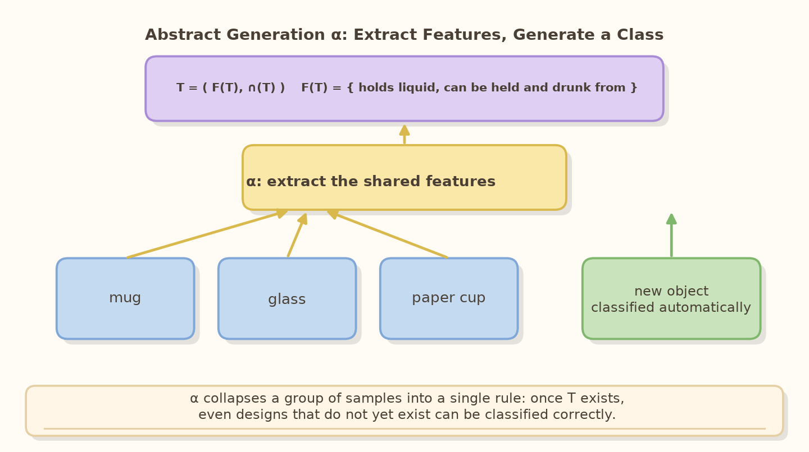

*Figure 6-2 α, abstract generation*

> **[Definition] Definition 6-2 (abstract generation)**
>
> α( x1, x2, …, xk ) → T: extract the common features of a group of concrete Types and generate the abstract class T = ( F(T), ∩(T) ).
>
> Property-emergence rule (after Unit Type and Set Logic): if a difference matches neither an existing property nor anything else, open a new property and backfill; if it does match, only add a new property value.

α is the operation 'from samples to a rule': mug, glass, paper cup → α → the class 'cup'. Once T exists, even a thermos or a straw cup that has not appeared yet is classified correctly by ∩(T) automatically — which is exactly what a closed list cannot do.

### 6.3 The Inverse-Monotonicity Theorem for F(T)

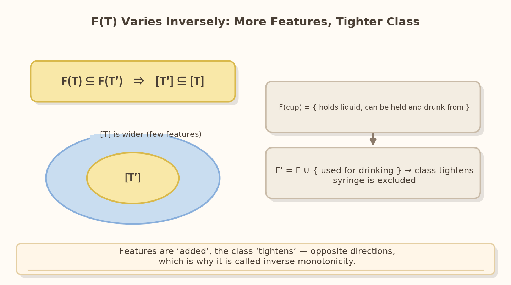

*Figure 6-3 F(T) is inversely monotone*

> **[Theorem] Theorem 6-2 (inverse monotonicity)**
>
> If F(T) ⊆ F(T′), then [T′] ⊆ [T].
>
> Derivation: (1) F(T′) requires more features to pass than F(T); (2) x ∈ [T′] means x passes all features of T′, hence also all features of T; (3) therefore x ∈ [T], that is [T′] ⊆ [T]. (QED)

Features are 'adding in', the class is 'tightening' — opposite directions, hence inverse monotonicity. The theorem is directly usable on 'rule revision': to make a class stricter, add features; to make it wider, drop features — the effect of the change can be derived in advance instead of re-tested case by case.

### 6.4 Example: A Straw Cup and Two Contrasts

> **[Example] Example 6-1**
>
> F(cup) = { can hold liquid, can be drunk from while held }. Straw cup: f1 passes, f2 passes (drunk through a straw while held) → ∩(cup)(straw cup) = true → straw cup ∈ [cup].
>
> Boundary cases: a bowl fails f2 → ∉; a syringe passes both, but if F(T) includes 'used for drinking' it is excluded — the choice of the feature list is a stance about the concept.
>
> Contrast 1 (program interface): does a module count as a 'pluggable interface'? F = { has explicit inputs and outputs, implementation replaceable } — checking item by item beats arguing in generalities.
>
> Contrast 2 (organisational remit): does a project team count as an 'R&D unit'? F(R&D) = { does prototype development, produces technical documents } — the classification formula turns a qualification review into a re-checkable process.

> **[Exercise] Exercises**
>
> P09 (classification derivation): let F(electric vehicle) = { can run on a road, can carry people or goods, has a power system, can be steered by a driver }; derive Tesla Model 3 ∈ [electric vehicle] item by item with the classification formula, writing out the f(x) verdict at each step.
>
> P10 (inverse monotonicity): if the feature 'capacity under 500 ml' is added to F(cup), derive the change in [T′] with Theorem 6-2, and give one object that used to enter the class and is now excluded.

## Chapter 7 The Nesting Operation ι: Types Enter Containers, Each Level Keeps Its Identity

The fifth operation puts a Type into a container — it fixes a 'position'. Nesting is the normal state of spatial structure: cup into bag, bag into box, box into room; the combinatorial world of Types grows level by level through nesting.

### 7.1 Definition

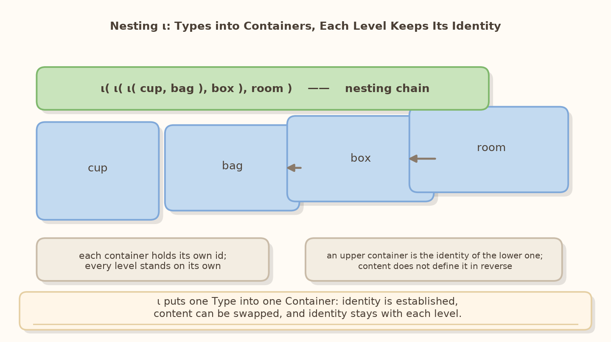

*Figure 7-1 The ι nesting chain*

> **[Definition] Definition 7-1 (nesting)**
>
> ι( M, C ): put Type M into the interior space S(C) of container C; M becomes the content of C.
>
> Nesting chain: ι( ι( ι( cup, bag ), box ), room ) — every level is a 'container + content' structure.

### 7.2 The Nesting-Chain Level Theorem

> **[Theorem] Theorem 7-1 (every level keeps its identity)**
>
> Every container in a nesting chain keeps its own id, unchanged by content changes above or below it.
>
> Derivation: (1) each ι establishes exactly one 'container-content' relation; (2) by the axiom of invariance, a change of this level's content does not change this level's id(C); (3) the id of the level below is part of this level's content, so its change still falls inside the scope of σ; (4) by induction every level's id is constant along the whole chain. (QED)

The theorem gives nesting a clean reading: the upper container is the 'identity' of the lower level, and content does not define the container in reverse — fix the identity first, then talk about content, at every level.

### 7.3 ι Commutes with σ; the Non-Flattening Counter-example

> **[Theorem] Theorem 7-2 (ι and σ commute)**
>
> At the right level, 'nest then change the content' is equivalent to 'change the content then nest': ι( σ_{e1→e2}(M), C ) ≡ σ_{e1→e2}( ι(M, C) ) (the substitution happens inside M).
>
> Derivation: (1) σ acts on S(M) of M; (2) ι only puts the whole M into C and does not touch the interior of M; (3) both sides end with the same levels and the same ids. (QED)

*Figure 7-2 Counter-example: levels cannot be flattened*

> **[Misuse] Counter-example 7-1 (levels cannot be flattened)**
>
> { cup, water } flattens 'container' and 'content' into parallel elements — change the water and it becomes 'another set', and the identity scatters.
>
> ( CUP-001, ( water ) ) keeps two levels: the container is the identity, the content is the element — only then does σ have room to act.
>
> Conclusion: once the levels are flattened, σ and ι both lose their meaning — an expression must be written at the correct level.

### 7.4 Example: Cup into Bag into Box, and Two Contrasts

> **[Example] Example 7-1**
>
> ι(cup, bag): the cup becomes the content of the bag; the cup's id does not change by entering the bag, and the bag's id does not change by holding the cup.
>
> Contrast 1 (data directory): file ι folder ι disk — each level is a container of its own; moving a file (changing level) changes neither the file itself nor the id of any folder.
>
> Contrast 2 (organisational hierarchy): employee ι department ι business group — the employee is content, the department is the container; transferring an employee is σ (changing the content) and the department's establishment does not change; the department level is not flattened with the employees into one list.

> **[Exercise] Exercises**
>
> P11 (nesting derivation): write the full nesting chain 'phone ι case ι courier box ι van', and use Theorem 7-1 to explain why the phone's identity is unchanged when the van is swapped for another.
>
> P12 (flattening check): is 'the roll of 30 students in a class' a Type? Which level is it missing, so that σ and ι cannot be applied? (Hint: is the roll a { } or a ( )?)

## Chapter 8 The Comparison Operation ≡ / ≢ / ⊂: Identity at Which Level

The last operation does not build a Type but compares two. Yet 'identity' comes in three kinds: identity of id, identity of Type, identity of class — before comparing, ask which level.

### 8.1 Three Kinds of Identity

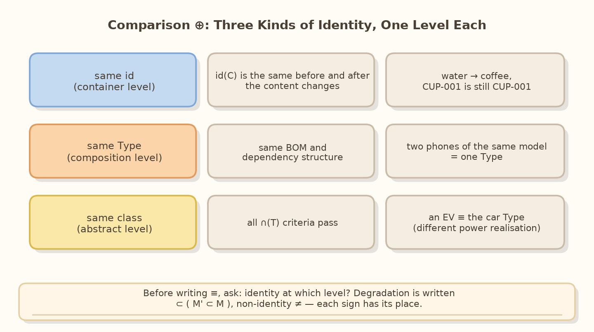

*Figure 8-1 Comparison: three kinds of identity*

> **[Definition] Definition 8-1 (three kinds of identity)**
>
> id identity (container level): id(C) is the same before and after σ — water becomes coffee, CUP-001 is still CUP-001.
>
> Type identity (composition level): same BOM and same dependency structure — two phones of the same model are ≡ the same Type.
>
> Class identity (abstraction level): all ∩(T) criteria pass — an electric car and a petrol car are ≡ the car Type.

### 8.2 The Degradation Formula and Choosing the Comparison Level

Degradation is written with ⊂: the result of remove(function-degraded part) is written M′ ⊂ M — M′ is still a Type of M, but one function is missing. The full sign set of comparison is: ≡ (identical), ≢ (not identical), ⊂ (degradation containment) — each sign in its own place, never mixed.

> **[Derivation] Worked derivation: an electric car ≡ the car Type**
>
> ① Identify the objects compared: Tesla Model 3 and the 'car' Type; ② choose the level: what is compared here is class identity (classification level); ③ cite the criterion: F(car) = { can run on a road, can carry people or goods, has a power system, can be steered by a driver }; ④ item by item: all pass, ∩(car)(Tesla) = true; ⑤ conclusion: an electric car ≡ the car Type — how the power is realised (internal combustion engine or electric motor) is not in F(T) and does not affect Type identity. (QED)

> **[Misuse] Contrast 8-1 (the wrong comparison level)**
>
> 'The books on the shelf': the shelf is a container (swap the books, not the shelf — same id); the combination 'books on the shelf' is a { } set (swap the books and the combination changes — ≢).
>
> One physical scene, different objects compared, different levels — before comparing, ask 'which whole am I comparing'.

### 8.3 Example: Comparisons in Three Domains

> **[Example] Example 8-1**
>
> Cup: (water) and (coffee) are ≡ at the container level (the same CUP-001); two white porcelain cups are ≡ at the Type-identity level; a mug and a paper cup are ≡ at the class-identity level (both are cups).
>
> Program: the same service changes its database implementation — interface and responsibility unchanged, class identity ≡; a microservice is split into two — the BOM changes, ≢.
>
> Organisation: the company is renamed — the id is unchanged (same legal person), id identity ≡; departments are reorganised after a merger — BOM and dependencies all change, ≢.

> **[Exercise] Exercises**
>
> P13 (choosing the level): 'the same employee has moved to another desk' — identity at which level? Write the derivation and state the comparison level.
>
> P14 (degradation formula): the air conditioning is taken out of a car; write the full judgement for M′ ⊂ M, and explain why it is written ⊂ and not ≢.

## Part Three · Confluence

Gather the five formulas: the master table of laws, the simultaneous judgement formulas, and Type in / Type out joining the Time Type

## Chapter 9 Composite Operations and the Master Table of Laws

The five operations have now been derived one by one. This chapter puts them together: which laws may be cited with confidence, which need an extra condition, and what a counter-example looks like — one master table gathers the whole derivation.

### 9.1 The Master Table of Laws

*Figure 9-1 The master table of laws*

| Law | Formula | Status | Condition / reason |
| --- | --- | --- | --- |
| ⊕ associativity | (A⊕B)⊕C ≡ A⊕(B⊕C) | holds | union is associative, levels are independent of brackets |
| ⊕ unit element | M ⊕ ε ≡ M | holds | ε = the part-less Type |
| ⊕ commutativity | A⊕B ≢ B⊕A | does not hold | position and dependency are part of the Type |
| remove idempotence | remove² ≡ remove | holds | the second pass finds no p |
| remove branch distribution | (M1⊕M2) remove p ≡ M1⊕(M2 remove p) | holds | when p is only in M2 |
| remove full distribution | remove(essential part) → dissolution | does not hold | after dissolution it is no longer the original Type |
| σ commutativity | σb(σa(C)) ≡ σa(σb(C)) | holds | same container, not each other's target |
| σ identity preservation | id(σ(C)) = id(C) | holds | the axiom of invariance |
| σ cross-level exchange | changing the container ≠ changing the content | does not hold | touching id leaves the scope of σ |
| ∩(T) order | the order of feature checks is irrelevant | holds | conjunction is commutative and associative |
| F(T) inverse monotonicity | F(T) ⊆ F(T′) ⇒ [T′] ⊆ [T] | holds | more features, tighter class |
| α and remove commute | decompose then abstract ≢ abstract then decompose | does not hold | the samples changed, so the rule changes |
| ι and σ commute | ι(σ(M),C) ≡ σ(ι(M,C)) | holds | when the substitution is inside M |

*Table 9-1 The master table of laws: five hold, four do not, two hold with a condition*

### 9.2 Three Counter-example Derivations

*Figure 9-2 Three counter-example derivations*

> **[Misuse] What a counter-example derivation does**
>
> ① ⊕ does not commute: handle⊕body ≢ body⊕handle — a different joining position, a different dependency structure.
>
> ② remove does not distribute fully: remove(essential part, M1⊕M2) dissolves the Type outright — the left side vanishes while the right side M1⊕(M2 remove p) still exists; the two are not equal.
>
> ③ σ cannot cross levels: replacing 'the container itself' is dismantling (it touches id), not content substitution — the precondition of σ is broken.
>
> Behind every counter-example lies a constraint: level and identity. Any formula that violates these two must take an extra condition or be rewritten.

### 9.3 A Worked Composite Derivation

> **[Derivation] Worked derivation: σ composed with ⊕**
>
> Situation: the coffee cup M = { handle, base, lid, body, (coffee), [white] }; change the content to tea and fit a coaster.
>
> ① Change the content: σ_{coffee→tea}(M) = { handle, base, lid, body, (tea), [white] } — only ( ) moves;
>
> ② Add a part: M′ = σ(M) ⊕ coaster = { handle, base, lid, body, coaster, (tea), [white] } — only { } moves;
>
> ③ Check: the two steps belong to different levels and do not interfere (level independence); the result is uniquely determined. (QED)

The one rule for deriving a composite formula is: move one level at a time. Level independence guarantees that operations on different levels do not interfere — which is the root reason a complex formula can be split into a string of simple ones.

> **[Exercise] Exercises**
>
> P15 (judging laws): which of these hold? ① (M1⊕M2)⊕M3 ≡ M1⊕(M3⊕M2) (hint: commutativity); ② σ after σ; ③ remove(p, M) ⊕ p ≡ M (hint: compose and decompose are not symmetric).
>
> P16 (make your own counter-example): construct a concrete counter-example for 'α and remove do not commute' (hint: remove part of the sample first — what happens to the extracted features?).

## Chapter 10 Putting the Three-Level Judgement into Expressions: Three Formulas in Concert

The three-level judgement of Type logic — container judgement, bill-of-materials judgement, abstraction judgement — can now be written as three expressions and combined into one judgement. Judgement is upgraded from 'walking a process' to 'deriving a formula'.

### 10.1 The Three Judgement Formulas

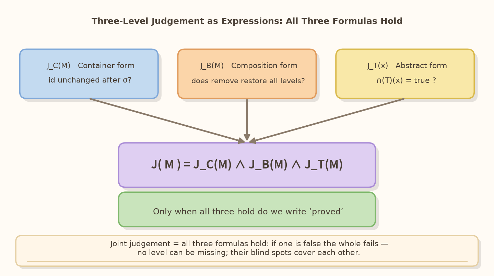

*Figure 10-1 Three formulas in concert*

> **[Definition] Definition 10-1 (the three-level judgement formula)**
>
> Container formula J_C(M): is there a content substitution σ that leaves id unchanged? — J_C = true ⇔ the container judgement holds.
>
> Composition formula J_B(M): does the BOM pass the 'recognisable once taken off' check, and does the remove of every part land in its three-level place?
>
> Abstraction formula J_T(x): is ∩(T)(x) = true?
>
> Joint judgement J( M ) = J_C(M) ∧ J_B(M) ∧ J_T(M) — only when all three are true do we write 'QED'.

The division of labour among the three formulas matches the blind spots of the three levels exactly: J_C guards identity, J_B guards structure, J_T guards the rule. If any one is false the whole fails — this is the expression version of 'none of the three levels may be missing'.

### 10.2 A Full Worked Derivation: The Smartphone

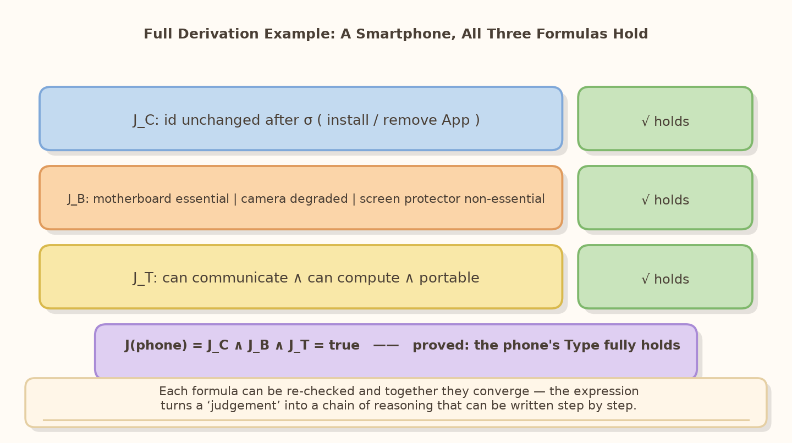

*Figure 10-2 The smartphone: three formulas in concert*

> **[Derivation] Worked derivation: J(smartphone)**
>
> ① Identify the object: M = smartphone; write the Type Set: M = { mainboard, battery, screen, camera module, speaker, …, (App), [smartphone] }.
>
> ② J_C: after σ_{install/remove App}(M) the id is unchanged — J_C = true.
>
> ③ J_B: mainboard remove ≢ M (essential); camera module ≡ M′ ⊂ M (degraded); screen protector ≡ M (non-essential) — all three levels land, J_B = true.
>
> ④ J_T: F = { can communicate, can compute, is portable }; each passes, ∩(T)(M) = true.
>
> ⑤ In concert: J = true ∧ true ∧ true = true — the smartphone's Type fully holds. (QED)

> **[Example] Contrast: the blind spot of a single-level judgement**
>
> J_C alone: a tablet also installs apps and would be misjudged a phone; J_B alone: a calculator also has part structure; J_T alone: a walkie-talkie also communicates.
>
> Once the three formulas are combined the blind spots complement each other — any object that a single level would let through is stopped by the other two.

### 10.3 Why the Judgement Formulas Are Worth Deriving

Writing a judgement as formulas has three direct benefits. Re-checkable: a reviewer ticks formula by formula and reproduces the conclusion. Composable: a complex judgement can be derived formula by formula and then gathered in concert. Error-locating: whichever formula is false shows which level the blind spot sits at — far more precise than 'the judgement was wrong'.

> **[Exercise] Exercises**
>
> P17 (three in concert): write the full J_C, J_B, J_T and the joint formula for 'an electric vehicle', and mark at least one essential part inside J_B.
>
> P18 (locating the blind spot): use the three formulas in concert to judge 'a smartwatch', and say at which formula it is stopped and why that formula is false.

## Chapter 11 Type In, Type Out: Expressions Meet the Time-Type Rail

Now that the five operations are derived, look back at the general form fixed in Chapter 2: op: Type → Type. That form is not only the syntax of this volume — it is the definition of a Time Type.

### 11.1 Every Operation Is Type In, Type Out

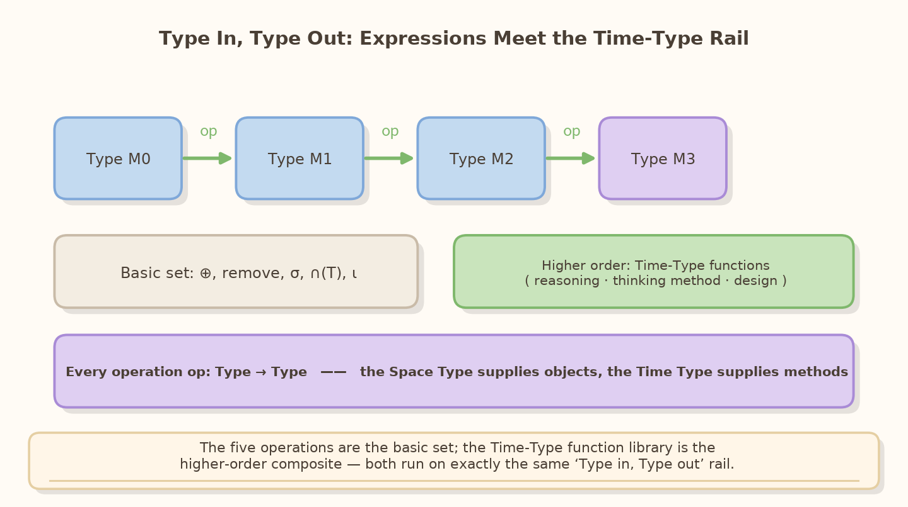

*Figure 11-1 Type in, Type out and the Time Type*

The spatial Type (noun) supplies the object of operation: the Type Set is the 'what'; the Time Type (verb) supplies the action of operation: the function is the 'how'. The five formulas ⊕, remove, σ, ∩(T), ι are the 'basic model' of Type in, Type out — one in, one out, simple syntax, laws on record.

### 11.2 Higher-Order Composition: The Time-Type Function Library

> **[Definition] Basic model and higher-order model**
>
> Basic model: the five operations — they act on the parts, content and class of the Type Set, one step one Type.
>
> Higher-order model: the Time-Type function library — reasoning (causal / abductive / simulation / statistical / reverse), thinking methods (forward / reverse / lateral / vertical / first principles), design, analysis, problem solving — all are composite chains of the basic model: one Type in, one Type out.

> **[Example] Example 11-1: a reasoning chain as a composite of operations**
>
> Situation: 'the lid has gone missing — where did the cup go?' — abductive reasoning.
>
> ① Observe the Type: remove(lid, M) ≡ M′ ⊂ M (degradation) — the lid is a function-degraded part;
>
> ② Trace the chain: in which containers did M′ after σ_{lid→∅} ever appear? — reverse lookup along the ι chain: cup ι desk ι office;
>
> ③ Compare: run an ≡ comparison against the Type at each candidate position and lock onto the one with a matching id.
>
> One reasoning chain = remove + σ + reverse ι lookup + ≡ comparison composed — every step of the Time Type stands on a spatial Type.

### 11.3 The Two Libraries Compared

| Aspect | The five operations of this volume | The Time-Type function library |
| --- | --- | --- |
| Position | the basic model of Type in, Type out | the higher-order composite of Type in, Type out |
| Granularity | one step, one Type | a string of formulas, many Types back and forth |
| Derivation | laws on record formula by formula | built on the laws of the basic model |
| Use | write formulas | choose functions, assemble a derivation chain |

*Table 11-1 The five operations and the Time-Type function library compared*

The comparison explains one thing: why the Time Type depends on the spatial Type — what a function takes in and puts out is always a Type; without a Type a function has nothing to move. The five formulas derived here are the common underlying operations of the whole library.

> **[Exercise] Exercises**
>
> P19 (decomposing a composite): break 'find out where the lid of the coffee cup on the desk went' into at least three basic operations and write the composite formula.
>
> P20 (positioning): is 'design search' basic or higher-order? Why? Write out the basic operations it may contain.

## Chapter 12 How to Use It Precisely: The Expression-Derivation Edition

The tools of derivation are all in place. The last chapter gathers them into a method: facing a real problem, how to write the correct expression step by step and check it yourself before handing it over. Precision is precision that can be re-checked.

### 12.1 The Six Derivation Steps

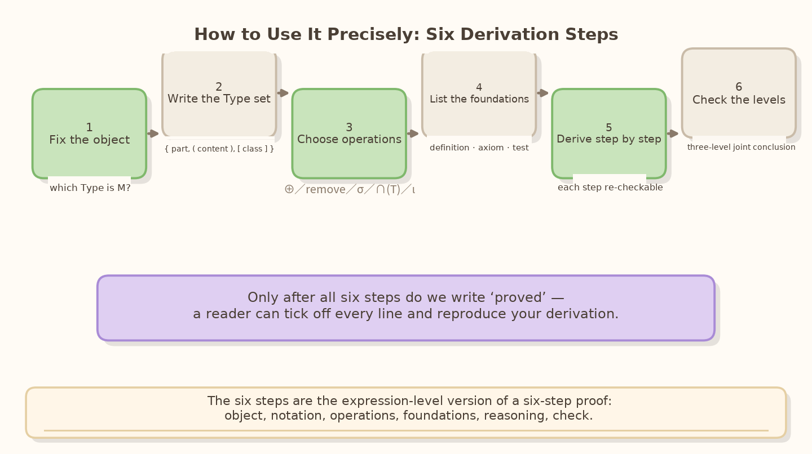

*Figure 12-1 The six derivation steps*

| Step | Action | Output | Tool often used |
| --- | --- | --- | --- |
| 1  Identify the object | Name the object of the derivation | one sentence: which Type M is | —— |
| 2  Write the Type Set | full notation | { part, ( content ), [ class ] } | the three brackets |
| 3  Choose the operation | choose the formula by the question | ⊕ / remove / σ / ∩(T) / ι / ≡ | the table of operands |
| 4  List the foundations | write out the definition, axiom, criterion | T, C, the axiom of invariance, remove | Chapter 1 foundations |
| 5  Derive step by step | one step one level, step by step | the derivation body | the master table of laws |
| 6  Check the levels | joint check of the three levels | conclusion (QED) | three formulas in concert |

*Table 12-1 The six derivation steps as an operating table*

The six steps are the expression version of the six proof steps: step three 'choose the proposition' becomes 'choose the operation', and step five 'criterion reasoning' widens into 'step-by-step derivation' — the rest of the spirit is identical: identify the object first, then write the notation, then walk the reasoning, and check at the end.

### 12.2 The Eight-Question Checklist

| # | Check | Pass standard |
| --- | --- | --- |
| 1 | Is the object identified? | you can say in one sentence 'which Type I am deriving' |
| 2 | Is the Type Set complete? | all three segments present: { part, ( content ), [ class ] } |
| 3 | Are object and operation paired? | parts use ⊕/remove, content uses σ/ι, class uses ∩(T)/α |
| 4 | Is the bracket scope marked? | the scope of every formula is unambiguous |
| 5 | Is the cited law valid? | check the master table: cite only what holds, add a condition to what does not |
| 6 | Has a counter-example been sought? | at least one boundary case correctly judged |
| 7 | Is every step re-checkable? | a reader can tick sentence by sentence and reproduce the derivation |
| 8 | Has the three-level check been done? | J_C ∧ J_B ∧ J_T all pass, only then write QED |

*Table 12-2 The eight questions before handing over a derivation*

### 12.3 Five Common Misuses

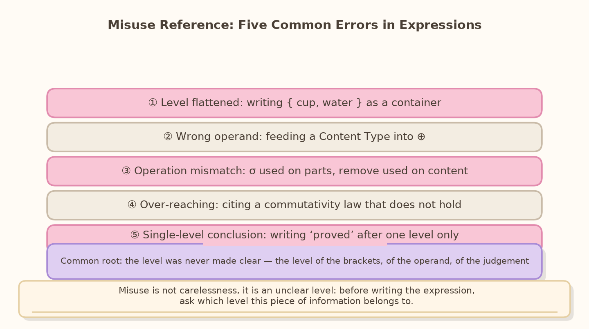

*Figure 12-2 Five common misuses*

| # | Misuse | What goes wrong | Correct writing |
| --- | --- | --- | --- |
| 1 | flattening the levels | writing {cup, water} as a container leaves σ no room | use ( ) for a container and mark id(C) |
| 2 | mistaking the object | feeding a content Type to ⊕ | tell part / content / class apart, then choose the formula |
| 3 | mismatching the operation | σ on parts, remove on content | the brackets decide the operation; the scope may not be crossed |
| 4 | over-reaching a law | citing a commutativity that does not hold | check the master table, let counter-examples fix the boundary |
| 5 | concluding on one level | writing QED after a single-level judgement | gather the conclusion only after the three formulas are in concert |

*Table 12-3 Five misuses and the correct writing*

### 12.4 A Full Case: One Expression from Definition to Proof

> **[Derivation] Full worked derivation: three questions about the coffee cup in one pass**
>
> Situation: M = coffee cup = { handle, base, lid, body, (coffee), [white] }. Three questions: (1) is it the same cup once the tea is in? (2) what if the lid is taken off? (3) does a thermos count as a cup?
>
> [Steps 1-2] Identify the object, write the Type Set — M as above, id(M) = CUP-001.
>
> [Steps 3-4] Choose the operations: (1) σ; (2) remove; (3) ∩(T). Foundations: the axiom of invariance, the remove criterion, F(cup) = { can hold liquid, can be drunk from while held }.
>
> [Step 5] (1) σ_{coffee→tea}(M): only S(C) moves → by Theorem 5-1 id is unchanged → ≡ the same cup. (2) remove(lid, M): the lid can be taken off and still knows itself → ≡ M′ ⊂ M, function degraded, identity survives. (3) ∩(cup)(thermos) = can hold liquid ∧ can be drunk from while held = true → ∈ [cup].
>
> [Step 6] Three-level check: container level ✓ (σ preserves identity); composition level ✓ (the three remove levels all land); abstraction level ✓ (∩(T) all pass) — the three formulas in concert are true, all proven.

> **[Exercise] Exercises**
>
> S01 (the full six steps): choose an object from your own work (a document, a product or an organisation), walk the six derivation steps, and write at least two expressions.
>
> S02 (self-check for misuse): use Table 12-3 to check three judgements you wrote in the past, mark the misuses you committed and rewrite them.

## Chapter 13 A Complete Content Plan: Learn · Practise · Apply · Teach · Build

Finally, the complete implementation plan for this derivation system: how to learn, how to practise, how to apply, how to teach, how to build — five stages joined into one growth line.

### 13.1 The Five-Stage Route

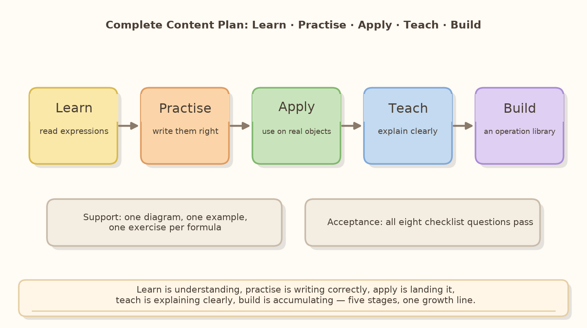

*Figure 13-1 The five-stage route: learn, practise, apply, teach, build*

| Stage | Goal | Method | Acceptance |
| --- | --- | --- | --- |
| Learn | understand every formula | one formula, one diagram, one example; start from the definition and key boxes | can restate the object and the scope of the five formulas |
| Practise | write every formula correctly | hand-write the derivation for exercises P01-P20 chapter by chapter | all exercises written and checked against the answers |
| Apply | use it on real things | pick two real objects a week and walk the six steps | eight or more derivation cards |
| Teach | explain every formula clearly | explain one formula to someone who does not know it | the other person can solve one problem correctly |
| Build | build a library of operation cards | settle the composite formulas you use often into cards | twenty or more personal operation cards |

*Table 13-1 The five stages as an operating table*

### 13.2 The Eight-Week Learning Route

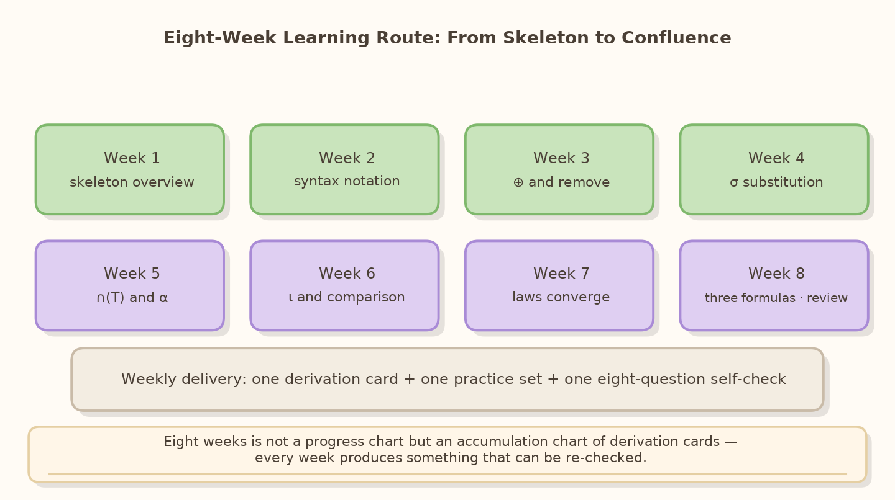

*Figure 13-2 The eight-week learning route*

The eight weeks are not a schedule but an accumulation table of derivation cards: every week you deliver one derivation card, one set of exercises and one eight-question self-check. The first six weeks take one or two operations each, week seven concentrates on the master table of laws and counter-examples, week eight on the three formulas in concert and a general review — every week has a re-checkable output.

### 13.3 Choosing by Situation: Which Operation, When

| The problem you meet | First choice | Supporting tool |
| --- | --- | --- |
| combine several parts into one whole | ⊕ compose | associativity; dependency check |
| take one part away — is it still the same | remove decompose | the three-level criterion formula |
| swap what is inside — does the identity hold | σ substitution | identity-preservation theorem, axiom of invariance |
| does a new thing count as this class | ∩(T) classification | F(T) boundary cases |
| how does a group of samples become a rule | α abstract generation | the property-emergence rule |
| put things inside — how are the levels arranged | ι nesting | the level theorem, non-flattening |
| are two things the same | ≡ / ≢ / ⊂ | choose the comparison level first |

*Table 13-2 Decision table for choosing by situation*

### 13.4 Acceptance Criteria

> **[Key] Overall acceptance**
>
> - Personal level: you can write the five formulas from memory, recite the master table of laws, and walk one real object through the six steps within 30 minutes.
> - Output level: eight derivation cards, twenty personal operation cards, and all exercises P01-P20 checked against the answers.
> - Review level: hand any derivation to another person and they can tick sentence by sentence and reproduce it — precision = precision that can be re-checked.

## Review Key Points and Self-Check

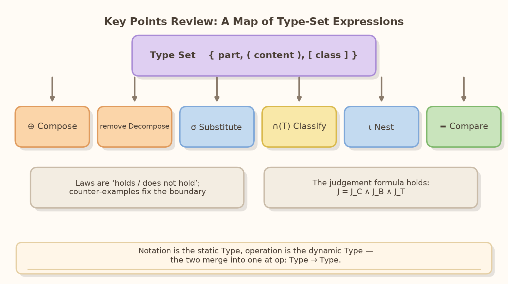

*Figure R-1 Key points reviewed: one map of the Type-Set expressions*

### R-1 Five Formulas, Three Laws, One Judgement

The five operations each govern one level: ⊕ compose and remove decompose govern the parts { }, σ substitution and ι nesting govern the content ( ), ∩(T) classification and α abstraction govern the class [ ]; the comparison ≡ / ≢ / ⊂ gathers the distinction between two Types. Some laws hold and some do not — the counter-examples that fail all point to two constraints: level and identity. Judgement is gathered into the three formulas in concert J = J_C ∧ J_B ∧ J_T.

### R-2 Notation and Operation Are Two Sides of One Thing

Notation is the static Type: { part, ( content ), [ class ] }; operation is the dynamic Type: op: Type → Type. The two become one in 'Type in, Type out' — the five operations are the basic model, the Time-Type function library is the higher-order composite.

### R-3 Precision Is Checkable Precision

Derivation does not rely on intuition but on process: walk the six steps one by one, check the eight questions item by item, let counter-examples fix the boundary, and conclude only when the three formulas are in concert. A reader can tick sentence by sentence and reproduce your derivation — that is what the word 'precision' means.

| Self-check question | What you should be able to answer |
| --- | --- |
| The general form of an operation? | op: Type → Type — Type in, Type out |
| Which level does each of the five operations act on? | ⊕/remove on parts, σ/ι on content, ∩(T)/α on class |
| Which laws hold? | associativity, idempotence, commutativity (σ in the same container), identity preservation, inverse monotonicity |
| The common root of those that do not? | level and identity — counter-examples draw the boundary |
| How is a judgement written as formulas? | J = J_C ∧ J_B ∧ J_T, three formulas in concert |
| Where does a derivation start? | identify the object → write the Type Set → choose the operation → list the foundations → derive → check |

*Table R-1 Self-check list*

> **[Key] In one sentence**
>
> Notation is the static Type, operation is the dynamic Type — see the Type clearly, derive the formula precisely.

## Exercises Reference Answers

Below are model answers for P01-P20 and S01-S02. An answer is not unique — as long as the six steps are walked correctly, the levels are written clearly and every step is re-checkable, it is a good answer.

#### P01 Recognising the object

> **[Derivation] Model answer**
>
> (1) Textbooks in the schoolbag swapped for notebooks — textbooks and notebooks are content Types ( e ), the schoolbag is a container → σ_{textbook→notebook}(schoolbag), id(schoolbag) unchanged.
>
> (2) The camera module is taken off — part Type { p } → remove(camera module, phone), and the result is ≡ M′ ⊂ M (function-degraded part).
>
> (3) Is a straw cup a cup — class Type [ T ] → ∩(cup)(straw cup), with F = { can hold liquid, can be drunk from while held } checked item by item.

#### P02 Judging the syntax

> **[Derivation] Model answer**
>
> Because the brackets decide the level, and the root of misuse is a misplaced level: ⊕ on content would wrongly compose 'what is inside' as a part and pollute the BOM; σ on parts would take 'dismantling' for 'swapping' and leave the identity judgement without ground; ∩(T) on parts would misjudge 'a structural difference' as 'a class difference'.
>
> The scope rule locks each formula inside its own level — a formula that crosses the line cannot be written, and misuse is stopped at the moment of writing.

#### P03 Compose derivation

> **[Derivation] Model answer**
>
> M = mainboard ⊕ battery ⊕ screen ⊕ camera module (by associativity the brackets may go anywhere).
>
> BOM(M) = { mainboard, battery, screen, camera module }; dependency: the screen depends on the mainboard (no mainboard, no display output) — the levels are preserved, so the compose holds.

#### P04 Finding a counter-example

> **[Derivation] Model answer**
>
> Example: 'foreword ⊕ body' and 'body ⊕ foreword' of an article — the reading order and the logical dependency differ, so they are two different Types.
>
> The difference is at the dependency level: the foreword leads into the body (dependency direction A → B); swap them and the dependency reverses — position and order are part of the Type.

#### P05 Three-level classification

> **[Derivation] Model answer**
>
> M = laptop. Essential parts: mainboard, battery — remove(p, M) ≢ M (it will not start; dissolution);
>
> Function-degraded parts: touchpad, built-in speakers — remove ≡ M′ ⊂ M (external devices work; the function is degraded);
>
> Non-essential parts: stickers, rubber feet — remove ≡ M (no effect at all).

#### P06 Branch distribution

> **[Derivation] Model answer**
>
> ( bookshelf ⊕ books ) remove magazine ≡ bookshelf ⊕ ( books remove magazine ) — the magazine is only in the 'books' branch, so by Theorem 4-2 branch distribution holds.
>
> remove(magazine, books) ≡ books (the whole of the books is unaffected by one magazine) → the magazine is a non-essential part.

#### P07 Identity-preservation derivation

> **[Derivation] Model answer**
>
> (1) C = ( WALLET-001, (banknote A) ), write id(C); (2) the change: σ_{banknote A→banknote B}(C), which moves only S(C);
>
> (3) cite the axiom of invariance (∀ e1, e2 ∈ S(C), substitution does not change id(C)); (4) hence id(C) is constant and the wallet is the same wallet. (QED)

#### P08 The boundary of σ

> **[Derivation] Model answer**
>
> It is not a σ. 'Swap the cup for a bowl' moves the container itself — id(CUP-001) becomes id(BOWL-001) and the identity changes;
>
> the precondition of σ is that id does not move and only elements in S(C) are swapped. Moving the container is dismantling (the reverse of ι) plus a new container, and should be written ≢ with a new Type set up.

#### P09 Classification derivation

> **[Derivation] Model answer**
>
> F = { can run on a road, can carry people or goods, has a power system, can be steered by a driver }.
>
> f1(Tesla) = true (runs on a road); f2 = true (carries 5); f3 = true (battery + electric motor = power system); f4 = true (steered by wheel).
>
> ∩(electric vehicle)(Tesla) = true ∧ true ∧ true ∧ true = true → Tesla ∈ [electric vehicle]. (QED)

#### P10 Inverse monotonicity

> **[Derivation] Model answer**
>
> F(T′) = F(T) ∪ { capacity under 500 ml } ⊋ F(T) → by Theorem 6-2, [T′] ⊆ [T], the class tightens.
>
> Example: a 750 ml sports bottle was ∈ [cup] and after the feature is added ∉ [T′] — features added, class tightened, opposite directions.

#### P11 Nesting derivation

> **[Derivation] Model answer**
>
> ι( ι( ι( phone, case ), courier box ), van ).
>
> By Theorem 7-1: swapping the van moves only the outermost S(logistics system) — every level's id stays constant, and the phone's id(SM-001) is unchanged at every level of the chain. (QED)

#### P12 Flattening check

> **[Derivation] Model answer**
>
> The roll is a composition/set notation { student1, student2, … } — only side by side, with no container level of 'who holds whom'.
>
> It lacks ( ): there is no id(C) and no S(C), so σ finds no scope to substitute in and ι finds no position to enter — to apply σ/ι you must first set up a container (such as the class container 'Class 3A').

#### P13 Choosing the level

> **[Derivation] Model answer**
>
> The employee is a container (duties and staff number are its Type), the desk is one of its contents → changing the desk is σ_{desk A→desk B} and the employee's id does not change — id identity (container level).
>
> Note: if 'the employee' is taken as the content of the organisational container, then a transfer is a σ of the organisation — the comparison level depends on which whole you identify.

#### P14 Degradation formula

> **[Derivation] Model answer**
>
> remove(air conditioning, car) ≡ M′ ⊂ M: the car is still recognised as a car (id and main BOM intact) but the function of air conditioning is gone.
>
> It is written ⊂ and not ≢: identity survives and only the function is subsetted — ≢ is kept for dissolution, ⊂ for degradation.

#### P15 Judging laws

> **[Derivation] Model answer**
>
> (1) does not hold: ⊕ has no commutativity, (M1⊕M2)⊕M3 ≢ M1⊕(M3⊕M2) (swap M2 and M3 and the Type changes).
>
> (2) holds: σ composition — two substitutions in the same container may be merged and may commute.
>
> (3) does not hold: compose and decompose are not symmetric; remove(p, M) ⊕ p rebuilds a 'new compose', and the dependency gap differs from the original M.

#### P16 Make your own counter-example

> **[Derivation] Model answer**
>
> Samples: { a cup with a lid, a bowl without a lid }. remove(lid) then α → the features do not include 'has a lid'; α then remove → the class already contains the feature 'has a lid', and after the remove the samples no longer match the rule.
>
> A different order, a different extracted F(T) → decompose then abstract ≢ abstract then decompose — α and remove do not commute.

#### P17 Three formulas in concert

> **[Derivation] Model answer**
>
> J_C: passengers getting in and out is σ, the vehicle id does not change → true.
>
> J_B: battery pack and electric motor = essential parts (remove ≢ M); centre screen = degraded part; badge = non-essential part → the three levels land, true.
>
> J_T: F(car) = { can run on a road, can carry people or goods, has a power system, can be steered by a driver } all pass → true.
>
> J = true ∧ true ∧ true = true. (QED)

#### P18 Locating the blind spot

> **[Derivation] Model answer**
>
> Smartwatch: J_C = true (apps can be installed); J_B = true (it has part structure); J_T = false — 'portable' in F(smartphone) passes, but if F includes 'independent calling / large-screen operation' it fails (depending on the F(T) you set up).
>
> The intended answer here: judged by F = { can communicate, can compute, is portable } the watch passes all three and would enter the class — so the blind spot is that F(T) is not precise enough, and features (such as 'can install applications independently') must be added to tighten the class. Conclusion: which formula stops it depends on the stance taken in F(T) — which is precisely the proof that the feature list is a stance.

#### P19 Decomposing a composite

> **[Derivation] Model answer**
>
> (1) remove(lid, M) observed → M′ ≡ M′ ⊂ M (the lid is missing); (2) reverse ι lookup: M ι desk ι office, list the candidate container chain;
>
> (3) compare the σ state at each level: the record of σ_{lid→∅} plus an ≡ comparison → lock onto the container with the matching id.
>
> Composite: compare( reverse-ι( remove(lid, M) ), σ record ) — abductive reasoning = a composite chain of basic operations.

#### P20 Positioning

> **[Derivation] Model answer**
>
> Higher-order: design search has to 'find a design Type from a requirement Type', many Types back and forth, with comparison and extraction.
>
> The basic operations it may contain: ∩(T) (does a candidate belong to the required class), ≡ (compare with known designs), ⊕ (combine candidate options), remove (exclude unsuitable parts) — a higher-order function = a composite of the basic model.

#### S01 · S02 Combined questions

> **[Derivation] Model answer (key points)**
>
> S01: after choosing the object, always write the Type Set before choosing the formula; the two expressions should belong to different levels (one σ, one remove) so as to show level independence.
>
> S02: the point of a misuse self-check is not 'finding a mistake' but marking 'where the level went wrong' — the common root of all five misuses is that the level was not written clearly.

## Appendix A Master Table of Operators

| Sign | Name | Definition | Level it acts on |
| --- | --- | --- | --- |
| ⊕ | compose | BOM(M1⊕M2) = BOM(M1) ∪ BOM(M2) | { } parts |
| remove(p, M) | decompose | three levels: ≢M / ≡M′⊂M / ≡M | { } parts |
| σ_{e1→e2}(C) | substitution | e1 in S(C) replaced by e2 | ( ) content |
| ∩(T)(x) | classification | f1(x) ∧ f2(x) ∧ … ∧ fn(x) | [ ] class |
| α(x1…xk) | abstract generation | extract features → T = (F(T), ∩(T)) | [ ] class |
| ι(M, C) | nesting | M ∈ S(C), fixing the position | ( ) content |
| ≡ / ≢ | comparison | three kinds of identity: id / Type / class | all three levels |
| ⊂ | degradation sign | M′ ⊂ M (function degraded) | { } parts |
| op: Type → Type | general form | Type in, Type out | all |

*Table A-1 Master table of operators*

## Appendix B Quick Reference: Terms and Signs

| Term | English / sign | Definition in one sentence |
| --- | --- | --- |
| Type | Type | an object that is completely described |
| Unit Type | Unit Type | the union of three sets: { part, ( content ), [ class ] } |
| Type Set | Type Set | the complete notation of a Unit Type |
| Abstract class | T = (F(T), ∩(T)) | an open class determined by features and a criterion |
| Intersection criterion | ∩(T) | membership only if every feature passes |
| Container | C = (id(C), S(C)) | a set plus an unchanging identity |
| Axiom of invariance | ∀ e1, e2 ∈ S(C) | replacing the content does not change id(C) |
| remove criterion | remove(p, M) | remove a part and see whether identity survives |
| Three-level judgement | J_C ∧ J_B ∧ J_T | container / composition / abstraction in concert |
| Type in, Type out | op: Type → Type | one Type in, one Type out |
| Time Type | Function / Method | the higher-order composite of Type in, Type out |
| Precision | checkable precision | a reader can tick sentence by sentence and reproduce the derivation |

*Table B-1 Quick reference of terms*

| Sign | How to read it | How it is used |
| --- | --- | --- |
| { } | braces | composition set (parts) |
| ( ) | parentheses | container set (contents) |
| [ ] | square brackets | abstract set (class) |
| ∈ / ∉ | belongs / does not belong | a membership statement |
| ≡ / ≢ / ⊂ | identical / not identical / degraded | comparison |
| ∀ / ∧ | for all / and | universal quantifier / conjunction |
| ⇔ | if and only if | definitional equivalence |

*Table B-2 Quick reference of signs*

## Appendix C Quick Reference: Derivation Templates

> **[Definition] Template 1: single-formula derivation card**
>
> [Object] M = { part, ( content ), [ class ] }, id = …
>
> [Question] one sentence.
>
> [Operation] ⊕ / remove / σ / ∩(T) / ι / ≡ (choose one).
>
> [Foundations] the definitions / axioms / criteria cited.
>
> [Derivation] (1) (2) (3)… one step one level, step by step.
>
> [Conclusion] QED / verdict + level annotation.

> **[Definition] Template 2: law-judgement card**
>
> [Formula] write the law to be judged.
>
> [Holds?] check the master table of Chapter 9.
>
> [Derivation or counter-example] if it holds, give a derivation; if not, give a counter-example.
>
> [Condition] if an extra condition is needed, state the premise.

> **[Definition] Template 3: three-in-concert card**
>
> [Object] M = …
>
> [J_C] is id unchanged after σ? → true/false + reason.
>
> [J_B] do all three remove levels land? → true/false + reason.
>
> [J_T] ∩(T)(x) = ? → true/false + item-by-item table.
>
> [In concert] J = J_C ∧ J_B ∧ J_T → proven or not.

The three templates are the six steps condensed: template 1 walks a single formula, template 2 judges a law, template 3 gathers the conclusion. Print them and keep them on the desk; fill in cell by cell while deriving — if it can be filled in, it can be derived.

> **[Key] One last sentence**
>
> Notation is the static Type, operation is the dynamic Type — see the Type clearly, derive the formula precisely, and put it into practice as Mind AI.

www.longreat.net

Chang Changfeng  gamma@livemail.tw  |  Chang Tingying  mindaiworks@gmail.com
