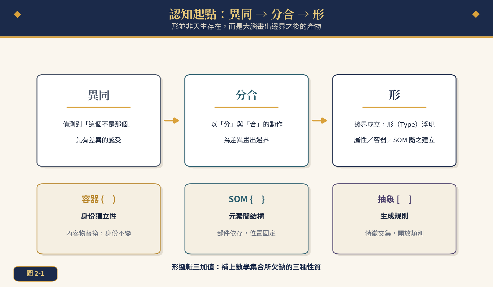
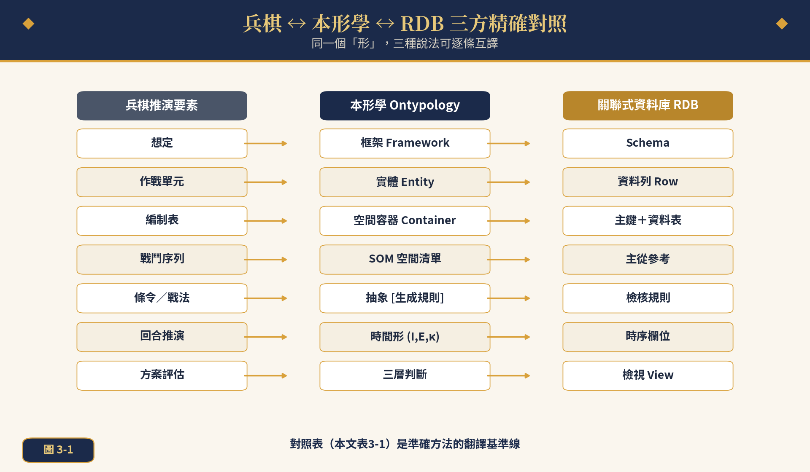
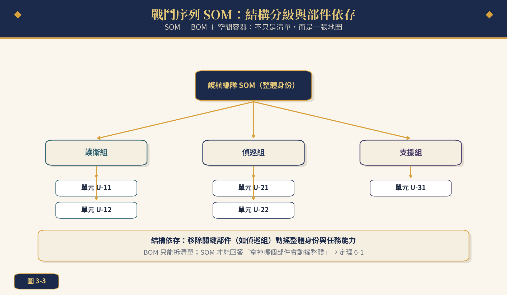
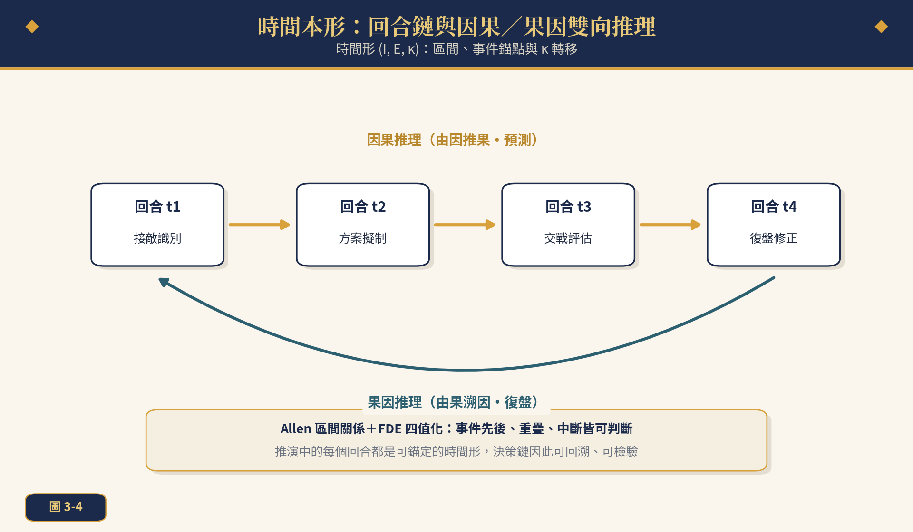
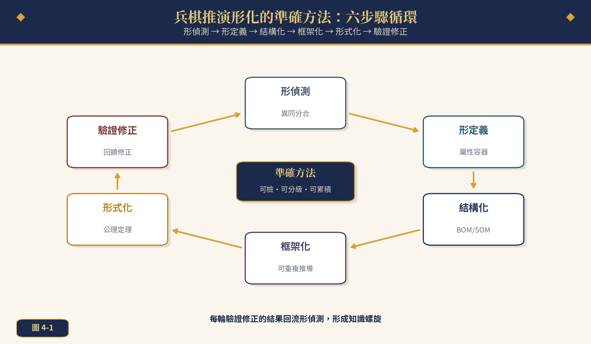
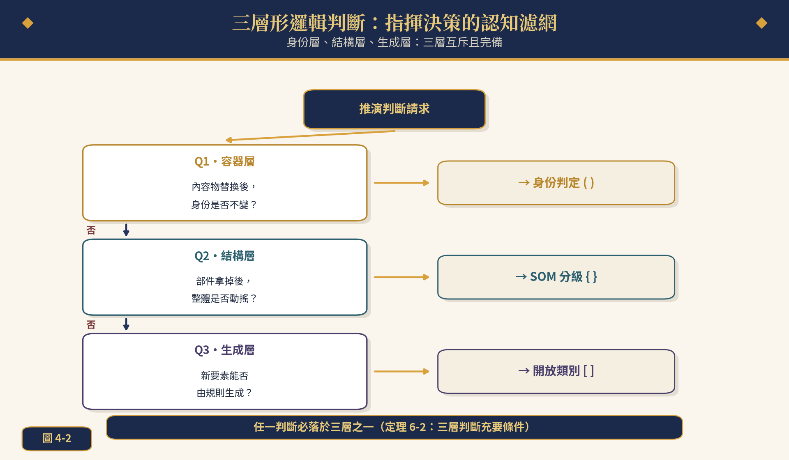
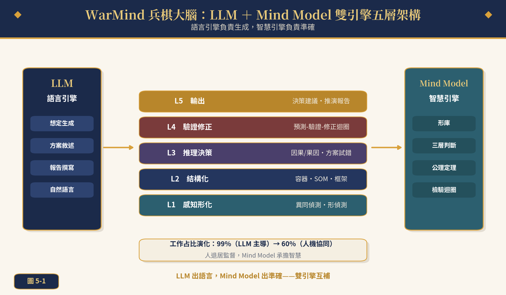
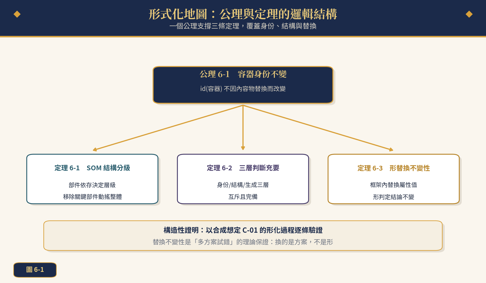

  <a href="https://youtu.be/NbvQTO81iLM">💻Landscape</a> ｜ 
   <a href="https://v.douyin.com/hx7s5DgRzKg">📱Portrait</a> 
 

 
**Ontypology**

# Wargames Brain   WarMind

> **Research Positioning**
> Taking the "War Matrix" described in "US Military Activates a New AI Wargaming System" (China National Defense News, 2026-04-22) as the starting point, this paper proposes the accurate method of wargaming that fuses Ontypology and Mind Model, together with the WarMind Wargames Brain architecture.

*Synthetic scenario demonstration; no real operational details involved*

## Contents

- Abstract
- Chapter 1  Introduction: The Era's Proposition of AI Wargaming
  - 1.1  Starting from the "War Matrix"
  - 1.2  The Four Structural Bottlenecks of Traditional Wargaming
  - 1.3  Ontypology's Point of Entry: Making Simulation Knowledge "Typed"
  - 1.4  Structure of the Paper
- Chapter 2  Theoretical Foundations of Ontypology and Mind Model
  - 2.1  The Origin of the Type: Difference & Similarity, Split & Merge, and Type
  - 2.2  Unit Type: Attribute, Container, and Space Object Model
  - 2.3  Framework: A Machine for Repeatable Derivation
  - 2.4  The Eighteen Themes of Temporal Types
  - 2.5  Mind Model and the Dual-Engine Philosophy
- Chapter 3  Ontypological Typification of Wargaming
  - 3.1  The Three-Way Precise Mapping
  - 3.2  Battlefield Containers and Identity
  - 3.3  Order of Battle SOM and Structural Grading
  - 3.4  Scenario Framework: The Asymmetry of Adding Rows vs. Adding Columns
  - 3.5  Temporal Types: The Round Chain, Causation, and Effect-to-Cause
- Chapter 4  The Accurate Method: Six Steps and Three-Layer Judgment
  - 4.1  The Six-Step Cycle of Wargame Typification
  - 4.2  Operating Principles and Checks
  - 4.3  Three-Layer Type Logic Judgment
  - 4.4  Five-Dimensional Accuracy
- Chapter 5  WarMind Wargames Brain
  - 5.1  The Dual-Engine Five-Layer Architecture
  - 5.2  The Predict-Verify-Revise Loop
  - 5.3  The Typification Upgrade of Multi-Option Trial and Error
  - 5.4  Simulation Data Feedback and Type Assets
- Chapter 6  Formalization: Axioms and Theorems
  - 6.1  Axiom 6-1: Container Identity Is Invariant
  - 6.2  Theorem 6-1: SOM Structural Grading
  - 6.3  Theorem 6-2: Necessary and Sufficient Condition of the Three-Layer Judgment
  - 6.4  Theorem 6-3: Type Substitution Invariance
- Chapter 7  Case Simulation: Synthetic Scenario C-01
  - 7.1  Scenario Overview
  - 7.2  Six-Step Typification Drill
  - 7.3  Multi-Option Trial-and-Error Matrix
  - 7.4  Three-Layer Judgment and After-Action Review
  - 7.5  Boundary Cases and FDE Four-Valued Judgment
- Chapter 8  Evaluation and Outlook
  - 8.1  Five-Dimensional Accuracy Comparison
  - 8.2  Evolution of Work Share and Human-Machine Division of Labor
  - 8.3  Ethics and Human-in-the-Loop
  - 8.4  Outlook
- Chapter 9  Conclusion
- References
- Appendix A  Three-Layer Judgment Quick-Reference Table

## Abstract

In April 2026, during a wargaming event code-named GE26, the US Air Force activated for the first time the AI wargaming system "War Matrix," compressing multi-round strategic simulations that traditionally take weeks into completion within a short time, and endowing it with capabilities such as multi-option trial and error, interactive parsing of multi-dimensional operational factors, and simulation-data feedback. However, current AI wargaming generally faces four bottlenecks: unverifiable black-box reasoning, high cost of option trial and error, difficulty in accumulating simulation knowledge, and the lack of hierarchical structure in factor relationships. This paper proposes the "Wargames Brain WarMind"—an accurate wargaming method grounded in Ontypology and Mind Model: it first reconstructs the cognitive starting point of battlefield knowledge through "Difference & Similarity → Split & Merge → Type," and completes the typification of scenarios, combat units, order of battle, and doctrine using Attribute, Space Collections, BOM/SOM, and Framework; it then establishes a verifiable simulation process through six steps (Type Detection, Type Definition, Structuring, Frameworking, Formalization, Verification & Revision) and three-layer Type Logic judgment (Identity Layer, Structure Layer, Generation Layer); finally, it carries the Predict-Verify-Revise loop on an LLM + Mind Model dual-engine five-layer architecture, upgrading "multi-option trial and error" into the type operation of "adding rows within the framework," and operating under the formal guarantees of Axiom 6-1 (Container Identity Is Invariant) and Theorems 6-1 through 6-3 (SOM Structural Grading, Necessary and Sufficient Three-Layer Judgment, and Type Substitution Invariance). Using synthetic scenario C-01 "Escort Air-Defense Identification," this paper fully drills the six-step typification and multi-option trial and error, and compares WarMind against pure LLM and traditional wargaming systems using a five-dimensional accuracy radar (Semantic Completeness, Visible Assumptions, Verifiable Steps, Consistent Layers, Clear Boundaries), verifying WarMind's advantages in verifiability and knowledge accumulation.

**Keywords:** Wargaming, Artificial Intelligence, Ontypology, Mind Model, WarMind, Typification, Multi-Option Trial and Error, Three-Layer Judgment, Relational Database

## Chapter 1  Introduction: The Era's Proposition of AI Wargaming

> **Chapter Guide**
> Starting from the four capabilities of the "War Matrix," this chapter points out the knowledge problem behind the speed, and explains Ontypology's point of entry and the paper's roadmap.

*Figure 1-1  Comparison of the working forms of traditional wargaming vs. "War Matrix" AI wargaming*

### ◆ 1.1  Starting from the "War Matrix"

In April 2026, during a wargaming event code-named GE26, the US Air Force used for the first time the new AI wargaming system "War Matrix," and it was reported that this simulation "completely changed the working form of traditional wargaming." Under the traditional mode, a strategic simulation containing multiple rounds of action typically takes weeks; the "War Matrix," relying on cloud computing and AI technology, can complete within a short time multi-round simulations equivalent to several days of actual operations. US Air Force officials said the system has "multi-option trial and error" capability, allowing commanders to set different conditions within the simulation and rapidly verify a variety of tactical effects; the system can parse the interactive relationships among multi-dimensional operational factors on the battlefield, evaluate the synergistic effectiveness of different weapon-equipment combinations, and provide decision support for campaign-level actions. In addition, the simulation data generated by the system will feed back into the US military's simulation training system, providing reference for future equipment R&D. The US military plans to expand the scope of use of the system, and the US Space Force and Marine Corps have already shown interest in it.

This report from China National Defense News outlines four signature capabilities of AI wargaming: cloud-accelerated multi-round simulation, multi-option trial and error, multi-dimensional factor interaction parsing, and simulation-data feedback. These four capabilities can be neatly organized into Table 1-1—and behind each capability lurks a more fundamental question: **in what form must simulation knowledge exist so that it can be accelerated, trial-and-errored, and fed back?** This paper's answer is: it must exist in the form of the "Type."

**Table 1-1  Capability Highlights of the "War Matrix" and the Typification Requirement**

| **Capability Highlight** | **As Reported** | **Knowledge Problem Behind It** | **Typification Requirement** |
| --- | --- | --- | --- |
| Cloud-accelerated multi-round | Complete several days of multi-round simulation in a short time | Simulation states must be rapidly reproducible | Framework repeatably derivable |
| Multi-option trial and error | Set different conditions for rapid verification | Option differences must be comparable | Adding rows does not disturb the Type |
| Multi-dimensional factor parsing | Parsing the interactive relationships of operational factors | Relationships must be clearly hierarchical | Container/SOM grading |
| Data feedback | Feedback into the training system and equipment R&D | Knowledge must be able to accumulate | Type asset management |

### ◆ 1.2  The Four Structural Bottlenecks of Traditional Wargaming

The "War Matrix" solves the problem of speed, but speed is only the surface. Looking one level deeper, whether traditional human wargaming or existing AI wargaming, four structural bottlenecks are generally faced (Figure 1-2).

*Figure 1-2  The four structural bottlenecks of traditional wargaming*

> **Structural Definition of the Bottlenecks**
> "Structural" means that the bottleneck does not come from a shortage of computing power or manpower, but from a defect in the **way knowledge is represented**: if simulation knowledge exists as narrative text or flat tables, then black-boxing, high trial-and-error cost, non-accumulation, and non-grading are inevitable consequences rather than engineering flaws.

First, black-boxing is unverifiable: the simulation reasoning generated by an LLM sounds plausible, yet it cannot be traced and verified item by item, and the credibility of the conclusion remains at "sounds right." Second, trial-and-error cost is high: a change to an option drags the whole board into re-simulation, and a cycle of weeks can hardly support rapid comparison of "multiple options." Third, knowledge does not accumulate: simulation experience stays in the participants' heads, and the next simulation starts from scratch. Fourth, structure cannot be graded: scenario elements are stacked flatly, and "who is who," "who contains whom," and "who determines whom" lack hierarchy.

### ◆ 1.3  Ontypology's Point of Entry: Making Simulation Knowledge "Typed"

Ontypology holds that human intelligence is jointly constituted by "Type" and "Number"; mathematics describes quantity, relations, and regularity, while Typology describes structure, composition, association, evolution, and essence. A "Type" does not exist innately; rather, it is the product after the brain first detects "Difference & Similarity" and then draws boundaries by "Split" and "Merge"; to understand a Type is to understand "what it looks like" (Attributes), "where it is" (Container), "what it is composed of" (SOM), and "whether this description method can be applied repeatably" (Framework).

Bringing this perspective into wargaming, each of the four bottlenecks has its counterpart: the black-box problem is resolved by the verifiability of typification; the trial-and-error cost is resolved by the framework's "adding rows" operation; non-accumulation of knowledge is resolved by Type asset management; and non-grading of structure is resolved by the three added values of Container/SOM/Abstraction. This is the "accurate method" in the title of this paper—accuracy is not rhetoric, but a technical meaning of verifiable, gradable, and accumulable.

### ◆ 1.4  Structure of the Paper

Chapter 2 condenses the theoretical foundations of Ontypology and Mind Model; Chapter 3 gives a three-way precise mapping among wargaming elements, Ontypology, and the Relational Database, completing the translation baseline of "typification"; Chapter 4 proposes the six-step accurate method and the three-layer Type Logic judgment; Chapter 5 constructs the WarMind Wargames Brain dual-engine five-layer architecture; Chapter 6 completes the formalization with axioms and theorems; Chapter 7 fully drills synthetic scenario C-01; Chapter 8 provides the five-dimensional evaluation and outlook; Chapter 9 concludes.

> **❖  Accuracy is not about sounding right, but about every sentence being verifiable.**

## Chapter 2  Theoretical Foundations of Ontypology and Mind Model

> **Chapter Guide**
> Condensing the theoretical base of Ontypology: Difference & Similarity → Split & Merge → Type, the three constructs of the Unit Type, the four steps of the Framework, the eighteen temporal themes, and the dual-engine philosophy.

*Figure 2-1  The cognitive starting point: Difference & Similarity → Split & Merge → Type, and the three added values of Type Logic*

### ◆ 2.1  The Origin of the Type: Difference & Similarity, Split & Merge, and Type

The first proposition of Ontypology is: a Type does not exist innately. The brain first detects the feeling of difference—"this is not that"—and then draws a boundary for the difference through the actions of "Split" and "Merge"; only after the boundary holds does the Type emerge. Take cups as an example: between a transparent cup and a blue cup there exists only the most primitive "difference"; when a third cup brings a batch of differences of a different nature—material and handle—"comparison failure" forces the brain to separate and name the differences, and only then are dimensions (Attributes) such as "color" and "material" abstracted out. This chain of "Difference & Similarity → Split & Merge → Type" is the cognitive starting point of all of Ontypology's theory.

### ◆ 2.2  Unit Type: Attribute, Container, and Space Object Model

Once a Type holds, it must answer "how to completely describe a concrete Type." Ontypology answers with three constructs:

> **Definition 2-1  Attribute and Attribute Value**
> An Attribute is an independent dimension describing "what the object itself looks like" (e.g., color, material); an Attribute Value is the value taken under that dimension (e.g., transparent, glass). An Attribute cannot be torn off—once color is "torn off," it is nothing at all.

> **Definition 2-2  Space Collections**
> A Space Collection is an object with a clear boundary and an internal space into which contents can be placed and removed. A container answers "where the thing is" rather than "what the thing is"; the key property: **a container's identity is not determined by its contents**—a cup holding water or holding coffee is the same cup.

> **Definition 2-3  BOM and SOM**
> BOM (Bill of Materials) answers "which parts can be disassembled out": those that can be disassembled and remain independent individuals after disassembly go into the BOM. SOM (Space Object Model) = BOM + Space Collection, and answers "how the parts constitute a whole": parts are fixed at specific positions and are structurally interdependent, and **removing a key part shakes the identity of the whole**. BOM is a list; SOM is a map.

Corresponding to the Relational Database (RDB): the table header is the Type, the data row is the entity, the Primary Key is the identity (by what each row is independently identified), and the master-detail reference is the link between Type and Type—each row of the detail table must first point to some Primary Key of the master table in order to hold. This correspondence enables typified simulation knowledge to immediately obtain a data-structure carrier.

### ◆ 2.3  Framework: A Machine for Repeatable Derivation

The Framework abstracts the very act of "describing an object" into a repeatably applicable method. The four steps of the Framework are: (1) take a group of things and first be able to distinguish "this is not that"; (2) when a second batch of differences of a different nature appears and comparison fails, trigger the need for abstraction; (3) name each of the two batches of differences and divide them into different dimensions—this is the act of abstraction itself; (4) when a new thing is added, first judge which dimension it matches: if it matches, hang it in; if it does not match, abstract a new dimension. The biological taxonomic hierarchy (kingdom, phylum, class, order, family, genus, species) validates the universality of the Framework: concrete individuals must exist first before abstract hierarchies can be derived.

> **Framework Essentials**
> The Framework is "a machine for repeatable derivation": it does not store individual answers, but stores the procedure that produces answers. The drafting, modification, and reuse of wargame scenarios are essentially all Framework operations.

### ◆ 2.4  The Eighteen Themes of Temporal Types

Space Types answer "what the structure is," while Temporal Types answer "how evolution proceeds." The eighteen themes of Temporal Types gather into four modules (Table 2-1, Figure 2-2), among which "causal reasoning" (from cause to effect · prediction) and "effect-to-cause reasoning" (from effect back to cause · after-action review) are precisely the two directions of the time arrow in wargaming.

*Figure 2-2  The eighteen themes of Temporal Types gathered into four modules*

**Table 2-1  The Eighteen Themes of Temporal Types Gathered into Four Modules**

| **Module** | **Themes** | **Role in Wargaming** |
| --- | --- | --- |
| Split & Merge and Abstraction | Split & Merge, Abstraction, Marking, Reconstruction | Cutting, naming, and adjusting scenario elements |
| Thinking and Design | Thinking, Thinking Methods, Problem Solving, Analysis, Design | The thinking procedure of command decisions |
| Reasoning and Logic | Reasoning, Causal Reasoning, Effect-to-Cause Reasoning, Logical Generation, Logical Application | Option prediction and after-action review |
| Framework and Learning | Framework, Design Patterns, Memory Management, Continuous Learning | Knowledge accumulation and reuse |

### ◆ 2.5  Mind Model and the Dual-Engine Philosophy

Mind Model is the practical architecture of Typology theory—not a traditional knowledge graph, but a unified knowledge model that simulates the way human cognition works. Although a knowledge graph can describe entities and relations, it is limited in six respects: the expressive power of relations, deep reasoning, abstract concepts, thought structure, cross-domain unification, and continuous evolution; Mind Model supplements these with the Typology architecture, can simultaneously accommodate language, mathematics, physics, engineering, experience, and tacit knowledge, and practices such thinking abilities as logical reasoning, induction and deduction, causal reasoning, pattern extraction, and decision analysis.

The core philosophy of Mind AI is the dual engine: the LLM is responsible for the generation and understanding of language, and Mind Model is responsible for the accuracy and verification of knowledge; the former produces fluency, the latter produces accuracy. Landed onto wargaming, this philosophy is the WarMind Wargames Brain of Chapter 5.

> **❖  A Type is the boundary drawn after Difference & Similarity has been Split and Merged; to understand a Type is to understand structure, composition, association, and evolution.**

## Chapter 3  Ontypological Typification of Wargaming

> **Chapter Guide**
> Establishing the three-way mapping of wargame ↔ Ontypology ↔ RDB, and completing section by section the typification of the four aspects of identity, structure, framework, and time.

*Figure 3-1  The three-way precise mapping of wargame ↔ Ontypology ↔ RDB*

### ◆ 3.1  The Three-Way Precise Mapping

The first step of typification is to establish an item-by-item inter-translatable mapping table (Table 3-1). The scenario is the Framework: it stipulates "by what procedure a simulation is generated and modified"; the combat unit is the entity: the concrete existence independently identified in the simulation; the establishment table is the Container: in which units obtain position and identity; the order of battle is the SOM: answering "what it is composed of and on whom it depends"; doctrine and tactics are the Abstraction: judging the belonging of a new tactic by generation rules; round-by-round simulation is the Temporal Type: intervals, event anchors, and transitions; option evaluation is the three-layer judgment: decomposing "which option is good" into a verifiable sequence of judgments.

**Table 3-1  Three-Way Precise Mapping of Wargaming Elements ↔ Ontypology ↔ RDB**

| **Wargaming Element** | **Ontypological Concept** | **RDB Correspondence** | **Typification Meaning** |
| --- | --- | --- | --- |
| Scenario | Framework | Schema | Procedure repeatably derivable |
| Combat unit | Entity | Row | Independently identified by Primary Key |
| Establishment table | Space Collection (Container) | Primary Key + Data Table | Identity independent of contents |
| Order of battle | SOM (Space Object Model) | Master-detail reference | Parts with dependency grading |
| Doctrine / tactics | Abstraction [generation rules] | Check rules | Open category is decidable |
| Round simulation | Temporal Type (I,E,κ) | Temporal fields | Decision chain traceable |
| Option evaluation | Three-layer judgment | View | Conclusion verifiable item by item |

### ◆ 3.2  Battlefield Containers and Identity

The most basic and most easily overlooked property in a simulation is the stability of identity. An escort formation will change assignment, change mission, and change station during a simulation—like a cup changing the beverage it holds; but the formation's id should not change because of this (Figure 3-2). The reason container identity invariance is crucial is that **the comparability of option trial and error is built on "the same identity bearing different options"**; if identity drifts with contents, options A and B lose their basis for comparison. This property is elevated in Chapter 6 to Axiom 6-1.

*Figure 3-2  Battlefield containers and identity: contents may change, identity does not*

### ◆ 3.3  Order of Battle SOM and Structural Grading

The order of battle is not a list, but a map. Disassemble the formation into an escort group, a reconnaissance-patrol group, and a support group, each of which then commands units (Figure 3-3); among the parts there exist relations of support, connection, and attachment; removing the reconnaissance-patrol group not only removes two cards, but shakes the mission capability and identity of the whole—this is precisely the structural-dependency semantics of the SOM. The BOM can answer "which parts can be disassembled out," while only the SOM can answer "removing which part shakes the whole"; the latter is precisely the commander's real judgment problem. Theorem 6-1 of Chapter 6 will give a precise statement of SOM structural grading.

*Figure 3-3  Order of battle SOM: structural grading and part dependency*

### ◆ 3.4  Scenario Framework: The Asymmetry of Adding Rows vs. Adding Columns

The RDB has a famous asymmetry: adding a row (a piece of data) is cheap and safe, while adding a column (changing the structure) is expensive and drags the whole. The scenario framework is analogous—appending an option under the same scenario is "adding a row"; modifying the scenario's dimensional structure is "adding a column." The secret of the efficiency of multi-option trial and error is to constrain the vast majority of changes within the "adding rows" domain (Table 3-2).

**Table 3-2  Scenario Evolution: The Asymmetry of Adding Rows vs. Adding Columns**

| **Change Type** | **RDB Meaning** | **Scenario Meaning** | **Cost** | **Trial-and-Error Feasibility** |
| --- | --- | --- | --- | --- |
| Adding rows | Add a piece of data | Add an option configuration | Low | Suited to high-frequency trial and error |
| Adding columns | Change the table structure | Add/modify scenario dimensions | High | Requires formal verification |

> **Principle for Using the Asymmetry**
> "Try rows first, be cautious about touching columns": option trial and error is preferentially completed by adding rows; only when none of the existing dimensions can explain a new difference (case two of the Framework's four steps) is the re-abstraction of adding columns activated, and the Schema and check rules are updated in sync.

### ◆ 3.5  Temporal Types: The Round Chain, Causation, and Effect-to-Cause

The temporal dimension of a simulation is carried by the round chain (Figure 3-4). Each round is an anchorable Temporal Type (I, E, κ): I is the interval, E is the event anchor, and κ is the state transition; Allen's interval relations (precedes, overlaps, is interrupted by, etc.), combined with FDE four-valuedization, make "event order, overlap, and interruption" all decidable. Causal reasoning runs along the round chain from cause to effect (prediction), and effect-to-cause reasoning runs from effect back to cause (after-action review); the two share the same Temporal Type chain, so the knowledge of prediction and after-action review can mutually verify each other.

*Figure 3-4  Temporal Types: the round chain and bidirectional causal/effect-to-cause reasoning*

> **❖  The scenario is the Framework, the unit is the entity, the establishment is the Container, the sequence is the SOM, the doctrine is the Abstraction, the round is the Temporal Type.**

## Chapter 4  The Accurate Method: Six Steps and Three-Layer Judgment

> **Chapter Guide**
> Operationalizing "accuracy": the six-step cycle, the three-layer judgment filter, and the five-dimensional ruler—from a mnemonic to an executable procedure.

*Figure 4-1  The Accurate Method of wargame typification: the six-step cycle*

### ◆ 4.1  The Six-Step Cycle of Wargame Typification

Putting the translation baseline of Chapter 3 into practice requires an operable procedure. This paper proposes a six-step cycle (Figure 4-1): Type Detection (scanning scenario elements by Difference & Similarity and Split & Merge), Type Definition (writing down each Type using Attribute, Container, BOM/SOM), Structuring (establishing SOM dependencies and master-detail references), Frameworking (abstracting the derivation process into a repeatable scenario framework), Formalization (writing axioms, theorems, and check rules), and Verification & Revision (revising the Type repository with feedback from simulation results). The six steps join end to end: the output of Verification & Revision returns to Type Detection, forming a knowledge spiral.

**Table 4-1  Operating Principles and Checks of the Six Steps**

| **Step** | **Operation** | **Check Question** | **Output** |
| --- | --- | --- | --- |
| Type Detection | Scan elements, distinguish Difference & Similarity | What "this is not that" are there? | Candidate Type list |
| Type Definition | Write down Attribute, Container, BOM | By what does identity hold? | Type definition table |
| Structuring | Build SOM, master-detail references | Who depends on whom? | Structural grading diagram |
| Frameworking | Abstract into a repeatable procedure | Does it still apply to another simulation? | Scenario framework |
| Formalization | Axioms, theorems, rules | Is each step verifiable? | Formal specification |
| Verification & Revision | Simulation feedback, revise the Type repository | Where do prediction and result differ? | Revision record |

### ◆ 4.2  Operating Principles and Checks

The quality of the six steps is guaranteed by three principles. First, **judge the layer first, define later**: for any element, first ask whether it is a Container problem, a Structure problem, or a Generation problem, and then write it into the corresponding Type definition; second, **assumptions visible**: the basis of judgment at each step is written as an explicit rule, not left in the simulation officer's head; third, **substitution must be verified**: after any option change, re-run the three-layer judgment to confirm that the Type determination conclusion is unchanged (the practical side of Theorem 6-3).

> **Difference from PDCA**
> The six steps are not a management cycle but a knowledge cycle: PDCA improves process performance, while the six steps improve knowledge representation itself—at the end of each round, the Type repository (not merely the conclusion) becomes more complete.

### ◆ 4.3  Three-Layer Type Logic Judgment

The cognitive filter of command decisions is the three-layer judgment (Figure 4-2): the Identity Layer asks "after the contents are substituted, does the identity remain unchanged" (Container judgment, applying the container-logic parentheses); the Structure Layer asks "after a part is removed, does the whole shake" (SOM judgment, applying the braces); the Generation Layer asks "can the new element be generated by rules" (Abstraction judgment, applying the brackets). The three layers are mutually exclusive and exhaustive—any judgment must fall into one of the three layers, and this is Theorem 6-2 of Chapter 6.

*Figure 4-2  Three-layer Type Logic judgment: the cognitive filter of command decisions*

The three-layer judgment decomposes "the commander's intuition" into a procedure that can be taught, learned, and checked. Taking air identification as an example: first ask whether the contact is "the same target having changed course" (Identity Layer: Container judgment—contents change, identity does not); then ask about the target's dependency position in the formation structure (Structure Layer); finally ask whether its behavior pattern falls into a known doctrine category (Generation Layer). Veterans who are quick in intuition and accurate in judgment are often precisely those who switch smoothly among the three layers—and now this switching can be written down.

### ◆ 4.4  Five-Dimensional Accuracy

"Accuracy" needs an operable definition. This paper adopts five-dimensional accuracy (Table 4-2): Semantic Completeness (no element semantics omitted), Visible Assumptions (premises explicit), Verifiable Steps (reasoning traceable item by item), Consistent Layers (the three layers not confused), and Clear Boundaries (the Type's boundaries clear). The five dimensions are also the ruler of the evaluation in Chapter 8.

**Table 4-2  Definition of Five-Dimensional Accuracy**

| **Dimension** | **Definition** | **Check Method** | **Corresponding Bottleneck** |
| --- | --- | --- | --- |
| Semantic Completeness | No element semantics omitted | Coverage check of the Type definition table | Structure cannot be graded |
| Visible Assumptions | Premises and rules made explicit | Rule list enumerable | Black box unverifiable |
| Verifiable Steps | Reasoning traceable item by item | Judgment chain replayable | Black box unverifiable |
| Consistent Layers | The three-layer judgment not confused | Layer-attribution recheck | Structure cannot be graded |
| Clear Boundaries | The Type's boundaries clear | Substitution test | High trial-and-error cost |

The way to use the five dimensions is "check dimension by dimension, quantify the score": after each simulation ends, score item by item according to the action in the check-method column, forming a trackable quality trajectory. The five dimensions are mutually independent—Semantic Completeness does not imply Visible Assumptions, and Verifiable Steps does not imply Clear Boundaries; precisely because of this, the total score can reflect the whole picture of accuracy, rather than the prominence of a single aspect.

Worth emphasizing is that the five dimensions and the formalization of Chapter 6 echo each other: Visible Assumptions corresponds to the explicitness of axioms, Verifiable Steps corresponds to the replayability of the judgment chain, Consistent Layers corresponds to the uniqueness of layer attribution in Theorem 6-2, and Clear Boundaries corresponds to the substitution test of Theorem 6-3. In other words, the five dimensions are not an add-on scorecard, but the projection of formalization onto the operational plane.

> **❖  Judge the layer first, define later, substitution must be verified—the three-sentence mnemonic of accuracy.**

## Chapter 5  WarMind Wargames Brain

> **Chapter Guide**
> The system carrier of the Accurate Method: the WarMind dual-engine five-layer architecture, the Predict-Verify-Revise loop, and Type asset management.

*Figure 5-1  WarMind Wargames Brain: the LLM + Mind Model dual-engine five-layer architecture*

### ◆ 5.1  The Dual-Engine Five-Layer Architecture

WarMind (Wargames Brain) is the carrier system of the Accurate Method: the LLM + Mind Model dual-engine five-layer architecture (Figure 5-1, Table 5-1). L1 Perceptual Typification turns simulation inputs (situation, orders, reports) into Types; L2 Structuring establishes Containers, SOM, and Frameworks; L3 Reasoning & Decision executes causal/effect-to-cause reasoning and option expansion; L4 Verification & Revision runs the Predict-Verify-Revise loop; L5 Output generates decision recommendations and simulation reports. The LLM engine handles language work such as scenario generation, option narration, and report writing; the Mind Model engine handles intelligence work such as the Type repository, three-layer judgment, axioms and theorems, and the verification loop.

**Table 5-1  WarMind's Five-Layer Architecture**

| **Layer** | **Name** | **Function** | **Main Engine** | **Evolution of Work Share** |
| --- | --- | --- | --- | --- |
| L5 | Output | Decision recommendations, simulation reports | Mainly LLM | 99%→60% |
| L4 | Verification & Revision | Predict-Verify-Revise loop | Dual-engine collaboration | Verification-led |
| L3 | Reasoning & Decision | Causal/effect-to-cause, option trial and error | Mainly Mind Model | Intelligence share ↑ |
| L2 | Structuring | Container, SOM, Framework | Mind Model | Structure-led |
| L1 | Perceptual Typification | Difference & Similarity detection, Type Detection | Dual-engine collaboration | Typification automation ↑ |

The meaning of the work share 99%→60% is: initially the LLM carries almost all the work (99%), and as the Type repository matures, Mind Model and formal rules gradually take over structuring and judgment, the LLM retreats to the language hub (60%), and humans retreat to oversight and adjudication. This is consistent with the commander's role in the "War Matrix" report—humans set conditions and adjudicate options, and the system handles parsing and verification.

### ◆ 5.2  The Predict-Verify-Revise Loop

The intelligence core of WarMind is the Predict-Verify-Revise loop (Figure 5-2): it gives option predictions by causal reasoning, verifies item by item by the three-layer judgment and formal rules, and locates the causes of differences and revises the Type repository by effect-to-cause reasoning. The key property of the loop is: **the object of verification is the typified judgment chain, not the conclusion itself**, so revision can land precisely on a certain Type definition or rule, rather than "thinking it all over again."

*Figure 5-2  The Predict-Verify-Revise loop and multi-option trial and error*

### ◆ 5.3  The Typification Upgrade of Multi-Option Trial and Error

The multi-option trial-and-error capability of the "War Matrix" is upgraded in WarMind to the "adding rows" operation within the framework (Table 5-2): each option is a configuration of Attribute Values in one row under the scenario framework; prediction, verification, and determination are all completed automatically by the loop; appending options does not disturb the framework (the table header), so the marginal cost of trial and error approaches zero. More importantly—because identity is invariant (Axiom 6-1) and substitution invariance holds (Theorem 6-3), the evaluation results of different options are naturally comparable.

**Table 5-2  Multi-Option Trial and Error: Traditional Mode vs. WarMind Typification Mode**

| **Aspect** | **Traditional Mode** | **WarMind Typification Mode** |
| --- | --- | --- |
| Option representation | Narrative text | A configuration of Attribute Values in one row within the framework |
| Appending cost | Re-simulate the whole board | Add a row, marginal cost approaches zero |
| Comparability | Relies on the simulation officer's reading | Identity invariance guarantees the same baseline |
| Trial-and-error record | Left in the report | Written back to Type assets |
| Revision landing point | Rethink the whole | Precise down to the Type definition or rule |

### ◆ 5.4  Simulation Data Feedback and Type Assets

The report notes that the simulation data generated by the "War Matrix" will feed back into the simulation training system and provide reference for equipment R&D. WarMind's feedback goes further: simulation data is not merely archived, but written back to Type assets—revisions of Type definitions, abstractions of new tactics, and expansions of framework dimensions are all accumulated in a versionable way (adding rows records simulations, adding columns records evolution). This makes every simulation make the next one more accurate, echoing the Temporal Type themes of "continuous learning" and "memory management."

> **Three Layers of Type Assets**
> Simulation layer (each simulation = adding a row) →  Rule layer (three-layer judgment rules and checks) →  Framework layer (scenario dimensions and generation rules). Each of the three layers is independently versionable, and the cost and scope of impact of a change are clear at a glance.

> **❖  The LLM produces language, Mind Model produces accuracy—the dual engines complement each other, and neither can be dispensed with.**

## Chapter 6  Formalization: Axioms and Theorems

> **Chapter Guide**
> One axiom and three theorems provide formal guarantees for identity, structure, layer attribution, and substitution.

*Figure 6-1  The formalization map: the logical structure of axioms and theorems*

### ◆ 6.1  Axiom 6-1: Container Identity Is Invariant

> **Axiom 6-1 (Container Identity Is Invariant)**
> Let u be the container to which any combat unit in the simulation is assimilated, c its contents (assignment, ammunition, mission, station, etc.), and id(u) the identity marker of u. If c is replaced by c′ while u's boundary and structure remain unchanged, then **id(u) = id(u′)**.

Axiom 6-1 does not take the conclusion as a premise, but writes the defining property of the container as the base law of the simulation world: it stipulates the criterion for judging "identity" in the simulation context, making "the same formation changed mission" a legitimate statement. All option comparison, substitution testing, and after-action review analysis use this axiom as the common baseline.

### ◆ 6.2  Theorem 6-1: SOM Structural Grading

> **Theorem 6-1 (SOM Structural Grading)**
> Let S be the SOM of some whole, its part set {p1, …, pn}, and its dependency relation R. Then there exists a grading function level: {p1, …, pn} → ℕ uniquely determined by (S, R), such that: (i) a part's level is determined by its dependency depth in R; (ii) removing any key part with level = 0 will make id(S) no longer hold; (iii) removing a higher-order part only downgrades S rather than dissolving it.

> **Proof (Constructive)**
> Define level by the dependency depth in R: those with no dependency are 0, and the rest are the length of the longest dependency chain. (i) Holds directly by construction. (ii) A level = 0 part supports the longest dependency chain; its removal breaks the chain and changes S's mission-capability set, and by the SOM definition "removing a part shakes the identity of the whole," id(S) does not hold. (iii) A higher-order part only cuts off its own subtree; S's boundary and root structure remain, the identity is downgraded to S′, and id(S′) can be identified by continuation of S's Primary Key. ∎

### ◆ 6.3  Theorem 6-2: Necessary and Sufficient Condition of the Three-Layer Judgment

> **Theorem 6-2 (Necessity and Sufficiency of the Three-Layer Judgment)**
> Let J be any Type judgment request. Disposing of J by the three—P1 (Container judgment: after contents are substituted, is the identity unchanged), P2 (SOM judgment: after a part is removed, does the whole shake), and P3 (Generation judgment: can the new element be generated by existing rules)—then the determinations of the three layers are **mutually exclusive and exhaustive**: there must be exactly one layer that gives the final attribution.

> **Proof Sketch**
> Exhaustiveness: the object of any judgment must be one of "a contents problem," "a part problem," or "a rule-attribution problem," and the three questions cover all Type semantics (the inferences of Attribute/Container/SOM/Abstraction). Exclusivity: the criteria of the three questions belong to different added values (identity independence, inter-element structure, generation rules), and the same judgment at the same moment can only be finalized by one added value; if two layers trigger at the same time, by the "judge the layer first" principle, take the first finalizing layer in the order P1→P2→P3. Necessity and sufficiency: finalizing at any one layer is sufficient for attribution (sufficiency), and if any layer is missing, there exists a judgment that cannot be attributed (necessity). ∎

### ◆ 6.4  Theorem 6-3: Type Substitution Invariance

> **Theorem 6-3 (Type Substitution Invariance)**
> Let F be a scenario framework, σ and σ′ two sets of options (Attribute Value configurations) within F undergoing substitution, and J any Type judgment made by F's rules. If the substitution involves only Attribute Values (adding rows) and does not change F's dimensional structure (no columns added), then **the layer attribution and conclusion form of J(σ) and J(σ′) are the same**.

> **Proof (Constructive)**
> A Type judgment is determined by the framework rules, and the framework rules are a function of the dimensional structure, independent of individual Attribute Values. Substituting Attribute Values does not change the dimension set or the generation rules, so the "Type" input to the determination procedure is unchanged; by Axiom 6-1, the substitution does not change the identity of any container involved; therefore J's layer attribution (Theorem 6-2) and conclusion form do not change with σ. ∎

Theorem 6-3 is the theoretical guarantee of multi-option trial and error: **what is changed is the option, not the Type**. This prevents "fast trial and error" from degenerating into "fast random trial"—all options are evaluated on the same Type baseline, and only then do comparative conclusions have force.

**Table 6-1  Master Table of Axioms and Theorems**

| **No.** | **Name** | **Role** | **Practical Aspect** |
| --- | --- | --- | --- |
| Axiom 6-1 | Container Identity Is Invariant | Stipulates the identity baseline | Options are comparable |
| Theorem 6-1 | SOM Structural Grading | Part dependency grading | Key-node identification |
| Theorem 6-2 | Necessity and Sufficiency of Three-Layer Judgment | Judgment layer attribution solvable | Cognitive filter holds |
| Theorem 6-3 | Type Substitution Invariance | Substitution does not disturb the Type | Trial and error has force |

The ultimate use of formalization is to be executed by machines: WarMind's Mind Model engine encodes the axioms and theorems as check rules, so that every determination of the L4 Verification & Revision layer has grounds to rely on. When verification fails, the system can point out whether the conflict occurs in the identity premise of Axiom 6-1, the layer-attribution procedure of Theorem 6-2, or the substitution boundary of Theorem 6-3—this precise error localization is an answer that a black-box system can never give.

From an engineering point of view, the value of these four formal statements lies not in profundity but in sufficiency: they exactly cover all the theoretical premises needed for multi-option trial and error—the same baseline (axiom), ordered layers (Theorems 6-1 and 6-2), and effective substitution (Theorem 6-3). If FDE four-valued judgment and Temporal Type transitions are introduced later, they can be further expanded on this map without having to tear it down and start over.

> **❖  Substitution invariance is the theoretical guarantee of multi-option trial and error: what is changed is the option, not the Type.**

## Chapter 7  Case Simulation: Synthetic Scenario C-01

> **Chapter Guide**
> An end-to-end drill of synthetic scenario C-01: from Type Detection to after-action review, including the handling of FDE four-valued boundary cases.

*Figure 7-1  Synthetic scenario C-01: schematic of the escort air-defense identification situation (abstract)*

### ◆ 7.1  Scenario Overview

This chapter fully drills the six-step typification with synthetic scenario C-01 "Escort Air-Defense Identification." The scenario is a fictional composite, demonstrating only the judgment structure and involving no real operational details: within mission area M-01, escort formation C-01 develops the simulation according to framework F-C01; during the simulation, three air contacts U-01, U-02, and U-03 appear awaiting identification, and the commander must complete identification and option adjudication within rounds t1–t4, and complete the after-action review at t4.

**Table 7-1  Overview of Synthetic Scenario C-01**

| **Element** | **Designation** | **Type Category** | **Description (Abstract)** |
| --- | --- | --- | --- |
| Scenario | F-C01 | Framework | Escort air-defense identification procedure |
| Formation | C-01 | Container | Stable id, contents changeable |
| Mission area | M-01 | Container | Spatial boundary |
| Air contacts | U-01/02/03 | Entity candidates | Awaiting identification, awaiting layer attribution |
| Options | σA/σB/σC | Attribute Value configurations | Adding rows within the framework |

### ◆ 7.2  Six-Step Typification Drill

**Table 7-2  C-01 Six-Step Typification Drill**

| **Step** | **Operation Summary** | **Output in This Case** |
| --- | --- | --- |
| Type Detection | Distinguish the Difference & Similarity of contacts, formation, mission area | 5 categories of candidate Types |
| Type Definition | Formation = Container; contact = entity candidate | Type definition table |
| Structuring | Formation SOM: escort/reconnaissance-patrol/support groups | Grading diagram (Figure 3-3) |
| Frameworking | Identification procedure abstracted as F-C01 | Scenario framework |
| Formalization | Apply Axiom 6-1 and Theorems 6-1~6-3 | Judgment rule set |
| Verification & Revision | t4 after-action review: tracing the misjudgment of U-02 | Revision record |

The most representative part of the drill is the identification of U-02: initially judged as a "friendly support unit," at t3 its behavior pattern fails comparison with existing categories (case two of the Framework's four steps), forcing re-abstraction of a new dimension "intent" and re-judgment. This is precisely the implementation of the "Generation Layer" judgment—abstraction is not gilding the lily, but a necessary action forced out by a new difference.

### ◆ 7.3  Multi-Option Trial-and-Error Matrix

After identification is complete, option adjudication unfolds by adding rows (Table 7-3). The three options are evaluated on the same Type baseline: σA concentrates the reconnaissance patrol on U-01's bearing, σB splits it toward U-02, and σC maintains maneuver. WarMind's Predict-Verify-Revise loop automatically gives a prediction and determination for each row, and the commander only needs to adjudicate.

**Table 7-3  C-01 Option Trial-and-Error Matrix (Synthetic Illustration)**

| **Option** | **Attribute Value Configuration** | **Prediction** | **Three-Layer Determination** | **Adjudication** |
| --- | --- | --- | --- | --- |
| σA | Reconnaissance concentrated / t1 / p1 | High identification rate, narrow coverage | Identity Layer passes | Feasible |
| σB | Reconnaissance split / t2 / p1 | Balanced | Structure Layer to be verified | To be verified |
| σC | Maneuver maintained / t1 / p2 | Low identification rate | Generation Layer conflict | Eliminated |

### ◆ 7.4  Three-Layer Judgment and After-Action Review

The t4 after-action review traces back along the Temporal Type chain by effect-to-cause reasoning: the root cause of σC's elimination is not in the configuration itself, but in the fact that at t1 the Generation Layer judgment of U-02 entered option evaluation before being finalized—the old problem of invisible assumptions is precisely captured by the "Visible Assumptions" dimension among the five. Revision action: write "an unfinalized Generation Layer may not enter option evaluation" into the check rules, and feed it back to the rule layer of the Type assets.

### ◆ 7.5  Boundary Cases and FDE Four-Valued Judgment

The trickiest thing in a simulation is not what is decidable, but boundary cases with insufficient or mutually contradictory evidence. This paper handles them with FDE four-valued logic: let E+ be positive evidence and E− negative evidence, then there are four landing points of judgment—t (positive without negative), f (negative without positive), n (neither), b (both, contradictory evidence). The three contacts of C-01 exactly demonstrate three landing points (Table 7-4): U-01's evidence is one-directional and clear, landing at t; U-03 lacks classifiable evidence, landing at n; U-02 has both contradictory evidence of "behavior resembling an enemy" and "identification resembling a friend," landing at b.

**Table 7-4  FDE Four-Valued Coordinates of Contact Identification in C-01**

| **Contact** | **E+ (Positive Evidence)** | **E− (Negative Evidence)** | **Landing Point** | **Disposition** |
| --- | --- | --- | --- | --- |
| U-01 | Identification signal consistent | None | t (true) | Incorporate into option evaluation |
| U-03 | None | None | n (undetermined) | Continue collecting evidence |
| U-02 | Behavioral features resembling an enemy | Identification signal resembling a friend | b (contradictory) | Re-abstraction at the Generation Layer |

The value of the four-valued coordinates lies in honesty: n and b are not forcibly compressed into "true" or "false," but enter the loop with explicit status, awaiting the next batch of evidence. This is precisely the typification of "Visible Assumptions" in the evidential context—complementing the three-layer judgment of Theorem 6-2: the three layers answer "which layer to attribute to," and the four values answer "to what degree the evidence reaches."

> **Case Insight**
> The true output of a simulation is not victory or defeat, but three increments of the Type repository: the new dimension "intent" (framework layer), one check rule (rule layer), and three option rows (simulation layer).

> **❖  The true output of a simulation is the increment of the Type repository.**

## Chapter 8  Evaluation and Outlook

> **Chapter Guide**
> Quantitatively verifying WarMind's advantages with a five-dimensional radar, and discussing human-machine division of labor, ethical principles, and follow-up directions.

*Figure 8-1  Five-dimensional accuracy radar comparison*

### ◆ 8.1  Five-Dimensional Accuracy Comparison

Three systems are evaluated with five-dimensional accuracy (Figure 8-1, Table 8-1): a pure LLM wargaming assistant is semantically fluent but a black box, with a total score of 10.5/25; a traditional wargaming system (RDB + rules) is structurally stable but limited in layers and verifiability, scoring 16.7; WarMind achieves 23.2 with the typified dual engine, leading on all five dimensions, with the largest advantages in "Visible Assumptions" and "Verifiable Steps"—because formalization and the three-layer judgment turn every step of reasoning into a traceable judgment chain.

**Table 8-1  Five-Dimensional Accuracy Scores (Full Score 5 Each)**

| **System** | **Semantic Completeness** | **Visible Assumptions** | **Verifiable Steps** | **Consistent Layers** | **Clear Boundaries** | **Total** |
| --- | --- | --- | --- | --- | --- | --- |
| Pure LLM | 2.5 | 2.0 | 1.8 | 2.0 | 2.2 | 10.5 |
| Traditional wargaming system | 3.8 | 3.4 | 3.2 | 3.0 | 3.3 | 16.7 |
| WarMind | 4.6 | 4.8 | 4.7 | 4.5 | 4.6 | 23.2 |

### ◆ 8.2  Evolution of Work Share and Human-Machine Division of Labor

WarMind's deployment is an evolutionary curve: initially the LLM carries 99% of the work and the Type repository cold-starts; as Type assets accumulate, structuring and judgment are gradually handed over to Mind Model and formal rules; in the steady state the LLM is about 60%, focusing on the language hub, while humans focus on oversight, adjudication, and ethical gatekeeping. This curve enables organizations to adopt gradually rather than transform all at once.

### ◆ 8.3  Ethics and Human-in-the-Loop

> **Three Principles of Human-in-the-Loop**
> First, the right of adjudication rests with humans: what WarMind gives is a verifiable judgment chain and recommendations, and the adjudication is made by the commander; second, responsibility is traceable: the judgment chain is replayable, and any decision can be traced back to the version of the Type definition and rules; third, use is limited: this method serves simulation, training, and decision support, and the synthetic scenarios only demonstrate the method and involve no operational implementation details.

The acceleration capability of AI wargaming is a double-edged sword: the faster the simulation, the faster erroneous knowledge also accumulates. Precisely for this reason, verifiable Type assets are more important than a faster simulation engine—this is the fundamental reason this paper places "accuracy" before "speed."

### ◆ 8.4  Outlook

Follow-up research can unfold along three directions: first, the deepened application of Temporal Types and FDE four-valued judgment in simulation after-action review (the four-valued coordinates of uncertain and contradictory evidence); second, the cross-scenario migration of Type assets—the repeatable derivability of the Framework allows the Type repository of one simulation to serve the next; third, the interfacing of WarMind with the simulation training system and the equipment R&D process, echoing the vision of "War Matrix" data feedback, and turning simulation knowledge into the organization's long-term memory.

> **❖  The faster the simulation, the faster erroneous knowledge also accumulates—verifiability matters more than speed.**

## Chapter 9  Conclusion

> **Chapter Guide**
> Reviewing the four main contributions, and pointing out that the "increment of the Type repository" is the true output of a simulation.

Taking the "War Matrix" AI wargaming system as the starting point, this paper proposes the accurate wargaming method and WarMind Wargames Brain architecture that fuse Ontypology and Mind Model. The main contributions are four:

First, the translation baseline: it establishes the three-way precise mapping of wargaming elements ↔ Ontypology ↔ RDB, making the seven categories of elements—scenario, unit, establishment, sequence, doctrine, round, and evaluation—inter-translatable item by item, so that typification has a common language.

Second, the operating procedure: it operationalizes "accuracy" into concrete actions that are verifiable, gradable, and accumulable, through the six-step cycle and three-layer Type Logic judgment, and uses five-dimensional accuracy as the ruler.

Third, the system architecture: the WarMind dual-engine five-layer architecture and Predict-Verify-Revise loop upgrade "multi-option trial and error" into the Type operation of adding rows within the framework, and support gradual deployment through the evolution of work share.

Fourth, formal guarantees: Axiom 6-1 and Theorems 6-1 through 6-3 provide the theoretical foundation for identity, structure, judgment, and substitution, preventing fast trial and error from degenerating into fast random trial.

The drill of synthetic scenario C-01 shows: the output of a qualified simulation is not victory or defeat, but the increment of the Type repository. When simulation knowledge exists in the form of "Type," AI wargaming can possess both speed and accuracy at the same time—this is precisely the meaning of the "Wargames Brain": let every simulation become the accumulation of organizational intelligence.

> **❖  Let every simulation become the accumulation of organizational intelligence.**

## Appendix A  Three-Layer Judgment Quick-Reference Table

> **Quick-Reference Mnemonic**
> First ask identity, second ask structure, third ask generation; if it matches, hang it in; if it does not match, abstract again.

**Table A1  Three-Layer Judgment Quick-Reference Table**

| **Layer** | **Core Question** | **Criterion** | **Logical Symbol** | **Typical Example** |
| --- | --- | --- | --- | --- |
| Identity Layer (Container) | After contents are substituted, is the identity unchanged? | id the same before and after | Parentheses ( ) | A formation changing mission is still the same formation |
| Structure Layer (SOM) | After a part is removed, does the whole shake? | Key-part dependency | Braces { } | Removing the reconnaissance-patrol group downgrades capability |
| Generation Layer (Abstraction) | Can the new element be generated by rules? | Feature-intersection determination | Brackets [ ] | A new tactic is classified into an existing category |

**Table A2  Five-Step Judgment Flow (Quick Reference)**

| **Step** | **Action** | **Yes** | **No** |
| --- | --- | --- | --- |
| 1 | Confirm substitutable contents | → Step 2 | → Generation Layer |
| 2 | Substitute contents e1→e2, compare id | Container holds | → Step 3 |
| 3 | Examine part dependency | SOM holds | → Step 4 |
| 4 | Compare against generation rules | Abstraction holds | Abstract again |
| 5 | Record layer attribution and conclusion | Write back to the Type repository | — |

**Table A3  Six-Step Checklist**

| **Step** | **Entry Check** | **Exit Check** |
| --- | --- | --- |
| Type Detection | Element list complete | Difference & Similarity identifiable |
| Type Definition | All three constructs written | Identity decidable |
| Structuring | Dependency marking complete | Grading drawable |
| Frameworking | Procedure repeatable | Still applicable in another scenario |
| Formalization | Rules executable | Conflicts localizable |
| Verification & Revision | Differences traceable | Type repository updated |

[www.longreat.net](www.longreat.net)

Chang-Feng Chang [gamma@livemail.tw](mailto:gamma@livemail.tw)

Ting-Ying Chang [mindaiworks@gmail.com](mailto:mindaiworks@gmail.com)

