

  💻Landscape
  <a href="https://youtu.be/ek580IvQRQA">Introduction</a> ｜ 
  <a href="https://youtu.be/hG9KdjQCLGQ">Axiomatization, Theorems & Proofs</a> 
  ｜ 
 📱Portrait 
  <a href="https://v.douyin.com/fTPhFyduJY8">Introduction</a> ｜ 
 <a href="https://v.douyin.com/MDeWvl0yM">Axiomatization, Theorems & Proofs</a> 
 

 

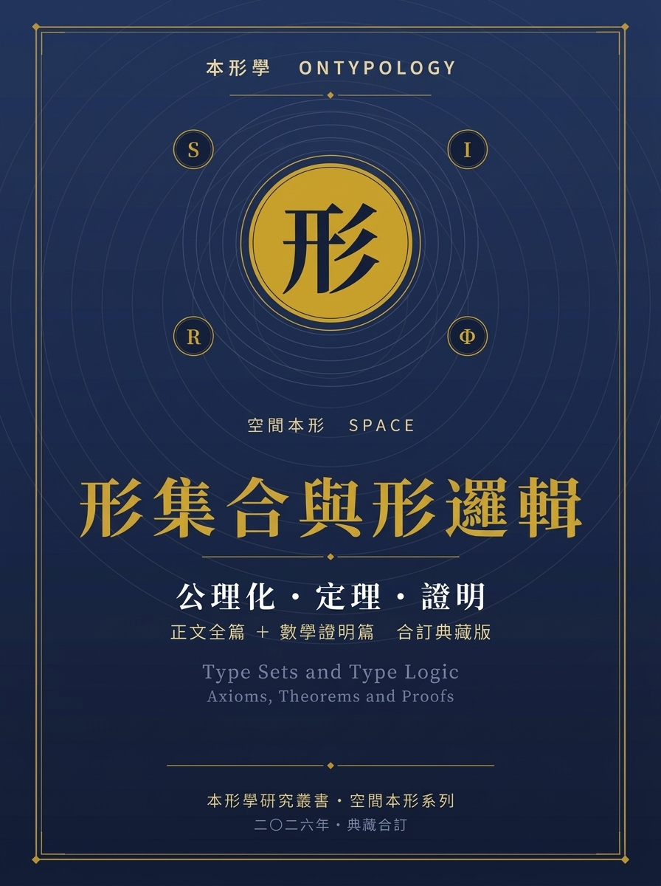

Ontypology

Space Type

**Type Sets and Type Logic**

**Full Main Text ＋ Axiomatization, Theorems, and Proofs**

*Form Sets and Form Logic: Text, Axioms, Theorems, and Proofs*

  **Document Nature**   Consolidated collector's edition: the full main text and the mathematical proofs bound in one volume
  -------------------- -------------------------------------------------------------------------------------------------------------
  **Theoretical Base**  Type Set F = ⟨S, I, R, Φ⟩・Four axioms・Twelve theorems
  **Chapter Mapping**   Formal reconstruction and extension of Part One (originally Chapter Five); see Part Two

# Consolidated Edition Note

This consolidated collector's edition contains the two texts of Chapter Five of *Ontypology: Space Type*. The first is the full main text, *Type Sets and Type Logic*, which uses everyday language and judgment examples to establish three kinds of "value-add": Container, SOM, and Abstraction. The second is *The Mathematical Proofs*, which rewrites the same theory as an axiomatic system and gives complete proofs of four axioms and twelve theorems. Part One provides intuition and usage; Part Two provides rigor and guarantees—read the main text first to gain judgment, then read the proof section to understand why it holds.

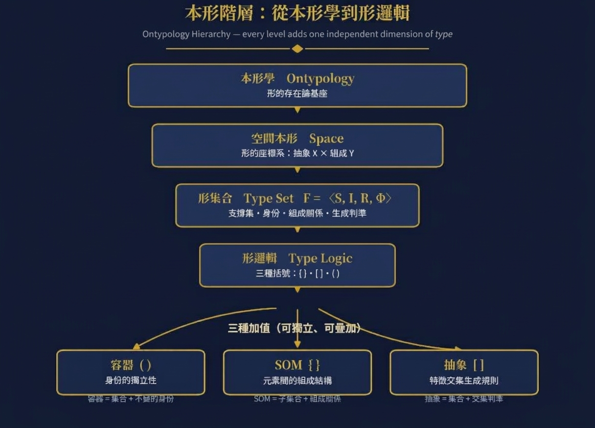

**The Ontypology Hierarchy: From Ontypology to Type Logic—Each Layer Adds an Independent Information Dimension**

**Chapter Architecture: Overview of the Correspondence Between Main Text × Proof Section**

# Table of Contents

**Part One　Type Sets and Type Logic (Main Text・Chapter Five)**

> · 5.1　The Limits of Mathematical Sets
>
> · 5.2　Container: Adding Back "Implicit Elements, Invisible Subsets"
>
> · 5.3　SOM: Adding Back "the Compositional Structure Between Elements"
>
> · 5.4　Abstraction: Adding Back "Feature-Intersection Generation"
>
> · 5.5　Examples of Logical Application and Judgment
>
> · 5.6　Summary

**Part Two　The Mathematical Proofs (Axiomatization・Theorems・Proofs)**

> · Chapter Zero　Abstract and Reading Guide
>
> · Chapter One　Introduction: The Expressive Limits of Set Language
>
> · Chapter Two　The Axiomatization of Type Sets
>
> · Chapter Three　The Container Layer: Identity Independence
>
> · Chapter Four　The Structural Layer (SOM): Composition Relations
>
> · Chapter Five　The Abstraction Layer: Generative Criteria
>
> · Chapter Six　Joint Three-Layer Determination
>
> · Chapter Seven　Formalized Solutions to the Judgment Examples
>
> · Chapter Eight　Conclusion
>
> · Appendix A　Symbol Table
>
> · Appendix B　Theorem Index

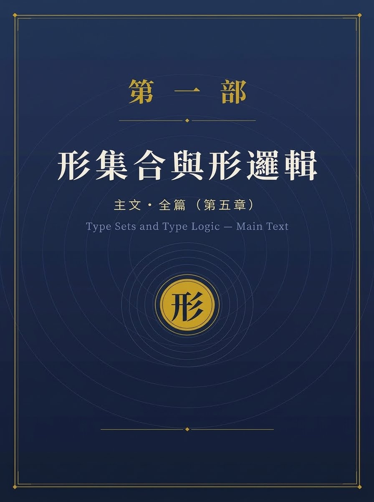

# Chapter Five　Type Sets and Type Logic　　Main Text・Complete

## 5.1 The Limits of Mathematical Sets

A mathematical set answers only one question to begin with: "Does it belong?"

This language is extremely minimal—it assumes the least, and therefore also describes the least. When we say "water belongs to the things contained in the cup," set theory can express this relation precisely as "water ∈ S"; but at the same time it omits all three additional layers of information that everyday language naturally carries:

> 1\. Identity independence: the cup does not become something else just because it holds water or coffee.
>
> 2\. The structure between elements: the handle, bottom, and lid are not placed arbitrarily; they depend on one another and each has its own position.
>
> 3\. Generation rule: the category "cup" is not a hard-coded list, but a rule that can judge new members.

What Type Logic sets out to do is to add back, one by one, these three omitted layers of information. To this end, we introduce three different bracket systems, each corresponding to a different kind of "value-add":

  **Set Kind**     **Bracket Kind**       **Example**                               **Source**            **Property Added**
  ---------------- ---------------------- ----------------------------------------- --------------------- -------------------------------
  Composition set  Braces { }             { handle, bottom, lid, container, body }  SOM (Y-axis)          Inter-element composition structure
  Abstraction set  Square brackets \[ \]  \[ mug, glass, paper cup \]               Abstraction (X-axis)  Feature-intersection generation rule
  Container set    Parentheses ( )        ( water, coffee )                         Container             Identity independence

**Figure 5-1 Three everyday statements, three kinds of value-add**

**Coffee cup:** { handle, bottom, lid, body, coffee }

**Coffee cup:** { handle, bottom, lid, body, container(coffee) }

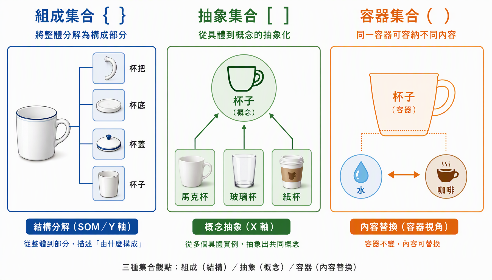

> The figure above compares three views of sets side by side: on the left, the "composition set" shows how a whole is decomposed into structural parts (SOM/Y-axis); in the middle, the "abstraction set" shows how multiple concrete instances converge upward into a common concept (Abstraction/X-axis); on the right, the "container set" shows how one container holds replaceable contents.

What the table above lists are in fact three different levels of "value-add." Every sentence in everyday language simultaneously compresses these three layers of information: "There is water in the cup" not only expresses "water belongs to the things contained in the cup," but also presupposes that the cup itself has an identity that does not change with its contents; "the cup is composed of a handle, a bottom, and a lid" not only expresses "these parts all belong to the cup," but also presupposes that there are fixed joining relations among the parts; "a thermos is also a cup" not only expresses "a thermos belongs to the set of cups," but also presupposes a judgment rule that can endlessly generate new members.

A mathematical set retains only the very first statement, "does it belong," while the other three layers are omitted. In other words, a set is a "minimal" language: it assumes the least, and therefore describes the least. What Type Logic sets out to do is to add back, one by one, these three omitted layers of information.

## 5.2 Container: Adding Back "Implicit Elements, Invisible Subsets"

**◆ Core Question**

The sentence "the cup contains water" is in fact still talking about a subset relation: water belongs to the things contained in the cup; pour the water out today and replace it with coffee, and the coffee also belongs to the things contained in the cup. But a container does one more thing that a mathematical set does not do: it gives this set a "self" that is independent of its elements.

Pour out the water and the cup is still that cup; replace it with coffee and it is still the same cup—the container's identity does not change because the contents change. A mathematical set is the exact opposite: take the water out of {water} and replace it with {coffee}, and it is already "another set"; there is no "cup" that can hold up this identity and let it be recognized as the same thing after the contents change.

**Container = Set + an identity that does not change as the elements change**

Here "cup" and "water/coffee" are two levels: the cup is the identity that remains unchanged, while water and coffee are merely elements temporarily put in and replaceable at any time.

**◆ Diagrammatic Comparison**

**Figure 5-2 Container: identity does not change with the contents**

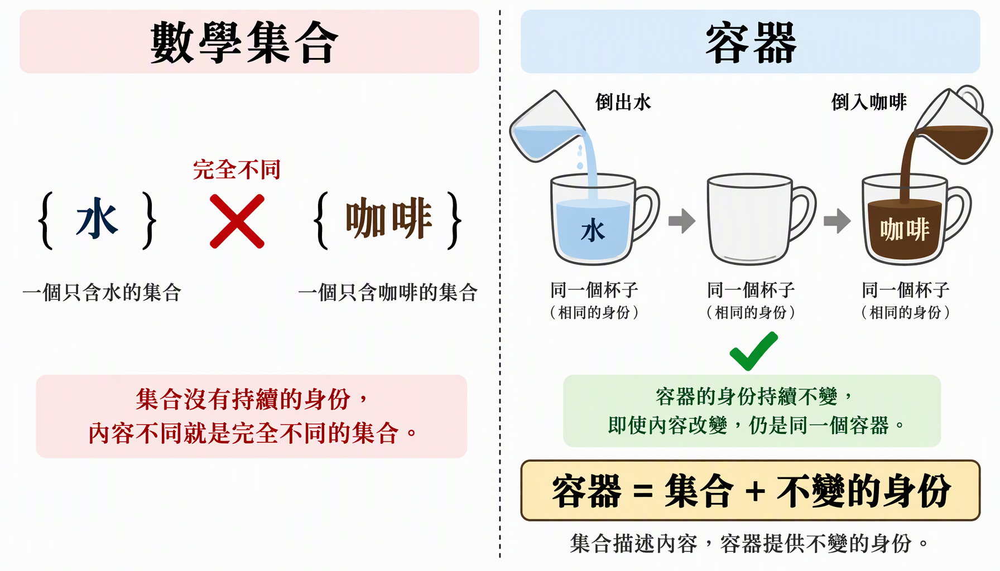

> On the left is the situation of a mathematical set: {water} and {coffee} are two unrelated sets. On the right is the situation of a container: the cup has an identification independent of its contents. The formula at the bottom summarizes: Container = Set + unchanging identity.

**◆ Why "Levels" Matter**

The key here lies in "levels." The cup and the water are in fact things at two different levels: the cup is the identity that remains unchanged, the water is the replaceable contents. If written only in the language of sets, these two levels are flattened into the same level—in {cup, water} the two elements have exactly equal status, and one cannot tell which is the identity and which is the contents. Everyday language, however, is never ambiguous: when we say "there is water in the cup," we never treat the cup and the water as the same kind of thing.

This distinction is especially crucial in engineering and data modeling. In a relational database, the "cup table" and the "contents table" are two different tables, and the contents table references the primary key of the cup table through a foreign key; this master-detail relationship itself embodies the concept of "levels."

**◆ Formal Definition of a Container**

> • Container C = ( identity token id(C), interior space S(C) )
>
> • Identity token id(C): a marker that does not change as the elements in S(C) change
>
> • Interior space S(C): a set that can hold elements, whose contents can be replaced and emptied
>
> • Invariance axiom: ∀ e₁, e₂ ∈ S(C), replacing e₁ with e₂ does not change id(C)

## 5.3 SOM: Adding Back "the Compositional Structure Between Elements"

**◆ Core Definition**

**SOM = BOM + Container**

The sentence "the cup is composed of a handle, a bottom, a lid, and a container" can likewise be seen as a set relation: {handle, bottom, lid, container} all belong to the cup. But what SOM adds back is what a mathematical set completely ignores: the compositional structural relations by which the elements depend on and position one another.

**◆ The Fundamental Difference Between a Set and SOM**

In set theory {lid, handle, bottom, container} and {handle, bottom, lid, container} are exactly the same set, and order and relations do not matter at all; but in an actual cup, the handle is attached to the side of the body, the bottom supports the whole structure, and the lid covers the rim—take away the bottom and the cup may even collapse.

**SOM = Subset + Composition Relations Between Elements**

The existence or position of certain elements affects the identity of the whole. This is also why the question "after removing one element, is this still the same thing as before?" is meaningless in a mathematical set, yet is a crucial question in a BOM.

**Figure 5-3 SOM: From "juxtaposed elements" to "structured parts"**

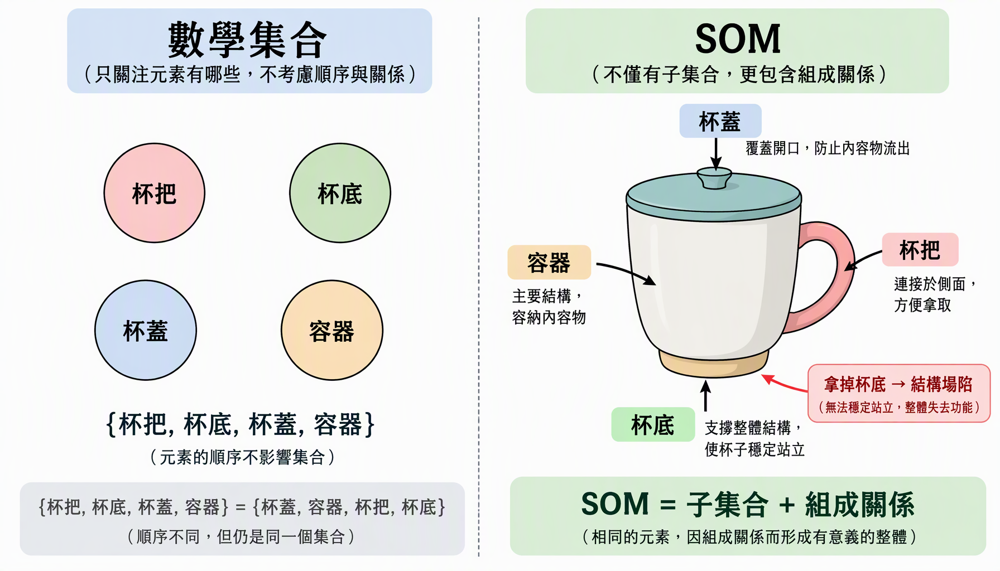

> On the left is the cup as seen by a set: the four elements have equal status and order is irrelevant. On the right is the cup as seen by SOM: each part has a definite position and object of dependence. Remove the bottom → the structure collapses.

**◆ Engineering Significance**

  **Part**     **Necessity**   **Effect After Removal**
  ------------ --------------- ------------------------------
  Bottom       Necessary part  Structure collapses; the cup is no longer a cup
  Body         Necessary part  Structure collapses; the cup is no longer a cup
  Handle       Optional part   The cup can still hold water, but loses its hand-held function
  Lid          Optional part   The cup can still hold water, but loses its sealing function
  Container    Core part       The whole does not exist

**◆ Formal Definition of SOM**

> • SOM(M) = ( part set P(M), composition relation R(M), spatial configuration G(M) )
>
> • Composition relation R(M) ⊆ P(M) × P(M): the dependency, connection, and support relations between parts
>
> • Identity condition: whether M is still the same whole after removing pᵢ depends on the role of pᵢ in R(M)

## 5.4 Abstraction: Adding Back "Feature-Intersection Generation"

**◆ Core Question**

Mugs, glasses, paper cups, thermoses⋯⋯these are all concrete, individually different actual objects. Extract their common features—"a container, plus an opening structure that lets a person hold it or drink from it"—and you get something new: the category "cup" itself.

What abstraction adds back is precisely what a mathematical set most lacks: a rule that can endlessly generate new members, rather than a hard-coded list.

**◆ Closed List vs. Open Rule**

  **Aspect**         **Closed set { }**                      **Open category \[ \]**
  ------------------ --------------------------------------- -------------------------------------------------
  Source of members  Manual enumeration                      Automatic determination by rule
  New members        Not on the list means not a member      Conforming to the rule means automatic membership
  Temporality        Static, fixed                           Dynamic, extensible
  Example            {mug, glass, paper cup}                 \[x \| x can hold liquid ∧ x can be picked up to drink from\]

**Abstraction = Set + Intersection (a judgment criterion)**

It turns a set from a "closed list" into "an open rule that can automatically judge new members."

**Figure 5-4 Abstraction: From "closed list" to "open rule"**

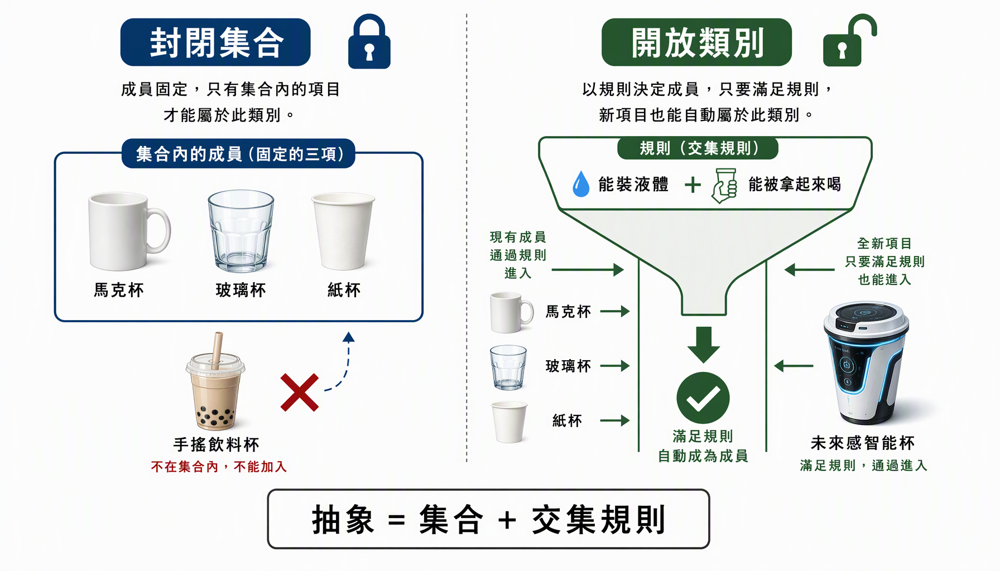

> On the left is a closed set: anything not listed in it never belongs to it. On the right is an open category: as long as it conforms to the rule, even a brand-new design automatically belongs to it.

**◆ Formal Definition of Abstraction**

> • Abstract category T = ( feature set F(T), intersection criterion ∩(T) )
>
> • Intersection criterion ∩(T): object x belongs to T ⟺ ∀ fᵢ ∈ F(T), fᵢ(x) = true
>
> • Openness: the members of T are not determined by enumeration, but dynamically generated by ∩(T)

## 5.5 Examples of Logical Application and Judgment

The preceding four sections established the theoretical definitions of the three value-adds: Container, SOM, and Abstraction. This section turns this theory into an operable judgment procedure, so that when readers face a concrete object they can answer three core questions step by step: Is it a container? Is there structural dependence among its parts? Which open category does it belong to? Finally, using the "smartphone" as an example, it shows how the three layers of judgment operate jointly.

### 5.5.1 Container Judgment: Is Identity Independent of the Contents?

When we face a "whole that has something in it," the first question to judge is: does this whole have an identity that does not change with its contents?

**Figure 5-6 Container judgment flow**

> Starting from the top question: "After the contents change, is the whole still the same thing?" The green path on the left (Yes) leads to the container judgment holding; the red path on the right (No) leads to a pure set relation.

  **Step**   **Operation**                                        **Criterion**
  ---------- ---------------------------------------------------- -------------------------------
  1          Confirm the whole contains replaceable contents      The contents can be taken out, replaced, emptied
  2          Replace the contents                                 Change e₁ to e₂
  3          Check identity                                       Is id(the whole) the same before and after replacement?
  4a         Same → the container judgment holds                  Container logic ( ) applies
  4b         Different → pure set relation                        Only the mathematical set ∈ applies

**◆ Worked Examples:**

> • Backpack: put in textbooks or swap them for a pencil case, and the backpack is still the same backpack → Container ✓
>
> • Computer folder: the files inside can be added, deleted, or modified, while the folder itself does not change → Container ✓
>
> • {apple, banana}: remove the apple and replace it with an orange, and it becomes another set → Pure set ✗

### 5.5.2 SOM Structural-Dependence Judgment: After removing a part, is the whole still the same thing?

Having confirmed that a whole has structural parts, the next step is to judge: how much does each part affect the identity of the whole?

**Figure 5-7 SOM structural-dependence decision tree**

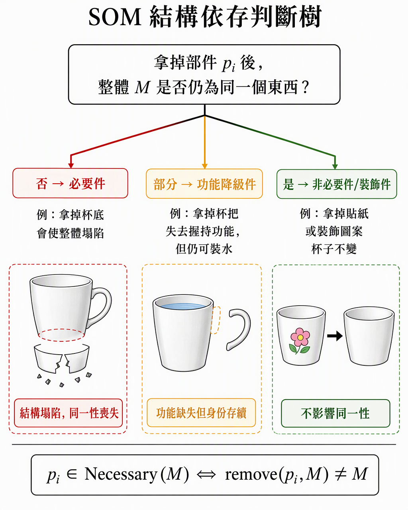

> Three paths branch from the root question: red (No → necessary part), orange (Partially → functionally degraded part), green (Yes → non-essential part). Formula at the bottom: pᵢ ∈ Necessary(M) ⟺ remove(pᵢ, M) ≢ M.

  **Grade**                    **Judgment Result**                        **Definition**            **Cup Example**        **Phone Example**
  ---------------------------- ------------------------------------------ ------------------------- ---------------------- --------------------
  Necessary part               Identity is lost after removal             remove(pᵢ,M) ≢ M          Bottom, body           Motherboard, battery
  Functionally degraded part   Function is missing but identity persists  remove(pᵢ,M) ≡ M\' ⊂ M    Handle, lid            Camera module, speaker
  Non-essential part           No effect at all after removal             remove(pᵢ,M) ≡ M          Stickers, decoration   Screen protector, charm

This three-level classification has a direct engineering correspondence: necessary parts correspond to "safety-critical parts," functionally degraded parts correspond to "optional functional parts," and non-essential parts correspond to "decorative/consumable parts."

### 5.5.3 Abstract-Rule Judgment: Does a new object conform to the category rule?

When we need to judge whether a newly appearing object belongs to a certain category, we do not consult a list, but verify on the spot using the intersection criterion.

**Figure 5-8 Judgment flow of the abstract rule**

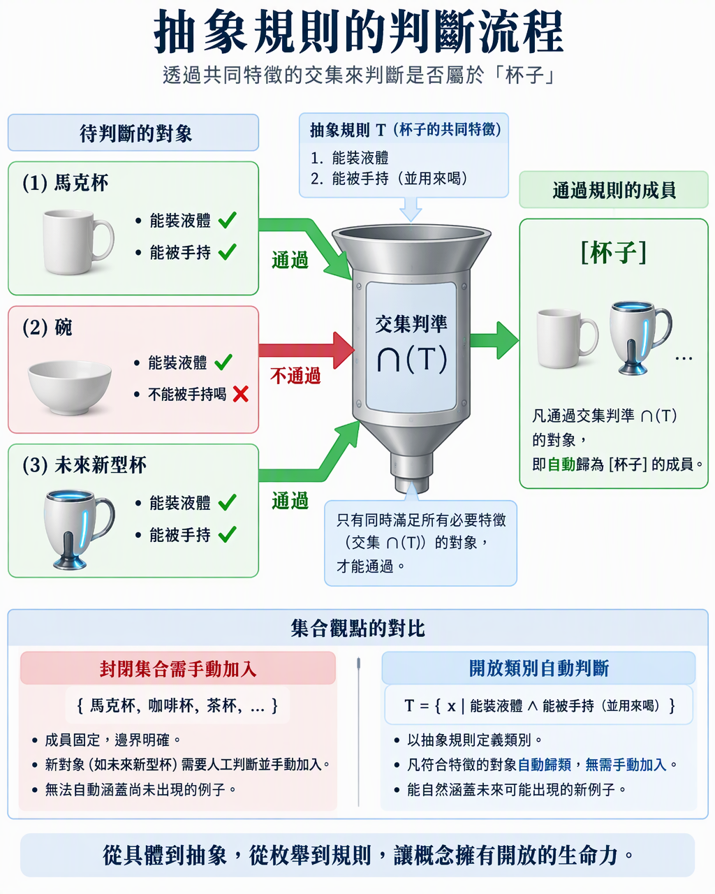

> Three objects to be judged pass through the "intersection criterion ∩(T)" funnel: the mug passes, the bowl is excluded, and a future new type of cup automatically passes too. The bottom compares a closed set with an open category.

  **Step**   **Operation**                                                **Explanation**
  ---------- ------------------------------------------------------------ ---------------------------------------
  1          Determine the necessary feature set F(T) of category T       e.g. F(cup) = {can hold liquid, can be hand-held to drink from}
  2          Test each feature of the new object o one by one             fᵢ(o) = true / false
  3          Take the intersection                                        ∩(T)(o) = ∀ fᵢ ∈ F(T), fᵢ(o) = true?
  4a         All pass → o ∈ \[T\]                                         Automatically classified, no manual addition needed
  4b         Any failure → o ∉ \[T\]                                      Does not belong to this category

**◆ Discussion of Boundary Cases:**

> • Bowl: can hold liquid ✓, but cannot be hand-held to drink from ✗ → does not belong to \[cup\]
>
> • Straw cup: can hold liquid ✓, drunk from through a straw ✓ → belongs to \[cup\]
>
> • Syringe: can hold liquid ✓, can be hand-held ✓, but its purpose is not "drinking" → depends on whether F(T) includes "used for drinking"

This boundary case illustrates that the precision of the rule depends on the completeness of the feature set F(T).

### 5.5.4 Example of Joint Three-Layer Judgment: Smartphone

Now let us put the three layers of judgment together, using the "smartphone" as the test object, to show how Type Logic operates completely on an actual object.

**Figure 5-9 Example of joint three-layer Type Logic judgment: smartphone**

> With the smartphone as the object, the three layers of judgment unfold simultaneously: container layer—apps can be replaced but the phone's identity does not change; composition layer—the battery/motherboard are necessary parts; abstraction layer—iPhone, Android, and foldables all pass the rule, while tablets are excluded.

**◆ First Layer: Container Judgment**

  **Check Item**                                                    **Result**
  ----------------------------------------------------------------- ----------------------------------------------------------
  Does the phone have replaceable contents?                         ✓ Apps can be installed/removed
  Does the identity remain unchanged after replacing the contents?  ✓ Install LINE or uninstall YouTube, and the phone is still the same one
  Container judgment                                                Holds — phone = Container(App)

**◆ Second Layer: SOM Structural-Dependence Judgment**

  **Part**          **Result After Removal**                            **Classification**
  ----------------- --------------------------------------------------- ----------------
  Motherboard       Cannot power on; functions completely lost          Necessary part
  Battery           Cannot supply power; functions lost                 Necessary part
  Screen            Cannot display/touch                                Necessary part
  Camera module     Cannot take photos; calls/browsing normal           Functionally degraded part
  Speaker           Cannot play aloud; headphones usable                Functionally degraded part
  Screen protector  No effect on function at all                        Non-essential part

**◆ Third Layer: Abstract-Rule Judgment**

F(smartphone) = { can communicate, can compute, portable }

  **Test Object**   **Can communicate**   **Can compute**   **Portable**   **Result**
  ----------------- --------------------- ----------------- -------------- ------------------
  iPhone            ✓                     ✓                 ✓              ∈ \[smartphone\]
  Android phone     ✓                     ✓                 ✓              ∈ \[smartphone\]
  Foldable phone    ✓                     ✓                 ✓              ∈ \[smartphone\]
  Tablet computer   ✗                     ✓                 ✓              ∉ \[smartphone\]
  Smartwatch        ✓                     ✓                 ✗              ∉ \[smartphone\]

**◆ Conclusion of the Joint Judgment:**

The smartphone simultaneously satisfies the judgments of all three layers of Type Logic: 1. Container layer ✓ — a container for apps, with independent identity; 2. Composition layer ✓ — a clear part structure and dependency relations; 3. Abstraction layer ✓ — conforms to the rule "can communicate ∧ can compute ∧ portable."

None of these three layers of judgment can be omitted: looking only at the container layer, a tablet is also a phone; looking only at the composition layer, a calculator is also a phone; looking only at the abstraction layer, a walkie-talkie is also a phone. Only when all three layers pass at the same time can "smartphone" be precisely defined.

### 5.5.5 The Theoretical Significance of the Judgment Examples

**◆ The Leap from Description to Judgment.**

The definitions established in the preceding sections solve the problem of "how to describe a Type"; the judgment procedure in this section solves the problem of "how to apply these descriptions to make decisions in actual situations." The former is a static knowledge structure, the latter a dynamic cognitive operation.

**◆ The Complementarity of the Three Layers of Judgment.**

Each layer used alone has blind spots: the container judgment cannot distinguish structural differences, the SOM judgment cannot handle content replacement, and the abstraction judgment cannot capture identity persistence. When the three layers are used jointly, their blind spots complement one another, forming a complete cognitive filter.

**◆ Correspondence with AI Classification Systems.**

Modern AI classification systems are essentially performing abstraction-layer judgments. But they usually lack the capabilities of the container layer (identity-persistence tracking) and the composition layer (structural-dependence analysis). The three-layer framework of Type Logic precisely points out the gaps in current AI classification capability, and the dimensions that future world models need to add.

### 5.5.6 Examples of Questions and Answers

The following six sets of judgment exercises cover the container, SOM, and abstraction layers as well as joint judgment. Each question first presents the problem scenario, then unfolds the solution process step by step.

**Figure 5-10 Type Logic judgment exercises: questions and answers**

> The four exercise cards correspond respectively to container judgment (refrigerator), SOM grading (car steering wheel), abstract rule (kettle vs. cup), and joint three-layer judgment (electric car vs. car).

**◆ Question One: Is a refrigerator a container? (Container-layer judgment)**

Question: A refrigerator can hold various foods, and all the food can be taken out. When the contents change, is the refrigerator still the same refrigerator?

Answer: Step 1 → Confirm replaceable contents ✓ food can be put in/taken out/replaced. Step 2 → Perform the replacement (milk for vegetables). Step 3 → Check identity: before and after, it is still "the same refrigerator," the id is unchanged. Step 4 → The container judgment holds ✓

Further reflection: if the compressor is removed, is it still a "refrigerator"? This is no longer a container-layer question, but an SOM-layer one—the compressor is a necessary part, and removing it causes loss of identity. The container layer concerns only "replacement of contents," not "removal of structural parts."

**◆ Question Two: What grade of part is a car's steering wheel? (SOM-layer judgment)**

Question: A car has parts such as the engine, wheels, steering wheel, air conditioning, and audio system. What grade does the steering wheel belong to?

Answer: mentally remove the steering wheel → it can still be recognized as a car (appearance/body/engine are all present), but it cannot be steered or driven → functionally degraded part.

  **Part**          **After Removal**                                          **Classification**
  ----------------- ---------------------------------------------------------- ----------------
  Engine            Cannot start; no longer a drivable car                      Necessary part
  Steering wheel    Still recognizable as a car, but cannot be driven          Functionally degraded part
  Air conditioning  Can still drive normally, just less comfortable             Functionally degraded part
  Audio system      No effect on driving or safety at all                       Non-essential part
  Emblem            No effect on any function at all                            Non-essential part

**◆ Question Three: Does a kettle belong to \[cup\]? (Abstraction-layer judgment)**

Question: F(cup) = { can hold liquid, can be hand-held to drink from }. Does a sports bottle (750 ml, with a straw opening) ∈ \[cup\]?

Answer: can hold liquid ✓ + can be hand-held to drink from (through the straw opening) ✓ → ∩(T) ✓ → ∈ \[cup\].

Contrast: thermos (2 L, must be poured out to drink): can hold liquid ✓ + cannot be hand-held to drink from ✗ → ∉ \[cup\], but ∈ \[container\].

Key insight: different F(T) define different categories, and the same object may belong to a superordinate category but not to a subordinate subcategory.

**◆ Question Four: Is an electric car \[car\]? (Joint three-layer judgment)**

Question: A Tesla Model 3 has no internal combustion engine, using a battery and an electric motor instead. Does it still count as a "car"?

First layer (container): passengers/cargo can get in and out ✓, carrying different people it is still the same car ✓ → container holds ✓

Second layer (SOM): battery pack = necessary part (replacing the role of the engine), electric motor = necessary part, center console screen = functionally degraded part, autonomous-driving sensors = functionally degraded part. SOM concerns structural roles, not modes of implementation.

Third layer (abstraction): F(car)={can drive on roads, can carry people and cargo, has a power system, can be driven and controlled}. Tesla passes all of them → ∈ \[car\] ✓

Joint conclusion: all three layers pass → it is a car. The rule says "has a power system" rather than "has an internal combustion engine," so electric drive does not affect the judgment. An open category captures the essence of function rather than implementation details.

**◆ Question Five: Are the books on a bookshelf a container relation or a set relation? (Disambiguation of easily confused cases)**

Question: "Ten books are placed on the bookshelf"—is the bookshelf a container? Or merely a set?

  **Object of Judgment**                                **Does identity persist?**                            **Judgment Result**
  ----------------------------------------------------- ----------------------------------------------------- -----------------------------
  Bookshelf (physical structure)                        ✓ No matter what books are placed, the bookshelf is unchanged   Container ( )
  "The books on the bookshelf" (combination of books)   ✗ Changing the books changes the combination          Pure set { }
  Bookshelf + books (display unit)                      Depends on the context                                Fixed display → SOM; temporary placement → Container

Important principle: within the same physical scene, depending on what "whole" you are attending to, different judgment types may be involved at the same time.

**◆ Question Six: Is an AI chatbot \[dialogue system\]? (Cross-domain abstraction judgment)**

Question: F(dialogue system) = { can receive natural-language input, can produce natural-language responses, can maintain dialogue context }. FAQ bot vs ChatGPT?

  **Feature**                              **FAQ bot**                            **ChatGPT**
  ---------------------------------------- -------------------------------------- ---------------------------
  Can receive natural-language input       ✓                                      ✓
  Can produce natural-language responses   △ Can only output preset replies       ✓ Freely generates
  Can maintain dialogue context            ✗ Handles each independently           ✓ Multi-turn dialogue has context
  ∩(T)                                     ✗                                      ✓
  Result                                   ∉ \[dialogue system\]                  ∈ \[dialogue system\]

The FAQ bot does not belong to \[dialogue system\], but belongs to the broader \[information retrieval tool\]. Adjusting the strictness of F(T) changes the judgment result.

Relevance to AI development: Type Logic provides a clear approach—do not ask essentialist questions like "is it really a dialogue system," but explicitly list F(T) and test item by item. The choice of the feature list is itself an expression of one's understanding of and stance on the concept.

### 5.5.7 Design Principles of the Judgment Exercises

  **Item**                  **Aspect Covered**                 **Pedagogical Purpose**
  ------------------------- ---------------------------------- --------------------------------
  Q1 Refrigerator           Basic container-layer judgment     Build the intuition of "identity vs. contents"
  Q2 Car steering wheel     SOM three-grade classification     Distinguish necessary / functionally degraded / non-essential parts
  Q3 Kettle vs. cup         Boundary of the abstract rule      Experience how the completeness of F(T) affects the result
  Q4 Electric car           Joint three-layer judgment         Show that the three layers are complementary and none can be omitted
  Q5 Books on a bookshelf    Disambiguation of easily confused cases   Distinguish different objects of judgment in the same scene
  Q6 AI chatbot             Cross-domain application           Apply Type Logic to non-physical objects

The common feature of these exercises: the answers are not guessed by intuition, but obtained by going through the judgment procedure. Even if your intuition is right, going through the procedure lets you understand "why it is right"; even if your intuition is wrong, going through the procedure lets you discover "which layer the error is in." This is the value of Type Logic as a cognitive tool—it gives you a repeatable, verifiable, and debatable method of judgment.

## 5.6 Summary

**◆ Overview of the Three Value-Adds**

  **Value-Add Type**   **Property Added**          **Core Contribution**                                                     **Corresponding Bracket**
  -------------------- --------------------------- ------------------------------------------------------------------------- ------------------------
  Container            Identity independence       Gives the set a "self" that does not change with the elements             ( )
  SOM                  Inter-element structure     Makes the elements in the set no longer merely juxtaposed, but related by dependency   { }
  Abstraction          Generation rule             Turns the set from a hard-coded list into a criterion that can automatically judge new members   \[ \]

These three value-adds are independent of one another; each can exist alone, or they can be stacked together. A "cup" simultaneously possesses the identity independence of a container, the part structure of a BOM, and the category rule of abstraction; together these three constitute our complete understanding of the concept "cup."

**Figure 5-5 One sentence, three layers of meaning**

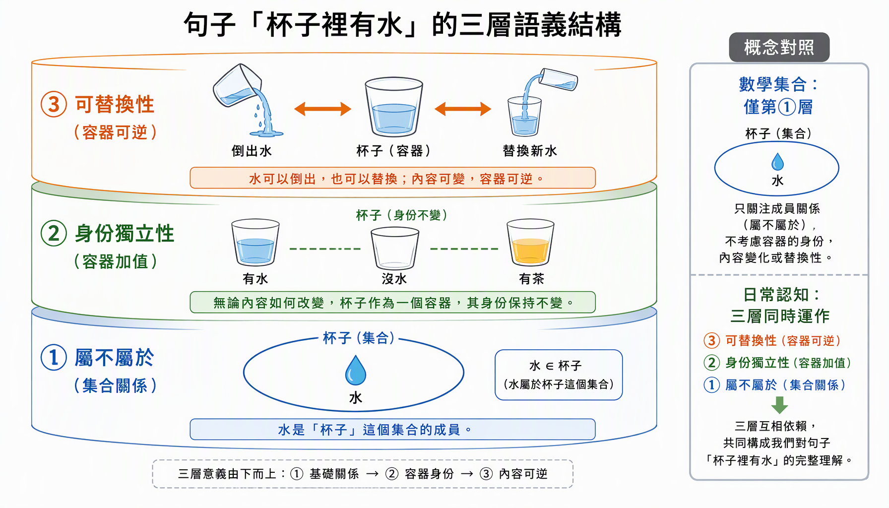

> The everyday sentence "there is water in the cup" simultaneously carries three layers of meaning: ① the set relation ② the identity independence of the container ③ replaceability. A mathematical set captures only layer ①, whereas everyday cognition operates all three layers at once.

When we say "there is water in the cup," we are saying three things at once: 1. the set relation; 2. the value-add of the container; 3. the replaceability of the container. A mathematical set captures only the first layer, but everyday cognition in fact operates all three layers simultaneously.

The reason mathematical sets are so useful is precisely that they condense the matter of "a group of things constituting a whole" down to just "does it belong." The theoretical framework established in this text systematically stacks three value-adds on top of this minimal core of the mathematical set, turning the concept of "Type" from an abstract mathematical tool into a cognitive framework capable of fully describing the real world.

**Reading Map: The Logical Dependencies of the Twelve Theorems—You May Read This Figure First, Then Unfold Chapter by Chapter**

# Chapter Zero　Abstract and Reading Guide

Chapter Five, *Type Sets and Type Logic*, pointed out in natural language that mathematical sets answer only "does it belong," and omit three layers of information—**identity independence**, **the structure between elements**, and **generation rules**. This part formalizes these three layers of information: we give an axiomatic definition of Type Sets, propose four axioms, and prove twelve theorems on that basis. All proofs use only elementary set theory and basic logic, and rely on no unstated intuition.

The core result of this part can be summarized in one sentence: **the three value-adds—Container, Structure, and Abstraction—are not rhetorical supplements to set theory, but three independent information dimensions that cannot be reduced to one another**—Theorem 2 proves that identity cannot be determined by the elements; Theorem 7 quantifies the number of bits of information carried by structure; Theorems 8 and 11 prove that the generative criterion and the joint three-layer determination are each indispensable.

  **Number**      **Theorem Name**                  **One-Sentence Content**
  --------------- --------------------------------- --------------------------------------------------
  **Theorem 1**   Conservative Extension            A degenerated Type Set is just an ordinary set, so it does not conflict with set theory
  **Theorem 2**   Non-definability of Identity      An "identity determined by the elements" must be a constant, so identity must be introduced independently
  **Theorem 3**   Equivalence Relation              The identity equivalence $\sim_{\text{id}}$ is a genuine equivalence relation
  **Theorem 4**   Substitution Invariance           Replacing the contents does not change the container's identity, whereas in set theory it necessarily does
  **Theorem 5**   Three-way Partition               Necessary / degraded / non-essential parts are complete and mutually exclusive
  **Theorem 6**   Collapse Propagation              Removing a necessary part causes the entire dependency cone to fail as well
  **Theorem 7**   Structural Information Content    The composition relation carries $\log_{2}P(n)$ bits; the set layer carries 0
  **Theorem 8**   Feature Antitonicity              The larger the feature set, the smaller the category
  **Theorem 9**   Openness                          An open category cannot be determined by a finite enumeration
  **Theorem 10**  Misclassification Characterization  The false-positive set can be written precisely, and shrinks monotonically with feature completeness
  **Theorem 11**  Minimal Sufficiency               Any proper subset of the three-layer determination is insufficient
  **Theorem 12**  Determination Complexity          Container $O(1)$・Structure ${O(n}^{3})$・Abstraction $O(m)$

**Reading Convention**: Definitions and axioms are conventions (they cannot be proved, only their consequences can be examined); theorems are necessary conclusions starting from the definitions and axioms (they must be proved); examples and remarks explain how the theorems land in practice. All mathematical expressions can be viewed directly in Word.

# Chapter One　Introduction: The Expressive Limits of Set Language

## 1.1　The Three Omitted Layers of Information

A mathematical set answers only one question to begin with: **does it belong**. "There is water in the cup" is written in set theory as $水 \in S$, which is precise, but it simultaneously discards three layers of information that everyday language naturally carries:

1.　**Identity independence**—the cup does not become something else just because it holds water or coffee;

2.　**The structure between elements**—the handle, bottom, and lid depend on one another and each has its own position;

3.　**Generation rule**—"cup" is not a hard-coded list, but a rule that can judge new members.

**▍Figure 1-1　The ladder of expressiveness: each layer stacks an independent information dimension on top of the previous one. This part will prove that these three dimensions cannot be reduced to one another.**

## 1.2　The Axiom of Extensionality and Its Cost

+----------------------------------------------------------------------------------------------------------+
| **▍Axiom 0 (Extensionality)**                                                                            |
|                                                                                                          |
| $$\forall A\,\forall B\,\lbrack(\forall x\,(x \in A \Leftrightarrow x \in B)) \Rightarrow A = B\rbrack$$ |
|                                                                                                          |
| A set is **completely determined** by its elements. This is the cornerstone of set theory, and also the source of the upper bound on its expressive power. |
+----------------------------------------------------------------------------------------------------------+

+-----------------------------------------------------------------------------------------------------------------------------------+
| **▍Corollary 0.1　Replacement Means a Different Set**                                                                             |
|                                                                                                                                   |
| Suppose $e_{1} \neq e_{2}$, $e_{1} \in A$, $e_{2} \notin A$, and $A' = (A \smallsetminus \{ e_{1}\}) \cup \{ e_{2}\}$. Then $A' \neq A$. |
|                                                                                                                                   |
| $$e_{2} \in A^{'}\  \land \ e_{2} \notin A\  \Rightarrow \ A^{'} \neq A$$                                                         |
|                                                                                                                                   |
| **Proof**: $e_{2} \in A'$ while $e_{2} \notin A$; by the law of identity in logic, $A' \neq A$.∎                                  |
+-----------------------------------------------------------------------------------------------------------------------------------+

Corollary 0.1 is precisely the strict form of the phenomenon pointed out in Chapter Five: "pour out the water and replace it with coffee" **necessarily** produces another set in set theory. Then the referent "cup," which is still recognized as the same thing after its contents change, simply has no place to be accommodated within set theory. This is not a defect of set theory, but its design trade-off—the remainder of Chapter One will quantify this trade-off, and Chapter Two onward will add it back.

## 1.3　The Methodology of This Part

We adopt the standard structured mathematical procedure: **Definition → Axiom → Theorem → Proof → Judgment Procedure**. Axioms are conventions, and their quality is examined by two criteria: (i) **consistency**—they do not derive a contradiction; (ii) **sufficiency**—they suffice to derive theorems that agree with everyday and engineering intuition. Every axiom in this part is used at least once in the subsequent chapters; there are no superfluous assumptions.

# Chapter Two　The Axiomatization of Type Sets

## 2.1　Domain of Discourse and Basic Symbols

Fix a domain of discourse $U$ (all individuals that may occur: water, coffee, cup handle, app……). Let $\mathcal{P}(U)$ denote the power set of $U$, $\varnothing$ the empty set, and $|X|$ the cardinality of a set. $\mathbb{N}$ denotes the natural numbers.

**▍Figure 2-1　The four-tuple structure of a Type Set: each of the four components carries one layer of information omitted by set theory.**

## 2.2　Definition of a Type Set

+--------------------------------------------------------------------------------------------------------------------------------------------------------------+
| **▍Definition 2.1　Type Set (Form Set)**                                                                                                                     |
|                                                                                                                                                              |
| A **Type Set** is an ordered four-tuple                                                                                                                      |
|                                                                                                                                                              |
| $$\mathbb{F} = \langle S,\mathcal{\text{\ I}},\ R,\ \Phi\rangle$$                                                                                            |
|                                                                                                                                                              |
| where:                                                                                                                                                       |
|                                                                                                                                                              |
| 1.　$S \subseteq U$, $|S| < \infty$, is called the **carrier**—what it holds;                                                                                |
|                                                                                                                                                              |
| 2.　$\mathcal{I} \in I$ is the **identity token**, where $I$ is a token set unrelated to $\mathcal{P}(U)$—who it is;                                         |
|                                                                                                                                                              |
| 3.　$R \subseteq S \times S$ is the **composition relation**, a strict partial order on $S$ (irreflexive, transitive); $q\, R\, p$ is read as "$q$ depends on $p$"—how it is composed; |
|                                                                                                                                                              |
| 4.　$\Phi:U \rightarrow \{ 0,1\}$ is the **generative criterion**, satisfying $S \subseteq \Phi^{- 1}(1)$—how it grows new members.                          |
|                                                                                                                                                              |
| The four projection functions are denoted $\pi_{S},\pi_{\mathcal{I}},\pi_{R},\pi_{\Phi}$.                                                                     |
+--------------------------------------------------------------------------------------------------------------------------------------------------------------+

+-----------------------------------------------------------------------------------------------------------------------------------------------------------------------------------------------------------------+
| **▍Remark 2.2　Why a Four-Tuple, and Not Three Properties Added onto a Set**                                                                                                                                    |
|                                                                                                                                                                                                                 |
| If identity $\mathcal{I}$ were defined as a function of $S$, Theorem 2 would prove that it necessarily degenerates into a constant. Hence identity must appear alongside $S$ as an **independent primitive term**, not as a derived quantity. This is precisely the key design of Definition 2.1, and the rigorous form of Chapter Five's "Container = Set + unchanging identity." |
+-----------------------------------------------------------------------------------------------------------------------------------------------------------------------------------------------------------------+

## 2.3　The Four Axioms

+-----------------------------------------------------------------------------------------------------------------------------------------------------------------------------------------------------+
| **▍Axiom A1　Identity Independence**                                                                                                                                                                |
|                                                                                                                                                                                                     |
| Define the **fill** and **empty** operators: for $e \in U \smallsetminus S$ and $e \in S$,                                                                                                          |
|                                                                                                                                                                                                     |
| $$\mathbb{F} \oplus e: = \langle S \cup \{ e\},\mathcal{I},R,\Phi\rangle,\quad\quad\mathbb{F} \ominus e: = \langle S \smallsetminus \{ e\},\mathcal{I}{,R|}_{S \smallsetminus \{ e\}},\Phi\rangle$$ |
|                                                                                                                                                                                                     |
| Then we require:                                                                                                                                                                                    |
|                                                                                                                                                                                                     |
| $$\pi_{\mathcal{I}}(\mathbb{F} \oplus e) = \pi_{\mathcal{I}}(\mathbb{F} \ominus e) = \pi_{\mathcal{I}}(\mathbb{F})$$                                                                                |
|                                                                                                                                                                                                     |
| That is: neither filling nor emptying touches the identity. **This single axiom is the entire content of "Container."**                                                                             |
+-----------------------------------------------------------------------------------------------------------------------------------------------------------------------------------------------------+

+-----------------------------------------------------------------------------------------------------------------------------------------------------------+
| **▍Axiom A2　Structural Dependence**                                                                                                                      |
|                                                                                                                                                           |
| There exist a **survival criterion** $\sigma:\mathcal{P}(S) \rightarrow \{ 0,1\}$ and a **capability function** $\kappa:\mathcal{P}(S) \rightarrow \mathcal{P}(C)$ ($C$ being the capability domain), satisfying: |
|                                                                                                                                                           |
| (A2a)　$\sigma$ is monotone: $X \subseteq Y$ and $\sigma(X) = 1 \Rightarrow \sigma(Y) = 1$;                                                                |
|                                                                                                                                                           |
| (A2b)　$\kappa$ is monotone: $X \subseteq Y \Rightarrow \kappa(X) \subseteq \kappa(Y)$;                                                                   |
|                                                                                                                                                           |
| (A2c)　Completeness: $\sigma(S) = 1$.                                                                                                                     |
+-----------------------------------------------------------------------------------------------------------------------------------------------------------+

+----------------------------------------------------------------------------------------------------+
| **▍Axiom A3　Generativity**                                                                         |
|                                                                                                    |
| Category membership is determined by a criterion, not by enumeration:                              |
|                                                                                                    |
| $$x \in \lbrack T\rbrack\  \Leftrightarrow \ \bigcap(T)(x) = \bigwedge_{f \in F(T)}^{}\ f(x) = 1$$ |
|                                                                                                    |
| where $F(T)$ is the feature set of category $T$ (see Chapter Five).                                |
+----------------------------------------------------------------------------------------------------+

+--------------------------------------------------------------------------------------------------------------------------------------------------------------------------------------------------+
| **▍Axiom A4　Separability**                                                                                                                                                                      |
|                                                                                                                                                                                                  |
| $\pi_{\mathcal{I}}$, $\sigma$, $\kappa$, $\Phi$ are mutually independent: any one component can vary without changing the others. This axiom guarantees that the three value-adds can **exist alone or be stacked**—this is the formalization of original Chapter 5.6's "the three value-adds are independent of one another." |
+--------------------------------------------------------------------------------------------------------------------------------------------------------------------------------------------------+

## 2.4　Degeneration and Conservative Extension

+-------------------------------------------------------------------------------------------------------------------------------------------+
| **▍Definition 2.3　Degeneration**                                                                                                         |
|                                                                                                                                           |
| $$\delta(S): = \langle S,\ \lceil S\rceil,\ \varnothing,\ \mathbb{1}\rangle$$                                                             |
|                                                                                                                                           |
| where $\lceil S\rceil$ is the token determined by $S$ (for example $S$ itself), $\mathbb{1}(x) \equiv 1$ is the identically-true criterion, and $R = \varnothing$ means there is no structural information. |
+-------------------------------------------------------------------------------------------------------------------------------------------+

+-----------------------------------------------------------------------------------------------------------------------------------------------------+
| **▍Theorem 1　Conservative Extension Theorem**                                                                                                      |
|                                                                                                                                                     |
| (i) $\rho(\delta(S)) = S$, where $\rho: = \pi_{S}$ is the forgetful function;                                                                       |
|                                                                                                                                                     |
| (ii) For any property $P$ that depends only on "which elements are inside," we have $P(\delta(S)) \Leftrightarrow P(S)$.                             |
|                                                                                                                                                     |
| **Proof**: (i) $\pi_{S}(\delta(S)) = S$ follows directly from Definition 2.3, so $\rho \circ \delta = \text{id}_{\mathcal{P}(U)}$, $\delta$ is injective and $\rho$ is surjective. |
|                                                                                                                                                     |
| (ii) Suppose $P$ depends only on $S$. Since $\rho(\delta(S)) = S$ and $P$ is a function of $S$, $P(\delta(S)) = P(S)$.∎                             |
+-----------------------------------------------------------------------------------------------------------------------------------------------------+

+--------------------------------------------------------------------------------------------------------------------------------------------------------------------------------------------------------------------------+
| **▍Corollary 1.1　Compatibility with Set Theory**                                                                                                                                                                        |
|                                                                                                                                                                                                                          |
| Type Set theory is a **conservative extension** of naive set theory: empty out $R$, set $\Phi$ to the identically-true criterion, and bind $\mathcal{I}$ to $S$, and the Type Set degenerates back into an ordinary set. Hence this part does not conflict with any existing result of set theory; it systematically adds back the three omitted layers of information only where set theory "assumes the least." |
+--------------------------------------------------------------------------------------------------------------------------------------------------------------------------------------------------------------------------+

# Chapter Three　The Container Layer: Identity Independence

## 3.1　Core Intuition

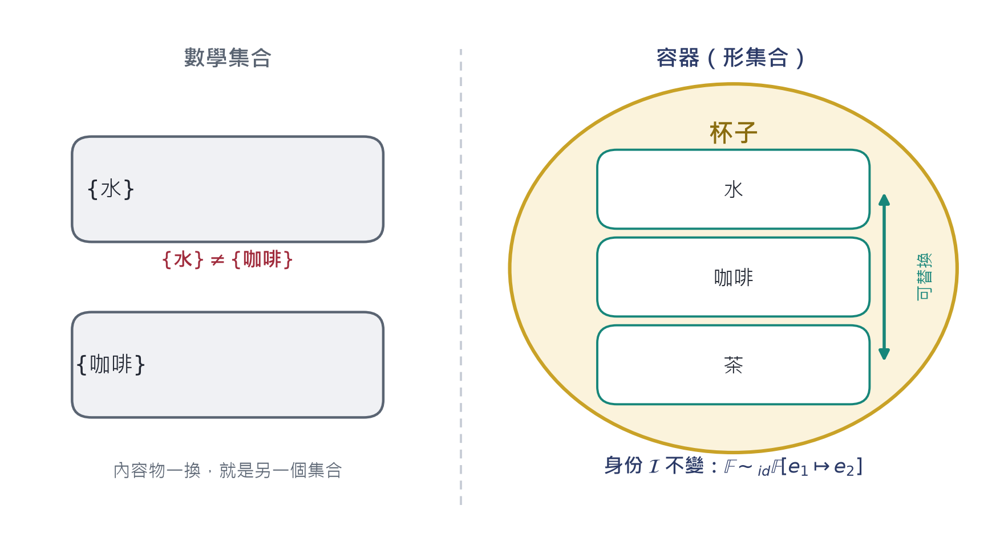

**▍Figure 3-1　Left: in set theory, replacing the contents necessarily yields another set (Corollary 0.1). Right: a container allows the contents to vary arbitrarily within Sigma(𝔽), while the identity ℐ remains unchanged.**

## 3.2　Substitution Operator and Identity Equivalence

+-----------------------------------------------------------------------------------------------+
| **▍Definition 3.1　Substitution Operator**                                                    |
|                                                                                               |
| $$\mathbb{F}{\lbrack e}_{1} \mapsto e_{2}\rbrack: = (\mathbb{F} \ominus e_{1}) \oplus e_{2}$$ |
|                                                                                               |
| where $e_{1} \in S$, $e_{2} \in U \smallsetminus (S \smallsetminus \{ e_{1}\})$.              |
+-----------------------------------------------------------------------------------------------+

+-----------------------------------------------------------------------------------------------------------------------------+
| **▍Definition 3.2　Identity Equivalence Relation**                                                                          |
|                                                                                                                             |
| $$\mathbb{F} \sim_{\text{id}}\mathbb{G}\  \Leftrightarrow \ \pi_{\mathcal{I}}(\mathbb{F}) = \pi_{\mathcal{I}}(\mathbb{G})$$ |
+-----------------------------------------------------------------------------------------------------------------------------+

+-----------------------------------------------------------------------------------------------------------------------------------------------------------------+
| **▍Theorem 2　The Non-definability of Identity**                                                                                                                 |
|                                                                                                                                                                 |
| Suppose $|U| \geq 2$. If a function $\text{id}:\mathcal{P}(U) \rightarrow I$ simultaneously satisfies                                                           |
|                                                                                                                                                                 |
| $$\text{id}(A \cup \{ e\}) = \text{id}(A)\text{\ \ }(e \notin A),\quad\quad\text{id}(A \smallsetminus \{ e\}) = \text{id}(A)\text{\ \ }(e \in A)$$              |
|                                                                                                                                                                 |
| (that is: neither filling nor emptying changes the identity), then $\text{id}$ is a **constant function**.                                                     |
|                                                                                                                                                                 |
| **Proof**: Take any $A,B \subseteq U$. Construct the intermediate set $M: = A \cap B$, and consider the sequence                                                    |
|                                                                                                                                                                 |
| $$A\  \longrightarrow \ M = A \smallsetminus (A \smallsetminus B)\  \longrightarrow \ M \cup (B \smallsetminus A) = B$$                                         |
|                                                                                                                                                                 |
| The first segment performs only **emptying** (removing one by one the elements of $A \smallsetminus B$), and the second segment performs only **filling** (adding one by one the elements of $B \smallsetminus A$). By hypothesis, $\text{id}$ is unchanged at each step, hence |
|                                                                                                                                                                 |
| $$\text{id}(A) = \text{id}(M) = \text{id}(B)$$                                                                                                                  |
|                                                                                                                                                                 |
| Since $A,B$ were arbitrary, $\text{id}$ is constant.∎                                                                                                           |
+-----------------------------------------------------------------------------------------------------------------------------------------------------------------+

+--------------------------------------------------------------------------------------------------------------------------------------------------------------------------------+
| **▍Corollary 2.1　Identity Must Be a Primitive Term**                                                                                                                          |
|                                                                                                                                                                                |
| Any attempt to define container identity as "a function of its set of contents" will fail: it either violates fill/empty invariance (and then the cup is no longer the same cup), or it is a constant (and then all containers share the same identity, and the concept of a container collapses). |
|                                                                                                                                                                                |
| Therefore the appearance of $\mathcal{I}$ alongside $S$ in Definition 2.1 is not a stylistic choice, but a **logical necessity**.                                              |
+--------------------------------------------------------------------------------------------------------------------------------------------------------------------------------+

+--------------------------------------------------------------------------------------------------------------------------------------------------------------------------------------------------+
| **▍Theorem 3　Identity Equivalence Is an Equivalence Relation**                                                                                                                                  |
|                                                                                                                                                                                                  |
| $\sim_{\text{id}}$ is reflexive, symmetric, and transitive.                                                                                                                                      |
|                                                                                                                                                                                                  |
| **Proof**: $\mathbb{F} \sim_{\text{id}}\mathbb{F}$ follows directly from $\pi_{\mathcal{I}}(\mathbb{F}) = \pi_{\mathcal{I}}(\mathbb{F})$; symmetry and transitivity follow directly from "the symmetry of $=$" and "the transitivity of $=$" respectively.∎ |
+--------------------------------------------------------------------------------------------------------------------------------------------------------------------------------------------------+

+------------------------------------------------------------------------------------------------------------------------------------------------------------------------------------------------------------------------------------------------------------------------------------------------------------------------------------------------------------+
| **▍Theorem 4　Substitution Invariance**                                                                                                                                                                                                                                                                                                                    |
|                                                                                                                                                                                                                                                                                                                                                            |
| Under Axiom A1, for any $e_{1} \in S$, $e_{2} \in U \smallsetminus S$:                                                                                                                                                                                                                                                                                     |
|                                                                                                                                                                                                                                                                                                                                                            |
| $$\boxed{\ \mathbb{F}{\lbrack e}_{1} \mapsto e_{2}\rbrack\  \sim_{\text{id}}\ \mathbb{F}\ }$$                                                                                                                                                                                                                                                              |
|                                                                                                                                                                                                                                                                                                                                                            |
| **Proof**: $\mathbb{F}{\lbrack e}_{1} \mapsto e_{2}\rbrack = (\mathbb{F} \ominus e_{1}) \oplus e_{2}$. By the empty-invariance of A1, $\pi_{\mathcal{I}}(\mathbb{F} \ominus e_{1}) = \pi_{\mathcal{I}}(\mathbb{F})$; then by the fill-invariance of A1, $\pi_{\mathcal{I}}((\mathbb{F} \ominus e_{1}) \oplus e_{2}) = \pi_{\mathcal{I}}(\mathbb{F} \ominus e_{1})$. Chaining the two equations gives the result.∎ |
+------------------------------------------------------------------------------------------------------------------------------------------------------------------------------------------------------------------------------------------------------------------------------------------------------------------------------------------------------------+

+-----------------------------------------------------------------------------------------------------------------------------------------------------------------------------------------------------------------------------------------------------------------------------------------------------------------------------------------------------------------+
| **▍Remark 3.3　Contrast with Corollary 0.1**                                                                                                                                                                                                                                                                                                                    |
|                                                                                                                                                                                                                                                                                                                                                                 |
| Set theory: ${A\lbrack e}_{1} \mapsto e_{2}\rbrack \neq A$ (necessarily). Type Set theory: $\mathbb{F}{\lbrack e}_{1} \mapsto e_{2}\rbrack \sim_{\text{id}}\mathbb{F}$ (guaranteed by axiom). The two do not conflict—the latter speaks about $\mathcal{I}$, the former about $S$. **This is precisely the mathematical meaning of "levels"**: when Chapter Five says "the cup and the water are things at two levels," here it means that $\pi_{\mathcal{I}}$ and $\pi_{S}$ are two different projections. |
+-----------------------------------------------------------------------------------------------------------------------------------------------------------------------------------------------------------------------------------------------------------------------------------------------------------------------------------------------------------------+

## 3.3　Contents Space

+-----------------------------------------------------------------------------------------------------------------------------+
| **▍Definition 3.4　Contents Space**                                                                                         |
|                                                                                                                             |
| $$\Sigma(\mathbb{F}): = \{ S^{'} \subseteq \Phi^{- 1}(1):\ \mathbb{F} \ominus S \oplus S^{'} \sim_{\text{id}}\mathbb{F}\}$$ |
|                                                                                                                             |
| That is: all configurations of contents such that "after being put in, it is still the same container." By A1 and A4, $\Sigma(\mathbb{F})$ is exactly the power set of admissible contents. |
+-----------------------------------------------------------------------------------------------------------------------------+

+-----------------------------------------------------------------------------------------------------------------------+
| **▍Proposition 3.5　The Size of the Contents Space**                                                                  |
|                                                                                                                       |
| If $|\Phi^{- 1}(1)| = m$, then $|\Sigma(\mathbb{F})| = 2^{m}$.                                                        |
|                                                                                                                       |
| **Proof**: $\Sigma(\mathbb{F}) = \mathcal{P}(\Phi^{- 1}(1))$ (A1 guarantees that every subset is usable), and the cardinality of the power set of a finite set is $2^{m}$.∎ |
+-----------------------------------------------------------------------------------------------------------------------+

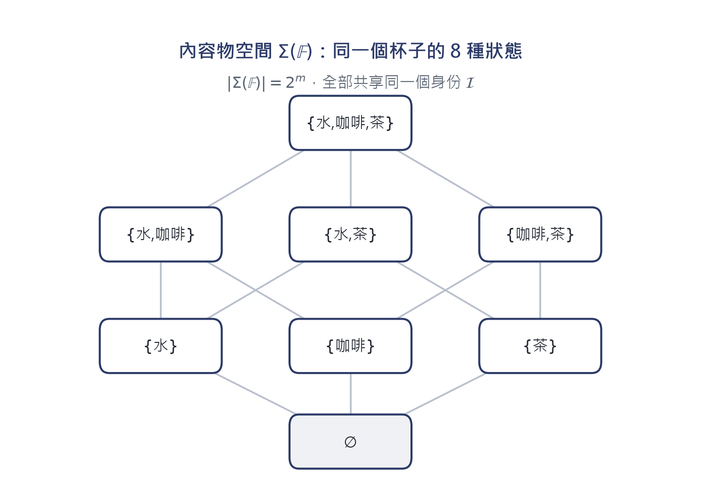

**▍Figure 3-2　For a cup that can hold three kinds of liquid, its contents space is a Boolean lattice of 8 states; filling or emptying along any path in the lattice, the identity ℐ remains unchanged throughout (Theorem 2).**

## 3.4　Engineering Correspondence

  **Type Logic Concept**                               **Relational Database Correspondence**      **Object-Oriented Correspondence**
  ---------------------------------------------------- ------------------------------------------- ---------------------------------------
  **Identity** $\mathcal{I}$                           Primary Key                                 Object reference / OID
  **Carrier** $S$                                      Set of foreign keys in the contents table   Member set
  $$\Sigma(\mathbb{F})$$                               All rows the foreign key can point to       Replaceable member states
  $$\mathbb{F}{\lbrack e}_{1} \mapsto e_{2}\rbrack$$   UPDATE the foreign key; the primary key is unchanged   Replace a member object; the container is unchanged

In database design, "the primary key does not change because the foreign key contents change" is an engineering discipline; Theorem 2 explains why it **must** be a discipline—because if identity could be derived from the contents, then any content update would create a "new" container, and all references would fail at once.

# Chapter Four　The Structural Layer (SOM): Composition Relations

## 4.1　From Juxtaposed Elements to Structured Parts

**▍Figure 4-1　SOM: the composition relation R is a directed graph of "who depends on whom." In set theory {lid, handle, bottom, body} is independent of order; in SOM, remove the bottom and the structure collapses.**

## 4.2　Formal Tools

+----------------------------------------------------------------------------------------------------------------------------------------+
| **▍Definition 4.1　Removal Operator and Transitive Closure**                                                                           |
|                                                                                                                                        |
| For $p \in S$, the **removal operator** is defined as                                                                                  |
|                                                                                                                                        |
| $$\mathbb{F} \smallsetminus p: = \langle S \smallsetminus \{ p\},\mathcal{\text{\ I}},\ {R|}_{S \smallsetminus \{ p\}},\ \Phi\rangle$$ |
|                                                                                                                                        |
| $R^{+}$ denotes the transitive closure of $R$. The **dependency cone** is defined as                                                  |
|                                                                                                                                        |
| $$\uparrow p: = \{ q \in S:\ p\, R^{+}\, q\}$$                                                                                         |
|                                                                                                                                        |
| that is, all parts that depend (directly or indirectly) on $p$.                                                                        |
+----------------------------------------------------------------------------------------------------------------------------------------+

+----------------------------------------------------------------------------------------------------------------------------------------------------------------------+
| **▍Definition 4.2　Three-Grade Part Classification**                                                                                                                 |
|                                                                                                                                                                      |
| Under $\sigma$ and $\kappa$ of Axiom A2, for $p \in S$:                                                                                                              |
|                                                                                                                                                                      |
| $$N(\mathbb{F}) = \{ p \in S:\ \sigma(S \smallsetminus \{ p\}) = 0\}\text{\quad\quad}(necessary part)$$                                                              |
|                                                                                                                                                                      |
| $$D(\mathbb{F}) = \{ p \in S:\ \sigma(S \smallsetminus \{ p\}) = 1\  \land \ \kappa(S \smallsetminus \{ p\}) \subsetneq \kappa(S)\}\text{\quad\quad}(functionally degraded part)$$ |
|                                                                                                                                                                      |
| $$T(\mathbb{F}) = \{ p \in S:\ \sigma(S \smallsetminus \{ p\}) = 1\  \land \ \kappa(S \smallsetminus \{ p\}) = \kappa(S)\}\text{\quad\quad}(non-essential part)$$    |
+----------------------------------------------------------------------------------------------------------------------------------------------------------------------+

+--------------------------------------------------------------------------------------+
| **▍Lemma A　Monotonicity of the Survival Criterion**                                 |
|                                                                                      |
| $X \subseteq Y \subseteq S$ and $\sigma(X) = 1 \Rightarrow \sigma(Y) = 1$. (i.e. A2a) |
+--------------------------------------------------------------------------------------+

+-----------------------------------------------------------------------+
| **▍Lemma B　Monotonicity of the Capability Function**                 |
|                                                                       |
| $X \subseteq Y \Rightarrow \kappa(X) \subseteq \kappa(Y)$. (i.e. A2b) |
+-----------------------------------------------------------------------+

## 4.3　The Three-way Partition Theorem

+----------------------------------------------------------------------------------------------------------------------------------------------------------------------------------------------------------------------------------------------------------------------------------------------------------------------------------------------------------------------------+
| **▍Theorem 5　Three-way Partition**                                                                                                                                                                                                                                                                                                                                        |
|                                                                                                                                                                                                                                                                                                                                                                            |
| $\{ N(\mathbb{F}),D(\mathbb{F}),T(\mathbb{F})\}$ constitutes a partition of $S$:                                                                                                                                                                                                                                                                                           |
|                                                                                                                                                                                                                                                                                                                                                                            |
| (i) **Completeness**　$N \cup D \cup T = S$;                                                                                                                                                                                                                                                                                                                               |
|                                                                                                                                                                                                                                                                                                                                                                            |
| (ii) **Mutual exclusivity**　the three are pairwise disjoint.                                                                                                                                                                                                                                                                                                             |
|                                                                                                                                                                                                                                                                                                                                                                            |
| **Proof**:                                                                                                                                                                                                                                                                                                                                                                 |
|                                                                                                                                                                                                                                                                                                                                                                            |
| (i) Take any $p \in S$. Since the range of $\sigma$ is $\{ 0,1\}$, there are two cases. If $\sigma(S \smallsetminus \{ p\}) = 0$, then $p \in N$. If $\sigma(S \smallsetminus \{ p\}) = 1$, then by Lemma B (taking $X = S \smallsetminus \{ p\}$, $Y = S$) we get $\kappa(S \smallsetminus \{ p\}) \subseteq \kappa(S)$. This inclusion relation has only two possibilities: proper inclusion ($p \in D$) or equality ($p \in T$). Hence $p$ must belong to one of the three. |
|                                                                                                                                                                                                                                                                                                                                                                            |
| (ii) Suppose $p \in N \cap D$. Then $\sigma(S \smallsetminus \{ p\}) = 0$ and $= 1$, violating the fact that $\sigma$ is a well-defined function, a contradiction. The mutual exclusivity of $N \cap T$ and $D \cap T$ follows by the same reasoning, from the incompatibility of the $\sigma$ values and the incompatibility of the $\kappa$ relation respectively.∎ |
+----------------------------------------------------------------------------------------------------------------------------------------------------------------------------------------------------------------------------------------------------------------------------------------------------------------------------------------------------------------------------+

**▍Figure 4-2　The decision tree and partition structure of the three-grade classification (Theorem 5): every part falls into exactly one grade, with no middle ground.**

## 4.4　Collapse Propagation

+-------------------------------------------------------------------------------------------------------------------------------------------------------------------------------------------------------------------------------------------------------------------------------------------------------------------------------------------------------+
| **▍Theorem 6　Collapse Propagation**                                                                                                                                                                                                                                                                                                                  |
|                                                                                                                                                                                                                                                                                                                                                       |
| If $p \in N(\mathbb{F})$, then for any $A$ satisfying $\{ p\} \subseteq A \subseteq S$, we have                                                                                                                                                                                                                                                        |
|                                                                                                                                                                                                                                                                                                                                                       |
| $$\sigma(S \smallsetminus A) = 0$$                                                                                                                                                                                                                                                                                                                    |
|                                                                                                                                                                                                                                                                                                                                                       |
| **Proof**: By contradiction. Suppose $\sigma(S \smallsetminus A) = 1$. From $\{ p\} \subseteq A$ we get $S \smallsetminus A \subseteq S \smallsetminus \{ p\}$. By Lemma A (monotonicity), $\sigma(S \smallsetminus A) = 1 \Rightarrow \sigma(S \smallsetminus \{ p\}) = 1$. But $p \in N$ means $\sigma(S \smallsetminus \{ p\}) = 0$, a contradiction. Hence $\sigma(S \smallsetminus A) = 0$.∎ |
+-------------------------------------------------------------------------------------------------------------------------------------------------------------------------------------------------------------------------------------------------------------------------------------------------------------------------------------------------------+

+---------------------------------------------------------------------------------------------------------------------------------------------------------------------------------------------------------------+
| **▍Corollary 6.1　Chained Failure Along the Dependency Cone**                                                                                                                                                 |
|                                                                                                                                                                                                               |
| If $q \in \uparrow p$ ($q$ depends on $p$) and $p \in N$, then under the configuration $S \smallsetminus \{ p\}$, $q$ is no longer usable. This is precisely the strict form of the original chapter's observation "remove the bottom, and the cup collapses": **failure is not local; it propagates monotonically along the dependency cone** (Figure 4-3). |
+---------------------------------------------------------------------------------------------------------------------------------------------------------------------------------------------------------------+

**▍Figure 4-3　Collapse propagation (Theorem 6): removing one necessary part p causes the entire dependency cone ↑p to fail as well.**

## 4.5　How Much Information Does Structure Carry?

+--------------------------------------------------------------------------------------+
| **▍Theorem 7　Structural Information Content**                                       |
|                                                                                      |
| Let $|S| = n$. Let $P(n)$ be the number of strict partial orders on an $n$-element set (i.e. the number of possible values of $R$). Then: |
|                                                                                      |
| (i) the structural information content of the set layer is $0$ bits (the Axiom of Extensionality guarantees a unique representation); |
|                                                                                      |
| (ii) the structural information content of the structural layer is $\log_{2}P(n)$ bits. |
|                                                                                      |
| **Proof**: (i) By Axiom 0, $S$ is completely determined by its elements, the representation is unique, so the entropy is 0. |
|                                                                                      |
| (ii) $R$ has $P(n)$ equally likely values, so its information content is $\log_{2}P(n)$ bits.∎ |
+--------------------------------------------------------------------------------------+

  $$n$$   $P(n)$ **(known enumeration)**   $$\log_{2}P(n)$$
  ------- -------------------------------- ------------------
  1       1                                0.00 bits
  2       3                                1.58 bits
  3       19                               4.25 bits
  4       219                              7.77 bits
  5       4,231                            12.05 bits

**▍Figure 4-4　Structural information content grows super-exponentially with the number of parts: a cup with four parts already carries nearly 8 bits of structural information. This explains why manually enumerating structures is infeasible and why they must be expressed in relational form.**

## 4.6　Engineering Significance

  **Grade**                 **Judgment Condition**                       **Engineering Correspondence**   **Example in a Cup**
  ------------------------- -------------------------------------------- -------------------------------- ------------------
  **Necessary part** $N$    $$\sigma(S \smallsetminus \{ p\}) = 0$$      Safety-critical part             Bottom
  **Degraded part** $D$     $\sigma = 1$ and $\kappa$ shrinks            Optional functional part         Handle
  **Non-essential part** $T$   $\sigma = 1$ and $\kappa$ unchanged       Decorative / consumable part     Carving on the body

# Chapter Five　The Abstraction Layer: Generative Criteria

## 5.1　From Closed List to Open Rule

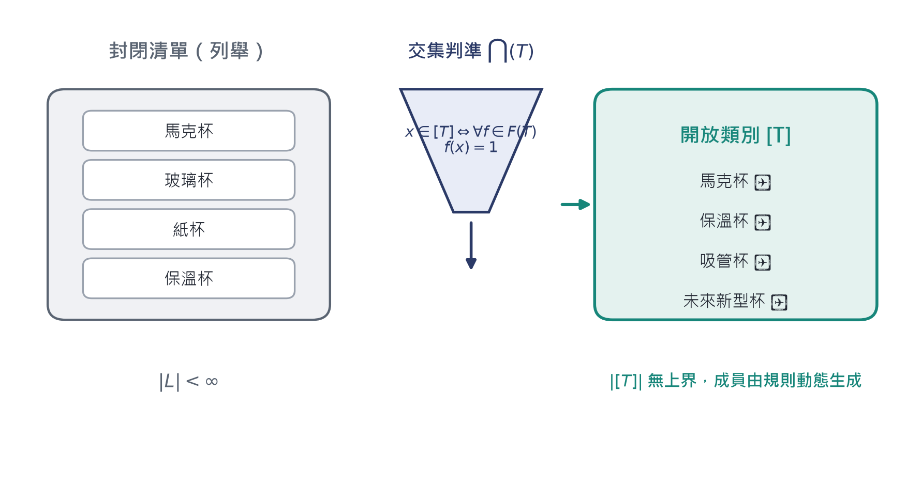

**▍Figure 5-1　A closed list relies on enumeration; an open category relies on a rule: membership is decided on the spot by the intersection criterion ⋂(T), independently of historical enumeration (Theorem 9).**

## 5.2　Formal Definition

+-----------------------------------------------------------------------------------------------------------+
| **▍Definition 5.1　Feature Set, Criterion, and Category Extension**                                       |
|                                                                                                           |
| The **feature set** of a category $T$ is a finite set $F(T) = \{ f_{1},\ldots{,f}_{n}\}$, where each $f_{i}:U \rightarrow \{ 0,1\}$. |
|                                                                                                           |
| **Intersection criterion**:                                                                               |
|                                                                                                           |
| $$\bigcap(T)(x): = \bigwedge_{i = 1}^{n}\ f_{i}(x)$$                                                      |
|                                                                                                           |
| **Category extension**:                                                                                   |
|                                                                                                           |
| $${\lbrack T\rbrack}_{F}: = \{ x \in U:\ \bigcap(T)(x) = 1\}$$                                            |
+-----------------------------------------------------------------------------------------------------------+

## 5.3　Monotonicity: The More Conditions, the Smaller the Category

+---------------------------------------------------------------------------------------------------------------------------------------------------------------------------------------------+
| **▍Theorem 8　Feature Antitonicity**                                                                                                                                                        |
|                                                                                                                                                                                             |
| If $F_{1} \subseteq F_{2}$, then ${\lbrack T\rbrack}_{F_{2}} \subseteq {\lbrack T\rbrack}_{F_{1}}$.                                                                                        |
|                                                                                                                                                                                             |
| **Proof**: Suppose $x \in {\lbrack T\rbrack}_{F_{2}}$, then $\forall f \in F_{2}:f(x) = 1$. Since $F_{1} \subseteq F_{2}$, $\forall f \in F_{1}:f(x) = 1$, that is $x \in {\lbrack T\rbrack}_{F_{1}}$.∎ |
+---------------------------------------------------------------------------------------------------------------------------------------------------------------------------------------------+

**▍Figure 5-2　The feature lattice and the category lattice run in opposite directions (Theorem 8): on the left, adding features moves upward; on the right, shrinking the category moves downward. The mapping F ↦ \[T\]\_F is an order-reversing correspondence between the two lattices.**

## 5.4　Openness

+--------------------------------------------------------------------------------------------------------------------------------------------------------+
| **▍Theorem 9　Openness**                                                                                                                               |
|                                                                                                                                                        |
| Suppose $U$ is infinite, and there exists a feature $f$ such that $f^{- 1}(1)$ is infinite. Then for any finite enumeration $L \subseteq f^{- 1}(1)$:   |
|                                                                                                                                                        |
| $$L \subsetneq {\lbrack T\rbrack}_{\{ f\}}$$                                                                                                           |
|                                                                                                                                                        |
| That is: **no finite list is this category**.                                                                                                          |
|                                                                                                                                                        |
| **Proof**: ${\lbrack T\rbrack}_{\{ f\}} = f^{- 1}(1)$ is an infinite set, and $L$ is a finite subset of it, so $f^{- 1}(1) \smallsetminus L \neq \varnothing$, that is, $L$ is a proper subset.∎ |
+--------------------------------------------------------------------------------------------------------------------------------------------------------+

+-----------------------------------------------------------------------------------------------------------------------------------------------------------------------------------------------------------+
| **▍Corollary 9.1　Automatic Determination of New Members**                                                                                                                                                |
|                                                                                                                                                                                                           |
| For any $x \in U$ (whether or not it has ever appeared in the training data, design documents, or historical lists), membership is determined by $\bigcap(T)(x)$ in $O(n)$ time ($n = |F(T)|$). This is the formal content of the original chapter's "as long as it conforms to the rule, even a brand-new design automatically belongs to it." |
+-----------------------------------------------------------------------------------------------------------------------------------------------------------------------------------------------------------+

## 5.5　Precise Characterization of Misclassification

+---------------------------------------------------------------------------------------------------+
| **▍Definition 5.2　Complete Feature Set**                                                         |
|                                                                                                   |
| Suppose there exists a target category $T^{*}$ whose true feature set is $F^{*}$. A user-proposed $F \subseteq F^{*}$ is called **incomplete**. |
+---------------------------------------------------------------------------------------------------+

+----------------------------------------------------------------------------------------------------------------------------------------------------------------------------------------------------------------------------------------------------------------------------------+
| **▍Theorem 10　Misclassification Characterization**                                                                                                                                                                                                                              |
|                                                                                                                                                                                                                                                                                  |
| Suppose $F \subseteq F^{*}$. Then:                                                                                                                                                                                                                                               |
|                                                                                                                                                                                                                                                                                  |
| (a) ${\lbrack T\rbrack}_{F^{*}} \subseteq {\lbrack T\rbrack}_{F}$ (by Theorem 8);                                                                                                                                                                                               |
|                                                                                                                                                                                                                                                                                  |
| (b) the **false-positive set** can be written precisely as                                                                                                                                                                                                                       |
|                                                                                                                                                                                                                                                                                  |
| $${\text{FP}(F): = \lbrack T\rbrack}_{F} \smallsetminus {\lbrack T\rbrack}_{F^{*}}{= \lbrack T\rbrack}_{F} \cap (U \smallsetminus {\lbrack T\rbrack}_{F^{*}})$$                                                                                                                  |
|                                                                                                                                                                                                                                                                                  |
| (c) $\text{FP}(F) = \varnothing \Leftrightarrow {\lbrack T\rbrack}_{F}{= \lbrack T\rbrack}_{F^{*}}$;                                                                                                                                                                            |
|                                                                                                                                                                                                                                                                                  |
| (d) if $F_{1} \subseteq F_{2} \subseteq F^{*}$, then ${\text{FP}(F}_{2}) \subseteq {\text{FP}(F}_{1})$—the more complete the features, the fewer the misclassifications.                                                                                                          |
|                                                                                                                                                                                                                                                                                  |
| **Proof**: (a) Theorem 8. (b) Definition of the difference set. (c) By (a), ${\lbrack T\rbrack}_{F^{*}} \subseteq {\lbrack T\rbrack}_{F}$; the difference set is empty if and only if the two sets are equal. (d) By Theorem 8, ${\lbrack T\rbrack}_{F_{2}} \subseteq {\lbrack T\rbrack}_{F_{1}}$; taking the difference from the same set, the smaller set yields the smaller difference.∎ |
+----------------------------------------------------------------------------------------------------------------------------------------------------------------------------------------------------------------------------------------------------------------------------------+

**▍Figure 5-3　The geometry of the false-positive set (Theorem 10): an incomplete feature set necessarily encloses some non-members; the process of adding features is the process of shrinking \[T\]\_F.**

+------------------------------------------------------------------------------------------------------------------------------------------------------------------------------------------+
| **▍Corollary 10.1　Decidability of Boundary Cases**                                                                                                                                      |
|                                                                                                                                                                                          |
| Disputes such as "is a bowl a cup" or "is a straw cup a cup" are, by Theorem 10, completely reduced to **disputes about the feature set**: if $F$ does not include "used for drinking," then the bowl $\in {\lbrack T\rbrack}_{F}$; if it does, the bowl $\notin {\lbrack T\rbrack}_{F}$. |
|                                                                                                                                                                                          |
| The judgment procedure contains no ambiguity; all ambiguity comes from the choice of $F(T)$. This converts an ontological dispute into an engineering decision that can be discussed unambiguously. |
+------------------------------------------------------------------------------------------------------------------------------------------------------------------------------------------+

  **Candidate Object**   $f_{1}$ **can hold liquid**   $f_{2}$ **can be hand-held to drink from**   $f_{3}$ **used for drinking**   **Conclusion**
  ---------------------- ----------------------------- -------------------------------------------- ------------------------------- --------------------------------
  **Mug**                1                             1                                            1                               $$\in {\lbrack T\rbrack}_{F}$$
  **Bowl**               1                             0                                            0                               $\notin$ ($f_{2}$ fails)
  **Straw cup**          1                             1                                            1                               $$\in {\lbrack T\rbrack}_{F}$$
  **Syringe**            1                             1                                            0                               Depends on whether $f_{3}$ $\in F$

## 5.6　Lattice Structure

+--------------------------------------------------------------------------------------------------------------------------------------+
| **▍Proposition 5.3　Order-Reversing Embedding**                                                                                      |
|                                                                                                                                      |
| The mapping $F \mapsto {\lbrack T\rbrack}_{F}$ is an order-reversing embedding from the Boolean lattice $(\mathcal{P}{(F}^{*}), \subseteq )$ into $(\mathcal{P}(U), \supseteq )$. |
|                                                                                                                                      |
| **Proof**: Order-reversal is Theorem 8. The embedding property follows because ${\lbrack T\rbrack}_{F}$ is uniquely determined as a function of $F$.∎ |
+--------------------------------------------------------------------------------------------------------------------------------------+

# Chapter Six　Joint Three-Layer Determination

## 6.1　Determination Operators

+-----------------------------------------------------------------------------------------------------------------------------------------------------------------------------+
| **▍Definition 6.1　Three-Layer Determination Operators**                                                                                                                    |
|                                                                                                                                                                             |
| $$\kappa_{c}(\mathbb{F}) = 1\  \Leftrightarrow \ \exists e_{1} \in S,\ \exists e_{2} \notin S:\ \mathbb{F}{\lbrack e}_{1} \mapsto e_{2}\rbrack \sim_{\text{id}}\mathbb{F}$$ |
|                                                                                                                                                                             |
| $$\kappa_{s}(\mathbb{F}) = 1\  \Leftrightarrow \ \sigma(S) = 1\  \land \ N(\mathbb{F}) \neq \varnothing$$                                                                   |
|                                                                                                                                                                             |
| $$\kappa_{a}(x) = 1\  \Leftrightarrow \ \bigcap(T)(x) = 1$$                                                                                                                 |
|                                                                                                                                                                             |
| $$J(\mathbb{F}): = \kappa_{c}(\mathbb{F}) \land \kappa_{s}(\mathbb{F}) \land \kappa_{a}(\mathbb{F})$$                                                                       |
+-----------------------------------------------------------------------------------------------------------------------------------------------------------------------------+

**▍Figure 6-1　Three gates: each operates independently, and failing any one excludes the object.**

## 6.2　Minimal Sufficiency

+--------------------------------------------------------------------------------------------------------------------------------------------------------------------------------------------------------------------+
| **▍Theorem 11　Minimal Sufficiency**                                                                                                                                                                               |
|                                                                                                                                                                                                                    |
| Let the target category be $M^{*}$ =［smartphone］, with complete feature set                                                                                                                                       |
|                                                                                                                                                                                                                    |
| $$F^{*}{(M}^{*}) = \{ has cellular mobile communication,\ general-purpose programmable computing platform,\ can be held and used in one hand on the go\}$$                                                          |
|                                                                                                                                                                                                                    |
| Domain $\Omega = \{ s^{*},t_{1},t_{2},c,w,u\}$ (smartphone, Wi-Fi tablet, LTE tablet, calculator, walkie-talkie, in-car head unit).                                                                                 |
|                                                                                                                                                                                                                    |
| Then for any proper subset $J'$ of $\{\kappa_{c},\kappa_{s},\kappa_{a}\}$, there exists $x \in \Omega \smallsetminus M^{*}$ such that $x$ passes all tests of $J'$.                                                 |
|                                                                                                                                                                                                                    |
| **Proof**: Construct witnesses one by one, see the table below and Figure 6-2.                                                                                                                                     |
|                                                                                                                                                                                                                    |
| (1) $J' = \varnothing$: take any $x \in \Omega \smallsetminus M^{*}$; it passes trivially.                                                                                                                         |
|                                                                                                                                                                                                                    |
| (2) $J' = \{\kappa_{c}\}$: take $x = t_{1}$ (Wi-Fi tablet). Apps can be added or removed while the tablet's identity is unchanged (A1), so $\kappa_{c}{(t}_{1}) = 1$; but $t_{1}$ has no cellular communication, $t_{1} \notin M^{*}$. |
|                                                                                                                                                                                                                    |
| (3) $J' = \{\kappa_{s}\}$: take $x = c$ (calculator). The battery and motherboard are necessary parts, $N(c) \neq \varnothing$; but $c$ has no cellular communication and is not a general-purpose platform, $c \notin M^{*}$. |
|                                                                                                                                                                                                                    |
| (4) $J' = \{\kappa_{a}\}$ (taking the incomplete feature $F = \{ can communicate, can compute\}$): $t_{1}$ passes both, $t_{1} \notin M^{*}$.                                                                        |
|                                                                                                                                                                                                                    |
| (5) $J' = \{\kappa_{c},\kappa_{s}\}$: $t_{1}$ passes both (see the reasons in 2 and 3), $t_{1} \notin M^{*}$.                                                                                                       |
|                                                                                                                                                                                                                    |
| (6) $J' = \{\kappa_{c},\kappa_{a}\}$: $t_{1}$ passes both, $t_{1} \notin M^{*}$.                                                                                                                                    |
|                                                                                                                                                                                                                    |
| (7) $J' = \{\kappa_{s},\kappa_{a}\}$: take $x = u$ (in-car head unit). $\kappa_{s}(u) = 1$ (it has necessary parts such as a power module); $u$ has communication and computing capability, $\kappa_{a}(u) = 1$ ($F$ does not include "portable"); but $u$ cannot be carried on one's person, $u \notin M^{*}$. |
|                                                                                                                                                                                                                    |
| All seven proper subsets are insufficient. As for $J$ itself: testing item by item against $F^{*}$, $t_{1}$ fails (no cellular), $t_{2}$ fails (cannot be held and used in one hand), $c$, $w$, $u$ all fail, and only $s^{*}$ passes all three. Hence $J$ precisely characterizes $M^{*}$ on $\Omega$.∎ |
+--------------------------------------------------------------------------------------------------------------------------------------------------------------------------------------------------------------------+

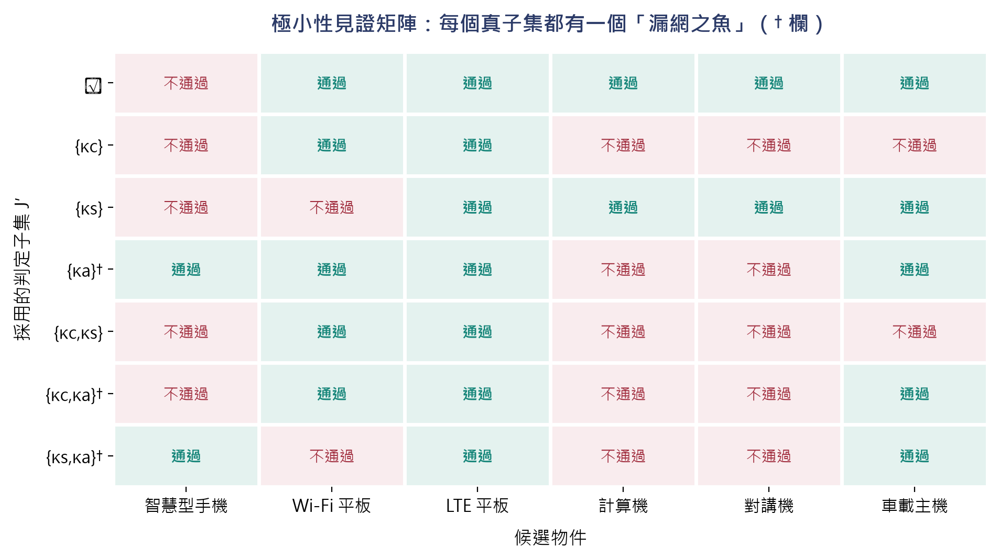

**▍Figure 6-2　The minimality witness matrix (Theorem 11): every row (a determination subset) has at least one "fish that slips through the net."**

+--------------------------------------------------------------------------------------------------------------------------------------------------------------------------------------------------------------------------------------------------------------------------------------+
| **▍Remark 6.2　What This Theorem Is Saying**                                                                                                                                                                                                                                         |
|                                                                                                                                                                                                                                                                                      |
| The original chapter said "none of the three layers of judgment can be omitted: looking only at the container layer, a tablet is also a phone; looking only at the composition layer, a calculator is also a phone"—Theorem 11 turns this statement into a testable mathematical proposition: **sufficiency belongs to the entire triple, not to any proper subset**. Note the key point of item (4): if the abstraction layer uses an incomplete feature set, it too will leak. This brings "the responsibility of feature engineering" into the framework as well (Theorem 10). |
+--------------------------------------------------------------------------------------------------------------------------------------------------------------------------------------------------------------------------------------------------------------------------------------+

## 6.3　Complete Case: Smartphone

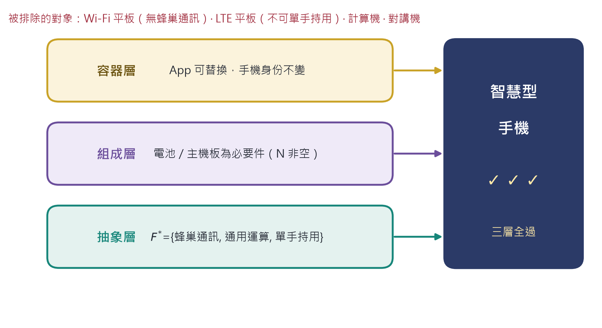

**▍Figure 6-3　The joint three-layer determination of a smartphone: all three gates are passed, and each approximating object is blocked at exactly one gate.**

  **Layer**                **Operator**       **Value of the object** $s^{*}$                                            **Determination**
  ------------------------ ------------------ --------------------------------------------------------------------------- ----------
  Container layer          $$\kappa_{c}$$     Apps replaceable, data can be emptied, identity unchanged                   1
  Composition layer        $$\kappa_{s}$$     $N = \{$battery, motherboard$\} \neq \varnothing$; $D = \{$protective case, screen protector$\}$   1
  Abstraction layer        $$\kappa_{a}$$     Cellular 1・general computing 1・one-hand use 1                           1
  Joint                    $$J$$              $$1 \land 1 \land 1$$                                                       **1**

## 6.4　Determination Complexity

+-----------------------------------------------------------------------------------------------------------------------------------------------------------------------------------------------------------------------------------------------------------------------------------------+
| **▍Theorem 12　Determination Complexity**                                                                                                                                                                                                                                               |
|                                                                                                                                                                                                                                                                                         |
| Let $|S| = n$, $|F| = m$. Then the determination times of $\kappa_{c}$, $\kappa_{s}$, $\kappa_{a}$ are respectively                                                                                                                                                                      |
|                                                                                                                                                                                                                                                                                         |
| $$O(1),\quad\quad{O(n}^{3}),\quad\quad O(m)$$                                                                                                                                                                                                                                           |
|                                                                                                                                                                                                                                                                                         |
| **Proof (key points)**: $\kappa_{c}$ requires only one substitution test (A1 is an axiom, no search needed). $\kappa_{s}$ requires first computing the transitive closure of $R$ (Warshall, ${O(n}^{3})$), then computing $\sigma(S \smallsetminus \{ p\})$ for each $p \in S$ (each ${O(n}^{2})$, $n$ times in total), amounting to ${O(n}^{3})$. $\kappa_{a}$ evaluates the $m$ features one by one.∎ |
+-----------------------------------------------------------------------------------------------------------------------------------------------------------------------------------------------------------------------------------------------------------------------------------------+

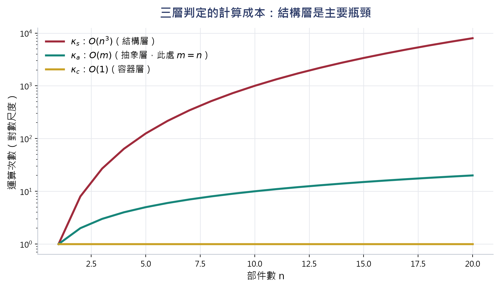

**▍Figure 6-4　The computational cost of three-layer determination: the structural layer O(n\^3) is the main bottleneck, which also explains why in engineering practice manually maintained BOM/SOM are often used in place of automatic derivation.**

+------------------------------------------------------------+
| **▍Algorithm 6.3　Joint Three-Layer Determination (pseudo-code)** |
|                                                            |
| INPUT : form set F = \<S, I, R, Phi\>; feature set F\_T    |
|                                                            |
| BEGIN                                                      |
|                                                            |
| \# First gate: container (O(1))                            |
|                                                            |
| k\_c := ( substitute one element of S; check I unchanged ) |
|                                                            |
| \# Second gate: SOM (O(n\^3))                              |
|                                                            |
| R+ := transitive\_closure(R) \# O(n\^3)                    |
|                                                            |
| for each p in S: \# n times                                |
|                                                            |
| sigma\[p\] := survival(S {p}) \# O(n\^2)                   |
|                                                            |
| k\_s := sigma\[S\] AND (exists p: sigma\[p\] = 0)          |
|                                                            |
| \# Third gate: abstraction (O(m))                          |
|                                                            |
| k\_a := AND over f in F\_T of f(x)                         |
|                                                            |
| RETURN k\_c AND k\_s AND k\_a                              |
|                                                            |
| END                                                        |
+------------------------------------------------------------+

# Chapter Seven　Formalized Solutions to the Judgment Examples

This chapter rewrites the six judgment exercises from original Chapter 5.5.6 as derivations executed step by step according to the theorems and axioms. The solution to each question can be mechanically redone by Algorithm 6.3—this is precisely the value of Type Logic as a cognitive tool: **the answers are not guessed by intuition, but obtained by going through the procedure**.

## 7.1　Question One: Is a refrigerator a container?

+----------------------------------------------------------------+
| **▍Question**                                                  |
|                                                                |
| Food can be put into a refrigerator and all taken out. When the contents change, is it still the same refrigerator? |
+----------------------------------------------------------------+

+------------------------------------------------------------------------------------------------------------------------------------------------------------------+
| **▍Answer　(Container Layer)**                                                                                                                                   |
|                                                                                                                                                                  |
| **Step 1**　Confirm the replaceable contents: $\Phi^{- 1}(1)$ includes milk, vegetables, food containers……, $|\Phi^{- 1}(1)| = m$.                              |
|                                                                                                                                                                  |
| **Step 2**　Perform the replacement: $\mathbb{F}\lbrack 牛奶 \mapsto 蔬菜\rbrack$ (Definition 3.1).                                                             |
|                                                                                                                                                                  |
| **Step 3**　Check identity: by Theorem 4, $\mathbb{F}\lbrack\cdots\rbrack \sim_{\text{id}}\mathbb{F}$.                                                           |
|                                                                                                                                                                  |
| **Step 4**　Conclusion: $\kappa_{c} = 1$; the refrigerator is a container. And the size of the contents space is $|\Sigma| = 2^{m}$ (Proposition 3.5).            |
|                                                                                                                                                                  |
| **Extension**: if the compressor is removed, this is not a container-layer question—the compressor $\in N(\mathbb{F})$ (SOM layer), and by Theorem 5 it is a necessary part, with $\sigma = 0$ after removal. **The two questions belong to two different layers and must not be conflated**. |
+------------------------------------------------------------------------------------------------------------------------------------------------------------------+

## 7.2　Question Two: What grade of part is a car's steering wheel?

+-------------------------------------------------------------------------+
| **▍Question**                                                           |
|                                                                         |
| A car has an engine, wheels, a steering wheel, air conditioning, and an audio system. Which grade does the steering wheel belong to among $N$, $D$, $T$? |
+-------------------------------------------------------------------------+

+-----------------------------------------------------------------------------------------------------------------------------------------------------------------------------------------------------------------------------------------+
| **▍Answer　(SOM Layer)**                                                                                                                                                                                                                |
|                                                                                                                                                                                                                                         |
| **Step 1**　Construct $S \smallsetminus \{ 方向盤\}$ (Definition 4.1).                                                                                                                                                                  |
|                                                                                                                                                                                                                                         |
| **Step 2**　Compute $\sigma$: the body, engine, and wheels are still present, the whole survives, $\sigma = 1$. Hence the steering wheel $\notin N$.                                                                                    |
|                                                                                                                                                                                                                                         |
| **Step 3**　Compute $\kappa$: the capability set $C$ includes "steering control"; $\kappa(S)$ has $c_{轉向}$, while $\kappa(S \smallsetminus \{ 方向盤\})$ does not (the monotonicity of Lemma B guarantees it only decreases, never increases). Hence $\kappa$ is a proper inclusion, $\kappa(S \smallsetminus \{ p\}) \subsetneq \kappa(S)$. |
|                                                                                                                                                                                                                                         |
| **Step 4**　By Definition 4.2: the steering wheel $\in D(\mathbb{F})$ (functionally degraded part).                                                                                                                                     |
|                                                                                                                                                                                                                                         |
| **Contrast**: the engine $\in N$ ($\sigma = 0$ after removal); the floor mat $\in T$ ($\kappa$ unchanged). The three-way partition is guaranteed by Theorem 5 to have exactly one solution.                                           |
+-----------------------------------------------------------------------------------------------------------------------------------------------------------------------------------------------------------------------------------------+

## 7.3　Question Three: Does a kettle belong to ［cup］?

+--------------------------------------------------------------------------------------------------------------+
| **▍Question**                                                                                                |
|                                                                                                              |
| $F(杯子) = \{ f_{1}能裝液體,f_{2}能被手持喝\}$. Does a sports bottle (750 ml, with a straw opening) $\in \lbrack 杯子\rbrack$? |
+--------------------------------------------------------------------------------------------------------------+

+-------------------------------------------------------------------------------------------------------------------------------------------------------------------------------------------------------------------------------------------------+
| **▍Answer　(Abstraction Layer)**                                                                                                                                                                                                                |
|                                                                                                                                                                                                                                                 |
| **Step 1**　Sports bottle: $f_{1} = 1$, $f_{2} = 1$ (hand-held drinking through the straw opening). By Definition 5.1, $\bigcap(T)(x) = 1 \land 1 = 1$, so $\in \lbrack 杯子\rbrack$.                                                          |
|                                                                                                                                                                                                                                                 |
| **Step 2**　Thermos (2 L, must be poured out): $f_{1} = 1$, $f_{2} = 0$, so $\notin \lbrack 杯子\rbrack$.                                                                                                                                       |
|                                                                                                                                                                                                                                                 |
| **Step 3**　But the thermos $\in \lbrack 容器\rbrack$ (container layer $\kappa_{c} = 1$).                                                                                                                                                       |
|                                                                                                                                                                                                                                                 |
| **Theoretical Basis**: $\{ f_{1}\} \subseteq F(杯子)$, by Theorem 8, $\lbrack 杯子\rbrack \subseteq {\lbrack T\rbrack}_{\{ f_{1}\}}$—a subcategory is smaller than its parent category, and the direction is locked in by monotonicity. The same object can belong to a superordinate category without belonging to a subordinate subcategory; this is not a contradiction, but lattice structure (Proposition 5.3). |
+-------------------------------------------------------------------------------------------------------------------------------------------------------------------------------------------------------------------------------------------------+

## 7.4　Question Four: Is an electric car ［car］?

+--------------------------------------------------------------+
| **▍Question**                                                |
|                                                              |
| The Tesla Model 3 has no internal combustion engine, using a battery and a motor instead. Is it still a "car"? |
+--------------------------------------------------------------+

+-----------------------------------------------------------------------------------------------------------------------------------------------------------------------------------------------+
| **▍Answer　(Joint Three Layers)**                                                                                                                                                             |
|                                                                                                                                                                                               |
| **First layer (Container)**: passengers and cargo can get in and out, and carrying different people it is still the same car. $\kappa_{c} = 1$.                                              |
|                                                                                                                                                                                               |
| **Second layer (SOM)**: $N = \{$電池組, 馬達, 車架$\}$; $D = \{$中控螢幕, 音響$\}$; $T = \{$裝飾條$\}$. Note: SOM concerns **structural roles**, not modes of implementation—the battery pack occupies the functional position of the engine. $\kappa_{s} = 1$. |
|                                                                                                                                                                                               |
| **Third layer (Abstraction)**: $F(汽車) = \{ 能在道路行駛,能載運人貨,有動力系統,可被駕駛操控\}$. Tesla passes all four. $\kappa_{a} = 1$.                                                    |
|                                                                                                                                                                                               |
| **Conclusion**: $J = 1$; the electric car is a car.                                                                                                                                           |
|                                                                                                                                                                                               |
| **Key point**: the rule says "has a power system" rather than "has an internal combustion engine." If the latter were mistakenly written, then by Theorem 10 "electric car" would become a member of the false-positive set and be wrongly excluded—**this is an error of feature engineering, not of the judgment procedure**. |
+-----------------------------------------------------------------------------------------------------------------------------------------------------------------------------------------------+

## 7.5　Question Five: Are the books on a bookshelf a container relation or a set relation?

+------------------------------------------------------------+
| **▍Question**                                              |
|                                                            |
| "Ten books are placed on the bookshelf"—is the bookshelf a container? Or merely a set? |
+------------------------------------------------------------+

+------------------------------------------------------------------------------------------------------------------------------------------------------------------------------------------------------------------------------------------------------------+
| **▍Answer　(Criterion Relativity)**                                                                                                                                                                                                                        |
|                                                                                                                                                                                                                                                            |
| **Case A**　Take the "whole" = the bookshelf (including the shelf structure): books can be placed, taken, and replaced, and the bookshelf's identity is unchanged, $\kappa_{c} = 1$; it is a container.                                                     |
|                                                                                                                                                                                                                                                            |
| **Case B**　Take the "whole" = the collection of books: take one away and put another in, and the element set of the collection changes; by Corollary 0.1 it is already another set, $\kappa_{c} = 0$; it is a pure set.                                    |
|                                                                                                                                                                                                                                                            |
| **Theoretical Basis**: the type of determination is decided by **the choice of the whole**, not by the physical scene. Formally, the two cases correspond to two different $\mathbb{F}$ (different $S$ and $\mathcal{I}$), so the difference in conclusions does not constitute a contradiction. **The same scene can involve several types of determination at once**—this is the rigorous form of the original chapter's "it depends on what whole you are attending to." |
+------------------------------------------------------------------------------------------------------------------------------------------------------------------------------------------------------------------------------------------------------------+

## 7.6　Question Six: Is an AI chatbot ［dialogue system］?

+-------------------------------------------------------------------------------------------------------------------------+
| **▍Question**                                                                                                           |
|                                                                                                                         |
| $F(對話系統) = \{ f_{1}接收自然語言輸入,f_{2}產生自然語言回應,f_{3}維持對話上下文\}$. What does each of the FAQ bot and ChatGPT belong to? |
+-------------------------------------------------------------------------------------------------------------------------+

+--------------------------------------------------------------------------------------------------------------------------------------------------------------------------------------------------------------+
| **▍Answer　(Cross-Domain Abstraction Judgment)**                                                                                                                                                             |
|                                                                                                                                                                                                              |
| **Step 1**　ChatGPT: $f_{1} = f_{2} = f_{3} = 1$, so $\in \lbrack 對話系統\rbrack$.                                                                                                                          |
|                                                                                                                                                                                                              |
| **Step 2**　FAQ bot: $f_{1} = 1$, $f_{2} = 1$, $f_{3} = 0$ (each query is independent, with no context), so $\notin \lbrack 對話系統\rbrack$.                                                                  |
|                                                                                                                                                                                                              |
| **Step 3**　But take the broader $F' = \{ f_{1},f_{2}\}$: by Theorem 8 ($F' \subseteq F$), ${\lbrack T\rbrack}_{F} \subseteq {\lbrack T\rbrack}_{F'}$, and the FAQ bot $\in {\lbrack T\rbrack}_{F'}$ = ［question-answering tool］. |
|                                                                                                                                                                                                              |
| **Theoretical Significance**: do not ask essentialist questions like "is it really a dialogue system," but explicitly list $F(T)$ and test item by item. **The choice of the feature list is itself an expression of one's understanding of and stance on the concept**—Theorem 10 guarantees that the consequences of this stance (the size of the false-positive set) are computable. |
+--------------------------------------------------------------------------------------------------------------------------------------------------------------------------------------------------------------+

# Chapter Eight　Conclusion

## 8.1　Overview of the Three Value-Adds

  **Layer**               **Information Added Back**             **Formal Carrier**                                     **Key Theorems**    **Determination Cost**
  ----------------------- -------------------------------------- ------------------------------------------------------ ------------------- ----------------------
  **Container**           Identity independent of the contents   $\mathcal{I}$ and $\sim_{\text{id}}$                   Theorems 2, 3, 4    $$O(1)$$
  **Structure (SOM)**     Dependence and positioning among elements   $R$, $\sigma$, $\kappa$                           Theorems 5, 6, 7    $${O(n}^{3})$$
  **Abstraction**         A rule that can generate new members   $F(T)$ and $\bigcap(T)$                                Theorems 8, 9, 10   $$O(m)$$
  **Joint**               The complementary filtering of the three layers   $$J = \kappa_{c} \land \kappa_{s} \land \kappa_{a}$$   Theorems 11, 12   Take the maximum

## 8.2　Theoretical Significance

**From description to judgment.** Definitions and axioms solve "how to describe a Type"; Theorem 11 and Algorithm 6.3 solve "how to apply these descriptions to make decisions in actual situations." The former is a static knowledge structure, the latter a dynamic cognitive operation, and the two are linked by the same set of symbols.

**Correspondence with AI classification systems.** Modern AI classification is essentially performing abstraction-layer determination ($\kappa_{a}$), and moreover using an incomplete feature set. Theorem 10 precisely points out this structural weakness (false positives are unavoidable), while Theorem 11 points out the two neglected layers: identity-persistence tracking ($\kappa_{c}$) and structural-dependence analysis ($\kappa_{s}$). The three-layer framework of Type Logic gives exactly the list of dimensions that world models need to add.

## 8.3　Limitations and Honest Statement

1.　$\sigma$, $\kappa$ **are exogenous parameters**. The framework gives the monotonicity structure they must satisfy (A2a, A2b), but does not give numerical values. Judging "whether the whole survives after removing the bottom" is still a modeling judgment; what the framework guarantees is that once given, conclusions such as the three-way partition and collapse propagation **necessarily hold.

2.　**The choice of the feature set involves a stance**. Theorem 10 guarantees only the behavior after "given $F$"; it does not guarantee that $F$ is chosen correctly. Disputes over boundary cases (bowl, syringe) are reduced to disputes about features, not automatically dissolved.

3.　Obtaining $R$ is a modeling decision. This framework examines the consequences of the dependency structure (Theorem 6); it does not automatically discover "who depends on whom." In engineering practice, $R$ usually comes from BOM/SOM documents or domain experts.

4.　The monotonicity of $\sigma$ and $\kappa$ may be violated. If a system has a pathological case in which "removing a part actually restores integrity" (for example an inhibitory regulatory loop), A2a does not hold, and Theorems 5 and 6 need to be relaxed. This is the boundary of the framework's applicability, not a defect of it—but it must be checked when using it.

# Appendix A　Symbol Table

  **Symbol**                                               **Meaning**                                             **Defined In**
  -------------------------------------------------------- ------------------------------------------------------- ------------
  $$U$$                                                    Domain of discourse (all individuals)                   2.1
  $$\mathbb{F} = \langle S,\mathcal{I},R,\Phi\rangle$$     Type Set                                                Definition 2.1
  $$S$$                                                    Carrier                                                 Definition 2.1
  $$\mathcal{I}$$                                          Identity token                                          Definition 2.1
  $$R$$                                                    Composition relation (strict partial order)            Definition 2.1
  $$\Phi$$                                                 Generative criterion                                    Definition 2.1
  $$\oplus / \ominus$$                                     Fill / empty operators                                  Axiom A1
  $$\mathbb{F}{\lbrack e}_{1} \mapsto e_{2}\rbrack$$       Substitution operator                                   Definition 3.1
  $$\sim_{\text{id}}$$                                     Identity equivalence relation                           Definition 3.2
  $$\Sigma(\mathbb{F})$$                                   Contents space                                          Definition 3.4
  $$\sigma$$                                               Survival criterion                                      Axiom A2
  $$\kappa$$                                               Capability function                                     Axiom A2
  $$N/D/T$$                                                Necessary / degraded / non-essential parts              Definition 4.2
  $$\uparrow p$$                                           Dependency cone                                         Definition 4.1
  $F(T)$**、**$\bigcap(T)$**、**${\lbrack T\rbrack}_{F}$   Feature set, intersection criterion, category extension   Definition 5.1
  $$\text{FP}(F)$$                                         False-positive set                                      Theorem 10
  $$J$$                                                    Joint three-layer determination operator                Definition 6.1

# Appendix B　Theorem Index

  **Number**      **Name**                                                **Chapter**   **Depends On**
  --------------- ------------------------------------------------------- ------------- ----------------------------
  **Theorem 1**   Conservative Extension                                  2.4           Definition 2.3
  **Theorem 2**   Non-definability of Identity                            3.2           Fill/empty invariance hypothesis
  **Theorem 3**   Identity Equivalence Is an Equivalence Relation         3.2           Definition 3.2
  **Theorem 4**   Substitution Invariance                                 3.2           Axiom A1
  **Theorem 5**   Three-way Partition                                     4.3           Axiom A2, Lemma A, Lemma B
  **Theorem 6**   Collapse Propagation                                    4.4           Theorem 5, Lemma A
  **Theorem 7**   Structural Information Content                          4.5           Axiom 0, enumeration of $P(n)$
  **Theorem 8**   Feature Antitonicity                                    5.3           Definition 5.1
  **Theorem 9**   Openness                                                5.4           Definition 5.1
  **Theorem 10**  Misclassification Characterization                      5.5           Theorem 8, Definition 5.2
  **Theorem 11**  Minimal Sufficiency                                     6.2           Axiom A1, Theorem 10, constructed witnesses
  **Theorem 12**  Determination Complexity                                6.4           Definition 4.1, Definition 6.1

[www.longreat.net](www.longreat.net)

Chang-Feng Chang<gamma@livemail.tw>

Ting-Ying Chang<mindaiworks@gmail.com>
